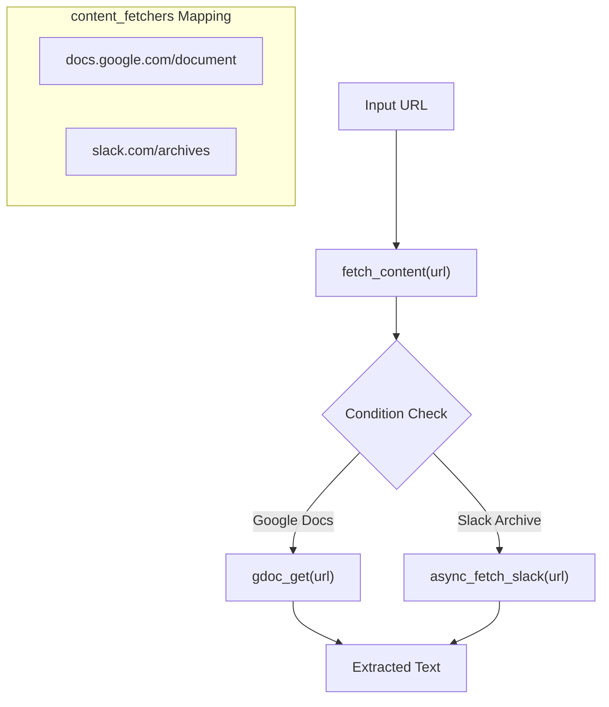
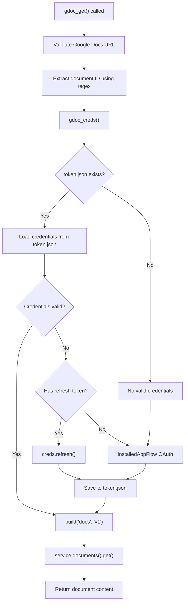
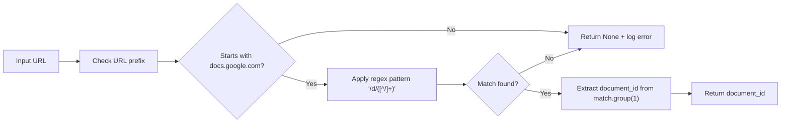
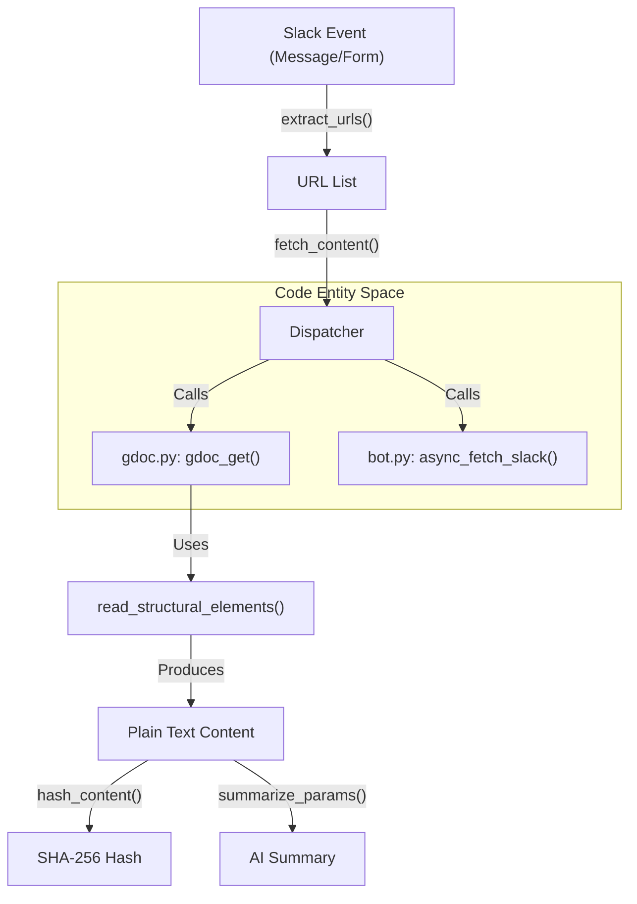

<!-- source: DeepWiki mcp.deepwiki.com · repo openai/openai-security-bots · page 4.5 Google Docs Integration · fetched 2026-10-26 -->

# Google Docs Integration

Relevant source files

The following files were used as context for generating this wiki page:

- [bots/sdlc-slackbot/sdlc_slackbot/bot.py](bots/sdlc-slackbot/sdlc_slackbot/bot.py)
- [bots/sdlc-slackbot/sdlc_slackbot/gdoc.py](bots/sdlc-slackbot/sdlc_slackbot/gdoc.py)

The Google Docs Integration provides functionality for the SDLC Slackbot to fetch and parse content from Google Docs URLs submitted by users during project assessments. This enables the AI to analyze referenced documentation and incorporate it into security review decisions. This module is part of the context assembly pipeline used by the SDLC bot to gather information before performing AI-driven risk assessments.

## Purpose and Scope

The Google Docs integration enables the SDLC bot to:
- Extract document IDs from Google Docs URLs using the `gdoc_get` function [bots/sdlc-slackbot/sdlc_slackbot/gdoc.py:85-122]().
- Authenticate with Google Docs API using OAuth 2.0 `credentials.json` setup [bots/sdlc-slackbot/sdlc_slackbot/gdoc.py:59-82]().
- Fetch complete document content including text, tables, and table of contents [bots/sdlc-slackbot/sdlc_slackbot/gdoc.py:31-56]().
- Parse structured document elements into plain text for AI processing [bots/sdlc-slackbot/sdlc_slackbot/gdoc.py:19-28]().
- Support content hashing for change detection via `hash_content` [bots/sdlc-slackbot/sdlc_slackbot/bot.py:44-45]().

## URL Dispatcher and Fallbacks

The bot uses a centralized `fetch_content` dispatcher to route URLs to the appropriate fetcher based on the domain.

- **`fetch_content(url)`**: Iterates through `content_fetchers` to find a matching condition and executes the associated fetcher [bots/sdlc-slackbot/sdlc_slackbot/bot.py:79-86]().
- **`async_fetch_slack(url)`**: A fallback fetcher for Slack archive links. It parses the channel ID and timestamp from the URL and retrieves the message thread using `conversations_replies` [bots/sdlc-slackbot/sdlc_slackbot/bot.py:59-67]().
- **`content_fetchers`**: A list of lambda conditions and function references mapping URLs to `gdoc_get` or `async_fetch_slack` [bots/sdlc-slackbot/sdlc_slackbot/bot.py:70-76]().

Sources: [bots/sdlc-slackbot/sdlc_slackbot/bot.py:59-86]()

## Authentication Flow

The `gdoc_creds` function manages the OAuth 2.0 lifecycle, including initial authorization and token refreshing.

Sources: [bots/sdlc-slackbot/sdlc_slackbot/gdoc.py:59-82]()

## Document Content Parsing

The bot converts the complex JSON structure returned by the Google Docs API into a flat string.

| Function | Role | Implementation Detail |
|----------|------|-----------------------|
| `read_structural_elements` | Recursive Parser | Iterates through `paragraph`, `table`, and `tableOfContents` keys [bots/sdlc-slackbot/sdlc_slackbot/gdoc.py:31-56](). |
| `read_paragraph_element` | Text Extractor | Extracts the `content` field from a `textRun` [bots/sdlc-slackbot/sdlc_slackbot/gdoc.py:19-28](). |
| `gdoc_get` | Execution Engine | Orchestrates the `build("docs", "v1")` service and calls parsers [bots/sdlc-slackbot/sdlc_slackbot/gdoc.py:85-122](). |

### Change Detection
The bot uses `hash_content` to generate a SHA-256 hex digest of the fetched content [bots/sdlc-slackbot/sdlc_slackbot/bot.py:44-45](). This hash is used to detect updates in the `update_resources` background monitoring thread to trigger re-assessments if a linked document changes.

Sources: [bots/sdlc-slackbot/sdlc_slackbot/gdoc.py:19-56](), [bots/sdlc-slackbot/sdlc_slackbot/bot.py:44-45]()

## URL Processing and Validation

The integration validates and processes Google Docs URLs using regex pattern matching:

The regex pattern `/d/([^/]+)` captures the document ID from URLs like:
- `https://docs.google.com/document/d/DOCUMENT_ID/edit` [bots/sdlc-slackbot/sdlc_slackbot/gdoc.py:97-101]().

Sources: [bots/sdlc-slackbot/sdlc_slackbot/gdoc.py:90-105]()

## Configuration and Credentials

The integration requires two credential files stored in the bot directory:

| File | Purpose | Location |
|------|---------|----------|
| `credentials.json` | OAuth2 client configuration from Google Cloud Console | `./bots/sdlc-slackbot/sdlc_slackbot/credentials.json` |
| `token.json` | Stored user access and refresh tokens (auto-generated) | `./bots/sdlc-slackbot/sdlc_slackbot/token.json` |

**API Scopes**: The integration uses read-only access with scope `https://www.googleapis.com/auth/documents.readonly` [bots/sdlc-slackbot/sdlc_slackbot/gdoc.py:14]().

Sources: [bots/sdlc-slackbot/sdlc_slackbot/gdoc.py:13-14](), [bots/sdlc-slackbot/sdlc_slackbot/gdoc.py:64-80]()

## Integration with SDLC Workflow

The following diagram illustrates how `fetch_content` bridges the gap between raw Slack input and the structured context used for AI analysis.

The Google Docs content is incorporated into the AI assessment workflow, allowing the SDLC bot to analyze referenced documentation alongside user-provided information for more comprehensive security reviews.

Sources: [bots/sdlc-slackbot/sdlc_slackbot/bot.py:44-56](), [bots/sdlc-slackbot/sdlc_slackbot/bot.py:79-86](), [bots/sdlc-slackbot/sdlc_slackbot/gdoc.py:85-122]()

---

