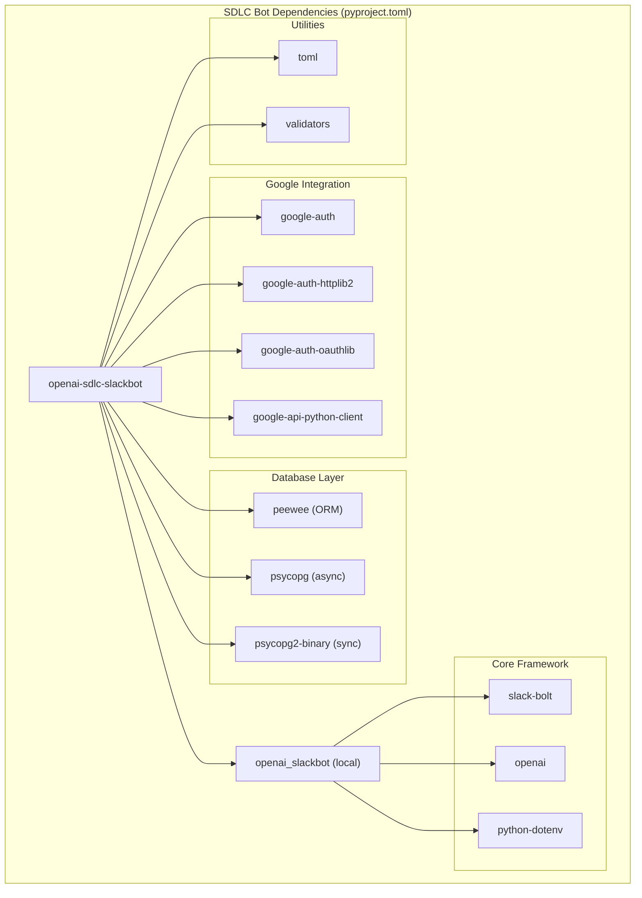
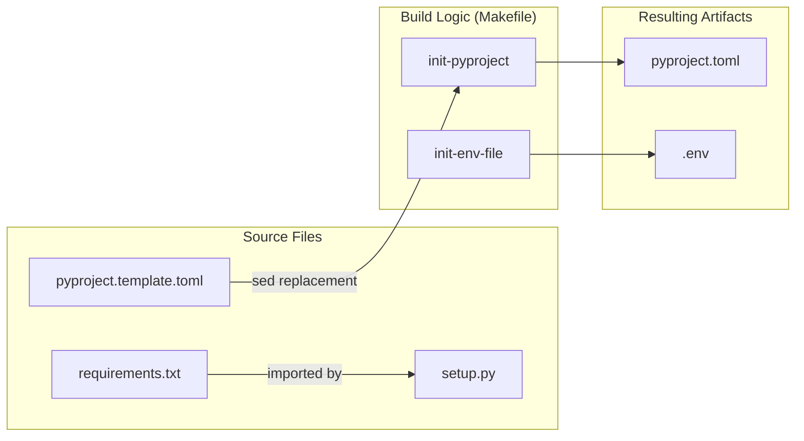
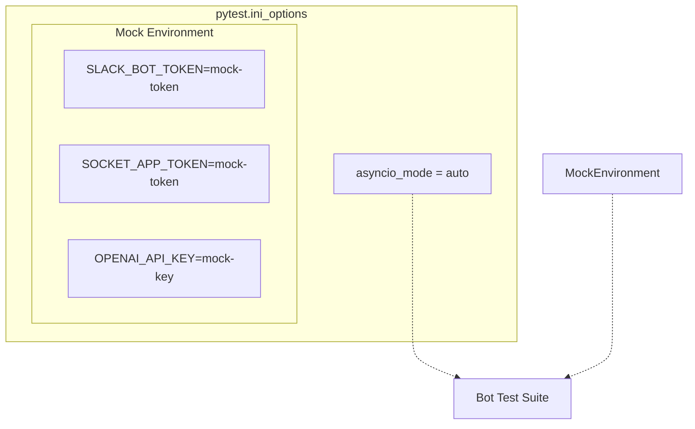

<!-- source: DeepWiki mcp.deepwiki.com · repo openai/openai-security-bots · page 4.6 Dependencies and Build System · fetched 2026-10-26 -->

# Dependencies and Build System

Relevant source files

The following files were used as context for generating this wiki page:

- [bots/sdlc-slackbot/Makefile](bots/sdlc-slackbot/Makefile)
- [bots/sdlc-slackbot/pyproject.template.toml](bots/sdlc-slackbot/pyproject.template.toml)
- [bots/sdlc-slackbot/requirements.txt](bots/sdlc-slackbot/requirements.txt)
- [bots/sdlc-slackbot/setup.py](bots/sdlc-slackbot/setup.py)

This document covers the dependency management and build system configuration for the SDLC Slackbot. It details the Python packages required, build system setup, and the automated build processes defined in the project's Makefile.

## Dependency Architecture

The SDLC Slackbot follows a layered dependency architecture with the shared `openai_slackbot` library as its foundation. The bot integrates with multiple external services, including Slack, OpenAI, Google Docs, and a PostgreSQL database.

Sources: [bots/sdlc-slackbot/pyproject.template.toml:5-16](), [bots/sdlc-slackbot/requirements.txt:1-11]()

## Core Dependencies

The SDLC Slackbot defines its dependencies in both `requirements.txt` and `pyproject.template.toml`.

| Category | Package | Purpose |
|----------|---------|---------|
| **Shared Infrastructure** | `openai_slackbot` | Common Slack and OpenAI utilities (Local file dependency) |
| **Slack Integration** | `slack-bolt` | Slack app framework and event handling |
| **AI Integration** | `openai` | OpenAI API client for GPT interactions |
| **Configuration** | `python-dotenv` | Environment variable management |
| **Configuration** | `toml` | TOML configuration file parsing |
| **Google Services** | `google-auth`, `google-auth-httplib2`, `google-auth-oauthlib`, `google-api-python-client` | Authentication and Google Docs API client for fetching project documents |
| **Database** | `peewee`, `psycopg`, `psycopg2-binary` | ORM and PostgreSQL adapters for storing assessments and resources |
| **Validation** | `validators` | Input validation for URLs and fields |

Sources: [bots/sdlc-slackbot/requirements.txt:1-11](), [bots/sdlc-slackbot/pyproject.template.toml:5-16]()

### Shared Library Dependency

The bot relies on the local `openai_slackbot` shared library. In the template configuration, this is specified as a relative file path that is dynamically resolved during the build process:

`openai_slackbot @ file://$REPO_ROOT/shared/openai-slackbot`

Sources: [bots/sdlc-slackbot/pyproject.template.toml:7]()

## Build System Configuration

The SDLC Slackbot uses `setuptools` as its build backend, supporting both modern `pyproject.toml` and legacy `setup.py` entry points.

Sources: [bots/sdlc-slackbot/Makefile:1-11](), [bots/sdlc-slackbot/setup.py:3-11]()

### Makefile Targets

The `Makefile` automates the preparation of the environment:

- **`init-env-file`**: Copies the `.env.template` to `.env` within the bot directory to prepare local environment variables. [bots/sdlc-slackbot/Makefile:5-6]()
- **`init-pyproject`**: A critical step that reads `pyproject.template.toml` and uses `sed` to replace the `$REPO_ROOT` placeholder with the absolute path of the repository on the local machine. This allows the local `openai_slackbot` dependency to be correctly resolved by `pip`. [bots/sdlc-slackbot/Makefile:8-10]()

### Modern Build System (pyproject.toml)

The primary build configuration is defined in `pyproject.template.toml`:
- **Name**: `openai-sdlc-slackbot` [bots/sdlc-slackbot/pyproject.template.toml:2]()
- **Requires-Python**: `>=3.8` [bots/sdlc-slackbot/pyproject.template.toml:3]()
- **Build Backend**: `setuptools.build_meta` [bots/sdlc-slackbot/pyproject.template.toml:20]()

### Legacy Build System (setup.py)

For compatibility, `setup.py` provides a standard installation path. It dynamically reads the `requirements.txt` file to populate the `install_requires` list. [bots/sdlc-slackbot/setup.py:3-10]()

## Testing Configuration

The `pyproject.template.toml` includes configuration for `pytest`, ensuring a consistent environment for automated tests.

The configuration enforces `asyncio_mode = "auto"` and injects mock environment variables (`SLACK_BOT_TOKEN`, `SOCKET_APP_TOKEN`, `OPENAI_API_KEY`) to prevent tests from attempting to reach real service endpoints unless explicitly overridden.

Sources: [bots/sdlc-slackbot/pyproject.template.toml:22-28]()

## Installation Sequence

To correctly build the SDLC bot, the following sequence is typically performed:

1. The root `Makefile` builds the shared `openai-slackbot` library.
2. The SDLC bot's `Makefile` runs `init-pyproject` to generate a valid `pyproject.toml` with the correct local paths. [bots/sdlc-slackbot/Makefile:8-10]()
3. The bot is installed (typically in a virtual environment) using `pip install .`, which triggers `setuptools` to process the generated `pyproject.toml`. [bots/sdlc-slackbot/pyproject.template.toml:18-20]()

Sources: [bots/sdlc-slackbot/Makefile:1-11](), [bots/sdlc-slackbot/pyproject.template.toml:1-20]()

---

