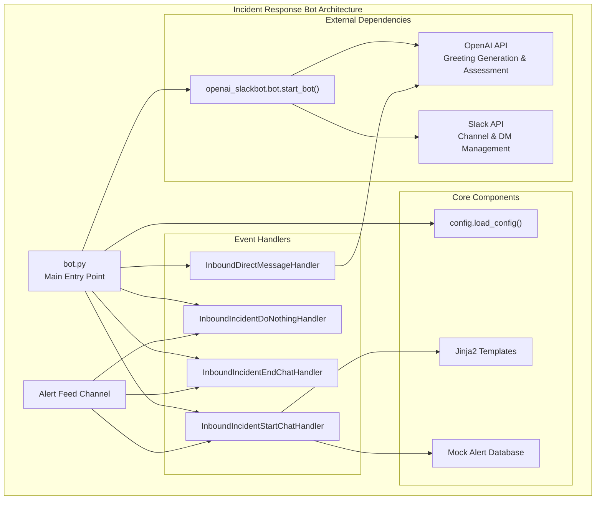
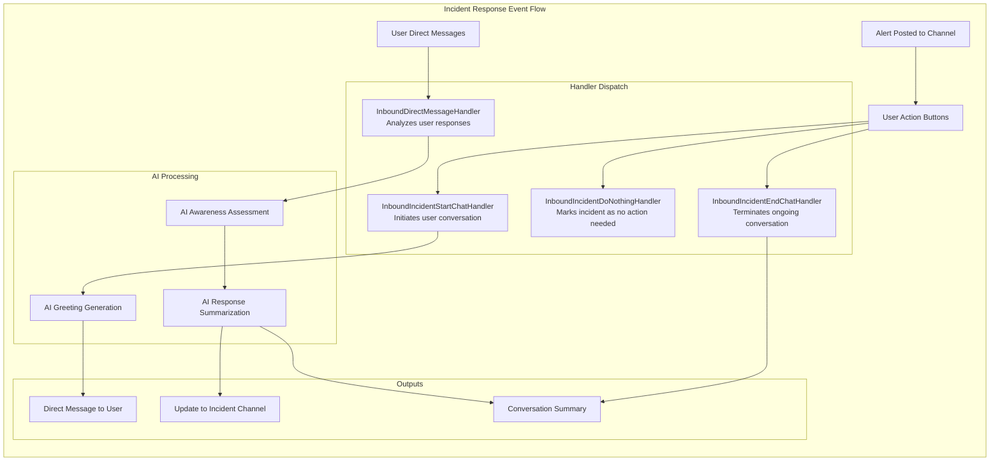
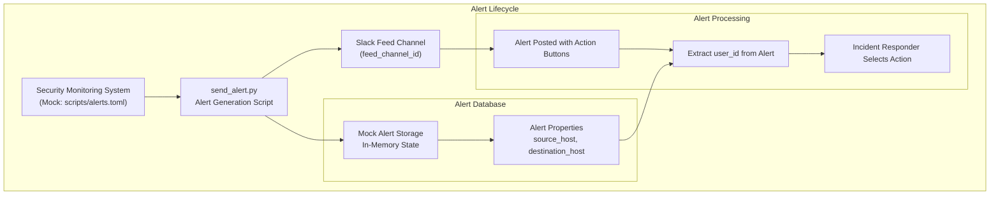

<!-- source: DeepWiki mcp.deepwiki.com · repo openai/openai-security-bots · page 5 Incident Response Slackbot · fetched 2026-10-26 -->

# Incident Response Slackbot

<details>
<summary>Relevant source files</summary>

The following files were used as context for generating this wiki page:

- [bots/incident-response-slackbot/README.md](bots/incident-response-slackbot/README.md)
- [bots/incident-response-slackbot/incident_response_slackbot/bot.py](bots/incident-response-slackbot/incident_response_slackbot/bot.py)

</details>


## Purpose and Scope

The Incident Response Slackbot is an AI-powered Slack bot designed to automate incident triage and facilitate communication with users involved in security alerts. The bot monitors incident alerts posted to designated channels, initiates direct conversations with affected users to assess their awareness of potential security incidents, and provides automated summaries of interactions back to incident response teams.

This document covers the bot's architecture, event handling workflow, AI integration for user interaction assessment, and configuration.

For deep dives into specific subsystems, see the following child pages:
- [Event Handlers and Workflow](#5.1) — Detailed logic for `InboundDirectMessageHandler` and incident state transitions.
- [AI-Powered Incident Analysis](#5.2) — Implementation of `create_greeting`, `get_user_awareness`, and summarization.
- [Configuration and Templates](#5.3) — Details on `config.toml` and Jinja2 templates.
- [Database and Data Management](#5.4) — The `Database` class and user-to-thread mapping.
- [Alert Feed and Scripting](#5.5) — `alert_feed.py` and `send_alert.py` utilities.
- [Setup and Deployment](#5.6) — Installation, environment variables, and testing.

## System Overview

The Incident Response Slackbot operates as part of a larger security automation ecosystem, leveraging shared infrastructure while providing specialized incident response capabilities.



Sources: [bots/incident-response-slackbot/incident_response_slackbot/bot.py:1-35](), [bots/incident-response-slackbot/README.md:1-118]()

## Core Architecture and Components

The Incident Response Slackbot follows a modular architecture with distinct handler classes for different types of user interactions and incident states.

### Main Entry Point

The bot's main entry point is defined in [bots/incident-response-slackbot/incident_response_slackbot/bot.py:13-34](), which configures and starts the bot with specific handlers:

| Component | Purpose | Code Entity |
|-----------|---------|-------------|
| Message Handler | Processes direct messages from users | `InboundDirectMessageHandler` |
| Action Handlers | Handle incident-specific button interactions | `InboundIncidentStartChatHandler`, `InboundIncidentDoNothingHandler`, `InboundIncidentEndChatHandler` |
| Template Path | Jinja2 template directory for message formatting | `templates/` directory |
| Configuration | Bot settings and OpenAI organization ID | `config.toml` |

### Handler Architecture



Sources: [bots/incident-response-slackbot/incident_response_slackbot/bot.py:17-22](), [bots/incident-response-slackbot/README.md:84-89]()

## Event Handling Workflow

The bot implements a multi-stage workflow for incident response management. For details, see [Event Handlers and Workflow](#5.1).

### Stage 1: Alert Processing
1. Security alerts are posted to the configured `feed_channel_id`.
2. Each alert includes action buttons for incident responders.
3. Alerts contain user IDs of potentially affected individuals.

### Stage 2: User Interaction Initiation
- **Start Chat**: `InboundIncidentStartChatHandler` initiates direct conversation with the user.
- **Do Nothing**: `InboundIncidentDoNothingHandler` marks the incident as requiring no user contact.
- **End Chat**: `InboundIncidentEndChatHandler` terminates any ongoing conversation.

### Stage 3: Conversation Management
1. Bot sends AI-generated greeting message to the user via direct message.
2. User responses are processed by `InboundDirectMessageHandler`.
3. OpenAI API analyzes whether the user has adequately addressed security concerns.
4. Conversation continues until user demonstrates adequate awareness or is manually terminated.

### Stage 4: Incident Resolution
- Bot posts conversation summary to the original incident thread.
- Incident status is updated in the monitoring channel.
- User conversation state is cleared from the system.

Sources: [bots/incident-response-slackbot/README.md:82-89](), [bots/incident-response-slackbot/incident_response_slackbot/bot.py:18-22]()

## AI Integration and Assessment

The bot leverages OpenAI's API for three primary functions. For details, see [AI-Powered Incident Analysis](#5.2).

| AI Function | Purpose | Implementation |
|-------------|---------|----------------|
| Greeting Generation | Creates contextual, personalized initial messages to users | `create_greeting` |
| Awareness Assessment | Evaluates whether user responses demonstrate adequate security awareness | `get_user_awareness` |
| Conversation Summarization | Generates summaries of user interactions for incident responders | `get_thread_summary` |

The AI assessment workflow determines whether users have sufficiently acknowledged and understood the security incident, allowing the bot to automatically conclude conversations when appropriate.

Sources: [bots/incident-response-slackbot/README.md:84-89]()

## Configuration and Setup

The bot requires specific environment variables and configuration files to function. For details, see [Configuration and Templates](#5.3) and [Setup and Deployment](#5.6).

### Required Slack Permissions

The Slack application requires the following OAuth scopes:
- `users:read`
- `channels:history`
- `chat:write`
- `groups:history`

### Setup Commands

From the bot directory:
```bash
make init-env-file        # Initialize environment file
make init-pyproject       # Set up Python project
```

From the repository root:
```bash
make clean-venv
source venv/bin/activate
make build-bot BOT=incident-response-slackbot
make run-bot BOT=incident-response-slackbot
```

Sources: [bots/incident-response-slackbot/README.md:10-79]()

## Alert Management System

The bot includes a mock alert system for development and testing purposes. For details, see [Alert Feed and Scripting](#5.5).

### Alert Structure
Alerts are defined in `scripts/alerts.toml` [bots/incident-response-slackbot/README.md:101-117](). Responders can trigger these using `python ./scripts/send_alert.py` [bots/incident-response-slackbot/README.md:64-67]().



Sources: [bots/incident-response-slackbot/README.md:97-118](), [bots/incident-response-slackbot/README.md:64-67]()

---

