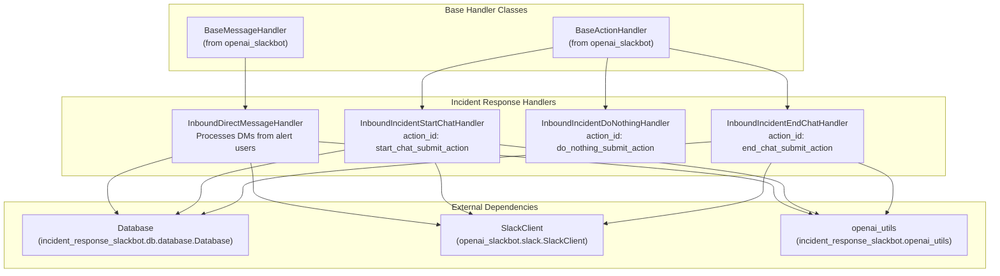
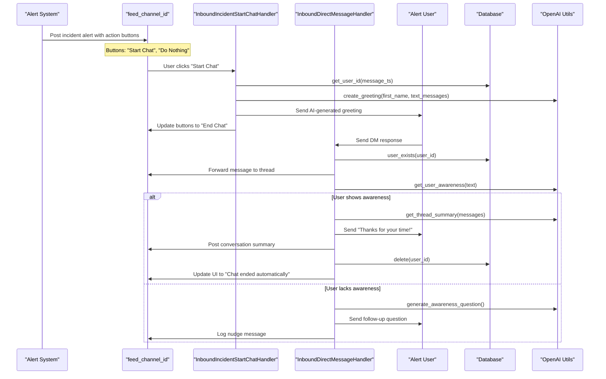
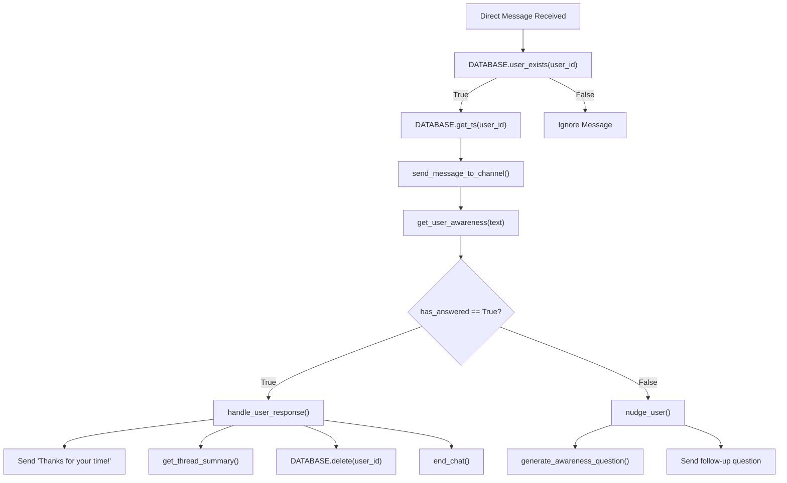
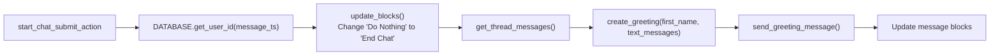

<!-- source: DeepWiki mcp.deepwiki.com · repo openai/openai-security-bots · page 5.1 Event Handlers and Workflow · fetched 2026-10-26 -->

# Event Handlers and Workflow

Relevant source files

The following files were used as context for generating this wiki page:

- [bots/incident-response-slackbot/incident_response_slackbot/bot.py](bots/incident-response-slackbot/incident_response_slackbot/bot.py)
- [bots/incident-response-slackbot/incident_response_slackbot/handlers.py](bots/incident-response-slackbot/incident_response_slackbot/handlers.py)

This document covers the event handling system and interaction workflows for the Incident Response Slackbot. It details how the bot processes Slack events, manages user conversations, and orchestrates the incident response workflow through specialized handler classes.

For information about the AI-powered analysis features, see [AI-Powered Incident Analysis](#5.2). For configuration and templates, see [Configuration and Templates](#5.3).

## Handler Architecture Overview

The Incident Response Slackbot implements a handler-based architecture that extends the shared `openai_slackbot` framework. Each handler class specializes in processing specific types of Slack events and user interactions. The bot initializes these handlers in its entry point and passes them to the `start_bot` function.

Sources: [bots/incident-response-slackbot/incident_response_slackbot/handlers.py:16-17](), [bots/incident-response-slackbot/incident_response_slackbot/handlers.py:22-25](), [bots/incident-response-slackbot/incident_response_slackbot/handlers.py:141-148](), [bots/incident-response-slackbot/incident_response_slackbot/bot.py:5-22]()

## Complete Incident Response Workflow

The incident response workflow orchestrates multiple handler interactions to manage the complete lifecycle of an incident alert.

Sources: [bots/incident-response-slackbot/incident_response_slackbot/handlers.py:150-193](), [bots/incident-response-slackbot/incident_response_slackbot/handlers.py:34-51](), [bots/incident-response-slackbot/incident_response_slackbot/handlers.py:61-93]()

## Direct Message Handler

The `InboundDirectMessageHandler` class processes all direct messages from users who are part of an active incident response conversation.

### Message Processing Logic

| Condition | Action | Methods Called |
|-----------|--------|----------------|
| User not in database | Ignore message | `DATABASE.user_exists()` [bots/incident-response-slackbot/incident_response_slackbot/handlers.py:38-40]() |
| User shows awareness | End conversation | `handle_user_response()` [bots/incident-response-slackbot/incident_response_slackbot/handlers.py:48-49]() |
| User lacks awareness | Send follow-up question | `nudge_user()` [bots/incident-response-slackbot/incident_response_slackbot/handlers.py:50-51]() |

The handler implements a sophisticated awareness detection system:

Sources: [bots/incident-response-slackbot/incident_response_slackbot/handlers.py:31-51](), [bots/incident-response-slackbot/incident_response_slackbot/handlers.py:61-93](), [bots/incident-response-slackbot/incident_response_slackbot/handlers.py:123-138]()

## Action Button Handlers

The bot uses three action handlers to manage the incident alert lifecycle through Slack's interactive components.

### Start Chat Handler (`InboundIncidentStartChatHandler`)

Processes the `start_chat_submit_action` when a security team member initiates contact with an alert user:

The `update_blocks()` method transforms the UI by changing button functionality:

- Original: `do_nothing_submit_action` → `end_chat_submit_action` [bots/incident-response-slackbot/incident_response_slackbot/handlers.py:201-202]()
- Button text: "Do Nothing" → "End Chat" [bots/incident-response-slackbot/incident_response_slackbot/handlers.py:203]()
- Button value: Set to `alert_user_id` [bots/incident-response-slackbot/incident_response_slackbot/handlers.py:204]()

Sources: [bots/incident-response-slackbot/incident_response_slackbot/handlers.py:141-193](), [bots/incident-response-slackbot/incident_response_slackbot/handlers.py:195-207]()

### Do Nothing Handler (`InboundIncidentDoNothingHandler`)

Handles the `do_nothing_submit_action` for closing alerts without further action. It removes all action buttons and appends a section indicating that no action was necessary.

Sources: [bots/incident-response-slackbot/incident_response_slackbot/handlers.py:235-279]()

### End Chat Handler (`InboundIncidentEndChatHandler`)

Processes the `end_chat_submit_action` for manually terminating active conversations. This handler performs a full cleanup, including sending a final message to the user, generating a thread summary, and deleting the user from the active session database.

Sources: [bots/incident-response-slackbot/incident_response_slackbot/handlers.py:282-357]()

## Database Integration Points

The handlers integrate with the `Database` class (aliased as `DATABASE` in `handlers.py`) for persistent state management:

| Handler | Database Operations |
|---------|-------------------|
| `InboundDirectMessageHandler` | `user_exists()`, `get_ts()`, `delete()` |
| `InboundIncidentStartChatHandler` | `get_user_id()` |
| `InboundIncidentEndChatHandler` | `get_user_id()`, `delete()` |

The database tracks active conversations by storing mappings between:
- Alert user IDs and message timestamps (`ts`)
- Message timestamps and alert user IDs

Sources: [bots/incident-response-slackbot/incident_response_slackbot/handlers.py:20](), [bots/incident-response-slackbot/incident_response_slackbot/handlers.py:38](), [bots/incident-response-slackbot/incident_response_slackbot/handlers.py:154]()

## AI Integration Touchpoints

The handlers leverage several AI-powered utilities from `openai_utils.py`:

| Function | Purpose | Used By |
|----------|---------|---------|
| `create_greeting()` | Generate personalized greeting messages | `InboundIncidentStartChatHandler` |
| `get_user_awareness()` | Assess user understanding of security situation | `InboundDirectMessageHandler` |
| `generate_awareness_question()` | Create follow-up questions for unaware users | `InboundDirectMessageHandler` |
| `get_thread_summary()` | Summarize conversation threads | Both end-chat handlers |
| `messages_to_string()` | Convert message objects to text for AI processing | `InboundIncidentStartChatHandler` |

These functions enable the bot to provide contextual, intelligent responses throughout the incident response workflow.

Sources: [bots/incident-response-slackbot/incident_response_slackbot/handlers.py:9-15](), [bots/incident-response-slackbot/incident_response_slackbot/handlers.py:45](), [bots/incident-response-slackbot/incident_response_slackbot/handlers.py:185]()

---

