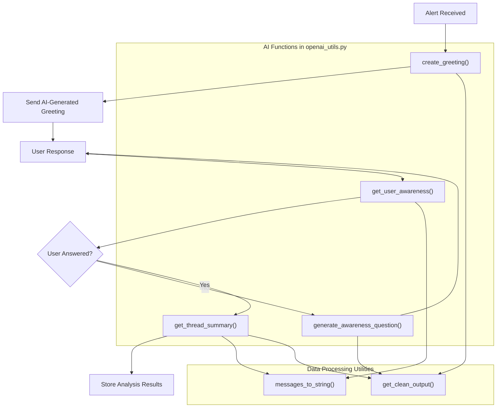
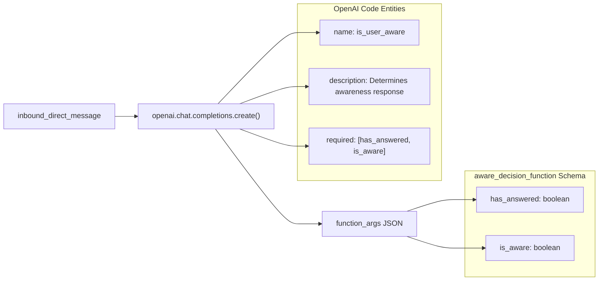
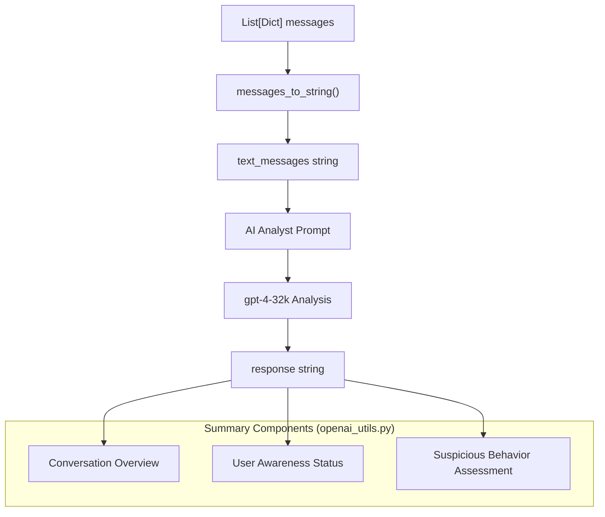
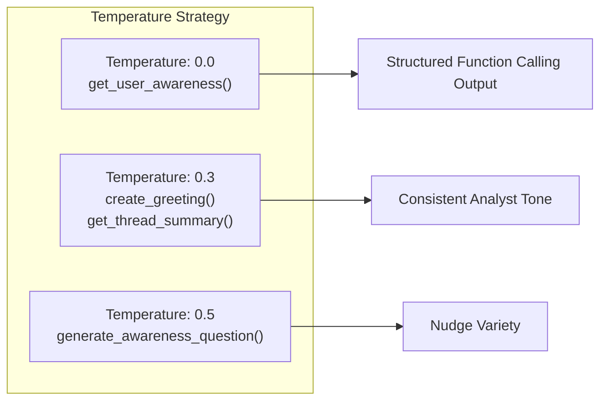

<!-- source: DeepWiki mcp.deepwiki.com · repo openai/openai-security-bots · page 5.2 AI-Powered Incident Analysis · fetched 2026-10-26 -->

# AI-Powered Incident Analysis

<details>
<summary>Relevant source files</summary>

The following files were used as context for generating this wiki page:

- [bots/incident-response-slackbot/incident_response_slackbot/openai_utils.py](bots/incident-response-slackbot/incident_response_slackbot/openai_utils.py)

</details>


## Purpose and Scope

This document covers the AI-powered analysis capabilities of the Incident Response Slackbot, specifically how it uses OpenAI's GPT-4-32k model to generate contextual greetings, assess user awareness of security alerts, and summarize incident response conversations. The AI analysis functionality is implemented in the `openai_utils.py` module and provides the core intelligence that drives automated incident triage and user interaction through the `cybersecurity analyst` persona.

For information about the overall incident response workflow and event handling, see [5.1 Event Handlers and Workflow](). For configuration and template management, see [5.3 Configuration and Templates]().

## AI Analysis Workflow

The incident response bot employs a structured AI analysis workflow that combines greeting generation, awareness assessment, and conversation summarization to provide comprehensive incident triage capabilities.

Title: Incident Analysis Logic Flow


**Sources:** [bots/incident-response-slackbot/incident_response_slackbot/openai_utils.py:1-156]()

## Core AI Functions

### Greeting Generation

The `create_greeting` function generates personalized, contextual greetings for users when security alerts are triggered. It uses a carefully crafted prompt to create non-accusatory messages that gently inquire about user awareness.

| Function | Purpose | Model | Temperature |
|----------|---------|-------|-------------|
| `create_greeting` | Generate contextual security alert greetings | gpt-4-32k | 0.3 |
| Parameters | `username`, `details` | | |
| Output | Brief, casual greeting ending with awareness question | | |

The function implements specific prompt engineering guidelines defined in the system prompt [bots/incident-response-slackbot/incident_response_slackbot/openai_utils.py:23-31]():
- Maintains a helpful, non-accusatory tone.
- Keeps messages brief (3-4 sentences maximum).
- Ends with a question about user awareness.
- Avoids signatures or formal closings.

**Sources:** [bots/incident-response-slackbot/incident_response_slackbot/openai_utils.py:19-45]()

### Awareness Assessment

The `get_user_awareness` function uses OpenAI's function calling API to provide structured analysis of user responses, determining whether users have answered awareness questions and their level of awareness.

Title: Awareness Function Mapping


The `aware_decision_function` JSON schema [bots/incident-response-slackbot/incident_response_slackbot/openai_utils.py:48-67]() ensures deterministic, structured responses:

| Property | Type | Description |
|----------|------|-------------|
| `has_answered` | boolean | Whether user answered the awareness question. |
| `is_aware` | boolean | Whether user was aware of alert details. |

**Sources:** [bots/incident-response-slackbot/incident_response_slackbot/openai_utils.py:48-99]()

### Conversation Summarization

The `get_thread_summary` function processes entire conversation threads to provide comprehensive summaries that include awareness assessment and behavioral analysis.

Title: Thread Summarization Pipeline


**Sources:** [bots/incident-response-slackbot/incident_response_slackbot/openai_utils.py:102-128]()

## OpenAI Integration Patterns

### Model Configuration

All AI functions use consistent OpenAI configuration patterns optimized for security analysis tasks:

| Configuration | Value | Purpose |
|---------------|-------|---------|
| Model | `gpt-4-32k` | Large context window for comprehensive analysis. |
| Temperature | 0.0-0.5 | Controlled randomness for different use cases. |
| Stream | `False` | Synchronous responses for structured workflows. |
| Function Calling | Available | Structured data extraction in `get_user_awareness`. |

### Temperature Settings by Function

The bot uses specific temperatures to balance determinism and natural language variety:

Title: Temperature Strategy for Code Entities


**Sources:** [bots/incident-response-slackbot/incident_response_slackbot/openai_utils.py:92-93](), [bots/incident-response-slackbot/incident_response_slackbot/openai_utils.py:41-42](), [bots/incident-response-slackbot/incident_response_slackbot/openai_utils.py:124-125](), [bots/incident-response-slackbot/incident_response_slackbot/openai_utils.py:151-152]()

### Error Handling and API Key Management

The system implements consistent error handling patterns for OpenAI API interactions by checking for `openai.api_key` before invocation [bots/incident-response-slackbot/incident_response_slackbot/openai_utils.py:20-21]().

This pattern is used across `create_greeting`, `get_thread_summary`, and `generate_awareness_question` functions to ensure proper API authentication before making requests.

**Sources:** [bots/incident-response-slackbot/incident_response_slackbot/openai_utils.py:20-21](), [bots/incident-response-slackbot/incident_response_slackbot/openai_utils.py:103-104](), [bots/incident-response-slackbot/incident_response_slackbot/openai_utils.py:132-133]()

## Utility Functions

### Message Processing

The `messages_to_string` function provides essential message processing capabilities for converting Slack threaded conversations into text suitable for AI analysis:

```python
def messages_to_string(messages):
    text_messages = " ".join([message["text"] for message in messages if "text" in message])
    return text_messages
```

This function filters messages to include only those with text content and concatenates them into a single string for processing by summarization functions [bots/incident-response-slackbot/incident_response_slackbot/openai_utils.py:10-12]().

### Response Extraction

The `get_clean_output` function standardizes OpenAI response processing:

```python
async def get_clean_output(completion: str) -> str:
    return completion.choices[0].message.content
```

This utility ensures consistent extraction of content from OpenAI completion responses across all AI functions [bots/incident-response-slackbot/incident_response_slackbot/openai_utils.py:15-16]().

**Sources:** [bots/incident-response-slackbot/incident_response_slackbot/openai_utils.py:10-12](), [bots/incident-response-slackbot/incident_response_slackbot/openai_utils.py:15-16]()

## Follow-up Question Generation

The `generate_awareness_question` function provides dynamic follow-up capabilities (nudges) when users don't initially respond to awareness inquiries. It generates varied questions to maintain engagement while preserving the gentle, casual tone established in initial greetings.

The function uses a moderate temperature setting (0.5) to provide question variation while maintaining consistency in tone and approach [bots/incident-response-slackbot/incident_response_slackbot/openai_utils.py:151-152](). This ensures that repeated follow-ups don't appear robotic or aggressive to users who may be hesitant to respond.

**Sources:** [bots/incident-response-slackbot/incident_response_slackbot/openai_utils.py:131-155]()

---

