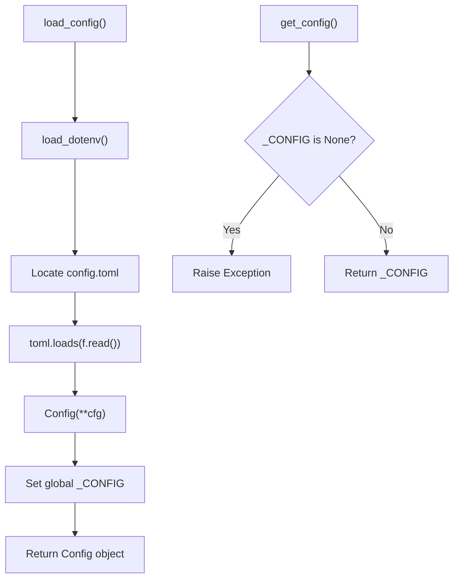
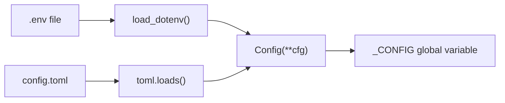
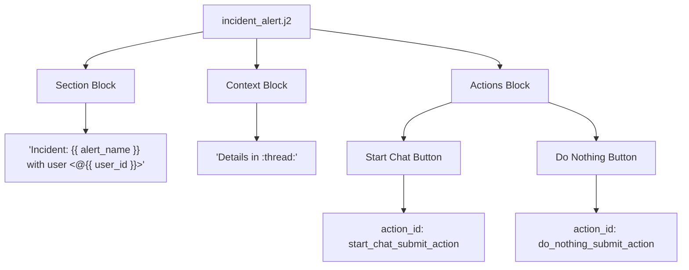
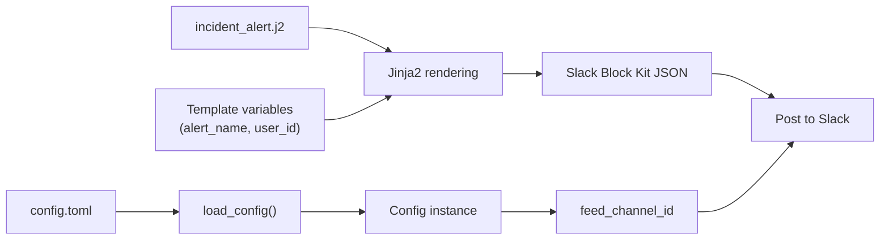

<!-- source: DeepWiki mcp.deepwiki.com · repo openai/openai-security-bots · page 5.3 Configuration and Templates · fetched 2026-10-26 -->

# Configuration and Templates

<details>
<summary>Relevant source files</summary>

The following files were used as context for generating this wiki page:

- [bots/incident-response-slackbot/incident_response_slackbot/config.py](bots/incident-response-slackbot/incident_response_slackbot/config.py)
- [bots/incident-response-slackbot/incident_response_slackbot/config.toml](bots/incident-response-slackbot/incident_response_slackbot/config.toml)
- [bots/incident-response-slackbot/incident_response_slackbot/templates/messages/incident_alert.j2](bots/incident-response-slackbot/incident_response_slackbot/templates/messages/incident_alert.j2)

</details>


This document covers the configuration management and template systems used by the Incident Response Slackbot. It details how the bot loads configuration settings from TOML files, manages environment variables, and uses Jinja2 templates to generate dynamic Slack messages.

For information about event handling and workflow logic, see [Event Handlers and Workflow](#5.1). For database configuration and data models, see [Database and Data Management](#5.4).

## Configuration System

The Incident Response Slackbot uses a structured configuration system built on Pydantic models and TOML files. The configuration is managed through the `Config` class and associated loading functions.

### Config Class Structure

The `Config` class defines the required configuration parameters:

| Parameter | Type | Purpose |
|-----------|------|---------|
| `openai_organization_id` | `str` | OpenAI organization ID for API authentication |
| `feed_channel_id` | `str` | Slack channel ID where triage alerts are posted |

The configuration is validated using Pydantic's `BaseModel`, ensuring type safety and automatic validation at runtime.

Sources: [bots/incident-response-slackbot/incident_response_slackbot/config.py:11-17]()

### Configuration Loading Flow

The bot initializes its configuration by calling `load_config`, which merges environment variables and TOML settings into a singleton object.



Sources: [bots/incident-response-slackbot/incident_response_slackbot/config.py:19-37]()

### Environment Variable Integration

The configuration system integrates with environment variables through the `load_dotenv()` function, allowing sensitive configuration values to be overridden at runtime without modifying the TOML file.



Sources: [bots/incident-response-slackbot/incident_response_slackbot/config.py:20-26]()

## Template System

The bot uses Jinja2 templates to generate dynamic Slack messages with consistent formatting. Templates are stored in the `templates/messages/` directory and follow Slack's Block Kit format.

### Incident Alert Template Structure

The `incident_alert.j2` template creates interactive Slack messages for incident notifications. It defines three distinct blocks: a header section, a context block for thread navigation, and an action block for human intervention.



Sources: [bots/incident-response-slackbot/incident_response_slackbot/templates/messages/incident_alert.j2:1-46]()

### Template Variables

The incident alert template accepts the following variables:

| Variable | Usage | Example |
|----------|-------|---------|
| `alert_name` | Incident identifier used in the section header | "Security Alert" |
| `user_id` | Slack user ID used for mentions and button values | "U1234567890" |

The `user_id` is specifically passed as the `value` in the `start_chat_submit_action` button to ensure the subsequent handler knows which user to contact.

Sources: [bots/incident-response-slackbot/incident_response_slackbot/templates/messages/incident_alert.j2:6-31]()

### Block Kit Integration

Templates generate Slack Block Kit JSON structures with interactive elements:

- **Section blocks**: Displays the incident name and user mention.
- **Context blocks**: Provides a visual cue that further details are in the thread.
- **Action blocks**: Contains a "Start Chat" button (primary style) and a "Do Nothing" button (danger style).

Sources: [bots/incident-response-slackbot/incident_response_slackbot/templates/messages/incident_alert.j2:1-46]()

## Configuration-Template Integration

The following diagram illustrates how the `Config` entity and the template files are utilized by the system to post messages.



Sources: [bots/incident-response-slackbot/incident_response_slackbot/config.py:11-17](), [bots/incident-response-slackbot/incident_response_slackbot/templates/messages/incident_alert.j2:1-46]()

## File Structure and Locations

The configuration and template files are organized as follows:

```
incident_response_slackbot/
├── config.py              # Configuration loading logic (Config class)
├── config.toml            # Configuration values (openai_organization_id, feed_channel_id)
└── templates/
    └── messages/
        └── incident_alert.j2  # Incident alert Jinja2 template
```

The `config.py` module automatically locates `config.toml` by resolving the path relative to its own location on disk, ensuring consistent configuration loading.

Sources: [bots/incident-response-slackbot/incident_response_slackbot/config.py:23](), [bots/incident-response-slackbot/incident_response_slackbot/config.toml:1-8](), [bots/incident-response-slackbot/incident_response_slackbot/templates/messages/incident_alert.j2:1-46]()

---

