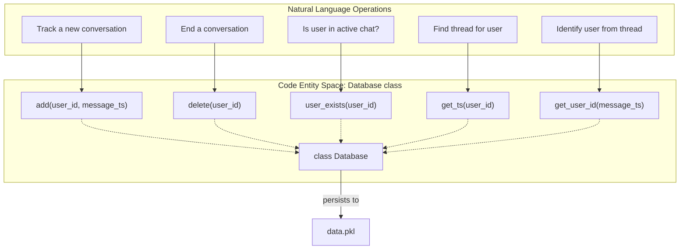
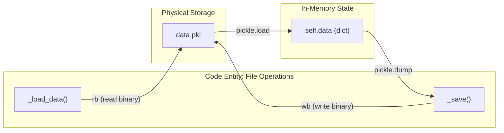
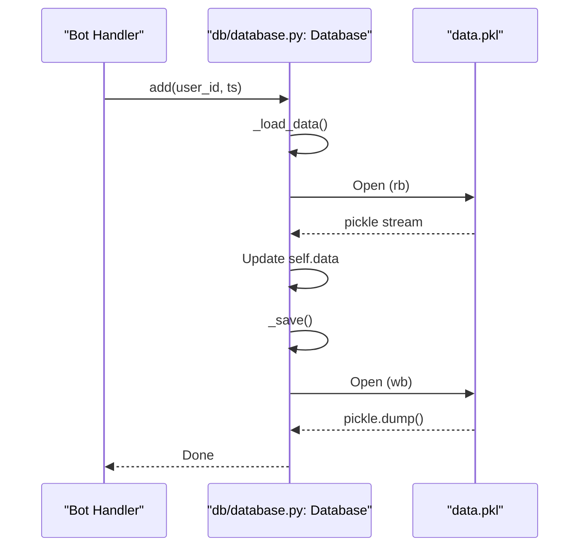

<!-- source: DeepWiki mcp.deepwiki.com · repo openai/openai-security-bots · page 5.4 Database and Data Management · fetched 2026-10-26 -->

# Database and Data Management

<details>
<summary>Relevant source files</summary>

The following files were used as context for generating this wiki page:

- [bots/incident-response-slackbot/incident_response_slackbot/db/database.py](bots/incident-response-slackbot/incident_response_slackbot/db/database.py)

</details>


This document covers the database and data management system used by the Incident Response Slackbot for tracking user interactions and conversation states. The system uses a lightweight file-based persistence layer to maintain conversation context across bot restarts.

## Overview

The Incident Response Slackbot uses a simple file-based database system to track active user conversations and maintain message timestamps for ongoing incident response interactions. This lightweight approach provides sufficient persistence for the bot's conversation tracking needs without requiring external database infrastructure.

### Natural Language to Code Entity Mapping

The following diagram bridges the high-level bot operations with the specific methods implemented in the `Database` class.



Sources: [bots/incident-response-slackbot/incident_response_slackbot/db/database.py:5-83]()

## Database Implementation

### Core Database Class

The `Database` class [bots/incident-response-slackbot/incident_response_slackbot/db/database.py:5]() provides the primary interface for data persistence operations. The implementation uses Python's `pickle` module for serialization and stores data in a local file system.

| Method | Purpose | Parameters | Return Value |
|--------|---------|------------|--------------|
| `add(user_id, message_ts)` | Store or update user conversation | `user_id`, `message_ts` | `None` |
| `delete(user_id)` | Remove user from tracking | `user_id` | `None` |
| `user_exists(user_id)` | Check if user is being tracked | `user_id` | `bool` |
| `get_ts(user_id)` | Retrieve message timestamp | `user_id` | `message_ts` (string) |
| `get_user_id(message_ts)` | Find user by timestamp | `message_ts` | `user_id` or `None` |

The database initializes with an empty dictionary [bots/incident-response-slackbot/incident_response_slackbot/db/database.py:18]() and loads existing data from the pickle file when operations are performed.

### Storage Mechanism

The database utilizes a local file named `data.pkl` located in the same directory as the module [bots/incident-response-slackbot/incident_response_slackbot/db/database.py:16-17]().



Sources: [bots/incident-response-slackbot/incident_response_slackbot/db/database.py:20-36]()

## Data Model and Schema

### Data Structure

The database uses a simple nested dictionary structure to store user conversation data. When `add` is called, it initializes or updates a dictionary for the specific `user_id` [bots/incident-response-slackbot/incident_response_slackbot/db/database.py:45]().

**Schema Representation:**
```python
{
    "user_id": {
        "message_ts": "timestamp_string"
    }
}
```

- **`user_id`**: The Slack User ID used as the primary key for lookup [bots/incident-response-slackbot/incident_response_slackbot/db/database.py:39]().
- **`message_ts`**: The Slack message timestamp representing the start of the DM thread with that user [bots/incident-response-slackbot/incident_response_slackbot/db/database.py:45]().

### File System Organization

The database file path is dynamically calculated using `os.path.realpath(__file__)` to ensure it is always placed relative to the `db/` directory [bots/incident-response-slackbot/incident_response_slackbot/db/database.py:16-17]().

Sources: [bots/incident-response-slackbot/incident_response_slackbot/db/database.py:16-17](), [bots/incident-response-slackbot/incident_response_slackbot/db/database.py:45]()

## Database Operations

### Data Persistence Pattern

The bot follows a "load-on-demand" pattern for every operation to ensure it is working with the latest state from the disk. This is critical as the bot may be restarted or modified between interactions.



1. **`add(user_id, message_ts)`**: Updates the internal dictionary and saves to disk [bots/incident-response-slackbot/incident_response_slackbot/db/database.py:39-46]().
2. **`delete(user_id)`**: Removes the user entry using `pop(user_id, None)` to avoid errors if the key is missing [bots/incident-response-slackbot/incident_response_slackbot/db/database.py:49-55]().
3. **`get_user_id(message_ts)`**: Iterates through the dictionary items to find a matching timestamp, returning the associated `user_id` [bots/incident-response-slackbot/incident_response_slackbot/db/database.py:74-82]().

### Error Handling and Data Safety

- **Missing File**: If `data.pkl` does not exist, `_load_data` returns an empty dictionary `{}` instead of raising an error [bots/incident-response-slackbot/incident_response_slackbot/db/database.py:25-29]().
- **Atomic-like Writes**: Every modification (`add`, `delete`) triggers an immediate `_save()` call to ensure the on-disk state matches the in-memory state [bots/incident-response-slackbot/incident_response_slackbot/db/database.py:46](), [bots/incident-response-slackbot/incident_response_slackbot/db/database.py:55]().

Sources: [bots/incident-response-slackbot/incident_response_slackbot/db/database.py:25-82]()

---

