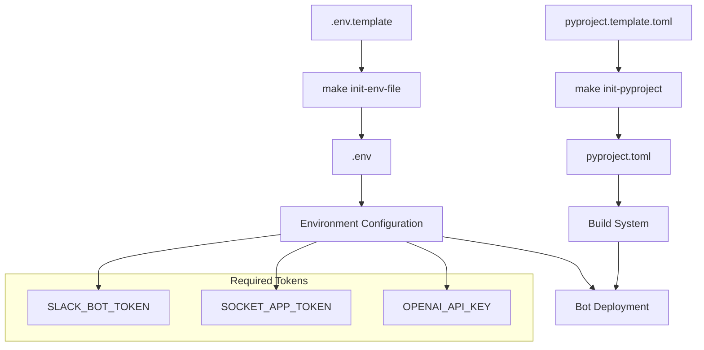
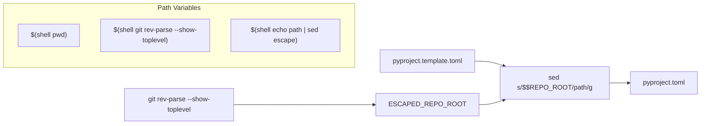
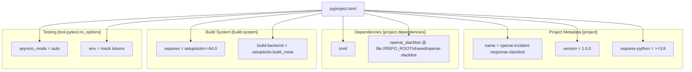
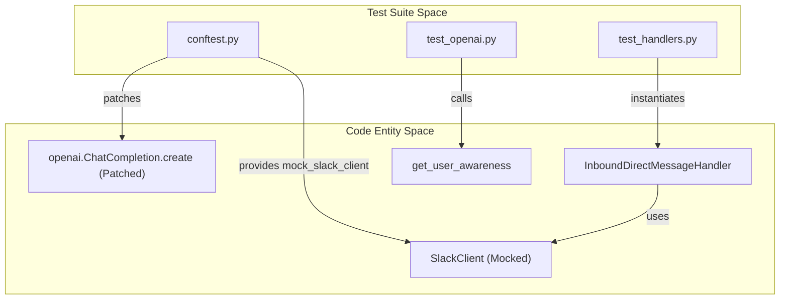

<!-- source: DeepWiki mcp.deepwiki.com · repo openai/openai-security-bots · page 5.6 Setup and Deployment · fetched 2026-10-26 -->

# Setup and Deployment

Relevant source files

The following files were used as context for generating this wiki page:

- [bots/incident-response-slackbot/Makefile](bots/incident-response-slackbot/Makefile)
- [bots/incident-response-slackbot/incident_response_slackbot/.env.template](bots/incident-response-slackbot/incident_response_slackbot/.env.template)
- [bots/incident-response-slackbot/pyproject.template.toml](bots/incident-response-slackbot/pyproject.template.toml)
- [bots/incident-response-slackbot/tests/conftest.py](bots/incident-response-slackbot/tests/conftest.py)
- [bots/incident-response-slackbot/tests/test_config.toml](bots/incident-response-slackbot/tests/test_config.toml)
- [bots/incident-response-slackbot/tests/test_handlers.py](bots/incident-response-slackbot/tests/test_handlers.py)
- [bots/incident-response-slackbot/tests/test_openai.py](bots/incident-response-slackbot/tests/test_openai.py)

This document covers the setup, configuration, and deployment process for the Incident Response Slackbot. It provides detailed instructions for preparing the development environment, configuring dependencies, and executing the test suite.

## Environment Setup Process

The Incident Response Slackbot uses a template-based configuration system that generates environment files and project configuration from templates. The setup process involves initializing environment variables and configuring Python project dependencies.

### Setup Workflow

Sources: [bots/incident-response-slackbot/Makefile:5-11](), [bots/incident-response-slackbot/incident_response_slackbot/.env.template:1-3]()

## Build System Configuration

The `Makefile` provides automated setup targets that handle the template-to-configuration conversion process. The build system uses repository root path substitution to ensure proper dependency resolution.

### Makefile Targets

| Target | Purpose | Template Source | Output |
|--------|---------|----------------|---------|
| `init-env-file` | Create environment configuration | `.env.template` | `.env` |
| `init-pyproject` | Generate Python project config | `pyproject.template.toml` | `pyproject.toml` |

The `init-pyproject` target performs dynamic path substitution using the repository root:

Sources: [bots/incident-response-slackbot/Makefile:1-11]()

## Environment Variables Configuration

The bot requires three essential environment variables for operation. These are defined in the `.env.template` file and must be populated during setup.

### Required Environment Variables

| Variable | Format | Source | Purpose |
|----------|--------|--------|---------|
| `SLACK_BOT_TOKEN` | `xoxb-*` | Slack App → Settings → Install App → Bot User OAuth Token | Bot authentication with Slack API |
| `SOCKET_APP_TOKEN` | `xapp-*` | Slack App → Settings → Basic Information → App-Level Tokens | Socket Mode connection |
| `OPENAI_API_KEY` | API key string | OpenAI platform | AI model access for incident analysis |

Sources: [bots/incident-response-slackbot/incident_response_slackbot/.env.template:1-3]()

## Python Project Dependencies

The bot uses a template-based `pyproject.toml` configuration that defines project metadata, dependencies, and testing configuration. The shared `openai_slackbot` library is included as a local file-based dependency.

### Project Configuration Structure

Sources: [bots/incident-response-slackbot/pyproject.template.toml:1-20]()

## Testing Infrastructure

The project includes a comprehensive test suite using `pytest`. The testing environment is isolated from production through the use of mock configurations and async fixtures.

### Test Configuration and Fixtures
The `tests/conftest.py` file defines global fixtures for the test suite:
- **`mock_config`**: Loads a specialized `test_config.toml` using `load_config` [tests/conftest.py:15-24]().
- **`mock_slack_client`**: An `AsyncMock` of the Slack client providing mocked methods for `post_message`, `update_message`, `get_original_blocks`, and `get_thread_messages` [tests/conftest.py:28-36]().
- **`mock_chat_completion`**: Automatically patches `openai.ChatCompletion.create` to return a standardized mock response with `gpt-4-32k` [tests/conftest.py:40-60]().

### Handler and OpenAI Utility Testing
- **Handler Logic**: `tests/test_handlers.py` verifies the behavior of event handlers. For example, `test_send_message_to_channel` asserts that `InboundDirectMessageHandler` correctly formats and posts messages to the `feed_channel_id` [tests/test_handlers.py:15-30]().
- **Action Handling**: `test_do_nothing_handle` validates that `InboundIncidentDoNothingHandler` correctly updates Slack blocks to indicate user action [tests/test_handlers.py:138-170]().
- **AI Integration**: `tests/test_openai.py` tests the integration with OpenAI. Specifically, `test_get_user_awareness` verifies that the bot correctly parses the `function_call` arguments from the AI response into a boolean dictionary [tests/test_openai.py:8-27]().

### Test Entity Mapping

Sources: [bots/incident-response-slackbot/tests/conftest.py:1-80](), [bots/incident-response-slackbot/tests/test_handlers.py:1-170](), [bots/incident-response-slackbot/tests/test_openai.py:1-27]()

## Deployment Checklist

To deploy the Incident Response Slackbot:

1. **Initialize Environment**: Run `make init-env-file` to create `.env` from template [bots/incident-response-slackbot/Makefile:5-6]().
2. **Configure Project**: Run `make init-pyproject` to generate `pyproject.toml` with the correct local paths [bots/incident-response-slackbot/Makefile:8-10]().
3. **Populate Tokens**: Add actual `SLACK_BOT_TOKEN`, `SOCKET_APP_TOKEN`, and `OPENAI_API_KEY` to the `.env` file [bots/incident-response-slackbot/incident_response_slackbot/.env.template:1-3]().
4. **Configure Bot Settings**: Ensure `tests/test_config.toml` parameters (or the production equivalent) like `feed_channel_id` and `openai_organization_id` are set correctly [bots/incident-response-slackbot/tests/test_config.toml:1-5]().
5. **Verify Configuration**: Run the test suite using `pytest` to ensure the environment and dependencies are correctly resolved [bots/incident-response-slackbot/pyproject.template.toml:14-20]().
6. **Start Bot**: Launch the bot application (typically via the shared library's entry point).

Sources: [bots/incident-response-slackbot/Makefile:1-11](), [bots/incident-response-slackbot/pyproject.template.toml:1-20](), [bots/incident-response-slackbot/incident_response_slackbot/.env.template:1-3](), [bots/incident-response-slackbot/tests/test_config.toml:1-5]()

---

