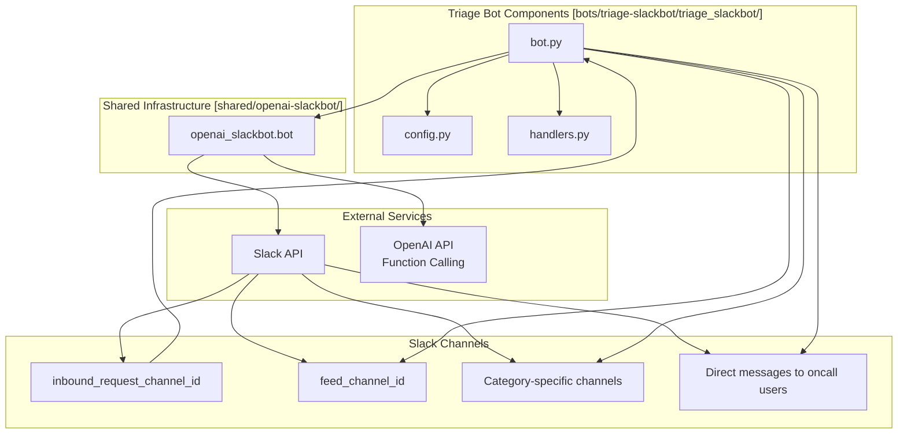
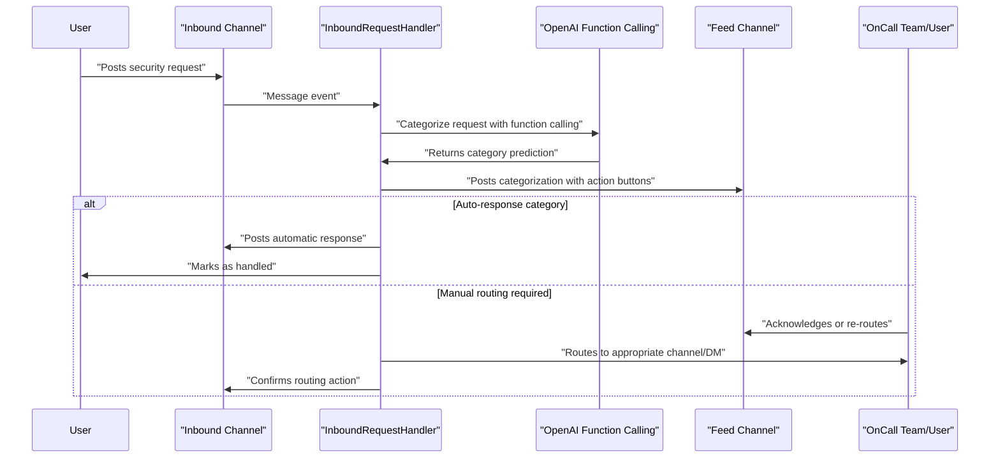
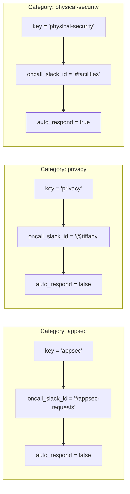
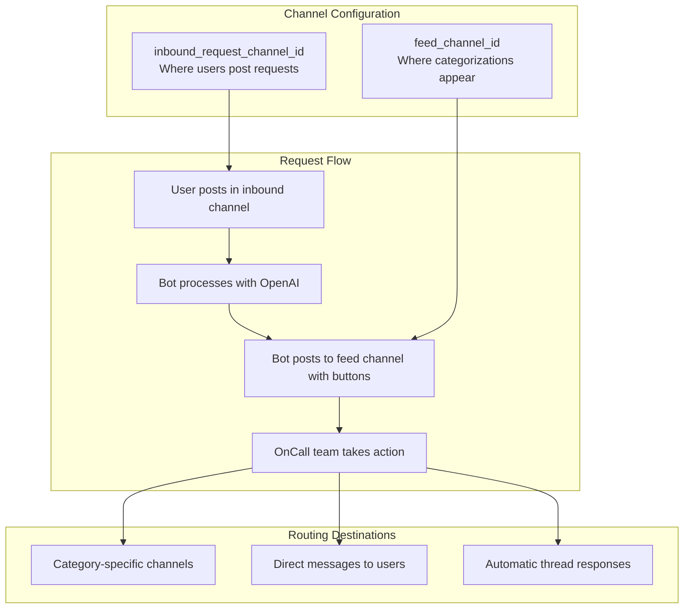
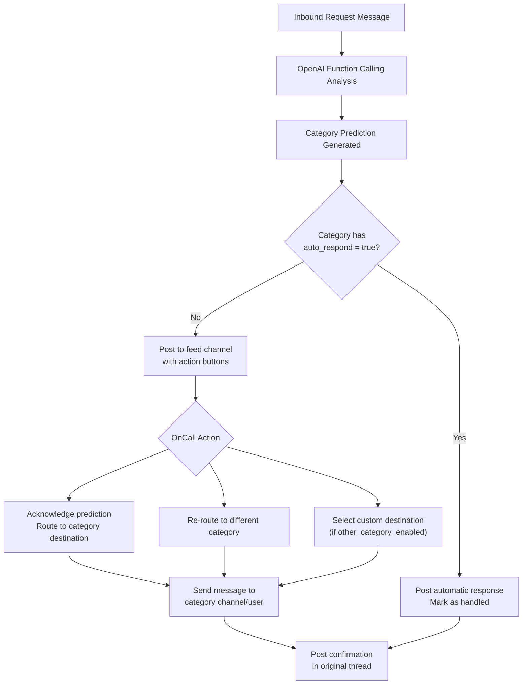
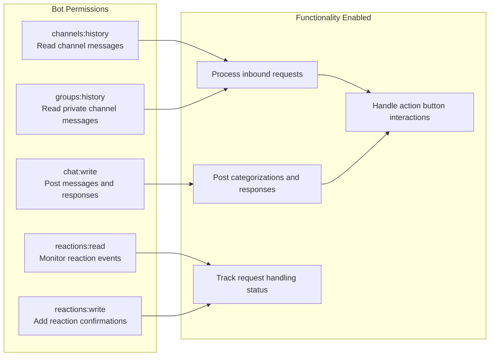

<!-- source: DeepWiki mcp.deepwiki.com · repo openai/openai-security-bots · page 6 Triage Slackbot · fetched 2026-10-26 -->

# Triage Slackbot

Relevant source files

The following files were used as context for generating this wiki page:

- [bots/triage-slackbot/README.md](bots/triage-slackbot/README.md)
- [bots/triage-slackbot/triage_slackbot/bot.py](bots/triage-slackbot/triage_slackbot/bot.py)

## Purpose and Scope

The Triage Slackbot provides automated categorization and routing of inbound security requests within Slack channels. It leverages OpenAI's function calling API to analyze incoming messages and direct them to appropriate sub-teams or provide automatic responses based on configurable categories and routing rules.

This document covers the triage bot's architecture, AI-powered categorization system, configuration options, and operational workflows. For information about the shared infrastructure used across all security bots, see [Shared Components](#3). For details about other security bots in the system, see [SDLC Slackbot](#4) and [Incident Response Slackbot](#5).

## System Architecture

The Triage Slackbot operates as part of the broader openai-security-bots ecosystem, sharing common infrastructure while providing specialized request routing functionality. The bot is initialized using the shared `start_bot` entrypoint [bots/triage-slackbot/triage_slackbot/bot.py:4-4](), which configures the Slack handlers and Jinja2 templates.

### High-Level Architecture

**Sources:** [bots/triage-slackbot/README.md:1-99](), [bots/triage-slackbot/triage_slackbot/bot.py:1-37]()

### Core Workflow Process

The bot utilizes a single message handler, `InboundRequestHandler`, to process new posts and several action handlers to manage user interactions in the feed [bots/triage-slackbot/triage_slackbot/bot.py:18-24]().

**Sources:** [bots/triage-slackbot/README.md:79-98](), [bots/triage-slackbot/triage_slackbot/bot.py:18-24]()

## Request Categorization System

The triage bot uses OpenAI's function calling API to provide deterministic categorization of inbound requests, enabling consistent routing decisions. For deep technical details on the categorization logic and fallback mechanisms, see [AI-Powered Request Categorization](#6.1).

### Category Configuration Structure

| Configuration Element | Purpose | Example Values |
|----------------------|---------|----------------|
| `key` | Category identifier | `"appsec"`, `"privacy"` |
| `oncall_slack_id` | Routing destination | Channel ID or user ID |
| `auto_respond` | Enable automatic responses | `true`/`false` |
| `other_category_enabled` | Allow manual re-routing | `true`/`false` |

### Category Definition Example

**Sources:** [bots/triage-slackbot/README.md:68-77]()

## Channel and Routing Configuration

The triage bot operates across multiple Slack channels with distinct roles in the categorization workflow. Detailed routing rules and template structures are covered in [Setup and Configuration](#6.2).

### Channel Mapping

**Sources:** [bots/triage-slackbot/README.md:64-67]()

## Operational Workflows

The triage bot supports three primary operational scenarios based on the categorization confidence and category configuration.

### Workflow Decision Tree

The interaction logic is distributed across specific action handlers: `InboundRequestAcknowledgeHandler`, `InboundRequestRecategorizeHandler`, `InboundRequestRecategorizeSelectHandler`, and `InboundRequestRecategorizeSelectConversationHandler` [bots/triage-slackbot/triage_slackbot/bot.py:19-24]().

**Sources:** [bots/triage-slackbot/README.md:79-98](), [bots/triage-slackbot/triage_slackbot/bot.py:19-24]()

## Setup and Configuration

### Prerequisites and Environment Setup

The triage bot requires specific Slack application permissions and environment configuration. For a complete guide on variables and routing rules, see [Setup and Configuration](#6.2).

| Requirement | Description |
|-------------|-------------|
| Slack App with Socket Mode | Enables real-time message processing |
| `SOCKET_APP_TOKEN` | App-level token with `connections:write` scope |
| OpenAI API Key | For AI-powered categorization |

### Required Slack Scopes

**Sources:** [bots/triage-slackbot/README.md:26-33]()

### Build and Deployment Commands

The triage bot follows the standard build system used across all security bots:

| Command | Purpose |
|---------|---------|
| `make init-env-file` | Initialize environment configuration |
| `make init-pyproject` | Set up Python project dependencies |
| `make clean-venv` | Clean virtual environment |
| `make build-bot BOT=triage-slackbot` | Build bot with dependencies |
| `make run-bot BOT=triage-slackbot` | Run bot with configuration |

**Sources:** [bots/triage-slackbot/README.md:20-58]()

---

