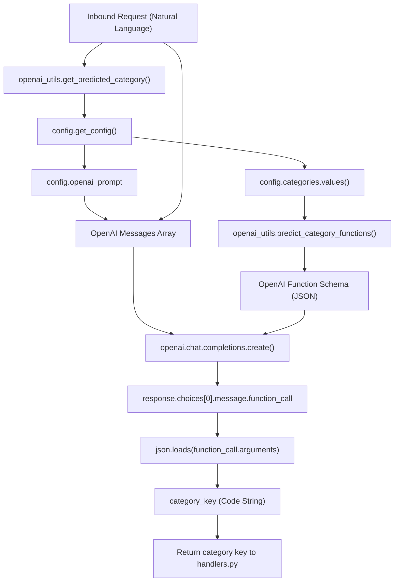
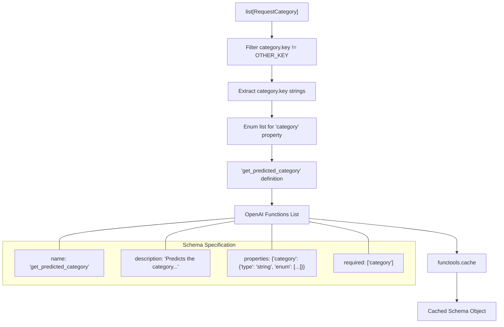

<!-- source: DeepWiki mcp.deepwiki.com · repo openai/openai-security-bots · page 6.1 AI-Powered Request Categorization · fetched 2026-10-26 -->

# AI-Powered Request Categorization

Relevant source files

The following files were used as context for generating this wiki page:

- [bots/triage-slackbot/triage_slackbot/category.py](bots/triage-slackbot/triage_slackbot/category.py)
- [bots/triage-slackbot/triage_slackbot/openai_utils.py](bots/triage-slackbot/triage_slackbot/openai_utils.py)

This document covers the AI-powered request categorization system used by the Triage Slackbot to automatically classify inbound requests with high accuracy. The system leverages OpenAI's function calling API to provide deterministic categorization results by mapping natural language input to structured code entities.

## System Overview

The Triage Slackbot uses OpenAI's `gpt-4-32k` model with function calling to categorize inbound requests into predefined categories defined in the `RequestCategory` data model [bots/triage-slackbot/triage_slackbot/category.py:8-43](). This approach ensures deterministic output by constraining the AI's responses to a specific set of valid category keys rather than allowing free-form text generation.

## Request Categorization Flow

The categorization system processes inbound requests through a structured workflow that combines natural language processing with deterministic function calling.

**Natural Language to Code Entity Mapping**

**Sources:** [bots/triage-slackbot/triage_slackbot/openai_utils.py:32-55](), [bots/triage-slackbot/triage_slackbot/category.py:5-10]()

## Data Model: RequestCategory

The `RequestCategory` class is a Pydantic model that defines how a category is structured and validated.

| Field | Type | Description |
|-------|------|-------------|
| `key` | `str` | Unique identifier used in code and OpenAI enums. |
| `display_name` | `str` | Human-readable name for Slack UI. |
| `oncall_slack_id` | `Optional[str]` | Target Slack ID (User or Channel) for routing. |
| `autorespond` | `bool` | Whether the bot should automatically reply. |
| `autorespond_message` | `Optional[str]` | The template used for automatic replies. |

The model includes a `model_validator` to ensure that if `autorespond` is enabled, an `autorespond_message` is provided [bots/triage-slackbot/triage_slackbot/category.py:27-31]().

**Sources:** [bots/triage-slackbot/triage_slackbot/category.py:8-43]()

## OpenAI Function Calling Implementation

The system uses OpenAI's function calling feature to ensure structured, predictable categorization responses. The `predict_category_functions` function dynamically generates the function schema based on available `RequestCategory` objects.

### Function Schema Generation

The `OTHER_KEY` (defined as `"other"`) is excluded from the AI's selection list in the schema [bots/triage-slackbot/triage_slackbot/openai_utils.py:21](). This forces the AI to pick from defined categories, while the bot logic can handle "other" as a fallback.

**Sources:** [bots/triage-slackbot/triage_slackbot/openai_utils.py:9-29](), [bots/triage-slackbot/triage_slackbot/category.py:5]()

## Category Prediction Process

The `get_predicted_category` function orchestrates the API interaction. It is configured for maximum determinism to avoid "hallucinations" or inconsistent routing.

### API Call Configuration
The call to `openai.chat.completions.create` uses specific parameters to ensure stability [bots/triage-slackbot/triage_slackbot/openai_utils.py:45-52]():

- **Model**: `gpt-4-32k` for high-reasoning capability.
- **Temperature**: `0` to ensure deterministic, repeatable outputs.
- **Function Call**: Explicitly set to `{"name": "get_predicted_category"}` to force the model to use the categorization tool rather than responding with text.
- **Stream**: `False` for synchronous processing.

### Implementation Detail
The function constructs the prompt using a `system` role message (the prompt instructions from `config.toml`) and a `user` role message (the raw content of the inbound Slack request) [bots/triage-slackbot/triage_slackbot/openai_utils.py:39-42]().

**Sources:** [bots/triage-slackbot/triage_slackbot/openai_utils.py:32-55]()

## Performance and Reliability

The implementation includes several technical optimizations to ensure the bot remains responsive and accurate:

1.  **Schema Caching**: The `predict_category_functions` is wrapped in `@cache` from `functools`. Since the categories are loaded from static configuration at startup, the JSON schema for the OpenAI API only needs to be generated once [bots/triage-slackbot/triage_slackbot/openai_utils.py:9-10]().
2.  **Deterministic Logic**: By setting `temperature=0` and providing an `enum` of valid keys, the bot eliminates the risk of the AI suggesting a category that does not exist in the code's configuration [bots/triage-slackbot/triage_slackbot/openai_utils.py:20-22](), [bots/triage-slackbot/triage_slackbot/openai_utils.py:48]().
3.  **Strict Parsing**: The response is parsed specifically from `response.choices[0].message.function_call.arguments`, ensuring that only the predicted key is returned to the calling handler [bots/triage-slackbot/triage_slackbot/openai_utils.py:54-55]().

**Sources:** [bots/triage-slackbot/triage_slackbot/openai_utils.py:9-55]()

---

