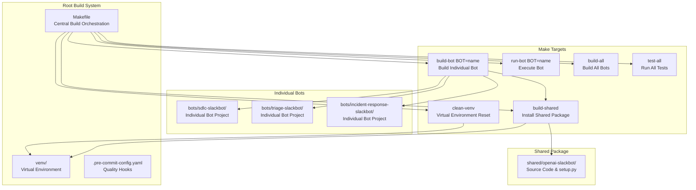
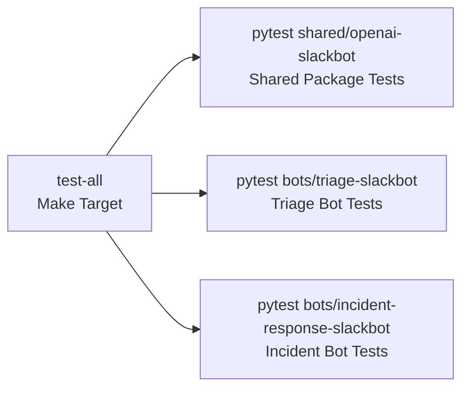

<!-- source: DeepWiki mcp.deepwiki.com · repo openai/openai-security-bots · page 7 Development and Build System · fetched 2026-10-26 -->

# Development and Build System

<details>
<summary>Relevant source files</summary>

The following files were used as context for generating this wiki page:

- [.gitignore](.gitignore)
- [.pre-commit-config.yaml](.pre-commit-config.yaml)
- [CODEOWNERS](CODEOWNERS)
- [Makefile](Makefile)
- [SECURITY.md](SECURITY.md)

</details>


This document covers the overall build system, testing infrastructure, and development workflows for the entire `openai-security-bots` repository. It focuses on the Makefile-based build system that orchestrates the shared package, individual bot deployments, and code quality enforcement through pre-commit hooks.

## Repository Build Architecture

The repository uses a hierarchical build system where a shared package (`openai-slackbot`) provides common functionality to individual bot projects. The build process is orchestrated through Make targets that handle virtual environment management, package installation, and cross-bot testing.

### Build System Structure



Sources: [Makefile:1-39](), [.pre-commit-config.yaml:1-22]()

## Code Quality and Pre-commit Hooks

The repository enforces code style and security standards using `pre-commit`. These hooks run automatically on commit and push stages to ensure code consistency and prevent secret leakage.

### Hook Configurations

| Hook ID | Tool | Purpose | Configuration |
|---------|------|---------|---------------|
| `trufflehog` | TruffleHog | Secret detection in git history | `--since-commit HEAD --fail` [ .pre-commit-config.yaml:4-9 ]() |
| `black` | Black | Deterministic code formatting | `--line-length=100` [ .pre-commit-config.yaml:11-16 ]() |
| `isort` | isort | Standardized import sorting | Version 5.12.0 [ .pre-commit-config.yaml:17-22 ]() |

Sources: [.pre-commit-config.yaml:1-22]()

## Build Targets and Workflows

The `Makefile` defines standardized targets for common development operations across all bots in the repository.

### Virtual Environment Management

The build system includes targets for clean virtual environment management:

- `clean-venv`: Creates a fresh Python virtual environment using `python3 -m venv venv`. [ Makefile:3-4 ]()
- `rm-venv`: Removes the existing `venv` directory if it exists. [ Makefile:7-8 ]()

```bash
# Virtual environment reset workflow
make clean-venv  # Removes and recreates venv/
```

### Package Installation Workflow

The `build-bot` target orchestrates a multi-step installation process:
1. **Cache Management**: Executes `maybe-clear-shared` to remove the `openai_slackbot` pip cache unless `SKIP_CLEAR_SHARED` is true. [ Makefile:10-14 ]()
2. **Shared Library**: Runs `build-shared` to install the library in `./shared/openai-slackbot` in editable mode (`-e`). [ Makefile:16-17 ]()
3. **Bot Initialization**: Navigates to the specific bot directory, runs `init-pyproject` (via the bot's own Makefile), and installs the bot package. [ Makefile:20-21 ]()

```bash
# Build a specific bot
make build-bot BOT=triage-slackbot
```

Sources: [Makefile:10-21]()

### Execution and Testing

| Target | Command | Purpose |
|--------|---------|---------|
| `run-bot` | `python bots/$(BOT)/$(subst -,_,$(BOT))/bot.py` | Execute specific bot entrypoint. [ Makefile:24-25 ]() |
| `build-all` | `$(MAKE) build-bot BOT=triage-slackbot SKIP_CLEAR_SHARED=true` | Build all bots (example shows triage). [ Makefile:32-34 ]() |
| `test-all` | `pytest` across shared and bot directories | Runs the full test suite sequentially. [ Makefile:36-39 ]() |
| `clear` | `find . | grep -E "(/__pycache__$\|\.pyc$\|\.pyo$)" | xargs rm -rf` | Remove Python bytecode artifacts. [ Makefile:28-29 ]() |

## Testing Infrastructure

The testing system uses `pytest` to validate both the shared library and the individual bot implementations.



The `test-all` target ensures that breaking changes in the shared library are caught before testing the dependent bots. [ Makefile:36-39 ]()

## Repository Maintenance

### Ignored Artifacts
The repository maintains a comprehensive `.gitignore` to prevent committing environment-specific files:
- **Environments**: `.env`, `venv/`, `.venv`, and `env/`. [ .gitignore:105-112 ]()
- **Build Artifacts**: `dist/`, `build/`, and `*.egg-info/`. [ .gitignore:11-25 ]()
- **Databases**: `db.sqlite3` and `db.sqlite3-journal`. [ .gitignore:61-62 ]()
- **Generated Configs**: `pyproject.toml` files inside bot directories are ignored as they are generated from templates. [ .gitignore:132-133 ]()

### Ownership
The entire repository is managed by the `@openai/security-team` as defined in the `CODEOWNERS` file. [ CODEOWNERS:1 ]()

Sources: [.gitignore:1-139](), [CODEOWNERS:1](), [SECURITY.md:1-5]()

---

