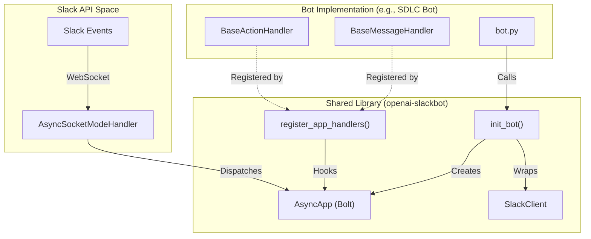
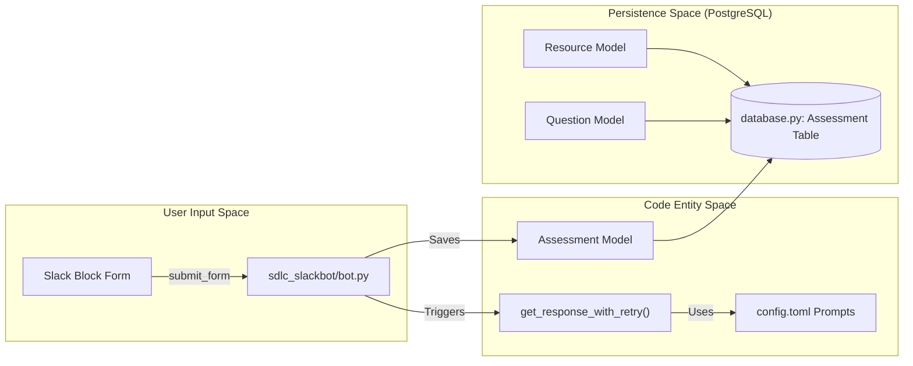

<!-- source: DeepWiki mcp.deepwiki.com · repo openai/openai-security-bots · page 8 Glossary · fetched 2026-10-26 -->

# Glossary

Relevant source files

The following files were used as context for generating this wiki page:

- [README.md](README.md)
- [bots/incident-response-slackbot/incident_response_slackbot/handlers.py](bots/incident-response-slackbot/incident_response_slackbot/handlers.py)
- [bots/incident-response-slackbot/incident_response_slackbot/openai_utils.py](bots/incident-response-slackbot/incident_response_slackbot/openai_utils.py)
- [bots/sdlc-slackbot/sdlc_slackbot/bot.py](bots/sdlc-slackbot/sdlc_slackbot/bot.py)
- [bots/sdlc-slackbot/sdlc_slackbot/config.toml](bots/sdlc-slackbot/sdlc_slackbot/config.toml)
- [bots/sdlc-slackbot/sdlc_slackbot/database.py](bots/sdlc-slackbot/sdlc_slackbot/database.py)
- [bots/triage-slackbot/triage_slackbot/openai_utils.py](bots/triage-slackbot/triage_slackbot/openai_utils.py)
- [shared/openai-slackbot/openai_slackbot/bot.py](shared/openai-slackbot/openai_slackbot/bot.py)
- [shared/openai-slackbot/openai_slackbot/clients/slack.py](shared/openai-slackbot/openai_slackbot/clients/slack.py)

This page provides definitions for codebase-specific terms, jargon, and domain concepts used across the `openai-security-bots` repository. It serves as a technical reference for onboarding engineers to understand the relationship between abstract system concepts and their concrete implementations.

## Core Framework Terms

### BaseHandler (and Subclasses)
The fundamental abstraction for processing Slack events. Handlers are divided into `BaseMessageHandler` for standard chat events and `BaseActionHandler` for interactive elements like buttons or menus.
*   **Implementation:** Handlers implement a `maybe_handle` method that acts as a gatekeeper, checking `should_handle` before executing the core logic in `handle`.
*   **Code Pointer:** [shared/openai-slackbot/openai_slackbot/handlers.py:1-30]()

### SlackClient (Shared)
A wrapper around the `slack_sdk.web.async_client.AsyncWebClient`. It provides high-level utilities for common security bot tasks, such as rendering Jinja2 templates into Slack blocks and retrieving message threads.
*   **Implementation:** Uses `jinja2.Environment` to load and render JSON-based block templates.
*   **Code Pointer:** [shared/openai-slackbot/openai_slackbot/clients/slack.py:33-125]()

### Socket Mode
A Slack connectivity pattern that allows the bots to receive events over a WebSocket connection instead of exposing a public HTTP endpoint.
*   **Implementation:** Managed by `AsyncSocketModeHandler` within the `start_app` function.
*   **Code Pointer:** [shared/openai-slackbot/openai_slackbot/bot.py:57-61]()

## AI and Logic Concepts

### Function Calling (OpenAI)
A technique where the OpenAI model is instructed to output structured JSON arguments for a specific function rather than free-form text. This is used for deterministic categorization and state detection.
*   **Implementation:** Seen in the Triage bot for category prediction and the Incident Response bot for user awareness checks.
*   **Code Pointer (Triage):** [bots/triage-slackbot/triage_slackbot/openai_utils.py:10-29]()
*   **Code Pointer (Incident):** [bots/incident-response-slackbot/incident_response_slackbot/openai_utils.py:48-67]()

### Risk and Confidence Scoring
The SDLC bot evaluates projects on two 1-10 scales. "Risk" determines if a security review is needed, while "Confidence" reflects the AI's certainty based on available documentation.
*   **Implementation:** Mapped to human-readable strings via `risk_and_confidence_to_string`.
*   **Code Pointer:** [bots/sdlc-slackbot/sdlc_slackbot/bot.py:114-145]()

### Prompt Types (SDLC)
The SDLC bot uses a multi-stage prompting strategy defined in `config.toml`:
*   `base_prompt`: Defines the "Security Analyst" persona.
*   `initial_prompt`: Instructions for the first intake.
*   `update_prompt`: Logic for comparing new vs. old project state.
*   `summary_prompt`: Used to condense large documents.
*   **Code Pointer:** [bots/sdlc-slackbot/sdlc_slackbot/config.toml:8-61]()

## System Entity Mapping

The following diagram bridges the gap between natural language system concepts and the actual classes and files that implement them.

### Diagram 1: Bot Initialization and Request Flow
"How a generic bot instance is constructed and starts listening."

**Sources:** [shared/openai-slackbot/openai_slackbot/bot.py:30-78](), [shared/openai-slackbot/openai_slackbot/handlers.py:1-30]()

## SDLC Bot Specifics

### Assessment
A database record representing a single project's security evaluation.
*   **Implementation:** The `Assessment` Peewee model.
*   **Code Pointer:** [bots/sdlc-slackbot/sdlc_slackbot/database.py:15-25]()

### Resource Monitoring
The process of fetching external content (Google Docs or Slack threads) and detecting changes via content hashing.
*   **Implementation:** `fetch_content` dispatches to `gdoc_get` or `async_fetch_slack`. Hashes are stored in the `Resource` table.
*   **Code Pointer:** [bots/sdlc-slackbot/sdlc_slackbot/bot.py:79-86](), [bots/sdlc-slackbot/sdlc_slackbot/database.py:37-42]()

### Diagram 2: SDLC Assessment Data Flow
"How data moves from a Slack form into the database and AI evaluation."

**Sources:** [bots/sdlc-slackbot/sdlc_slackbot/bot.py:88-111](), [bots/sdlc-slackbot/sdlc_slackbot/database.py:1-46](), [bots/sdlc-slackbot/sdlc_slackbot/config.toml:1-68]()

## Incident Response Bot Specifics

### Alert Feed
A designated Slack channel where security alerts are posted for analyst review before interacting with users.
*   **Implementation:** Controlled by `feed_channel_id` in configuration.
*   **Code Pointer:** [bots/incident-response-slackbot/incident_response_slackbot/config.py:1-20]()

### Awareness Check
An AI-driven interaction to determine if a user was "aware" of a suspicious action (e.g., a login from a new location).
*   **Implementation:** `get_user_awareness` function.
*   **Code Pointer:** [bots/incident-response-slackbot/incident_response_slackbot/openai_utils.py:70-99]()

### Nudge Loop
The logic that repeatedly asks a user for a response if they ignore the bot's initial greeting.
*   **Implementation:** `nudge_user` function within `InboundDirectMessageHandler`.
*   **Code Pointer:** [bots/incident-response-slackbot/incident_response_slackbot/handlers.py:123-139]()

## Triage Bot Specifics

### Request Category
A predefined bucket (e.g., "Access Request", "Phishing Report") that the AI uses to route inbound messages.
*   **Implementation:** Defined as `RequestCategory` objects loaded from `config.toml`.
*   **Code Pointer:** [bots/triage-slackbot/triage_slackbot/category.py:1-10]()

### OTHER_KEY
The fallback category used when the AI cannot confidently match an inbound request to a specific predefined category.
*   **Implementation:** `OTHER_KEY` constant.
*   **Code Pointer:** [bots/triage-slackbot/triage_slackbot/openai_utils.py:21-22]()