# Page: Overview

# Overview

<details>
<summary>Relevant source files</summary>

The following files were used as context for generating this wiki page:

- [.gitignore](.gitignore)
- [CODEOWNERS](CODEOWNERS)
- [LICENSE](LICENSE)
- [Makefile](Makefile)
- [README.md](README.md)
- [SECURITY.md](SECURITY.md)

</details>


## Purpose and Scope

The `openai-security-bots` repository is a suite of AI-powered Slack applications designed to automate and streamline security operations workflows at OpenAI. By leveraging OpenAI's LLMs and the Slack Bolt framework, these bots handle complex tasks such as project security reviews, incident triage, and request categorization.

The repository is structured as a monorepo, containing a shared core library and three specialized bot implementations.

## Monorepo Layout

The project structure separates reusable logic from bot-specific implementations:

| Directory | Description |
|:---|:---|
| `shared/openai-slackbot/` | The core library providing base classes for handlers, Slack client wrappers, and OpenAI integration utilities. |
| `bots/sdlc-slackbot/` | Automates the Software Development Life Cycle (SDLC) security review process, including risk assessment and document analysis. |
| `bots/incident-response-slackbot/` | Manages automated incident triage, user awareness checks, and alert feed management. |
| `bots/triage-slackbot/` | Uses LLM function calling to categorize and route inbound security requests to the appropriate on-call teams. |

Sources: [README.md:7-14](), [Makefile:16-25]()

## System Architecture

The architecture relies on a "Shared Library" pattern where each bot inherits from a common framework to ensure consistency in event handling and API communication.

### High-Level Component Interaction

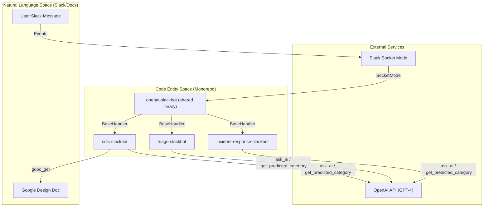

Sources: [README.md:1-14](), [Makefile:16-25]()

### Code Entity Mapping: Bot Initialization

The following diagram illustrates how the build system bridges the shared library to the specific bot implementations.

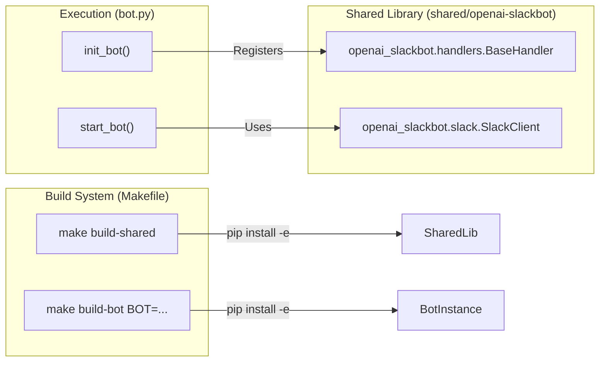

Sources: [Makefile:16-27](), [README.md:8-14]()

## Getting Started

The repository uses a centralized `Makefile` to manage dependencies and execution across the monorepo.

### Prerequisites
1.  **Python 3.8+**: Ensure a compatible Python environment is active.
2.  **Pre-commit**: The project uses `pre-commit` for code quality (TruffleHog, Black, isort).
    -   `pip install pre-commit && pre-commit install` [README.md:19-23]()

### Build and Run
To set up and run a specific bot (e.g., `triage-slackbot`):

1.  **Build the shared library and bot**:
    ```bash
    make build-bot BOT=triage-slackbot
    ```
    This command installs the shared library in editable mode and then installs the specific bot's dependencies. [Makefile:20-21]()

2.  **Run the bot**:
    ```bash
    make run-bot BOT=triage-slackbot
    ```
    This executes the entry point located at `bots/triage-slackbot/triage_slackbot/bot.py`. [Makefile:24-25]()

3.  **Testing**:
    Run the full test suite across the shared library and all bots:
    ```bash
    make test-all
    ```
    [Makefile:36-39]()

## Development Summary

| Feature | Implementation |
|:---|:---|
| **Language** | Python |
| **Orchestration** | `Makefile` for monorepo management |
| **Shared Logic** | `shared/openai-slackbot` (installed as a local package) |
| **Deployment** | Slack Socket Mode (no public endpoint required) |
| **AI Integration** | OpenAI Chat Completions and Function Calling |

Sources: [README.md:1-24](), [Makefile:1-39]()

---

# Page: System Architecture

# System Architecture

<details>
<summary>Relevant source files</summary>

The following files were used as context for generating this wiki page:

- [Makefile](Makefile)
- [README.md](README.md)
- [shared/openai-slackbot/openai_slackbot/bot.py](shared/openai-slackbot/openai_slackbot/bot.py)
- [shared/openai-slackbot/openai_slackbot/handlers.py](shared/openai-slackbot/openai_slackbot/handlers.py)

</details>


This document provides a high-level overview of the OpenAI security bots system architecture, including how the three specialized security bots work together and their shared infrastructure. It covers the monorepo structure, shared library dependencies, the Slack Socket Mode communication pattern, and the OpenAI integration model.

## System Overview

The OpenAI security bots repository contains three specialized Slack bots that leverage OpenAI's APIs to automate different aspects of security workflows:

- **SDLC Slackbot**: Security review triage and project assessment.
- **Incident Response Slackbot**: Automated incident triage and user interaction.
- **Triage Slackbot**: Request categorization and routing.

All bots share common infrastructure through the `openai-slackbot` library located in the `shared/` directory [README.md:8-14]().

## High-Level System Architecture

The following diagram illustrates the relationship between the bots, the shared library, and external service dependencies.

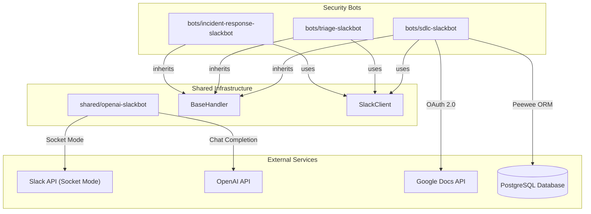

Sources: [README.md:1-14](), [shared/openai-slackbot/openai_slackbot/bot.py:5-9](), [shared/openai-slackbot/openai_slackbot/handlers.py:10-12]()

## Monorepo Structure and Dependency Management

The project is organized as a monorepo. Shared logic is decoupled into a local library that bots install during their build process.

- **`shared/openai-slackbot/`**: A shared Python package providing the core bot framework, base handler classes, and a Slack client wrapper [shared/openai-slackbot/openai_slackbot/bot.py:5-9]().
- **`bots/`**: Contains individual bot implementations. Each bot is a standalone application but depends on the `shared` library.
- **`Makefile`**: Manages the build lifecycle, including virtual environment creation and cross-package installation [Makefile:1-39]().

### Dependency Flow
The `Makefile` at the root handles the installation of the shared library into the bot's environment using `pip install -e ./shared/openai-slackbot` [Makefile:16-17](). This allows for live development where changes in the shared library are immediately reflected in the bots.

Sources: [README.md:7-14](), [Makefile:16-22]()

## Slack Socket Mode and Event Dispatching

The system utilizes Slack's **Socket Mode**, allowing the bots to reside behind a firewall without requiring public HTTP endpoints. The `openai_slackbot` library abstracts the boilerplate for initializing this connection.

### Bot Initialization Pattern
The `init_bot` function in the shared library performs the following [shared/openai-slackbot/openai_slackbot/bot.py:30-54]():
1. Loads credentials (`SLACK_BOT_TOKEN`, `OPENAI_API_KEY`).
2. Initializes the `AsyncApp` from `slack_bolt`.
3. Registers bot-specific handlers using `register_app_handlers`.

### Event Handling Pipeline
All bots implement handlers by subclassing `BaseMessageHandler` or `BaseActionHandler` [shared/openai-slackbot/openai_slackbot/handlers.py:42-53]().

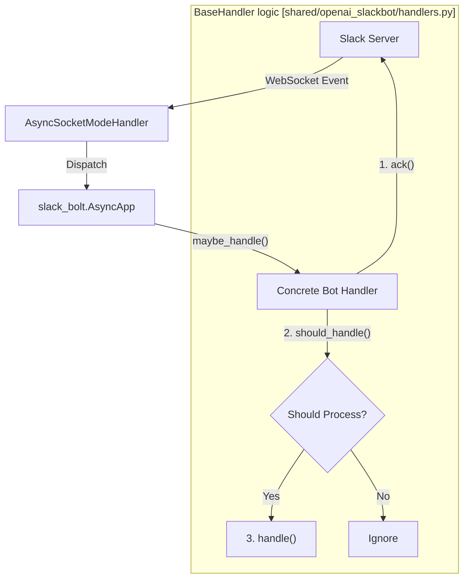

Sources: [shared/openai-slackbot/openai_slackbot/bot.py:57-60](), [shared/openai-slackbot/openai_slackbot/handlers.py:14-25]()

## OpenAI Integration Model

The bots use OpenAI's APIs for intelligent decision-making and text generation. The shared library initializes the global `openai` configuration [shared/openai-slackbot/openai_slackbot/bot.py:40-42](), while individual bots implement their specific AI logic.

### AI Implementation Details
- **SDLC Bot**: Uses OpenAI for risk assessment and summarizing project documentation.
- **Incident Response Bot**: Uses function calling for deterministic output (e.g., determining user awareness) and generating greetings.
- **Triage Bot**: Uses function calling to categorize inbound requests into predefined buckets based on a configuration schema.

| Feature | Code Entity | Purpose |
| :--- | :--- | :--- |
| **Authentication** | `init_bot` | Sets `openai.api_key` and `openai.organization` [shared/openai-slackbot/openai_slackbot/bot.py:41-42]() |
| **Action Dispatch** | `BaseActionHandler` | Maps Slack `action_id` to code logic [shared/openai-slackbot/openai_slackbot/handlers.py:50-53]() |
| **Message Dispatch** | `BaseMessageHandler` | Filters and processes channel messages [shared/openai-slackbot/openai_slackbot/handlers.py:42-47]() |

## Build and Deployment Architecture

The system uses a unified build system managed through a root `Makefile`.

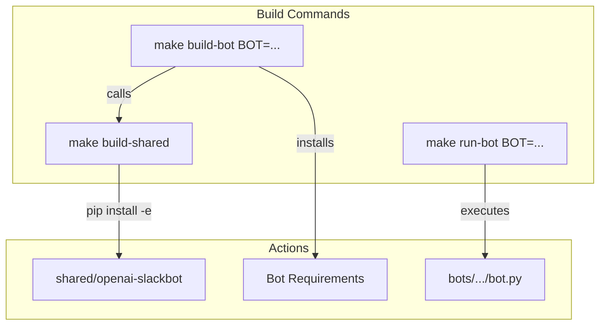

Sources: [Makefile:16-25]()

---

# Page: Shared Components

# Shared Components

<details>
<summary>Relevant source files</summary>

The following files were used as context for generating this wiki page:

- [shared/openai-slackbot/openai_slackbot/bot.py](shared/openai-slackbot/openai_slackbot/bot.py)
- [shared/openai-slackbot/openai_slackbot/clients/slack.py](shared/openai-slackbot/openai_slackbot/clients/slack.py)
- [shared/openai-slackbot/openai_slackbot/handlers.py](shared/openai-slackbot/openai_slackbot/handlers.py)
- [shared/openai-slackbot/openai_slackbot/utils/slack.py](shared/openai-slackbot/openai_slackbot/utils/slack.py)
- [shared/openai-slackbot/pyproject.toml](shared/openai-slackbot/pyproject.toml)
- [shared/openai-slackbot/setup.cfg](shared/openai-slackbot/setup.cfg)

</details>


## Purpose and Scope

The shared components provide common functionality used across all security bots in the repository through the `openai-slackbot` Python package. This shared library abstracts core integrations with Slack and OpenAI APIs, eliminating code duplication and ensuring consistent behavior across the SDLC Slackbot, Incident Response Slackbot, and Triage Slackbot.

The library provides the base classes for event handling, a wrapped Slack client with Jinja2 templating support, and utility functions for parsing Slack message blocks.

For detailed documentation of individual bot implementations that use these shared components, see [SDLC Slackbot](#4), [Incident Response Slackbot](#5), and [Triage Slackbot](#6).

## Library Architecture

The `openai-slackbot` package serves as the foundation layer. It is organized into three primary modules: `bot.py` for lifecycle management, `clients/` for external API wrappers, and `handlers.py` for the event dispatch framework.

### Component Relationship Diagram

The following diagram illustrates how the shared library entities bridge the gap between Slack events and bot logic.

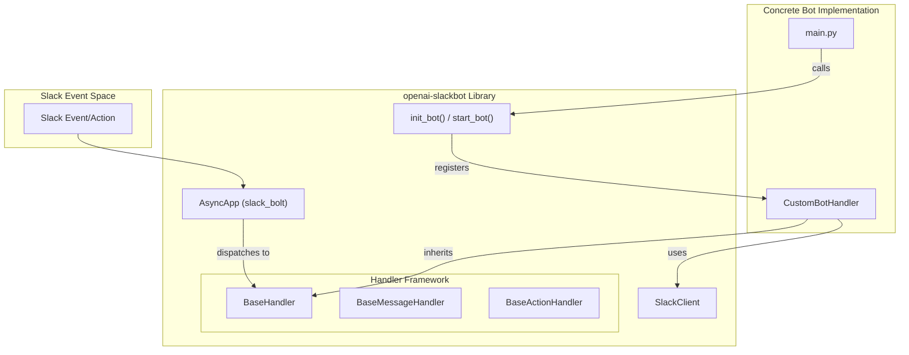

Sources: [shared/openai-slackbot/openai_slackbot/bot.py:30-54](), [shared/openai-slackbot/openai_slackbot/handlers.py:10-42](), [shared/openai-slackbot/openai_slackbot/clients/slack.py:33-43]()

## Core Modules

The shared library is divided into the following functional areas:

### 3.1 Bot Framework and Handler Base Classes
This module provides the standardized entry points for initializing and starting bots using Slack's Socket Mode. It defines the `BaseHandler` abstract class, which implements a "check-then-act" pattern via `should_handle` and `handle` methods. This ensures that every bot follows a consistent logging and error handling strategy.

For details, see [Bot Framework and Handler Base Classes](#3.1).

### 3.2 Slack Client and Utilities
The `SlackClient` class wraps the `slack_sdk` `AsyncWebClient` to provide high-level methods like `post_message` and `get_thread_messages`. A key feature is the integration with **Jinja2**, allowing bots to render complex Slack Block Kit UI components from templates stored in the filesystem. It also includes `utils/slack.py` for common tasks like extracting text from nested block structures and formatting Slack mentions.

For details, see [Slack Client and Utilities](#3.2).

### 3.3 Shared Library Tests
The library includes a robust test suite using `pytest` and `pytest-asyncio`. These tests validate the handler dispatch logic, the Slack client's interaction with the Web API, and the environment variable loading mechanisms.

For details, see [Shared Library Tests](#3.3).

## Technology Stack and Dependencies

The shared package defines core dependencies that all security bots inherit. These dependencies provide essential functionality for Slack integration, AI processing, and data validation.

| Dependency | Purpose |
|------------|---------|
| `slack-bolt` | Primary Slack app framework for event handling [shared/openai-slackbot/pyproject.toml:11]() |
| `slack-sdk` | Low-level Slack API client [shared/openai-slackbot/pyproject.toml:12]() |
| `openai` | OpenAI API integration for AI-powered features [shared/openai-slackbot/pyproject.toml:8]() |
| `Jinja2` | Template engine for message formatting [shared/openai-slackbot/pyproject.toml:7]() |
| `pydantic` | Data validation and parsing [shared/openai-slackbot/pyproject.toml:9]() |

### Data Flow: Event to Handler

This diagram maps the code entities involved when a Slack message reaches a bot.

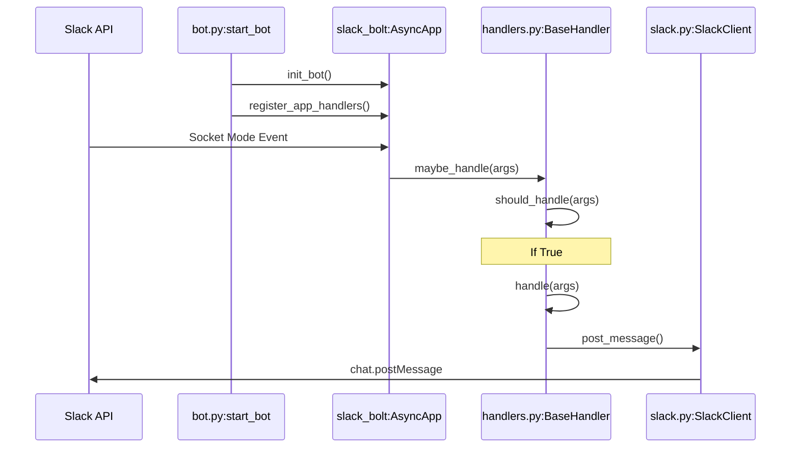

Sources: [shared/openai-slackbot/openai_slackbot/bot.py:14-28](), [shared/openai-slackbot/openai_slackbot/handlers.py:14-25](), [shared/openai-slackbot/openai_slackbot/clients/slack.py:60-66]()

## Build System Integration

The shared components integrate with the repository's build system through a multi-stage process. The root `Makefile` manages the installation of this library into the virtual environments of the individual bots.

### Installation Pattern
1. **Build Shared**: The library is installed in editable mode (`pip install -e`) to ensure changes are immediately reflected across all bots during development.
2. **Environment Injection**: The `pyproject.toml` in the shared directory includes `pytest-env` configuration to provide mock tokens (`SLACK_BOT_TOKEN`, `OPENAI_API_KEY`) for local testing.

Sources: [shared/openai-slackbot/pyproject.toml:23-29](), [shared/openai-slackbot/pyproject.toml:1-5]()

---

# Page: Bot Framework and Handler Base Classes

# Bot Framework and Handler Base Classes

<details>
<summary>Relevant source files</summary>

The following files were used as context for generating this wiki page:

- [shared/openai-slackbot/openai_slackbot/__init__.py](shared/openai-slackbot/openai_slackbot/__init__.py)
- [shared/openai-slackbot/openai_slackbot/bot.py](shared/openai-slackbot/openai_slackbot/bot.py)
- [shared/openai-slackbot/openai_slackbot/handlers.py](shared/openai-slackbot/openai_slackbot/handlers.py)

</details>


This page provides a deep dive into the core abstractions of the shared `openai_slackbot` library. This library provides the foundation for all security bots in the repository, offering standardized entry points for initialization and a structured framework for handling Slack events and actions.

## Bot Lifecycle and Entrypoints

The framework provides two primary entrypoints for managing a bot's lifecycle: `init_bot` and `start_bot`. These functions abstract away the complexities of configuring the OpenAI SDK, initializing the Slack `AsyncApp`, and registering event handlers.

### Initialization Flow

The `init_bot` function serves as the setup phase for the bot's infrastructure.

1.  **Credential Loading**: It retrieves `SLACK_BOT_TOKEN` and `OPENAI_API_KEY` from the environment using the `string` utility [[shared/openai-slackbot/openai_slackbot/bot.py:37-38]]().
2.  **OpenAI Configuration**: It configures the global `openai` library with the provided organization ID and API key [[shared/openai-slackbot/openai_slackbot/bot.py:41-42]]().
3.  **Slack Client Setup**: It instantiates an `AsyncApp` (from Slack Bolt) and wraps the Bolt client in a custom `SlackClient` that supports Jinja2 templating [[shared/openai-slackbot/openai_slackbot/bot.py:45-46]]().
4.  **Handler Registration**: It calls `register_app_handlers` to bind message and action handlers to the Slack app [[shared/openai-slackbot/openai_slackbot/bot.py:47-52]]().

### Execution Flow

The `start_bot` function is the high-level entrypoint that both initializes and runs the bot in Socket Mode [[shared/openai-slackbot/openai_slackbot/bot.py:63-78]]().

**Bot Startup Sequence**
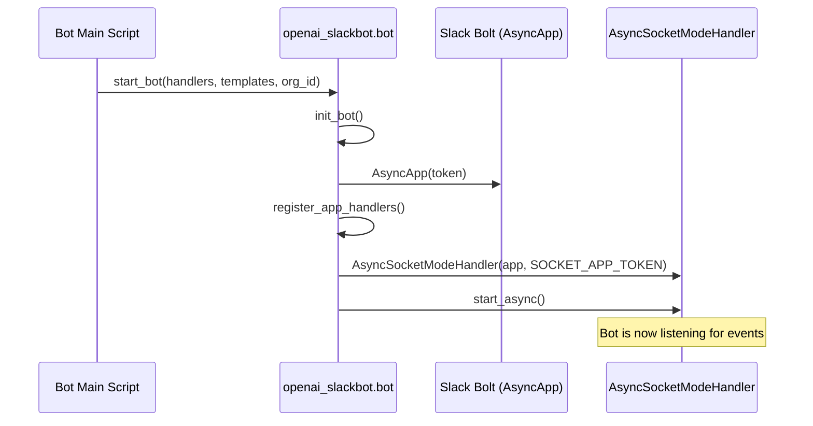
Sources: [[shared/openai-slackbot/openai_slackbot/bot.py:30-78]]()

---

## Handler Base Classes

The framework uses an object-oriented approach to handle Slack interactions, defined in `handlers.py`. This ensures consistency in how events are acknowledged, logged, and processed.

### BaseHandler Abstraction

All handlers inherit from `BaseHandler`, which defines the `maybe_handle` dispatch pattern. This pattern ensures that every event is acknowledged (`ack()`) immediately to prevent Slack from retrying the event while the bot is still processing [[shared/openai-slackbot/openai_slackbot/handlers.py:14-15]]().

| Method | Type | Description |
| :--- | :--- | :--- |
| `maybe_handle(args)` | `async` | The entrypoint called by Bolt. Orchestrates `ack`, `should_handle`, and `handle` [[shared/openai-slackbot/openai_slackbot/handlers.py:14-25]](). |
| `should_handle(args)` | `abstract` | Returns a boolean indicating if the handler should process this specific event [[shared/openai-slackbot/openai_slackbot/handlers.py:29-31]](). |
| `handle(args)` | `abstract` | Contains the core business logic for the handler [[shared/openai-slackbot/openai_slackbot/handlers.py:33-35]](). |
| `logging_extra(args)` | `abstract` | Returns a dictionary of context-specific metadata for structured logging [[shared/openai-slackbot/openai_slackbot/handlers.py:37-39]](). |

### Specialized Handlers

The framework provides two specialized base classes for common Slack interaction types:

1.  **`BaseMessageHandler`**: Used for processing `message` events. It implements a default `logging_extra` that extracts `type`, `subtype`, `channel`, and `ts` from the Slack event [[shared/openai-slackbot/openai_slackbot/handlers.py:42-47]]().
2.  **`BaseActionHandler`**: Used for processing interactive components (like button clicks). It requires an `action_id` property and defaults `should_handle` to `True` [[shared/openai-slackbot/openai_slackbot/handlers.py:50-56]]().

**Handler Class Hierarchy**
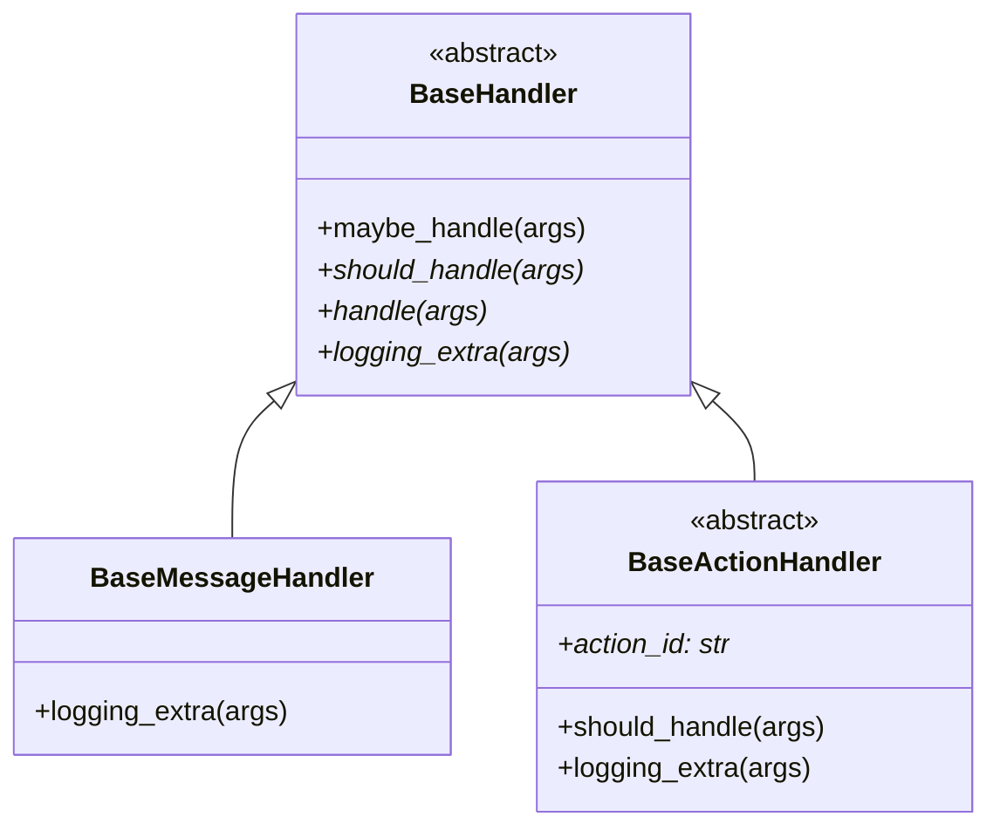
Sources: [[shared/openai-slackbot/openai_slackbot/handlers.py:10-63]]()

---

## Dispatch Pattern and Registration

Handlers are registered to the `AsyncApp` via the `register_app_handlers` function. This function acts as the bridge between the high-level handler classes and the Slack Bolt event listeners.

### The `maybe_handle` Dispatch Logic

When an event arrives, the framework follows this internal logic:
1.  **Acknowledge**: Call `args.ack()` immediately [[shared/openai-slackbot/openai_slackbot/handlers.py:15]]().
2.  **Evaluate**: Call `should_handle(args)`. If it returns `False`, the handler exits [[shared/openai-slackbot/openai_slackbot/handlers.py:19-24]]().
3.  **Execute**: If evaluated as true, call `handle(args)`. Any exceptions during this phase are caught and logged using the metadata from `logging_extra` [[shared/openai-slackbot/openai_slackbot/handlers.py:25-27]]().

### Handler Registration

Individual bots pass their handler classes to `init_bot`, which then performs the registration:

*   **Messages**: Registered using `app.event("message")` [[shared/openai-slackbot/openai_slackbot/bot.py:22]]().
*   **Actions**: Registered using `app.action(handler.action_id)` [[shared/openai-slackbot/openai_slackbot/bot.py:27]]().

**Entity Mapping: Registration to Dispatch**
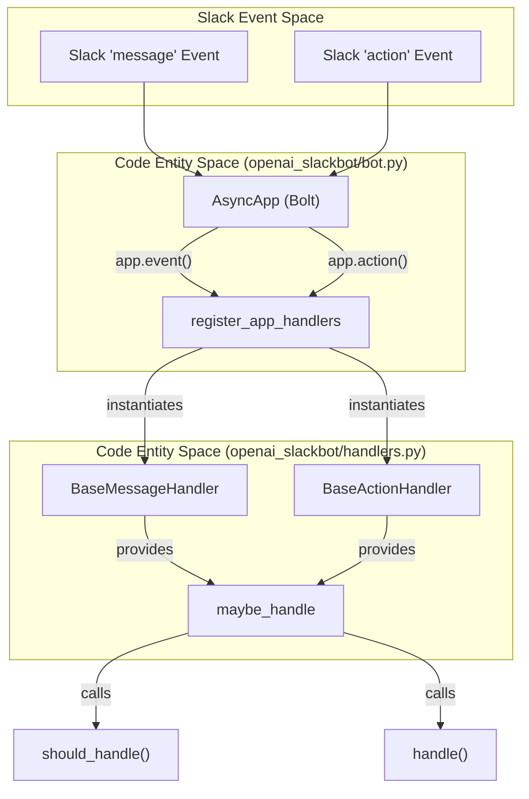
Sources: [[shared/openai-slackbot/openai_slackbot/bot.py:14-28]](), [[shared/openai-slackbot/openai_slackbot/handlers.py:14-35]]()

---

# Page: Slack Client and Utilities

# Slack Client and Utilities

<details>
<summary>Relevant source files</summary>

The following files were used as context for generating this wiki page:

- [shared/openai-slackbot/openai_slackbot/clients/__init__.py](shared/openai-slackbot/openai_slackbot/clients/__init__.py)
- [shared/openai-slackbot/openai_slackbot/clients/slack.py](shared/openai-slackbot/openai_slackbot/clients/slack.py)
- [shared/openai-slackbot/openai_slackbot/utils/__init__.py](shared/openai-slackbot/openai_slackbot/utils/__init__.py)
- [shared/openai-slackbot/openai_slackbot/utils/envvars.py](shared/openai-slackbot/openai_slackbot/utils/envvars.py)
- [shared/openai-slackbot/openai_slackbot/utils/slack.py](shared/openai-slackbot/openai_slackbot/utils/slack.py)

</details>


This page documents the communication layer and utility functions within the `openai-slackbot` shared library. It covers the `SlackClient` wrapper, the Jinja2-based block templating system, and helper utilities for Slack event parsing and environment management.

## SlackClient Wrapper

The `SlackClient` class acts as a high-level wrapper around the `slack_sdk.web.async_client.AsyncWebClient` [shared/openai-slackbot/openai_slackbot/clients/slack.py:9-33](). It simplifies common Slack operations and integrates the Jinja2 template engine for generating complex UI blocks.

### Core Implementation

The client is initialized with an instance of `AsyncWebClient` and a path to the directory containing Jinja2 templates [shared/openai-slackbot/openai_slackbot/clients/slack.py:40-42]().

#### Message Management
The class provides several asynchronous methods for interacting with Slack messages:
*   **`post_message`**: Sends a message to a channel. It validates the response and returns a `CreateSlackMessageResponse` Pydantic model [shared/openai-slackbot/openai_slackbot/clients/slack.py:60-66]().
*   **`update_message`**: Updates an existing message based on its timestamp (`ts`) [shared/openai-slackbot/openai_slackbot/clients/slack.py:68-74]().
*   **`get_message`**: Retrieves a single message from history using the `conversations_history` API [shared/openai-slackbot/openai_slackbot/clients/slack.py:50-58]().
*   **`get_thread_messages`**: Fetches all replies in a thread using `conversations_replies` [shared/openai-slackbot/openai_slackbot/clients/slack.py:87-93]().
*   **`get_original_blocks`**: Specifically extracts the `blocks` array from the root message of a thread [shared/openai-slackbot/openai_slackbot/clients/slack.py:101-116]().

#### UI and Identity
*   **`add_reaction`**: Adds an emoji reaction to a message. It includes built-in error handling for `already_reacted` cases to prevent unnecessary exceptions [shared/openai-slackbot/openai_slackbot/clients/slack.py:76-85]().
*   **`get_user_display_name`**: Resolves a Slack User ID to a human-readable display name [shared/openai-slackbot/openai_slackbot/clients/slack.py:95-99]().

### Template Rendering System

The `SlackClient` utilizes Jinja2 to render Slack Block Kit JSON templates. This allows for dynamic UI generation where variables (like user names or incident IDs) are injected into the JSON structure before being sent to Slack.

*   **Initialization**: The `_init_jinja` method sets up a `FileSystemLoader` pointing to the bot's specific template directory [shared/openai-slackbot/openai_slackbot/clients/slack.py:122-124]().
*   **Rendering**: `render_blocks_from_template` takes a filename and a context dictionary, renders the template, and parses the resulting string back into a Python object (list of blocks) using `json.loads` [shared/openai-slackbot/openai_slackbot/clients/slack.py:118-120]().

**Data Flow: From Template to Slack**

Title: Slack Block Rendering Pipeline
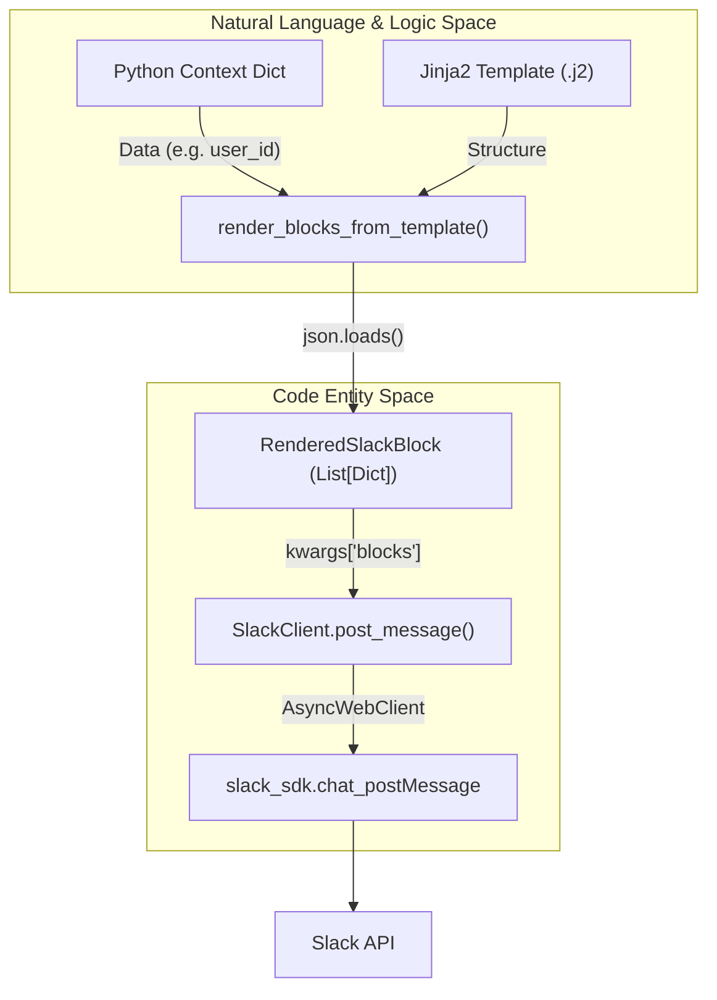
Sources: [shared/openai-slackbot/openai_slackbot/clients/slack.py:60-66](), [shared/openai-slackbot/openai_slackbot/clients/slack.py:118-120](), [shared/openai-slackbot/openai_slackbot/utils/slack.py:3]()

---

## Slack Utilities

The `utils/slack.py` module contains helper functions for manipulating Slack block structures and parsing event data.

### Block Manipulation
These functions help manage the state of interactive messages by finding or removing specific UI elements:

| Function | Purpose | Implementation Detail |
| :--- | :--- | :--- |
| `block_id_exists` | Checks if a specific `block_id` is present in a list of blocks. | Uses a list comprehension with `any()` [shared/openai-slackbot/openai_slackbot/utils/slack.py:6-7](). |
| `remove_block_id_if_exists` | Returns a new list of blocks excluding the one with the specified ID. | Uses list comprehension filter [shared/openai-slackbot/openai_slackbot/utils/slack.py:10-11](). |
| `get_block_by_id` | Retrieves a specific block dictionary by its ID. | Iterates through blocks and returns the match [shared/openai-slackbot/openai_slackbot/utils/slack.py:14-18](). |

### Content Extraction
The `extract_text_from_event` function is critical for handling the variety of ways text can be delivered in Slack events (direct text vs. complex block attachments). It traverses nested structures: `attachments` -> `message_blocks` -> `elements` to find and join text snippets [shared/openai-slackbot/openai_slackbot/utils/slack.py:21-44]().

### ID Formatting
The `render_slack_id_to_mention` function converts raw Slack IDs into the specific syntax required for mentions [shared/openai-slackbot/openai_slackbot/utils/slack.py:47-59]():
*   `U...` (User) -> `<@ID>`
*   `S...` (Subteam/Usergroup) -> `<!subteam|ID>`
*   `C...` (Channel) -> `<#ID>`

**Code Entity Relationship: Event Processing**

Title: Slack Event Parsing and Utility Mapping
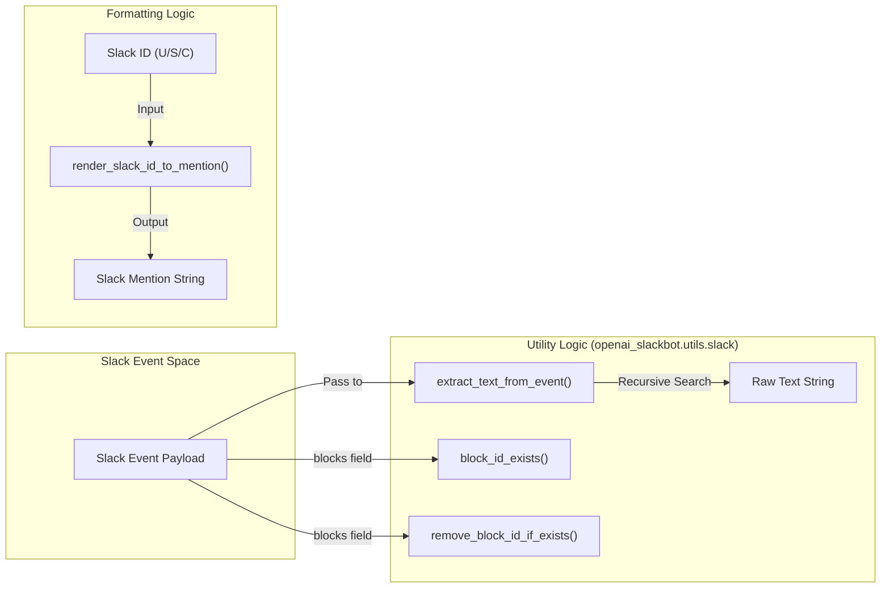
Sources: [shared/openai-slackbot/openai_slackbot/utils/slack.py:6-11](), [shared/openai-slackbot/openai_slackbot/utils/slack.py:21-44](), [shared/openai-slackbot/openai_slackbot/utils/slack.py:47-59]()

---

## Environment Variable Utilities

The `openai_slackbot.utils.envvars` module provides a strictly typed way to load configuration from the environment.

### `string(key, default)`
This utility ensures that required environment variables are present before the bot starts.
*   If the variable is found, it returns the string [shared/openai-slackbot/openai_slackbot/utils/envvars.py:6-11]().
*   If not found and no `default` is provided, it raises a `ValueError` [shared/openai-slackbot/openai_slackbot/utils/envvars.py:8-9]().
*   This is used extensively in bot initialization to validate credentials like `SLACK_BOT_TOKEN` or `OPENAI_API_KEY`.

Sources: [shared/openai-slackbot/openai_slackbot/utils/envvars.py:5-11]()

---

# Page: Shared Library Tests

# Shared Library Tests

<details>
<summary>Relevant source files</summary>

The following files were used as context for generating this wiki page:

- [shared/openai-slackbot/tests/__init__.py](shared/openai-slackbot/tests/__init__.py)
- [shared/openai-slackbot/tests/clients/__init__.py](shared/openai-slackbot/tests/clients/__init__.py)
- [shared/openai-slackbot/tests/clients/test_slack.py](shared/openai-slackbot/tests/clients/test_slack.py)
- [shared/openai-slackbot/tests/conftest.py](shared/openai-slackbot/tests/conftest.py)
- [shared/openai-slackbot/tests/test_bot.py](shared/openai-slackbot/tests/test_bot.py)
- [shared/openai-slackbot/tests/test_handlers.py](shared/openai-slackbot/tests/test_handlers.py)

</details>


The `openai-slackbot` shared library includes a comprehensive test suite designed to validate the core framework abstractions, the Slack client wrapper, and the event dispatch mechanism used by all bots in the repository. The suite utilizes `pytest` along with `unittest.mock` to simulate Slack API interactions and OpenAI configurations without requiring live network connections.

## Test Infrastructure and Fixtures

The test suite relies on a central `conftest.py` file to provide reusable fixtures that mock external dependencies like the Slack Bolt framework, the Slack Web Client, and OpenAI modules.

### Mock Entities

| Fixture Name | Mocked Entity | Purpose |
| :--- | :--- | :--- |
| `mock_slack_app` | `slack_bolt.app.async_app.AsyncApp` | Simulates the main Bolt application instance for event registration [shared/openai-slackbot/tests/conftest.py:9-11](). |
| `mock_socket_mode_handler` | `slack_bolt.adapter.socket_mode.async_handler.AsyncSocketModeHandler` | Simulates the Socket Mode connection handler and its start loop [shared/openai-slackbot/tests/conftest.py:15-21](). |
| `mock_openai` | `openai` module | Patches the system modules to prevent real OpenAI calls [shared/openai-slackbot/tests/conftest.py:25-28](). |
| `mock_slack_asyncwebclient` | `slack_sdk.web.async_client.AsyncWebClient` | Provides a mock for the underlying Slack SDK client [shared/openai-slackbot/tests/conftest.py:32-34](). |
| `mock_slack_client` | `openai_slackbot.clients.slack.SlackClient` | An instance of the shared library's Slack wrapper initialized with a mock web client [shared/openai-slackbot/tests/conftest.py:38-39](). |

### Concrete Test Handlers
Because `BaseMessageHandler` and `BaseActionHandler` are abstract, `conftest.py` defines `MockMessageHandler` and `MockActionHandler` to test the dispatch logic [shared/openai-slackbot/tests/conftest.py:52-75]().

**Sources:**
- [shared/openai-slackbot/tests/conftest.py:1-75]()

## Bot Initialization Tests

The `test_bot.py` file validates that the `start_bot` entry point correctly wires together the Slack application, registers the provided handlers, and initiates the Socket Mode connection.

### Initialization Sequence Diagram

This diagram illustrates how `start_bot` interacts with the mocked entities during the setup phase.

"Bot Initialization Data Flow"
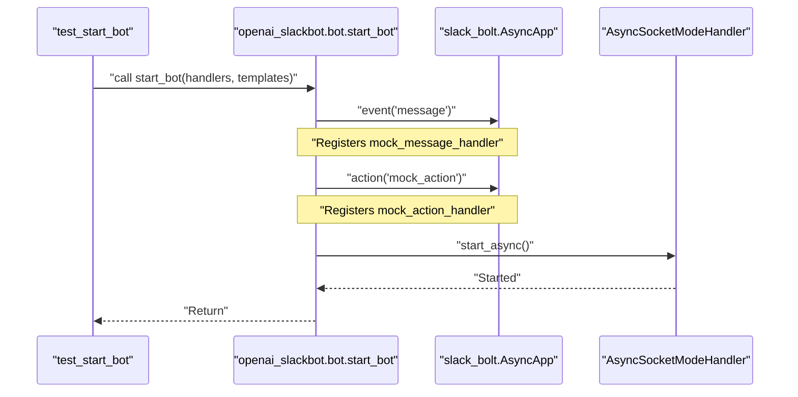

The test asserts that `mock_slack_app.event` is called with "message" and `mock_slack_app.action` is called with the specific `action_id` defined in the mock handler [shared/openai-slackbot/tests/test_bot.py:16-18]().

**Sources:**
- [shared/openai-slackbot/tests/test_bot.py:4-19]()
- [shared/openai-slackbot/tests/conftest.py:52-75]()

## Handler Dispatch Tests

Tests in `test_handlers.py` focus on the `maybe_handle` method logic, which is responsible for acknowledging Slack events and determining if the specific handler should execute based on the event payload.

### Message Handler Dispatch
The `test_message_handler` uses a parameterization strategy to verify that the bot only responds to valid subtypes. For example, it confirms that the handler executes for standard "message" types but ignores "bot_message" subtypes to prevent infinite loops [shared/openai-slackbot/tests/test_handlers.py:6-19]().

### Action Handler Dispatch
The `test_action_handler` ensures that when a Slack block action (like a button click) occurs, the library correctly extracts the action data, acknowledges the request (`ack`), and invokes the concrete `handle` implementation [shared/openai-slackbot/tests/test_handlers.py:28-44]().

### Code Entity Mapping: Handler Logic

"Handler Dispatch Logic Mapping"
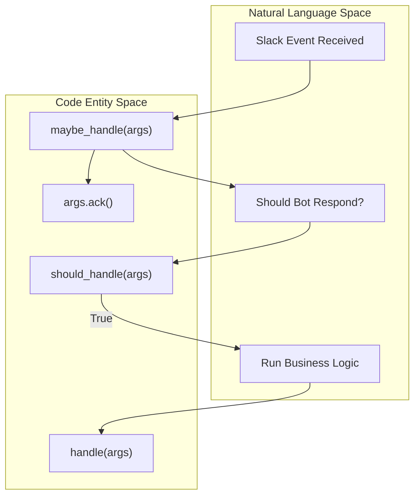

**Sources:**
- [shared/openai-slackbot/tests/test_handlers.py:6-45]()
- [shared/openai-slackbot/tests/conftest.py:57-61]()

## Slack Client Tests

The `test_slack.py` suite validates the `SlackClient` wrapper, ensuring it correctly parses Slack API responses and handles errors gracefully.

### Tested Functionalities

| Function | Scenario | Verification |
| :--- | :--- | :--- |
| `get_message_link` | Success | Verifies that the permalink URL is correctly extracted from the `chat_getPermalink` response [shared/openai-slackbot/tests/clients/test_slack.py:8-21](). |
| `post_message` | Success | Ensures the response is correctly cast into a `CreateSlackMessageResponse` object [shared/openai-slackbot/tests/clients/test_slack.py:34-55](). |
| `add_reaction` | Already Reacted | Validates that if Slack returns an `already_reacted` error, the client suppresses the exception and returns an empty dict [shared/openai-slackbot/tests/clients/test_slack.py:108-116](). |
| `update_message` | Failure | Confirms that a non-OK response from Slack triggers a Python `Exception` [shared/openai-slackbot/tests/clients/test_slack.py:91-97](). |

### Slack Client Error Handling Pattern

"SlackClient Error Handling"
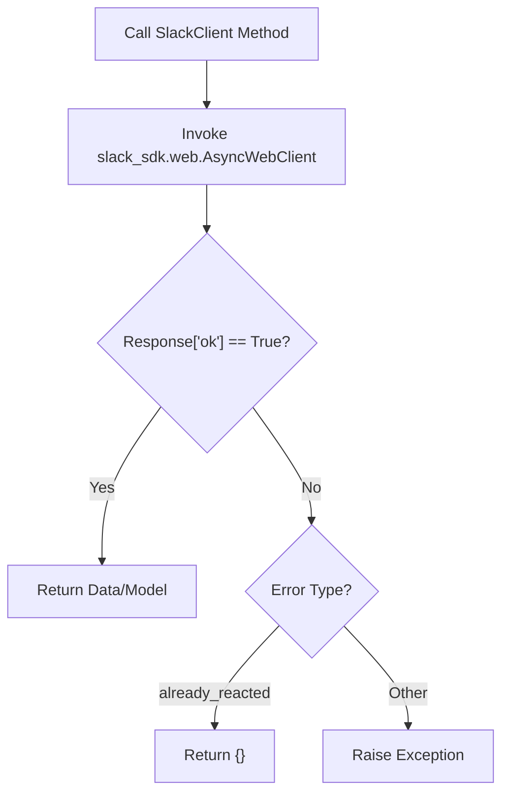

**Sources:**
- [shared/openai-slackbot/tests/clients/test_slack.py:1-126]()
- [shared/openai-slackbot/tests/conftest.py:38-39]()

---

# Page: SDLC Slackbot

# SDLC Slackbot

<details>
<summary>Relevant source files</summary>

The following files were used as context for generating this wiki page:

- [bots/sdlc-slackbot/README.md](bots/sdlc-slackbot/README.md)
- [bots/sdlc-slackbot/sdlc_slackbot/bot.py](bots/sdlc-slackbot/sdlc_slackbot/bot.py)

</details>


The SDLC Slackbot is an AI-powered Slack bot that automates security review triage by evaluating project submissions and determining whether they require formal security review. The bot collects project information through interactive Slack forms, analyzes the content using OpenAI's GPT models, and provides risk assessments with confidence scores.

This document covers the bot's architecture, core workflows, AI integration, and database schema. For information about shared infrastructure components used across all bots, see [Shared Components](#3). For setup and configuration details, see [Setup and Configuration](#4.1).

## Architecture Overview

The SDLC Slackbot follows an event-driven architecture with form-based user interactions, AI-powered analysis, and persistent data storage.

### System Components

```mermaid
graph TB
    subgraph "User Interface Layer"
        SlackForms["Slack Interactive Forms"]
        SlackEvents["Slack Events (app_mention, message)"]
    end
    
    subgraph "Core Bot Logic"
        BotMain["bot.py - Main Event Loop"]
        EventHandlers["handle_app_mention_events / handle_message_events"]
        FormHandlers["submit_form / submit_followup_questions"]
    end
    
    subgraph "Business Logic Layer"
        Utils["utils.py - Form Processing"]
        Validation["validate.py - Input Validation"]
        AIIntegration["ask_ai() / get_response_with_retry()"]
    end
    
    subgraph "Data Layer"
        DatabaseModels["database.py Models"]
        Assessment["Assessment Model"]
        Resource["Resource Model"] 
        Question["Question Model"]
    end
    
    subgraph "External Integrations"
        GoogleDocs["gdoc.py - gdoc_get()"]
        SlackAPI["Slack WebClient / async_fetch_slack()"]
        OpenAIAPI["OpenAI API"]
        PostgreSQL["PostgreSQL Database (DATABASE_URL)"]
    end
    
    subgraph "Background Services"
        Monitor["update_resources() Thread"]
    end
    
    SlackEvents --> EventHandlers
    SlackForms --> FormHandlers
    EventHandlers --> Utils
    FormHandlers --> Utils
    Utils --> Validation
    Utils --> AIIntegration
    Utils --> DatabaseModels
    DatabaseModels --> Assessment
    DatabaseModels --> Resource
    DatabaseModels --> Question
    AIIntegration --> OpenAIAPI
    Utils --> GoogleDocs
    Utils --> SlackAPI
    GoogleDocs --> "Google Docs API"
    DatabaseModels --> PostgreSQL
    Monitor --> DatabaseModels
    Monitor --> AIIntegration
```

Sources: [bots/sdlc-slackbot/sdlc_slackbot/bot.py:1-472](), [bots/sdlc-slackbot/README.md:1-78](), [bots/sdlc-slackbot/sdlc_slackbot/database.py:1-60]()

### Core Workflow

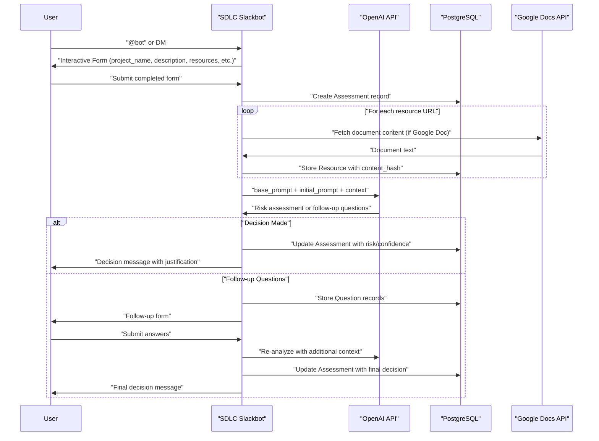

Sources: [bots/sdlc-slackbot/sdlc_slackbot/bot.py:239-322](), [bots/sdlc-slackbot/sdlc_slackbot/bot.py:324-373]()

## Event Handling System

The bot's core event handling is built on the Slack Bolt framework with async support.

### Primary Event Handlers

| Handler Function | Event Type | Purpose |
|------------------|------------|---------|
| `handle_app_mention_events` | `app_mention` | Responds to @mentions with assessment form [bots/sdlc-slackbot/sdlc_slackbot/bot.py:187-190]() |
| `handle_message_events` | `message` (DM only) | Responds to direct messages with assessment form [bots/sdlc-slackbot/sdlc_slackbot/bot.py:192-196]() |
| `submit_form` | `submit_form` action | Processes initial project assessment [bots/sdlc-slackbot/sdlc_slackbot/bot.py:239-322]() |
| `submit_followup_questions` | `submit_followup_questions_*` action | Processes follow-up question responses [bots/sdlc-slackbot/sdlc_slackbot/bot.py:324-373]() |

### Form Structure

The initial assessment form is defined as a list of Slack blocks in `bot.py` [bots/sdlc-slackbot/sdlc_slackbot/bot.py:88-111]():

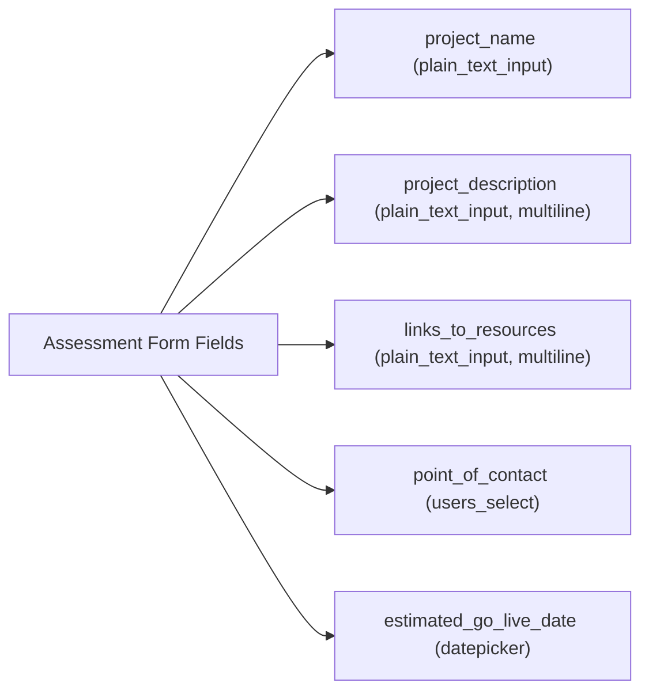

Sources: [bots/sdlc-slackbot/sdlc_slackbot/bot.py:88-111](), [bots/sdlc-slackbot/sdlc_slackbot/bot.py:187-196](), [bots/sdlc-slackbot/sdlc_slackbot/bot.py:461-465]()

## AI Integration and Decision Engine

The bot uses OpenAI's GPT models to analyze project contexts and make risk assessments.

### AI Processing Pipeline

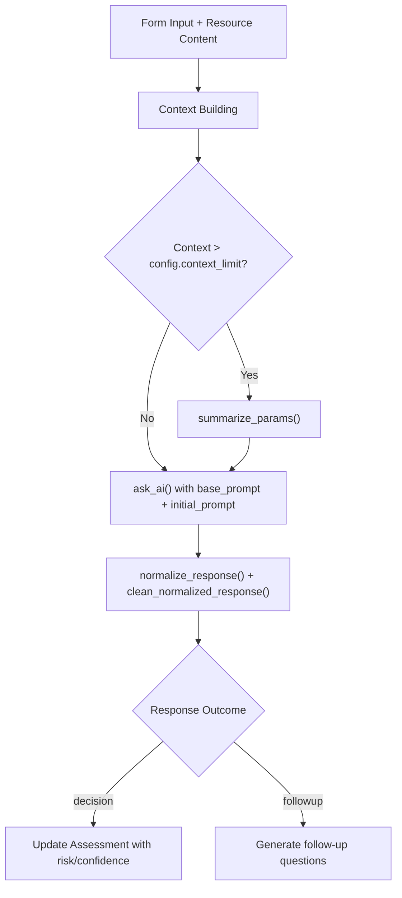

### Risk Assessment Output

The AI generates structured responses with:

- **Risk Score**: 1-10 scale (mapped to strings like "medium-high risk") [bots/sdlc-slackbot/sdlc_slackbot/bot.py:116-123]()
- **Confidence Score**: 1-10 scale (mapped to strings like "extreme confidence") [bots/sdlc-slackbot/sdlc_slackbot/bot.py:125-132]()  
- **Justification**: Text explanation of the decision
- **Outcome**: Either "decision" (final) or "followup" (needs more info)

The `risk_and_confidence_to_string()` function maps numeric scores to human-readable descriptions using lookup tables [bots/sdlc-slackbot/sdlc_slackbot/bot.py:114-145]().

Sources: [bots/sdlc-slackbot/sdlc_slackbot/bot.py:174-184](), [bots/sdlc-slackbot/sdlc_slackbot/bot.py:198-219](), [bots/sdlc-slackbot/sdlc_slackbot/bot.py:114-154](), [bots/sdlc-slackbot/sdlc_slackbot/bot.py:288-301]()

## Database Schema

The bot uses three main database models built with the Peewee ORM in `database.py`.

### Entity Relationship Model

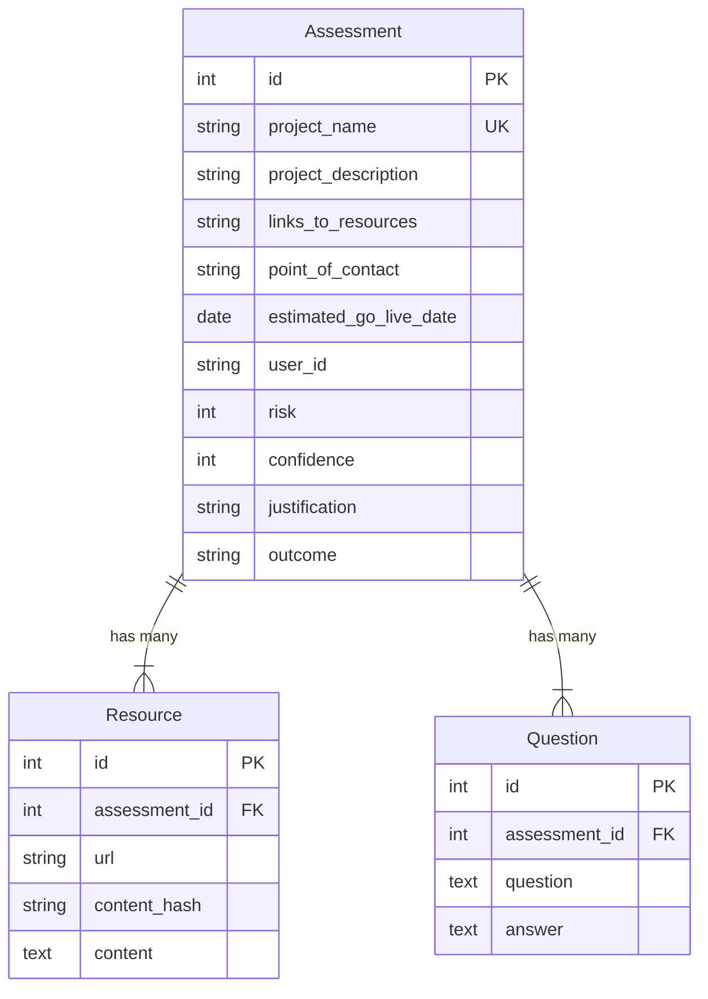

### Key Database Operations

- **Assessment Creation**: `Assessment.create(**params, user_id=body["user"]["id"])` with unique constraint on `project_name` [bots/sdlc-slackbot/sdlc_slackbot/bot.py:259-261]()
- **Resource Storage**: Bulk insert with `Resource.insert_many(resources).execute()` [bots/sdlc-slackbot/sdlc_slackbot/bot.py:275]()
- **Content Monitoring**: Resources tracked by `content_hash` (SHA256) for change detection [bots/sdlc-slackbot/sdlc_slackbot/bot.py:44-45]()
- **Question Management**: Follow-up questions stored and retrieved for multi-step assessments [bots/sdlc-slackbot/sdlc_slackbot/bot.py:300-301]()

Sources: [bots/sdlc-slackbot/sdlc_slackbot/database.py:1-60](), [bots/sdlc-slackbot/sdlc_slackbot/bot.py:259-275](), [bots/sdlc-slackbot/sdlc_slackbot/bot.py:300-301]()

## Resource Integration System

The bot can fetch and analyze content from external resources to inform its risk assessments.

### Supported Resource Types

```mermaid
graph LR
    URLExtraction["extract_urls()"]
    URLExtraction --> GoogleDocs["Google Docs URLs"]
    URLExtraction --> SlackLinks["Slack Archive Links"]
    
    GoogleDocs --> gdoc_get["gdoc_get()"]
    SlackLinks --> async_fetch_slack["async_fetch_slack()"]
    
    gdoc_get --> Content["Document Content"]
    async_fetch_slack --> Content
    Content --> ContentHash["hash_content() (SHA256)"]
    ContentHash --> Database["Resource table"]
```

### Content Fetching Logic

The `content_fetchers` list defines URL pattern matching and corresponding fetch functions [bots/sdlc-slackbot/sdlc_slackbot/bot.py:70-76]():

```python
content_fetchers = [
    (
        lambda u: u.startswith(("https://docs.google.com/document", "docs.google.com/document")),
        gdoc_get,
    ),
    (lambda u: "slack.com/archives" in u, async_fetch_slack),
]
```

Sources: [bots/sdlc-slackbot/sdlc_slackbot/bot.py:48-86](), [bots/sdlc-slackbot/sdlc_slackbot/bot.py:70-76](), [bots/sdlc-slackbot/sdlc_slackbot/bot.py:264-275]()

## Background Monitoring System

A dedicated thread `update_resources` continuously monitors stored resources for changes and triggers re-assessment when updates are detected [bots/sdlc-slackbot/sdlc_slackbot/bot.py:375-435]().

### Monitoring Workflow

```mermaid
graph TB
    MonitorThread["update_resources() Thread"]
    SleepLoop["Sleep 6 seconds"]
    FetchAssessments["Assessment.select()"]
    CheckResources["Resource.select() for Assessment"]
    CompareHash{"hash_content(new) != old_hash?"}
    FetchNewContent["fetch_content(url)"]
    BuildContext["Build context with previous_decision and new_context"]
    AIReassess["ask_ai() with config.update_prompt"]
    CheckOutcome{"Outcome = 'unchanged'?"}
    UpdateDB["Update Assessment / Resource records"]
    SendNotification["send_update_notification()"]
    
    MonitorThread --> SleepLoop
    SleepLoop --> FetchAssessments
    FetchAssessments --> CheckResources
    CheckResources --> CompareHash
    CompareHash -->|Yes| FetchNewContent
    CompareHash -->|No| SleepLoop
    FetchNewContent --> BuildContext
    BuildContext --> AIReassess
    AIReassess --> CheckOutcome
    CheckOutcome -->|No| UpdateDB
    CheckOutcome -->|Yes| SleepLoop
    UpdateDB --> SendNotification
    SendNotification --> SleepLoop
```

The monitoring system uses a structured context format containing the original resource content, the previous decision, and the updated content to determine if the risk profile has changed [bots/sdlc-slackbot/sdlc_slackbot/bot.py:406-412]().

Sources: [bots/sdlc-slackbot/sdlc_slackbot/bot.py:375-435](), [bots/sdlc-slackbot/sdlc_slackbot/bot.py:467-468](), [bots/sdlc-slackbot/sdlc_slackbot/bot.py:30-42]()

## Configuration and Prompts

The bot's behavior is controlled through a `config.toml` file that defines AI prompts, context limits, and operational parameters. The configuration is loaded using the `load_config()` and `get_config()` functions from the config module [bots/sdlc-slackbot/sdlc_slackbot/bot.py:20]().

### Key Configuration Elements

| Setting | Purpose |
|---------|---------|
| `base_prompt` | Core system prompt for AI interactions |
| `initial_prompt` | Prompt for initial risk assessment |
| `update_prompt` | Prompt for re-assessment when resources change |
| `summary_prompt` | Prompt for content summarization when context too long |
| `context_limit` | Maximum context length before summarization [bots/sdlc-slackbot/sdlc_slackbot/bot.py:179]() |
| `openai_organization_id` | OpenAI API organization identifier |
| `notification_channel_id` | Slack channel for update notifications [bots/sdlc-slackbot/sdlc_slackbot/bot.py:41]() |

Sources: [bots/sdlc-slackbot/sdlc_slackbot/bot.py:440-445](), [bots/sdlc-slackbot/README.md:58-59](), [bots/sdlc-slackbot/sdlc_slackbot/config.py:1-40]()

---

# Page: Setup and Configuration

# Setup and Configuration

<details>
<summary>Relevant source files</summary>

The following files were used as context for generating this wiki page:

- [bots/sdlc-slackbot/Makefile](bots/sdlc-slackbot/Makefile)
- [bots/sdlc-slackbot/README.md](bots/sdlc-slackbot/README.md)
- [bots/sdlc-slackbot/sdlc_slackbot/.env.template](bots/sdlc-slackbot/sdlc_slackbot/.env.template)
- [bots/sdlc-slackbot/sdlc_slackbot/config.py](bots/sdlc-slackbot/sdlc_slackbot/config.py)
- [bots/sdlc-slackbot/sdlc_slackbot/config.toml](bots/sdlc-slackbot/sdlc_slackbot/config.toml)

</details>


This document covers the setup and configuration process for the SDLC Slackbot, including environment variables, configuration files, build system, and required integrations. This page focuses specifically on getting the bot operational in your environment.

For information about the bot's core logic and event handling, see [Core Logic and Event Handling](#4.2). For details about the AI integration and prompt configuration, see [AI Integration and Prompts](#4.3).

## Prerequisites and Dependencies

The SDLC Slackbot requires several external services and configurations before it can be deployed:

```mermaid
graph TB
    subgraph "External Requirements"
        SlackApp["Slack Application"]
        SocketMode["Socket Mode Enabled"]
        OpenAIKey["OpenAI API Key"]
        PostgresDB["PostgreSQL Database"]
        GoogleCreds["Google Docs Credentials (Optional)"]
    end
    
    subgraph "Slack App Configuration"
        AppToken["SOCKET_APP_TOKEN"]
        BotToken["SLACK_BOT_TOKEN"]
        Scopes["Required OAuth Scopes"]
    end
    
    subgraph "Required Scopes"
        AppMentions["app_mentions:read"]
        ChannelJoin["channels:join"]
        ChannelRead["channels:read"]
        ChannelHistory["channels:history"]
        ChatWrite["chat:write"]
        GroupsHistory["groups:history"]
        GroupsRead["groups:read"]
        GroupsWrite["groups:write"]
        UserGroupsRead["usergroups:read"]
        UsersRead["users:read"]
        UsersEmail["users:read.email"]
    end
    
    SlackApp --> SocketMode
    SlackApp --> AppToken
    SlackApp --> BotToken
    SlackApp --> Scopes
    
    Scopes --> AppMentions
    Scopes --> ChannelJoin
    Scopes --> ChannelRead
    Scopes --> ChannelHistory
    Scopes --> ChatWrite
    Scopes --> GroupsHistory
    Scopes --> GroupsRead
    Scopes --> GroupsWrite
    Scopes --> UserGroupsRead
    Scopes --> UsersRead
    Scopes --> UsersEmail
```

**Sources:** [bots/sdlc-slackbot/README.md:11-40]()

## Environment Configuration

### Environment Variables Setup

The bot uses a `.env` file for sensitive configuration data. Initialize the environment file using the provided template:

```bash
make init-env-file
```

This copies the template from `sdlc_slackbot/.env.template` to `sdlc_slackbot/.env`:

| Variable | Purpose | Source |
|----------|---------|--------|
| `SLACK_BOT_TOKEN` | Bot User OAuth Token (`xoxb-`) | [bots/sdlc-slackbot/sdlc_slackbot/.env.template:1-1]() |
| `SOCKET_APP_TOKEN` | App-Level Token with `connections:write` scope (`xapp-`) | [bots/sdlc-slackbot/sdlc_slackbot/.env.template:2-2]() |
| `OPENAI_API_KEY` | OpenAI API authentication | [bots/sdlc-slackbot/sdlc_slackbot/.env.template:3-3]() |

```mermaid
graph LR
    subgraph "Environment Setup Flow"
        Template["sdlc_slackbot/.env.template"]
        MakeCommand["make init-env-file"]
        EnvFile["sdlc_slackbot/.env"]
        ManualEdit["Manual Token Entry"]
    end
    
    subgraph "Token Sources"
        SlackSettings["Slack App Settings"]
        OpenAIPlatform["OpenAI Platform"]
    end
    
    Template --> MakeCommand
    MakeCommand --> EnvFile
    EnvFile --> ManualEdit
    
    SlackSettings --> ManualEdit
    OpenAIPlatform --> ManualEdit
```

**Sources:** [bots/sdlc-slackbot/Makefile:5-6](), [bots/sdlc-slackbot/sdlc_slackbot/.env.template:1-4]()

## TOML Configuration Structure

The primary configuration is managed through `config.toml`, which is validated by the `Config` class in `config.py` using Pydantic.

### Core Configuration Parameters

The `Config` Pydantic model ensures that all required fields are present and valid, such as verifying that `notification_channel_id` starts with a 'C' via the `validate_channel` function.

```mermaid
graph TB
    subgraph "config.py:Config Class"
        OrgID["openai_organization_id: str"]
        NotifyChannel["notification_channel_id: str"]
        ContextLimit["context_limit: int"]
        
        subgraph "AI Prompts"
            BasePrompt["base_prompt: str"]
            InitialPrompt["initial_prompt: str"]
            UpdatePrompt["update_prompt: str"]
            SummaryPrompt["summary_prompt: str"]
        end
        
        subgraph "User Messages"
            ReviewingMsg["reviewing_message: str"]
            RecoverableErr["recoverable_error_message: str"]
            IrrecoverableErr["irrecoverable_error_message: str"]
        end
    end
    
    subgraph "Configuration Usage"
        AIService["OpenAI Service"]
        SlackNotify["Slack Notifications"]
        ErrorHandling["Error Handling"]
        UserFeedback["User Feedback"]
    end
    
    OrgID --> AIService
    NotifyChannel --> SlackNotify
    BasePrompt --> AIService
    InitialPrompt --> AIService
    UpdatePrompt --> AIService
    SummaryPrompt --> AIService
    
    ReviewingMsg --> UserFeedback
    RecoverableErr --> ErrorHandling
    IrrecoverableErr --> ErrorHandling
```

### Critical Configuration Values

| Parameter | Description | Example | Required |
|-----------|-------------|---------|----------|
| `openai_organization_id` | OpenAI organization identifier | `"org-abc123"` | Yes |
| `notification_channel_id` | Slack channel for notifications (must start with 'C') | `"C1234567890"` | Yes |
| `context_limit` | Token limit for AI context | `31500` | Yes |

**Sources:** [bots/sdlc-slackbot/sdlc_slackbot/config.toml:1-68](), [bots/sdlc-slackbot/sdlc_slackbot/config.py:12-36]()

## Build and Initialization Process

### Project Initialization

The build system uses a combination of `Makefile` commands and Python package management. The `load_config` function in `config.py` initializes the configuration by loading environment variables and parsing the TOML file.

```mermaid
flowchart TD
    Start["Project Setup Start"]
    InitPyproject["make init-pyproject"]
    CleanVenv["make clean-venv"]
    ActivateVenv["source venv/bin/activate"]
    BuildBot["make build-bot BOT=sdlc-slackbot"]
    RunBot["make run-bot BOT=sdlc-slackbot"]
    
    Start --> InitPyproject
    InitPyproject --> CleanVenv
    CleanVenv --> ActivateVenv
    ActivateVenv --> BuildBot
    BuildBot --> RunBot
    
    subgraph "Generated Files"
        PyprojectToml["pyproject.toml"]
        VenvDir["venv/"]
        InstalledDeps["Installed Dependencies"]
    end
    
    InitPyproject --> PyprojectToml
    CleanVenv --> VenvDir
    BuildBot --> InstalledDeps
```

### Build Commands

Execute these commands in sequence:

1. **Initialize project structure** (from bot directory):
   ```bash
   make init-pyproject
   ```
   This command uses `sed` to replace `$REPO_ROOT` in the template with the actual absolute path.

2. **Set up virtual environment** (from repo root):
   ```bash
   make clean-venv
   source venv/bin/activate
   ```

3. **Build and install bot** (from repo root):
   ```bash
   make build-bot BOT=sdlc-slackbot
   ```

**Sources:** [bots/sdlc-slackbot/README.md:44-54](), [bots/sdlc-slackbot/Makefile:8-10](), [bots/sdlc-slackbot/sdlc_slackbot/config.py:38-47]()

## Optional Google Docs Integration

For enhanced project analysis, the bot can integrate with Google Docs to fetch documentation content.

### Setup Steps

1. Navigate to **Google Cloud Console**.
2. Select your project and navigate to **APIs & Services > Credentials**.
3. Under **OAuth 2.0 Client IDs**, find your client ID and download the JSON file.
4. Save it as `credentials.json` in the `sdlc-slackbot/sdlc_slackbot` directory.

```mermaid
graph TB
    subgraph "Google Docs Setup"
        GCPConsole["Google Cloud Console"]
        APIsServices["APIs & Services > Credentials"]
        OAuth2Client["OAuth 2.0 Client IDs"]
        DownloadJSON["Download JSON"]
        SaveCreds["Save as credentials.json"]
    end
    
    subgraph "File Location"
        BotDir["sdlc-slackbot/sdlc_slackbot/"]
        CredsFile["credentials.json"]
    end
    
    GCPConsole --> APIsServices
    APIsServices --> OAuth2Client
    OAuth2Client --> DownloadJSON
    DownloadJSON --> SaveCreds
    SaveCreds --> BotDir
    BotDir --> CredsFile
```

**Sources:** [bots/sdlc-slackbot/README.md:61-67]()

## Channel Permissions and Deployment

### Required Channel Access

The bot must be explicitly added to channels where it needs to operate. It requires access to:
- The `notification_channel_id` specified in `config.toml`.
- Any channel where it is mentioned for project reviews.

### Deployment Verification

After configuration, run the bot from the repo root with:

```bash
make run-bot BOT=sdlc-slackbot
```

Verify the bot is properly configured by checking:
- Bot appears online in Slack.
- Bot responds to mentions in configured channels.
- `load_config` in `config.py` completes without validation errors.
- OpenAI API calls succeed using the provided `openai_organization_id`.

**Sources:** [bots/sdlc-slackbot/README.md:70-76](), [bots/sdlc-slackbot/sdlc_slackbot/config.py:50-54]()

---

# Page: Core Logic and Event Handling

# Core Logic and Event Handling

<details>
<summary>Relevant source files</summary>

The following files were used as context for generating this wiki page:

- [bots/sdlc-slackbot/sdlc_slackbot/bot.py](bots/sdlc-slackbot/sdlc_slackbot/bot.py)
- [bots/sdlc-slackbot/sdlc_slackbot/validate.py](bots/sdlc-slackbot/sdlc_slackbot/validate.py)

</details>


This document covers the core event handling logic and main workflow orchestration of the SDLC Slackbot. It explains how the bot processes Slack events, manages form submissions, handles AI-powered assessments, and monitors resource changes in the background.

For information about AI integration and prompt engineering, see [AI Integration and Prompts](#4.3). For database schema details, see [Database Schema and Data Models](#4.4). For Google Docs integration specifics, see [Google Docs Integration](#4.5).

## Event Handling Architecture

The SDLC Slackbot uses Slack's Socket Mode to handle real-time events. The main event handlers are registered during bot initialization and respond to user interactions.

```mermaid
graph TB
    SlackEvent["Slack Event"] --> EventRouter["Event Router"]
    
    EventRouter --> AppMention["handle_app_mention_events"]
    EventRouter --> DirectMessage["handle_message_events"] 
    EventRouter --> FormSubmit["submit_form"]
    EventRouter --> FollowupSubmit["submit_followup_questions"]
    
    AppMention --> ShowForm["Display Assessment Form"]
    DirectMessage --> ShowForm
    FormSubmit --> ProcessAssessment["Process Assessment"]
    FollowupSubmit --> ProcessFollowup["Process Follow-up Answers"]
    
    ProcessAssessment --> AIAnalysis["AI Risk Analysis"]
    ProcessAssessment --> ResourceFetch["Fetch Resource Content"]
    ProcessFollowup --> AIReanalysis["AI Re-analysis"]
    
    AIAnalysis --> Decision["Risk Decision"]
    AIAnalysis --> Questions["Follow-up Questions"]
    AIReanalysis --> FinalDecision["Final Risk Decision"]
```

**Sources:** [bots/sdlc-slackbot/sdlc_slackbot/bot.py:187-197](), [bots/sdlc-slackbot/sdlc_slackbot/bot.py:459-465]()

### Event Handler Functions

| Handler Function | Trigger | Purpose |
|------------------|---------|---------|
| `handle_app_mention_events` | App mention in channel | Display assessment form in thread [bots/sdlc-slackbot/sdlc_slackbot/bot.py:187-190]() |
| `handle_message_events` | Direct message to bot | Display assessment form in DM [bots/sdlc-slackbot/sdlc_slackbot/bot.py:192-197]() |
| `submit_form` | Initial form submission | Process project assessment [bots/sdlc-slackbot/sdlc_slackbot/bot.py:239-322]() |
| `submit_followup_questions` | Follow-up form submission | Process additional answers [bots/sdlc-slackbot/sdlc_slackbot/bot.py:324-373]() |

**Sources:** [bots/sdlc-slackbot/sdlc_slackbot/bot.py:187-197](), [bots/sdlc-slackbot/sdlc_slackbot/bot.py:239-322](), [bots/sdlc-slackbot/sdlc_slackbot/bot.py:324-373]()

## Form Workflow and Processing

The bot presents users with a structured assessment form and processes responses through a multi-stage workflow.

### Initial Assessment Form

The assessment form is defined as a static structure with input blocks for project information:

```mermaid
graph LR
    FormDefinition["form array"] --> ProjectName["project_name input_block"]
    FormDefinition --> ProjectDesc["project_description input_block"]
    FormDefinition --> LinksResource["links_to_resources input_block"]
    FormDefinition --> PointContact["point_of_contact input_block"]
    FormDefinition --> GoLiveDate["estimated_go_live_date input_block"]
    FormDefinition --> SubmitButton["submit_block"]
```

**Sources:** [bots/sdlc-slackbot/sdlc_slackbot/bot.py:88-111]()

### Form Processing Pipeline

When a user submits the initial assessment form, the `submit_form` function orchestrates a complex processing pipeline:

```mermaid
flowchart TD
    FormSubmit["submit_form()"] --> Ack["ack()"]
    Ack --> ExtractValues["get_form_input()"]
    ExtractValues --> Validate["validate.required()"]
    
    Validate --> CreateAssessment["Assessment.create()"]
    CreateAssessment --> ExtractUrls["extract_urls()"]
    ExtractUrls --> FetchContent["fetch_content()"]
    FetchContent --> CreateResources["Resource.insert_many()"]
    
    CreateResources --> BuildContext["model_params_to_str()"]
    BuildContext --> CheckLength["len(context) > config.context_limit"]
    
    CheckLength -->|Yes| Summarize["summarize_params()"]
    CheckLength -->|No| AICall["get_response_with_retry()"]
    Summarize --> AICall
    
    AICall --> NormalizeResponse["normalize_response()"]
    NormalizeResponse --> CleanResponse["clean_normalized_response()"]
    
    CleanResponse --> CheckOutcome{"item['outcome']"}
    CheckOutcome -->|decision| UpdateAssessment["assessment.update()"]
    CheckOutcome -->|followup| CreateQuestions["Question.insert_many()"]
    
    UpdateAssessment --> SendDecision["Send decision message"]
    CreateQuestions --> BuildFollowupForm["Build dynamic form"]
    BuildFollowupForm --> DisplayForm["Display follow-up form"]
```

**Sources:** [bots/sdlc-slackbot/sdlc_slackbot/bot.py:239-322](), [bots/sdlc-slackbot/sdlc_slackbot/bot.py:169-172](), [bots/sdlc-slackbot/sdlc_slackbot/bot.py:174-184]()

### Content Fetching System

The bot can fetch content from multiple sources based on URL patterns:

```mermaid
graph TB
    UrlExtraction["extract_urls()"] --> ContentFetchers["content_fetchers array"]
    
    ContentFetchers --> GoogleDocsCheck["Google Docs URL check"]
    ContentFetchers --> SlackCheck["Slack archive URL check"]
    
    GoogleDocsCheck -->|Match| GdocFetch["gdoc_get()"]
    SlackCheck -->|Match| SlackFetch["async_fetch_slack()"]
    
    GdocFetch --> ContentHash["hash_content()"]
    SlackFetch --> ContentHash
    ContentHash --> ResourceCreate["Resource.create()"]
```

**Sources:** [bots/sdlc-slackbot/sdlc_slackbot/bot.py:53-86](), [bots/sdlc-slackbot/sdlc_slackbot/bot.py:70-76]()

## Background Resource Monitoring

The bot runs a continuous background thread `update_resources` that monitors resources for changes and triggers re-assessment when updates are detected.

### Monitoring Thread Architecture

```mermaid
graph TB
    MainThread["Main Thread"] --> BackgroundThread["update_resources Thread"]
    BackgroundThread --> SleepLoop["time.sleep(monitor_thread_sleep_seconds)"]
    
    SleepLoop --> FetchAssessments["Assessment.select()"]
    FetchAssessments --> CheckResources["Loop through assessment.resources"]
    
    CheckResources --> FetchNewContent["asyncio.run(fetch_content())"]
    FetchNewContent --> CompareHash["Compare content_hash"]
    
    CompareHash -->|Changed| BuildUpdateContext["Build context with previous/new content"]
    CompareHash -->|Unchanged| ContinueLoop["Continue to next resource"]
    
    BuildUpdateContext --> UpdatePrompt["config.base_prompt + config.update_prompt"]
    UpdatePrompt --> AIUpdate["ask_ai()"]
    AIUpdate --> ProcessResponse["Process update response"]
    
    ProcessResponse --> UpdateAssessment["assessment.update()"]
    UpdateAssessment --> SendNotification["send_update_notification()"]
    SendNotification --> SaveResource["resource.save()"]
```

**Sources:** [bots/sdlc-slackbot/sdlc_slackbot/bot.py:375-434](), [bots/sdlc-slackbot/sdlc_slackbot/bot.py:467-468]()

### Update Context Structure

The monitoring system creates a structured context for AI analysis when resources change:

| Field | Description |
|-------|-------------|
| `previous_context` | Original resource content [bots/sdlc-slackbot/sdlc_slackbot/bot.py:408]() |
| `previous_decision` | Risk, confidence, and justification from initial assessment [bots/sdlc-slackbot/sdlc_slackbot/bot.py:409]() |
| `new_context` | Updated resource content [bots/sdlc-slackbot/sdlc_slackbot/bot.py:410]() |

**Sources:** [bots/sdlc-slackbot/sdlc_slackbot/bot.py:405-416]()

## AI Integration Points

The bot integrates with OpenAI at multiple stages of the workflow, with retry logic and response normalization.

### AI Response Processing Pipeline

```mermaid
flowchart TD
    AICall["ask_ai() call"] --> GetResponse["get_response_with_retry()"]
    GetResponse --> RetryLoop["Retry loop (max_retries=1)"]
    
    RetryLoop --> ParseJSON["JSON parsing"]
    ParseJSON -->|Success| NormalizeResponse["normalize_response()"]
    ParseJSON -->|JSONDecodeError| Retry["Increment retry count"]
    
    Retry --> CheckMaxRetries{"retries > max_retries"}
    CheckMaxRetries -->|Yes| ReturnEmpty["return {}"]
    CheckMaxRetries -->|No| RetryLoop
    
    NormalizeResponse --> CleanResponse["clean_normalized_response()"]
    CleanResponse --> ExtractDecision["Extract risk/confidence from decision"]
    ExtractDecision --> ProcessOutcome["Process based on outcome type"]
```

**Sources:** [bots/sdlc-slackbot/sdlc_slackbot/bot.py:198-236]()

### Risk and Confidence Mapping

The bot converts numeric AI responses to human-readable risk and confidence levels via `risk_and_confidence_to_string`:

| Risk Range | Description | Confidence Range | Description |
|------------|-------------|------------------|-------------|
| 1-2 | extremely low risk | 1-2 | extremely low confidence |
| 3 | low risk | 3 | low confidence |
| 4-5 | medium risk | 4-5 | medium confidence |
| 6-7 | medium-high risk | 6-7 | medium-high confidence |
| 8-9 | high risk | 8-9 | high confidence |
| 10 | critical risk | 10 | extreme confidence |

**Sources:** [bots/sdlc-slackbot/sdlc_slackbot/bot.py:114-145]()

## Error Handling and Validation

The bot implements comprehensive error handling at multiple levels to ensure graceful degradation.

### Validation Pipeline

```mermaid
graph LR
    FormInput["Form Input"] --> RequiredCheck["validate.required()"]
    RequiredCheck -->|Pass| DatabaseCreate["Assessment.create()"]
    RequiredCheck -->|Fail| ValidationError["ValidationError"]
    
    DatabaseCreate -->|Success| ContinueProcess["Continue Processing"]
    DatabaseCreate -->|IntegrityError| UniqueError["Unique constraint error"]
    
    ValidationError --> ErrorMessage["Send error message to user"]
    UniqueError --> ErrorMessage
```

The `validate.required()` function checks for the presence of required fields:

- `project_name`
- `project_description` 
- `point_of_contact`

**Sources:** [bots/sdlc-slackbot/sdlc_slackbot/validate.py:8-13](), [bots/sdlc-slackbot/sdlc_slackbot/bot.py:254-261]()

### Exception Handling Strategy

| Exception Type | Handler Location | Recovery Action |
|----------------|------------------|----------------|
| `ValidationError` | Form submission handlers | Send field-specific error message [bots/sdlc-slackbot/sdlc_slackbot/bot.py:315-317]() |
| `IntegrityError` | Database operations | Convert to validation error [bots/sdlc-slackbot/sdlc_slackbot/bot.py:254-261]() |
| `JSONDecodeError` | AI response parsing | Retry via `get_response_with_retry` [bots/sdlc-slackbot/sdlc_slackbot/bot.py:205-209]() |
| `General Exception` | All handlers | Send generic error message and log traceback [bots/sdlc-slackbot/sdlc_slackbot/bot.py:318-321]() |

**Sources:** [bots/sdlc-slackbot/sdlc_slackbot/bot.py:315-321](), [bots/sdlc-slackbot/sdlc_slackbot/bot.py:370-372](), [bots/sdlc-slackbot/sdlc_slackbot/bot.py:432-434](), [bots/sdlc-slackbot/sdlc_slackbot/bot.py:205-209]()

## Data Flow Integration

The core logic coordinates between multiple data sources and processing stages:

```mermaid
graph TB
    subgraph "Input Sources"
        SlackForm["Slack Form Input"]
        GoogleDocs["Google Docs Content"]
        SlackThreads["Slack Thread Content"]
    end
    
    subgraph "Processing Layer"
        FormProcessor["submit_form()"]
        ContentFetcher["fetch_content()"]
        AIProcessor["get_response_with_retry()"]
        ContextBuilder["model_params_to_str()"]
    end
    
    subgraph "Data Storage"
        AssessmentModel["Assessment Model"]
        ResourceModel["Resource Model"] 
        QuestionModel["Question Model"]
    end
    
    subgraph "Background Services"
        MonitorThread["update_resources()"]
        NotificationSender["send_update_notification()"]
    end
    
    SlackForm --> FormProcessor
    GoogleDocs --> ContentFetcher
    SlackThreads --> ContentFetcher
    
    FormProcessor --> ContextBuilder
    ContentFetcher --> ContextBuilder
    ContextBuilder --> AIProcessor
    
    FormProcessor --> AssessmentModel
    ContentFetcher --> ResourceModel
    AIProcessor --> QuestionModel
    
    AssessmentModel --> MonitorThread
    ResourceModel --> MonitorThread
    MonitorThread --> NotificationSender
```

**Sources:** [bots/sdlc-slackbot/sdlc_slackbot/bot.py:239-322](), [bots/sdlc-slackbot/sdlc_slackbot/bot.py:375-434]()

---

# Page: AI Integration and Prompts

# AI Integration and Prompts

<details>
<summary>Relevant source files</summary>

The following files were used as context for generating this wiki page:

- [bots/sdlc-slackbot/sdlc_slackbot/config.toml](bots/sdlc-slackbot/sdlc_slackbot/config.toml)
- [bots/sdlc-slackbot/sdlc_slackbot/utils.py](bots/sdlc-slackbot/sdlc_slackbot/utils.py)

</details>


## Purpose and Scope

This document covers how the SDLC Slackbot integrates with OpenAI's GPT-4 model to perform automated security risk assessment and project triage. It details the prompt engineering strategy, response processing mechanisms, and AI model configuration used to evaluate development projects for security review requirements.

For information about the overall SDLC bot architecture, see [Core Logic and Event Handling](4.2). For database storage of AI assessment results, see [Database Schema and Data Models](4.4).

## AI Integration Architecture

The SDLC bot's AI integration follows a structured approach where user-provided project information is processed through carefully engineered prompts to produce standardized risk assessments.

### Code-to-Logic Mapping
The following diagram maps the logical flow of AI integration to specific code entities in the `sdlc_slackbot` module.

```mermaid
flowchart TD
    UserInput["User Project Submission"] --> PromptEngine["Prompt Engineering Layer"]
    PromptEngine --> AIModel["OpenAI GPT-4-32k"]
    AIModel --> ResponseProcessor["Response Processing"]
    ResponseProcessor --> DecisionOutput["Risk Decision Output"]
    
    subgraph "Prompt Constants (config.toml)"
        BasePrompt["base_prompt"]
        InitialPrompt["initial_prompt"]
        UpdatePrompt["update_prompt"]
        SummaryPrompt["summary_prompt"]
    end
    
    subgraph "AI Utility Functions (utils.py)"
        AskAI["ask_ai()"]
        AskGPT["ask_gpt()"]
        AskClaude["ask_claude()"]
    end
    
    PromptEngine --> BasePrompt
    PromptEngine --> InitialPrompt
    PromptEngine --> UpdatePrompt
    PromptEngine --> SummaryPrompt
    
    AIModel --> AskAI
    AskAI --> AskGPT
    AskAI --> AskClaude
    
    ResponseProcessor --> JSONParsing["json.loads()"]
    JSONParsing --> ErrorHandling["JSONDecodeError Logging"]
```

**Sources:** [bots/sdlc-slackbot/sdlc_slackbot/config.toml:1-61](), [bots/sdlc-slackbot/sdlc_slackbot/utils.py:60-104]()

## Prompt Engineering Strategy

The SDLC bot employs a multi-prompt strategy designed to handle different phases of the security assessment workflow. Each prompt is defined as a string in the configuration file.

### Risk Assessment Prompt (`base_prompt`)

The core risk assessment prompt establishes the AI as a security analyst with specific organizational context and decision-making criteria. It enforces a 1-10 scale for risk and confidence.

| Prompt Component | Purpose | Key Elements |
|------------------|---------|--------------|
| Role Definition | Establishes AI persona | "Highly skilled security analyst" [bots/sdlc-slackbot/sdlc_slackbot/config.toml:9-9]() |
| Organizational Context | Sets resource constraints | "Small company with limited security team" [bots/sdlc-slackbot/sdlc_slackbot/config.toml:10-12]() |
| Risk Factors | Defines evaluation criteria | Model weights, customer data, internet exposure [bots/sdlc-slackbot/sdlc_slackbot/config.toml:14-19]() |
| Decision Format | Standardizes output | Risk score (1-10), confidence score (1-10) [bots/sdlc-slackbot/sdlc_slackbot/config.toml:25-31]() |
| Response Structure | Ensures parseable JSON | `{"outcome": "decision", "decision": {...}, "justification": "..."}` [bots/sdlc-slackbot/sdlc_slackbot/config.toml:35-35]() |

The prompt specifically prioritizes:
- **Data Protection**: Model weights and customer data access.
- **Attack Surface**: Internet-accessible components.
- **Security-Critical Systems**: Authentication, authorization, encryption.

**Sources:** [bots/sdlc-slackbot/sdlc_slackbot/config.toml:8-39]()

### Follow-up Question Prompt (`initial_prompt`)

When the AI determines that additional information is needed, this prompt guides the generation of clarifying questions. It instructs the AI to use the `outcome: followup` state.

**Sources:** [bots/sdlc-slackbot/sdlc_slackbot/config.toml:42-47]()

### Update Assessment Prompt (`update_prompt`)

This prompt handles reassessment when project information changes. It provides the AI with `previous_context` and `new_context` to detect changes affecting security components. If the change is negligible, the AI returns `outcome: unchanged`.

**Sources:** [bots/sdlc-slackbot/sdlc_slackbot/config.toml:49-54]()

### Document Summary Prompt (`summary_prompt`)

Used for analyzing and summarizing security-relevant content from project documentation fetched via Google Docs or Slack links.

**Sources:** [bots/sdlc-slackbot/sdlc_slackbot/config.toml:56-61]()

## AI Model Integration

The bot primarily uses OpenAI's GPT-4-32k model through the `ask_ai()` abstraction.

### AI Abstraction Layer
The bot uses a tiered abstraction for calling AI models, allowing for easy switching between providers.

```mermaid
flowchart TD
    subgraph "Abstraction Layer (utils.py)"
        direction TB
        A["ask_ai(prompt, context)"] --> B["ask_gpt(prompt, context)"]
        A -.-> C["ask_claude(prompt, context)"]
    end

    subgraph "Implementation Detail"
        B --> D["openai.chat.completions.create"]
        C --> E["anthropic.Anthropic.messages.create"]
    end

    D -- "Model: gpt-4-32k" --> F["OpenAI API"]
    E -- "Model: claude-3-opus" --> G["Anthropic API"]
```

### Model Configuration

The bot is configured with specific parameters for optimal performance:

| Parameter | Value | Purpose |
|-----------|--------|---------|
| Model | `gpt-4-32k` | Large context window for complex assessments [bots/sdlc-slackbot/sdlc_slackbot/utils.py:87-87]() |
| Context Limit | `31,500` tokens | Maximum input size for processing [bots/sdlc-slackbot/sdlc_slackbot/config.toml:6-6]() |
| Organization ID | `openai_organization_id` | OpenAI organization association [bots/sdlc-slackbot/sdlc_slackbot/config.toml:2-2]() |

**Sources:** [bots/sdlc-slackbot/sdlc_slackbot/config.toml:1-6](), [bots/sdlc-slackbot/sdlc_slackbot/utils.py:85-94]()

## Response Processing Pipeline

The `ask_ai` function implements a sanitization pipeline to ensure the raw string returned by the LLM can be reliably parsed into a Python dictionary.

### Response Cleanup Logic

The `ask_ai()` function performs the following transformations on the `clean_response` string:

1.  **Stripping**: Removes leading/trailing backticks and whitespace using `.strip("` \n ")` [bots/sdlc-slackbot/sdlc_slackbot/utils.py:65-65]().
2.  **Markdown Removal**: Detects and removes the `json` prefix often added by LLMs in markdown code blocks [bots/sdlc-slackbot/sdlc_slackbot/utils.py:68-69]().
3.  **Brace Correction**: Handles a specific edge case where models might append an extra closing brace `}}` [bots/sdlc-slackbot/sdlc_slackbot/utils.py:72-73]().
4.  **JSON Parsing**: Executes `json.loads(clean_response)` and catches `json.JSONDecodeError` [bots/sdlc-slackbot/sdlc_slackbot/utils.py:78-82]().

**Sources:** [bots/sdlc-slackbot/sdlc_slackbot/utils.py:60-83]()

## Outcome State Machine

The AI integration drives the lifecycle of an assessment through the `outcome` field in the JSON response.

| Outcome | Description | Resulting Action |
|---------|-------------|------------------|
| `decision` | AI has enough info to score risk. | Bot posts risk/confidence scores and justification. |
| `followup` | AI needs more information. | Bot posts the list of `questions` to the thread. |
| `unchanged` | Project update doesn't change risk. | Bot acknowledges update but keeps previous decision. |

**Sources:** [bots/sdlc-slackbot/sdlc_slackbot/config.toml:35-52]()

## Error Handling and Fallbacks

### User-Facing Error Messages
The bot uses standardized strings from `config.toml` when the AI integration fails or encounters errors.

- **`recoverable_error_message`**: Used for transient failures where a new conversation might work [bots/sdlc-slackbot/sdlc_slackbot/config.toml:65-65]().
- **`irrecoverable_error_message`**: Used for persistent issues, directing users to the `#security` channel [bots/sdlc-slackbot/sdlc_slackbot/config.toml:67-67]().

**Sources:** [bots/sdlc-slackbot/sdlc_slackbot/config.toml:63-68](), [bots/sdlc-slackbot/sdlc_slackbot/utils.py:81-82]()

---

# Page: Database Schema and Data Models

# Database Schema and Data Models

<details>
<summary>Relevant source files</summary>

The following files were used as context for generating this wiki page:

- [bots/sdlc-slackbot/sdlc_slackbot/database.py](bots/sdlc-slackbot/sdlc_slackbot/database.py)

</details>


This document covers the database schema and data models used by the SDLC Slackbot to persist project assessments, follow-up questions, and associated resources. The database implementation uses PostgreSQL with the Peewee ORM to manage project security review data throughout the assessment workflow.

For information about how these models are used in the core assessment logic, see [Core Logic and Event Handling](4.2). For AI integration patterns that analyze this stored data, see [AI Integration and Prompts](4.3).

## Database Connection and Configuration

The SDLC Slackbot connects to a PostgreSQL database using a configurable connection URL. The database connection is established through the `DATABASE_URL` environment variable with a localhost fallback for development environments [bots/sdlc-slackbot/sdlc_slackbot/database.py:6-7]().

```mermaid
graph TB
    subgraph "Database Connection Setup"
        [EnvVar] -- "DATABASE_URL" --> [Connection]
        [DefaultURL] -- "postgres://.../postgres" --> [Connection]
        [Connection] -- "Peewee connect()" --> [BaseModel]
    end
    
    [BaseModel] -- "Inheritance" --> [Assessment]
    [BaseModel] -- "Inheritance" --> [Resource]
    [db] -- "Explicit Meta" --> [Question]
```

**Database Connection Flow**
```mermaid
sequenceDiagram
    participant App as "sdlc_slackbot/database.py"
    participant Peewee as "Peewee/playhouse.db_url"
    participant DB as "PostgreSQL Instance"
    
    App->>Peewee: connect(os.getenv("DATABASE_URL"))
    Peewee->>DB: Establish Connection
    DB-->>Peewee: Connection Success
    App->>DB: db.create_tables([Assessment, Question, Resource])
    Note over App,DB: Idempotent table creation at module load
```

Sources: [bots/sdlc-slackbot/sdlc_slackbot/database.py:1-7](), [bots/sdlc-slackbot/sdlc_slackbot/database.py:44-45]()

## Data Models Overview

The database schema consists of three primary models that represent the core entities in the security assessment workflow: `Assessment`, `Question`, and `Resource`. These models form a hierarchical relationship where questions and resources are associated with specific assessments via `ForeignKeyField` [bots/sdlc-slackbot/sdlc_slackbot/database.py:30-41]().

**Entity Relationship Diagram**
```mermaid
erDiagram
    "Assessment (sdlc_slackbot.database)" {
        string project_name UK
        text project_description
        text links_to_resources
        string point_of_contact
        string estimated_go_live_date
        string outcome
        int risk
        int confidence
        text justification
    }
    
    "Question (sdlc_slackbot.database)" {
        text question
        text answer
        int assessment_id FK
    }
    
    "Resource (sdlc_slackbot.database)" {
        text url
        string content_hash
        text content
        int assessment_id FK
    }
    
    "Assessment (sdlc_slackbot.database)" ||--o{ "Question (sdlc_slackbot.database)" : "questions backref"
    "Assessment (sdlc_slackbot.database)" ||--o{ "Resource (sdlc_slackbot.database)" : "resources backref"
```

Sources: [bots/sdlc-slackbot/sdlc_slackbot/database.py:15-42]()

## Assessment Model

The `Assessment` model represents the core project assessment record containing all project details and AI-generated analysis results. Each assessment is uniquely identified by the `project_name` [bots/sdlc-slackbot/sdlc_slackbot/database.py:16]().

| Field | Type | Constraints | Purpose |
|-------|------|-------------|---------|
| `project_name` | `CharField` | `unique=True` | Unique project identifier |
| `project_description` | `TextField` | Required | Detailed project description |
| `links_to_resources` | `TextField` | `null=True` | User-provided resource URLs |
| `point_of_contact` | `CharField` | Required | Project contact person |
| `estimated_go_live_date` | `CharField` | `null=True` | Project timeline |
| `outcome` | `CharField` | `null=True` | AI-generated assessment result (e.g., "decision", "followup") |
| `risk` | `IntegerField` | `null=True` | AI-generated risk score (1-10) |
| `confidence` | `IntegerField` | `null=True` | AI confidence in assessment (1-10) |
| `justification` | `TextField` | `null=True` | AI-generated risk justification |

**Assessment Data Flow**
```mermaid
flowchart TD
    [Slack_UI] -- "submit_form" --> [Assessment_Model]
    [OpenAI_Integration] -- "ask_ai results" --> [Assessment_Model]
    
    subgraph "Model State"
        [Assessment_Model] -- "Relationship" --> [Question_Model]
        [Assessment_Model] -- "Relationship" --> [Resource_Model]
    end
```

Sources: [bots/sdlc-slackbot/sdlc_slackbot/database.py:15-25]()

## Question Model

The `Question` model stores follow-up questions generated by the AI system and their corresponding answers. Questions are linked to specific assessments and use a compound unique index to prevent duplicate questions within the same assessment [bots/sdlc-slackbot/sdlc_slackbot/database.py:34]().

| Field | Type | Constraints | Purpose |
|-------|------|-------------|---------|
| `question` | `TextField` | Required | AI-generated follow-up question |
| `answer` | `TextField` | `null=True` | User's response to the question |
| `assessment` | `ForeignKeyField` | Required | Link to parent `Assessment` via `backref="questions"` |

**Question Lifecycle**
```mermaid
stateDiagram-v2
    [*] --> Generated: AI produces question text
    Generated --> Stored: Question.create()
    Stored --> Answered: User submits answer in Slack
    Answered --> Assessment_Updated: AI re-evaluates with new context
    Assessment_Updated --> [*]
```

Sources: [bots/sdlc-slackbot/sdlc_slackbot/database.py:27-35]()

## Resource Model

The `Resource` model tracks external resources (primarily Google Docs URLs) associated with project assessments. It stores both the resource URL and fetched content with a `content_hash` for change detection [bots/sdlc-slackbot/sdlc_slackbot/database.py:39-40]().

| Field | Type | Constraints | Purpose |
|-------|------|-------------|---------|
| `url` | `TextField` | Required | Resource URL (typically Google Docs) |
| `content_hash` | `CharField` | Required | Hash of fetched content for change detection |
| `content` | `TextField` | `null=True` | Fetched and processed resource content |
| `assessment` | `ForeignKeyField` | Required | Link to parent `Assessment` via `backref="resources"` |

**Resource Processing Pipeline**
```mermaid
flowchart LR
    [URL_Input] --> [GDoc_Fetch]
    [GDoc_Fetch] --> [Hash_Generation]
    [Hash_Generation] --> [Resource_Update]
    [Resource_Update] --> [AI_Reassessment]
```

Sources: [bots/sdlc-slackbot/sdlc_slackbot/database.py:37-42]()

## Database Relationships and Indexes

The database schema implements a one-to-many relationship pattern where each `Assessment` can have multiple associated `Question` and `Resource` records.

### Relationships
- `Assessment.questions`: Access all questions via the `backref` on the `Question.assessment` field [bots/sdlc-slackbot/sdlc_slackbot/database.py:30]().
- `Assessment.resources`: Access all resources via the `backref` on the `Resource.assessment` field [bots/sdlc-slackbot/sdlc_slackbot/database.py:41]().

### Constraints and Indexes
- **Uniqueness**: `Assessment.project_name` is unique [bots/sdlc-slackbot/sdlc_slackbot/database.py:16]().
- **Compound Index**: `Question` model enforces uniqueness on the combination of `question` text and `assessment` ID to prevent duplicate follow-ups [bots/sdlc-slackbot/sdlc_slackbot/database.py:34]().
- **Nullability**: Lifecycle fields like `outcome`, `risk`, `confidence`, and `answer` are nullable to support the incremental nature of the assessment process [bots/sdlc-slackbot/sdlc_slackbot/database.py:21-29]().

## Database Initialization

The module follows a self-initializing pattern. When `database.py` is imported, it immediately establishes a connection and ensures the tables exist [bots/sdlc-slackbot/sdlc_slackbot/database.py:44-45]().

```python
db.connect()
db.create_tables([Assessment, Question, Resource])
```

This pattern ensures that any component importing the models (like the Slack event handlers) has a guaranteed database schema available without explicit setup steps in the main application entry point.

Sources: [bots/sdlc-slackbot/sdlc_slackbot/database.py:44-46]()

---

# Page: Google Docs Integration

# Google Docs Integration

<details>
<summary>Relevant source files</summary>

The following files were used as context for generating this wiki page:

- [bots/sdlc-slackbot/sdlc_slackbot/bot.py](bots/sdlc-slackbot/sdlc_slackbot/bot.py)
- [bots/sdlc-slackbot/sdlc_slackbot/gdoc.py](bots/sdlc-slackbot/sdlc_slackbot/gdoc.py)

</details>


The Google Docs Integration provides functionality for the SDLC Slackbot to fetch and parse content from Google Docs URLs submitted by users during project assessments. This enables the AI to analyze referenced documentation and incorporate it into security review decisions. This module is part of the context assembly pipeline used by the SDLC bot to gather information before performing AI-driven risk assessments.

## Purpose and Scope

The Google Docs integration enables the SDLC bot to:
- Extract document IDs from Google Docs URLs using the `gdoc_get` function [bots/sdlc-slackbot/sdlc_slackbot/gdoc.py:85-122]().
- Authenticate with Google Docs API using OAuth 2.0 `credentials.json` setup [bots/sdlc-slackbot/sdlc_slackbot/gdoc.py:59-82]().
- Fetch complete document content including text, tables, and table of contents [bots/sdlc-slackbot/sdlc_slackbot/gdoc.py:31-56]().
- Parse structured document elements into plain text for AI processing [bots/sdlc-slackbot/sdlc_slackbot/gdoc.py:19-28]().
- Support content hashing for change detection via `hash_content` [bots/sdlc-slackbot/sdlc_slackbot/bot.py:44-45]().

## URL Dispatcher and Fallbacks

The bot uses a centralized `fetch_content` dispatcher to route URLs to the appropriate fetcher based on the domain.

```mermaid
flowchart TD
    URL["Input URL"] --> Dispatcher["fetch_content(url)"]
    Dispatcher --> Logic{"Condition Check"}
    
    Logic -->|Google Docs| GDoc["gdoc_get(url)"]
    Logic -->|Slack Archive| Slack["async_fetch_slack(url)"]
    
    GDoc --> Content["Extracted Text"]
    Slack --> Content
    
    subgraph "content_fetchers Mapping"
    GDocCond["docs.google.com/document"]
    SlackCond["slack.com/archives"]
    end
```

- **`fetch_content(url)`**: Iterates through `content_fetchers` to find a matching condition and executes the associated fetcher [bots/sdlc-slackbot/sdlc_slackbot/bot.py:79-86]().
- **`async_fetch_slack(url)`**: A fallback fetcher for Slack archive links. It parses the channel ID and timestamp from the URL and retrieves the message thread using `conversations_replies` [bots/sdlc-slackbot/sdlc_slackbot/bot.py:59-67]().
- **`content_fetchers`**: A list of lambda conditions and function references mapping URLs to `gdoc_get` or `async_fetch_slack` [bots/sdlc-slackbot/sdlc_slackbot/bot.py:70-76]().

Sources: [bots/sdlc-slackbot/sdlc_slackbot/bot.py:59-86]()

## Authentication Flow

The `gdoc_creds` function manages the OAuth 2.0 lifecycle, including initial authorization and token refreshing.

```mermaid
flowchart TD
    Start["gdoc_get() called"] --> CheckURL["Validate Google Docs URL"]
    CheckURL --> ExtractID["Extract document ID using regex"]
    ExtractID --> GetCreds["gdoc_creds()"]
    
    GetCreds --> TokenExists{"token.json exists?"}
    TokenExists -->|Yes| LoadCreds["Load credentials from token.json"]
    TokenExists -->|No| NoValidCreds["No valid credentials"]
    
    LoadCreds --> ValidCreds{"Credentials valid?"}
    ValidCreds -->|Yes| BuildService["build('docs', 'v1')"]
    ValidCreds -->|No| RefreshCheck{"Has refresh token?"}
    
    RefreshCheck -->|Yes| RefreshToken["creds.refresh()"]
    RefreshCheck -->|No| AuthFlow["InstalledAppFlow OAuth"]
    
    NoValidCreds --> AuthFlow
    AuthFlow --> SaveToken["Save to token.json"]
    RefreshToken --> SaveToken
    SaveToken --> BuildService
    
    BuildService --> FetchDoc["service.documents().get()"]
    FetchDoc --> Success["Return document content"]
```

Sources: [bots/sdlc-slackbot/sdlc_slackbot/gdoc.py:59-82]()

## Document Content Parsing

The bot converts the complex JSON structure returned by the Google Docs API into a flat string.

| Function | Role | Implementation Detail |
|----------|------|-----------------------|
| `read_structural_elements` | Recursive Parser | Iterates through `paragraph`, `table`, and `tableOfContents` keys [bots/sdlc-slackbot/sdlc_slackbot/gdoc.py:31-56](). |
| `read_paragraph_element` | Text Extractor | Extracts the `content` field from a `textRun` [bots/sdlc-slackbot/sdlc_slackbot/gdoc.py:19-28](). |
| `gdoc_get` | Execution Engine | Orchestrates the `build("docs", "v1")` service and calls parsers [bots/sdlc-slackbot/sdlc_slackbot/gdoc.py:85-122](). |

### Change Detection
The bot uses `hash_content` to generate a SHA-256 hex digest of the fetched content [bots/sdlc-slackbot/sdlc_slackbot/bot.py:44-45](). This hash is used to detect updates in the `update_resources` background monitoring thread to trigger re-assessments if a linked document changes.

Sources: [bots/sdlc-slackbot/sdlc_slackbot/gdoc.py:19-56](), [bots/sdlc-slackbot/sdlc_slackbot/bot.py:44-45]()

## URL Processing and Validation

The integration validates and processes Google Docs URLs using regex pattern matching:

```mermaid
flowchart LR
    Input["Input URL"] --> Validate["Check URL prefix"]
    Validate --> ValidPrefix{"Starts with docs.google.com?"}
    ValidPrefix -->|No| Error["Return None + log error"]
    ValidPrefix -->|Yes| Regex["Apply regex pattern '/d/([^/]+)'"]
    Regex --> Match{"Match found?"}
    Match -->|No| Error
    Match -->|Yes| ExtractID["Extract document_id from match.group(1)"]
    ExtractID --> Success["Return document_id"]
```

The regex pattern `/d/([^/]+)` captures the document ID from URLs like:
- `https://docs.google.com/document/d/DOCUMENT_ID/edit` [bots/sdlc-slackbot/sdlc_slackbot/gdoc.py:97-101]().

Sources: [bots/sdlc-slackbot/sdlc_slackbot/gdoc.py:90-105]()

## Configuration and Credentials

The integration requires two credential files stored in the bot directory:

| File | Purpose | Location |
|------|---------|----------|
| `credentials.json` | OAuth2 client configuration from Google Cloud Console | `./bots/sdlc-slackbot/sdlc_slackbot/credentials.json` |
| `token.json` | Stored user access and refresh tokens (auto-generated) | `./bots/sdlc-slackbot/sdlc_slackbot/token.json` |

**API Scopes**: The integration uses read-only access with scope `https://www.googleapis.com/auth/documents.readonly` [bots/sdlc-slackbot/sdlc_slackbot/gdoc.py:14]().

Sources: [bots/sdlc-slackbot/sdlc_slackbot/gdoc.py:13-14](), [bots/sdlc-slackbot/sdlc_slackbot/gdoc.py:64-80]()

## Integration with SDLC Workflow

The following diagram illustrates how `fetch_content` bridges the gap between raw Slack input and the structured context used for AI analysis.

```mermaid
flowchart TB
    Event["Slack Event (Message/Form)"] -- "extract_urls()" --> URLs["URL List"]
    URLs -- "fetch_content()" --> Dispatcher["Dispatcher"]
    
    subgraph "Code Entity Space"
    Dispatcher -- "Calls" --> gdoc_get["gdoc.py: gdoc_get()"]
    Dispatcher -- "Calls" --> async_fetch_slack["bot.py: async_fetch_slack()"]
    end
    
    gdoc_get -- "Uses" --> read_structural_elements["read_structural_elements()"]
    read_structural_elements -- "Produces" --> RawText["Plain Text Content"]
    
    RawText -- "hash_content()" --> Hash["SHA-256 Hash"]
    RawText -- "summarize_params()" --> Summary["AI Summary"]
```

The Google Docs content is incorporated into the AI assessment workflow, allowing the SDLC bot to analyze referenced documentation alongside user-provided information for more comprehensive security reviews.

Sources: [bots/sdlc-slackbot/sdlc_slackbot/bot.py:44-56](), [bots/sdlc-slackbot/sdlc_slackbot/bot.py:79-86](), [bots/sdlc-slackbot/sdlc_slackbot/gdoc.py:85-122]()

---

# Page: Dependencies and Build System

# Dependencies and Build System

<details>
<summary>Relevant source files</summary>

The following files were used as context for generating this wiki page:

- [bots/sdlc-slackbot/Makefile](bots/sdlc-slackbot/Makefile)
- [bots/sdlc-slackbot/pyproject.template.toml](bots/sdlc-slackbot/pyproject.template.toml)
- [bots/sdlc-slackbot/requirements.txt](bots/sdlc-slackbot/requirements.txt)
- [bots/sdlc-slackbot/setup.py](bots/sdlc-slackbot/setup.py)

</details>


This document covers the dependency management and build system configuration for the SDLC Slackbot. It details the Python packages required, build system setup, and the automated build processes defined in the project's Makefile.

## Dependency Architecture

The SDLC Slackbot follows a layered dependency architecture with the shared `openai_slackbot` library as its foundation. The bot integrates with multiple external services, including Slack, OpenAI, Google Docs, and a PostgreSQL database.

```mermaid
graph TB
    subgraph "SDLC Bot Dependencies (pyproject.toml)"
        SDLCBot["openai-sdlc-slackbot"]
        SharedLib["openai_slackbot (local)"]
        
        subgraph "Core Framework"
            SlackBolt["slack-bolt"]
            OpenAI["openai"]
            PythonDotenv["python-dotenv"]
        end
        
        subgraph "Google Integration"
            GoogleAuth["google-auth"]
            GoogleAuthHTTP["google-auth-httplib2"]
            GoogleAuthOAuth["google-auth-oauthlib"]
            GoogleAPIClient["google-api-python-client"]
        end
        
        subgraph "Database Layer"
            Peewee["peewee (ORM)"]
            Psycopg["psycopg (async)"]
            Psycopg2["psycopg2-binary (sync)"]
        end
        
        subgraph "Utilities"
            TOML["toml"]
            Validators["validators"]
        end
    end
    
    SDLCBot --> SharedLib
    SDLCBot --> TOML
    SDLCBot --> Validators
    SDLCBot --> GoogleAuth
    SDLCBot --> GoogleAuthHTTP
    SDLCBot --> GoogleAuthOAuth
    SDLCBot --> GoogleAPIClient
    SDLCBot --> Peewee
    SDLCBot --> Psycopg
    SDLCBot --> Psycopg2
    
    SharedLib --> SlackBolt
    SharedLib --> OpenAI
    SharedLib --> PythonDotenv
```

Sources: [bots/sdlc-slackbot/pyproject.template.toml:5-16](), [bots/sdlc-slackbot/requirements.txt:1-11]()

## Core Dependencies

The SDLC Slackbot defines its dependencies in both `requirements.txt` and `pyproject.template.toml`.

| Category | Package | Purpose |
|----------|---------|---------|
| **Shared Infrastructure** | `openai_slackbot` | Common Slack and OpenAI utilities (Local file dependency) |
| **Slack Integration** | `slack-bolt` | Slack app framework and event handling |
| **AI Integration** | `openai` | OpenAI API client for GPT interactions |
| **Configuration** | `python-dotenv` | Environment variable management |
| **Configuration** | `toml` | TOML configuration file parsing |
| **Google Services** | `google-auth`, `google-auth-httplib2`, `google-auth-oauthlib`, `google-api-python-client` | Authentication and Google Docs API client for fetching project documents |
| **Database** | `peewee`, `psycopg`, `psycopg2-binary` | ORM and PostgreSQL adapters for storing assessments and resources |
| **Validation** | `validators` | Input validation for URLs and fields |

Sources: [bots/sdlc-slackbot/requirements.txt:1-11](), [bots/sdlc-slackbot/pyproject.template.toml:5-16]()

### Shared Library Dependency

The bot relies on the local `openai_slackbot` shared library. In the template configuration, this is specified as a relative file path that is dynamically resolved during the build process:

`openai_slackbot @ file://$REPO_ROOT/shared/openai-slackbot`

Sources: [bots/sdlc-slackbot/pyproject.template.toml:7]()

## Build System Configuration

The SDLC Slackbot uses `setuptools` as its build backend, supporting both modern `pyproject.toml` and legacy `setup.py` entry points.

```mermaid
graph LR
    subgraph "Source Files"
        Template["pyproject.template.toml"]
        Reqs["requirements.txt"]
        Setup["setup.py"]
    end
    
    subgraph "Build Logic (Makefile)"
        InitPy["init-pyproject"]
        InitEnv["init-env-file"]
    end
    
    subgraph "Resulting Artifacts"
        PyProj["pyproject.toml"]
        DotEnv[".env"]
    end
    
    Template -- "sed replacement" --> InitPy
    InitPy --> PyProj
    Reqs -- "imported by" --> Setup
    InitEnv --> DotEnv
```

Sources: [bots/sdlc-slackbot/Makefile:1-11](), [bots/sdlc-slackbot/setup.py:3-11]()

### Makefile Targets

The `Makefile` automates the preparation of the environment:

- **`init-env-file`**: Copies the `.env.template` to `.env` within the bot directory to prepare local environment variables. [bots/sdlc-slackbot/Makefile:5-6]()
- **`init-pyproject`**: A critical step that reads `pyproject.template.toml` and uses `sed` to replace the `$REPO_ROOT` placeholder with the absolute path of the repository on the local machine. This allows the local `openai_slackbot` dependency to be correctly resolved by `pip`. [bots/sdlc-slackbot/Makefile:8-10]()

### Modern Build System (pyproject.toml)

The primary build configuration is defined in `pyproject.template.toml`:
- **Name**: `openai-sdlc-slackbot` [bots/sdlc-slackbot/pyproject.template.toml:2]()
- **Requires-Python**: `>=3.8` [bots/sdlc-slackbot/pyproject.template.toml:3]()
- **Build Backend**: `setuptools.build_meta` [bots/sdlc-slackbot/pyproject.template.toml:20]()

### Legacy Build System (setup.py)

For compatibility, `setup.py` provides a standard installation path. It dynamically reads the `requirements.txt` file to populate the `install_requires` list. [bots/sdlc-slackbot/setup.py:3-10]()

## Testing Configuration

The `pyproject.template.toml` includes configuration for `pytest`, ensuring a consistent environment for automated tests.

```mermaid
graph TB
    subgraph "pytest.ini_options"
        AsyncIO["asyncio_mode = auto"]
        subgraph "Mock Environment"
            SBT["SLACK_BOT_TOKEN=mock-token"]
            SAT["SOCKET_APP_TOKEN=mock-token"]
            OAK["OPENAI_API_KEY=mock-key"]
        end
    end
    
    AsyncIO -.-> Tests["Bot Test Suite"]
    MockEnvironment -.-> Tests
```

The configuration enforces `asyncio_mode = "auto"` and injects mock environment variables (`SLACK_BOT_TOKEN`, `SOCKET_APP_TOKEN`, `OPENAI_API_KEY`) to prevent tests from attempting to reach real service endpoints unless explicitly overridden.

Sources: [bots/sdlc-slackbot/pyproject.template.toml:22-28]()

## Installation Sequence

To correctly build the SDLC bot, the following sequence is typically performed:

1. The root `Makefile` builds the shared `openai-slackbot` library.
2. The SDLC bot's `Makefile` runs `init-pyproject` to generate a valid `pyproject.toml` with the correct local paths. [bots/sdlc-slackbot/Makefile:8-10]()
3. The bot is installed (typically in a virtual environment) using `pip install .`, which triggers `setuptools` to process the generated `pyproject.toml`. [bots/sdlc-slackbot/pyproject.template.toml:18-20]()

Sources: [bots/sdlc-slackbot/Makefile:1-11](), [bots/sdlc-slackbot/pyproject.template.toml:1-20]()

---

# Page: Incident Response Slackbot

# Incident Response Slackbot

<details>
<summary>Relevant source files</summary>

The following files were used as context for generating this wiki page:

- [bots/incident-response-slackbot/README.md](bots/incident-response-slackbot/README.md)
- [bots/incident-response-slackbot/incident_response_slackbot/bot.py](bots/incident-response-slackbot/incident_response_slackbot/bot.py)

</details>


## Purpose and Scope

The Incident Response Slackbot is an AI-powered Slack bot designed to automate incident triage and facilitate communication with users involved in security alerts. The bot monitors incident alerts posted to designated channels, initiates direct conversations with affected users to assess their awareness of potential security incidents, and provides automated summaries of interactions back to incident response teams.

This document covers the bot's architecture, event handling workflow, AI integration for user interaction assessment, and configuration.

For deep dives into specific subsystems, see the following child pages:
- [Event Handlers and Workflow](#5.1) — Detailed logic for `InboundDirectMessageHandler` and incident state transitions.
- [AI-Powered Incident Analysis](#5.2) — Implementation of `create_greeting`, `get_user_awareness`, and summarization.
- [Configuration and Templates](#5.3) — Details on `config.toml` and Jinja2 templates.
- [Database and Data Management](#5.4) — The `Database` class and user-to-thread mapping.
- [Alert Feed and Scripting](#5.5) — `alert_feed.py` and `send_alert.py` utilities.
- [Setup and Deployment](#5.6) — Installation, environment variables, and testing.

## System Overview

The Incident Response Slackbot operates as part of a larger security automation ecosystem, leveraging shared infrastructure while providing specialized incident response capabilities.

```mermaid
graph TB
    subgraph "Incident Response Bot Architecture"
        AlertFeed["Alert Feed Channel"]
        BotMain["bot.py<br/>Main Entry Point"]
        
        subgraph "Event Handlers"
            StartChatHandler["InboundIncidentStartChatHandler"]
            DoNothingHandler["InboundIncidentDoNothingHandler"] 
            EndChatHandler["InboundIncidentEndChatHandler"]
            DirectMessageHandler["InboundDirectMessageHandler"]
        end
        
        subgraph "Core Components"
            ConfigLoader["config.load_config()"]
            Templates["Jinja2 Templates"]
            MockDatabase["Mock Alert Database"]
        end
        
        subgraph "External Dependencies"
            SharedBot["openai_slackbot.bot.start_bot()"]
            OpenAIAPI["OpenAI API<br/>Greeting Generation & Assessment"]
            SlackAPI["Slack API<br/>Channel & DM Management"]
        end
    end
    
    AlertFeed --> StartChatHandler
    AlertFeed --> DoNothingHandler
    AlertFeed --> EndChatHandler
    
    BotMain --> ConfigLoader
    BotMain --> StartChatHandler
    BotMain --> DoNothingHandler
    BotMain --> EndChatHandler
    BotMain --> DirectMessageHandler
    BotMain --> SharedBot
    
    StartChatHandler --> Templates
    StartChatHandler --> MockDatabase
    DirectMessageHandler --> OpenAIAPI
    
    SharedBot --> SlackAPI
    SharedBot --> OpenAIAPI
```

Sources: [bots/incident-response-slackbot/incident_response_slackbot/bot.py:1-35](), [bots/incident-response-slackbot/README.md:1-118]()

## Core Architecture and Components

The Incident Response Slackbot follows a modular architecture with distinct handler classes for different types of user interactions and incident states.

### Main Entry Point

The bot's main entry point is defined in [bots/incident-response-slackbot/incident_response_slackbot/bot.py:13-34](), which configures and starts the bot with specific handlers:

| Component | Purpose | Code Entity |
|-----------|---------|-------------|
| Message Handler | Processes direct messages from users | `InboundDirectMessageHandler` |
| Action Handlers | Handle incident-specific button interactions | `InboundIncidentStartChatHandler`, `InboundIncidentDoNothingHandler`, `InboundIncidentEndChatHandler` |
| Template Path | Jinja2 template directory for message formatting | `templates/` directory |
| Configuration | Bot settings and OpenAI organization ID | `config.toml` |

### Handler Architecture

```mermaid
graph LR
    subgraph "Incident Response Event Flow"
        AlertPosted["Alert Posted to Channel"]
        UserActions["User Action Buttons"]
        DirectMessages["User Direct Messages"]
        
        subgraph "Handler Dispatch"
            StartChat["InboundIncidentStartChatHandler<br/>Initiates user conversation"]
            DoNothing["InboundIncidentDoNothingHandler<br/>Marks incident as no action needed"]
            EndChat["InboundIncidentEndChatHandler<br/>Terminates ongoing conversation"]
            ProcessDM["InboundDirectMessageHandler<br/>Analyzes user responses"]
        end
        
        subgraph "AI Processing"
            GreetingGen["AI Greeting Generation"]
            AwarenessCheck["AI Awareness Assessment"]
            ResponseSummary["AI Response Summarization"]
        end
        
        subgraph "Outputs"
            UserDM["Direct Message to User"]
            ChannelUpdate["Update to Incident Channel"]
            ConversationEnd["Conversation Summary"]
        end
    end
    
    AlertPosted --> UserActions
    UserActions --> StartChat
    UserActions --> DoNothing
    UserActions --> EndChat
    
    StartChat --> GreetingGen
    GreetingGen --> UserDM
    
    DirectMessages --> ProcessDM
    ProcessDM --> AwarenessCheck
    AwarenessCheck --> ResponseSummary
    ResponseSummary --> ChannelUpdate
    ResponseSummary --> ConversationEnd
    
    EndChat --> ConversationEnd
```

Sources: [bots/incident-response-slackbot/incident_response_slackbot/bot.py:17-22](), [bots/incident-response-slackbot/README.md:84-89]()

## Event Handling Workflow

The bot implements a multi-stage workflow for incident response management. For details, see [Event Handlers and Workflow](#5.1).

### Stage 1: Alert Processing
1. Security alerts are posted to the configured `feed_channel_id`.
2. Each alert includes action buttons for incident responders.
3. Alerts contain user IDs of potentially affected individuals.

### Stage 2: User Interaction Initiation
- **Start Chat**: `InboundIncidentStartChatHandler` initiates direct conversation with the user.
- **Do Nothing**: `InboundIncidentDoNothingHandler` marks the incident as requiring no user contact.
- **End Chat**: `InboundIncidentEndChatHandler` terminates any ongoing conversation.

### Stage 3: Conversation Management
1. Bot sends AI-generated greeting message to the user via direct message.
2. User responses are processed by `InboundDirectMessageHandler`.
3. OpenAI API analyzes whether the user has adequately addressed security concerns.
4. Conversation continues until user demonstrates adequate awareness or is manually terminated.

### Stage 4: Incident Resolution
- Bot posts conversation summary to the original incident thread.
- Incident status is updated in the monitoring channel.
- User conversation state is cleared from the system.

Sources: [bots/incident-response-slackbot/README.md:82-89](), [bots/incident-response-slackbot/incident_response_slackbot/bot.py:18-22]()

## AI Integration and Assessment

The bot leverages OpenAI's API for three primary functions. For details, see [AI-Powered Incident Analysis](#5.2).

| AI Function | Purpose | Implementation |
|-------------|---------|----------------|
| Greeting Generation | Creates contextual, personalized initial messages to users | `create_greeting` |
| Awareness Assessment | Evaluates whether user responses demonstrate adequate security awareness | `get_user_awareness` |
| Conversation Summarization | Generates summaries of user interactions for incident responders | `get_thread_summary` |

The AI assessment workflow determines whether users have sufficiently acknowledged and understood the security incident, allowing the bot to automatically conclude conversations when appropriate.

Sources: [bots/incident-response-slackbot/README.md:84-89]()

## Configuration and Setup

The bot requires specific environment variables and configuration files to function. For details, see [Configuration and Templates](#5.3) and [Setup and Deployment](#5.6).

### Required Slack Permissions

The Slack application requires the following OAuth scopes:
- `users:read`
- `channels:history`
- `chat:write`
- `groups:history`

### Setup Commands

From the bot directory:
```bash
make init-env-file        # Initialize environment file
make init-pyproject       # Set up Python project
```

From the repository root:
```bash
make clean-venv
source venv/bin/activate
make build-bot BOT=incident-response-slackbot
make run-bot BOT=incident-response-slackbot
```

Sources: [bots/incident-response-slackbot/README.md:10-79]()

## Alert Management System

The bot includes a mock alert system for development and testing purposes. For details, see [Alert Feed and Scripting](#5.5).

### Alert Structure
Alerts are defined in `scripts/alerts.toml` [bots/incident-response-slackbot/README.md:101-117](). Responders can trigger these using `python ./scripts/send_alert.py` [bots/incident-response-slackbot/README.md:64-67]().

```mermaid
graph TB
    subgraph "Alert Lifecycle"
        AlertSource["Security Monitoring System<br/>(Mock: scripts/alerts.toml)"]
        AlertScript["send_alert.py<br/>Alert Generation Script"]
        FeedChannel["Slack Feed Channel<br/>(feed_channel_id)"]
        
        subgraph "Alert Processing"
            AlertMessage["Alert Posted with Action Buttons"]
            UserIdentification["Extract user_id from Alert"]
            ActionSelection["Incident Responder Selects Action"]
        end
        
        subgraph "Alert Database"
            MockDB["Mock Alert Storage<br/>In-Memory State"]
            AlertProps["Alert Properties<br/>source_host, destination_host"]
        end
    end
    
    AlertSource --> AlertScript
    AlertScript --> FeedChannel
    FeedChannel --> AlertMessage
    AlertMessage --> UserIdentification
    UserIdentification --> ActionSelection
    
    AlertScript --> MockDB
    MockDB --> AlertProps
    AlertProps --> UserIdentification
```

Sources: [bots/incident-response-slackbot/README.md:97-118](), [bots/incident-response-slackbot/README.md:64-67]()

---

# Page: Event Handlers and Workflow

# Event Handlers and Workflow

<details>
<summary>Relevant source files</summary>

The following files were used as context for generating this wiki page:

- [bots/incident-response-slackbot/incident_response_slackbot/bot.py](bots/incident-response-slackbot/incident_response_slackbot/bot.py)
- [bots/incident-response-slackbot/incident_response_slackbot/handlers.py](bots/incident-response-slackbot/incident_response_slackbot/handlers.py)

</details>


This document covers the event handling system and interaction workflows for the Incident Response Slackbot. It details how the bot processes Slack events, manages user conversations, and orchestrates the incident response workflow through specialized handler classes.

For information about the AI-powered analysis features, see [AI-Powered Incident Analysis](#5.2). For configuration and templates, see [Configuration and Templates](#5.3).

## Handler Architecture Overview

The Incident Response Slackbot implements a handler-based architecture that extends the shared `openai_slackbot` framework. Each handler class specializes in processing specific types of Slack events and user interactions. The bot initializes these handlers in its entry point and passes them to the `start_bot` function.

```mermaid
graph TB
    subgraph "Base Handler Classes"
        BaseMessageHandler["BaseMessageHandler<br/>(from openai_slackbot)"]
        BaseActionHandler["BaseActionHandler<br/>(from openai_slackbot)"]
    end
    
    subgraph "Incident Response Handlers"
        InboundDirectMessageHandler["InboundDirectMessageHandler<br/>Processes DMs from alert users"]
        InboundIncidentStartChatHandler["InboundIncidentStartChatHandler<br/>action_id: start_chat_submit_action"]
        InboundIncidentDoNothingHandler["InboundIncidentDoNothingHandler<br/>action_id: do_nothing_submit_action"]
        InboundIncidentEndChatHandler["InboundIncidentEndChatHandler<br/>action_id: end_chat_submit_action"]
    end
    
    subgraph "External Dependencies"
        Database["Database<br/>(incident_response_slackbot.db.database.Database)"]
        SlackClient["SlackClient<br/>(openai_slackbot.slack.SlackClient)"]
        OpenAIUtils["openai_utils<br/>(incident_response_slackbot.openai_utils)"]
    end
    
    BaseMessageHandler --> InboundDirectMessageHandler
    BaseActionHandler --> InboundIncidentStartChatHandler
    BaseActionHandler --> InboundIncidentDoNothingHandler
    BaseActionHandler --> InboundIncidentEndChatHandler
    
    InboundDirectMessageHandler --> Database
    InboundDirectMessageHandler --> SlackClient
    InboundDirectMessageHandler --> OpenAIUtils
    
    InboundIncidentStartChatHandler --> Database
    InboundIncidentStartChatHandler --> SlackClient
    InboundIncidentStartChatHandler --> OpenAIUtils
    
    InboundIncidentEndChatHandler --> Database
    InboundIncidentEndChatHandler --> SlackClient
    InboundIncidentEndChatHandler --> OpenAIUtils
```

Sources: [bots/incident-response-slackbot/incident_response_slackbot/handlers.py:16-17](), [bots/incident-response-slackbot/incident_response_slackbot/handlers.py:22-25](), [bots/incident-response-slackbot/incident_response_slackbot/handlers.py:141-148](), [bots/incident-response-slackbot/incident_response_slackbot/bot.py:5-22]()

## Complete Incident Response Workflow

The incident response workflow orchestrates multiple handler interactions to manage the complete lifecycle of an incident alert.

```mermaid
sequenceDiagram
    participant AlertSystem as "Alert System"
    participant FeedChannel as "feed_channel_id"
    participant StartChatHandler as "InboundIncidentStartChatHandler"
    participant DirectMessageHandler as "InboundDirectMessageHandler"
    participant AlertUser as "Alert User"
    participant Database as "Database"
    participant OpenAI as "OpenAI Utils"
    
    AlertSystem->>FeedChannel: Post incident alert with action buttons
    Note over FeedChannel: Buttons: "Start Chat", "Do Nothing"
    
    FeedChannel->>StartChatHandler: User clicks "Start Chat"
    StartChatHandler->>Database: get_user_id(message_ts)
    StartChatHandler->>OpenAI: create_greeting(first_name, text_messages)
    StartChatHandler->>AlertUser: Send AI-generated greeting
    StartChatHandler->>FeedChannel: Update buttons to "End Chat"
    
    AlertUser->>DirectMessageHandler: Send DM response
    DirectMessageHandler->>Database: user_exists(user_id)
    DirectMessageHandler->>FeedChannel: Forward message to thread
    DirectMessageHandler->>OpenAI: get_user_awareness(text)
    
    alt User shows awareness
        DirectMessageHandler->>OpenAI: get_thread_summary(messages)
        DirectMessageHandler->>AlertUser: Send "Thanks for your time!"
        DirectMessageHandler->>FeedChannel: Post conversation summary
        DirectMessageHandler->>Database: delete(user_id)
        DirectMessageHandler->>FeedChannel: Update UI to "Chat ended automatically"
    else User lacks awareness
        DirectMessageHandler->>OpenAI: generate_awareness_question()
        DirectMessageHandler->>AlertUser: Send follow-up question
        DirectMessageHandler->>FeedChannel: Log nudge message
    end
```

Sources: [bots/incident-response-slackbot/incident_response_slackbot/handlers.py:150-193](), [bots/incident-response-slackbot/incident_response_slackbot/handlers.py:34-51](), [bots/incident-response-slackbot/incident_response_slackbot/handlers.py:61-93]()

## Direct Message Handler

The `InboundDirectMessageHandler` class processes all direct messages from users who are part of an active incident response conversation.

### Message Processing Logic

| Condition | Action | Methods Called |
|-----------|--------|----------------|
| User not in database | Ignore message | `DATABASE.user_exists()` [bots/incident-response-slackbot/incident_response_slackbot/handlers.py:38-40]() |
| User shows awareness | End conversation | `handle_user_response()` [bots/incident-response-slackbot/incident_response_slackbot/handlers.py:48-49]() |
| User lacks awareness | Send follow-up question | `nudge_user()` [bots/incident-response-slackbot/incident_response_slackbot/handlers.py:50-51]() |

The handler implements a sophisticated awareness detection system:

```mermaid
flowchart TD
    DMReceived["Direct Message Received"]
    CheckUser["DATABASE.user_exists(user_id)"]
    GetTimestamp["DATABASE.get_ts(user_id)"]
    ForwardMessage["send_message_to_channel()"]
    AnalyzeAwareness["get_user_awareness(text)"]
    
    DMReceived --> CheckUser
    CheckUser -->|False| IgnoreMessage["Ignore Message"]
    CheckUser -->|True| GetTimestamp
    GetTimestamp --> ForwardMessage
    ForwardMessage --> AnalyzeAwareness
    
    AnalyzeAwareness --> CheckAwareness{"has_answered == True?"}
    CheckAwareness -->|True| EndConversation["handle_user_response()"]
    CheckAwareness -->|False| NudgeUser["nudge_user()"]
    
    EndConversation --> SendThanks["Send 'Thanks for your time!'"]
    EndConversation --> GenerateSummary["get_thread_summary()"]
    EndConversation --> CleanupDB["DATABASE.delete(user_id)"]
    EndConversation --> UpdateUI["end_chat()"]
    
    NudgeUser --> GenerateQuestion["generate_awareness_question()"]
    NudgeUser --> SendQuestion["Send follow-up question"]
```

Sources: [bots/incident-response-slackbot/incident_response_slackbot/handlers.py:31-51](), [bots/incident-response-slackbot/incident_response_slackbot/handlers.py:61-93](), [bots/incident-response-slackbot/incident_response_slackbot/handlers.py:123-138]()

## Action Button Handlers

The bot uses three action handlers to manage the incident alert lifecycle through Slack's interactive components.

### Start Chat Handler (`InboundIncidentStartChatHandler`)

Processes the `start_chat_submit_action` when a security team member initiates contact with an alert user:

```mermaid
graph LR
    StartAction["start_chat_submit_action"] --> GetUserID["DATABASE.get_user_id(message_ts)"]
    GetUserID --> UpdateBlocks["update_blocks()<br/>Change 'Do Nothing' to 'End Chat'"]
    UpdateBlocks --> GetMessages["get_thread_messages()"]
    GetMessages --> CreateGreeting["create_greeting(first_name, text_messages)"]
    CreateGreeting --> SendGreeting["send_greeting_message()"]
    SendGreeting --> UpdateUI["Update message blocks"]
```

The `update_blocks()` method transforms the UI by changing button functionality:

- Original: `do_nothing_submit_action` → `end_chat_submit_action` [bots/incident-response-slackbot/incident_response_slackbot/handlers.py:201-202]()
- Button text: "Do Nothing" → "End Chat" [bots/incident-response-slackbot/incident_response_slackbot/handlers.py:203]()
- Button value: Set to `alert_user_id` [bots/incident-response-slackbot/incident_response_slackbot/handlers.py:204]()

Sources: [bots/incident-response-slackbot/incident_response_slackbot/handlers.py:141-193](), [bots/incident-response-slackbot/incident_response_slackbot/handlers.py:195-207]()

### Do Nothing Handler (`InboundIncidentDoNothingHandler`)

Handles the `do_nothing_submit_action` for closing alerts without further action. It removes all action buttons and appends a section indicating that no action was necessary.

Sources: [bots/incident-response-slackbot/incident_response_slackbot/handlers.py:235-279]()

### End Chat Handler (`InboundIncidentEndChatHandler`)

Processes the `end_chat_submit_action` for manually terminating active conversations. This handler performs a full cleanup, including sending a final message to the user, generating a thread summary, and deleting the user from the active session database.

Sources: [bots/incident-response-slackbot/incident_response_slackbot/handlers.py:282-357]()

## Database Integration Points

The handlers integrate with the `Database` class (aliased as `DATABASE` in `handlers.py`) for persistent state management:

| Handler | Database Operations |
|---------|-------------------|
| `InboundDirectMessageHandler` | `user_exists()`, `get_ts()`, `delete()` |
| `InboundIncidentStartChatHandler` | `get_user_id()` |
| `InboundIncidentEndChatHandler` | `get_user_id()`, `delete()` |

The database tracks active conversations by storing mappings between:
- Alert user IDs and message timestamps (`ts`)
- Message timestamps and alert user IDs

Sources: [bots/incident-response-slackbot/incident_response_slackbot/handlers.py:20](), [bots/incident-response-slackbot/incident_response_slackbot/handlers.py:38](), [bots/incident-response-slackbot/incident_response_slackbot/handlers.py:154]()

## AI Integration Touchpoints

The handlers leverage several AI-powered utilities from `openai_utils.py`:

| Function | Purpose | Used By |
|----------|---------|---------|
| `create_greeting()` | Generate personalized greeting messages | `InboundIncidentStartChatHandler` |
| `get_user_awareness()` | Assess user understanding of security situation | `InboundDirectMessageHandler` |
| `generate_awareness_question()` | Create follow-up questions for unaware users | `InboundDirectMessageHandler` |
| `get_thread_summary()` | Summarize conversation threads | Both end-chat handlers |
| `messages_to_string()` | Convert message objects to text for AI processing | `InboundIncidentStartChatHandler` |

These functions enable the bot to provide contextual, intelligent responses throughout the incident response workflow.

Sources: [bots/incident-response-slackbot/incident_response_slackbot/handlers.py:9-15](), [bots/incident-response-slackbot/incident_response_slackbot/handlers.py:45](), [bots/incident-response-slackbot/incident_response_slackbot/handlers.py:185]()

---

# Page: AI-Powered Incident Analysis

# AI-Powered Incident Analysis

<details>
<summary>Relevant source files</summary>

The following files were used as context for generating this wiki page:

- [bots/incident-response-slackbot/incident_response_slackbot/openai_utils.py](bots/incident-response-slackbot/incident_response_slackbot/openai_utils.py)

</details>


## Purpose and Scope

This document covers the AI-powered analysis capabilities of the Incident Response Slackbot, specifically how it uses OpenAI's GPT-4-32k model to generate contextual greetings, assess user awareness of security alerts, and summarize incident response conversations. The AI analysis functionality is implemented in the `openai_utils.py` module and provides the core intelligence that drives automated incident triage and user interaction through the `cybersecurity analyst` persona.

For information about the overall incident response workflow and event handling, see [5.1 Event Handlers and Workflow](). For configuration and template management, see [5.3 Configuration and Templates]().

## AI Analysis Workflow

The incident response bot employs a structured AI analysis workflow that combines greeting generation, awareness assessment, and conversation summarization to provide comprehensive incident triage capabilities.

Title: Incident Analysis Logic Flow
```mermaid
flowchart TD
    AlertTrigger["Alert Received"] --> CreateGreeting["create_greeting()"]
    CreateGreeting --> SendGreeting["Send AI-Generated Greeting"]
    SendGreeting --> UserResponse["User Response"]
    UserResponse --> AssessAwareness["get_user_awareness()"]
    AssessAwareness --> AwarenessDecision{"User Answered?"}
    
    AwarenessDecision -->|"No"| FollowUp["generate_awareness_question()"]
    FollowUp --> UserResponse
    
    AwarenessDecision -->|"Yes"| SummarizeThread["get_thread_summary()"]
    SummarizeThread --> StoreResults["Store Analysis Results"]
    
    subgraph "AI Functions in openai_utils.py"
        CreateGreeting["create_greeting()"]
        AssessAwareness["get_user_awareness()"]
        FollowUp["generate_awareness_question()"]
        SummarizeThread["get_thread_summary()"]
    end
    
    subgraph "Data Processing Utilities"
        MessagesToString["messages_to_string()"]
        GetCleanOutput["get_clean_output()"]
    end
    
    AssessAwareness --> MessagesToString
    SummarizeThread --> MessagesToString
    CreateGreeting --> GetCleanOutput
    SummarizeThread --> GetCleanOutput
    FollowUp --> GetCleanOutput
```

**Sources:** [bots/incident-response-slackbot/incident_response_slackbot/openai_utils.py:1-156]()

## Core AI Functions

### Greeting Generation

The `create_greeting` function generates personalized, contextual greetings for users when security alerts are triggered. It uses a carefully crafted prompt to create non-accusatory messages that gently inquire about user awareness.

| Function | Purpose | Model | Temperature |
|----------|---------|-------|-------------|
| `create_greeting` | Generate contextual security alert greetings | gpt-4-32k | 0.3 |
| Parameters | `username`, `details` | | |
| Output | Brief, casual greeting ending with awareness question | | |

The function implements specific prompt engineering guidelines defined in the system prompt [bots/incident-response-slackbot/incident_response_slackbot/openai_utils.py:23-31]():
- Maintains a helpful, non-accusatory tone.
- Keeps messages brief (3-4 sentences maximum).
- Ends with a question about user awareness.
- Avoids signatures or formal closings.

**Sources:** [bots/incident-response-slackbot/incident_response_slackbot/openai_utils.py:19-45]()

### Awareness Assessment

The `get_user_awareness` function uses OpenAI's function calling API to provide structured analysis of user responses, determining whether users have answered awareness questions and their level of awareness.

Title: Awareness Function Mapping
```mermaid
flowchart LR
    UserMessage["inbound_direct_message"] --> FunctionCall["openai.chat.completions.create()"]
    FunctionCall --> StructuredOutput["function_args JSON"]
    
    subgraph "aware_decision_function Schema"
        HasAnswered["has_answered: boolean"]
        IsAware["is_aware: boolean"]
    end
    
    StructuredOutput --> HasAnswered
    StructuredOutput --> IsAware
    
    subgraph "OpenAI Code Entities"
        FunctionName["name: is_user_aware"]
        Description["description: Determines awareness response"]
        RequiredFields["required: [has_answered, is_aware]"]
    end
    
    FunctionCall --> FunctionName
    FunctionCall --> Description
    FunctionCall --> RequiredFields
```

The `aware_decision_function` JSON schema [bots/incident-response-slackbot/incident_response_slackbot/openai_utils.py:48-67]() ensures deterministic, structured responses:

| Property | Type | Description |
|----------|------|-------------|
| `has_answered` | boolean | Whether user answered the awareness question. |
| `is_aware` | boolean | Whether user was aware of alert details. |

**Sources:** [bots/incident-response-slackbot/incident_response_slackbot/openai_utils.py:48-99]()

### Conversation Summarization

The `get_thread_summary` function processes entire conversation threads to provide comprehensive summaries that include awareness assessment and behavioral analysis.

Title: Thread Summarization Pipeline
```mermaid
flowchart TD
    SlackMessages["List[Dict] messages"] --> MessagesToString["messages_to_string()"]
    MessagesToString --> TextMessages["text_messages string"]
    TextMessages --> SummaryPrompt["AI Analyst Prompt"]
    SummaryPrompt --> GPTAnalysis["gpt-4-32k Analysis"]
    GPTAnalysis --> ComprehensiveSummary["response string"]
    
    subgraph "Summary Components (openai_utils.py)"
        ConversationSummary["Conversation Overview"]
        AwarenessStatus["User Awareness Status"]
        BehavioralAnalysis["Suspicious Behavior Assessment"]
    end
    
    ComprehensiveSummary --> ConversationSummary
    ComprehensiveSummary --> AwarenessStatus
    ComprehensiveSummary --> BehavioralAnalysis
```

**Sources:** [bots/incident-response-slackbot/incident_response_slackbot/openai_utils.py:102-128]()

## OpenAI Integration Patterns

### Model Configuration

All AI functions use consistent OpenAI configuration patterns optimized for security analysis tasks:

| Configuration | Value | Purpose |
|---------------|-------|---------|
| Model | `gpt-4-32k` | Large context window for comprehensive analysis. |
| Temperature | 0.0-0.5 | Controlled randomness for different use cases. |
| Stream | `False` | Synchronous responses for structured workflows. |
| Function Calling | Available | Structured data extraction in `get_user_awareness`. |

### Temperature Settings by Function

The bot uses specific temperatures to balance determinism and natural language variety:

Title: Temperature Strategy for Code Entities
```mermaid
graph LR
    subgraph "Temperature Strategy"
        Deterministic["Temperature: 0.0<br/>get_user_awareness()"] 
        LowCreative["Temperature: 0.3<br/>create_greeting()<br/>get_thread_summary()"]
        ModerateCreative["Temperature: 0.5<br/>generate_awareness_question()"]
    end
    
    Deterministic --> StructuredData["Structured Function Calling Output"]
    LowCreative --> ContextualContent["Consistent Analyst Tone"]
    ModerateCreative --> VariedQuestions["Nudge Variety"]
```

**Sources:** [bots/incident-response-slackbot/incident_response_slackbot/openai_utils.py:92-93](), [bots/incident-response-slackbot/incident_response_slackbot/openai_utils.py:41-42](), [bots/incident-response-slackbot/incident_response_slackbot/openai_utils.py:124-125](), [bots/incident-response-slackbot/incident_response_slackbot/openai_utils.py:151-152]()

### Error Handling and API Key Management

The system implements consistent error handling patterns for OpenAI API interactions by checking for `openai.api_key` before invocation [bots/incident-response-slackbot/incident_response_slackbot/openai_utils.py:20-21]().

This pattern is used across `create_greeting`, `get_thread_summary`, and `generate_awareness_question` functions to ensure proper API authentication before making requests.

**Sources:** [bots/incident-response-slackbot/incident_response_slackbot/openai_utils.py:20-21](), [bots/incident-response-slackbot/incident_response_slackbot/openai_utils.py:103-104](), [bots/incident-response-slackbot/incident_response_slackbot/openai_utils.py:132-133]()

## Utility Functions

### Message Processing

The `messages_to_string` function provides essential message processing capabilities for converting Slack threaded conversations into text suitable for AI analysis:

```python
def messages_to_string(messages):
    text_messages = " ".join([message["text"] for message in messages if "text" in message])
    return text_messages
```

This function filters messages to include only those with text content and concatenates them into a single string for processing by summarization functions [bots/incident-response-slackbot/incident_response_slackbot/openai_utils.py:10-12]().

### Response Extraction

The `get_clean_output` function standardizes OpenAI response processing:

```python
async def get_clean_output(completion: str) -> str:
    return completion.choices[0].message.content
```

This utility ensures consistent extraction of content from OpenAI completion responses across all AI functions [bots/incident-response-slackbot/incident_response_slackbot/openai_utils.py:15-16]().

**Sources:** [bots/incident-response-slackbot/incident_response_slackbot/openai_utils.py:10-12](), [bots/incident-response-slackbot/incident_response_slackbot/openai_utils.py:15-16]()

## Follow-up Question Generation

The `generate_awareness_question` function provides dynamic follow-up capabilities (nudges) when users don't initially respond to awareness inquiries. It generates varied questions to maintain engagement while preserving the gentle, casual tone established in initial greetings.

The function uses a moderate temperature setting (0.5) to provide question variation while maintaining consistency in tone and approach [bots/incident-response-slackbot/incident_response_slackbot/openai_utils.py:151-152](). This ensures that repeated follow-ups don't appear robotic or aggressive to users who may be hesitant to respond.

**Sources:** [bots/incident-response-slackbot/incident_response_slackbot/openai_utils.py:131-155]()

---

# Page: Configuration and Templates

# Configuration and Templates

<details>
<summary>Relevant source files</summary>

The following files were used as context for generating this wiki page:

- [bots/incident-response-slackbot/incident_response_slackbot/config.py](bots/incident-response-slackbot/incident_response_slackbot/config.py)
- [bots/incident-response-slackbot/incident_response_slackbot/config.toml](bots/incident-response-slackbot/incident_response_slackbot/config.toml)
- [bots/incident-response-slackbot/incident_response_slackbot/templates/messages/incident_alert.j2](bots/incident-response-slackbot/incident_response_slackbot/templates/messages/incident_alert.j2)

</details>


This document covers the configuration management and template systems used by the Incident Response Slackbot. It details how the bot loads configuration settings from TOML files, manages environment variables, and uses Jinja2 templates to generate dynamic Slack messages.

For information about event handling and workflow logic, see [Event Handlers and Workflow](#5.1). For database configuration and data models, see [Database and Data Management](#5.4).

## Configuration System

The Incident Response Slackbot uses a structured configuration system built on Pydantic models and TOML files. The configuration is managed through the `Config` class and associated loading functions.

### Config Class Structure

The `Config` class defines the required configuration parameters:

| Parameter | Type | Purpose |
|-----------|------|---------|
| `openai_organization_id` | `str` | OpenAI organization ID for API authentication |
| `feed_channel_id` | `str` | Slack channel ID where triage alerts are posted |

The configuration is validated using Pydantic's `BaseModel`, ensuring type safety and automatic validation at runtime.

Sources: [bots/incident-response-slackbot/incident_response_slackbot/config.py:11-17]()

### Configuration Loading Flow

The bot initializes its configuration by calling `load_config`, which merges environment variables and TOML settings into a singleton object.

```mermaid
flowchart TD
    Start["load_config()"] --> LoadEnv["load_dotenv()"]
    LoadEnv --> FindConfig["Locate config.toml"]
    FindConfig --> ReadTOML["toml.loads(f.read())"]
    ReadTOML --> ValidateConfig["Config(**cfg)"]
    ValidateConfig --> SetGlobal["Set global _CONFIG"]
    SetGlobal --> Return["Return Config object"]
    
    GetConfig["get_config()"] --> CheckGlobal{"_CONFIG is None?"}
    CheckGlobal -->|Yes| ThrowError["Raise Exception"]
    CheckGlobal -->|No| ReturnGlobal["Return _CONFIG"]
```

Sources: [bots/incident-response-slackbot/incident_response_slackbot/config.py:19-37]()

### Environment Variable Integration

The configuration system integrates with environment variables through the `load_dotenv()` function, allowing sensitive configuration values to be overridden at runtime without modifying the TOML file.

```mermaid
graph LR
    DotEnv[".env file"] --> LoadDotenv["load_dotenv()"]
    ConfigTOML["config.toml"] --> TomlLoad["toml.loads()"]
    LoadDotenv --> ConfigClass["Config(**cfg)"]
    TomlLoad --> ConfigClass
    ConfigClass --> GlobalConfig["_CONFIG global variable"]
```

Sources: [bots/incident-response-slackbot/incident_response_slackbot/config.py:20-26]()

## Template System

The bot uses Jinja2 templates to generate dynamic Slack messages with consistent formatting. Templates are stored in the `templates/messages/` directory and follow Slack's Block Kit format.

### Incident Alert Template Structure

The `incident_alert.j2` template creates interactive Slack messages for incident notifications. It defines three distinct blocks: a header section, a context block for thread navigation, and an action block for human intervention.

```mermaid
graph TD
    Template["incident_alert.j2"] --> Section["Section Block"]
    Template --> Context["Context Block"]
    Template --> Actions["Actions Block"]
    
    Section --> AlertText["'Incident: {{ alert_name }} with user <@{{ user_id }}>'"]
    Context --> ThreadInfo["'Details in :thread:'"]
    Actions --> StartChat["Start Chat Button"]
    Actions --> DoNothing["Do Nothing Button"]
    
    StartChat --> StartChatAction["action_id: start_chat_submit_action"]
    DoNothing --> DoNothingAction["action_id: do_nothing_submit_action"]
```

Sources: [bots/incident-response-slackbot/incident_response_slackbot/templates/messages/incident_alert.j2:1-46]()

### Template Variables

The incident alert template accepts the following variables:

| Variable | Usage | Example |
|----------|-------|---------|
| `alert_name` | Incident identifier used in the section header | "Security Alert" |
| `user_id` | Slack user ID used for mentions and button values | "U1234567890" |

The `user_id` is specifically passed as the `value` in the `start_chat_submit_action` button to ensure the subsequent handler knows which user to contact.

Sources: [bots/incident-response-slackbot/incident_response_slackbot/templates/messages/incident_alert.j2:6-31]()

### Block Kit Integration

Templates generate Slack Block Kit JSON structures with interactive elements:

- **Section blocks**: Displays the incident name and user mention.
- **Context blocks**: Provides a visual cue that further details are in the thread.
- **Action blocks**: Contains a "Start Chat" button (primary style) and a "Do Nothing" button (danger style).

Sources: [bots/incident-response-slackbot/incident_response_slackbot/templates/messages/incident_alert.j2:1-46]()

## Configuration-Template Integration

The following diagram illustrates how the `Config` entity and the template files are utilized by the system to post messages.

```mermaid
flowchart LR
    ConfigTOML["config.toml"] --> LoadConfig["load_config()"]
    LoadConfig --> ConfigInstance["Config instance"]
    ConfigInstance --> FeedChannelId["feed_channel_id"]
    
    TemplateFile["incident_alert.j2"] --> JinjaRender["Jinja2 rendering"]
    TemplateVars["Template variables<br/>(alert_name, user_id)"] --> JinjaRender
    JinjaRender --> SlackBlocks["Slack Block Kit JSON"]
    
    SlackBlocks --> PostMessage["Post to Slack"]
    FeedChannelId --> PostMessage
```

Sources: [bots/incident-response-slackbot/incident_response_slackbot/config.py:11-17](), [bots/incident-response-slackbot/incident_response_slackbot/templates/messages/incident_alert.j2:1-46]()

## File Structure and Locations

The configuration and template files are organized as follows:

```
incident_response_slackbot/
├── config.py              # Configuration loading logic (Config class)
├── config.toml            # Configuration values (openai_organization_id, feed_channel_id)
└── templates/
    └── messages/
        └── incident_alert.j2  # Incident alert Jinja2 template
```

The `config.py` module automatically locates `config.toml` by resolving the path relative to its own location on disk, ensuring consistent configuration loading.

Sources: [bots/incident-response-slackbot/incident_response_slackbot/config.py:23](), [bots/incident-response-slackbot/incident_response_slackbot/config.toml:1-8](), [bots/incident-response-slackbot/incident_response_slackbot/templates/messages/incident_alert.j2:1-46]()

---

# Page: Database and Data Management

# Database and Data Management

<details>
<summary>Relevant source files</summary>

The following files were used as context for generating this wiki page:

- [bots/incident-response-slackbot/incident_response_slackbot/db/database.py](bots/incident-response-slackbot/incident_response_slackbot/db/database.py)

</details>


This document covers the database and data management system used by the Incident Response Slackbot for tracking user interactions and conversation states. The system uses a lightweight file-based persistence layer to maintain conversation context across bot restarts.

## Overview

The Incident Response Slackbot uses a simple file-based database system to track active user conversations and maintain message timestamps for ongoing incident response interactions. This lightweight approach provides sufficient persistence for the bot's conversation tracking needs without requiring external database infrastructure.

### Natural Language to Code Entity Mapping

The following diagram bridges the high-level bot operations with the specific methods implemented in the `Database` class.

```mermaid
graph TB
    subgraph "Natural Language Operations"
        OpAdd["Track a new conversation"]
        OpDel["End a conversation"]
        OpCheck["Is user in active chat?"]
        OpGetTS["Find thread for user"]
        OpGetUser["Identify user from thread"]
    end

    subgraph "Code Entity Space: Database class"
        Database["class Database"]
        Database_add["add(user_id, message_ts)"]
        Database_delete["delete(user_id)"]
        Database_exists["user_exists(user_id)"]
        Database_get_ts["get_ts(user_id)"]
        Database_get_user["get_user_id(message_ts)"]
    end
    
    OpAdd --> Database_add
    OpDel --> Database_delete
    OpCheck --> Database_exists
    OpGetTS --> Database_get_ts
    OpGetUser --> Database_get_user
    
    Database_add -.-> Database
    Database_delete -.-> Database
    Database_exists -.-> Database
    Database_get_ts -.-> Database
    Database_get_user -.-> Database

    Database -- "persists to" --> PickleFile["data.pkl"]
```

Sources: [bots/incident-response-slackbot/incident_response_slackbot/db/database.py:5-83]()

## Database Implementation

### Core Database Class

The `Database` class [bots/incident-response-slackbot/incident_response_slackbot/db/database.py:5]() provides the primary interface for data persistence operations. The implementation uses Python's `pickle` module for serialization and stores data in a local file system.

| Method | Purpose | Parameters | Return Value |
|--------|---------|------------|--------------|
| `add(user_id, message_ts)` | Store or update user conversation | `user_id`, `message_ts` | `None` |
| `delete(user_id)` | Remove user from tracking | `user_id` | `None` |
| `user_exists(user_id)` | Check if user is being tracked | `user_id` | `bool` |
| `get_ts(user_id)` | Retrieve message timestamp | `user_id` | `message_ts` (string) |
| `get_user_id(message_ts)` | Find user by timestamp | `message_ts` | `user_id` or `None` |

The database initializes with an empty dictionary [bots/incident-response-slackbot/incident_response_slackbot/db/database.py:18]() and loads existing data from the pickle file when operations are performed.

### Storage Mechanism

The database utilizes a local file named `data.pkl` located in the same directory as the module [bots/incident-response-slackbot/incident_response_slackbot/db/database.py:16-17]().

```mermaid
graph LR
    subgraph "Code Entity: File Operations"
        Database_load["_load_data()"]
        Database_save["_save()"]
    end
    
    subgraph "Physical Storage"
        PickleFile["data.pkl"]
    end
    
    subgraph "In-Memory State"
        DataDict["self.data (dict)"]
    end
    
    Database_load -- "rb (read binary)" --> PickleFile
    PickleFile -- "pickle.load" --> DataDict
    DataDict -- "pickle.dump" --> Database_save
    Database_save -- "wb (write binary)" --> PickleFile
```

Sources: [bots/incident-response-slackbot/incident_response_slackbot/db/database.py:20-36]()

## Data Model and Schema

### Data Structure

The database uses a simple nested dictionary structure to store user conversation data. When `add` is called, it initializes or updates a dictionary for the specific `user_id` [bots/incident-response-slackbot/incident_response_slackbot/db/database.py:45]().

**Schema Representation:**
```python
{
    "user_id": {
        "message_ts": "timestamp_string"
    }
}
```

- **`user_id`**: The Slack User ID used as the primary key for lookup [bots/incident-response-slackbot/incident_response_slackbot/db/database.py:39]().
- **`message_ts`**: The Slack message timestamp representing the start of the DM thread with that user [bots/incident-response-slackbot/incident_response_slackbot/db/database.py:45]().

### File System Organization

The database file path is dynamically calculated using `os.path.realpath(__file__)` to ensure it is always placed relative to the `db/` directory [bots/incident-response-slackbot/incident_response_slackbot/db/database.py:16-17]().

Sources: [bots/incident-response-slackbot/incident_response_slackbot/db/database.py:16-17](), [bots/incident-response-slackbot/incident_response_slackbot/db/database.py:45]()

## Database Operations

### Data Persistence Pattern

The bot follows a "load-on-demand" pattern for every operation to ensure it is working with the latest state from the disk. This is critical as the bot may be restarted or modified between interactions.

```mermaid
sequenceDiagram
    participant App as "Bot Handler"
    participant DB as "db/database.py: Database"
    participant File as "data.pkl"
    
    App->>DB: add(user_id, ts)
    DB->>DB: _load_data()
    DB->>File: Open (rb)
    File-->>DB: pickle stream
    DB->>DB: Update self.data
    DB->>DB: _save()
    DB->>File: Open (wb)
    File-->>DB: pickle.dump()
    DB-->>App: Done
```

1. **`add(user_id, message_ts)`**: Updates the internal dictionary and saves to disk [bots/incident-response-slackbot/incident_response_slackbot/db/database.py:39-46]().
2. **`delete(user_id)`**: Removes the user entry using `pop(user_id, None)` to avoid errors if the key is missing [bots/incident-response-slackbot/incident_response_slackbot/db/database.py:49-55]().
3. **`get_user_id(message_ts)`**: Iterates through the dictionary items to find a matching timestamp, returning the associated `user_id` [bots/incident-response-slackbot/incident_response_slackbot/db/database.py:74-82]().

### Error Handling and Data Safety

- **Missing File**: If `data.pkl` does not exist, `_load_data` returns an empty dictionary `{}` instead of raising an error [bots/incident-response-slackbot/incident_response_slackbot/db/database.py:25-29]().
- **Atomic-like Writes**: Every modification (`add`, `delete`) triggers an immediate `_save()` call to ensure the on-disk state matches the in-memory state [bots/incident-response-slackbot/incident_response_slackbot/db/database.py:46](), [bots/incident-response-slackbot/incident_response_slackbot/db/database.py:55]().

Sources: [bots/incident-response-slackbot/incident_response_slackbot/db/database.py:25-82]()

---

# Page: Alert Feed and Scripting

# Alert Feed and Scripting

<details>
<summary>Relevant source files</summary>

The following files were used as context for generating this wiki page:

- [bots/incident-response-slackbot/scripts/alert_feed.py](bots/incident-response-slackbot/scripts/alert_feed.py)
- [bots/incident-response-slackbot/scripts/alerts.toml](bots/incident-response-slackbot/scripts/alerts.toml)
- [bots/incident-response-slackbot/scripts/send_alert.py](bots/incident-response-slackbot/scripts/send_alert.py)

</details>


This document covers the alert feed system and scripting infrastructure for the Incident Response Slackbot. The alert feed system provides automated posting of security incident alerts to designated Slack channels with detailed follow-up information in threaded conversations.

For information about the broader incident response workflow and event handling, see [Event Handlers and Workflow](5.1). For details about AI-powered incident analysis capabilities, see [AI-Powered Incident Analysis](5.2).

## Purpose and Functionality

The alert feed system serves as the entry point for incident notifications, automatically posting structured alert messages to Slack channels and initiating incident response workflows. The system handles alert ingestion, message formatting, database tracking, and threaded detail posting.

**Key Capabilities:**
- Automated alert posting to configured Slack channels.
- Threaded detail posting with alert properties.
- Database persistence for alert tracking.
- Template-based message formatting.
- Utility scripts for manual and simulated alert triggering.

Sources: [bots/incident-response-slackbot/scripts/alert_feed.py:17-48](), [bots/incident-response-slackbot/scripts/send_alert.py:23-31]()

## Alert Feed Workflow

The alert feed processes incoming alerts through a structured workflow that ensures consistent messaging and proper data persistence.

### Logic Flow Diagram

```mermaid
flowchart TD
    "InputData[Alert Data]" --> "post_alert[alert_feed.py: post_alert()]"
    "post_alert" --> "incident_feed_begin[alert_feed.py: incident_feed_begin()]"
    "incident_feed_begin" --> "render[SlackClient.render_blocks_from_template()]"
    "render" --> "post[SlackClient.post_message()]"
    "post" --> "DB_Add[Database.add(user_id, message.ts)]"
    "DB_Add" --> "initial_details[alert_feed.py: initial_details()]"
    "initial_details" --> "get_details[alert_feed.py: get_alert_details()]"
    "get_details" --> "post_thread[SlackClient.post_message(thread_ts)]"

    subgraph "Natural Language Space"
    "InputData"
    end

    subgraph "Code Entity Space"
    "post_alert"
    "incident_feed_begin"
    "DB_Add"
    "initial_details"
    end
```

Sources: [bots/incident-response-slackbot/scripts/alert_feed.py:17-118]()

## Core Functions and Components

### Alert Posting Entry Point

The `post_alert` function in `alert_feed.py` serves as the main entry point. It initializes the `SlackClient` using `SLACK_BOT_TOKEN` and coordinates the message posting sequence.

| Step | Operation | Code Reference |
| :--- | :--- | :--- |
| 1 | Extract `user_id`, `name`, and `properties` | [bots/incident-response-slackbot/scripts/alert_feed.py:37-39]() |
| 2 | Post the main feed message | [bots/incident-response-slackbot/scripts/alert_feed.py:41-43]() |
| 3 | Persist `user_id` and `ts` to DB | [bots/incident-response-slackbot/scripts/alert_feed.py:45]() |
| 4 | Post property details to the thread | [bots/incident-response-slackbot/scripts/alert_feed.py:47]() |

Sources: [bots/incident-response-slackbot/scripts/alert_feed.py:17-48]()

### Alert Message Rendering

The `incident_feed_begin` function handles the initial alert message creation. It uses the `SlackClient` to render blocks from the `messages/incident_alert.j2` template and posts to the channel defined in `config.feed_channel_id`.

Sources: [bots/incident-response-slackbot/scripts/alert_feed.py:50-87]()

### Alert Detail Processing

The system processes alert properties through two key functions:
- `get_alert_details`: Iterates through the `properties` dictionary and formats them into a human-readable string [bots/incident-response-slackbot/scripts/alert_feed.py:89-100]().
- `initial_details`: Takes the formatted string and posts it as a threaded reply to the original alert message [bots/incident-response-slackbot/scripts/alert_feed.py:103-118]().

## Alert Scripting and Simulation

The repository includes utilities for testing the alert feed without requiring external triggers.

### Alert Configuration (`alerts.toml`)

Alert templates and examples are defined in `alerts.toml`. Each entry includes an `id`, `name`, `description`, `user_id`, and a set of `properties`.

```toml
[[alerts]]
id = "pivot"
name = "Pivoting"
user_id = "<insert slack user id here>"
[alerts.properties]
source_host = "source.machine.org"
```

Sources: [bots/incident-response-slackbot/scripts/alerts.toml:1-21]()

### Send Alert Utility (`send_alert.py`)

The `send_alert.py` script acts as a simulation tool:
1. **`load_alerts()`**: Loads the alert definitions from `alerts.toml` [bots/incident-response-slackbot/scripts/send_alert.py:10-14]().
2. **`generate_random_alert()`**: Randomly selects an alert from the loaded list [bots/incident-response-slackbot/scripts/send_alert.py:17-20]().
3. **`main()`**: Executes the asynchronous `post_alert` function with the selected alert [bots/incident-response-slackbot/scripts/send_alert.py:23-27]().

### Scripting Integration Diagram

```mermaid
graph LR
    "TOML[alerts.toml]" --> "Load[send_alert.py: load_alerts()]"
    "Load" --> "Select[send_alert.py: generate_random_alert()]"
    "Select" --> "Trigger[alert_feed.py: post_alert()]"
    "Trigger" --> "Slack[Slack Feed Channel]"

    subgraph "Scripting Layer"
    "Load"
    "Select"
    end

    subgraph "Core Logic"
    "Trigger"
    end
```

Sources: [bots/incident-response-slackbot/scripts/send_alert.py:1-31](), [bots/incident-response-slackbot/scripts/alert_feed.py:17-48]()

## System Dependencies and Integration

### Database Integration
The alert feed uses the `Database` class from `incident_response_slackbot.db.database`. When an alert is posted, the script calls `DATABASE.add(user_id, message.ts)` to ensure the bot can later associate user replies with this specific incident thread.

Sources: [bots/incident-response-slackbot/scripts/alert_feed.py:5, 12, 45]()

### Configuration
The scripts utilize the standard bot configuration loader:
- `load_config()` and `get_config()` are called to retrieve settings like `feed_channel_id`.
- Environment variables are accessed via `openai_slackbot.utils.envvars.string`.

Sources: [bots/incident-response-slackbot/scripts/alert_feed.py:4, 14-15, 28]()

---

# Page: Setup and Deployment

# Setup and Deployment

<details>
<summary>Relevant source files</summary>

The following files were used as context for generating this wiki page:

- [bots/incident-response-slackbot/Makefile](bots/incident-response-slackbot/Makefile)
- [bots/incident-response-slackbot/incident_response_slackbot/.env.template](bots/incident-response-slackbot/incident_response_slackbot/.env.template)
- [bots/incident-response-slackbot/pyproject.template.toml](bots/incident-response-slackbot/pyproject.template.toml)
- [bots/incident-response-slackbot/tests/conftest.py](bots/incident-response-slackbot/tests/conftest.py)
- [bots/incident-response-slackbot/tests/test_config.toml](bots/incident-response-slackbot/tests/test_config.toml)
- [bots/incident-response-slackbot/tests/test_handlers.py](bots/incident-response-slackbot/tests/test_handlers.py)
- [bots/incident-response-slackbot/tests/test_openai.py](bots/incident-response-slackbot/tests/test_openai.py)

</details>


This document covers the setup, configuration, and deployment process for the Incident Response Slackbot. It provides detailed instructions for preparing the development environment, configuring dependencies, and executing the test suite.

## Environment Setup Process

The Incident Response Slackbot uses a template-based configuration system that generates environment files and project configuration from templates. The setup process involves initializing environment variables and configuring Python project dependencies.

### Setup Workflow

```mermaid
graph TB
    Template[".env.template"] --> EnvInit["make init-env-file"]
    PyTemplate["pyproject.template.toml"] --> PyInit["make init-pyproject"]
    
    EnvInit --> EnvFile[".env"]
    PyInit --> PyProject["pyproject.toml"]
    
    EnvFile --> Config["Environment Configuration"]
    PyProject --> Build["Build System"]
    
    Config --> Deploy["Bot Deployment"]
    Build --> Deploy
    
    subgraph "Required Tokens"
        SlackBot["SLACK_BOT_TOKEN"]
        SocketToken["SOCKET_APP_TOKEN"]
        OpenAIKey["OPENAI_API_KEY"]
    end
    
    Config --> SlackBot
    Config --> SocketToken
    Config --> OpenAIKey
```

Sources: [bots/incident-response-slackbot/Makefile:5-11](), [bots/incident-response-slackbot/incident_response_slackbot/.env.template:1-3]()

## Build System Configuration

The `Makefile` provides automated setup targets that handle the template-to-configuration conversion process. The build system uses repository root path substitution to ensure proper dependency resolution.

### Makefile Targets

| Target | Purpose | Template Source | Output |
|--------|---------|----------------|---------|
| `init-env-file` | Create environment configuration | `.env.template` | `.env` |
| `init-pyproject` | Generate Python project config | `pyproject.template.toml` | `pyproject.toml` |

The `init-pyproject` target performs dynamic path substitution using the repository root:

```mermaid
graph LR
    RepoRoot["git rev-parse --show-toplevel"] --> EscapedPath["ESCAPED_REPO_ROOT"]
    Template["pyproject.template.toml"] --> SedProcess["sed s/$$REPO_ROOT/path/g"]
    EscapedPath --> SedProcess
    SedProcess --> PyProject["pyproject.toml"]
    
    subgraph "Path Variables"
        CWD["$(shell pwd)"]
        REPO_ROOT["$(shell git rev-parse --show-toplevel)"]
        ESCAPED_REPO_ROOT["$(shell echo path | sed escape)"]
    end
```

Sources: [bots/incident-response-slackbot/Makefile:1-11]()

## Environment Variables Configuration

The bot requires three essential environment variables for operation. These are defined in the `.env.template` file and must be populated during setup.

### Required Environment Variables

| Variable | Format | Source | Purpose |
|----------|--------|--------|---------|
| `SLACK_BOT_TOKEN` | `xoxb-*` | Slack App → Settings → Install App → Bot User OAuth Token | Bot authentication with Slack API |
| `SOCKET_APP_TOKEN` | `xapp-*` | Slack App → Settings → Basic Information → App-Level Tokens | Socket Mode connection |
| `OPENAI_API_KEY` | API key string | OpenAI platform | AI model access for incident analysis |

Sources: [bots/incident-response-slackbot/incident_response_slackbot/.env.template:1-3]()

## Python Project Dependencies

The bot uses a template-based `pyproject.toml` configuration that defines project metadata, dependencies, and testing configuration. The shared `openai_slackbot` library is included as a local file-based dependency.

### Project Configuration Structure

```mermaid
graph TB
    subgraph "Project Metadata [project]"
        Name["name = openai-incident-response-slackbot"]
        Version["version = 1.0.0"]
        Python["requires-python = >=3.8"]
    end
    
    subgraph "Dependencies [project.dependencies]"
        TOML["toml"]
        SharedLib["openai_slackbot @ file://REPO_ROOT/shared/openai-slackbot"]
    end
    
    subgraph "Build System [build-system]"
        Setuptools["requires = setuptools>=64.0"]
        Backend["build-backend = setuptools.build_meta"]
    end
    
    subgraph "Testing [tool.pytest.ini_options]"
        AsyncMode["asyncio_mode = auto"]
        MockEnv["env = mock tokens"]
    end
    
    PyProject["pyproject.toml"] --> Name
    PyProject --> Version
    PyProject --> Python
    PyProject --> TOML
    PyProject --> SharedLib
    PyProject --> Setuptools
    PyProject --> Backend
    PyProject --> AsyncMode
    PyProject --> MockEnv
```

Sources: [bots/incident-response-slackbot/pyproject.template.toml:1-20]()

## Testing Infrastructure

The project includes a comprehensive test suite using `pytest`. The testing environment is isolated from production through the use of mock configurations and async fixtures.

### Test Configuration and Fixtures
The `tests/conftest.py` file defines global fixtures for the test suite:
- **`mock_config`**: Loads a specialized `test_config.toml` using `load_config` [tests/conftest.py:15-24]().
- **`mock_slack_client`**: An `AsyncMock` of the Slack client providing mocked methods for `post_message`, `update_message`, `get_original_blocks`, and `get_thread_messages` [tests/conftest.py:28-36]().
- **`mock_chat_completion`**: Automatically patches `openai.ChatCompletion.create` to return a standardized mock response with `gpt-4-32k` [tests/conftest.py:40-60]().

### Handler and OpenAI Utility Testing
- **Handler Logic**: `tests/test_handlers.py` verifies the behavior of event handlers. For example, `test_send_message_to_channel` asserts that `InboundDirectMessageHandler` correctly formats and posts messages to the `feed_channel_id` [tests/test_handlers.py:15-30]().
- **Action Handling**: `test_do_nothing_handle` validates that `InboundIncidentDoNothingHandler` correctly updates Slack blocks to indicate user action [tests/test_handlers.py:138-170]().
- **AI Integration**: `tests/test_openai.py` tests the integration with OpenAI. Specifically, `test_get_user_awareness` verifies that the bot correctly parses the `function_call` arguments from the AI response into a boolean dictionary [tests/test_openai.py:8-27]().

### Test Entity Mapping

```mermaid
graph TD
    subgraph "Test Suite Space"
        Conftest["conftest.py"]
        TestHandlers["test_handlers.py"]
        TestOpenAI["test_openai.py"]
    end

    subgraph "Code Entity Space"
        SlackClient["SlackClient (Mocked)"]
        ChatCompletion["openai.ChatCompletion.create (Patched)"]
        DirectHandler["InboundDirectMessageHandler"]
        AwarenessFn["get_user_awareness"]
    end

    Conftest -->|"provides mock_slack_client"| SlackClient
    Conftest -->|"patches"| ChatCompletion
    TestHandlers -->|"instantiates"| DirectHandler
    TestOpenAI -->|"calls"| AwarenessFn
    DirectHandler -->|"uses"| SlackClient
```

Sources: [bots/incident-response-slackbot/tests/conftest.py:1-80](), [bots/incident-response-slackbot/tests/test_handlers.py:1-170](), [bots/incident-response-slackbot/tests/test_openai.py:1-27]()

## Deployment Checklist

To deploy the Incident Response Slackbot:

1. **Initialize Environment**: Run `make init-env-file` to create `.env` from template [bots/incident-response-slackbot/Makefile:5-6]().
2. **Configure Project**: Run `make init-pyproject` to generate `pyproject.toml` with the correct local paths [bots/incident-response-slackbot/Makefile:8-10]().
3. **Populate Tokens**: Add actual `SLACK_BOT_TOKEN`, `SOCKET_APP_TOKEN`, and `OPENAI_API_KEY` to the `.env` file [bots/incident-response-slackbot/incident_response_slackbot/.env.template:1-3]().
4. **Configure Bot Settings**: Ensure `tests/test_config.toml` parameters (or the production equivalent) like `feed_channel_id` and `openai_organization_id` are set correctly [bots/incident-response-slackbot/tests/test_config.toml:1-5]().
5. **Verify Configuration**: Run the test suite using `pytest` to ensure the environment and dependencies are correctly resolved [bots/incident-response-slackbot/pyproject.template.toml:14-20]().
6. **Start Bot**: Launch the bot application (typically via the shared library's entry point).

Sources: [bots/incident-response-slackbot/Makefile:1-11](), [bots/incident-response-slackbot/pyproject.template.toml:1-20](), [bots/incident-response-slackbot/incident_response_slackbot/.env.template:1-3](), [bots/incident-response-slackbot/tests/test_config.toml:1-5]()

---

# Page: Triage Slackbot

# Triage Slackbot

<details>
<summary>Relevant source files</summary>

The following files were used as context for generating this wiki page:

- [bots/triage-slackbot/README.md](bots/triage-slackbot/README.md)
- [bots/triage-slackbot/triage_slackbot/bot.py](bots/triage-slackbot/triage_slackbot/bot.py)

</details>


## Purpose and Scope

The Triage Slackbot provides automated categorization and routing of inbound security requests within Slack channels. It leverages OpenAI's function calling API to analyze incoming messages and direct them to appropriate sub-teams or provide automatic responses based on configurable categories and routing rules.

This document covers the triage bot's architecture, AI-powered categorization system, configuration options, and operational workflows. For information about the shared infrastructure used across all security bots, see [Shared Components](#3). For details about other security bots in the system, see [SDLC Slackbot](#4) and [Incident Response Slackbot](#5).

## System Architecture

The Triage Slackbot operates as part of the broader openai-security-bots ecosystem, sharing common infrastructure while providing specialized request routing functionality. The bot is initialized using the shared `start_bot` entrypoint [bots/triage-slackbot/triage_slackbot/bot.py:4-4](), which configures the Slack handlers and Jinja2 templates.

### High-Level Architecture

```mermaid
graph TB
    subgraph "Triage Bot Components [bots/triage-slackbot/triage_slackbot/]"
        TriageBot["bot.py"]
        ConfigLoader["config.py"]
        Handlers["handlers.py"]
    end
    
    subgraph "Shared Infrastructure [shared/openai-slackbot/]"
        SharedBot["openai_slackbot.bot"]
    end
    
    subgraph "External Services"
        SlackAPI["Slack API"]
        OpenAIAPI["OpenAI API<br/>Function Calling"]
    end
    
    subgraph "Slack Channels"
        InboundChannel["inbound_request_channel_id"]
        FeedChannel["feed_channel_id"] 
        CategoryChannels["Category-specific channels"]
        DirectMessages["Direct messages to oncall users"]
    end
    
    TriageBot --> SharedBot
    TriageBot --> ConfigLoader
    TriageBot --> Handlers
    
    SharedBot --> SlackAPI
    SharedBot --> OpenAIAPI
    
    SlackAPI --> InboundChannel
    SlackAPI --> FeedChannel
    SlackAPI --> CategoryChannels
    SlackAPI --> DirectMessages
    
    InboundChannel --> TriageBot
    TriageBot --> FeedChannel
    TriageBot --> CategoryChannels
    TriageBot --> DirectMessages
```

**Sources:** [bots/triage-slackbot/README.md:1-99](), [bots/triage-slackbot/triage_slackbot/bot.py:1-37]()

### Core Workflow Process

The bot utilizes a single message handler, `InboundRequestHandler`, to process new posts and several action handlers to manage user interactions in the feed [bots/triage-slackbot/triage_slackbot/bot.py:18-24]().

```mermaid
sequenceDiagram
    participant User
    participant InboundChannel as "Inbound Channel"
    participant TriageBot as "InboundRequestHandler"
    participant OpenAI as "OpenAI Function Calling"
    participant FeedChannel as "Feed Channel"
    participant OnCall as "OnCall Team/User"
    
    User->>InboundChannel: "Posts security request"
    InboundChannel->>TriageBot: "Message event"
    TriageBot->>OpenAI: "Categorize request with function calling"
    OpenAI->>TriageBot: "Returns category prediction"
    TriageBot->>FeedChannel: "Posts categorization with action buttons"
    
    alt Auto-response category
        TriageBot->>InboundChannel: "Posts automatic response"
        TriageBot->>User: "Marks as handled"
    else Manual routing required
        OnCall->>FeedChannel: "Acknowledges or re-routes"
        TriageBot->>OnCall: "Routes to appropriate channel/DM"
        TriageBot->>InboundChannel: "Confirms routing action"
    end
```

**Sources:** [bots/triage-slackbot/README.md:79-98](), [bots/triage-slackbot/triage_slackbot/bot.py:18-24]()

## Request Categorization System

The triage bot uses OpenAI's function calling API to provide deterministic categorization of inbound requests, enabling consistent routing decisions. For deep technical details on the categorization logic and fallback mechanisms, see [AI-Powered Request Categorization](#6.1).

### Category Configuration Structure

| Configuration Element | Purpose | Example Values |
|----------------------|---------|----------------|
| `key` | Category identifier | `"appsec"`, `"privacy"` |
| `oncall_slack_id` | Routing destination | Channel ID or user ID |
| `auto_respond` | Enable automatic responses | `true`/`false` |
| `other_category_enabled` | Allow manual re-routing | `true`/`false` |

### Category Definition Example

```mermaid
graph LR
    subgraph "Category: appsec"
        AppSecKey["key = 'appsec'"]
        AppSecChannel["oncall_slack_id = '#appsec-requests'"]
        AppSecAuto["auto_respond = false"]
    end
    
    subgraph "Category: privacy"
        PrivacyKey["key = 'privacy'"]
        PrivacyUser["oncall_slack_id = '@tiffany'"]
        PrivacyAuto["auto_respond = false"]
    end
    
    subgraph "Category: physical-security"
        PhysicalKey["key = 'physical-security'"]
        PhysicalChannel["oncall_slack_id = '#facilities'"]
        PhysicalAuto["auto_respond = true"]
    end
    
    AppSecKey --> AppSecChannel
    AppSecChannel --> AppSecAuto
    
    PrivacyKey --> PrivacyUser
    PrivacyUser --> PrivacyAuto
    
    PhysicalKey --> PhysicalChannel  
    PhysicalChannel --> PhysicalAuto
```

**Sources:** [bots/triage-slackbot/README.md:68-77]()

## Channel and Routing Configuration

The triage bot operates across multiple Slack channels with distinct roles in the categorization workflow. Detailed routing rules and template structures are covered in [Setup and Configuration](#6.2).

### Channel Mapping

```mermaid
graph TB
    subgraph "Channel Configuration"
        InboundConfig["inbound_request_channel_id<br/>Where users post requests"]
        FeedConfig["feed_channel_id<br/>Where categorizations appear"]
    end
    
    subgraph "Request Flow"
        UserRequest["User posts in inbound channel"]
        BotProcessing["Bot processes with OpenAI"]
        FeedPosting["Bot posts to feed channel with buttons"]
        OnCallAction["OnCall team takes action"]
    end
    
    subgraph "Routing Destinations"
        CategoryChannel["Category-specific channels"]
        DirectMessage["Direct messages to users"]
        AutoResponse["Automatic thread responses"]
    end
    
    InboundConfig --> UserRequest
    UserRequest --> BotProcessing
    BotProcessing --> FeedPosting
    FeedConfig --> FeedPosting
    FeedPosting --> OnCallAction
    
    OnCallAction --> CategoryChannel
    OnCallAction --> DirectMessage
    OnCallAction --> AutoResponse
```

**Sources:** [bots/triage-slackbot/README.md:64-67]()

## Operational Workflows

The triage bot supports three primary operational scenarios based on the categorization confidence and category configuration.

### Workflow Decision Tree

The interaction logic is distributed across specific action handlers: `InboundRequestAcknowledgeHandler`, `InboundRequestRecategorizeHandler`, `InboundRequestRecategorizeSelectHandler`, and `InboundRequestRecategorizeSelectConversationHandler` [bots/triage-slackbot/triage_slackbot/bot.py:19-24]().

```mermaid
graph TD
    InboundMessage["Inbound Request Message"]
    
    InboundMessage --> OpenAIAnalysis["OpenAI Function Calling Analysis"]
    OpenAIAnalysis --> CategoryPrediction["Category Prediction Generated"]
    
    CategoryPrediction --> AutoResponseCheck{"Category has<br/>auto_respond = true?"}
    
    AutoResponseCheck -->|Yes| AutoResponse["Post automatic response<br/>Mark as handled"]
    AutoResponseCheck -->|No| ManualTriage["Post to feed channel<br/>with action buttons"]
    
    ManualTriage --> OnCallDecision{"OnCall Action"}
    
    OnCallDecision --> Acknowledge["Acknowledge prediction<br/>Route to category destination"]
    OnCallDecision --> Reroute["Re-route to different category"]
    OnCallDecision --> OtherCategory["Select custom destination<br/>(if other_category_enabled)"]
    
    Acknowledge --> RouteMessage["Send message to<br/>category channel/user"]
    Reroute --> RouteMessage
    OtherCategory --> RouteMessage
    
    RouteMessage --> ThreadConfirmation["Post confirmation<br/>in original thread"]
    AutoResponse --> ThreadConfirmation
```

**Sources:** [bots/triage-slackbot/README.md:79-98](), [bots/triage-slackbot/triage_slackbot/bot.py:19-24]()

## Setup and Configuration

### Prerequisites and Environment Setup

The triage bot requires specific Slack application permissions and environment configuration. For a complete guide on variables and routing rules, see [Setup and Configuration](#6.2).

| Requirement | Description |
|-------------|-------------|
| Slack App with Socket Mode | Enables real-time message processing |
| `SOCKET_APP_TOKEN` | App-level token with `connections:write` scope |
| OpenAI API Key | For AI-powered categorization |

### Required Slack Scopes

```mermaid
graph LR
    subgraph "Bot Permissions"
        ChannelsHistory["channels:history<br/>Read channel messages"]
        ChatWrite["chat:write<br/>Post messages and responses"]
        GroupsHistory["groups:history<br/>Read private channel messages"]
        ReactionsRead["reactions:read<br/>Monitor reaction events"]
        ReactionsWrite["reactions:write<br/>Add reaction confirmations"]
    end
    
    subgraph "Functionality Enabled"
        MessageProcessing["Process inbound requests"]
        ResponsePosting["Post categorizations and responses"]
        InteractiveButtons["Handle action button interactions"]
        StatusTracking["Track request handling status"]
    end
    
    ChannelsHistory --> MessageProcessing
    ChatWrite --> ResponsePosting
    GroupsHistory --> MessageProcessing
    ReactionsRead --> StatusTracking
    ReactionsWrite --> StatusTracking
    
    MessageProcessing --> InteractiveButtons
    ResponsePosting --> InteractiveButtons
```

**Sources:** [bots/triage-slackbot/README.md:26-33]()

### Build and Deployment Commands

The triage bot follows the standard build system used across all security bots:

| Command | Purpose |
|---------|---------|
| `make init-env-file` | Initialize environment configuration |
| `make init-pyproject` | Set up Python project dependencies |
| `make clean-venv` | Clean virtual environment |
| `make build-bot BOT=triage-slackbot` | Build bot with dependencies |
| `make run-bot BOT=triage-slackbot` | Run bot with configuration |

**Sources:** [bots/triage-slackbot/README.md:20-58]()

---

# Page: AI-Powered Request Categorization

# AI-Powered Request Categorization

<details>
<summary>Relevant source files</summary>

The following files were used as context for generating this wiki page:

- [bots/triage-slackbot/triage_slackbot/category.py](bots/triage-slackbot/triage_slackbot/category.py)
- [bots/triage-slackbot/triage_slackbot/openai_utils.py](bots/triage-slackbot/triage_slackbot/openai_utils.py)

</details>


This document covers the AI-powered request categorization system used by the Triage Slackbot to automatically classify inbound requests with high accuracy. The system leverages OpenAI's function calling API to provide deterministic categorization results by mapping natural language input to structured code entities.

## System Overview

The Triage Slackbot uses OpenAI's `gpt-4-32k` model with function calling to categorize inbound requests into predefined categories defined in the `RequestCategory` data model [bots/triage-slackbot/triage_slackbot/category.py:8-43](). This approach ensures deterministic output by constraining the AI's responses to a specific set of valid category keys rather than allowing free-form text generation.

## Request Categorization Flow

The categorization system processes inbound requests through a structured workflow that combines natural language processing with deterministic function calling.

**Natural Language to Code Entity Mapping**

```mermaid
flowchart TD
    InboundRequest["Inbound Request (Natural Language)"] --> GetPredictedCategory["openai_utils.get_predicted_category()"]
    GetPredictedCategory --> ConfigLoad["config.get_config()"]
    ConfigLoad --> SystemPrompt["config.openai_prompt"]
    ConfigLoad --> Categories["config.categories.values()"]
    
    Categories --> FunctionDef["openai_utils.predict_category_functions()"]
    FunctionDef --> FunctionSchema["OpenAI Function Schema (JSON)"]
    
    SystemPrompt --> Messages["OpenAI Messages Array"]
    InboundRequest --> Messages
    
    Messages --> OpenAICall["openai.chat.completions.create()"]
    FunctionSchema --> OpenAICall
    
    OpenAICall --> FunctionCall["response.choices[0].message.function_call"]
    FunctionCall --> ParseArgs["json.loads(function_call.arguments)"]
    ParseArgs --> CategoryKey["category_key (Code String)"]
    
    CategoryKey --> Return["Return category key to handlers.py"]
```

**Sources:** [bots/triage-slackbot/triage_slackbot/openai_utils.py:32-55](), [bots/triage-slackbot/triage_slackbot/category.py:5-10]()

## Data Model: RequestCategory

The `RequestCategory` class is a Pydantic model that defines how a category is structured and validated.

| Field | Type | Description |
|-------|------|-------------|
| `key` | `str` | Unique identifier used in code and OpenAI enums. |
| `display_name` | `str` | Human-readable name for Slack UI. |
| `oncall_slack_id` | `Optional[str]` | Target Slack ID (User or Channel) for routing. |
| `autorespond` | `bool` | Whether the bot should automatically reply. |
| `autorespond_message` | `Optional[str]` | The template used for automatic replies. |

The model includes a `model_validator` to ensure that if `autorespond` is enabled, an `autorespond_message` is provided [bots/triage-slackbot/triage_slackbot/category.py:27-31]().

**Sources:** [bots/triage-slackbot/triage_slackbot/category.py:8-43]()

## OpenAI Function Calling Implementation

The system uses OpenAI's function calling feature to ensure structured, predictable categorization responses. The `predict_category_functions` function dynamically generates the function schema based on available `RequestCategory` objects.

### Function Schema Generation

```mermaid
graph TB
    Categories["list[RequestCategory]"] --> FilterOther["Filter category.key != OTHER_KEY"]
    FilterOther --> ExtractKeys["Extract category.key strings"]
    ExtractKeys --> EnumList["Enum list for 'category' property"]
    
    EnumList --> FunctionDef["'get_predicted_category' definition"]
    FunctionDef --> Schema["OpenAI Functions List"]
    
    Schema --> CacheResult["functools.cache"]
    CacheResult --> ReturnSchema["Cached Schema Object"]
    
    subgraph "Schema Specification"
        Name["name: 'get_predicted_category'"]
        Desc["description: 'Predicts the category...'"]
        Props["properties: {'category': {'type': 'string', 'enum': [...]}}"]
        Req["required: ['category']"]
    end
    
    Schema --- Name
    Schema --- Desc
    Schema --- Props
    Schema --- Req
```

The `OTHER_KEY` (defined as `"other"`) is excluded from the AI's selection list in the schema [bots/triage-slackbot/triage_slackbot/openai_utils.py:21](). This forces the AI to pick from defined categories, while the bot logic can handle "other" as a fallback.

**Sources:** [bots/triage-slackbot/triage_slackbot/openai_utils.py:9-29](), [bots/triage-slackbot/triage_slackbot/category.py:5]()

## Category Prediction Process

The `get_predicted_category` function orchestrates the API interaction. It is configured for maximum determinism to avoid "hallucinations" or inconsistent routing.

### API Call Configuration
The call to `openai.chat.completions.create` uses specific parameters to ensure stability [bots/triage-slackbot/triage_slackbot/openai_utils.py:45-52]():

- **Model**: `gpt-4-32k` for high-reasoning capability.
- **Temperature**: `0` to ensure deterministic, repeatable outputs.
- **Function Call**: Explicitly set to `{"name": "get_predicted_category"}` to force the model to use the categorization tool rather than responding with text.
- **Stream**: `False` for synchronous processing.

### Implementation Detail
The function constructs the prompt using a `system` role message (the prompt instructions from `config.toml`) and a `user` role message (the raw content of the inbound Slack request) [bots/triage-slackbot/triage_slackbot/openai_utils.py:39-42]().

**Sources:** [bots/triage-slackbot/triage_slackbot/openai_utils.py:32-55]()

## Performance and Reliability

The implementation includes several technical optimizations to ensure the bot remains responsive and accurate:

1.  **Schema Caching**: The `predict_category_functions` is wrapped in `@cache` from `functools`. Since the categories are loaded from static configuration at startup, the JSON schema for the OpenAI API only needs to be generated once [bots/triage-slackbot/triage_slackbot/openai_utils.py:9-10]().
2.  **Deterministic Logic**: By setting `temperature=0` and providing an `enum` of valid keys, the bot eliminates the risk of the AI suggesting a category that does not exist in the code's configuration [bots/triage-slackbot/triage_slackbot/openai_utils.py:20-22](), [bots/triage-slackbot/triage_slackbot/openai_utils.py:48]().
3.  **Strict Parsing**: The response is parsed specifically from `response.choices[0].message.function_call.arguments`, ensuring that only the predicted key is returned to the calling handler [bots/triage-slackbot/triage_slackbot/openai_utils.py:54-55]().

**Sources:** [bots/triage-slackbot/triage_slackbot/openai_utils.py:9-55]()

---

# Page: Setup and Configuration

# Setup and Configuration

<details>
<summary>Relevant source files</summary>

The following files were used as context for generating this wiki page:

- [bots/triage-slackbot/Makefile](bots/triage-slackbot/Makefile)
- [bots/triage-slackbot/pyproject.template.toml](bots/triage-slackbot/pyproject.template.toml)
- [bots/triage-slackbot/tests/conftest.py](bots/triage-slackbot/tests/conftest.py)
- [bots/triage-slackbot/tests/test_config.toml](bots/triage-slackbot/tests/test_config.toml)
- [bots/triage-slackbot/tests/test_handlers.py](bots/triage-slackbot/tests/test_handlers.py)
- [bots/triage-slackbot/triage_slackbot/.env.template](bots/triage-slackbot/triage_slackbot/.env.template)
- [bots/triage-slackbot/triage_slackbot/config.py](bots/triage-slackbot/triage_slackbot/config.py)
- [bots/triage-slackbot/triage_slackbot/config.toml](bots/triage-slackbot/triage_slackbot/config.toml)
- [bots/triage-slackbot/triage_slackbot/handlers.py](bots/triage-slackbot/triage_slackbot/handlers.py)
- [bots/triage-slackbot/triage_slackbot/templates/blocks/empty_category_warning.j2](bots/triage-slackbot/triage_slackbot/templates/blocks/empty_category_warning.j2)
- [bots/triage-slackbot/triage_slackbot/templates/blocks/empty_conversation_warning.j2](bots/triage-slackbot/triage_slackbot/templates/blocks/empty_conversation_warning.j2)
- [bots/triage-slackbot/triage_slackbot/templates/blocks/select_conversation.j2](bots/triage-slackbot/triage_slackbot/templates/blocks/select_conversation.j2)
- [bots/triage-slackbot/triage_slackbot/templates/messages/_notify_oncall_body.j2](bots/triage-slackbot/triage_slackbot/templates/messages/_notify_oncall_body.j2)
- [bots/triage-slackbot/triage_slackbot/templates/messages/autorespond.j2](bots/triage-slackbot/triage_slackbot/templates/messages/autorespond.j2)
- [bots/triage-slackbot/triage_slackbot/templates/messages/feed.j2](bots/triage-slackbot/triage_slackbot/templates/messages/feed.j2)
- [bots/triage-slackbot/triage_slackbot/templates/messages/notify_oncall_channel.j2](bots/triage-slackbot/triage_slackbot/templates/messages/notify_oncall_channel.j2)
- [bots/triage-slackbot/triage_slackbot/templates/messages/notify_oncall_in_feed.j2](bots/triage-slackbot/triage_slackbot/templates/messages/notify_oncall_in_feed.j2)

</details>


This document covers the setup and configuration process for the **Triage Slackbot**, including environment variables, configuration files, routing rules, and deployment setup. The Triage bot is designed to categorize inbound requests using OpenAI and route them to the appropriate on-call security engineers.

## Prerequisites and Dependencies

The Triage Slackbot requires a Slack Application configured with Socket Mode and specific OpenAI API access.

```mermaid
graph TB
    subgraph "External Requirements"
        SlackApp["Slack Application"]
        SocketMode["Socket Mode Enabled"]
        OpenAIKey["OpenAI API Key"]
    end
    
    subgraph "Slack App Configuration"
        AppToken["SOCKET_APP_TOKEN"]
        BotToken["SLACK_BOT_TOKEN"]
    end
    
    subgraph "Required Scopes"
        ChannelsHistory["channels:history"]
        ChannelsRead["channels:read"]
        ChatWrite["chat:write"]
        GroupsHistory["groups:history"]
        GroupsRead["groups:read"]
        ReactionsAdd["reactions:add"]
        UsersRead["users:read"]
        MetadataWrite["metadata.message:write"]
    end
    
    SlackApp --> SocketMode
    SlackApp --> AppToken
    SlackApp --> BotToken
    SlackApp --> Scopes
    
    Scopes --> ChannelsHistory
    Scopes --> ChannelsRead
    Scopes --> ChatWrite
    Scopes --> GroupsHistory
    Scopes --> GroupsRead
    Scopes --> ReactionsAdd
    Scopes --> UsersRead
    Scopes --> MetadataWrite
```

**Sources:** [bots/triage-slackbot/pyproject.template.toml:17-19](), [bots/triage-slackbot/triage_slackbot/handlers.py:124-134]()

## Environment Configuration

### Environment Variables Setup

The bot uses a `.env` file for sensitive credentials. Initialize the environment file using the provided Makefile target:

```bash
make init-env-file
```

This command copies the template from `triage_slackbot/.env.template` to `triage_slackbot/.env` [bots/triage-slackbot/Makefile:5-6]().

| Variable | Purpose | Source |
|----------|---------|--------|
| `SLACK_BOT_TOKEN` | Bot User OAuth Token (`xoxb-`) | Slack App > Settings > Install App |
| `SOCKET_APP_TOKEN` | App-Level Token (`xapp-`) | Slack App > Basic Information |
| `OPENAI_API_KEY` | OpenAI API authentication key | OpenAI Platform |

**Sources:** [bots/triage-slackbot/triage_slackbot/.env.template:1-3]()

## TOML Configuration Structure

The primary logic and routing rules are defined in `config.toml`. This file is loaded by `config.py` using Pydantic for validation [bots/triage-slackbot/triage_slackbot/config.py:27-58]().

### Configuration Parameters

| Parameter | Description |
|-----------|-------------|
| `openai_organization_id` | Organization ID for OpenAI API billing/tracking. |
| `openai_prompt` | The system prompt used to instruct the AI on how to categorize requests. |
| `inbound_request_channel_id` | The ID of the channel (starting with 'C') where the bot listens for new requests. |
| `feed_channel_id` | The ID of the channel where the bot posts triage updates and summaries. |
| `other_category_enabled` | Boolean. If true, adds an "Other" category for manual routing. |
| `categories` | A list of category objects defining keys, display names, and on-call IDs. |

### Category Definition

Each entry in the `[[ categories ]]` list defines a routing destination:
- `key`: Internal identifier (e.g., "appsec").
- `display_name`: Human-readable name (e.g., "Application Security").
- `oncall_slack_id`: The Slack ID of a channel or user to notify.
- `autorespond`: Boolean. If true, the bot sends a canned response instead of notifying on-call.
- `autorespond_message`: The text to send if `autorespond` is enabled.

**Sources:** [bots/triage-slackbot/triage_slackbot/config.toml:1-32](), [bots/triage-slackbot/triage_slackbot/config.py:13-25]()

## Routing Logic and Event Handling

The bot uses `handlers.py` to route events. It implements a mixin pattern to share logic between message handlers and action handlers (buttons).

```mermaid
graph TD
    subgraph "handlers.py Logic Flow"
        Event["Slack Event"]
        Dispatch{"Event Type?"}
        
        Dispatch -- "Message" --> InboundRequestHandler["InboundRequestHandler"]
        Dispatch -- "Button Click" --> ActionHandler["InboundRequestRecategorizeHandler"]
        
        InboundRequestHandler --> Predict["get_predicted_category (OpenAI)"]
        Predict --> Notify["notify_oncall"]
        
        Notify -- "autorespond=true" --> AutoReply["Post autorespond.j2"]
        Notify -- "autorespond=false" --> Route["Post notify_oncall_*.j2"]
    end
    
    subgraph "Code Entities"
        InboundRequestHandler
        InboundRequestRecategorizeHandler
        get_predicted_category
        notify_oncall["InboundRequestHandlerMixin.notify_oncall"]
    end
```

**Sources:** [bots/triage-slackbot/triage_slackbot/handlers.py:59-160](), [bots/triage-slackbot/triage_slackbot/openai_utils.py:18-18]()

## Jinja2 Message Templates

The bot uses Jinja2 templates to render complex Slack Block Kit messages. Templates are stored in `triage_slackbot/templates/`.

| Template Path | Usage |
|---------------|-------|
| `messages/feed.j2` | Summarizes the triage event in the `feed_channel_id` [bots/triage-slackbot/triage_slackbot/handlers.py:40](). |
| `messages/autorespond.j2` | Sent to the user when a category has `autorespond = true` [bots/triage-slackbot/triage_slackbot/handlers.py:49](). |
| `messages/notify_oncall_channel.j2` | Sent to the specific on-call channel if `route_to_channel` is true [bots/triage-slackbot/triage_slackbot/handlers.py:46](). |
| `blocks/select_conversation.j2` | Renders a `conversations_select` block for the "Other" category [bots/triage-slackbot/triage_slackbot/templates/blocks/select_conversation.j2:1-14](). |

**Sources:** [bots/triage-slackbot/triage_slackbot/handlers.py:38-56]()

## Build and Test Suite

### Makefile Targets

The bot includes a Makefile to automate setup:
- `init-env-file`: Creates `.env` from template [bots/triage-slackbot/Makefile:5-6]().
- `init-pyproject`: Generates `pyproject.toml` with the correct local path to the `openai-slackbot` shared library [bots/triage-slackbot/Makefile:8-10]().

### Testing

The test suite uses `pytest` and `unittest.mock`. Key components include:
- `conftest.py`: Provides fixtures for `mock_slack_client`, `mock_config`, and sample Slack events [bots/triage-slackbot/tests/conftest.py:69-153]().
- `test_handlers.py`: Verifies that `InboundRequestHandler` correctly calls OpenAI and posts the expected blocks to Slack [bots/triage-slackbot/tests/test_handlers.py:62-110]().

**Sources:** [bots/triage-slackbot/pyproject.template.toml:14-20](), [bots/triage-slackbot/tests/test_handlers.py:1-9]()

---

# Page: Development and Build System

# Development and Build System

<details>
<summary>Relevant source files</summary>

The following files were used as context for generating this wiki page:

- [.gitignore](.gitignore)
- [.pre-commit-config.yaml](.pre-commit-config.yaml)
- [CODEOWNERS](CODEOWNERS)
- [Makefile](Makefile)
- [SECURITY.md](SECURITY.md)

</details>


This document covers the overall build system, testing infrastructure, and development workflows for the entire `openai-security-bots` repository. It focuses on the Makefile-based build system that orchestrates the shared package, individual bot deployments, and code quality enforcement through pre-commit hooks.

## Repository Build Architecture

The repository uses a hierarchical build system where a shared package (`openai-slackbot`) provides common functionality to individual bot projects. The build process is orchestrated through Make targets that handle virtual environment management, package installation, and cross-bot testing.

### Build System Structure

```mermaid
graph TB
    subgraph "Root Build System"
        Makefile["Makefile<br/>Central Build Orchestration"]
        VenvManagement["venv/<br/>Virtual Environment"]
        PreCommit[".pre-commit-config.yaml<br/>Quality Hooks"]
    end
    
    subgraph "Shared Package"
        SharedSource["shared/openai-slackbot/<br/>Source Code & setup.py"]
    end
    
    subgraph "Individual Bots"
        SDLCBot["bots/sdlc-slackbot/<br/>Individual Bot Project"]
        TriageBot["bots/triage-slackbot/<br/>Individual Bot Project"]  
        IncidentBot["bots/incident-response-slackbot/<br/>Individual Bot Project"]
    end
    
    subgraph "Make Targets"
        CleanVenv["clean-venv<br/>Virtual Environment Reset"]
        BuildShared["build-shared<br/>Install Shared Package"]
        BuildBot["build-bot BOT=name<br/>Build Individual Bot"]
        RunBot["run-bot BOT=name<br/>Execute Bot"]
        BuildAll["build-all<br/>Build All Bots"]
        TestAll["test-all<br/>Run All Tests"]
    end
    
    Makefile --> CleanVenv
    Makefile --> BuildShared
    Makefile --> BuildBot
    Makefile --> RunBot
    Makefile --> BuildAll
    Makefile --> TestAll
    
    BuildShared --> SharedSource
    
    BuildBot --> SDLCBot
    BuildBot --> TriageBot
    BuildBot --> IncidentBot
    
    BuildBot --> BuildShared
    
    CleanVenv --> VenvManagement
    BuildShared --> VenvManagement
```

Sources: [Makefile:1-39](), [.pre-commit-config.yaml:1-22]()

## Code Quality and Pre-commit Hooks

The repository enforces code style and security standards using `pre-commit`. These hooks run automatically on commit and push stages to ensure code consistency and prevent secret leakage.

### Hook Configurations

| Hook ID | Tool | Purpose | Configuration |
|---------|------|---------|---------------|
| `trufflehog` | TruffleHog | Secret detection in git history | `--since-commit HEAD --fail` [ .pre-commit-config.yaml:4-9 ]() |
| `black` | Black | Deterministic code formatting | `--line-length=100` [ .pre-commit-config.yaml:11-16 ]() |
| `isort` | isort | Standardized import sorting | Version 5.12.0 [ .pre-commit-config.yaml:17-22 ]() |

Sources: [.pre-commit-config.yaml:1-22]()

## Build Targets and Workflows

The `Makefile` defines standardized targets for common development operations across all bots in the repository.

### Virtual Environment Management

The build system includes targets for clean virtual environment management:

- `clean-venv`: Creates a fresh Python virtual environment using `python3 -m venv venv`. [ Makefile:3-4 ]()
- `rm-venv`: Removes the existing `venv` directory if it exists. [ Makefile:7-8 ]()

```bash
# Virtual environment reset workflow
make clean-venv  # Removes and recreates venv/
```

### Package Installation Workflow

The `build-bot` target orchestrates a multi-step installation process:
1. **Cache Management**: Executes `maybe-clear-shared` to remove the `openai_slackbot` pip cache unless `SKIP_CLEAR_SHARED` is true. [ Makefile:10-14 ]()
2. **Shared Library**: Runs `build-shared` to install the library in `./shared/openai-slackbot` in editable mode (`-e`). [ Makefile:16-17 ]()
3. **Bot Initialization**: Navigates to the specific bot directory, runs `init-pyproject` (via the bot's own Makefile), and installs the bot package. [ Makefile:20-21 ]()

```bash
# Build a specific bot
make build-bot BOT=triage-slackbot
```

Sources: [Makefile:10-21]()

### Execution and Testing

| Target | Command | Purpose |
|--------|---------|---------|
| `run-bot` | `python bots/$(BOT)/$(subst -,_,$(BOT))/bot.py` | Execute specific bot entrypoint. [ Makefile:24-25 ]() |
| `build-all` | `$(MAKE) build-bot BOT=triage-slackbot SKIP_CLEAR_SHARED=true` | Build all bots (example shows triage). [ Makefile:32-34 ]() |
| `test-all` | `pytest` across shared and bot directories | Runs the full test suite sequentially. [ Makefile:36-39 ]() |
| `clear` | `find . | grep -E "(/__pycache__$\|\.pyc$\|\.pyo$)" | xargs rm -rf` | Remove Python bytecode artifacts. [ Makefile:28-29 ]() |

## Testing Infrastructure

The testing system uses `pytest` to validate both the shared library and the individual bot implementations.

```mermaid
graph LR
    TestAll["test-all<br/>Make Target"]
    SharedTests["pytest shared/openai-slackbot<br/>Shared Package Tests"]
    TriageTests["pytest bots/triage-slackbot<br/>Triage Bot Tests"]
    IncidentTests["pytest bots/incident-response-slackbot<br/>Incident Bot Tests"]
    
    TestAll --> SharedTests
    TestAll --> TriageTests  
    TestAll --> IncidentTests
```

The `test-all` target ensures that breaking changes in the shared library are caught before testing the dependent bots. [ Makefile:36-39 ]()

## Repository Maintenance

### Ignored Artifacts
The repository maintains a comprehensive `.gitignore` to prevent committing environment-specific files:
- **Environments**: `.env`, `venv/`, `.venv`, and `env/`. [ .gitignore:105-112 ]()
- **Build Artifacts**: `dist/`, `build/`, and `*.egg-info/`. [ .gitignore:11-25 ]()
- **Databases**: `db.sqlite3` and `db.sqlite3-journal`. [ .gitignore:61-62 ]()
- **Generated Configs**: `pyproject.toml` files inside bot directories are ignored as they are generated from templates. [ .gitignore:132-133 ]()

### Ownership
The entire repository is managed by the `@openai/security-team` as defined in the `CODEOWNERS` file. [ CODEOWNERS:1 ]()

Sources: [.gitignore:1-139](), [CODEOWNERS:1](), [SECURITY.md:1-5]()

---

# Page: Glossary

# Glossary

<details>
<summary>Relevant source files</summary>

The following files were used as context for generating this wiki page:

- [README.md](README.md)
- [bots/incident-response-slackbot/incident_response_slackbot/handlers.py](bots/incident-response-slackbot/incident_response_slackbot/handlers.py)
- [bots/incident-response-slackbot/incident_response_slackbot/openai_utils.py](bots/incident-response-slackbot/incident_response_slackbot/openai_utils.py)
- [bots/sdlc-slackbot/sdlc_slackbot/bot.py](bots/sdlc-slackbot/sdlc_slackbot/bot.py)
- [bots/sdlc-slackbot/sdlc_slackbot/config.toml](bots/sdlc-slackbot/sdlc_slackbot/config.toml)
- [bots/sdlc-slackbot/sdlc_slackbot/database.py](bots/sdlc-slackbot/sdlc_slackbot/database.py)
- [bots/triage-slackbot/triage_slackbot/openai_utils.py](bots/triage-slackbot/triage_slackbot/openai_utils.py)
- [shared/openai-slackbot/openai_slackbot/bot.py](shared/openai-slackbot/openai_slackbot/bot.py)
- [shared/openai-slackbot/openai_slackbot/clients/slack.py](shared/openai-slackbot/openai_slackbot/clients/slack.py)

</details>


This page provides definitions for codebase-specific terms, jargon, and domain concepts used across the `openai-security-bots` repository. It serves as a technical reference for onboarding engineers to understand the relationship between abstract system concepts and their concrete implementations.

## Core Framework Terms

### BaseHandler (and Subclasses)
The fundamental abstraction for processing Slack events. Handlers are divided into `BaseMessageHandler` for standard chat events and `BaseActionHandler` for interactive elements like buttons or menus.
*   **Implementation:** Handlers implement a `maybe_handle` method that acts as a gatekeeper, checking `should_handle` before executing the core logic in `handle`.
*   **Code Pointer:** [shared/openai-slackbot/openai_slackbot/handlers.py:1-30]()

### SlackClient (Shared)
A wrapper around the `slack_sdk.web.async_client.AsyncWebClient`. It provides high-level utilities for common security bot tasks, such as rendering Jinja2 templates into Slack blocks and retrieving message threads.
*   **Implementation:** Uses `jinja2.Environment` to load and render JSON-based block templates.
*   **Code Pointer:** [shared/openai-slackbot/openai_slackbot/clients/slack.py:33-125]()

### Socket Mode
A Slack connectivity pattern that allows the bots to receive events over a WebSocket connection instead of exposing a public HTTP endpoint.
*   **Implementation:** Managed by `AsyncSocketModeHandler` within the `start_app` function.
*   **Code Pointer:** [shared/openai-slackbot/openai_slackbot/bot.py:57-61]()

## AI and Logic Concepts

### Function Calling (OpenAI)
A technique where the OpenAI model is instructed to output structured JSON arguments for a specific function rather than free-form text. This is used for deterministic categorization and state detection.
*   **Implementation:** Seen in the Triage bot for category prediction and the Incident Response bot for user awareness checks.
*   **Code Pointer (Triage):** [bots/triage-slackbot/triage_slackbot/openai_utils.py:10-29]()
*   **Code Pointer (Incident):** [bots/incident-response-slackbot/incident_response_slackbot/openai_utils.py:48-67]()

### Risk and Confidence Scoring
The SDLC bot evaluates projects on two 1-10 scales. "Risk" determines if a security review is needed, while "Confidence" reflects the AI's certainty based on available documentation.
*   **Implementation:** Mapped to human-readable strings via `risk_and_confidence_to_string`.
*   **Code Pointer:** [bots/sdlc-slackbot/sdlc_slackbot/bot.py:114-145]()

### Prompt Types (SDLC)
The SDLC bot uses a multi-stage prompting strategy defined in `config.toml`:
*   `base_prompt`: Defines the "Security Analyst" persona.
*   `initial_prompt`: Instructions for the first intake.
*   `update_prompt`: Logic for comparing new vs. old project state.
*   `summary_prompt`: Used to condense large documents.
*   **Code Pointer:** [bots/sdlc-slackbot/sdlc_slackbot/config.toml:8-61]()

## System Entity Mapping

The following diagram bridges the gap between natural language system concepts and the actual classes and files that implement them.

### Diagram 1: Bot Initialization and Request Flow
"How a generic bot instance is constructed and starts listening."

```mermaid
graph TD
    subgraph "Shared Library (openai-slackbot)"
        A["init_bot()"] -->|Creates| B["AsyncApp (Bolt)"]
        A -->|Wraps| C["SlackClient"]
        D["register_app_handlers()"] -->|Hooks| B
    end

    subgraph "Bot Implementation (e.g., SDLC Bot)"
        E["bot.py"] -->|Calls| A
        F["BaseMessageHandler"] -.->|Registered by| D
        G["BaseActionHandler"] -.->|Registered by| D
    end

    subgraph "Slack API Space"
        H["Slack Events"] -->|WebSocket| I["AsyncSocketModeHandler"]
        I -->|Dispatches| B
    end
```
**Sources:** [shared/openai-slackbot/openai_slackbot/bot.py:30-78](), [shared/openai-slackbot/openai_slackbot/handlers.py:1-30]()

## SDLC Bot Specifics

### Assessment
A database record representing a single project's security evaluation.
*   **Implementation:** The `Assessment` Peewee model.
*   **Code Pointer:** [bots/sdlc-slackbot/sdlc_slackbot/database.py:15-25]()

### Resource Monitoring
The process of fetching external content (Google Docs or Slack threads) and detecting changes via content hashing.
*   **Implementation:** `fetch_content` dispatches to `gdoc_get` or `async_fetch_slack`. Hashes are stored in the `Resource` table.
*   **Code Pointer:** [bots/sdlc-slackbot/sdlc_slackbot/bot.py:79-86](), [bots/sdlc-slackbot/sdlc_slackbot/database.py:37-42]()

### Diagram 2: SDLC Assessment Data Flow
"How data moves from a Slack form into the database and AI evaluation."

```mermaid
graph LR
    subgraph "User Input Space"
        Form["Slack Block Form"] -->|submit_form| Logic["sdlc_slackbot/bot.py"]
    end

    subgraph "Code Entity Space"
        Logic -->|Saves| M1["Assessment Model"]
        Logic -->|Triggers| AI["get_response_with_retry()"]
        AI -->|Uses| P["config.toml Prompts"]
    end

    subgraph "Persistence Space (PostgreSQL)"
        M1 --> DB[("database.py: Assessment Table")]
        M2["Resource Model"] --> DB
        M3["Question Model"] --> DB
    end
```
**Sources:** [bots/sdlc-slackbot/sdlc_slackbot/bot.py:88-111](), [bots/sdlc-slackbot/sdlc_slackbot/database.py:1-46](), [bots/sdlc-slackbot/sdlc_slackbot/config.toml:1-68]()

## Incident Response Bot Specifics

### Alert Feed
A designated Slack channel where security alerts are posted for analyst review before interacting with users.
*   **Implementation:** Controlled by `feed_channel_id` in configuration.
*   **Code Pointer:** [bots/incident-response-slackbot/incident_response_slackbot/config.py:1-20]()

### Awareness Check
An AI-driven interaction to determine if a user was "aware" of a suspicious action (e.g., a login from a new location).
*   **Implementation:** `get_user_awareness` function.
*   **Code Pointer:** [bots/incident-response-slackbot/incident_response_slackbot/openai_utils.py:70-99]()

### Nudge Loop
The logic that repeatedly asks a user for a response if they ignore the bot's initial greeting.
*   **Implementation:** `nudge_user` function within `InboundDirectMessageHandler`.
*   **Code Pointer:** [bots/incident-response-slackbot/incident_response_slackbot/handlers.py:123-139]()

## Triage Bot Specifics

### Request Category
A predefined bucket (e.g., "Access Request", "Phishing Report") that the AI uses to route inbound messages.
*   **Implementation:** Defined as `RequestCategory` objects loaded from `config.toml`.
*   **Code Pointer:** [bots/triage-slackbot/triage_slackbot/category.py:1-10]()

### OTHER_KEY
The fallback category used when the AI cannot confidently match an inbound request to a specific predefined category.
*   **Implementation:** `OTHER_KEY` constant.
*   **Code Pointer:** [bots/triage-slackbot/triage_slackbot/openai_utils.py:21-22]()