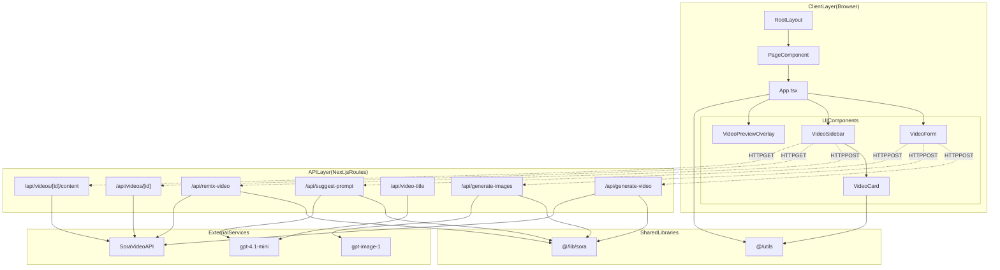
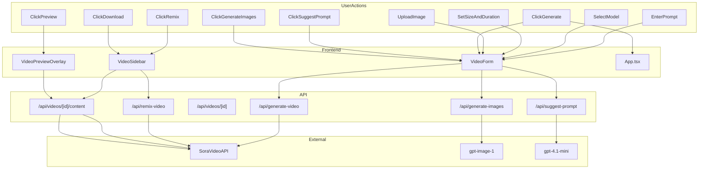

<!-- source: DeepWiki mcp.deepwiki.com · repo openai/openai-sora-sample-app · page 1 Overview · fetched 2026-10-26 -->

# Overview

<details>
<summary>Relevant source files</summary>

The following files were used as context for generating this wiki page:

- [LICENSE](LICENSE)
- [README.md](README.md)
- [components/App.tsx](components/App.tsx)

</details>


This document introduces the Sora Sample App repository. It explains the purpose of the project, its high-level architecture, and how the main systems and code entities relate to each other. The Sora Sample App is a frontend application for generating, remixing, and managing videos using OpenAI's Sora models and related AI services.

This page covers the overall system design, major workflows, and the mapping between user-facing features and code entities. For details on setup, see [Getting Started](#2). For a deep dive into the architecture, see [Architecture](#3).

---

## Purpose and Scope

The Sora Sample App demonstrates how to build a web-based video generation experience using OpenAI's Sora Video API, along with image and text generation models. It provides:

- A browser-based UI for entering prompts, configuring video parameters, and managing video runs.
- Integration with OpenAI APIs for video, image, and text generation.
- State management and persistence for user sessions and video history.
- A reference implementation for error handling, theming, and extensibility.

This document provides a high-level summary of the system, its main components, and how code entities map to user-facing features.

**For details on individual subsystems, see:**
- [Architecture](#3)
- [Frontend Components](#4)
- [API Layer](#5)
- [External Service Integration](#8)

**Sources:**  
[README.md:1-118]()

---

## High-Level System Architecture

The Sora Sample App follows a three-tier architecture:

1. **Client Layer (Browser):** React-based UI for user interaction and state management.
2. **API Layer (Next.js Routes):** Server-side endpoints for business logic and external API integration.
3. **External Services:** OpenAI APIs for video, image, and text generation.

### Diagram: "Overall System Architecture"



**Sources:**  
[README.md:1-118]()  
[components/App.tsx:1-783]()

---

## Mapping Features to Code Entities

The following table summarizes how user-facing features are implemented in code:

| Feature                        | Code Entity / File(s)                | Description                                      |
|---------------------------------|--------------------------------------|--------------------------------------------------|
| Video Generation (Prompt, Model, Size, Duration) | `VideoForm` (`components/VideoForm.tsx`), `App` (`components/App.tsx`) | UI for input, state management, and submission   |
| Video Remixing                 | `VideoSidebar`, `App`                | UI and logic for remixing existing videos        |
| Video Status Polling           | `useVideoPolling` (`hooks/useVideoPolling.ts`) | Polls video status from API                      |
| Video Preview & Download       | `VideoPreviewOverlay`, `App`         | Fullscreen preview and download logic            |
| Image Suggestions              | `generateImages` (`services/soraApi.ts`), `App` | Calls image generation API, manages results      |
| Prompt Optimization            | `suggestVideoPrompt` (`services/soraApi.ts`), `App` | Calls text generation API for prompt suggestions |
| State Persistence              | `usePersistedState` (`hooks/usePersistedState.ts`) | Persists video history in localStorage           |
| Error Handling                 | `@/lib/sora`                         | Centralized error formatting and status mapping  |

**Sources:**  
[components/App.tsx:1-783]()  
[README.md:12-21]()

---

## Bridging User Workflows to Code Entities

### Diagram: "User Workflow to Code Entity Mapping"



**Sources:**  
[components/App.tsx:1-783]()  
[README.md:64-110]()

---

## Key Integration Points

The application integrates with OpenAI services through well-defined API routes. Each route corresponds to a specific workflow:

| API Route                    | External Service      | Purpose                                 |
|------------------------------|----------------------|-----------------------------------------|
| `/api/generate-video`        | Sora Video API       | Create new video                        |
| `/api/remix-video`           | Sora Video API       | Remix existing video                    |
| `/api/videos/[id]`           | Sora Video API       | Poll video status                       |
| `/api/videos/[id]/content`   | Sora Video API       | Download video content                  |
| `/api/generate-images`       | gpt-image-1          | Generate image suggestions              |
| `/api/suggest-prompt`        | gpt-4.1-mini         | Suggest/optimize prompts                |
| `/api/video-title`           | gpt-4.1-mini         | Generate video titles                   |

**Sources:**  
[README.md:14-21, 64-110]()  
[components/App.tsx:36-43, 215-360]()

---

## Video Lifecycle Overview

Videos in the Sora Sample App follow a defined lifecycle:

1. **Form Input:** User enters parameters.
2. **Title Generation:** Optionally auto-generates a title.
3. **Batch Creation:** Supports multiple versions in one submission.
4. **Queued/In Progress:** Video jobs are queued and processed by the Sora API.
5. **Polling:** Status is polled until completion.
6. **Completed:** Video is available for preview, download, remix, or retry.
7. **Terminal States:** Completed, succeeded, or failed.

### Diagram: "Video Lifecycle State Machine"

```mermaid
stateDiagram-v2
    [*] --> "FormInput"
    "FormInput" --> "TitleGeneration": "ClickGenerate"
    "TitleGeneration" --> "BatchCreation": "requestVideoTitle()"
    "BatchCreation" --> "Creating": "Loop versionsCount"
    "Creating" --> "Queued": "createVideo/remixVideo"
    "Queued" --> "InProgress": "SoraAPI processing"
    "InProgress" --> "Polling": "useVideoPolling"
    "Polling" --> "InProgress": "Status not complete"
    "Polling" --> "Completed": "Status complete"
    "Completed" --> "Previewable": "Added to sidebar"
    "Completed" --> "Downloadable": "Can download"
    "Completed" --> "Remixable": "Can remix"
    "Previewable" --> "Previewing": "handlePlayPreview"
    "Downloadable" --> "Downloaded": "handleDownload"
    "Remixable" --> "FormInput": "handleRemixFrom"
    "InProgress" --> "Failed": "Error from API"
    "Failed" --> "Retrying": "handleRetry"
    "Retrying" --> "Creating"
    "Completed" --> "Refreshing": "handleRefreshVideo"
    "Refreshing" --> "Completed"
```

**Sources:**  
[components/App.tsx:215-360, 508-540]()  
[README.md:15-21, 93-110]()

---

## Licensing

The Sora Sample App is licensed under the MIT License.

**Sources:**  
[LICENSE:1-22]()  
[README.md:115-117]()

---

## Summary

The Sora Sample App provides a reference implementation for building video generation experiences using OpenAI's Sora models. It demonstrates best practices in API integration, state management, error handling, and user experience for generative video applications.

For further details on setup, architecture, or specific components, refer to the relevant sections in this documentation.

**Sources:**  
[README.md:1-118]()  
[components/App.tsx:1-783]()  
[LICENSE:1-22]()

---

