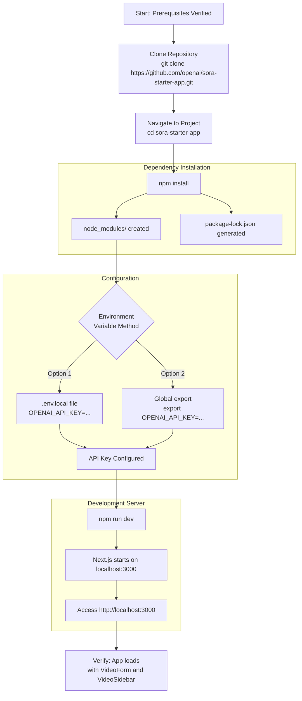
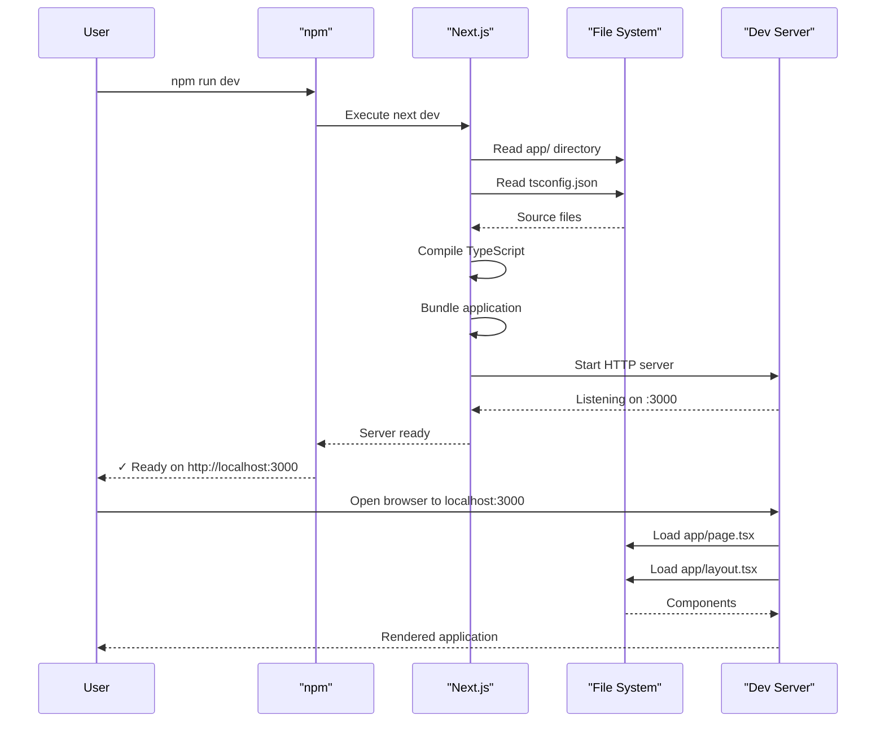

<!-- source: DeepWiki mcp.deepwiki.com · repo openai/openai-sora-sample-app · page 2 Getting Started · fetched 2026-10-26 -->

# Getting Started

<details>
<summary>Relevant source files</summary>

The following files were used as context for generating this wiki page:

- [.gitignore](.gitignore)
- [README.md](README.md)

</details>


This page guides you through the initial setup, installation, and execution of the Sora Sample App. It covers prerequisites, repository cloning, dependency installation, basic configuration, and starting the development server. For detailed configuration options and environment variables, see [Configuration & Environment](#2.1).

## Prerequisites

Before installing the Sora Sample App, ensure you have the following:

| Requirement | Description | Verification Command |
|-------------|-------------|---------------------|
| **Sora API Access** | Limited availability access to OpenAI's Sora Video API | Obtain from [OpenAI waitlist](https://openai.com/waitlist/sora) or account team |
| **OpenAI API Key** | Valid API key with Sora permissions | Test at [platform.openai.com](https://platform.openai.com) |
| **Node.js** | JavaScript runtime (v18 or higher recommended) | `node --version` |
| **npm** | Package manager (included with Node.js) | `npm --version` |

**Sources:** [README.md:26-29]()

## Installation Flow

The following diagram illustrates the complete setup process from prerequisites through first run:



**Sources:** [README.md:42-62]()

## Step-by-Step Installation

### 1. Clone the Repository

```bash
git clone https://github.com/openai/sora-starter-app.git
cd sora-starter-app
```

This creates a local copy of the repository with the following structure:

```
sora-starter-app/
├── app/              # Next.js App Router directory
├── components/       # React components
├── lib/             # Shared utilities
├── public/          # Static assets
├── package.json     # Dependencies and scripts
└── tsconfig.json    # TypeScript configuration
```

**Sources:** [README.md:42-46]()

### 2. Install Dependencies

Run the following command in the project root:

```bash
npm install
```

This command:
- Reads dependency specifications from `package.json`
- Downloads and installs all required packages into `node_modules/`
- Generates `package-lock.json` for reproducible builds
- Installs Next.js, React, OpenAI SDK, and other required libraries

The `.gitignore` file ensures that `node_modules/` and build artifacts are excluded from version control.

**Sources:** [README.md:48-54](), [.gitignore:3-11]()

### 3. Configure Environment Variables

The application requires at minimum the `OPENAI_API_KEY` environment variable. You have two configuration options:

#### Option 1: Create `.env.local` File (Recommended)

Create a file named `.env.local` in the project root:

```bash
OPENAI_API_KEY="sk-proj-..."
```

The `.env.local` file is automatically:
- Loaded by Next.js at runtime
- Excluded from version control via `.gitignore` ([.gitignore:34]())
- Scoped to local development only

#### Option 2: Global Environment Export

Export the variable in your shell environment:

```bash
export OPENAI_API_KEY="sk-proj-..."
```

This makes the variable available system-wide but requires re-export in each new terminal session.

For complete environment variable documentation including `OPENAI_BASE_URL` and other optional settings, see [Configuration & Environment](#2.1).

**Sources:** [README.md:31-40](), [.gitignore:33-34]()

## Running the Development Server

### Start the Application

Execute the development script:

```bash
npm run dev
```

This command:
- Compiles TypeScript files
- Starts the Next.js development server
- Enables hot module replacement (HMR)
- Makes the app available at `http://localhost:3000`

### Development Server Initialization

The following diagram shows what happens when you run `npm run dev`:



**Sources:** [README.md:57-62]()

## Verifying the Installation

Once the development server starts, navigate to `http://localhost:3000` in your browser. You should see:

| Component | Expected Behavior |
|-----------|------------------|
| **VideoForm** | Left panel with prompt input, model selector, size/duration options |
| **VideoSidebar** | Right panel labeled "History" (empty on first run) |
| **Theme Toggle** | Dark/light mode switcher in the interface |
| **API Key Status** | No error messages about missing API key |

### First Request Test

To verify the API integration is functional:

1. Enter a simple prompt in the text area (e.g., "A sunset over mountains")
2. Select a model from the dropdown (`sora-2` or `sora-2-pro`)
3. Click **Generate**
4. Observe that the request initiates without authentication errors

If you see authentication errors, verify your `OPENAI_API_KEY` is correctly set and you have Sora API access.

**Sources:** [README.md:68-73]()

## Project File Structure

After installation, your project contains these key directories and files:

```mermaid
graph TB
    Root["Project Root"]
    
    subgraph "Source Code"
        App["app/<br/>Next.js App Router"]
        Components["components/<br/>React UI Components"]
        Lib["lib/<br/>Shared Utilities"]
        Utils["utils/<br/>Helper Functions"]
    end
    
    subgraph "Configuration"
        PackageJSON["package.json<br/>Dependencies"]
        TSConfig["tsconfig.json<br/>TypeScript Config"]
        TailwindConfig["tailwind.config.ts<br/>Styling Config"]
        NextConfig["next.config.ts<br/>Next.js Config"]
    end
    
    subgraph "Runtime Files (Generated)"
        NodeModules["node_modules/<br/>Installed Packages"]
        NextDir[".next/<br/>Build Output"]
        EnvLocal[".env.local<br/>Environment Variables"]
    end
    
    subgraph "Static Assets"
        Public["public/<br/>Images & Fonts"]
    end
    
    Root --> App
    Root --> Components
    Root --> Lib
    Root --> Utils
    
    Root --> PackageJSON
    Root --> TSConfig
    Root --> TailwindConfig
    Root --> NextConfig
    
    Root --> NodeModules
    Root --> NextDir
    Root --> EnvLocal
    Root --> Public
```



**Sources:** [.gitignore:3-41](), [README.md:1-23]()

## Common Setup Issues

| Issue | Symptom | Resolution |
|-------|---------|-----------|
| **Missing API Key** | Error: "Missing OPENAI_API_KEY" on generation | Verify `.env.local` exists and contains valid key |
| **No Sora Access** | 403 Forbidden errors | Confirm Sora API access through OpenAI account |
| **Port Already in Use** | Error: "Port 3000 is already in use" | Stop other services on port 3000 or use `npm run dev -- -p 3001` |
| **Module Not Found** | TypeScript or import errors | Delete `node_modules/` and run `npm install` again |
| **Build Errors** | TypeScript compilation failures | Ensure Node.js version is 18+ |

## Next Steps

After successful installation and verification:

1. **Explore Configuration**: See [Configuration & Environment](#2.1) for advanced settings like `OPENAI_BASE_URL`
2. **Understand Architecture**: Review [Architecture](#3) to understand the three-tier design
3. **Generate Your First Video**: Follow the workflow in [Video Generation Endpoint](#5.1)
4. **Review Components**: Examine [Frontend Components](#4) to understand the UI structure

**Sources:** [README.md:64-110]()

---

