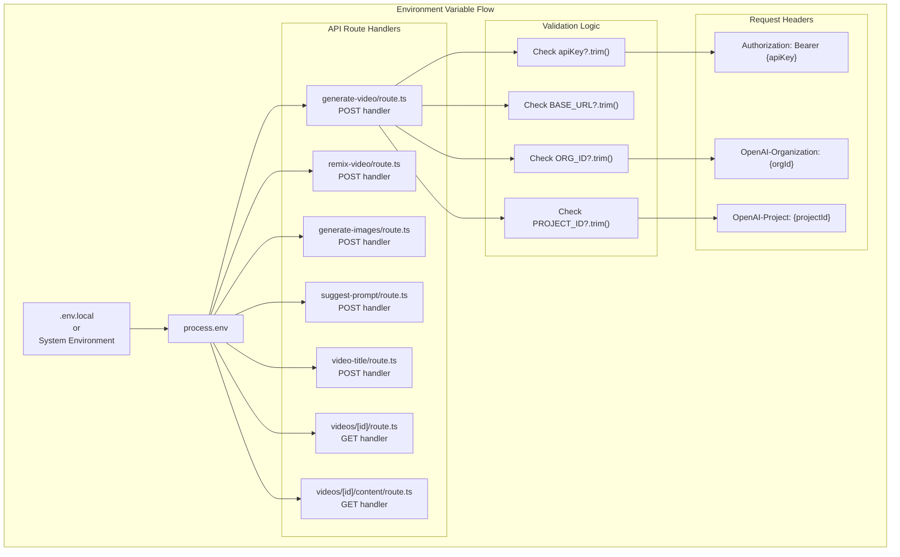
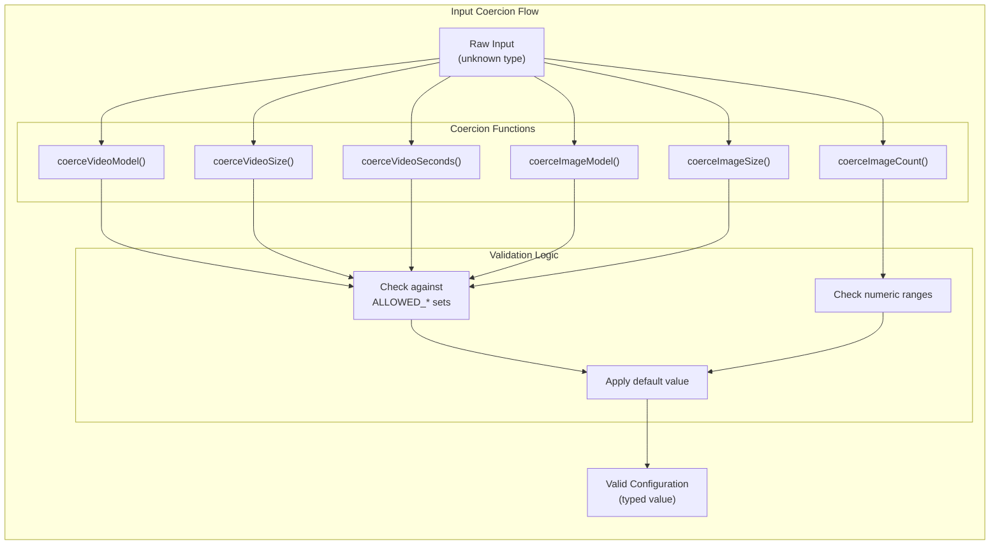

<!-- source: DeepWiki mcp.deepwiki.com · repo openai/openai-sora-sample-app · page 2.1 Configuration & Environment · fetched 2026-10-26 -->

# Configuration & Environment

<details>
<summary>Relevant source files</summary>

The following files were used as context for generating this wiki page:

- [README.md](README.md)
- [app/api/generate-images/route.ts](app/api/generate-images/route.ts)
- [app/api/generate-video/route.ts](app/api/generate-video/route.ts)

</details>


This document details all environment variables, configuration options, and setup requirements for the Sora Sample App. It covers both required and optional environment variables, configuration methods, and how these settings propagate through the application. For information about the OpenAI service integration patterns, see [External Service Integration](#8).

## Environment Variables

The application requires specific environment variables to function correctly. All API routes validate these variables before processing requests.

### Required Variables

| Variable | Purpose | Validation Location |
|----------|---------|---------------------|
| `OPENAI_API_KEY` | Authentication token for OpenAI API requests | All API routes |

The `OPENAI_API_KEY` is the only mandatory configuration. Every API route performs validation at the entry point:

**Video Generation Routes:**
- [app/api/generate-video/route.ts:21-25]()
- [app/api/remix-video/route.ts:22-26]()

**AI Enhancement Routes:**
- [app/api/generate-images/route.ts:73-77]()
- [app/api/suggest-prompt/route.ts:26-30]()
- [app/api/video-title/route.ts:23-27]()

**Video Retrieval Routes:**
- [app/api/videos/[id]/route.ts:14-18]()
- [app/api/videos/[id]/content/route.ts:13-17]()

### Optional Variables

| Variable | Purpose | Default Value | Usage Location |
|----------|---------|---------------|----------------|
| `OPENAI_BASE_URL` | Custom API endpoint URL | `https://api.openai.com/v1` | [app/api/generate-video/route.ts:68-70]() |
| `OPENAI_ORG_ID` | Organization identifier for team accounts | None | [app/api/generate-video/route.ts:75-78]() |
| `OPENAI_PROJECT_ID` | Project identifier for scoped API access | None | [app/api/generate-video/route.ts:79-82]() |

The `OPENAI_BASE_URL` enables routing requests to alternative endpoints or proxy servers. The `OPENAI_ORG_ID` and `OPENAI_PROJECT_ID` variables support multi-tenant OpenAI accounts by scoping API requests to specific organizations and projects.

**Sources:** [app/api/generate-video/route.ts:68-82](), [app/api/remix-video/route.ts:67-81]()

### Environment Variable Access Pattern



**Sources:** [app/api/generate-video/route.ts:21-25,68-82](), [app/api/generate-images/route.ts:73-79](), [app/api/suggest-prompt/route.ts:26-30](), [app/api/video-title/route.ts:23-27](), [app/api/videos/[id]/route.ts:14-18](), [app/api/videos/[id]/content/route.ts:13-17]()

## Configuration Methods

The application supports two methods for providing environment variables, following standard Next.js conventions.

### Local Environment File (.env.local)

Create a `.env.local` file in the project root directory:

```bash
OPENAI_API_KEY="your-openai-api-key"
OPENAI_BASE_URL="https://api.openai.com/v1"
OPENAI_ORG_ID="org-xxxxx"
OPENAI_PROJECT_ID="proj-xxxxx"
```

This file is automatically loaded by Next.js and excluded from version control via `.gitignore`. This is the recommended approach for local development.

**Sources:** [README.md:36-40]()

### Global System Environment

Export environment variables at the system level before starting the application:

```bash
export OPENAI_API_KEY="your-openai-api-key"
export OPENAI_BASE_URL="https://api.openai.com/v1"
npm run dev
```

This method is suitable for production deployments where environment variables are managed by hosting platforms or container orchestration systems.

**Sources:** [README.md:35]()

## Runtime Configuration Constants

The application defines several configuration constants for API behavior. These are hardcoded but can be modified by developers extending the codebase.

### Video Generation Defaults

| Configuration | Value | Location |
|--------------|-------|----------|
| Default Model | `sora-2-pro` | [lib/sora.ts:7]() |
| Allowed Models | `sora-2`, `sora-2-pro` | [lib/sora.ts:8]() |
| Default Size | `1280x720` | [lib/sora.ts:26]() |
| Allowed Sizes | `1280x720`, `1920x1080`, `1080x1920` | [lib/sora.ts:27-31]() |
| Default Duration | `8` seconds | [lib/sora.ts:38]() |
| Allowed Durations | `4`, `8`, `12` seconds | [lib/sora.ts:39]() |

**Sources:** [lib/sora.ts:7-39]()

### Image Generation Defaults

| Configuration | Value | Location |
|--------------|-------|----------|
| Default Model | `gpt-image-1` | [app/api/generate-images/route.ts:6]() |
| Allowed Models | `gpt-image-1` | [app/api/generate-images/route.ts:7]() |
| Max Image Count | `4` | [app/api/generate-images/route.ts:8]() |
| Default Count | `3` | [app/api/generate-images/route.ts:9]() |
| Default Size | `1024x1024` | [app/api/generate-images/route.ts:13]() |
| Allowed Sizes | `256x256`, `512x512`, `1024x1024`, `1024x1536`, `1536x1024`, `1024x1792`, `1792x1024`, `auto` | [app/api/generate-images/route.ts:14-23]() |

**Sources:** [app/api/generate-images/route.ts:6-23]()

### Text Generation Configuration

| Configuration | Value | Location |
|--------------|-------|----------|
| Prompt Model | `gpt-4.1-mini` | [app/api/suggest-prompt/route.ts:4]() |
| Title Model | `gpt-4o-mini` | [app/api/video-title/route.ts:6]() |
| Title Max Tokens | `24` | [app/api/video-title/route.ts:7]() |

**Sources:** [app/api/suggest-prompt/route.ts:4](), [app/api/video-title/route.ts:6-7]()

## Configuration Validation & Coercion

The application implements robust validation and coercion logic to handle untrusted or malformed configuration inputs. This pattern is centralized in the `@/lib/sora` module.



**Sources:** [lib/sora.ts:13-57](), [app/api/generate-images/route.ts:32-70]()

### Video Parameter Coercion

The `coerceVideoModel()`, `coerceVideoSize()`, and `coerceVideoSeconds()` functions ensure that user-provided values conform to allowed sets:

- **Model Coercion** [lib/sora.ts:13-17](): Validates against `ALLOWED_VIDEO_MODELS`, falls back to `VIDEO_MODEL_FALLBACK`
- **Size Coercion** [lib/sora.ts:26-34](): Validates against `ALLOWED_VIDEO_SIZES`, falls back to `VIDEO_SIZE_FALLBACK`
- **Duration Coercion** [lib/sora.ts:38-45](): Validates against `ALLOWED_VIDEO_SECONDS`, falls back to `VIDEO_SECONDS_FALLBACK`

Each coercion function:
1. Accepts `unknown` type to handle untrusted inputs
2. Returns `null` for invalid non-string inputs
3. Trims and validates string inputs
4. Checks membership in allowed sets
5. Returns default fallback for invalid values

**Sources:** [lib/sora.ts:13-45]()

### Image Parameter Coercion

Image generation endpoints implement similar coercion patterns:

- **Model Coercion** [app/api/generate-images/route.ts:56-61](): Validates against `ALLOWED_IMAGE_MODELS`
- **Size Coercion** [app/api/generate-images/route.ts:63-70](): Validates against `ALLOWED_IMAGE_SIZES`
- **Count Coercion** [app/api/generate-images/route.ts:48-54](): Clamps between `1` and `MAX_IMAGE_COUNT`, rounds to integer

**Sources:** [app/api/generate-images/route.ts:48-70]()

## Configuration Error Handling

When environment variables are missing or invalid, the application returns standardized error responses using the `describeError()` and `resolveErrorStatus()` utilities from `@/lib/sora`.

### Missing API Key Response

All API routes return consistent error responses when `OPENAI_API_KEY` is not configured:

```typescript
// Example from generate-video/route.ts
if (!apiKey) {
  const message = "OPENAI_API_KEY is not configured";
  return Response.json({ error: { message } }, { status: 500 });
}
```

**Response Structure:**
```json
{
  "error": {
    "message": "OPENAI_API_KEY is not configured"
  }
}
```

**HTTP Status Code:** `500 Internal Server Error`

**Sources:** [app/api/generate-video/route.ts:21-25](), [app/api/remix-video/route.ts:22-26](), [app/api/generate-images/route.ts:73-77]()

### Invalid Configuration Values

When coercion functions receive invalid values, they silently apply defaults rather than raising errors. This defensive approach ensures the application remains functional even with malformed inputs.

For example, if a client sends `model: "invalid-model"`, the system applies the fallback value without interrupting the request flow.

**Sources:** [lib/sora.ts:13-45](), [app/api/generate-images/route.ts:48-70]()

## Configuration Propagation Through Request Lifecycle

The following diagram illustrates how configuration values flow from environment variables through API routes to external service requests.

```mermaid
graph TB
    subgraph "Configuration Lifecycle"
        Env[".env.local or<br/>System Environment"]
        
        subgraph "API Route Handler Entry"
            ReadEnv["Read from process.env"]
            ValidateKey["Validate OPENAI_API_KEY"]
            ReadOptional["Read optional configs<br/>(BASE_URL, ORG_ID, PROJECT_ID)"]
        end
        
        subgraph "Request Parsing"
            ParseBody["Parse request.json()"]
            ExtractParams["Extract user parameters<br/>(model, size, seconds, etc)"]
        end
        
        subgraph "Coercion & Validation"
            ApplyCoercion["Apply coercion functions<br/>(coerceVideoModel, etc)"]
            BuildPayload["Build VideoRequestPayload<br/>or ImageGenerateParams"]
        end
        
        subgraph "External API Request"
            BuildHeaders["Build headers<br/>(Authorization, Org, Project)"]
            BuildEndpoint["Build endpoint URL<br/>using BASE_URL"]
            SendRequest["Send fetch() or<br/>OpenAI SDK call"]
        end
        
        ExternalService["OpenAI API<br/>(Sora, Images, Chat)"]
        
        Env --> ReadEnv
        ReadEnv --> ValidateKey
        ReadEnv --> ReadOptional
        ValidateKey --> ParseBody
        ParseBody --> ExtractParams
        ExtractParams --> ApplyCoercion
        ApplyCoercion --> BuildPayload
        BuildPayload --> BuildHeaders
        ReadOptional --> BuildHeaders
        ReadOptional --> BuildEndpoint
        BuildHeaders --> SendRequest
        BuildEndpoint --> SendRequest
        SendRequest --> ExternalService
    end
```



**Sources:** [app/api/generate-video/route.ts:20-142](), [app/api/generate-images/route.ts:72-135](), [app/api/suggest-prompt/route.ts:25-77]()

## Configuration File Reference

The following table maps configuration concerns to their implementation locations:

| Configuration Type | File Path | Lines | Description |
|-------------------|-----------|-------|-------------|
| Video Model Defaults | `lib/sora.ts` | 7-8 | Model fallback and allowed set |
| Video Size Defaults | `lib/sora.ts` | 26-31 | Size fallback and allowed set |
| Video Duration Defaults | `lib/sora.ts` | 38-39 | Duration fallback and allowed set |
| Video Model Coercion | `lib/sora.ts` | 13-17 | Input validation logic |
| Video Size Coercion | `lib/sora.ts` | 26-34 | Input validation logic |
| Video Duration Coercion | `lib/sora.ts` | 38-45 | Input validation logic |
| Image Model Defaults | `app/api/generate-images/route.ts` | 6-7 | Model fallback and allowed set |
| Image Size Defaults | `app/api/generate-images/route.ts` | 13-23 | Size fallback and allowed set |
| Image Count Limits | `app/api/generate-images/route.ts` | 8-9 | Max and default count |
| Image Model Coercion | `app/api/generate-images/route.ts` | 56-61 | Input validation logic |
| Image Size Coercion | `app/api/generate-images/route.ts` | 63-70 | Input validation logic |
| Image Count Coercion | `app/api/generate-images/route.ts` | 48-54 | Input validation logic |
| Prompt Generation Model | `app/api/suggest-prompt/route.ts` | 4 | Chat model for prompt suggestions |
| Title Generation Model | `app/api/video-title/route.ts` | 6 | Chat model for title generation |
| Title Max Tokens | `app/api/video-title/route.ts` | 7 | Token limit for titles |

**Sources:** [lib/sora.ts:7-45](), [app/api/generate-images/route.ts:6-70](), [app/api/suggest-prompt/route.ts:4](), [app/api/video-title/route.ts:6-7]()

---

