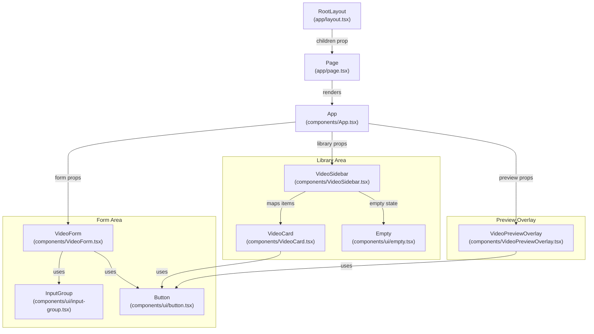
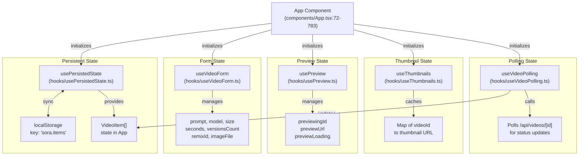
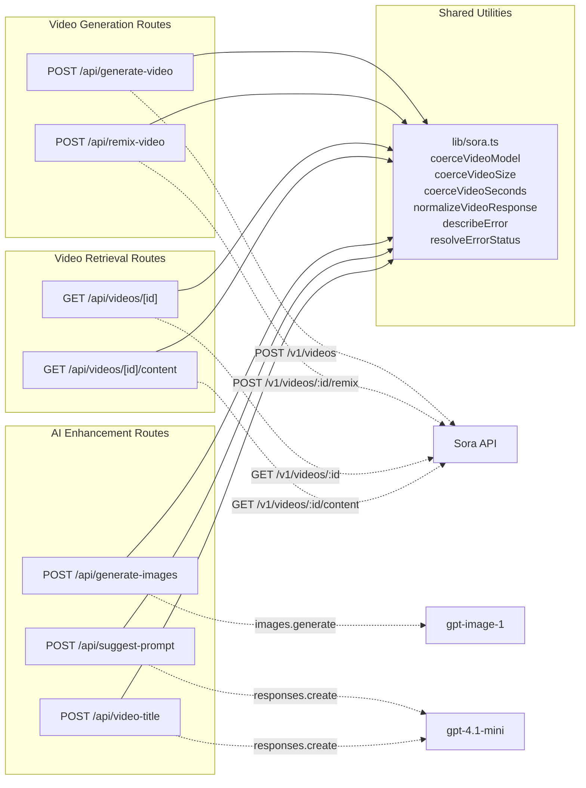
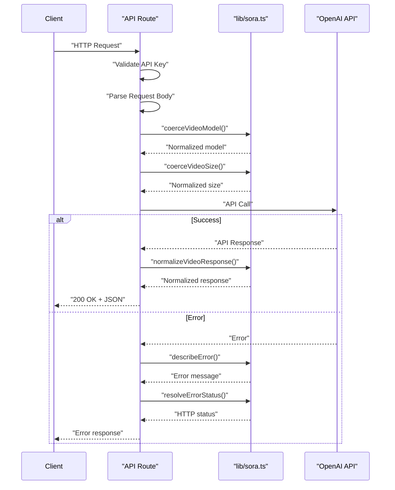
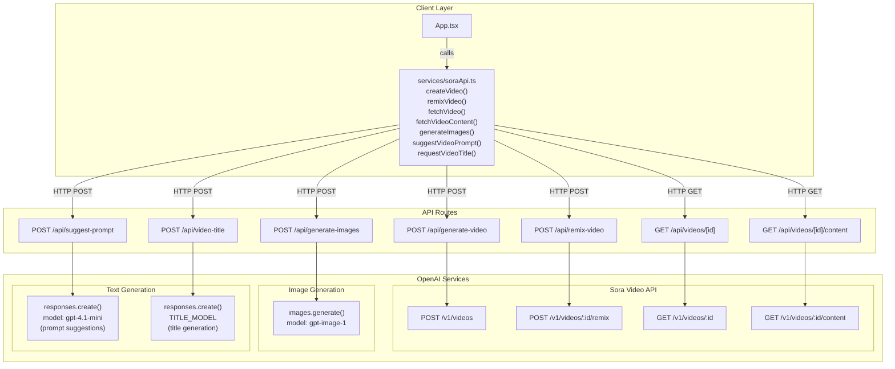

<!-- source: DeepWiki mcp.deepwiki.com · repo openai/openai-sora-sample-app · page 3 Architecture · fetched 2026-10-26 -->

# Architecture

<details>
<summary>Relevant source files</summary>

The following files were used as context for generating this wiki page:

- [app/layout.tsx](app/layout.tsx)
- [app/page.tsx](app/page.tsx)
- [components/App.tsx](components/App.tsx)

</details>


This document provides a comprehensive overview of the system architecture for the Sora Sample App. It describes the three-tier design pattern, component relationships, and integration points with external services. For detailed information about specific subsystems, see:
- Client-side state management patterns: [Client-Side State Management](#3.1)
- Video creation and status tracking: [Video Lifecycle](#3.2)  
- Request/response patterns and data transformations: [Data Flow & Communication](#3.3)

## Three-Tier Architecture Overview

The application follows a clear separation of concerns across three architectural tiers: client-side rendering, API middleware, and external service integration.

### Architecture Diagram

```mermaid
graph TB
    subgraph Browser["Browser Tier"]
        RootLayout["app/layout.tsx<br/>RootLayout"]
        PageComp["app/page.tsx<br/>Page"]
        AppComp["components/App.tsx<br/>App"]
        
        subgraph Components["UI Components"]
            VideoForm["components/VideoForm.tsx"]
            VideoSidebar["components/VideoSidebar.tsx"]
            VideoCard["components/VideoCard.tsx"]
            VideoPreview["components/VideoPreviewOverlay.tsx"]
        end
        
        subgraph Hooks["Custom Hooks"]
            PersistedState["hooks/usePersistedState.ts"]
            VideoForm2["hooks/useVideoForm.ts"]
            Preview["hooks/usePreview.ts"]
            Thumbnails["hooks/useThumbnails.ts"]
            Polling["hooks/useVideoPolling.ts"]
        end
    end
    
    subgraph API["API Tier - Next.js Routes"]
        GenVideo["app/api/generate-video/route.ts"]
        RemixVideo["app/api/remix-video/route.ts"]
        GenImages["app/api/generate-images/route.ts"]
        SuggestPrompt["app/api/suggest-prompt/route.ts"]
        VideoTitle["app/api/video-title/route.ts"]
        FetchVideo["app/api/videos/[id]/route.ts"]
        VideoContent["app/api/videos/[id]/content/route.ts"]
    end
    
    subgraph External["External Services"]
        SoraAPI["OpenAI Sora API<br/>/v1/videos/*"]
        ImageAPI["OpenAI Images API<br/>gpt-image-1"]
        ChatAPI["OpenAI Chat API<br/>gpt-4.1-mini"]
    end
    
    subgraph Shared["Shared Libraries"]
        LibSora["lib/sora.ts"]
        UtilsVideo["utils/video.ts"]
        ServiceAPI["services/soraApi.ts"]
    end
    
    RootLayout --> PageComp
    PageComp --> AppComp
    AppComp --> VideoForm
    AppComp --> VideoSidebar
    AppComp --> VideoPreview
    VideoSidebar --> VideoCard
    
    AppComp --> PersistedState
    AppComp --> VideoForm2
    AppComp --> Preview
    AppComp --> Thumbnails
    AppComp --> Polling
    
    VideoForm -.->|HTTP| GenVideo
    VideoForm -.->|HTTP| GenImages
    VideoForm -.->|HTTP| SuggestPrompt
    AppComp -.->|HTTP| VideoTitle
    
    VideoSidebar -.->|HTTP| RemixVideo
    Polling -.->|HTTP| FetchVideo
    VideoSidebar -.->|HTTP| VideoContent
    
    GenVideo --> LibSora
    RemixVideo --> LibSora
    GenImages --> LibSora
    
    GenVideo --> SoraAPI
    RemixVideo --> SoraAPI
    FetchVideo --> SoraAPI
    VideoContent --> SoraAPI
    GenImages --> ImageAPI
    SuggestPrompt --> ChatAPI
    VideoTitle --> ChatAPI
    
    AppComp --> UtilsVideo
    AppComp --> ServiceAPI
```



**Sources:** [app/layout.tsx:1-54](), [app/page.tsx:1-8](), [components/App.tsx:1-784]()

### Tier Responsibilities

| Tier | Purpose | Key Technologies | Entry Points |
|------|---------|------------------|--------------|
| **Browser** | UI rendering, user interaction, state management | React, TypeScript, Tailwind CSS | [app/layout.tsx]() |
| **API** | Request validation, business logic, external service integration | Next.js API Routes, TypeScript | [app/api/*]() |
| **External** | AI model inference, video generation | OpenAI API | Environment: `OPENAI_API_KEY` |

**Sources:** [app/layout.tsx:1-54](), [app/api/generate-video/route.ts]()

## Component Architecture

The client tier is organized around a central orchestrator component with specialized child components and custom hooks for state management.

### Component Hierarchy



**Sources:** [app/layout.tsx:24-53](), [app/page.tsx:1-8](), [components/App.tsx:72-783]()

### Core Component Responsibilities

**`App` Component** ([components/App.tsx:72-783]())
- Central state orchestrator managing all application state
- Coordinates between UI components and API services
- Implements event handlers for user actions: `handleCreateVideo`, `handleRemixFrom`, `handleRetry`, `handleDownload`, `handlePlayPreview`, `handleRefreshVideo`
- Manages batch video generation with progress tracking

**`VideoForm` Component** ([components/VideoForm.tsx]())
- Collects user input for video generation parameters
- Supports text prompts, model selection, size/duration configuration
- Handles image upload and AI-generated image suggestions
- Integrates with `/api/generate-images` and `/api/suggest-prompt`

**`VideoSidebar` Component** ([components/VideoSidebar.tsx]())
- Displays video library in reverse chronological order
- Shows thumbnail previews via `useThumbnails` hook
- Provides actions: preview, download, remix, retry, refresh, remove
- Responsive design with mobile overlay support

**`VideoPreviewOverlay` Component** ([components/VideoPreviewOverlay.tsx]())
- Full-screen video preview with navigation controls
- Supports previous/next navigation through video library
- Displays video metadata (prompt, model, size, duration)
- Download functionality from preview interface

**Sources:** [components/App.tsx:72-783](), [components/VideoForm.tsx](), [components/VideoSidebar.tsx](), [components/VideoPreviewOverlay.tsx]()

## State Management Architecture

The application uses a hooks-based state management pattern with clear separation of concerns.

### State Management Flow



**Sources:** [components/App.tsx:15-19](), [components/App.tsx:73-126]()

### Hook Usage Pattern

| Hook | File | State Managed | Purpose |
|------|------|---------------|---------|
| `usePersistedState` | [hooks/usePersistedState.ts]() | `VideoItem[]` | Persists video library to `localStorage` |
| `useVideoForm` | [hooks/useVideoForm.ts]() | Form parameters | Manages video generation form state |
| `usePreview` | [hooks/usePreview.ts]() | Preview state | Handles video preview loading and display |
| `useThumbnails` | [hooks/useThumbnails.ts]() | Thumbnail URLs | Caches video thumbnail URLs |
| `useVideoPolling` | [hooks/useVideoPolling.ts]() | Polling logic | Polls Sora API for video status updates |

**Sources:** [components/App.tsx:15-19](), [components/App.tsx:73-131]()

## API Layer Architecture

The API tier implements a consistent request handling pattern across all endpoints with shared validation and error handling logic.

### API Route Structure



**Sources:** [app/api/generate-video/route.ts](), [app/api/remix-video/route.ts](), [lib/sora.ts]()

### Common API Route Pattern

Every API route follows this standardized flow:

1. **Authentication**: Validate `OPENAI_API_KEY` from environment
2. **Request Parsing**: Extract and parse request body/parameters
3. **Input Coercion**: Use `lib/sora.ts` functions to normalize inputs
4. **External Service Call**: Invoke OpenAI API with normalized parameters
5. **Response Normalization**: Transform API response to standard format
6. **Error Handling**: Use `describeError` and `resolveErrorStatus` for consistent error responses



**Sources:** [app/api/generate-video/route.ts](), [lib/sora.ts]()

### API Route Details

| Route | Method | File | External Endpoint | Purpose |
|-------|--------|------|-------------------|---------|
| `/api/generate-video` | POST | [app/api/generate-video/route.ts]() | `POST /v1/videos` | Create new video from text/image |
| `/api/remix-video` | POST | [app/api/remix-video/route.ts]() | `POST /v1/videos/:id/remix` | Create variation of existing video |
| `/api/videos/[id]` | GET | [app/api/videos/[id]/route.ts]() | `GET /v1/videos/:id` | Poll video status |
| `/api/videos/[id]/content` | GET | [app/api/videos/[id]/content/route.ts]() | `GET /v1/videos/:id/content` | Download video binary |
| `/api/generate-images` | POST | [app/api/generate-images/route.ts]() | `images.generate` | Generate image suggestions |
| `/api/suggest-prompt` | POST | [app/api/suggest-prompt/route.ts]() | `responses.create` | Enhance user prompt |
| `/api/video-title` | POST | [app/api/video-title/route.ts]() | `responses.create` | Generate video title |

**Sources:** [app/api/]() directory structure

## External Service Integration

The application integrates with three distinct OpenAI service categories, each accessed through dedicated API routes.

### Service Integration Points



**Sources:** [services/soraApi.ts](), [components/App.tsx:36-43]()

### Service Configuration

| Service | Model/Endpoint | Configuration | Usage |
|---------|----------------|---------------|-------|
| **Sora Video** | `/v1/videos/*` | `OPENAI_BASE_URL`, `OPENAI_API_KEY` | Video generation and remixing |
| **Image Generation** | `gpt-image-1` | `OPENAI_API_KEY` | Generate image suggestions ([components/App.tsx:61]()) |
| **Text Generation** | `gpt-4.1-mini` | `OPENAI_API_KEY` | Prompt enhancement and title generation |

**Sources:** [app/api/generate-video/route.ts](), [app/api/generate-images/route.ts](), [app/api/suggest-prompt/route.ts]()

## Cross-Cutting Concerns

Several architectural patterns are applied consistently across the entire application.

### Theming System

The application implements a CSS custom property-based theming system with runtime dark mode detection:

- Theme initialization: [app/layout.tsx:29-39]() - Inline script detects system preference
- CSS variables: [app/globals.css]() - Defines color palette for light and dark modes
- Class toggling: `.dark` class applied to `<html>` element controls theme
- Color scheme: `root.style.colorScheme` set to `'dark'` or `'light'`

**Sources:** [app/layout.tsx:29-39](), [app/globals.css]()

### Error Handling Pattern

All errors flow through centralized utilities in `lib/sora.ts`:

```typescript
// Pattern used in all API routes
try {
  // API call
} catch (error) {
  const message = describeError(error);      // Human-readable message
  const status = resolveErrorStatus(error);  // HTTP status code
  return new Response(JSON.stringify({ error: message }), { status });
}
```

Functions:
- `describeError`: Converts any error type to human-readable message
- `resolveErrorStatus`: Maps error types to appropriate HTTP status codes

**Sources:** [lib/sora.ts](), [app/api/generate-video/route.ts]()

### Data Validation & Coercion

Input validation uses type coercion functions to handle untrusted user input:

| Function | File | Purpose |
|----------|------|---------|
| `coerceVideoModel` | [lib/sora.ts]() | Validates and normalizes model names |
| `coerceVideoSize` | [lib/sora.ts]() | Validates video dimensions |
| `coerceVideoSeconds` | [lib/sora.ts]() | Validates video duration |
| `normalizeVideoResponse` | [lib/sora.ts]() | Normalizes API responses to `VideoItem` type |

**Sources:** [lib/sora.ts](), [utils/video.ts]()

### Binary Content Delivery

Video content is delivered through a dedicated streaming endpoint:
- Client requests: [services/soraApi.ts]() - `fetchVideoContent` function
- API route: [app/api/videos/[id]/content/route.ts]() - Streams binary from Sora API
- Return type: `Blob` for browser-native video playback
- Usage: Thumbnails via `useThumbnails`, previews via `usePreview`, downloads via `handleDownload`

**Sources:** [app/api/videos/[id]/content/route.ts](), [services/soraApi.ts](), [hooks/useThumbnails.ts](), [hooks/usePreview.ts]()

### Persistence Strategy

The application uses `localStorage` for client-side persistence without server-side sessions:
- Implementation: [hooks/usePersistedState.ts]() - Generic hook for any state type
- Primary usage: [components/App.tsx:73]() - `usePersistedState<VideoItem[]>("sora.items", [])`
- Storage key: `"sora.items"` contains array of `VideoItem` objects
- Synchronization: Automatic on every state change

**Sources:** [hooks/usePersistedState.ts](), [components/App.tsx:73]()

---

