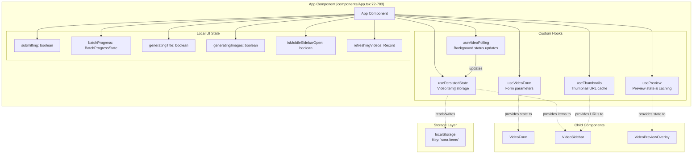
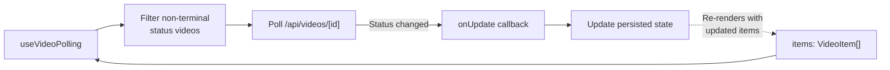
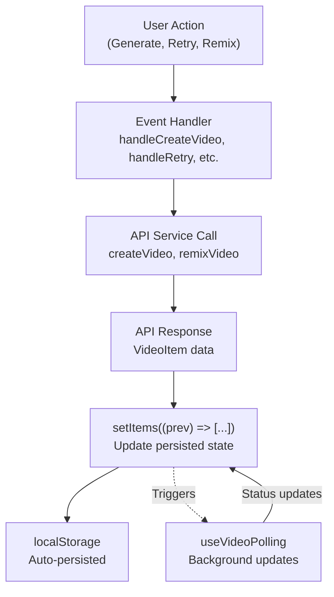
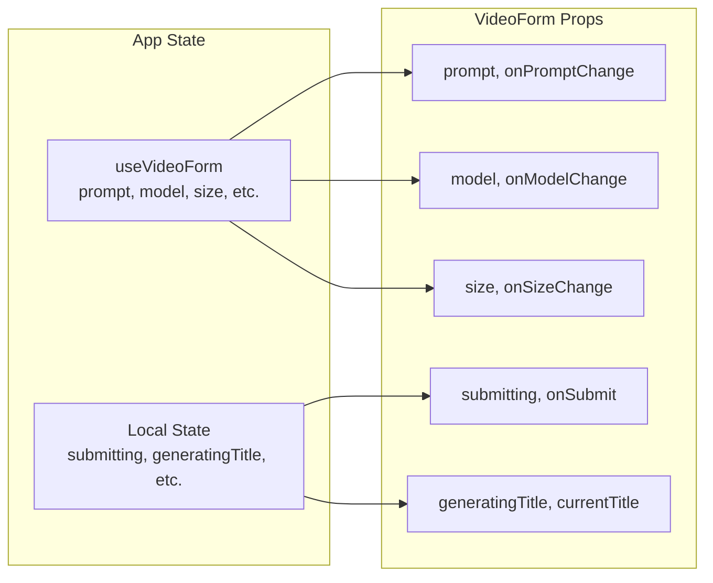

<!-- source: DeepWiki mcp.deepwiki.com · repo openai/openai-sora-sample-app · page 3.1 Client-Side State Management · fetched 2026-10-26 -->

# Client-Side State Management

<details>
<summary>Relevant source files</summary>

The following files were used as context for generating this wiki page:

- [components/App.tsx](components/App.tsx)
- [components/VideoForm.tsx](components/VideoForm.tsx)

</details>


## Purpose and Scope

This document describes the client-side state management architecture of the Sora Sample App. It covers the custom React hooks pattern used to organize state, the localStorage persistence layer, and how state flows between components. For information about the video lifecycle and status transitions, see [Video Lifecycle](#3.2). For details on API communication patterns, see [Data Flow & Communication](#3.3).

## State Management Architecture

The application uses a custom hooks pattern to separate state concerns into focused, reusable modules. The main `App` component orchestrates these hooks and manages additional local UI state.

**State Management Layers**



Sources: [components/App.tsx:72-198]()

## Persistent State Layer

### usePersistedState Hook

The `usePersistedState` hook provides localStorage-backed state persistence for the video library. It is instantiated once in the `App` component to maintain the collection of `VideoItem` objects across browser sessions.

**Usage Pattern**

```
[components/App.tsx:73]
const [items, setItems] = usePersistedState<VideoItem[]>("sora.items", []);
```

The hook manages:
- Reading initial state from `localStorage` on mount
- Writing state changes back to `localStorage` on every update
- Type-safe state with TypeScript generics
- Fallback to default value if localStorage is unavailable

**State Structure**

| Field | Type | Description |
|-------|------|-------------|
| Key | `"sora.items"` | localStorage key identifier |
| Value | `VideoItem[]` | Array of video generation records |
| Default | `[]` | Empty array if no saved state exists |

**Update Patterns**

The `setItems` function is used throughout the App component to modify the video library:

- **Adding new videos**: [components/App.tsx:328-341]() - Prepends new videos to the array
- **Updating existing videos**: [components/App.tsx:162-171]() - Maps over array and applies updater function
- **Removing videos**: [components/App.tsx:499]() - Filters out specific video by id
- **Marking as downloaded**: [components/App.tsx:386-392]() - Updates individual item properties

Sources: [components/App.tsx:15](), [components/App.tsx:73](), [components/App.tsx:162-171](), [components/App.tsx:328-341](), [components/App.tsx:386-392](), [components/App.tsx:499]()

## Form State Management

### useVideoForm Hook

The `useVideoForm` hook encapsulates all form input state and logic for video generation parameters. It provides state variables, setters, and utility functions for form management.

**State Variables Provided**

```
[components/App.tsx:103-125]
const {
  prompt, setPrompt,
  model, setModel,
  size, setSize,
  seconds, setSeconds,
  versionsCount, setVersionsCount,
  remixId, setRemixId,
  imageFile,
  imagePreviewUrl,
  imagePreviewMeta,
  handleImageSelect,
  handleGeneratedImageDataUrl,
  handleGeneratedImageUrl,
  clearForm: resetFormFields,
  applyVideoToForm,
  sizeOptionGroups,
} = useVideoForm();
```

**Form State Categories**

| Category | State Variables | Purpose |
|----------|----------------|---------|
| Text Input | `prompt: string` | User-provided video description |
| Model Selection | `model: SoraModel` | Selected Sora model variant |
| Size Configuration | `size: string`, `sizeOptionGroups: SizeOptionGroups` | Video dimensions and available options |
| Duration | `seconds: SoraSeconds` | Video length in seconds |
| Batch Generation | `versionsCount: number` | Number of versions to generate |
| Remix | `remixId: string` | ID of video to remix from |
| Image Input | `imageFile: File \| null`, `imagePreviewUrl: string \| null`, `imagePreviewMeta: ImagePreviewMeta \| null` | Uploaded reference image data |

**Utility Functions**

- `handleImageSelect`: Processes file input change events for image uploads
- `handleGeneratedImageDataUrl`: Converts data URL to File for generated images
- `handleGeneratedImageUrl`: Fetches URL and converts to File for generated images
- `clearForm`: Resets all form fields to defaults
- `applyVideoToForm`: Populates form with existing video parameters (used for remix/retry)

Sources: [components/App.tsx:18](), [components/App.tsx:103-125](), [components/VideoForm.tsx:102-136]()

## Preview State Management

### usePreview Hook

The `usePreview` hook manages video preview playback state and implements a caching layer for video blob URLs to optimize preview loading performance.

**Preview State Interface**

```
[components/App.tsx:63-70]
const preview = usePreview();
const previewState: SidebarPreviewState = {
  previewingId: preview.previewingId,
  previewLoading: preview.previewLoading,
};
```

**State Properties**

| Property | Type | Description |
|----------|------|-------------|
| `previewingId` | `string \| null` | ID of currently previewing video |
| `previewLoading` | `boolean` | Whether preview is loading |
| `previewUrl` | `string \| null` | Blob URL for current preview video |

**Methods**

- `playPreview(videoId: string)`: Loads and displays video preview
- `clearPreview()`: Closes preview and cleans up blob URLs
- `prefetchPreviews(videoIds: string[])`: Pre-loads video blobs into cache for faster playback

**Prefetch Strategy**

The App component prefetches all completed videos on mount and when the list changes:

```
[components/App.tsx:136-143]
useEffect(() => {
  const ids = previewableItems
    .map((item) => item.id)
    .filter((id): id is string => Boolean(id));
  prefetchPreviews(ids).catch((error) => {
    console.error("Preview prefetch failed", error);
  });
}, [prefetchPreviews, previewableItems]);
```

Sources: [components/App.tsx:16](), [components/App.tsx:63-70](), [components/App.tsx:127-143](), [components/App.tsx:428-442]()

## Thumbnail Management

### useThumbnails Hook

The `useThumbnails` hook provides a mapping of video IDs to thumbnail blob URLs, managing the lifecycle of thumbnail data fetching and URL creation.

**Usage Pattern**

```
[components/App.tsx:130]
const thumbnails = useThumbnails({ items });
```

**Return Type**

The hook returns a `Record<string, string>` mapping video IDs to blob URLs for thumbnails. This is passed directly to the `VideoSidebar` component for display in video cards.

**Lifecycle Management**

- Automatically fetches thumbnails for new videos with completed status
- Creates and manages blob URLs for binary thumbnail data
- Cleans up blob URLs when component unmounts or items change
- Memoizes results to prevent unnecessary re-renders

Sources: [components/App.tsx:17](), [components/App.tsx:130]()

## Polling State Management

### useVideoPolling Hook

The `useVideoPolling` hook implements background polling for video generation status updates. It automatically polls the status endpoint for videos that are in non-terminal states.

**Usage Pattern**

```
[components/App.tsx:198]
useVideoPolling({ items, onUpdate: handleUpdateItem });
```

**Configuration**

| Parameter | Type | Description |
|-----------|------|-------------|
| `items` | `VideoItem[]` | Current list of videos to monitor |
| `onUpdate` | `(id: string, updater: (item: VideoItem) => VideoItem) => void` | Callback to update individual video state |

**Polling Behavior**

The hook:
- Identifies videos with non-terminal status (`queued`, `in_progress`, etc.)
- Polls the `/api/videos/[id]` endpoint at regular intervals
- Invokes `onUpdate` callback when status changes
- Automatically stops polling when videos reach terminal states (`completed`, `failed`)
- Handles multiple concurrent video generations

**Status Update Flow**



Sources: [components/App.tsx:19](), [components/App.tsx:162-171](), [components/App.tsx:198]()

## Local Component State

In addition to custom hooks, the `App` component maintains several pieces of local state for UI-specific concerns that don't require persistence or complex logic.

**UI State Variables**

| Variable | Type | Purpose | Set By |
|----------|------|---------|--------|
| `submitting` | `boolean` | Form submission in progress | [components/App.tsx:262](), [components/App.tsx:357]() |
| `batchProgress` | `BatchProgressState \| null` | Current batch generation progress | [components/App.tsx:280]() |
| `currentTitle` | `string` | Generated title for current batch | [components/App.tsx:275]() |
| `generatingTitle` | `boolean` | Title generation in progress | [components/App.tsx:268](), [components/App.tsx:273]() |
| `downloadingAll` | `boolean` | Bulk download operation active | [components/App.tsx:414](), [components/App.tsx:424]() |
| `generatingImages` | `boolean` | Image suggestion generation active | [components/App.tsx:566](), [components/App.tsx:597]() |
| `generatedImages` | `GeneratedImageSuggestion[]` | AI-generated image suggestions | [components/App.tsx:587]() |
| `generatedImageError` | `string` | Error message for image generation | [components/App.tsx:595]() |
| `selectedGeneratedImageId` | `string \| null` | Currently selected generated image | [components/App.tsx:611]() |
| `generatingPrompt` | `boolean` | Prompt suggestion in progress | [components/App.tsx:632](), [components/App.tsx:659]() |
| `isMobileSidebarOpen` | `boolean` | Mobile sidebar visibility | [components/App.tsx:96](), [components/App.tsx:100]() |
| `refreshingVideos` | `Record<string, boolean>` | Per-video refresh operation state | [components/App.tsx:177](), [components/App.tsx:188-192]() |

**BatchProgressState Structure**

```typescript
interface BatchProgressState {
  total: number;    // Total versions to generate
  current: number;  // Current version being generated
}
```

Sources: [components/App.tsx:74-93](), [components/VideoForm.tsx:97-100]()

## State Update Patterns

### Update Item Pattern

The `handleUpdateItem` function provides a centralized pattern for updating individual videos in the persisted array:

```
[components/App.tsx:162-171]
const handleUpdateItem = useCallback(
  (id: string, updater: (existing: VideoItem) => VideoItem) => {
    setItems((prev) =>
      prev.map((existing) =>
        existing.id === id ? updater(existing) : existing
      )
    );
  },
  [setItems]
);
```

This pattern is used by:
- **Video polling**: [components/App.tsx:198]() - Updates status from API responses
- **Video refresh**: [components/App.tsx:182-184]() - Manual status refresh

**State Flow Diagram**



Sources: [components/App.tsx:162-171](), [components/App.tsx:215-374]()

## State-to-Props Pattern

The `App` component follows a unidirectional data flow pattern, passing state down to child components via props and receiving updates via callback props.

**VideoForm Props Mapping**



**Key Prop Patterns**

| Component | State Inputs | Callback Outputs |
|-----------|--------------|------------------|
| `VideoForm` | `prompt`, `model`, `size`, `seconds`, `versionsCount`, `submitting`, `generatingTitle` | `onPromptChange`, `onModelChange`, `onSubmit`, `onClear`, `onGeneratePrompt` |
| `VideoSidebar` | `items`, `thumbnails`, `previewState`, `downloadingAll`, `refreshingMap` | `onDownloadAll`, `onDownload`, `onPlayPreview`, `onRemix`, `onRetry`, `onRefresh`, `onRemove` |
| `VideoPreviewOverlay` | `previewingId`, `previewUrl`, `previewLoading`, `currentPreviewItem` | `onClose`, `onPrev`, `onNext`, `onDownload` |

**Example: Form State Flow**

```
User types in VideoForm textarea
  ↓
onPromptChange(value) callback invoked
  ↓
[components/App.tsx:673-679] handlePromptChange
  ↓
setPrompt(value) from useVideoForm
  ↓
VideoForm re-renders with new prompt prop
```

Sources: [components/App.tsx:721-757](), [components/App.tsx:684-699](), [components/App.tsx:769-780]()

## State Initialization and Effects

### Initial State Loading

The application initializes state in the following order:

1. **Persistent state**: `usePersistedState` reads from localStorage immediately
2. **Form state**: `useVideoForm` initializes with defaults
3. **Preview state**: `usePreview` starts with no active preview
4. **Derived state**: Computed from persistent state (e.g., `previewableItems`)

### Side Effects

**Preview Prefetch Effect**

```
[components/App.tsx:136-143]
useEffect(() => {
  const ids = previewableItems
    .map((item) => item.id)
    .filter((id): id is string => Boolean(id));
  prefetchPreviews(ids).catch((error) => {
    console.error("Preview prefetch failed", error);
  });
}, [prefetchPreviews, previewableItems]);
```

This effect runs whenever `previewableItems` changes, ensuring all completed videos have their previews ready.

**Size Option Synchronization**

[components/VideoForm.tsx:203-209]() - The VideoForm component maintains internal `sizeSelectionKey` state that syncs with the external `size` prop, preserving orientation preference during updates.

Sources: [components/App.tsx:136-143](), [components/VideoForm.tsx:199-209]()

## Memory Management

The state management layer includes several memory cleanup strategies:

### Blob URL Cleanup

Both `usePreview` and `useThumbnails` hooks manage blob URLs that must be explicitly revoked to prevent memory leaks:

- Preview URLs are revoked when cleared via `clearPreview()`
- Thumbnail URLs are revoked when the hook unmounts or items change
- Download URLs are revoked after download completes: [components/App.tsx:385]()

### Effect Dependencies

All hooks use proper dependency arrays to ensure effects run only when necessary, preventing unnecessary re-renders and state updates.

Sources: [components/App.tsx:376-404](), [components/App.tsx:385]()

---

