<!-- source: DeepWiki mcp.deepwiki.com · repo openai/openai-sora-sample-app · page 3.2 Video Lifecycle · fetched 2026-10-26 -->

# Video Lifecycle

Relevant source files

The following files were used as context for generating this wiki page:

- [app/api/generate-video/route.ts](app/api/generate-video/route.ts)
- [app/api/videos/[id]/route.ts](app/api/videos/[id]/route.ts)
- [components/App.tsx](components/App.tsx)

This document describes the complete lifecycle of a video from initial creation through terminal states, including status polling, batch generation, error handling, and post-completion operations. For information about the API layer that powers video operations, see [API Layer](#5). For details on client-side state management, see [Client-Side State Management](#3.1).

## Lifecycle Overview

Videos progress through a well-defined sequence of states from user input to completion. The system supports batch creation of multiple versions, automatic status polling, and various post-completion actions.

### Video State Machine

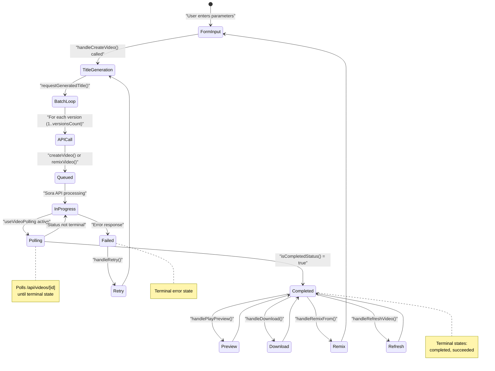

**Sources:** [components/App.tsx:215-374](), [components/App.tsx:198]()

## Creation Phase

### Initial Request

Video creation begins when the user clicks the generate button, triggering the `handleCreateVideo` function. This function orchestrates the entire creation flow including validation, title generation, and batch processing.

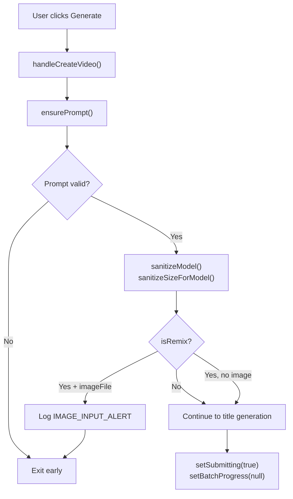

**Sources:** [components/App.tsx:215-274]()

### Title Generation

Before creating videos, the system generates a descriptive title using the `requestVideoTitle` API endpoint. This step can be skipped if a title is provided in the `overrideTitle` parameter.

| Step | Function | API Route | Fallback |
|------|----------|-----------|----------|
| Set generating flag | `setGeneratingTitle(true)` | - | - |
| Request title | `requestGeneratedTitle()` | `/api/video-title` | First 60 chars of prompt |
| Extract title | `extractTitleFromResponse()` | - | "Untitled Video" |
| Limit length | `.slice(0, 80)` | - | - |
| Clear flag | `setGeneratingTitle(false)` | - | - |

**Sources:** [components/App.tsx:200-213](), [components/App.tsx:265-275]()

### Batch Creation Loop

The system supports creating multiple versions of a video in a single operation. The `versionsCount` parameter controls how many versions are generated.

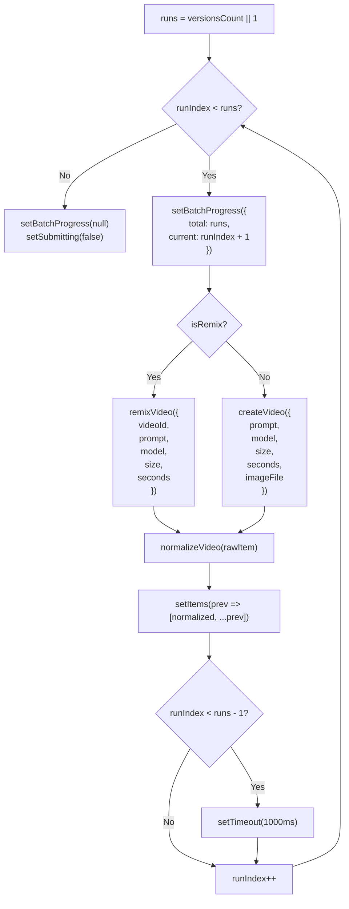

**Sources:** [components/App.tsx:277-346]()

### Video Item Construction

After receiving a response from the API, the system constructs a `VideoItem` object with normalized fields:

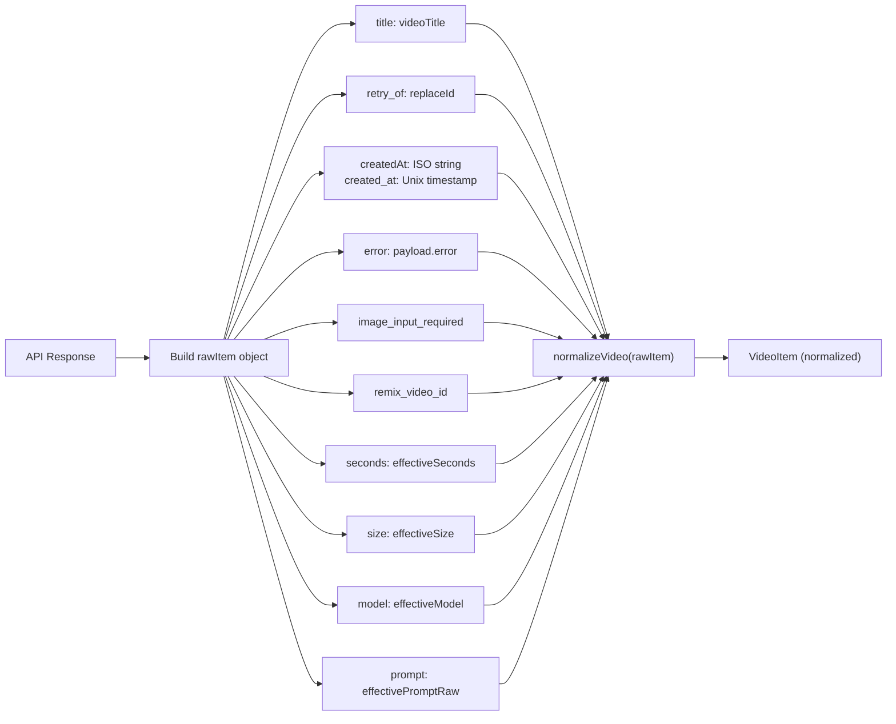

**Sources:** [components/App.tsx:302-326]()

## Status Tracking Phase

### Polling Mechanism

Once a video enters the queue, the `useVideoPolling` hook automatically polls its status until it reaches a terminal state. The polling system operates independently for each video.

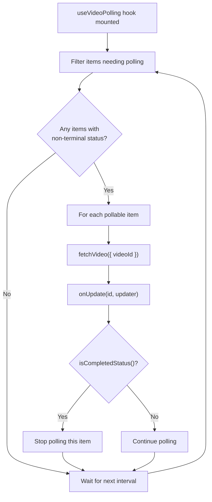

The polling loop calls `GET /api/videos/[id]` which internally calls `client.get(/videos/${videoId})` on the OpenAI SDK.

**Sources:** [components/App.tsx:198](), [app/api/videos/[id]/route.ts:34-58]()

### Status Updates

Status updates occur through the `handleUpdateItem` callback, which uses an updater function pattern to ensure atomic state updates:

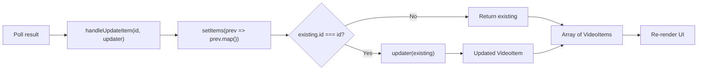

**Sources:** [components/App.tsx:162-171]()

## Terminal States

### Completed State

A video reaches the completed state when `isCompletedStatus(item.status)` returns `true`. In this state, the video becomes available for preview, download, and remixing.

**Terminal Status Values:**
- `completed`
- `succeeded`

Videos in completed state are:
1. Included in `previewableItems` filter [components/App.tsx:131-134]()
2. Available for download via `handleDownload` [components/App.tsx:376-404]()
3. Can be remixed via `handleRemixFrom` [components/App.tsx:475-494]()
4. Displayed with a thumbnail in the sidebar [components/VideoSidebar.tsx]()

**Sources:** [components/App.tsx:131-134](), [components/App.tsx:407-409]()

### Failed State

Videos enter the failed state when an error occurs during processing. Failed videos can be retried using `handleRetry`.

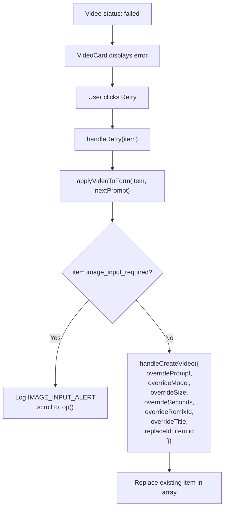

**Sources:** [components/App.tsx:507-540]()

## Post-Completion Operations

### Preview

The preview system allows full-screen playback of completed videos through the `VideoPreviewOverlay` component.

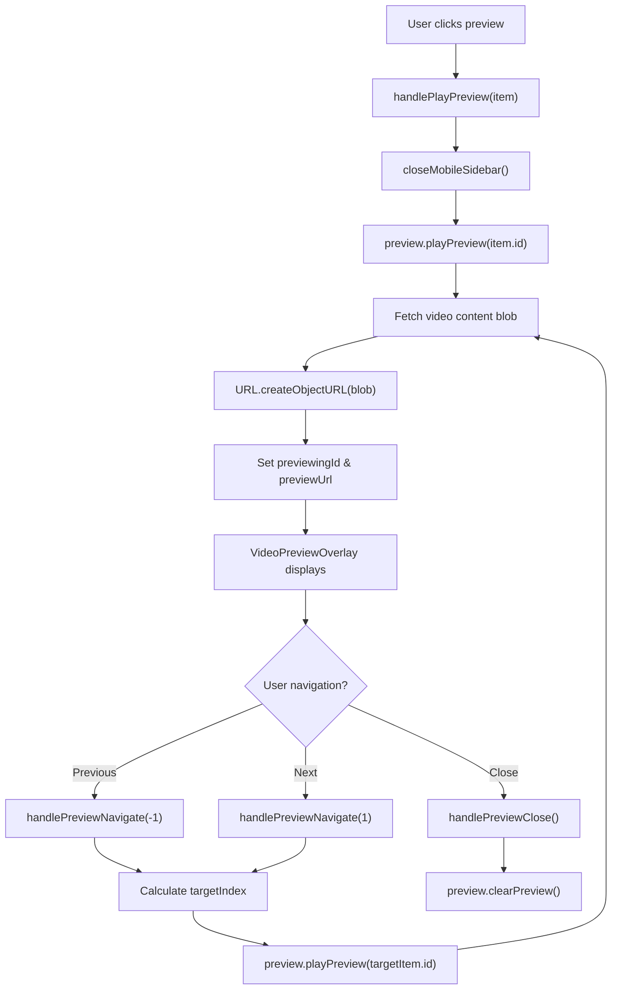

**Sources:** [components/App.tsx:428-464](), [components/App.tsx:770-780]()

### Download

Videos can be downloaded individually or in batch using the download system.

| Operation | Function | Behavior |
|-----------|----------|----------|
| Single download | `handleDownload(item)` | Fetches blob, creates download link, marks as downloaded |
| Batch download | `handleDownloadAll()` | Downloads all completed videos with 400ms delay between each |
| Mark downloaded | `setItems(prev => ...)` | Updates `downloaded: true` flag on item |

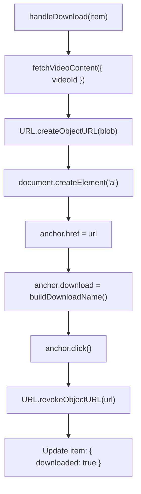

**Sources:** [components/App.tsx:376-404](), [components/App.tsx:406-426]()

### Remix

Remixing creates a new video based on an existing one's parameters. The remix operation populates the form and sets the `remixId` field.

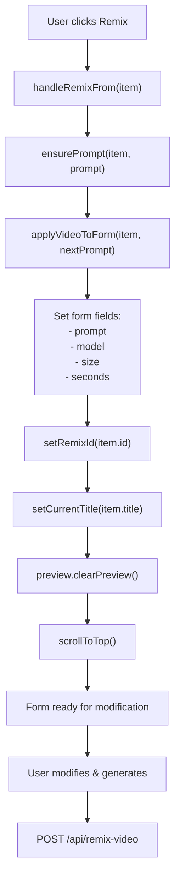

When the user submits, the system detects `remixId` and calls `remixVideo` instead of `createVideo`:

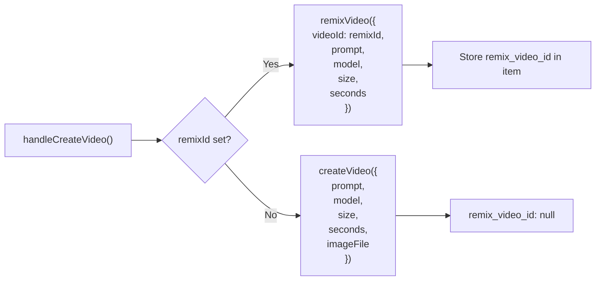

**Sources:** [components/App.tsx:475-494](), [components/App.tsx:284-291]()

### Retry

The retry operation recreates a failed video with the same parameters, optionally replacing the failed item.

**Retry Flow:**
1. Apply failed video parameters to form
2. Check for `image_input_required` flag - if set, alert user and stop
3. Call `handleCreateVideo` with `replaceId: item.id`
4. Replace existing item in state array instead of prepending

**Key Difference from Remix:**
- Retry: Uses `replaceId` parameter, replaces item in-place [components/App.tsx:328-340]()
- Remix: Creates new item, preserves original [components/App.tsx:340]()

**Sources:** [components/App.tsx:507-540]()

### Refresh

The refresh operation manually polls a video's current status, useful for debugging or checking stale items.

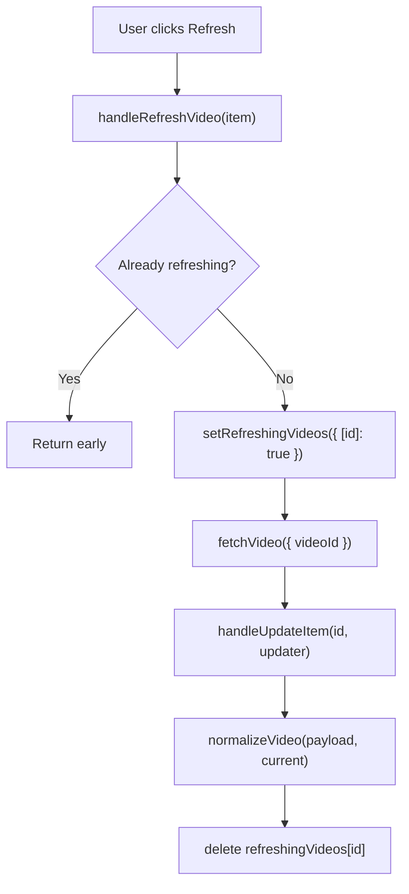

The `refreshingVideos` state object tracks which videos are currently being refreshed to prevent duplicate requests.

**Sources:** [components/App.tsx:173-196](), [components/App.tsx:91-93]()

## State Management

### VideoItem Structure

The `VideoItem` type represents a video throughout its lifecycle. Key fields include:

| Field | Type | Purpose |
|-------|------|---------|
| `id` | `string` | Unique identifier from API |
| `status` | `string` | Current processing status |
| `prompt` | `string` | Generation prompt |
| `model` | `SoraModel` | Model identifier (e.g., "sora-turbo-latest") |
| `size` | `string` | Video dimensions (e.g., "1920x1080") |
| `seconds` | `string` | Duration in seconds |
| `title` | `string` | Human-readable title |
| `remix_video_id` | `string \| null` | Parent video ID if this is a remix |
| `retry_of` | `string \| null` | Original video ID if this is a retry |
| `image_input_required` | `boolean` | Whether image input was used |
| `downloaded` | `boolean` | Download tracking flag |
| `createdAt` | `string` | ISO timestamp |
| `created_at` | `number` | Unix timestamp |
| `error` | `unknown` | Error details if failed |

**Sources:** [components/App.tsx:302-324]()

### Persistence

Video items persist in localStorage using the `usePersistedState` hook:

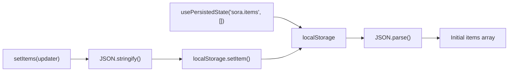

The persistence key is `"sora.items"` and the state is automatically synchronized with localStorage on every update.

**Sources:** [components/App.tsx:73](), [hooks/usePersistedState.tsx]()

### Lifecycle State Flags

The `App` component maintains several flags that track lifecycle state:

| State Variable | Type | Purpose |
|----------------|------|---------|
| `submitting` | `boolean` | Video creation in progress |
| `batchProgress` | `BatchProgressState \| null` | Current/total for batch operations |
| `generatingTitle` | `boolean` | Title generation in progress |
| `downloadingAll` | `boolean` | Batch download in progress |
| `refreshingVideos` | `Record<string, boolean>` | Per-video refresh flags |
| `currentTitle` | `string` | Currently generated title |

**Sources:** [components/App.tsx:74-93]()

---

