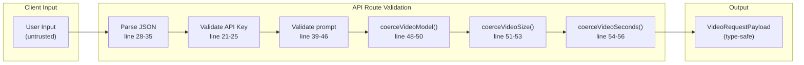
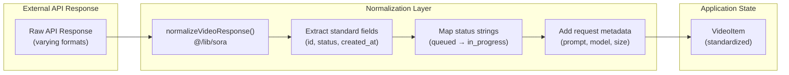
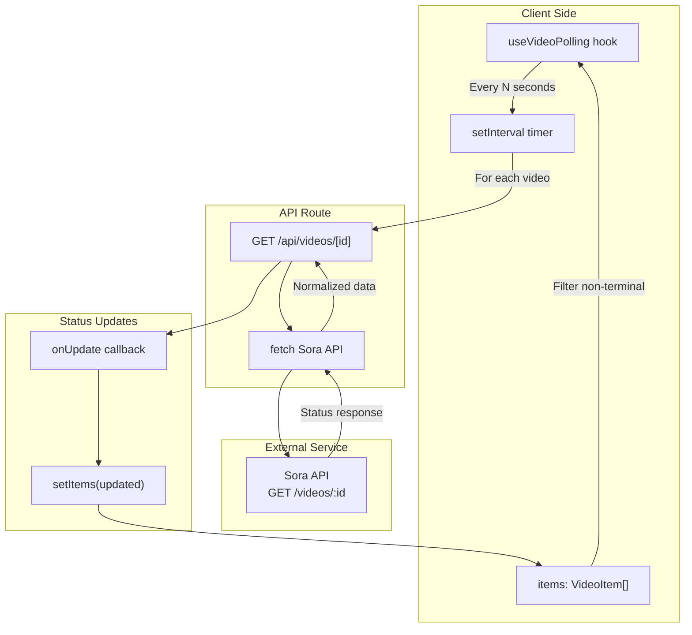
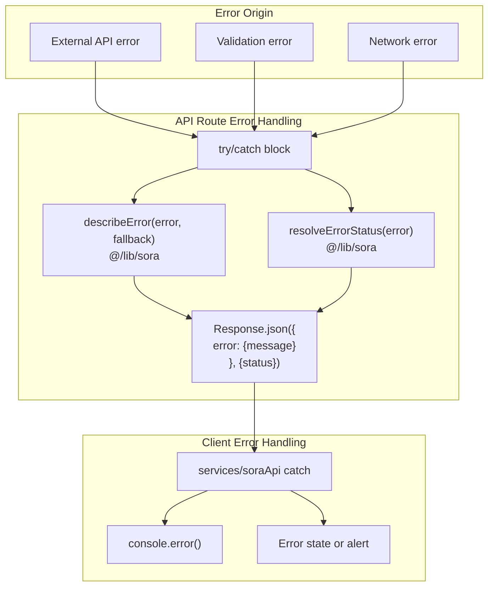
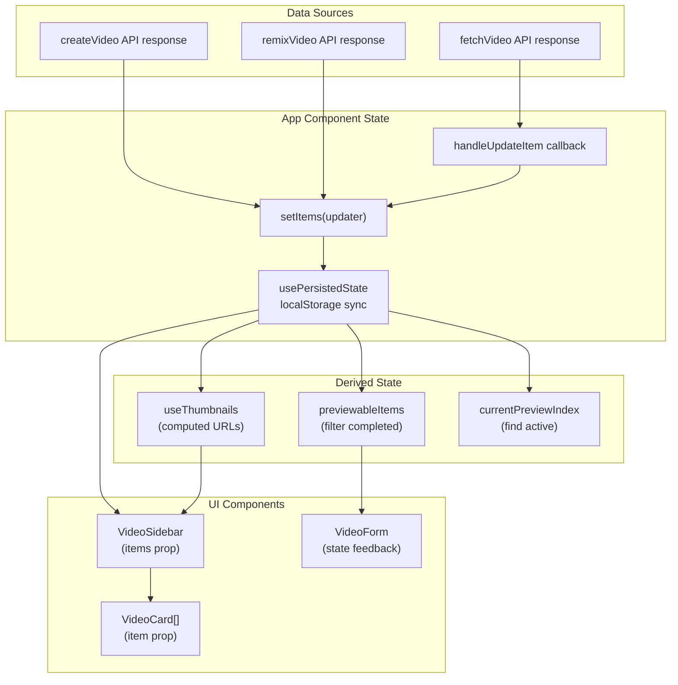

<!-- source: DeepWiki mcp.deepwiki.com · repo openai/openai-sora-sample-app · page 3.3 Data Flow & Communication · fetched 2026-10-26 -->

# Data Flow & Communication

<details>
<summary>Relevant source files</summary>

The following files were used as context for generating this wiki page:

- [app/api/generate-video/route.ts](app/api/generate-video/route.ts)
- [components/App.tsx](components/App.tsx)
- [components/VideoSidebar.tsx](components/VideoSidebar.tsx)

</details>


## Purpose and Scope

This document describes how data flows through the Sora Sample App, from user interactions in the browser to external API calls and back. It covers the request/response patterns, data transformation pipelines, polling mechanisms, and binary content delivery strategies used throughout the application.

For information about state management patterns and hooks, see [Client-Side State Management](#3.1). For information about video status transitions and lifecycle stages, see [Video Lifecycle](#3.2). For details about specific API endpoints, see [API Layer](#5).

---

## Communication Architecture Overview

The application uses a three-tier communication architecture with strict separation of concerns:

1. **Client Layer**: React components trigger actions and consume data through props and callbacks
2. **API Layer**: Next.js API routes validate inputs, transform data, and proxy requests to external services
3. **External Services Layer**: OpenAI APIs (Sora, Image Generation, Chat Completion) provide AI capabilities

All communication between tiers uses HTTP/HTTPS protocols. There are no WebSocket connections; real-time updates are achieved through client-initiated polling.

**Key Communication Patterns:**

| Pattern | Usage | Implementation |
|---------|-------|----------------|
| Request/Response | Video generation, image generation, prompt suggestions | Standard HTTP POST/GET |
| Status Polling | Video completion tracking | Client-initiated periodic GET requests |
| Binary Streaming | Video content delivery | HTTP GET with blob response |
| Form Submission | Video creation with image inputs | FormData with multipart/form-data |

Sources: [app/api/generate-video/route.ts:1-144](), [components/App.tsx:1-784]()

---

## Request Flow: Video Generation

### Complete Request/Response Cycle

The following diagram shows how a video generation request flows through the system, including all major code entities involved:

```mermaid
sequenceDiagram
    participant User
    participant VideoForm
    participant App["App.handleCreateVideo"]
    participant createVideo["services/soraApi.createVideo"]
    participant Route["app/api/generate-video/route.ts"]
    participant Coercion["@/lib/sora coercion functions"]
    participant SoraAPI["OpenAI Sora API /videos"]
    participant Normalize["@/lib/sora normalizeVideoResponse"]
    participant State["usePersistedState"]

    User->>VideoForm: "Enter prompt, click Generate"
    VideoForm->>App: "onSubmit()"
    App->>App: "requestGeneratedTitle(prompt)"
    App->>createVideo: "{prompt, model, size, seconds, imageFile}"
    createVideo->>Route: "POST /api/generate-video"
    
    Route->>Route: "Validate OPENAI_API_KEY"
    Route->>Coercion: "coerceVideoModel(model)"
    Route->>Coercion: "coerceVideoSize(size)"
    Route->>Coercion: "coerceVideoSeconds(seconds)"
    
    alt "With image input"
        Route->>Route: "Construct FormData"
        Route->>Route: "Buffer.from(base64)"
        Route->>SoraAPI: "POST FormData"
    else "Text only"
        Route->>Route: "Construct JSON payload"
        Route->>SoraAPI: "POST JSON"
    end
    
    SoraAPI-->>Route: "Raw video response"
    Route->>Normalize: "normalizeVideoResponse(result, payload)"
    Normalize-->>Route: "Normalized VideoItem"
    Route-->>createVideo: "Response.json(normalized)"
    createVideo-->>App: "VideoItem data"
    
    App->>App: "normalizeVideo(rawItem)"
    App->>State: "setItems([normalized, ...prev])"
    State-->>VideoForm: "Re-render with new item"
```

**Sources:** [components/App.tsx:215-374](), [app/api/generate-video/route.ts:20-143]()

---

## Data Transformation Pipeline

All data passes through a standardized transformation pipeline to ensure type safety and API compatibility.

### Input Coercion Pipeline



**Key Coercion Functions:**

| Function | Input | Output | Default |
|----------|-------|--------|---------|
| `coerceVideoModel` | string \| null | SoraModel | "sora-1.1" |
| `coerceVideoSize` | string \| null | string | "1920x1080" |
| `coerceVideoSeconds` | string \| null | string | "5" |

These functions are located in `@/lib/sora` and ensure that invalid or missing parameters are replaced with safe defaults rather than causing runtime errors.

**Sources:** [app/api/generate-video/route.ts:48-56]()

---

### Response Normalization Pipeline

After receiving responses from external APIs, all data is normalized into a consistent `VideoItem` structure:



The normalization process handles multiple response formats from the Sora API and ensures that the application always works with a consistent data structure, regardless of API version differences.

**Sources:** [app/api/generate-video/route.ts:135-136](), [components/App.tsx:302-327]()

---

## Status Polling Mechanism

Videos are created asynchronously by the Sora API. The application uses client-side polling to track completion status.

### Polling Architecture



**Polling Logic:**

1. The `useVideoPolling` hook identifies videos with non-terminal statuses (not "completed", "succeeded", or "failed")
2. For each such video, it periodically calls `fetchVideo({ videoId })` 
3. The API route [app/api/videos/[id]/route.ts]() proxies to the Sora API
4. Responses are normalized and passed to the `onUpdate` callback
5. The callback updates the specific item in the `items` array
6. React re-renders components with updated video status

**Terminal States:** Once a video reaches a terminal state, polling stops for that video to reduce unnecessary API calls.

**Sources:** [components/App.tsx:198]()

---

## Binary Content Delivery

Video content is delivered as binary blobs through a separate endpoint to support preview and download functionality.

### Content Streaming Flow

```mermaid
sequenceDiagram
    participant User
    participant VideoCard
    participant Handler["App.handleDownload<br/>or<br/>App.handlePlayPreview"]
    participant Service["services/soraApi"]
    participant ContentRoute["app/api/videos/[id]/content"]
    participant SoraAPI["Sora API<br/>GET /videos/:id/content"]
    participant Browser

    User->>VideoCard: "Click Download/Preview"
    VideoCard->>Handler: "onDownload(item)"
    Handler->>Service: "fetchVideoContent({videoId})"
    Service->>ContentRoute: "GET /api/videos/[id]/content"
    
    ContentRoute->>ContentRoute: "Validate API key"
    ContentRoute->>SoraAPI: "GET /videos/:id/content"
    SoraAPI-->>ContentRoute: "Binary video stream"
    ContentRoute->>ContentRoute: "response.blob()"
    ContentRoute-->>Service: "Blob object"
    Service-->>Handler: "Blob object"
    
    alt "Download"
        Handler->>Handler: "URL.createObjectURL(blob)"
        Handler->>Browser: "anchor.download = filename"
        Handler->>Browser: "anchor.click()"
        Handler->>Handler: "URL.revokeObjectURL(url)"
    else "Preview"
        Handler->>Handler: "Store in preview cache"
        Handler->>Browser: "Set video.src to blob URL"
    end
```

**Key Implementation Details:**

- **Download Path**: [components/App.tsx:376-404]() creates an anchor element with the blob URL and triggers a click
- **Preview Path**: The `usePreview` hook maintains a cache of blob URLs for instant playback
- **Memory Management**: Blob URLs are revoked after use to prevent memory leaks
- **Content Type**: The API route preserves the `content-type` header from the Sora API response

**Sources:** [components/App.tsx:376-404](), [components/App.tsx:428-442]()

---

## Multi-Request Form Data Construction

When creating videos with image inputs, the application constructs a `FormData` object to support multipart uploads.

### Image Input Processing

```mermaid
graph TB
    subgraph "Client: VideoForm"
        FileInput["<input type='file'>"]
        Base64["Convert to base64<br/>FileReader.readAsDataURL"]
        ImageData["imageData object<br/>{data, mimeType, name}"]
    end
    
    subgraph "Client: App.handleCreateVideo"
        CreatePayload["createVideo({<br/>prompt, model,<br/>size, seconds,<br/>imageFile<br/>})"]
    end
    
    subgraph "API Route: /api/generate-video"
        CheckImage["if (imageData?.data)"]
        FormData["new FormData()"]
        SetFields["formData.set('prompt')<br/>formData.set('model')<br/>formData.set('size')<br/>formData.set('seconds')"]
        Buffer["Buffer.from(data, 'base64')"]
        Blob["new Blob([buffer], {type})"]
        Append["formData.append(<br/>'input_reference',<br/>blob, filename)"]
        Post["POST with FormData body"]
    end
    
    FileInput --> Base64
    Base64 --> ImageData
    ImageData --> CreatePayload
    CreatePayload --> CheckImage
    CheckImage -->|"has image"| FormData
    FormData --> SetFields
    SetFields --> Buffer
    Buffer --> Blob
    Blob --> Append
    Append --> Post
    
    CheckImage -->|"no image"| JSONPost["POST with JSON body"]
```



**Multi-Step Process:**

1. **Client-side encoding** [useVideoForm hook](): User selects file → Convert to base64 data URL → Store in component state
2. **API-side decoding** [app/api/generate-video/route.ts:85-102](): Extract base64 string → Convert to Buffer → Create Blob with MIME type → Append to FormData
3. **HTTP transmission**: FormData automatically sets `Content-Type: multipart/form-data` boundary
4. **Sora API processing**: Receives multipart upload with `input_reference` field

**Sources:** [app/api/generate-video/route.ts:85-108]()

---

## Error Communication Pattern

Errors are communicated through a standardized format across all API routes.

### Error Flow



**Error Response Structure:**

```typescript
{
  error: {
    message: string  // Human-readable error description
  }
}
```

**HTTP Status Codes:**

- `400`: Invalid request parameters (e.g., missing prompt)
- `401`: Authentication failure (invalid API key)
- `429`: Rate limit exceeded
- `500`: Server error or external API failure

**Error Utilities:**

- `describeError(error, fallback)`: Extracts human-readable error messages from various error formats
- `resolveErrorStatus(error)`: Maps error types to appropriate HTTP status codes

**Sources:** [app/api/generate-video/route.ts:125-142]()

---

## State Synchronization

State updates flow unidirectionally from API responses to UI components through the `App` component.

### State Update Propagation



**Update Patterns:**

1. **Full Replacement** [components/App.tsx:328-341](): New videos are prepended to the `items` array
2. **Selective Update** [components/App.tsx:162-171](): Individual items are updated by mapping over the array and replacing matching IDs
3. **Automatic Persistence**: The `usePersistedState` hook automatically syncs changes to `localStorage`
4. **Reactive Recomputation**: Derived state (thumbnails, previewable items) automatically recomputes when source data changes

**Sources:** [components/App.tsx:162-171](), [components/App.tsx:328-341]()

---

## Cross-Component Communication

Components communicate through callbacks passed down from the `App` component, following the "lifting state up" pattern.

### Event Handler Wiring

| UI Action | Component | Handler | API Call | State Update |
|-----------|-----------|---------|----------|--------------|
| Generate Video | VideoForm | `onSubmit` → `handleCreateVideo` | `createVideo` | `setItems([new, ...prev])` |
| Remix Video | VideoCard | `onRemix` → `handleRemixFrom` | None (immediate) | `applyVideoToForm` |
| Retry Video | VideoCard | `onRetry` → `handleRetry` | `createVideo` | `setItems(replace)` |
| Download Video | VideoCard | `onDownload` → `handleDownload` | `fetchVideoContent` | `setItems(mark downloaded)` |
| Preview Video | VideoCard | `onPlayPreview` → `handlePlayPreview` | `fetchVideoContent` (cached) | `preview.playPreview` |
| Refresh Status | VideoCard | `onRefresh` → `handleRefreshVideo` | `fetchVideo` | `handleUpdateItem` |
| Generate Images | VideoForm | `onGenerateImages` → `handleGenerateInputImages` | `generateImages` | `setGeneratedImages` |
| Suggest Prompt | VideoForm | `onGeneratePrompt` → `handleSuggestPrompt` | `suggestVideoPrompt` | `setPrompt` |

**Sources:** [components/App.tsx:681-783](), [components/VideoSidebar.tsx:22-37]()

---

## API Service Layer

The `services/soraApi` module provides a typed interface to all API routes, abstracting HTTP details from React components.

### Service Function Pattern

All service functions follow this pattern:

```typescript
export async function serviceName<T>(params): Promise<T> {
  const response = await fetch('/api/endpoint', {
    method: 'POST',
    headers: { 'Content-Type': 'application/json' },
    body: JSON.stringify(params)
  });
  
  if (!response.ok) {
    const error = await response.json();
    throw new Error(error?.error?.message || 'Request failed');
  }
  
  return response.json();
}
```

**Available Service Functions:**

- `createVideo`: POST /api/generate-video
- `remixVideo`: POST /api/remix-video
- `fetchVideo`: GET /api/videos/[id]
- `fetchVideoContent`: GET /api/videos/[id]/content (returns Blob)
- `generateImages`: POST /api/generate-images
- `suggestVideoPrompt`: POST /api/suggest-prompt
- `requestVideoTitle`: POST /api/video-title

These functions provide type-safe interfaces and consistent error handling for all API interactions.

**Sources:** [components/App.tsx:36-43]()

---

