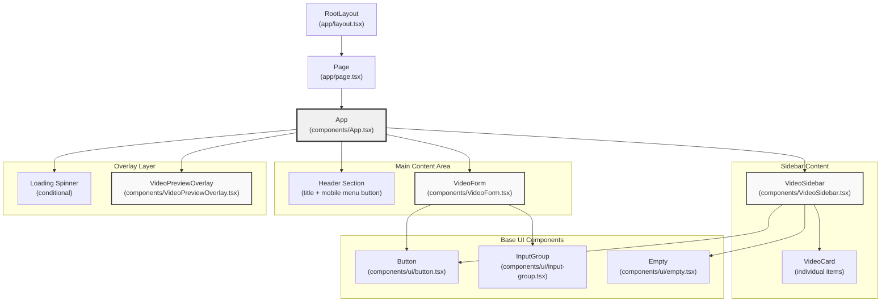
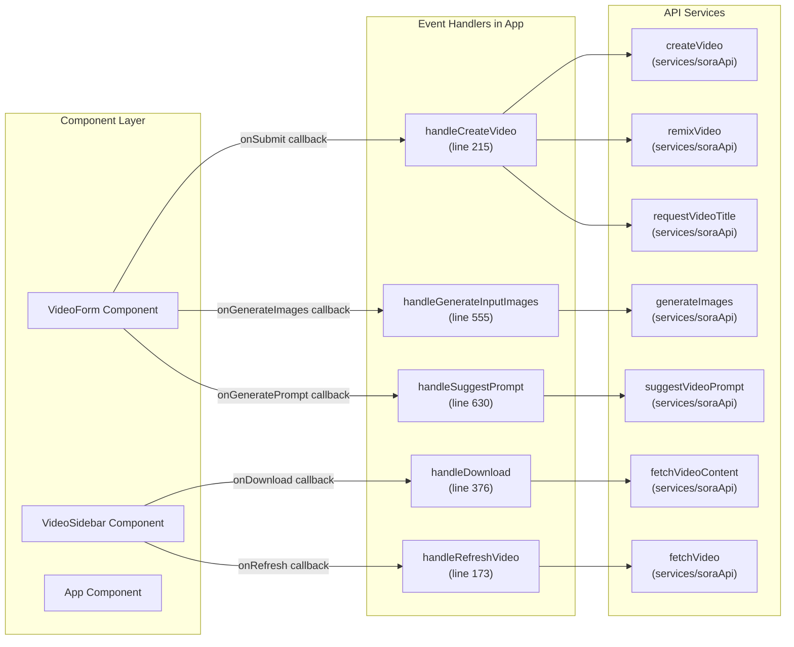
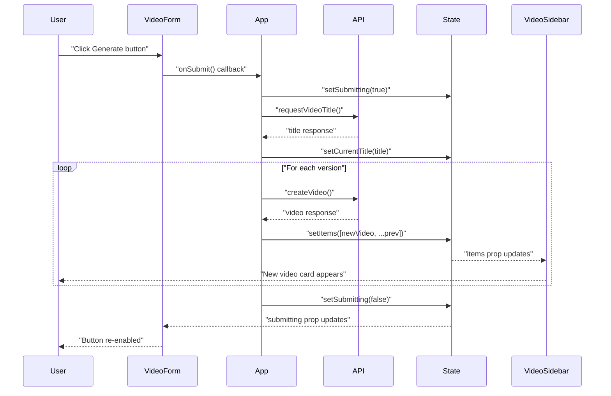
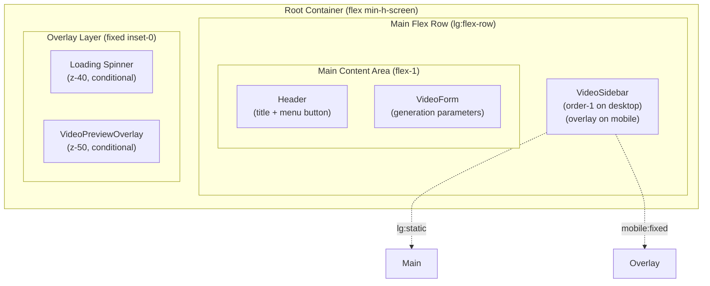
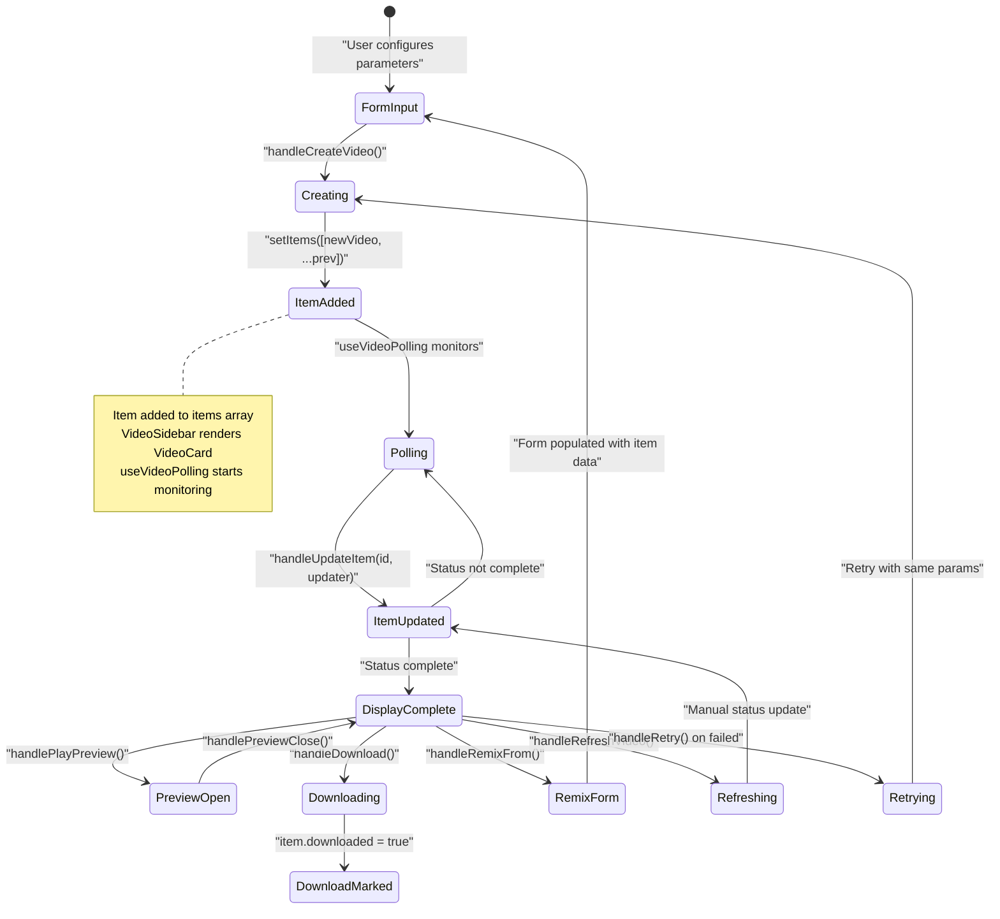

<!-- source: DeepWiki mcp.deepwiki.com · repo openai/openai-sora-sample-app · page 4 Frontend Components · fetched 2026-10-26 -->

# Frontend Components

<details>
<summary>Relevant source files</summary>

The following files were used as context for generating this wiki page:

- [app/layout.tsx](app/layout.tsx)
- [app/page.tsx](app/page.tsx)
- [components/App.tsx](components/App.tsx)

</details>


## Purpose and Scope

This document provides an overview of the React component architecture in the Sora Sample App, including the component hierarchy, responsibilities, and data flow patterns. It covers the structural organization of UI components from the application shell down to individual UI elements.

For detailed information about specific component systems, see:
- Application shell components ([RootLayout](#4.1), [Page](#4.1), [App](#4.1))
- Video generation form ([VideoForm](#4.2))
- Video library display ([VideoSidebar](#4.3), [VideoCard](#4.3))
- Video preview and playback ([VideoPreviewOverlay](#4.4))
- Reusable UI primitives ([Button](#4.5), [InputGroup](#4.5))

For state management patterns used by these components, see [Client-Side State Management](#3.1).

---

## Component Hierarchy

The application follows a clear component hierarchy with the `App` component serving as the central orchestrator.

### Component Tree Structure



**Sources:** [app/layout.tsx:24-53](), [app/page.tsx:1-8](), [components/App.tsx:72-783]()

---

## Core Components Overview

### Application Shell Components

| Component | File Path | Responsibility |
|-----------|-----------|----------------|
| `RootLayout` | `app/layout.tsx` | Provides HTML structure, font configuration, theme system, and metadata |
| `Page` | `app/page.tsx` | Next.js page component that renders the `App` component |
| `App` | `components/App.tsx` | Main application orchestrator managing state, event handlers, and component composition |

The application shell establishes the foundation for the entire UI. `RootLayout` configures theming via a system preference script [app/layout.tsx:29-39]() and applies Geist font variables [app/layout.tsx:5-13](). The `Page` component serves as a thin wrapper that delegates to `App` [app/page.tsx:5-7]().

**Sources:** [app/layout.tsx:1-54](), [app/page.tsx:1-8](), [components/App.tsx:72]()

### Primary Feature Components

| Component | Purpose | Key Props/Callbacks |
|-----------|---------|---------------------|
| `VideoForm` | Video generation input interface | `prompt`, `model`, `size`, `seconds`, `versionsCount`, `onSubmit`, `onGenerateImages` |
| `VideoSidebar` | Video library display and management | `items`, `thumbnails`, `onDownload`, `onPlayPreview`, `onRemix`, `onRetry` |
| `VideoPreviewOverlay` | Full-screen video playback | `isOpen`, `item`, `previewUrl`, `onClose`, `onPrev`, `onNext` |

These components implement the three main user-facing features:
1. **VideoForm** handles all video generation parameters and image input [components/App.tsx:721-757]()
2. **VideoSidebar** displays the persistent video library with action buttons [components/App.tsx:684-699]()
3. **VideoPreviewOverlay** provides immersive video playback [components/App.tsx:769-780]()

**Sources:** [components/App.tsx:7-14](), [components/App.tsx:684-780]()

---

## Component Responsibilities and State Flow

### App Component Architecture

The `App` component serves as the central state manager and event coordinator. It maintains application state through custom hooks and passes both state and callbacks down to child components.

```mermaid
graph TB
    subgraph "App Component State Management"
        direction TB
        
        App["App Component<br/>(components/App.tsx:72)"]
        
        subgraph "Custom Hooks"
            usePersistedState["usePersistedState<br/>(VideoItem[])"]
            useVideoForm["useVideoForm<br/>(form parameters)"]
            usePreview["usePreview<br/>(preview state)"]
            useThumbnails["useThumbnails<br/>(thumbnail URLs)"]
            useVideoPolling["useVideoPolling<br/>(status updates)"]
        end
        
        subgraph "Local State"
            submitting["submitting: boolean"]
            batchProgress["batchProgress: BatchProgressState"]
            currentTitle["currentTitle: string"]
            generatingImages["generatingImages: boolean"]
            generatedImages["generatedImages: GeneratedImageSuggestion[]"]
            isMobileSidebarOpen["isMobileSidebarOpen: boolean"]
            refreshingVideos["refreshingVideos: Record<string, boolean>"]
        end
    end
    
    App --> usePersistedState
    App --> useVideoForm
    App --> usePreview
    App --> useThumbnails
    App --> useVideoPolling
    
    App --> submitting
    App --> batchProgress
    App --> currentTitle
    App --> generatingImages
    App --> generatedImages
    App --> isMobileSidebarOpen
    App --> refreshingVideos
```



**Sources:** [components/App.tsx:72-93](), [components/App.tsx:103-125]()

### Event Handler Pattern

The `App` component implements event handlers that orchestrate complex workflows involving multiple API calls and state updates.

**Key Event Handlers:**

| Handler | Purpose | API Calls | State Updates |
|---------|---------|-----------|---------------|
| `handleCreateVideo` | Create new video or remix | `requestVideoTitle`, `createVideo`/`remixVideo` | `items`, `submitting`, `batchProgress`, `currentTitle` |
| `handleDownload` | Download video content | `fetchVideoContent` | `items` (marks downloaded) |
| `handlePlayPreview` | Open video preview | `preview.playPreview` | Preview state via hook |
| `handleRemixFrom` | Load video into form for remixing | None | Form state via `applyVideoToForm` |
| `handleRetry` | Retry failed video generation | `createVideo` | `items` (replaces failed item) |
| `handleRefreshVideo` | Manually refresh video status | `fetchVideo` | `items` (updates single item) |

**Sources:** [components/App.tsx:215-374]() (handleCreateVideo), [components/App.tsx:376-404]() (handleDownload), [components/App.tsx:428-442]() (handlePlayPreview), [components/App.tsx:475-494]() (handleRemixFrom), [components/App.tsx:507-540]() (handleRetry), [components/App.tsx:173-196]() (handleRefreshVideo)

---

## Component-to-API Integration

Components interact with external services through API service functions imported from `@/services/soraApi`.



**Sources:** [components/App.tsx:35-43]() (imports), [components/App.tsx:215-374]() (handleCreateVideo), [components/App.tsx:555-604]() (handleGenerateInputImages), [components/App.tsx:630-671]() (handleSuggestPrompt)

---

## Data Flow Patterns

### Unidirectional Data Flow

The application follows React's unidirectional data flow pattern: state lives in `App` or custom hooks, flows down as props to child components, and updates propagate back up through callbacks.



**Sources:** [components/App.tsx:215-374]() (handleCreateVideo flow), [components/App.tsx:721-757]() (VideoForm props), [components/App.tsx:684-699]() (VideoSidebar props)

### Prop Passing Structure

The `App` component passes state and callbacks to child components through props:

**VideoForm Props Flow:**
```typescript
// Form state from useVideoForm hook
prompt, model, size, seconds, versionsCount, remixId

// Image generation state
generatingImages, generatedImages, selectedGeneratedImageId, generatedImageError

// UI state
submitting, generatingTitle, generatingPrompt, currentTitle, batchProgress

// Callbacks
onPromptChange, onModelChange, onSizeChange, onSecondsChange, 
onSubmit, onGenerateImages, onGeneratePrompt, onClear
```

**VideoSidebar Props Flow:**
```typescript
// Data
items, thumbnails

// Preview state
previewState: { previewingId, previewLoading }

// Action callbacks
onDownload, onPlayPreview, onRemix, onRetry, onRefresh, onRemove, onDownloadAll

// UI state
downloadingAll, refreshingMap, isMobileOpen, onMobileClose
```

**Sources:** [components/App.tsx:721-757]() (VideoForm props), [components/App.tsx:684-699]() (VideoSidebar props)

---

## Component Layout Structure

The `App` component organizes the UI into a responsive layout with a sidebar and main content area.

### Responsive Layout Architecture



The layout uses Tailwind CSS classes for responsive behavior:
- **Desktop (lg+):** Sidebar is `order-1` and appears on the left, main content is `order-2` on the right [components/App.tsx:682-759]()
- **Mobile:** Sidebar becomes a fixed overlay controlled by `isMobileSidebarOpen` state [components/App.tsx:90]()
- **Overlays:** Loading spinner and preview use `fixed inset-0` with high z-index for modal behavior [components/App.tsx:761-780]()

**Sources:** [components/App.tsx:681-783]()

---

## Component State Synchronization

### Video Item Lifecycle

Components stay synchronized with video state through shared access to the `items` array from `usePersistedState`.



**Sources:** [components/App.tsx:162-171]() (handleUpdateItem), [components/App.tsx:198]() (useVideoPolling), [components/App.tsx:327-341]() (setItems in handleCreateVideo)

---

## Component Communication Patterns

### Callback-Based Communication

Child components communicate with `App` through callback props, following React's standard pattern.

**Example: VideoSidebar to App Communication**

```typescript
// In App component [components/App.tsx:684-699]
<VideoSidebar
  items={items}
  onDownload={handleDownload}      // Single video download
  onPlayPreview={handlePlayPreview}  // Open preview overlay
  onRemix={handleRemixFrom}        // Load into form
  onRetry={handleRetry}            // Retry failed generation
  onRefresh={handleRefreshVideo}   // Manual status refresh
  onRemove={handleRemove}          // Delete from library
  onDownloadAll={handleDownloadAll} // Bulk download
  // ... other props
/>
```

Each callback handler in `App` performs specific operations:
- **State mutations:** Update `items` array via `setItems`
- **API calls:** Invoke service functions from `@/services/soraApi`
- **Side effects:** Navigate to preview, scroll to top, close mobile sidebar
- **Form updates:** Populate form fields via `applyVideoToForm`

**Sources:** [components/App.tsx:684-699]() (VideoSidebar callbacks), [components/App.tsx:376-540]() (handler implementations)

### Hook-Mediated State

Some state is managed through custom hooks that provide both state and actions:

```typescript
// Preview state hook [components/App.tsx:63-70]
const { preview, previewState } = usePreviewState();
// preview provides: playPreview(), clearPreview(), prefetchPreviews()
// previewState provides: { previewingId, previewLoading }

// Form state hook [components/App.tsx:103-125]
const {
  prompt, setPrompt,
  model, setModel,
  size, setSize,
  // ... other form fields and setters
  clearForm: resetFormFields,
  applyVideoToForm,
} = useVideoForm();
```

These hooks encapsulate related state and logic, exposing only the necessary interface to `App`.

**Sources:** [components/App.tsx:63-70]() (usePreviewState), [components/App.tsx:103-125]() (useVideoForm)

---

## Component Mounting and Lifecycle

### Effect-Based Operations

The `App` component uses React effects for operations that depend on state changes:

**Preview Prefetching Effect:**
```typescript
// [components/App.tsx:136-143]
useEffect(() => {
  const ids = previewableItems
    .map((item) => item.id)
    .filter((id): id is string => Boolean(id));
  prefetchPreviews(ids).catch((error) => {
    console.error("Preview prefetch failed", error);
  });
}, [prefetchPreviews, previewableItems]);
```

This effect runs whenever `previewableItems` changes, proactively loading video content for instant preview playback.

**Polling via Custom Hook:**

The `useVideoPolling` hook monitors incomplete videos and automatically updates their status [components/App.tsx:198](). This hook-based approach keeps polling logic separate from the component while still triggering state updates through the `onUpdate` callback.

**Sources:** [components/App.tsx:136-143]() (prefetch effect), [components/App.tsx:198]() (useVideoPolling)

---

## Summary Table: Component Ecosystem

| Component | File | Primary Responsibility | Key State | Key Callbacks |
|-----------|------|----------------------|-----------|--------------|
| `RootLayout` | app/layout.tsx | App shell, theme, fonts | N/A (stateless) | N/A |
| `Page` | app/page.tsx | Next.js page wrapper | N/A (stateless) | N/A |
| `App` | components/App.tsx | State orchestration | `items`, `submitting`, form state | All handlers |
| `VideoForm` | components/VideoForm.tsx | Input collection | Managed by `App` | `onSubmit`, `onGenerateImages` |
| `VideoSidebar` | components/VideoSidebar.tsx | Video library display | Managed by `App` | `onDownload`, `onPlayPreview`, `onRemix` |
| `VideoPreviewOverlay` | components/VideoPreviewOverlay.tsx | Full-screen playback | Managed by `usePreview` | `onClose`, `onPrev`, `onNext` |

**Sources:** [app/layout.tsx:24-53](), [app/page.tsx:1-8](), [components/App.tsx:72-783]()

---

