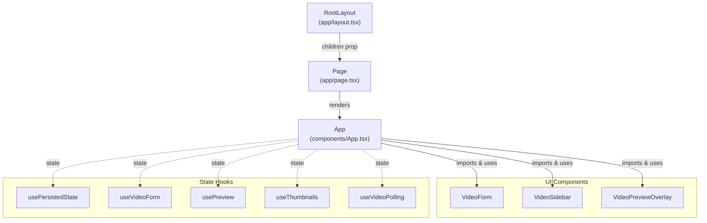
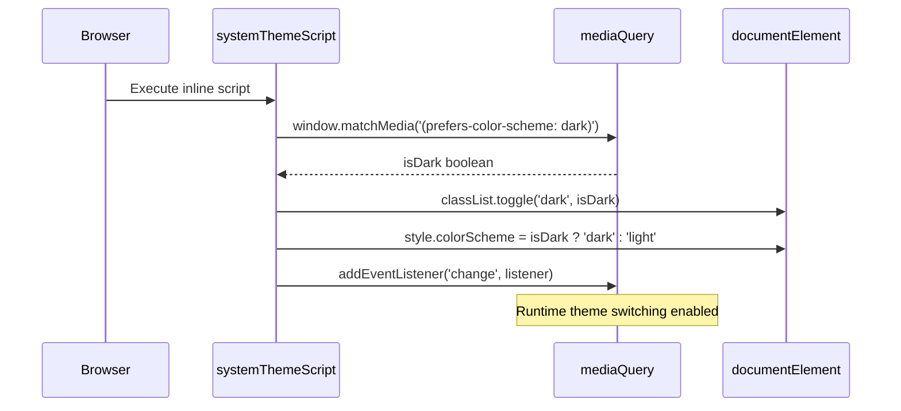
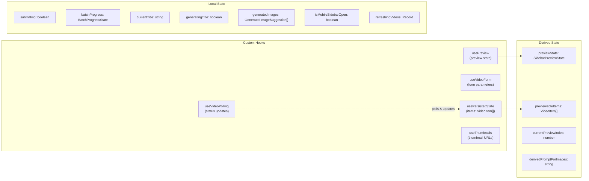
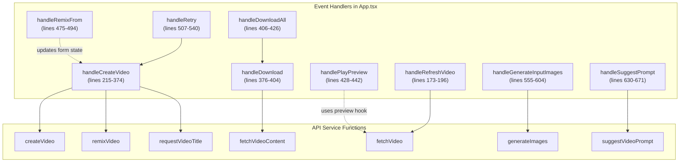
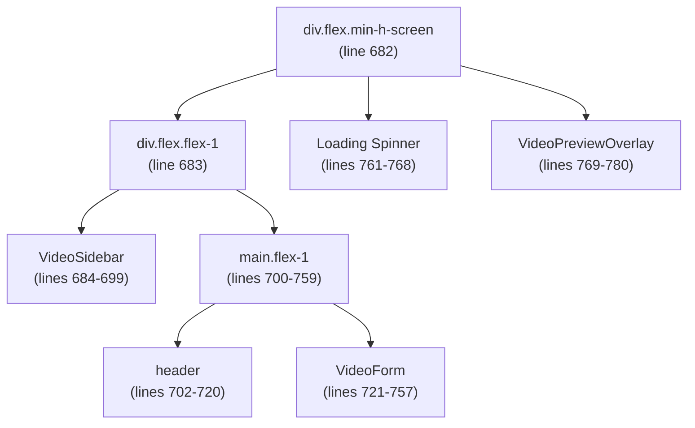
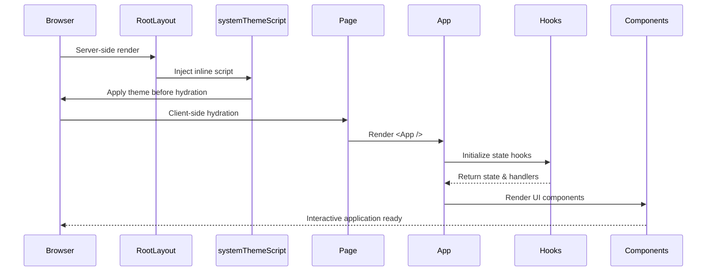

<!-- source: DeepWiki mcp.deepwiki.com · repo openai/openai-sora-sample-app · page 4.1 Application Shell · fetched 2026-10-26 -->

# Application Shell

<details>
<summary>Relevant source files</summary>

The following files were used as context for generating this wiki page:

- [app/layout.tsx](app/layout.tsx)
- [app/page.tsx](app/page.tsx)
- [components/App.tsx](components/App.tsx)

</details>


## Purpose and Scope

The Application Shell encompasses the foundational structure of the Sora Sample App, consisting of three core layers: the `RootLayout` component that establishes global styling and theme infrastructure, the `Page` component that serves as the Next.js page entry point, and the `App` component that orchestrates application state and UI composition. This document covers the initialization flow, theme system setup, and how these components integrate to form the executable application.

For detailed information about individual UI components rendered within the shell, see [Video Form Component](#4.2), [Video Sidebar & Library](#4.3), and [Video Preview System](#4.4). For state management patterns used by the App component, see [Client-Side State Management](#3.1).

---

## Component Hierarchy

The application shell follows a three-tier hierarchy where each layer has a distinct responsibility:

**Component Stack Diagram**



Sources: [app/layout.tsx:24-53](), [app/page.tsx:1-7](), [components/App.tsx:72-783]()

---

## RootLayout Component

The `RootLayout` component ([app/layout.tsx:24-53]()) provides the HTML document structure, font configuration, metadata, and theme system initialization.

### Font Configuration

Two Google Fonts are loaded and exposed as CSS custom properties:

| Font | Variable | Subsets | Purpose |
|------|----------|---------|---------|
| Geist | `--font-geist-sans` | latin | Primary UI font |
| Geist Mono | `--font-geist-mono` | latin | Monospace text |

The font variables are applied to the `<body>` element's `className` at [app/layout.tsx:44](), making them available globally throughout the application.

Sources: [app/layout.tsx:5-13](), [app/layout.tsx:44]()

### Application Metadata

The component defines standard Next.js metadata:

```typescript
title: "Sora Sample App"
description: "Sample frontend for generating videos with the OpenAI Sora models"
icon: "/sora-2.png"
```

Sources: [app/layout.tsx:15-22]()

### Theme System Initialization

**Theme Initialization Flow**



The `systemThemeScript` ([app/layout.tsx:29-39]()) is an inline script that executes before React hydration to prevent theme flashing. It:

1. Queries the system theme preference using `window.matchMedia('(prefers-color-scheme: dark)')`
2. Applies the `.dark` class to `document.documentElement` if dark mode is detected
3. Sets the `colorScheme` CSS property to match
4. Registers an event listener to respond to system theme changes at runtime

The script is injected using `dangerouslySetInnerHTML` ([app/layout.tsx:46-48]()) and executes synchronously before the React application mounts, ensuring no visual theme flash occurs.

Sources: [app/layout.tsx:29-39](), [app/layout.tsx:42-52]()

---

## Page Component

The `Page` component ([app/page.tsx:5-7]()) serves as a minimal Next.js page entry point. It is marked with the `"use client"` directive to enable client-side interactivity and simply renders the `App` component:

```typescript
export default function Page() {
  return <App />;
}
```

This separation allows the layout (server-rendered) to remain distinct from the interactive application (client-rendered).

Sources: [app/page.tsx:1-7]()

---

## App Component

The `App` component ([components/App.tsx:72-783]()) is the primary orchestrator, managing all application state, coordinating API calls, and composing the UI.

### State Management Architecture

**State Management Mapping**



The App component uses a combination of custom hooks for complex state and local `useState` for simpler values:

| State Type | Hook/State | Storage | Purpose |
|------------|------------|---------|---------|
| Persistent | `usePersistedState<VideoItem[]>` | localStorage | Video library |
| Form | `useVideoForm` | React state | Generation parameters |
| Preview | `usePreview` | React state | Video playback |
| Thumbnails | `useThumbnails` | React state | Thumbnail URLs |
| Polling | `useVideoPolling` | React state | Background updates |
| UI | Various `useState` | React state | UI toggles, loading states |

Sources: [components/App.tsx:73-93](), [components/App.tsx:103-125](), [components/App.tsx:127-134]()

### Event Handler Mapping

The App component defines numerous event handlers that bridge UI interactions to state changes and API calls:

**Handler to API Service Mapping**



Sources: [components/App.tsx:215-374](), [components/App.tsx:376-404](), [components/App.tsx:428-442](), [components/App.tsx:475-494](), [components/App.tsx:507-540](), [components/App.tsx:555-604](), [components/App.tsx:630-671]()

### Key Handler Implementations

**Video Creation Flow (`handleCreateVideo`)**

The primary video creation handler ([components/App.tsx:215-374]()) implements a multi-step process:

1. **Validation**: Ensures a prompt exists ([components/App.tsx:227-239]())
2. **Title Generation**: Requests an AI-generated title ([components/App.tsx:265-274]())
3. **Batch Loop**: Creates multiple versions if requested ([components/App.tsx:278-346]())
4. **API Call**: Invokes either `createVideo` or `remixVideo` based on `remixId` ([components/App.tsx:283-300]())
5. **State Update**: Normalizes response and adds to items list ([components/App.tsx:302-342]())

The handler supports override options for retry scenarios ([components/App.tsx:45-53]()).

**Retry Mechanism (`handleRetry`)**

The retry handler ([components/App.tsx:507-540]()) reconstructs the original request parameters from a failed `VideoItem` and re-invokes `handleCreateVideo` with the `replaceId` option. If the original video required an image input, it alerts the user and stops ([components/App.tsx:516-520]()).

**Preview System (`handlePlayPreview`)**

The preview handler ([components/App.tsx:428-442]()) closes the mobile sidebar and delegates to the `preview.playPreview` method from the `usePreview` hook, which fetches video content and displays the overlay.

Sources: [components/App.tsx:215-374](), [components/App.tsx:507-540](), [components/App.tsx:428-442]()

### UI Composition

The App component renders a flex-based layout with three primary UI regions:

**Application Layout Structure**



The layout uses Tailwind CSS classes for responsive behavior:
- **Mobile**: Sidebar hidden by default, toggled via menu button ([components/App.tsx:697-698]())
- **Desktop (`lg:`)**: Sidebar always visible, flex-row layout ([components/App.tsx:683]())

Sources: [components/App.tsx:681-781]()

---

## Initialization and Lifecycle

**Application Startup Sequence**



1. **Server Rendering**: Next.js renders `RootLayout` with HTML structure, fonts, and metadata
2. **Theme Script**: `systemThemeScript` executes before React hydration to set `.dark` class
3. **Hydration**: React hydrates the `Page` component marked with `"use client"`
4. **App Initialization**: `App` component initializes all state hooks
5. **Hook Execution**: Custom hooks load persisted state, set up polling, configure form
6. **Component Rendering**: UI components receive props and render interactive interface

Sources: [app/layout.tsx:24-53](), [app/layout.tsx:29-39](), [app/page.tsx:1-7](), [components/App.tsx:72-125]()

---

## Props and Data Flow

The `App` component follows a unidirectional data flow pattern:

| Source | Target | Data Type | Flow Direction |
|--------|--------|-----------|----------------|
| `usePersistedState` | `VideoSidebar` | `VideoItem[]` | State → Props |
| `useVideoForm` | `VideoForm` | Form parameters | State → Props |
| `usePreview` | `VideoPreviewOverlay` | Preview state | State → Props |
| `useThumbnails` | `VideoSidebar` | Thumbnail URLs | State → Props |
| `VideoForm` | `handleCreateVideo` | Callback invocation | Events → Handlers |
| `VideoSidebar` | `handleRemix`, `handleRetry`, etc. | Callback invocation | Events → Handlers |

All state updates flow through handlers in the `App` component, which then propagate to child components via props. This centralized approach ensures predictable state management and simplifies debugging.

Sources: [components/App.tsx:103-125](), [components/App.tsx:684-699](), [components/App.tsx:721-757](), [components/App.tsx:769-780]()

---

## Mobile Responsiveness

The application shell implements responsive behavior through state and conditional rendering:

| Screen Size | Sidebar Behavior | Toggle Mechanism |
|-------------|------------------|------------------|
| Mobile (`< lg`) | Hidden by default, overlay when open | `isMobileSidebarOpen` state |
| Desktop (`≥ lg`) | Always visible, fixed position | CSS classes (`lg:block`) |

The mobile menu button ([components/App.tsx:710-719]()) is hidden on desktop via the `lg:hidden` class. Opening the sidebar ([components/App.tsx:99-101]()) sets `isMobileSidebarOpen` to `true`, which the `VideoSidebar` component uses to display an overlay ([components/App.tsx:697]()).

Sources: [components/App.tsx:90](), [components/App.tsx:95-101](), [components/App.tsx:697-698](), [components/App.tsx:710-719]()

---

