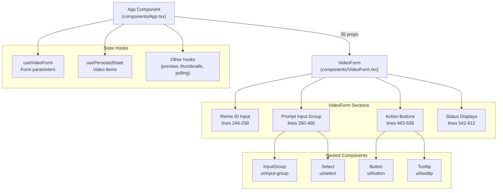
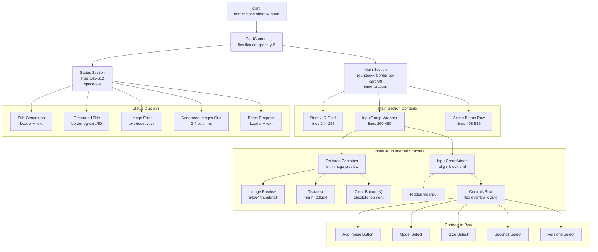
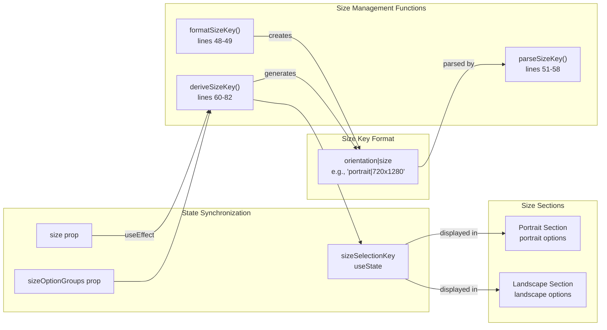
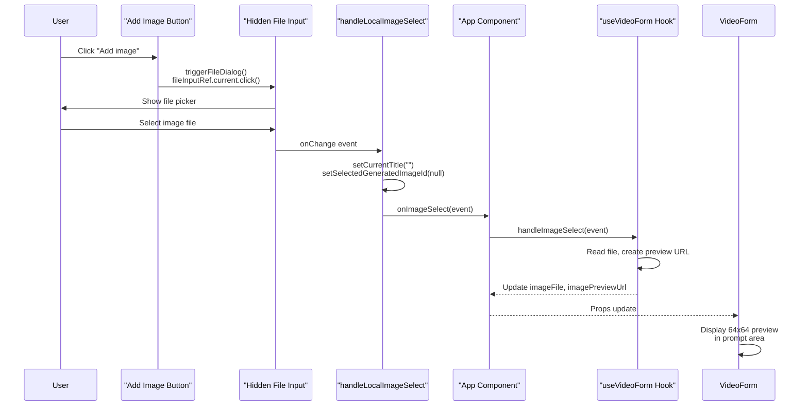
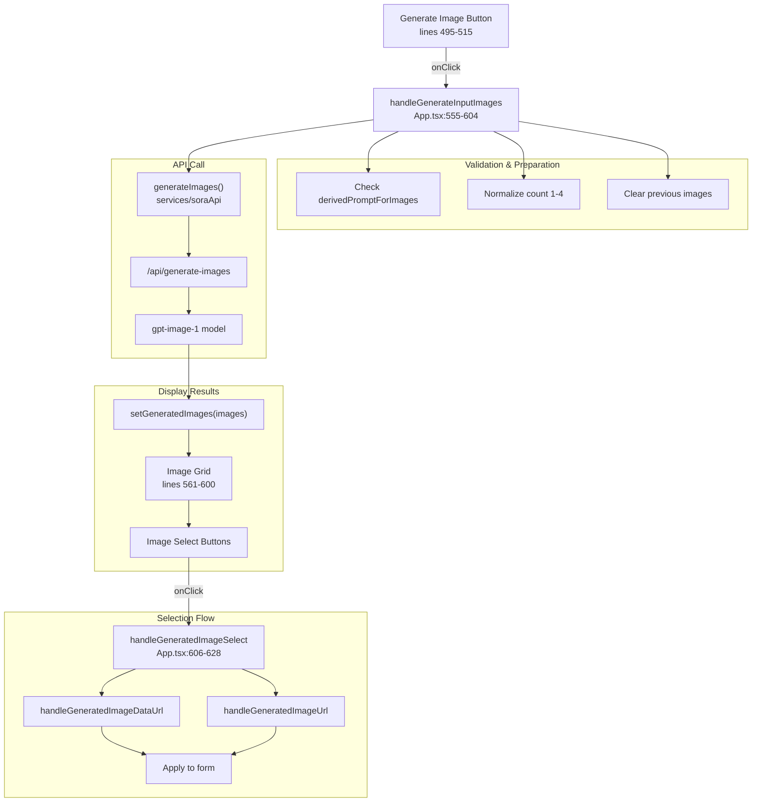
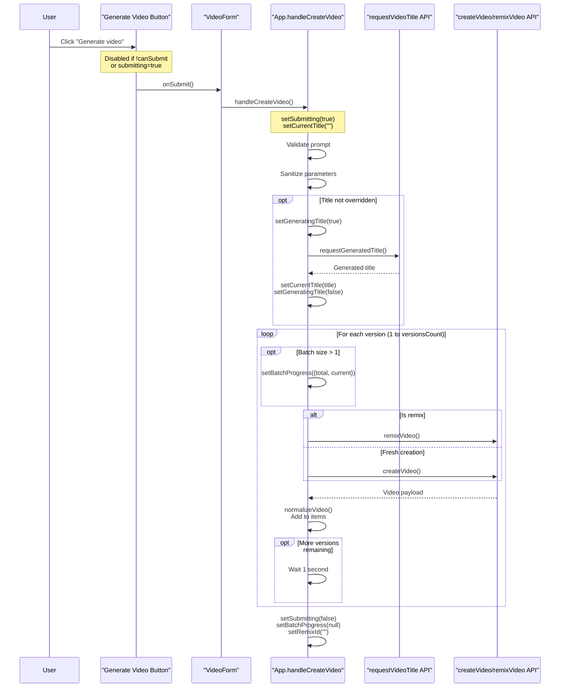
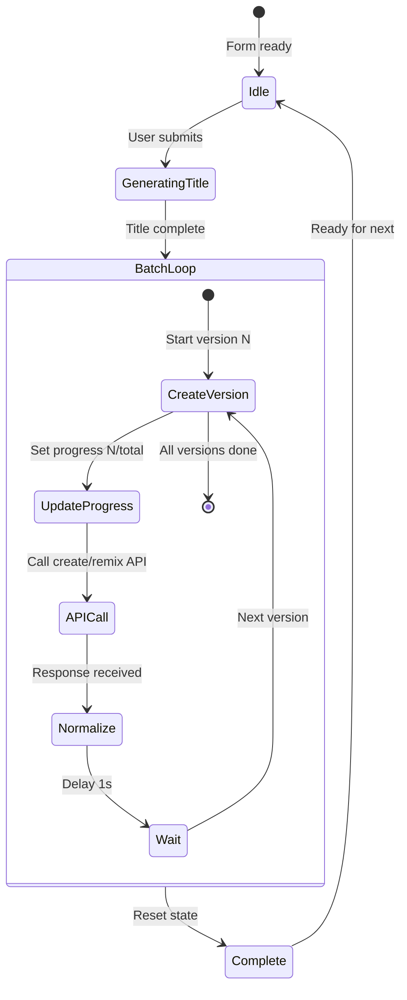

<!-- source: DeepWiki mcp.deepwiki.com · repo openai/openai-sora-sample-app · page 4.2 Video Form Component · fetched 2026-10-26 -->

# Video Form Component

<details>
<summary>Relevant source files</summary>

The following files were used as context for generating this wiki page:

- [components/App.tsx](components/App.tsx)
- [components/VideoForm.tsx](components/VideoForm.tsx)

</details>


The VideoForm component is the primary user input interface for video generation. It provides controls for prompt entry, model/size/duration configuration, image input (both local uploads and AI-generated suggestions), and submission handling. The component is a controlled form that receives all state and callbacks from its parent App component.

For information about the parent application shell that manages state and orchestrates this component, see [Application Shell](#4.1). For details on the video library display, see [Video Sidebar & Library](#4.3).

---

## Component Overview

The VideoForm component is defined in [components/VideoForm.tsx:138-618]() and used by the App component in [components/App.tsx:721-757](). It follows a fully controlled component pattern, receiving all state via props and communicating changes through callback functions.

### VideoFormProps Interface

The component accepts 35 props covering form state, callbacks, and status indicators:

| Prop Category | Props | Purpose |
|--------------|-------|---------|
| **Prompt** | `prompt`, `onPromptChange` | Text description of desired video |
| **Model** | `model`, `onModelChange`, `modelOptions` | Sora model selection |
| **Size** | `size`, `onSizeChange`, `sizeOptionGroups` | Video dimensions |
| **Duration** | `seconds`, `onSecondsChange` | Video length (5s or 10s) |
| **Batch** | `versionsCount`, `onVersionsCountChange` | Number of variants to generate |
| **Remix** | `remixId`, `onRemixIdChange`, `remixDisabled` | Existing video to remix from |
| **Local Image** | `onImageSelect`, `imagePreviewUrl`, `imagePreviewMeta` | User-uploaded image handling |
| **AI Images** | `onGenerateImages`, `generatingImages`, `generatedImages`, `onSelectGeneratedImage`, `selectedGeneratedImageId`, `generatedImageError` | AI-generated image suggestions |
| **Actions** | `onSubmit`, `onClear`, `onGeneratePrompt`, `generatingPrompt` | Form submission and enhancement |
| **Status** | `submitting`, `canSubmit`, `generatingTitle`, `currentTitle`, `batchProgress` | Operation state indicators |

**Sources:** [components/VideoForm.tsx:102-136]()

### Component Hierarchy in Application



**Sources:** [components/App.tsx:721-757](), [components/VideoForm.tsx:138-172]()

---

## Form Structure and Layout

The VideoForm component is structured as a Card with CardContent containing four main sections organized vertically:



**Sources:** [components/VideoForm.tsx:240-614]()

---

## Form Controls

### Model Selection

The model select control allows users to choose between available Sora models. It's implemented using the Select component from `ui/select`:

- **Location:** [components/VideoForm.tsx:337-364]()
- **Value:** `model` prop (type `SoraModel`)
- **Options:** `modelOptions` prop array
- **Change Handler:** `onModelChange(value as SoraModel)`
- **Disabled State:** When `remixDisabled` is true
- **Styling:** Uses `CONTROL_TRIGGER_CLASS` for consistent appearance

The control displays "Model" as a label and the selected model value using `SelectValue`.

### Size Selection with Orientation Groups

Size selection is more complex, supporting both portrait and landscape orientations. The component maintains an internal `sizeSelectionKey` state that encodes both orientation and size:



**Key Code Sections:**
- **Size key encoding:** [components/VideoForm.tsx:48-82]()
- **Internal state:** [components/VideoForm.tsx:199-209]()
- **Select rendering:** [components/VideoForm.tsx:366-398]()
- **Section mapping:** [components/VideoForm.tsx:180-197]()

The size select is organized into sections by orientation, with each section filtered to show only non-empty option arrays from `sizeOptionGroups`.

### Duration (Seconds) Selection

The seconds control allows users to choose video duration:

- **Location:** [components/VideoForm.tsx:400-427]()
- **Value:** `seconds` prop (type `SoraSeconds`)
- **Options:** `SECONDS_OPTIONS` constant from `utils/video`
- **Change Handler:** `onSecondsChange(value as SoraSeconds)`
- **Disabled State:** When `remixDisabled` is true

### Versions Count Selection

The versions control specifies how many variants to generate in a batch:

- **Location:** [components/VideoForm.tsx:429-456]()
- **Internal Value:** [components/VideoForm.tsx:174-178]() - normalized to 1-4 range
- **Options:** `VERSION_OPTIONS = [1, 2, 3, 4]` ([components/VideoForm.tsx:44]())
- **Change Handler:** `handleVersionChange` [components/VideoForm.tsx:221-224]()
- **Not Disabled:** This control remains enabled even during remix

### Remix ID Input

A simple text input for specifying an existing video ID to remix:

- **Location:** [components/VideoForm.tsx:244-258]()
- **Value:** `remixId` prop
- **Change Handler:** `onRemixIdChange(event.target.value)`
- **Placeholder:** `"video_..."`
- **Styling:** Borderless bottom-border style for inline appearance

**Sources:** [components/VideoForm.tsx:244-258](), [components/VideoForm.tsx:337-456]()

---

## Image Input System

The VideoForm supports two image input methods: local file upload and AI-generated image suggestions.

### Local File Upload Flow



**Key Code Sections:**
- **File input element:** [components/VideoForm.tsx:314-323]()
- **Trigger function:** [components/VideoForm.tsx:232-235]()
- **Add image button:** [components/VideoForm.tsx:325-334]()
- **Image preview display:** [components/VideoForm.tsx:268-281]()
- **Image metadata display:** [components/VideoForm.tsx:302-307]()
- **App handler:** [components/App.tsx:542-553]()

**File Constraints:**
- **Accepted formats:** `image/png`, `image/jpeg`, `image/webp`
- **Disabled when:** `remixDisabled` is true (remix mode doesn't support image input)

### AI-Generated Image Suggestions

The component can request AI-generated images based on the current prompt, displaying them in a grid for selection:



**Key Features:**
- **Image count:** Based on `versionsCount` prop, normalized to 1-4 ([components/App.tsx:572-578]())
- **Image size:** Calculated from current video size - portrait videos get `1024x1536`, landscape get `1536x1024` ([components/App.tsx:158-161]())
- **Selection state:** `selectedGeneratedImageId` tracks which generated image is active ([components/App.tsx:86-88]())
- **Grid layout:** Responsive 2-4 column grid ([components/VideoForm.tsx:566]())
- **Visual feedback:** Selected images show indigo border and ring ([components/VideoForm.tsx:579-582]())

**Sources:** [components/VideoForm.tsx:314-334](), [components/VideoForm.tsx:561-600](), [components/App.tsx:542-604](), [components/App.tsx:606-628]()

---

## Prompt Enhancement Features

### Prompt Generation

The "Generate prompt" button uses AI to enhance or create a prompt based on the current input:

- **Button location:** [components/VideoForm.tsx:468-484]()
- **Tooltip:** [components/VideoForm.tsx:487-490]() - explains it uses current prompt or requires one
- **Enabled condition:** `hasPrompt && onGeneratePrompt` ([components/VideoForm.tsx:474]())
- **Handler:** `handleSuggestPrompt` in App component ([components/App.tsx:630-671]())
- **Loading state:** Shows `Loader2` spinner when `generatingPrompt` is true

The handler:
1. Clears current title
2. Calls `suggestVideoPrompt()` API service
3. Validates and trims the response
4. Updates prompt state
5. Clears generated images and selection

### Image Generation

The "Generate image" button creates AI image suggestions:

- **Button location:** [components/VideoForm.tsx:495-515]()
- **Tooltip:** Same as prompt generation ([components/VideoForm.tsx:517-520]())
- **Enabled condition:** `hasPrompt && !remixDisabled && !generatingImages` ([components/VideoForm.tsx:499-501]())
- **Handler:** `handleGenerateInputImages` ([components/App.tsx:555-604]())
- **Loading state:** Shows `Loader2` spinner during generation

**Prompt Derivation:**
The prompt used for image generation is derived via `useMemo` from the current prompt state ([components/App.tsx:157]()):
```
const derivedPromptForImages = useMemo(() => prompt.trim(), [prompt]);
```

**Sources:** [components/VideoForm.tsx:468-520](), [components/App.tsx:630-671](), [components/App.tsx:555-604]()

---

## Submit Flow and State Management

### Video Generation Submit



**Key Submit Logic:**
- **Submit button:** [components/VideoForm.tsx:522-536]()
- **Disabled conditions:** `submitting || !canSubmit` ([components/VideoForm.tsx:526]())
- **canSubmit:** Evaluated as `prompt.trim().length > 0` in App ([components/App.tsx:752]())
- **Main handler:** `handleCreateVideo` ([components/App.tsx:215-374]())

### Form Clear/Reset

The clear button (X icon) in the top-right of the prompt area triggers `onClear`:

- **Button location:** [components/VideoForm.tsx:291-300]()
- **Handler:** `handleResetForm` in App ([components/App.tsx:466-473]())
- **Actions:**
  - Calls `resetFormFields()` from useVideoForm hook
  - Clears current title
  - Clears preview
  - Clears generated images and selection
  - Clears any image errors

**Sources:** [components/VideoForm.tsx:522-536](), [components/VideoForm.tsx:291-300](), [components/App.tsx:215-374](), [components/App.tsx:466-473]()

---

## Status Feedback and Progress Indicators

The VideoForm displays various status indicators below the main form controls:

### Title Generation Status

When a title is being generated for a new video:

- **Loading state:** [components/VideoForm.tsx:543-548]()
- **Displays:** `Loader2` spinner with text "Generating title..."
- **Controlled by:** `generatingTitle` prop

Once complete:

- **Result display:** [components/VideoForm.tsx:550-555]()
- **Shows:** "Generated title: {currentTitle}" in a bordered card
- **Visible when:** `!generatingTitle && currentTitle` is truthy

### Generated Images Grid

When AI-generated image suggestions are available:

- **Container:** [components/VideoForm.tsx:561-601]()
- **Header:** "GENERATED SUGGESTIONS" label
- **Grid layout:** 2-4 columns responsive (`grid-cols-2 sm:grid-cols-3 lg:grid-cols-4`)
- **Items:** Clickable buttons with image thumbnails (h-24)
- **Selection highlight:** Indigo border and ring when `selectedGeneratedImageId === image.id`

### Image Error Display

If image generation fails:

- **Location:** [components/VideoForm.tsx:557-559]()
- **Styling:** `text-xs text-destructive` (red error text)
- **Content:** `generatedImageError` prop

### Batch Progress Indicator

During multi-version generation:

- **Location:** [components/VideoForm.tsx:603-611]()
- **Visible when:** `batchProgress && batchProgress.total > 1`
- **Displays:** `Loader2` spinner with text "Generating version {current} of {total}..."
- **Type:** `BatchProgressState` with `total` and `current` numbers

**Progress Flow:**


**Sources:** [components/VideoForm.tsx:543-611](), [components/App.tsx:275-346]()

---

## Integration with App Component

The VideoForm is a presentation component with no internal business logic. All state management and side effects occur in the parent App component:

| Responsibility | Location in App |
|----------------|-----------------|
| **Form state** | `useVideoForm()` hook ([components/App.tsx:103-125]()) |
| **Persistent storage** | `usePersistedState()` for video items ([components/App.tsx:73]()) |
| **Image handling** | `handleLocalImageSelect`, `handleGenerateInputImages`, `handleGeneratedImageSelect` ([components/App.tsx:542-628]()) |
| **Prompt enhancement** | `handleSuggestPrompt` ([components/App.tsx:630-671]()) |
| **Video creation** | `handleCreateVideo` ([components/App.tsx:215-374]()) |
| **Title generation** | `requestGeneratedTitle` ([components/App.tsx:200-213]()) |
| **Form reset** | `handleResetForm` ([components/App.tsx:466-473]()) |

### Prop Binding Example

The VideoForm receives its props from App at [components/App.tsx:721-757]():

```
<VideoForm
  prompt={prompt}
  onPromptChange={handlePromptChange}
  model={model}
  onModelChange={(value) => setModel(sanitizeModel(value))}
  // ... 30 more props
  submitting={submitting}
  canSubmit={prompt.trim().length > 0}
  batchProgress={batchProgress}
/>
```

The unidirectional data flow ensures:
1. VideoForm displays current state
2. User interactions trigger callbacks
3. App component updates state
4. Props flow back to VideoForm
5. VideoForm re-renders with new state

**Sources:** [components/App.tsx:72-672](), [components/App.tsx:721-757]()

---

