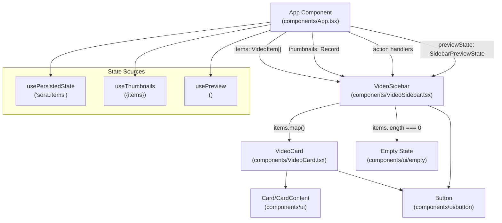
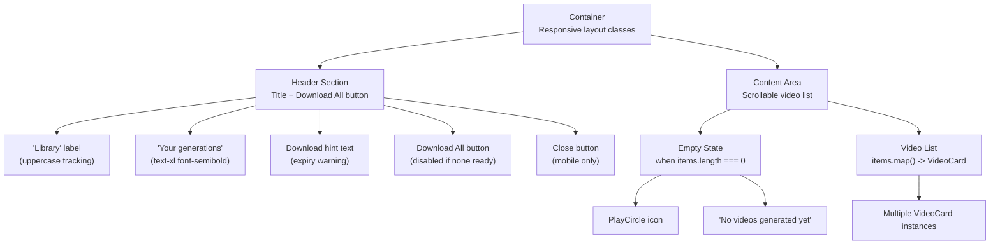
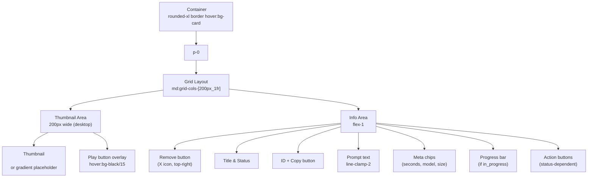
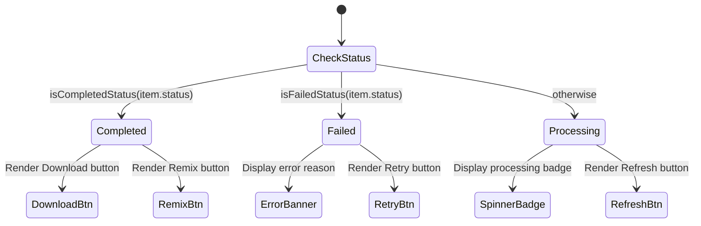
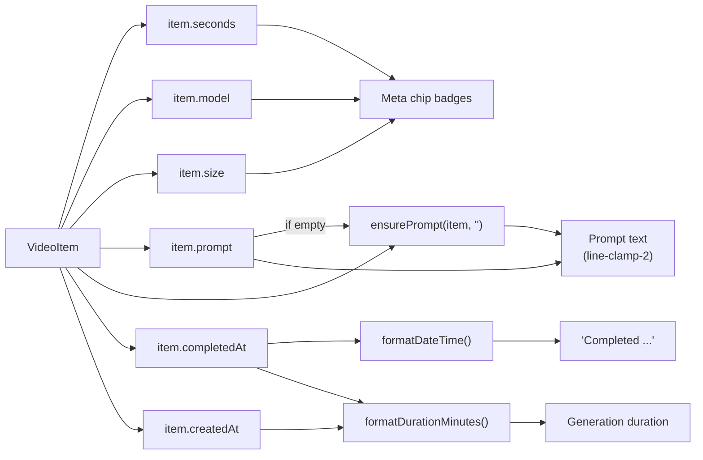
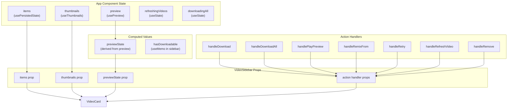
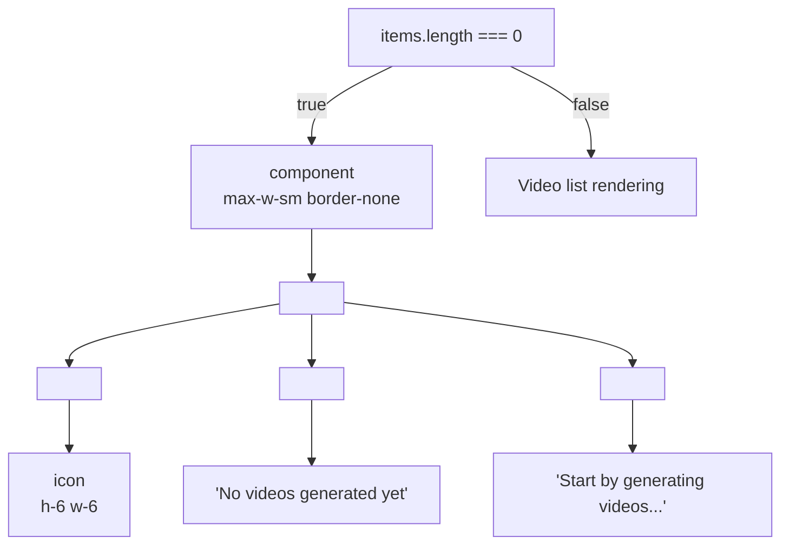
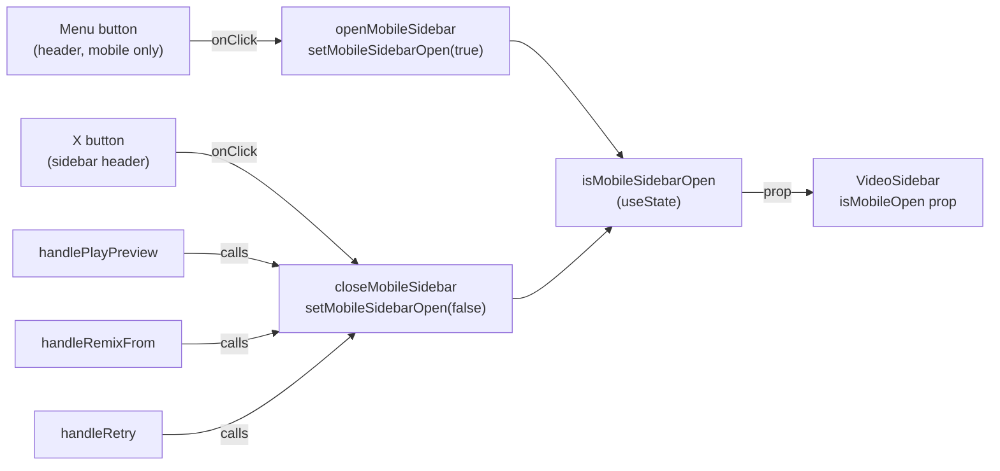
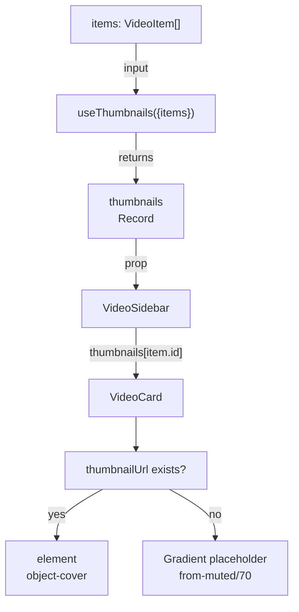

<!-- source: DeepWiki mcp.deepwiki.com · repo openai/openai-sora-sample-app · page 4.3 Video Sidebar & Library · fetched 2026-10-26 -->

# Video Sidebar & Library

<details>
<summary>Relevant source files</summary>

The following files were used as context for generating this wiki page:

- [components/App.tsx](components/App.tsx)
- [components/VideoCard.tsx](components/VideoCard.tsx)
- [components/VideoSidebar.tsx](components/VideoSidebar.tsx)

</details>


The Video Sidebar & Library system displays a persistent collection of generated videos in a sidebar panel, showing thumbnails, metadata, status information, and providing actions for each video. This component serves as the primary interface for viewing, managing, and interacting with the video library stored in client-side state.

For information about video generation and form input, see [Video Form Component](#4.2). For details on full-screen video playback, see [Video Preview System](#4.4). For state persistence mechanisms, see [Client-Side State Management](#3.1).

## Component Architecture

The sidebar system consists of two primary components: `VideoSidebar` as the container and `VideoCard` as the individual video display unit.

**Component Hierarchy Diagram**



Sources: [components/App.tsx:11-13](), [components/App.tsx:684-699](), [components/VideoSidebar.tsx:1-13](), [components/VideoCard.tsx:1-14]()

## VideoSidebar Component

The `VideoSidebar` component is the container for the video library. It manages the display of multiple video items, provides bulk actions, and adapts its layout for mobile devices.

### Component Props

| Prop | Type | Purpose |
|------|------|---------|
| `items` | `VideoItem[]` | Array of all generated videos |
| `thumbnails` | `Record<string, string>` | Map of video IDs to thumbnail URLs |
| `onDownloadAll` | `() => void` | Handler for batch download action |
| `downloadingAll` | `boolean` | Loading state for batch download |
| `onDownload` | `(item: VideoItem) => AsyncMaybe` | Handler for individual video download |
| `onPlayPreview` | `(item: VideoItem) => AsyncMaybe` | Handler for video preview playback |
| `onRemix` | `(item: VideoItem) => AsyncMaybe` | Handler to populate form with video parameters |
| `onRetry` | `(item: VideoItem) => AsyncMaybe` | Handler to retry failed video generation |
| `onRefresh` | `(item: VideoItem) => AsyncMaybe` | Handler to refresh video status |
| `onRemove` | `(item: VideoItem) => AsyncMaybe` | Handler to remove video from library |
| `refreshingMap` | `Record<string, boolean>` | Map of video IDs currently being refreshed |
| `previewState` | `SidebarPreviewState` | Current preview loading and active ID state |
| `isMobileOpen` | `boolean` | Mobile sidebar visibility state |
| `onMobileClose` | `() => void` | Handler to close mobile sidebar |

Sources: [components/VideoSidebar.tsx:15-37]()

### Layout Structure

The sidebar uses a fixed-position layout on desktop and a modal overlay on mobile devices. The component adapts between a 30-32rem wide sidebar (desktop) and full-screen overlay (mobile).



Sources: [components/VideoSidebar.tsx:68-166]()

The sidebar container uses conditional class names to handle responsive behavior [components/VideoSidebar.tsx:68-73]():
- On mobile: Fixed overlay (`fixed inset-0 z-50`) when `isMobileOpen` is true
- On desktop: Sticky sidebar (`lg:sticky lg:top-0`) always visible
- Conditional display: `hidden` by default, `lg:flex` on large screens

### Download All Feature

The sidebar provides a bulk download action that iterates through all completed videos. The feature tracks downloadable videos using a computed value.

```mermaid
graph LR
    hasDownloadable["hasDownloadable<br/>(useMemo)"]
    DownloadAllBtn["Download All Button"]
    handleDownloadAll["App.handleDownloadAll"]
    
    items["items array"] -->|"filter completed & !downloaded"| hasDownloadable
    hasDownloadable -->|"disables button"| DownloadAllBtn
    DownloadAllBtn -->|"onClick"| handleDownloadAll
    
    handleDownloadAll --> FilterReady["Filter ready items"]
    FilterReady --> LoopDownload["Loop with 400ms delay"]
    LoopDownload --> handleDownload["handleDownload(entry)"]
    handleDownload --> FetchBlob["fetchVideoContent"]
    FetchBlob --> CreateAnchor["Create <a> and trigger click"]
    CreateAnchor --> UpdateItem["Mark item.downloaded = true"]
```



Sources: [components/VideoSidebar.tsx:55-61](), [components/App.tsx:406-426]()

The `hasDownloadable` computed value [components/VideoSidebar.tsx:55-61]() filters items where:
1. `item.id` is truthy
2. `isCompletedStatus(item.status)` returns true
3. `item.downloaded` is falsy

The download hint displays either "Downloading completed videos…" during the batch operation or "Downloads may expire after one hour." as a static warning [components/VideoSidebar.tsx:63-65]().

## VideoCard Component

The `VideoCard` component renders an individual video item with its thumbnail, metadata, status indicators, and action buttons. Each card displays differently based on the video's current status.

### Card Layout

The card uses a responsive grid layout that stacks vertically on mobile and displays horizontally on desktop.



Sources: [components/VideoCard.tsx:267-412]()

### Status-Based UI States

The card displays different UI elements based on the video's status. The status badge and action buttons adapt dynamically.

**Status Badge Mapping**

| Status | Label | Visual Style | Border/Background |
|--------|-------|--------------|-------------------|
| `completed` | "Ready" | Green | `border-emerald-500/30 bg-emerald-500/10 text-emerald-500` |
| `succeeded` | "Ready" | Green | `border-emerald-500/30 bg-emerald-500/10 text-emerald-500` |
| `queued` | "Queued" | Blue | `border-blue-500/30 bg-blue-500/10 text-blue-500` |
| `in_progress` | "Processing" | Amber | `border-amber-500/30 bg-amber-500/10 text-amber-500` |
| `failed` | "Failed" | Red | `border-destructive/40 bg-destructive/10 text-destructive` |
| Other | Formatted | Gray | `border-border/60 bg-muted/60 text-muted-foreground` |

Sources: [components/VideoCard.tsx:59-100]()

**Status-Based Action Rendering**



Sources: [components/VideoCard.tsx:162-239]()

The `renderActions` function [components/VideoCard.tsx:162-239]() implements this logic:
- **Completed state** [components/VideoCard.tsx:163-189](): Shows Download and Remix buttons
- **Failed state** [components/VideoCard.tsx:192-214](): Shows error reason with Retry button
- **Processing state** [components/VideoCard.tsx:216-238](): Shows spinner badge with Refresh button

### Progress Indicator

When a video is in the `in_progress` state, the card displays a progress bar if the `progress` field contains a numeric value.

The progress calculation [components/VideoCard.tsx:245-253]():
1. Extract `item.progress` and format as percentage using `formatProgressPercent`
2. Check if status is `"in_progress"` and progress exists
3. Clamp progress width between 0-100%
4. Display amber-colored progress bar

Sources: [components/VideoCard.tsx:245-253](), [components/VideoCard.tsx:392-404]()

### Metadata Display

The card displays three types of metadata:

1. **Meta chips** [components/VideoCard.tsx:255-259](): Displays `seconds`, `model`, and `size` as small badges
2. **Prompt text** [components/VideoCard.tsx:260-264](): Shows stored prompt or falls back to `ensurePrompt(item, "")`. Italicized if fallback is used
3. **Completion metadata** [components/VideoCard.tsx:146-160](): Shows completion time and generation duration when `completedAt` is present



Sources: [components/VideoCard.tsx:255-264](), [components/VideoCard.tsx:146-160]()

### Copy to Clipboard

The card provides copy-to-clipboard functionality for both the video ID and the prompt text. A temporary "copied" state shows a checkmark icon for 1500ms.

The `handleCopy` function [components/VideoCard.tsx:128-144]():
1. Trims the value to copy
2. Calls `navigator.clipboard.writeText()`
3. Sets `copiedKey` state to either `"id"` or `"prompt"`
4. Clears the state after 1500ms using `setTimeout`

Sources: [components/VideoCard.tsx:115-144]()

## State Management & Data Flow

The sidebar receives all its data and handlers from the parent `App` component, following a unidirectional data flow pattern.

**Data Flow Diagram**



Sources: [components/App.tsx:73](), [components/App.tsx:130-143](), [components/App.tsx:63-70](), [components/App.tsx:684-699]()

### SidebarPreviewState

The `SidebarPreviewState` type [components/VideoSidebar.tsx:17-20]() provides preview-related state to the sidebar:

```typescript
type SidebarPreviewState = {
  previewingId: string | null;
  previewLoading: boolean;
};
```

This derived state is created in the `App` component [components/App.tsx:63-70]():
1. Calls `usePreview()` hook
2. Extracts `previewingId` and `previewLoading`
3. Packages into `SidebarPreviewState` object
4. Passes to `VideoSidebar` as `previewState` prop

Sources: [components/VideoSidebar.tsx:17-20](), [components/App.tsx:63-70]()

## Action Handlers

Each action handler in the `App` component performs a specific operation on video items. These handlers are passed as props to the sidebar and executed when users interact with video cards.

### Download Actions

**Individual Download** [components/App.tsx:376-404]():
1. Calls `fetchVideoContent({ videoId: item.id })` to retrieve binary blob
2. Creates object URL with `URL.createObjectURL(blob)`
3. Creates temporary `<a>` element with `download` attribute
4. Triggers click event programmatically
5. Revokes object URL
6. Updates item with `downloaded: true` flag

**Batch Download All** [components/App.tsx:406-426]():
1. Filters items to find completed videos not yet downloaded
2. Returns early if no downloadable items exist
3. Sets `downloadingAll` state to true
4. Loops through ready items, calling `handleDownload` for each
5. Adds 400ms delay between downloads to avoid overwhelming the browser
6. Clears `downloadingAll` state when complete

Sources: [components/App.tsx:376-404](), [components/App.tsx:406-426]()

### Preview Action

The `handlePlayPreview` handler [components/App.tsx:428-442]():
1. Closes mobile sidebar via `closeMobileSidebar()`
2. Calls `preview.playPreview(item.id)` from the `usePreview` hook
3. Catches and logs any errors

The preview mechanism loads the video content into the `VideoPreviewOverlay` component (see [Video Preview System](#4.4)).

Sources: [components/App.tsx:428-442]()

### Remix Action

The `handleRemixFrom` handler [components/App.tsx:475-494]() prepopulates the video form with parameters from an existing video:
1. Calls `ensurePrompt(item, prompt)` to determine the prompt text
2. Calls `applyVideoToForm(item, nextPrompt)` to populate form fields
3. Sets `remixId` to the video's ID
4. Sets `currentTitle` to the video's title
5. Clears preview state
6. Scrolls to top of page
7. Closes mobile sidebar

This action allows users to create variations by modifying parameters of existing videos.

Sources: [components/App.tsx:475-494]()

### Retry Action

The `handleRetry` handler [components/App.tsx:507-540]() attempts to regenerate a failed video:
1. Calls `ensurePrompt(item, prompt)` and `applyVideoToForm(item, nextPrompt)`
2. Sets `remixId` to the original remix video ID (if any)
3. Closes mobile sidebar
4. If the video required an image input, displays alert and scrolls to top
5. Otherwise, calls `handleCreateVideo` with override parameters:
   - `replaceId: item.id` to replace the failed video in the list
   - Other parameters from the original video

The `replaceId` mechanism [components/App.tsx:327-341]() updates the existing item in place rather than adding a new one.

Sources: [components/App.tsx:507-540](), [components/App.tsx:327-341]()

### Refresh Action

The `handleRefreshVideo` handler [components/App.tsx:173-196]() manually fetches updated status for a video:
1. Checks if video is already being refreshed (prevents duplicate requests)
2. Sets `refreshingVideos[item.id]` to true
3. Calls `fetchVideo({ videoId: item.id })` API
4. Normalizes response using `normalizeVideo(payload, current)`
5. Updates item via `handleUpdateItem` callback
6. Clears refreshing flag in finally block

This action is used when polling hasn't yet picked up status changes or when users want immediate feedback.

Sources: [components/App.tsx:173-196]()

### Remove Action

The `handleRemove` handler [components/App.tsx:496-505]():
1. Filters out the item with matching ID from the `items` array
2. If the removed item is currently being previewed, calls `preview.clearPreview()`

This permanently removes the video from the client-side library stored in localStorage.

Sources: [components/App.tsx:496-505]()

## Empty State

When no videos have been generated, the sidebar displays an empty state using the `Empty` component from the UI library.



Sources: [components/VideoSidebar.tsx:128-142]()

The empty state component is centered vertically and horizontally within the content area and uses the `PlayCircle` icon from `lucide-react` to represent video content.

## Mobile Responsiveness

The sidebar implements a responsive design that transforms between a sidebar layout (desktop) and a modal overlay (mobile).

### Responsive Behavior

**Desktop (lg and above)**:
- Fixed width sidebar: `lg:w-[30rem] xl:w-[32rem]`
- Sticky positioning: `lg:sticky lg:top-0`
- Always visible: `lg:flex`
- Border right: `lg:border-r`

**Mobile (below lg breakpoint)**:
- Full-screen overlay: `fixed inset-0 z-50`
- Controlled visibility: Shown when `isMobileOpen` is true, otherwise `hidden`
- Close button visible: `lg:hidden` on close button
- Hamburger menu in header to open: [components/App.tsx:710-719]()

Sources: [components/VideoSidebar.tsx:68-73](), [components/App.tsx:710-719]()

### Mobile State Management

The mobile sidebar state is managed in the `App` component:



Sources: [components/App.tsx:90](), [components/App.tsx:95-101](), [components/App.tsx:431](), [components/App.tsx:484](), [components/App.tsx:515]()

The sidebar automatically closes when certain actions are triggered to return focus to the main form area. This includes:
- Playing a video preview [components/App.tsx:431]()
- Remixing from a video [components/App.tsx:484]()
- Retrying a failed video [components/App.tsx:515]()

## Thumbnail Management

Video thumbnails are provided by the `useThumbnails` hook and passed to the sidebar as a mapping of video IDs to thumbnail URLs.



Sources: [components/App.tsx:130](), [components/VideoSidebar.tsx:149](), [components/VideoCard.tsx:271-280]()

The `VideoCard` component renders either:
1. An `` element when `thumbnailUrl` is provided [components/VideoCard.tsx:272-277]()
2. A gradient placeholder `<div>` when no thumbnail is available [components/VideoCard.tsx:279]()

The thumbnail display includes a hover scale effect (`group-hover:scale-[1.02]`) for visual feedback [components/VideoCard.tsx:276]().

---

