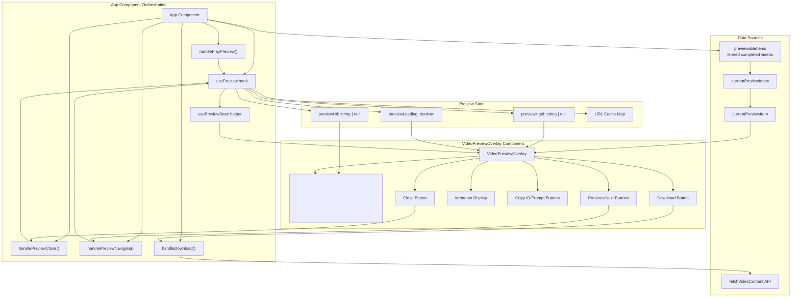
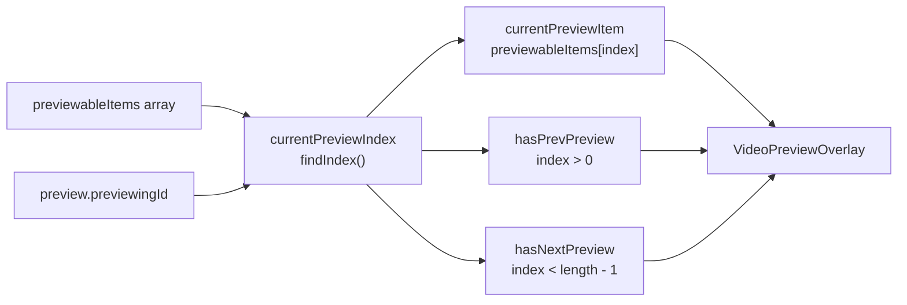
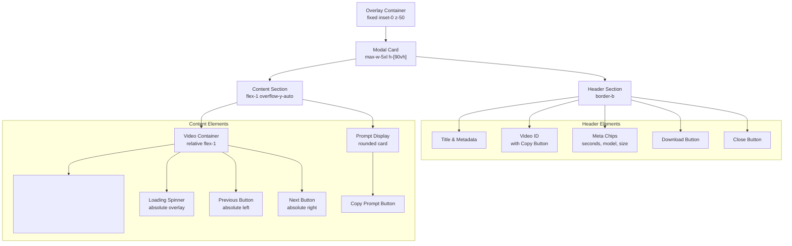
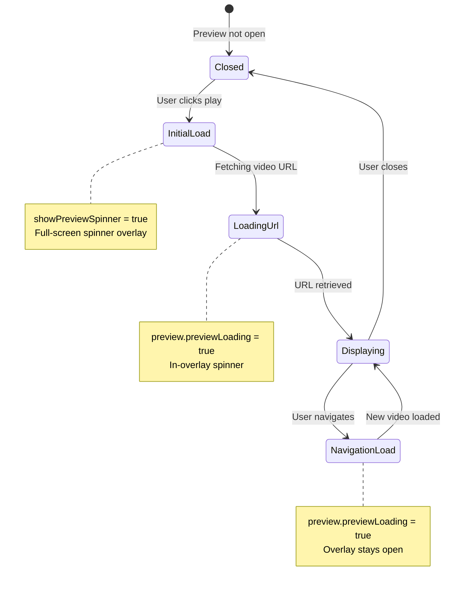
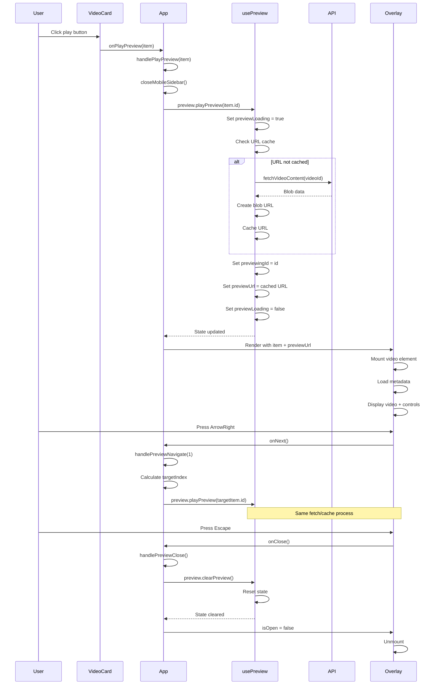

<!-- source: DeepWiki mcp.deepwiki.com · repo openai/openai-sora-sample-app · page 4.4 Video Preview System · fetched 2026-10-26 -->

# Video Preview System

<details>
<summary>Relevant source files</summary>

The following files were used as context for generating this wiki page:

- [components/App.tsx](components/App.tsx)
- [components/VideoPreviewOverlay.tsx](components/VideoPreviewOverlay.tsx)

</details>


The Video Preview System provides full-screen video playback functionality with navigation controls, metadata display, and keyboard shortcuts. It manages the preview overlay interface where users can watch generated videos, navigate between completed videos, copy video metadata, and download content.

For information about video generation and form controls, see [Video Form Component](#4.2). For details on the video library display, see [Video Sidebar & Library](#4.3). For the underlying state management, see [Client-Side State Management](#3.1).

## System Purpose and Scope

The Video Preview System handles:
- Full-screen video playback in an overlay modal
- Sequential navigation between completed videos
- Video metadata display (title, ID, model, size, duration)
- Keyboard shortcuts for preview control
- Copy-to-clipboard functionality for video IDs and prompts
- Download integration for saving videos locally
- URL prefetching for smooth navigation
- Aspect ratio preservation and responsive video rendering

This system does not handle video generation, status polling, or video library display—those are covered in other components.

**Sources:** [components/VideoPreviewOverlay.tsx:1-319](), [components/App.tsx:1-784]()

## Architecture Overview

The preview system consists of three main layers: state management (via `usePreview` hook), orchestration logic in the `App` component, and presentation through the `VideoPreviewOverlay` component.

### Preview System Components



**Diagram:** Component architecture showing state management, orchestration logic, and UI presentation layers

**Sources:** [components/App.tsx:63-70](), [components/App.tsx:127-156](), [components/VideoPreviewOverlay.tsx:17-28]()

## Preview State Management

The preview system uses the `usePreview` hook to manage preview state and URL caching. The `App` component wraps this with additional computed state.

### State Structure

| State Variable | Type | Purpose |
|---------------|------|---------|
| `previewingId` | `string \| null` | ID of currently previewed video |
| `previewUrl` | `string \| null` | Blob URL for current video |
| `previewLoading` | `boolean` | Whether preview is loading |
| URL cache (internal) | `Map<string, string>` | Cached blob URLs for prefetched videos |

### Computed Preview State

The `usePreviewState` helper function creates a simplified state object for passing to child components:

[components/App.tsx:63-70]()

```typescript
const usePreviewState = () => {
  const preview = usePreview();
  const previewState: SidebarPreviewState = {
    previewingId: preview.previewingId,
    previewLoading: preview.previewLoading,
  };
  return { preview, previewState };
};
```

### Previewable Items Filtering

The system maintains a filtered list of videos that can be previewed (completed videos with valid IDs):

[components/App.tsx:131-143]()

```typescript
const previewableItems = useMemo(
  () => items.filter((item) => item?.id && isCompletedStatus(item.status)),
  [items]
);

useEffect(() => {
  const ids = previewableItems
    .map((item) => item.id)
    .filter((id): id is string => Boolean(id));
  prefetchPreviews(ids).catch((error) => {
    console.error("Preview prefetch failed", error);
  });
}, [prefetchPreviews, previewableItems]);
```

This filtering ensures only videos with completed status are available for preview, and prefetches their URLs for smooth navigation.

**Sources:** [components/App.tsx:63-70](), [components/App.tsx:131-143](), [components/VideoSidebar.tsx:11-14]()

## Preview Navigation System

The navigation system allows users to move sequentially through completed videos. It maintains the current index and validates navigation bounds.

### Navigation State Computation



**Diagram:** Navigation state derivation from preview and video list state

[components/App.tsx:145-156]()

```typescript
const currentPreviewIndex = useMemo(
  () =>
    previewableItems.findIndex((item) => item.id === preview.previewingId),
  [previewableItems, preview.previewingId]
);
const currentPreviewItem =
  currentPreviewIndex >= 0 ? previewableItems[currentPreviewIndex] : null;
const hasPrevPreview = currentPreviewIndex > 0;
const hasNextPreview =
  currentPreviewIndex >= 0 &&
  currentPreviewIndex < previewableItems.length - 1;
```

### Navigation Handler

The `handlePreviewNavigate` function manages directional navigation with bounds checking:

[components/App.tsx:448-464]()

```typescript
const handlePreviewNavigate = useCallback(
  (direction: number) => {
    if (currentPreviewIndex < 0) return;
    const targetIndex = currentPreviewIndex + direction;
    if (targetIndex < 0 || targetIndex >= previewableItems.length) return;
    const targetItem = previewableItems[targetIndex];
    if (!targetItem?.id) return;
    preview.playPreview(targetItem.id).catch((error) => {
      console.error(
        `Preview failed: ${
          error instanceof Error ? error.message : String(error)
        }`
      );
    });
  },
  [currentPreviewIndex, preview, previewableItems]
);
```

The handler:
1. Validates current index exists
2. Calculates target index with direction (+1 or -1)
3. Checks bounds to prevent overflow
4. Calls `preview.playPreview()` with target video ID

**Sources:** [components/App.tsx:145-156](), [components/App.tsx:448-464]()

## VideoPreviewOverlay Component

The `VideoPreviewOverlay` component renders the full-screen modal interface with video playback, metadata, and controls.

### Component Props Interface

[components/VideoPreviewOverlay.tsx:17-28]()

| Prop | Type | Description |
|------|------|-------------|
| `isOpen` | `boolean` | Controls overlay visibility |
| `item` | `VideoItem \| null` | Current video metadata |
| `previewUrl` | `string \| null` | Blob URL for video content |
| `loading` | `boolean` | Loading state for video fetch |
| `onClose` | `() => void` | Close handler |
| `onPrev` | `() => void` | Previous video handler |
| `onNext` | `() => void` | Next video handler |
| `hasPrev` | `boolean` | Whether previous video exists |
| `hasNext` | `boolean` | Whether next video exists |
| `onDownload` | `(item: VideoItem) => AsyncMaybe` | Download handler (optional) |

### Component Structure



**Diagram:** UI structure of VideoPreviewOverlay component

### Video Rendering with Aspect Ratio

The component dynamically preserves video aspect ratio by reading metadata:

[components/VideoPreviewOverlay.tsx:129-157]()

```typescript
const renderVideoArea = () => {
  if (previewUrl) {
    const aspectRatio = videoDimensions
      ? `${videoDimensions.width} / ${videoDimensions.height}`
      : undefined;

    return (
      <div
        className="flex max-h-full max-w-full items-center justify-center"
        style={
          aspectRatio
            ? { aspectRatio, maxHeight: "100%", maxWidth: "100%" }
            : { width: "100%", height: "100%" }
        }
      >
        <video
          key={previewUrl}
          src={previewUrl}
          controls
          onLoadedMetadata={(event) => {
            const { videoWidth, videoHeight } = event.currentTarget;
            if (videoWidth && videoHeight) {
              setVideoDimensions({ width: videoWidth, height: videoHeight });
            }
          }}
          className="max-h-full max-w-full rounded-lg bg-black"
        />
      </div>
    );
  }
  // ... fallback rendering
};
```

The system:
1. Stores video dimensions in component state
2. Clears dimensions when URL changes
3. Reads dimensions from `onLoadedMetadata` event
4. Applies CSS aspect ratio for proper scaling

**Sources:** [components/VideoPreviewOverlay.tsx:17-28](), [components/VideoPreviewOverlay.tsx:129-157](), [components/VideoPreviewOverlay.tsx:167-277]()

## Keyboard Shortcuts

The preview system supports keyboard navigation for improved user experience.

### Keyboard Event Handling

[components/VideoPreviewOverlay.tsx:50-73]()

```typescript
useEffect(() => {
  if (!isOpen) return undefined;

  const handleKeyDown = (event: KeyboardEvent) => {
    if (event.key === "Escape") {
      event.preventDefault();
      onClose();
    } else if (event.key === "ArrowLeft" && hasPrev) {
      event.preventDefault();
      onPrev();
    } else if (event.key === "ArrowRight" && hasNext) {
      event.preventDefault();
      onNext();
    }
  };

  const previousOverflow = document.body.style.overflow;
  document.body.style.overflow = "hidden";
  window.addEventListener("keydown", handleKeyDown);
  return () => {
    document.body.style.overflow = previousOverflow;
    window.removeEventListener("keydown", handleKeyDown);
  };
}, [hasNext, hasPrev, isOpen, onClose, onNext, onPrev]);
```

### Supported Shortcuts

| Key | Action | Condition |
|-----|--------|-----------|
| `Escape` | Close preview overlay | Always active when open |
| `ArrowLeft` | Navigate to previous video | `hasPrev` is true |
| `ArrowRight` | Navigate to next video | `hasNext` is true |

The keyboard handler also:
- Prevents default browser behavior for each shortcut
- Locks body scroll while overlay is open
- Restores scroll state on cleanup
- Respects navigation bounds (disables arrows at endpoints)

**Sources:** [components/VideoPreviewOverlay.tsx:50-73]()

## Metadata Display and Copy Functionality

The preview overlay displays comprehensive video metadata with copy-to-clipboard functionality.

### Metadata Display Logic

[components/VideoPreviewOverlay.tsx:118-127]()

```typescript
const metaChips = [
  item?.seconds ? `${item.seconds}s` : null,
  item?.model || null,
  item?.size || null,
].filter(Boolean) as string[];

const storedPrompt = item?.prompt?.toString().trim() || "";
const fallbackPrompt = ensurePrompt(item ?? undefined, "");
const promptText = storedPrompt || fallbackPrompt || "";
const isPromptFallback = !storedPrompt && Boolean(promptText);
```

The system:
- Creates metadata chips for duration, model, and size
- Filters out null/undefined values
- Falls back to `ensurePrompt()` utility if prompt is missing
- Indicates when fallback prompt is used (italic styling)

### Copy to Clipboard Implementation

[components/VideoPreviewOverlay.tsx:100-116]()

```typescript
const handleCopy = async (
  value: string | null | undefined,
  key: "id" | "prompt"
) => {
  const text = (value ?? "").toString().trim();
  if (!text) return;
  try {
    await navigator.clipboard.writeText(text);
    setCopiedKey(key);
    if (copyTimeoutRef.current) {
      clearTimeout(copyTimeoutRef.current);
    }
    copyTimeoutRef.current = setTimeout(() => setCopiedKey(null), 1500);
  } catch (error) {
    console.error("Failed to copy text", error);
  }
};
```

Features:
- Uses Clipboard API for reliable copying
- Shows visual confirmation (Check icon replaces Copy icon)
- Auto-resets confirmation after 1500ms
- Cleans up timeout on unmount
- Validates text exists before copying

### Metadata Display Areas

[components/VideoPreviewOverlay.tsx:179-215]()

The header displays:
- Video title (or "Untitled Video" fallback)
- Video ID with copy button
- Metadata chips (duration, model, size)

[components/VideoPreviewOverlay.tsx:278-311]()

The prompt section displays:
- Prompt text with copy button
- Italic styling for fallback prompts
- Whitespace-preserving layout (`whitespace-pre-line`)

**Sources:** [components/VideoPreviewOverlay.tsx:100-116](), [components/VideoPreviewOverlay.tsx:118-127](), [components/VideoPreviewOverlay.tsx:179-215](), [components/VideoPreviewOverlay.tsx:278-311]()

## Download Integration

The preview overlay integrates with the download system to allow users to save videos directly from the preview interface.

### Download Handler Integration

[components/App.tsx:428-442]()

The `App` component's `handlePlayPreview` function opens the overlay and passes the download handler:

```typescript
const handlePlayPreview = useCallback(
  async (item: VideoItem) => {
    try {
      closeMobileSidebar();
      await preview.playPreview(item.id);
    } catch (error) {
      console.error(
        `Preview failed: ${
          error instanceof Error ? error.message : String(error)
        }`
      );
    }
  },
  [closeMobileSidebar, preview]
);
```

[components/App.tsx:779-780]()

The overlay receives the download handler as a prop:

```typescript
<VideoPreviewOverlay
  // ... other props
  onDownload={handleDownload}
/>
```

### Download Button in Overlay

[components/VideoPreviewOverlay.tsx:90-98]()

The overlay component manages download state locally:

```typescript
const handleDownloadClick = async () => {
  if (!onDownload || !item?.id) return;
  setDownloading(true);
  try {
    await onDownload(item);
  } finally {
    setDownloading(false);
  }
};
```

[components/VideoPreviewOverlay.tsx:218-231]()

The download button shows loading state during download:
- Displays spinner icon when `downloading` is true
- Disabled when no item ID or no handler provided
- Positioned in header alongside close button

**Sources:** [components/VideoPreviewOverlay.tsx:90-98](), [components/VideoPreviewOverlay.tsx:218-231](), [components/App.tsx:428-442](), [components/App.tsx:779-780]()

## Loading States and Spinner Display

The preview system handles multiple loading states with appropriate visual feedback.

### Loading State Types



**Diagram:** Loading state transitions during preview lifecycle

### Full-Screen Loading Spinner

[components/App.tsx:156]()

```typescript
const showPreviewSpinner = preview.previewLoading && !preview.previewingId;
```

This spinner appears during initial preview load before the overlay opens:

[components/App.tsx:761-768]()

```typescript
{showPreviewSpinner ? (
  <div className="fixed inset-0 z-40 flex items-center justify-center bg-neutral-950/70 px-4 py-4 backdrop-blur">
    <div className="flex items-center gap-3 rounded-2xl border border-border/60 bg-card/95 px-4 py-3 text-sm font-medium text-foreground shadow-lg">
      <Loader2 className="h-4 w-4 animate-spin text-muted-foreground" />
      Loading preview…
    </div>
  </div>
) : null}
```

### In-Overlay Loading Spinner

[components/VideoPreviewOverlay.tsx:246-250]()

When navigating between videos, a spinner overlays the video area:

```typescript
{loading ? (
  <div className="absolute inset-0 flex items-center justify-center bg-black/30">
    <Loader2 className="h-12 w-12 animate-spin text-white" />
  </div>
) : null}
```

### Loading States Summary

| State | Condition | Display | Purpose |
|-------|-----------|---------|---------|
| Full-screen spinner | `preview.previewLoading && !preview.previewingId` | Fixed overlay with spinner | Initial load before overlay opens |
| In-overlay spinner | `loading` prop is true | Absolute positioned over video | Navigation between videos |
| No video fallback | `!previewUrl && !loading` | "Preview not available" message | URL fetch failed |

**Sources:** [components/App.tsx:156](), [components/App.tsx:761-768](), [components/VideoPreviewOverlay.tsx:160-164](), [components/VideoPreviewOverlay.tsx:246-250]()

## Preview Lifecycle Flow

The complete flow from opening a preview to closing it involves multiple system interactions.



**Diagram:** Complete sequence diagram for preview lifecycle from open to close

**Sources:** [components/App.tsx:428-446](), [components/App.tsx:444-446](), [components/App.tsx:448-464](), [components/VideoPreviewOverlay.tsx:50-73]()

## Integration with App Component

The preview system integrates tightly with the `App` component's overall state management and event handling.

### Preview State Usage in App

[components/App.tsx:127-128]()

```typescript
const { preview, previewState } = usePreviewState();
const { prefetchPreviews } = preview;
```

The `App` component:
- Extracts preview hook and derived state
- Accesses `prefetchPreviews` for URL caching
- Passes `previewState` to `VideoSidebar` for highlighting active preview
- Uses preview methods for control

### Passing State to Overlay

[components/App.tsx:769-780]()

```typescript
<VideoPreviewOverlay
  isOpen={Boolean(preview.previewingId)}
  item={currentPreviewItem}
  previewUrl={preview.previewUrl}
  loading={preview.previewLoading}
  onClose={handlePreviewClose}
  onPrev={() => handlePreviewNavigate(-1)}
  onNext={() => handlePreviewNavigate(1)}
  hasPrev={hasPrevPreview}
  hasNext={hasNextPreview}
  onDownload={handleDownload}
/>
```

The overlay receives:
- Computed visibility state (`isOpen`)
- Current video item with full metadata
- Preview URL from cache
- Loading state
- Navigation handlers with direction
- Navigation availability flags
- Download integration

### Side Effects and Cleanup

The preview system cleans up state on various actions:

[components/App.tsx:466-473]()

```typescript
const handleResetForm = useCallback(() => {
  resetFormFields();
  setCurrentTitle("");
  preview.clearPreview();  // Close preview on form reset
  // ... other cleanup
}, [preview, resetFormFields, setCurrentTitle]);
```

[components/App.tsx:500-502]()

```typescript
if (preview.previewingId === item.id) {
  preview.clearPreview();  // Close preview when video removed
}
```

**Sources:** [components/App.tsx:127-128](), [components/App.tsx:466-473](), [components/App.tsx:500-502](), [components/App.tsx:769-780]()

---

