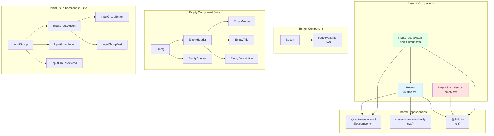
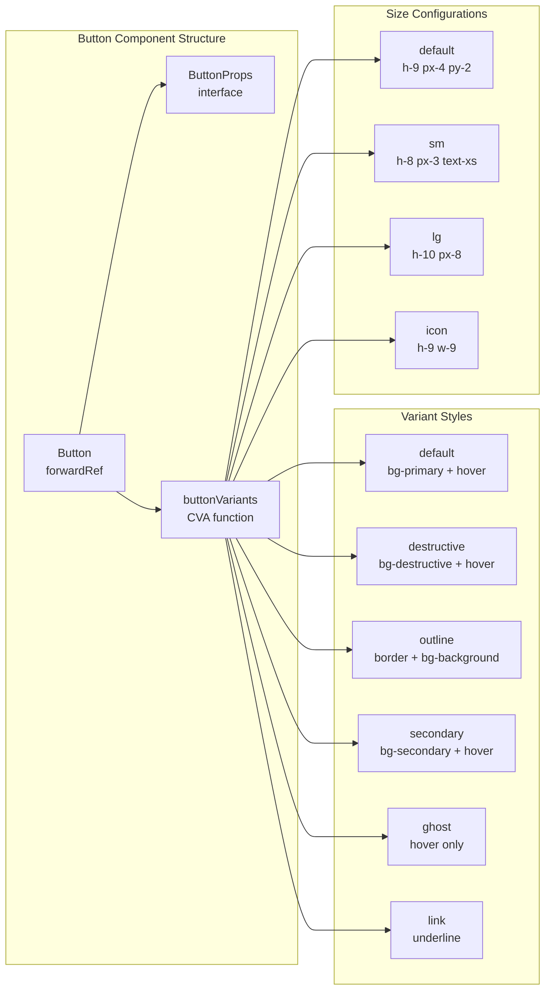
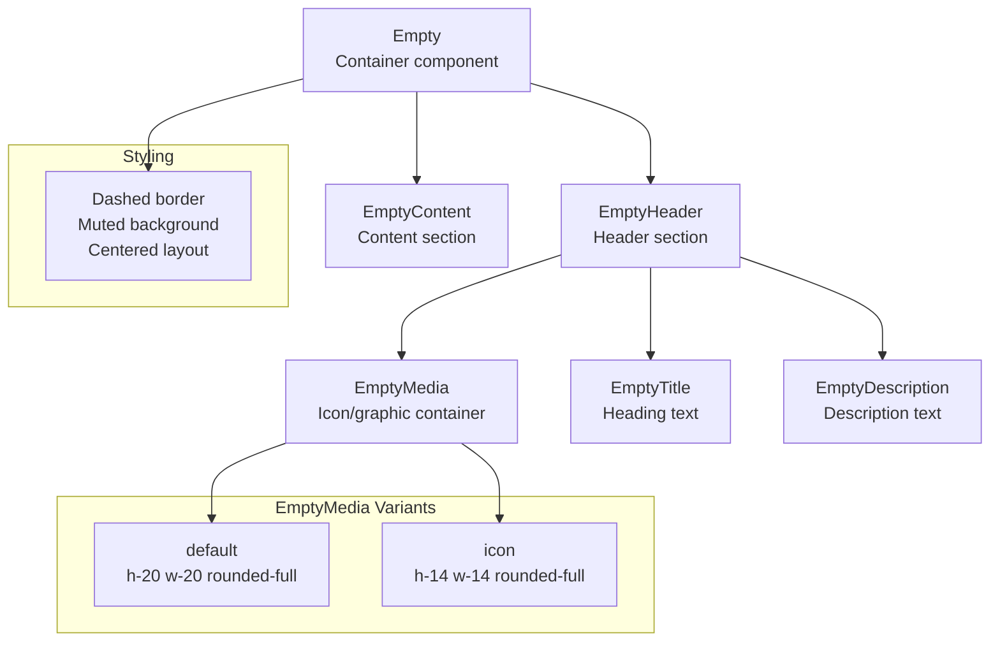
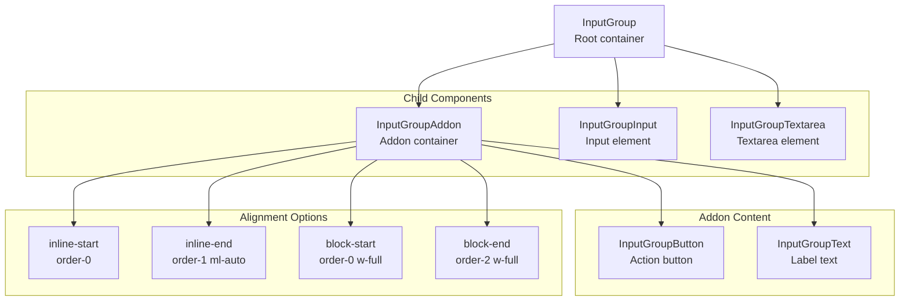
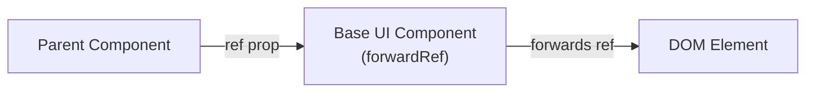
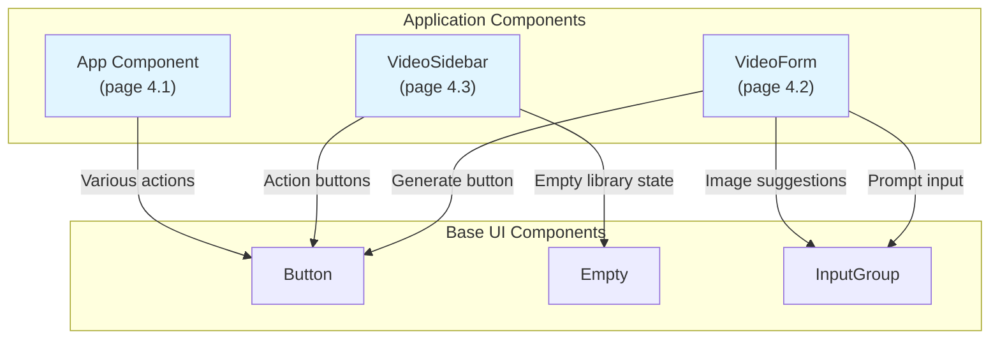

<!-- source: DeepWiki mcp.deepwiki.com · repo openai/openai-sora-sample-app · page 4.5 Base UI Components · fetched 2026-10-26 -->

# Base UI Components

<details>
<summary>Relevant source files</summary>

The following files were used as context for generating this wiki page:

- [components/ui/button.tsx](components/ui/button.tsx)
- [components/ui/empty.tsx](components/ui/empty.tsx)
- [components/ui/input-group.tsx](components/ui/input-group.tsx)

</details>


## Purpose and Scope

This document covers the foundational, reusable UI components located in the `components/ui/` directory. These components provide the basic building blocks used throughout the application, including buttons, empty state displays, and input groups. These components are styled using Tailwind CSS and leverage class-variance-authority for variant management.

For application-specific components like VideoForm and VideoSidebar, see [Video Form Component](#4.2) and [Video Sidebar & Library](#4.3). For styling and theming system details, see [Styling & Theming](#7).

---

## Component Architecture

The base UI components follow a consistent architecture pattern using React `forwardRef`, TypeScript type definitions, and the `cn` utility from `@/lib/utils` for className merging.

### Component System Overview



**Sources:** [components/ui/button.tsx:1-58](), [components/ui/empty.tsx:1-98](), [components/ui/input-group.tsx:1-163]()

---

## Button Component

The `Button` component provides a flexible, variant-based button implementation with support for different sizes, styles, and the ability to render as a child component via Radix UI's `Slot`.

### Button Variants and Configuration

| Property | Type | Options | Default |
|----------|------|---------|---------|
| `variant` | string | `default`, `destructive`, `outline`, `secondary`, `ghost`, `link` | `default` |
| `size` | string | `default`, `sm`, `lg`, `icon` | `default` |
| `asChild` | boolean | `true`, `false` | `false` |

### Button Variant Mapping



**Sources:** [components/ui/button.tsx:7-35]()

### Implementation Details

The `Button` component uses `class-variance-authority` to manage style variants. The `buttonVariants` function at [components/ui/button.tsx:7-35]() defines the base classes and all variant combinations. The base classes include:

- Flexbox layout with gap and alignment
- Rounded corners and text styling
- Transition effects and focus states
- Disabled state handling
- SVG child element styling

The component supports the `asChild` prop, which uses Radix UI's `Slot` component to render the button as a different element while maintaining button styling [components/ui/button.tsx:40-52]().

**Sources:** [components/ui/button.tsx:1-58]()

---

## Empty State Component

The `Empty` component system provides a composable empty state display with six related components that work together to create consistent empty state UI patterns.

### Empty Component Family



**Sources:** [components/ui/empty.tsx:1-98]()

### Component Structure

| Component | Purpose | Key Classes |
|-----------|---------|-------------|
| `Empty` | Root container | `flex`, `flex-col`, `items-center`, `justify-center`, `border-dashed`, `bg-muted/20` |
| `EmptyHeader` | Header section wrapper | `flex`, `flex-col`, `items-center`, `gap-2` |
| `EmptyContent` | Content/actions section | `mt-4`, `flex`, `flex-col`, `items-center`, `gap-2` |
| `EmptyMedia` | Icon/graphic container | `h-20 w-20` (default) or `h-14 w-14` (icon), `rounded-full`, `border-dashed` |
| `EmptyTitle` | Title heading | `text-lg`, `font-semibold`, `text-foreground` |
| `EmptyDescription` | Description text | `max-w-sm`, `text-sm`, `text-muted-foreground` |

### EmptyMedia Variant Configuration

The `EmptyMedia` component supports two variants through the `MEDIA_VARIANT_CLASSNAMES` mapping at [components/ui/empty.tsx:53-58]():

- **default**: Larger circular container (20x20) for prominent icons
- **icon**: Smaller circular container (14x14) for compact displays

**Sources:** [components/ui/empty.tsx:7-96]()

---

## InputGroup Component

The `InputGroup` component system provides a flexible container for grouped input controls with addons, buttons, and text labels. It supports multiple alignment options and composition patterns.

### InputGroup Component Hierarchy



**Sources:** [components/ui/input-group.tsx:1-163]()

### InputGroup Architecture

The `InputGroup` uses CSS order properties and flexbox to position addons and controls. The alignment system is defined at [components/ui/input-group.tsx:35-40]():

| Alignment | Order | Layout | Use Case |
|-----------|-------|--------|----------|
| `inline-start` | 0 | Inline flex | Left-aligned addon before input |
| `inline-end` | 1 | Inline flex with `ml-auto` | Right-aligned addon after input |
| `block-start` | 0 | Full width flex | Top addon above input |
| `block-end` | 2 | Full width flex | Bottom addon below input |

### Control Components

#### InputGroupInput

The `InputGroupInput` component at [components/ui/input-group.tsx:66-90]() provides a styled input element with `asChild` support via Radix UI's `Slot`. Shared control classes are defined at [components/ui/input-group.tsx:59-60]():

- `flex-1 min-w-0` for flexible width
- `rounded-xl border-0 bg-transparent` for seamless appearance
- `px-4 py-3` for consistent spacing
- Focus ring disabled (handled by parent `InputGroup`)

#### InputGroupTextarea

The `InputGroupTextarea` component at [components/ui/input-group.tsx:94-111]() extends the input styling with:

- `field-sizing-content` for content-based sizing
- `min-h-[180px]` minimum height
- `resize-none` to disable manual resizing
- `leading-relaxed` for better readability

#### InputGroupButton

The `InputGroupButton` at [components/ui/input-group.tsx:126-140]() wraps the base `Button` component with custom size variants:

| Size | Classes | Dimensions |
|------|---------|------------|
| `xs` | `h-7 px-2 text-xs` | Extra small |
| `icon-xs` | `h-7 w-7` | Extra small icon-only |
| `sm` | `h-8 px-3 text-sm` | Small |
| `icon-sm` | `h-8 w-8` | Small icon-only |

**Sources:** [components/ui/input-group.tsx:59-140]()

### Focus Management

The `InputGroup` root container handles focus states for all child controls through the `focus-within` pseudo-class at [components/ui/input-group.tsx:15]():

```
focus-within:ring-2 focus-within:ring-ring/40 focus-within:ring-offset-1
```

This provides a unified focus ring around the entire group, regardless of which internal control receives focus.

**Sources:** [components/ui/input-group.tsx:9-22]()

---

## Common Patterns and Utilities

### ForwardRef Pattern

All components use React's `forwardRef` to support ref forwarding, enabling parent components to access the underlying DOM element:



**Sources:** [components/ui/button.tsx:43-54](), [components/ui/empty.tsx:7-17](), [components/ui/input-group.tsx:9-22]()

### ClassName Merging with cn()

All components use the `cn` utility from `@/lib/utils` to merge Tailwind classes safely, preventing conflicts and ensuring proper class precedence:

1. Base classes from component definition
2. Variant classes (if applicable)
3. Custom classes from `className` prop

This pattern appears consistently across all three component files at:
- [components/ui/button.tsx:5,48]()
- [components/ui/empty.tsx:3,11]()
- [components/ui/input-group.tsx:5,14]()

### TypeScript Type Patterns

All components follow consistent TypeScript patterns:

| Pattern | Example | Usage |
|---------|---------|-------|
| Props extending HTML attributes | `React.ButtonHTMLAttributes<HTMLButtonElement>` | Button component |
| Props with discriminated unions | `variant?: "default" \| "icon"` | EmptyMedia variants |
| Props with omitted types | `Omit<ButtonProps, "size">` | InputGroupButton |

**Sources:** [components/ui/button.tsx:37-41](), [components/ui/empty.tsx:5,47-51](), [components/ui/input-group.tsx:62-64,115-117]()

### Display Name Assignment

All components set `displayName` for better debugging in React DevTools:

```
Button.displayName = "Button"
Empty.displayName = "Empty"
InputGroup.displayName = "InputGroup"
```

This practice ensures components appear with meaningful names in React DevTools and error messages.

**Sources:** [components/ui/button.tsx:55](), [components/ui/empty.tsx:19](), [components/ui/input-group.tsx:23]()

---

## Component Usage in Application

### Integration with Higher-Level Components



The base UI components are imported and used throughout the application to maintain visual consistency. For example:

- `Button` components appear in VideoForm for generation, in VideoSidebar for actions, and in VideoCard for operations
- `Empty` components display when the video library is empty
- `InputGroup` components provide the prompt textarea and other form inputs

**Sources:** [components/ui/button.tsx](), [components/ui/empty.tsx](), [components/ui/input-group.tsx]()

---

