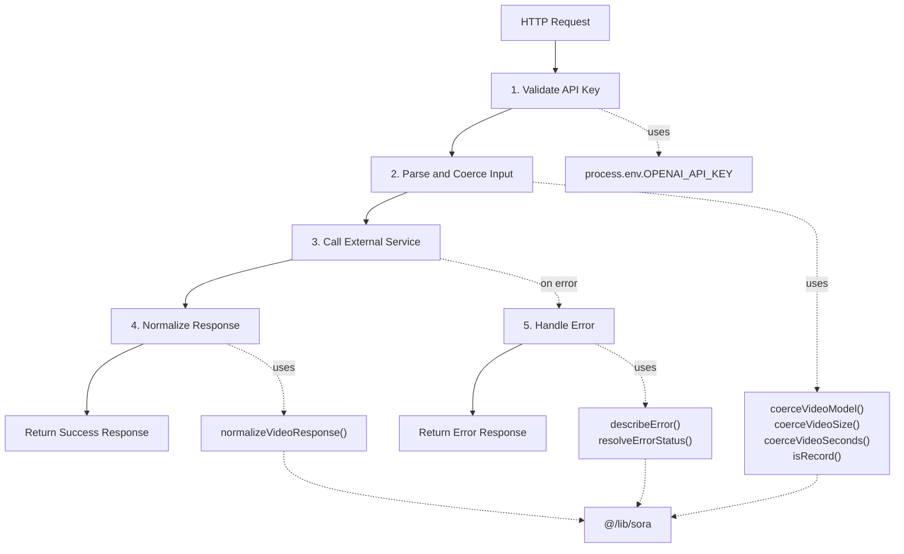
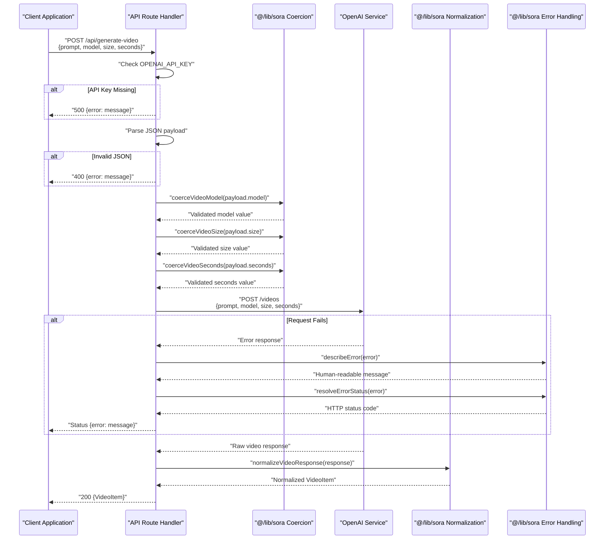
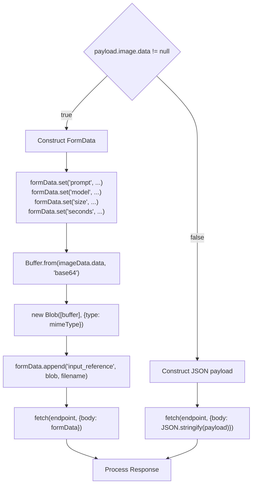
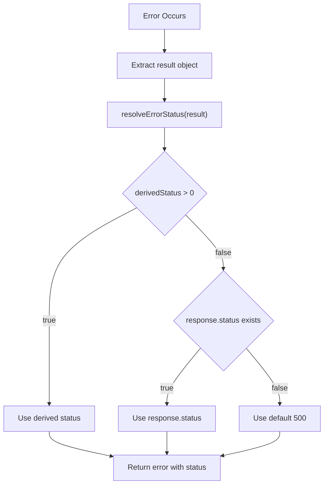
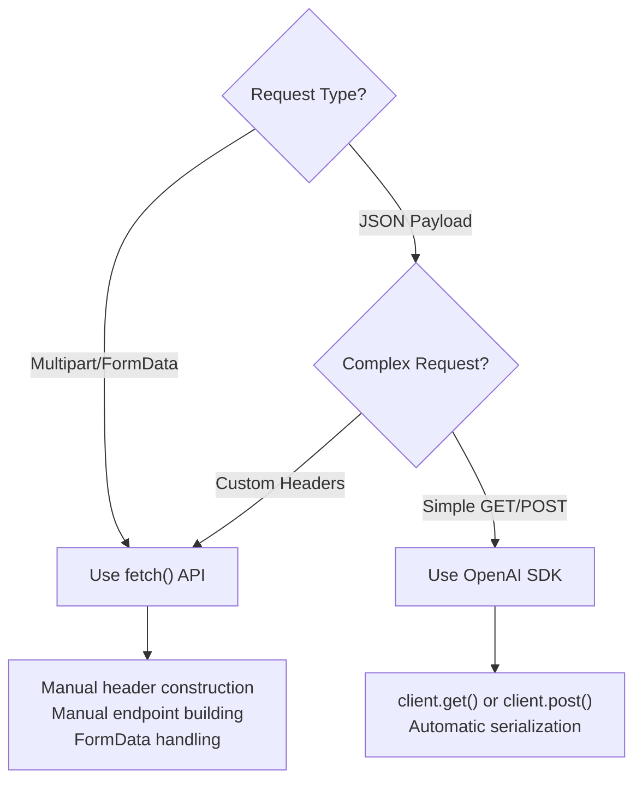

<!-- source: DeepWiki mcp.deepwiki.com · repo openai/openai-sora-sample-app · page 5 API Layer · fetched 2026-10-26 -->

# API Layer

<details>
<summary>Relevant source files</summary>

The following files were used as context for generating this wiki page:

- [app/api/generate-video/route.ts](app/api/generate-video/route.ts)
- [app/api/remix-video/route.ts](app/api/remix-video/route.ts)
- [app/api/videos/[id]/route.ts](app/api/videos/[id]/route.ts)

</details>


## Purpose and Scope

This document describes the Next.js API routes that comprise the backend layer of the Sora Sample App. These routes serve as the intermediary between the client-side UI and external OpenAI services, handling authentication, request validation, data coercion, and response normalization. 

For details on specific endpoints, see:
- Video generation: [Video Generation Endpoint](#5.1)
- Video remixing: [Video Remix Endpoint](#5.2)
- Video status and content: [Video Retrieval Endpoints](#5.3)
- AI-powered enhancements: [AI Enhancement Endpoints](#5.4)

For implementation details of the shared utilities used across all routes, see [Sora Utility Library](#6.1).

## API Routes Overview

The API layer consists of seven Next.js API routes, all located under the `app/api` directory:

| Route | Method | Purpose | External Service |
|-------|--------|---------|------------------|
| `/api/generate-video` | POST | Create new video from prompt | OpenAI Sora Video API |
| `/api/remix-video` | POST | Generate video variation from existing video | OpenAI Sora Video API |
| `/api/videos/[id]` | GET | Poll video generation status | OpenAI Sora Video API |
| `/api/videos/[id]/content` | GET | Retrieve binary video content | OpenAI Sora Video API |
| `/api/generate-images` | POST | Generate image suggestions for prompts | gpt-image-1 |
| `/api/suggest-prompt` | POST | Enhance user-provided prompts | gpt-4.1-mini |
| `/api/video-title` | POST | Generate titles for videos | gpt-4.1-mini |

Sources: [app/api/generate-video/route.ts](), [app/api/remix-video/route.ts](), [app/api/videos/[id]/route.ts]()

## Common Architectural Pattern

All API routes in the system follow an identical five-step pattern that ensures consistency, maintainability, and robust error handling:



**Pattern Breakdown:**

### Step 1: API Key Validation

All routes begin by validating the `OPENAI_API_KEY` environment variable:

[app/api/generate-video/route.ts:21-25]()
```typescript
const apiKey = process.env.OPENAI_API_KEY?.trim();
if (!apiKey) {
  const message = "OPENAI_API_KEY is not configured";
  return Response.json({ error: { message } }, { status: 500 });
}
```

### Step 2: Parse and Coerce Input

Routes parse the incoming JSON payload and use coercion functions from `@/lib/sora` to ensure type safety:

[app/api/generate-video/route.ts:27-56]()

The coercion functions (`coerceVideoModel`, `coerceVideoSize`, `coerceVideoSeconds`) provide safe defaults when inputs are invalid or missing, ensuring the system always operates with valid parameters.

### Step 3: Call External Service

Routes make HTTP requests to OpenAI services using either the `fetch` API or the OpenAI SDK:

[app/api/generate-video/route.ts:68-122]()

### Step 4: Normalize Response

Responses from external services are normalized using `normalizeVideoResponse()` to ensure consistent data structures:

[app/api/generate-video/route.ts:135-136]()

### Step 5: Handle Errors

All errors are caught and processed through centralized error utilities:

[app/api/generate-video/route.ts:137-142]()

The `describeError()` function extracts human-readable error messages, while `resolveErrorStatus()` determines appropriate HTTP status codes.

Sources: [app/api/generate-video/route.ts:21-142](), [app/api/remix-video/route.ts:13-59](), [app/api/videos/[id]/route.ts:13-65]()

## Authentication and Configuration

### Environment Variables

The API layer requires the following environment variables for authentication and service configuration:

| Variable | Required | Purpose | Default |
|----------|----------|---------|---------|
| `OPENAI_API_KEY` | Yes | OpenAI API authentication key | None |
| `OPENAI_BASE_URL` | No | Custom API endpoint URL | `https://api.openai.com/v1` |
| `OPENAI_ORG_ID` | No | OpenAI organization identifier | None |
| `OPENAI_PROJECT_ID` | No | OpenAI project identifier | None |

### Header Construction

Routes construct HTTP headers with authentication credentials and optional organization/project identifiers:

[app/api/generate-video/route.ts:71-82]()

The `Authorization` header uses bearer token authentication. Optional `OpenAI-Organization` and `OpenAI-Project` headers are added when the corresponding environment variables are configured.

### API Client Initialization

Routes using the OpenAI SDK initialize the client with the API key:

[app/api/remix-video/route.ts:20]()

```typescript
const client = new OpenAI({ apiKey });
```

Sources: [app/api/generate-video/route.ts:68-82](), [app/api/remix-video/route.ts:20]()

## Request/Response Flow

The following diagram shows the complete data flow from client request to external service and back:



**Key Flow Characteristics:**

1. **Synchronous Validation**: API key and JSON parsing validation occur synchronously before any external calls
2. **Progressive Coercion**: Input parameters are coerced one at a time using dedicated type-safe functions
3. **Error-First**: Errors are caught and normalized before being returned to the client
4. **Consistent Structure**: All responses follow a uniform structure through normalization

Sources: [app/api/generate-video/route.ts:20-143](), [app/api/remix-video/route.ts:13-59]()

## Data Coercion and Type Safety

### Input Coercion Functions

The API layer uses three primary coercion functions to ensure type-safe parameters:

| Function | Purpose | Returns | Source File |
|----------|---------|---------|-------------|
| `coerceVideoModel()` | Validates and defaults model parameter | `SoraModel` | `@/lib/sora` |
| `coerceVideoSize()` | Validates and defaults video dimensions | `string` | `@/lib/sora` |
| `coerceVideoSeconds()` | Validates and defaults video duration | `string` | `@/lib/sora` |
| `isRecord()` | Type guard for object validation | `boolean` | `@/lib/sora` |

### Type Coercion Pattern

Routes use a consistent pattern for coercing incoming parameters:

[app/api/generate-video/route.ts:48-56]()

This pattern:
1. Extracts the raw value from the payload
2. Performs type checking (`typeof payload.model === "string"`)
3. Passes the value (or `null`) to the coercion function
4. Receives a guaranteed valid value with appropriate defaults

### VideoRequestPayload Structure

Coerced parameters are collected into a `VideoRequestPayload` object:

[app/api/generate-video/route.ts:60-65]()

```typescript
const videoPayload: VideoRequestPayload = {
  prompt,
  model,
  size,
  seconds,
};
```

This structure serves as both a validated input container and fallback data for response normalization.

Sources: [app/api/generate-video/route.ts:48-65](), [app/api/remix-video/route.ts:41-46](), [app/api/videos/[id]/route.ts:43-56]()

## Image Data Handling

### FormData Construction

The `/api/generate-video` route supports optional image input for image-to-video generation. When an image is provided, the route constructs a `FormData` payload instead of JSON:

[app/api/generate-video/route.ts:85-108]()

**Image Processing Steps:**

1. **Extract Image Data**: Check for `payload.image.data` containing base64-encoded image
2. **Decode Base64**: Convert base64 string to `Buffer` using Node.js Buffer API
3. **Determine MIME Type**: Use provided `mimeType` or default to `"image/png"`
4. **Construct Blob**: Create `Blob` from buffer with appropriate MIME type
5. **Append to FormData**: Add blob to FormData with field name `"input_reference"`

### Conditional Request Format

The route branches based on image presence:



Sources: [app/api/generate-video/route.ts:58-122]()

## Error Handling Strategy

### Centralized Error Processing

All API routes use the same error handling utilities from `@/lib/sora`:

| Function | Purpose | Return Type |
|----------|---------|-------------|
| `describeError(error, fallback)` | Extracts human-readable error message | `string` |
| `resolveErrorStatus(error)` | Determines appropriate HTTP status code | `number` |

### Error Response Structure

All error responses follow a consistent structure:

```typescript
Response.json({ error: { message: string } }, { status: number })
```

### Error Handling Locations

Routes handle errors in three locations:

**1. JSON Parse Errors**

[app/api/generate-video/route.ts:28-35]()

**2. API Response Errors**

[app/api/generate-video/route.ts:124-133]()

**3. Caught Exceptions**

[app/api/generate-video/route.ts:137-142]()

### Error Status Resolution

The error handling logic attempts to derive the most appropriate HTTP status code:



Sources: [app/api/generate-video/route.ts:124-142](), [app/api/remix-video/route.ts:54-58](), [app/api/videos/[id]/route.ts:60-64]()

## Response Normalization

### normalizeVideoResponse Function

All video-related responses pass through the `normalizeVideoResponse()` function to ensure consistent structure:

[app/api/generate-video/route.ts:135-136]()

**Normalization Purpose:**

1. **Consistent Field Names**: Maps external API field names to internal schema
2. **Type Safety**: Ensures all fields have expected types
3. **Fallback Values**: Uses `VideoRequestPayload` to populate missing fields
4. **Status Standardization**: Normalizes various status representations

### Normalization Pattern

Routes provide both the raw external response and a fallback payload:

[app/api/videos/[id]/route.ts:43-58]()

The fallback `VideoRequestPayload` ensures that even if the external API response is incomplete, the normalized response contains all required fields.

### VideoItem Structure

The normalization process produces a `VideoItem` object with standardized fields:

- `id`: Video identifier
- `status`: Generation status (e.g., "queued", "in_progress", "completed")
- `prompt`: Text prompt used for generation
- `model`: Sora model identifier
- `size`: Video dimensions
- `seconds`: Video duration
- `created_at`: Creation timestamp
- Additional metadata fields

Sources: [app/api/generate-video/route.ts:135-136](), [app/api/remix-video/route.ts:52-53](), [app/api/videos/[id]/route.ts:58-59]()

## API Route Implementations

### Video Generation Route

**Path**: `app/api/generate-video/route.ts`

**Handler**: `POST` function

**Capabilities**:
- Text-to-video generation
- Image-to-video generation (with `input_reference`)
- Parameter validation and coercion
- FormData construction for multipart requests

**Key Implementation Details**:
- Supports base64-encoded image input
- Conditionally switches between JSON and FormData payloads
- Uses raw `fetch` API for maximum control over request format

[app/api/generate-video/route.ts:20-143]()

### Video Remix Route

**Path**: `app/api/remix-video/route.ts`

**Handler**: `POST` function

**Capabilities**:
- Creates video variations from existing videos
- Requires `videoId` and new `prompt`
- Maintains model/size/seconds from original video

**Key Implementation Details**:
- Uses OpenAI SDK's `client.post()` method
- Simpler payload structure (only prompt required)
- Passes fallback parameters for normalization

[app/api/remix-video/route.ts:13-59]()

### Video Status Route

**Path**: `app/api/videos/[id]/route.ts`

**Handler**: `GET` function

**Capabilities**:
- Polls video generation status
- Retrieves video metadata
- Used by `useVideoPolling` hook for status updates

**Key Implementation Details**:
- Dynamic route parameter `[id]`
- Extracts prompt from response for fallback
- Uses OpenAI SDK's `client.get()` method

[app/api/videos/[id]/route.ts:13-65]()

Sources: [app/api/generate-video/route.ts](), [app/api/remix-video/route.ts](), [app/api/videos/[id]/route.ts]()

## Route Handler Type Signatures

All route handlers follow Next.js App Router conventions:

### POST Handler Signature

```typescript
export async function POST(request: Request): Promise<Response>
```

### GET Handler Signature with Dynamic Route

```typescript
export async function GET(
  _request: Request,
  { params }: { params: Promise<{ id: string }> }
): Promise<Response>
```

**Parameter Notes**:
- `request`: Standard Web API Request object
- `params`: Next.js dynamic route parameters (always a Promise in Next.js 15+)
- Return type: Standard Web API Response object

### Async Parameter Resolution

Dynamic route parameters must be awaited in Next.js 15+:

[app/api/videos/[id]/route.ts:25-26]()

```typescript
const { id } = await params;
```

Sources: [app/api/generate-video/route.ts:20](), [app/api/remix-video/route.ts:13](), [app/api/videos/[id]/route.ts:13-15]()

## OpenAI SDK vs Fetch API

The API layer uses two different approaches for making external requests:

### Fetch API (Direct HTTP)

**Used in**: `app/api/generate-video/route.ts`

**Advantages**:
- Full control over request construction
- Required for multipart/form-data requests
- Custom header management

[app/api/generate-video/route.ts:104-108]()

### OpenAI SDK

**Used in**: `app/api/remix-video/route.ts`, `app/api/videos/[id]/route.ts`

**Advantages**:
- Simplified request syntax
- Automatic error handling
- Type-safe request/response objects

[app/api/remix-video/route.ts:49-51]()

**Decision Criteria**:



Sources: [app/api/generate-video/route.ts:104-122](), [app/api/remix-video/route.ts:49-51](), [app/api/videos/[id]/route.ts:35]()

## Summary

The API layer provides a consistent, maintainable backend architecture through:

1. **Uniform Pattern**: All routes follow the same five-step validation → coercion → call → normalize → error pattern
2. **Centralized Utilities**: Shared functions in `@/lib/sora` ensure consistency across all endpoints
3. **Type Safety**: Coercion functions guarantee valid parameters even with untrusted input
4. **Robust Error Handling**: Centralized error processing with human-readable messages and appropriate status codes
5. **Flexible Request Handling**: Support for both JSON and FormData payloads depending on requirements
6. **Response Normalization**: All external API responses are transformed into consistent `VideoItem` structures

This architecture allows the frontend to interact with a stable, predictable API surface while isolating external service integration complexity in the backend layer.

---

