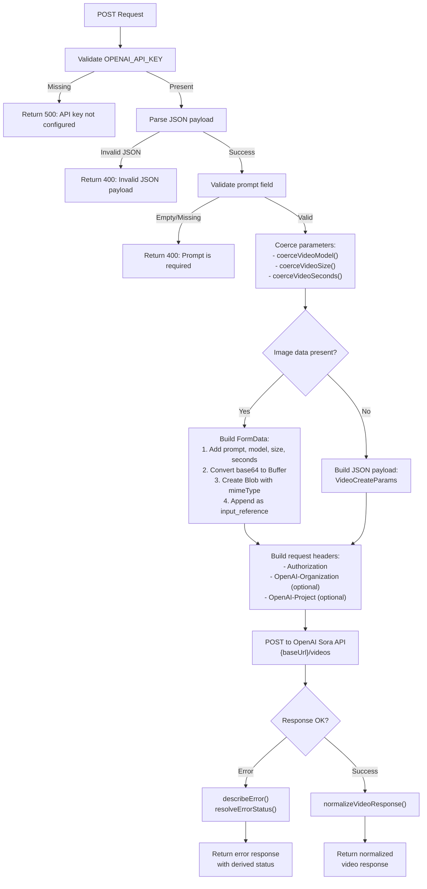
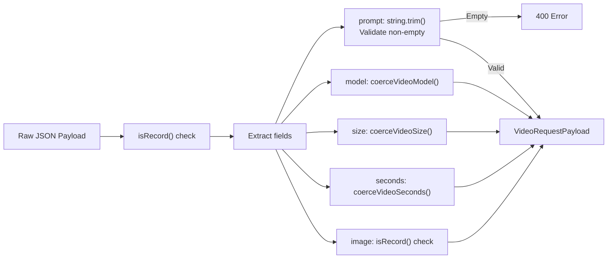
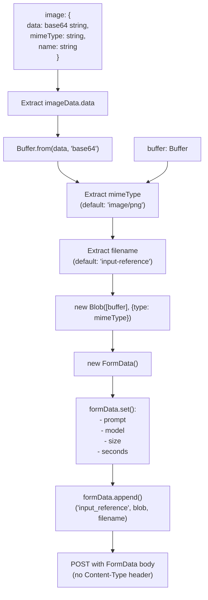
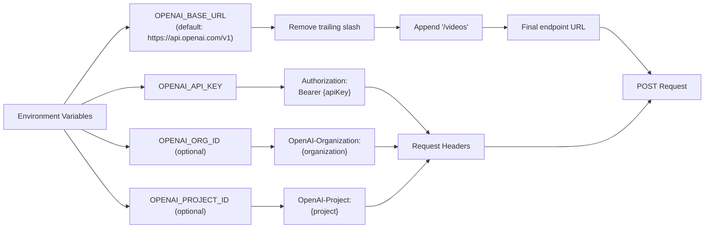
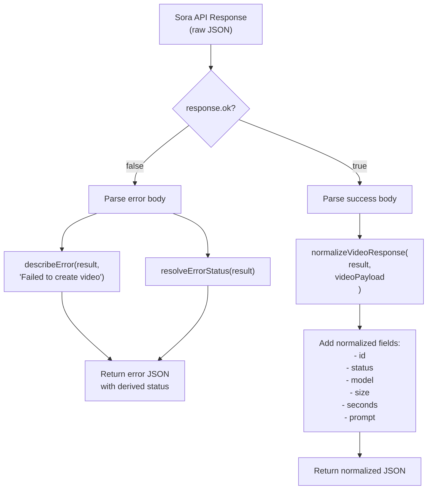
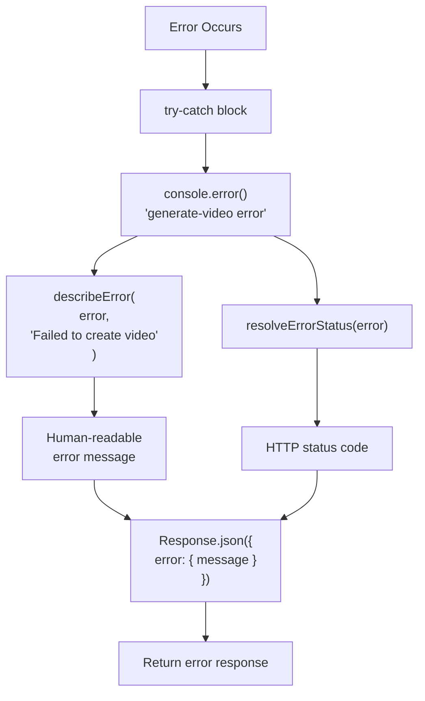
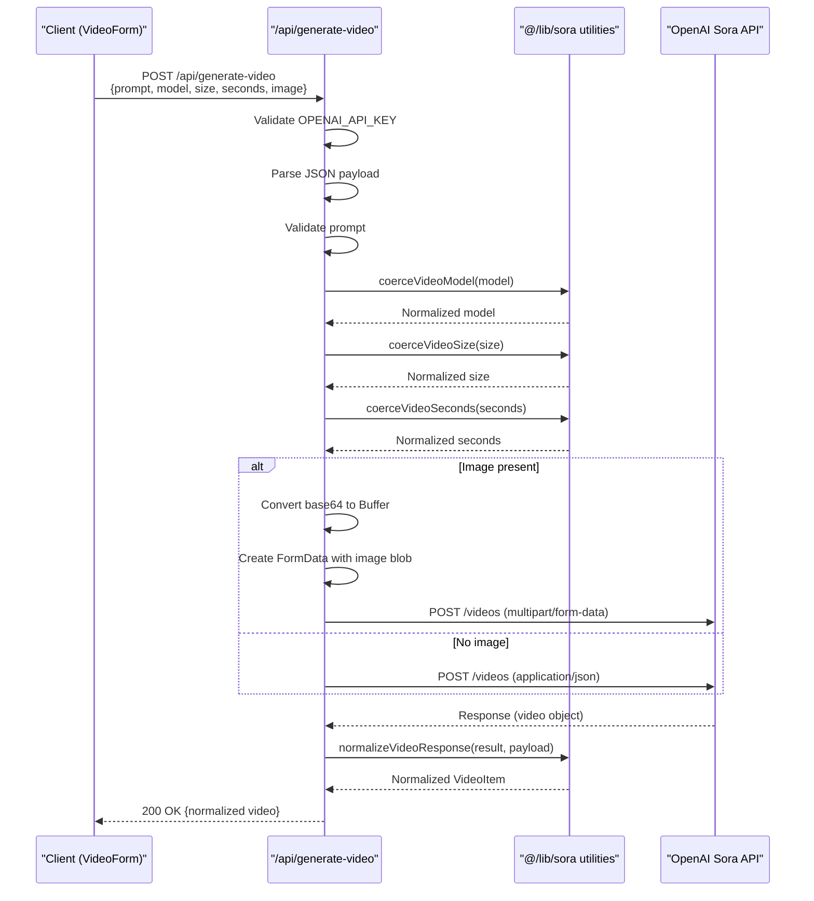

<!-- source: DeepWiki mcp.deepwiki.com · repo openai/openai-sora-sample-app · page 5.1 Video Generation Endpoint · fetched 2026-10-26 -->

# Video Generation Endpoint

<details>
<summary>Relevant source files</summary>

The following files were used as context for generating this wiki page:

- [app/api/generate-video/route.ts](app/api/generate-video/route.ts)
- [app/api/video-title/route.ts](app/api/video-title/route.ts)

</details>


## Purpose and Scope

This document details the `/api/generate-video` endpoint, which serves as the primary interface for creating new videos using OpenAI's Sora API. The endpoint accepts user-provided prompts and optional parameters, performs input validation and coercion, optionally handles image references, and forwards requests to the Sora video generation service.

For information about remixing existing videos, see [Video Remix Endpoint](#5.2). For polling video status and retrieving content, see [Video Retrieval Endpoints](#5.3). For AI-powered enhancements like prompt suggestions and title generation, see [AI Enhancement Endpoints](#5.4).

**Sources:** [app/api/generate-video/route.ts:1-143]()

---

## Endpoint Overview

The `/api/generate-video` endpoint is implemented as a Next.js API route handler that accepts POST requests and returns normalized video generation responses.

| Property | Value |
|----------|-------|
| **Route Path** | `/api/generate-video` |
| **HTTP Method** | `POST` |
| **Handler Function** | `POST` |
| **Content Types** | `application/json` (request), `multipart/form-data` (when image present) |
| **Authentication** | OpenAI API key via `OPENAI_API_KEY` environment variable |
| **External Service** | OpenAI Sora Video API (`/videos` endpoint) |

**Sources:** [app/api/generate-video/route.ts:20-143]()

---

## Request Processing Flow

The following diagram illustrates the complete request processing pipeline from initial validation through response normalization:



**Sources:** [app/api/generate-video/route.ts:20-143]()

---

## Request Payload Structure

The endpoint expects a JSON payload with the following structure:

| Field | Type | Required | Description | Coercion Function |
|-------|------|----------|-------------|-------------------|
| `prompt` | `string` | Yes | Text description of the video to generate | Trimmed, validated non-empty |
| `model` | `string` | No | Sora model identifier | `coerceVideoModel()` |
| `size` | `string` | No | Video dimensions (e.g., "1920x1080") | `coerceVideoSize()` |
| `seconds` | `string` or `number` | No | Video duration in seconds | `coerceVideoSeconds()` |
| `image` | `object` | No | Optional reference image for video generation | See Image Data Structure |

### Image Data Structure

When an `image` object is provided, it should contain:

| Field | Type | Description |
|-------|------|-------------|
| `data` | `string` | Base64-encoded image data |
| `mimeType` | `string` | MIME type (defaults to "image/png") |
| `name` | `string` | Filename (defaults to "input-reference") |

**Sources:** [app/api/generate-video/route.ts:37-66](), [app/api/generate-video/route.ts:85-102]()

---

## Parameter Coercion and Validation

The endpoint employs type-safe parameter coercion using utility functions from `@/lib/sora` to ensure valid inputs are sent to the Sora API:



### Coercion Behavior

The coercion functions handle potentially invalid or missing inputs gracefully:

- **`coerceVideoModel()`**: Converts model string to a valid `SoraModel` type, applying defaults if invalid
- **`coerceVideoSize()`**: Normalizes size strings to valid video dimensions
- **`coerceVideoSeconds()`**: Converts duration values to valid time strings

These functions are documented in detail in [Sora Utility Library](#6.1).

**Sources:** [app/api/generate-video/route.ts:39-65](), [app/api/generate-video/route.ts:2-11]()

---

## Image Handling: FormData Construction

When an image is provided, the endpoint constructs a `multipart/form-data` request instead of a JSON request. This process involves several transformations:



### Code Implementation

The FormData construction occurs when `imageData?.data` is present:

[app/api/generate-video/route.ts:85-108]()

Key implementation details:
- Base64 string is converted to a Node.js `Buffer` using `Buffer.from()`
- Buffer is wrapped in a `Blob` with the appropriate MIME type
- Text parameters are added via `formData.set()`
- Image blob is added via `formData.append()` with the field name `"input_reference"`
- The `Content-Type` header is **not** set manually; the browser/fetch API sets it automatically with the multipart boundary

**Sources:** [app/api/generate-video/route.ts:85-108]()

---

## OpenAI Sora API Integration

The endpoint constructs requests to the OpenAI Sora API with proper authentication and organization/project headers:

### Endpoint Construction



### Header Configuration

The following headers are configured based on environment variables:

| Header | Source | Required | Line Reference |
|--------|--------|----------|----------------|
| `Authorization` | `OPENAI_API_KEY` | Yes | [app/api/generate-video/route.ts:72]() |
| `OpenAI-Organization` | `OPENAI_ORG_ID` | No | [app/api/generate-video/route.ts:75-78]() |
| `OpenAI-Project` | `OPENAI_PROJECT_ID` | No | [app/api/generate-video/route.ts:79-82]() |
| `Content-Type` | N/A (FormData) or `"application/json"` | Conditional | [app/api/generate-video/route.ts:110]() |

**Sources:** [app/api/generate-video/route.ts:68-122]()

---

## Response Normalization

After receiving a response from the Sora API, the endpoint normalizes the data structure using the `normalizeVideoResponse()` function:



### Normalization Function

The `normalizeVideoResponse()` function from `@/lib/sora` ensures consistent response structure regardless of variations in the Sora API response format. It:

1. Extracts the video `id` from the response
2. Normalizes the `status` field
3. Preserves the original request parameters (`model`, `size`, `seconds`, `prompt`)
4. Adds any additional metadata from the API response

This normalized structure is used throughout the application for type-safe video data handling. See [Type Definitions & Data Structures](#6.2) for details on the `VideoItem` type.

**Sources:** [app/api/generate-video/route.ts:124-136]()

---

## Error Handling Strategy

The endpoint employs a comprehensive error handling strategy using centralized utilities:

### Error Handling Flow



### Error Scenarios

| Scenario | Status Code | Message Source | Line Reference |
|----------|-------------|----------------|----------------|
| Missing API key | 500 | Hardcoded string | [app/api/generate-video/route.ts:22-25]() |
| Invalid JSON payload | 400 | Hardcoded string | [app/api/generate-video/route.ts:31-35]() |
| Missing prompt | 400 | Hardcoded string | [app/api/generate-video/route.ts:42-45]() |
| Sora API error (non-OK response) | Derived via `resolveErrorStatus()` | `describeError()` with fallback | [app/api/generate-video/route.ts:125-132]() |
| Network/exception error | Derived via `resolveErrorStatus()` | `describeError()` with fallback | [app/api/generate-video/route.ts:137-142]() |

### Error Utility Functions

- **`describeError(error, fallback)`**: Extracts human-readable error messages from various error formats (API errors, Error objects, unknown values)
- **`resolveErrorStatus(error)`**: Derives appropriate HTTP status codes from error objects

These utilities provide consistent error handling across all API routes. See [Error Handling Patterns](#6.3) for implementation details.

**Sources:** [app/api/generate-video/route.ts:126-142]()

---

## Type Definitions

The endpoint uses several key type definitions:

### VideoCreateParams

Internal type for the JSON payload sent to the Sora API when no image is present:

```typescript
type VideoCreateParams = {
  prompt: string;
  model: string;
  size: string;
  seconds: string;
};
```

[app/api/generate-video/route.ts:13-18]()

### VideoRequestPayload

Imported type from `@/lib/sora` that represents the coerced parameters before API submission:

```typescript
// From @/lib/sora
type VideoRequestPayload = {
  prompt: string;
  model: string;
  size: string;
  seconds: string;
};
```

This type is passed to `normalizeVideoResponse()` to preserve request metadata in the normalized response.

[app/api/generate-video/route.ts:60-65]()

**Sources:** [app/api/generate-video/route.ts:2-18]()

---

## Usage Example

The following diagram shows how a client application interacts with this endpoint:



**Sources:** [app/api/generate-video/route.ts:20-143]()

---

## Environment Variables

The endpoint requires the following environment variables:

| Variable | Required | Purpose | Default |
|----------|----------|---------|---------|
| `OPENAI_API_KEY` | Yes | Authentication for OpenAI API | None |
| `OPENAI_BASE_URL` | No | Custom API endpoint base URL | `https://api.openai.com/v1` |
| `OPENAI_ORG_ID` | No | OpenAI organization identifier | None |
| `OPENAI_PROJECT_ID` | No | OpenAI project identifier | None |

See [Configuration & Environment](#2.1) for complete environment variable documentation.

**Sources:** [app/api/generate-video/route.ts:21](), [app/api/generate-video/route.ts:68-82]()

---

## Related Endpoints

This endpoint is part of the video generation workflow. Related endpoints include:

- **[Video Remix Endpoint](#5.2)**: `/api/remix-video` - Creates variations of existing videos
- **[Video Retrieval Endpoints](#5.3)**: `/api/videos/[id]` and `/api/videos/[id]/content` - Poll status and retrieve video content
- **[AI Enhancement Endpoints](#5.4)**: `/api/suggest-prompt`, `/api/generate-images`, `/api/video-title` - Enhance generation requests with AI suggestions

**Sources:** N/A (architectural context)

---

