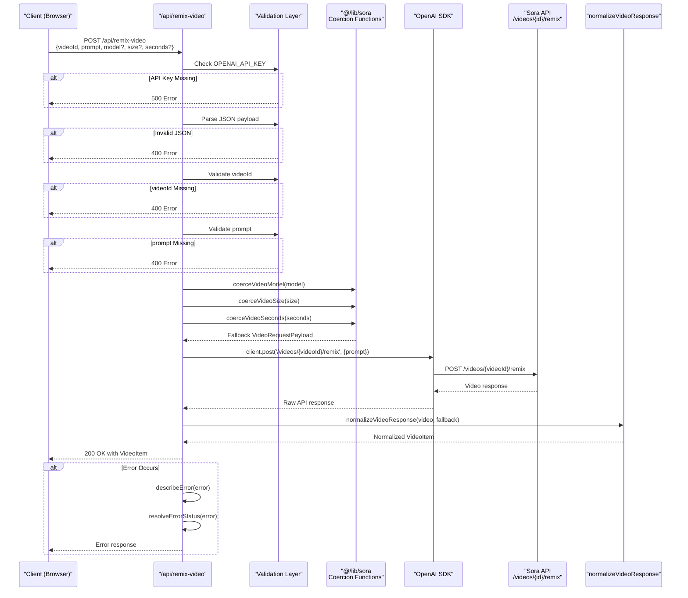
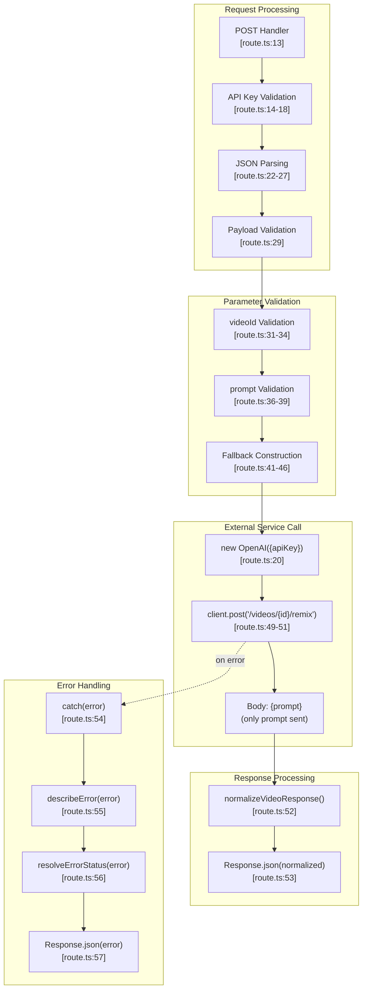
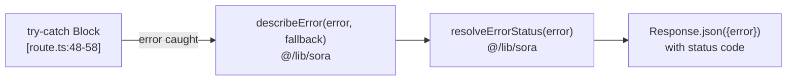
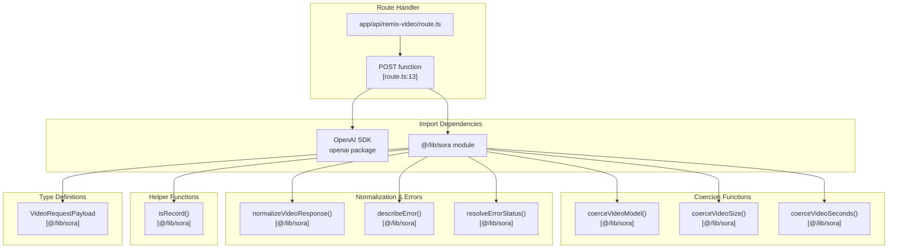

<!-- source: DeepWiki mcp.deepwiki.com · repo openai/openai-sora-sample-app · page 5.2 Video Remix Endpoint · fetched 2026-10-26 -->

# Video Remix Endpoint

<details>
<summary>Relevant source files</summary>

The following files were used as context for generating this wiki page:

- [app/api/generate-video/route.ts](app/api/generate-video/route.ts)
- [app/api/remix-video/route.ts](app/api/remix-video/route.ts)

</details>


## Purpose and Scope

The Video Remix Endpoint (`/api/remix-video`) enables users to create variations of existing videos by applying a new text prompt to an already-generated video. This endpoint serves as a wrapper around the OpenAI Sora API's remix functionality, providing parameter validation, error handling, and response normalization.

For information about creating new videos from scratch, see [Video Generation Endpoint](#5.1). For polling video status or retrieving content, see [Video Retrieval Endpoints](#5.3).

**Sources:** [app/api/remix-video/route.ts:1-59]()

---

## Endpoint Overview

The remix endpoint accepts a POST request containing a `videoId` and a new `prompt`, then forwards the request to the OpenAI Sora API's remix endpoint to generate a new video variation.

### Key Characteristics

| Property | Value |
|----------|-------|
| HTTP Method | POST |
| Route Path | `/api/remix-video` |
| Request Format | JSON |
| Authentication | Server-side via `OPENAI_API_KEY` |
| External API | `POST /videos/{videoId}/remix` |
| SDK Used | `openai` npm package |

**Sources:** [app/api/remix-video/route.ts:13-59]()

---

## Request Flow Diagram



**Sources:** [app/api/remix-video/route.ts:13-59]()

---

## Request Parameters

### Required Parameters

The remix endpoint requires two mandatory parameters in the JSON request body:

| Parameter | Type | Validation | Description |
|-----------|------|------------|-------------|
| `videoId` | `string` | Must be non-empty after trimming | The ID of the existing video to remix |
| `prompt` | `string` | Must be non-empty after trimming | The new text prompt for the remix |

**Sources:** [app/api/remix-video/route.ts:31-39]()

### Optional Parameters (Fallback Only)

These parameters are accepted and coerced but are **not sent to the OpenAI API**. They serve only as fallback values for response normalization:

| Parameter | Type | Coercion Function | Default Value |
|-----------|------|-------------------|---------------|
| `model` | `string` | `coerceVideoModel()` | System default model |
| `size` | `string` | `coerceVideoSize()` | System default size |
| `seconds` | `string \| number` | `coerceVideoSeconds()` | System default duration |

**Sources:** [app/api/remix-video/route.ts:41-46]()

### Parameter Processing Example

```typescript
// Input validation
const videoId = typeof payload.videoId === "string" 
  ? payload.videoId.trim() 
  : "";

if (!videoId) {
  return Response.json(
    { error: { message: "videoId is required" } }, 
    { status: 400 }
  );
}

// Fallback construction (not sent to API)
const fallback: VideoRequestPayload = {
  prompt,
  model: coerceVideoModel(typeof payload.model === "string" ? payload.model : null),
  size: coerceVideoSize(typeof payload.size === "string" ? payload.size : null),
  seconds: coerceVideoSeconds(payload.seconds != null ? String(payload.seconds) : null),
};
```

**Sources:** [app/api/remix-video/route.ts:31-46]()

---

## API Integration Architecture



**Sources:** [app/api/remix-video/route.ts:13-59]()

---

## OpenAI SDK Usage

Unlike the Video Generation Endpoint which uses raw `fetch` calls, the remix endpoint utilizes the `openai` npm package's SDK client. This provides automatic request/response handling and error transformation.

### SDK Client Initialization

```typescript
const client = new OpenAI({ apiKey });
```

The client is initialized with the `OPENAI_API_KEY` from environment variables [app/api/remix-video/route.ts:20](). The SDK automatically handles:
- Base URL configuration (from `OPENAI_BASE_URL` environment variable if set)
- Organization and project ID headers
- Request serialization
- Error standardization

**Sources:** [app/api/remix-video/route.ts:1, 20]()

### Remix API Call

```typescript
const video = await client.post(`/videos/${videoId}/remix`, {
  body: { prompt },
});
```

The SDK's `post` method is used to call the remix endpoint [app/api/remix-video/route.ts:49-51](). Notably:
- Only the `prompt` is sent in the request body
- The `videoId` is part of the URL path
- No model, size, or seconds parameters are transmitted
- The SDK automatically adds authentication headers

**Sources:** [app/api/remix-video/route.ts:49-51]()

---

## Response Normalization

### Normalization Process

The raw API response is normalized using the `normalizeVideoResponse` function with the fallback parameters:

```typescript
const normalized = normalizeVideoResponse(video, fallback);
```

This ensures the response conforms to the `VideoItem` type structure expected by the frontend, even if the API response has missing or inconsistent fields [app/api/remix-video/route.ts:52]().

### Fallback Parameter Purpose

The `fallback` object constructed from optional parameters serves a specific purpose: when the API response doesn't include certain fields (e.g., `model`, `size`, `seconds`), the normalization function uses these fallback values to populate the `VideoItem` structure. This ensures consistent data shapes across all video items, regardless of what the API returns.

**Sources:** [app/api/remix-video/route.ts:41-52](), [app/api/generate-video/route.ts:135]()

---

## Error Handling

### Error Processing Pipeline



### Error Types

The endpoint handles errors through the centralized `@/lib/sora` error utilities:

| Error Type | Status Code | Description |
|------------|-------------|-------------|
| Missing API Key | 500 | `OPENAI_API_KEY` not configured |
| Invalid JSON | 400 | Request body is not valid JSON |
| Missing `videoId` | 400 | Required parameter not provided |
| Missing `prompt` | 400 | Required parameter not provided |
| OpenAI API Error | Variable | Status determined by `resolveErrorStatus()` |
| Network Error | 500 | Connection or unexpected errors |

**Sources:** [app/api/remix-video/route.ts:14-18, 22-27, 31-39, 54-58]()

### Error Response Format

All errors return a standardized JSON structure:

```typescript
{
  error: {
    message: string  // Human-readable error description
  }
}
```

The `describeError()` function provides user-friendly error messages, while `resolveErrorStatus()` determines the appropriate HTTP status code [app/api/remix-video/route.ts:55-57]().

**Sources:** [app/api/remix-video/route.ts:17, 26, 33, 38, 55-57]()

---

## Comparison with Video Generation Endpoint

### Key Differences

| Aspect | Remix Endpoint | Generate-Video Endpoint |
|--------|----------------|-------------------------|
| **HTTP Client** | OpenAI SDK (`client.post`) | Raw `fetch` API |
| **Required Params** | `videoId`, `prompt` | `prompt` only |
| **Image Support** | ❌ No `input_reference` | ✅ Supports `input_reference` via FormData |
| **Parameters Sent** | Only `prompt` | `prompt`, `model`, `size`, `seconds` |
| **API Endpoint** | `/videos/{id}/remix` | `/videos` |
| **Request Body** | JSON only | JSON or FormData (if image present) |
| **Organization/Project Headers** | Automatic via SDK | Manual header construction |

**Sources:** [app/api/remix-video/route.ts:49-51](), [app/api/generate-video/route.ts:84-122]()

### Shared Patterns

Both endpoints share these common patterns:

1. **API Key Validation** - Both check for `OPENAI_API_KEY` at the start
2. **Parameter Coercion** - Both use `coerceVideoModel`, `coerceVideoSize`, `coerceVideoSeconds`
3. **Response Normalization** - Both use `normalizeVideoResponse` with fallback parameters
4. **Error Handling** - Both use `describeError` and `resolveErrorStatus`
5. **JSON Response Format** - Both return standardized JSON structures

**Sources:** [app/api/remix-video/route.ts:14-18, 41-46, 52, 55-57](), [app/api/generate-video/route.ts:21-25, 48-56, 135, 139-140]()

---

## Usage Context

### Frontend Integration

The remix endpoint is called by the client when users want to create variations of existing videos. The typical flow:

1. User views a completed video in the sidebar ([VideoSidebar](#4.3))
2. User clicks a "remix" action on a video card
3. Frontend calls `handleRemixFrom` in the [App component](#4.1)
4. `handleRemixFrom` populates the form with the video's prompt
5. User modifies the prompt and clicks generate
6. Frontend POSTs to `/api/remix-video` with the `videoId` and new prompt

The endpoint is not directly exposed in a dedicated service file, but is consumed through the browser's `fetch` API from the client-side code.

**Sources:** [app/api/remix-video/route.ts:13]()

---

## Implementation Details Summary

### Code Entity Mapping



**Sources:** [app/api/remix-video/route.ts:1-11]()

### Environment Variables

| Variable | Required | Purpose |
|----------|----------|---------|
| `OPENAI_API_KEY` | ✅ Yes | Authentication for OpenAI API calls |
| `OPENAI_BASE_URL` | ❌ No | SDK automatically uses if configured |
| `OPENAI_ORG_ID` | ❌ No | SDK automatically adds header if configured |
| `OPENAI_PROJECT_ID` | ❌ No | SDK automatically adds header if configured |

**Sources:** [app/api/remix-video/route.ts:14]()

---

## Security Considerations

### Server-Side Only

The `OPENAI_API_KEY` is only accessed server-side in the API route, never exposed to the client. All authentication happens within the Next.js API route [app/api/remix-video/route.ts:14]().

### Input Sanitization

- `videoId` is trimmed and validated for non-empty strings [app/api/remix-video/route.ts:31]()
- `prompt` is trimmed and validated for non-empty strings [app/api/remix-video/route.ts:36]()
- JSON payload is type-checked using `isRecord` helper [app/api/remix-video/route.ts:29]()
- All optional parameters go through type coercion functions

**Sources:** [app/api/remix-video/route.ts:29-46]()

---

