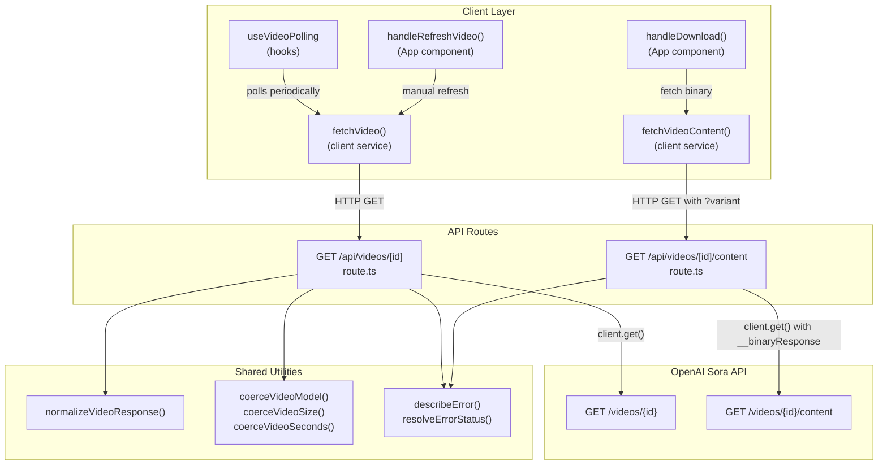
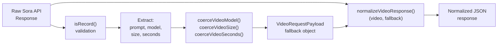
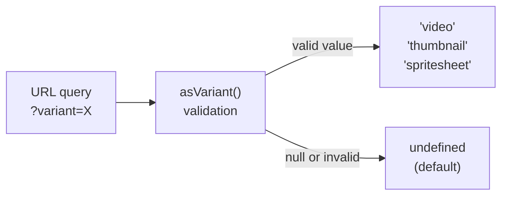
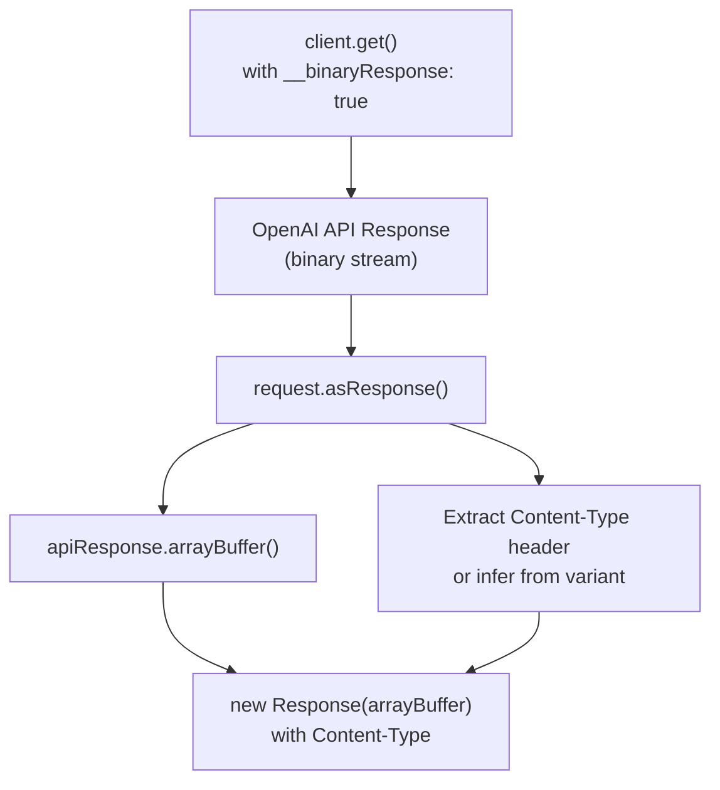
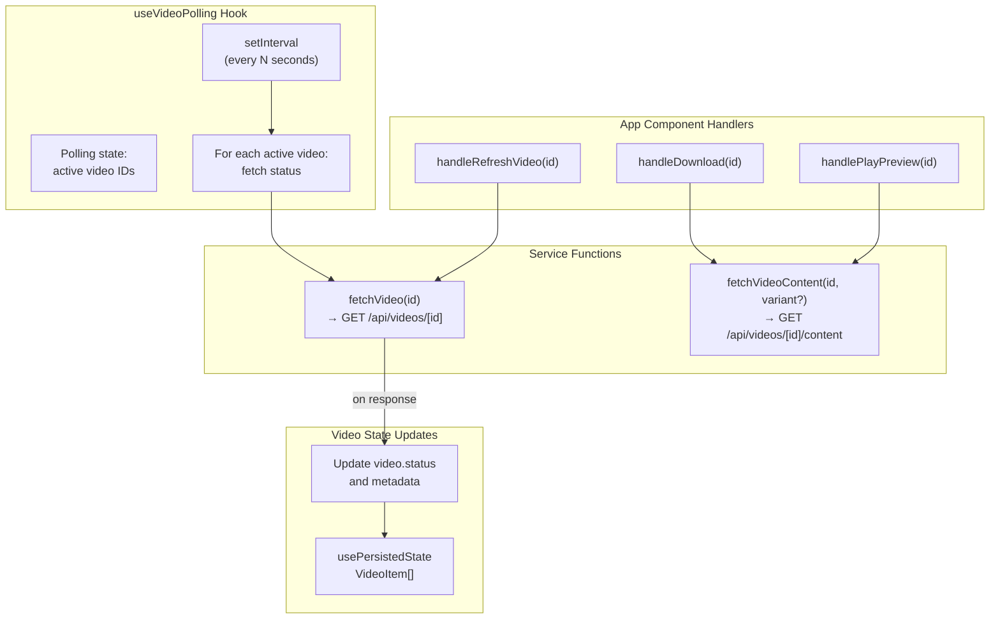

<!-- source: DeepWiki mcp.deepwiki.com · repo openai/openai-sora-sample-app · page 5.3 Video Retrieval Endpoints · fetched 2026-10-26 -->

# Video Retrieval Endpoints

<details>
<summary>Relevant source files</summary>

The following files were used as context for generating this wiki page:

- [app/api/videos/[id]/content/route.ts](app/api/videos/[id]/content/route.ts)
- [app/api/videos/[id]/route.ts](app/api/videos/[id]/route.ts)

</details>


This document describes the two API endpoints responsible for retrieving video data after generation: the status polling endpoint for fetching video metadata and completion status, and the content endpoint for retrieving binary video files, thumbnails, and spritesheets. These endpoints enable the client to monitor video generation progress and download completed videos.

For information about creating new videos, see [Video Generation Endpoint](#5.1). For information about creating video variations, see [Video Remix Endpoint](#5.2).

## Overview

The application provides two distinct retrieval endpoints to separate concerns between metadata/status retrieval and binary content delivery:

| Endpoint | Purpose | Response Type |
|----------|---------|---------------|
| `GET /api/videos/[id]` | Polls video generation status and retrieves normalized metadata | JSON |
| `GET /api/videos/[id]/content` | Retrieves binary video content (video file, thumbnail, or spritesheet) | Binary (video/mp4, image/png) |

Both endpoints follow the common API pattern of validating the `OPENAI_API_KEY`, making requests to the OpenAI Sora API, and providing standardized error handling through the `@/lib/sora` utilities.

**Sources:** [app/api/videos/[id]/route.ts:1-66](), [app/api/videos/[id]/content/route.ts:1-55]()

## Endpoint Routing Architecture



**Sources:** [app/api/videos/[id]/route.ts:1-66](), [app/api/videos/[id]/content/route.ts:1-55]()

## Status Polling Endpoint

### Route Implementation

The status polling endpoint is implemented at [app/api/videos/[id]/route.ts:13-65]() as a Next.js API route handler that accepts a dynamic `id` parameter.

**Request Format:**
```
GET /api/videos/{videoId}
```

The endpoint performs the following operations in sequence:

1. **API Key Validation** [app/api/videos/[id]/route.ts:17-21]() - Verifies `OPENAI_API_KEY` environment variable exists
2. **Parameter Extraction** [app/api/videos/[id]/route.ts:25-32]() - Extracts and validates the video ID from URL parameters
3. **External API Call** [app/api/videos/[id]/route.ts:35]() - Calls `client.get(/videos/${videoId})` on the OpenAI client
4. **Response Normalization** [app/api/videos/[id]/route.ts:36-58]() - Constructs fallback payload and normalizes response
5. **Error Handling** [app/api/videos/[id]/route.ts:60-64]() - Catches errors and returns standardized error responses

### Response Normalization Process



The normalization process [app/api/videos/[id]/route.ts:36-58]() constructs a `VideoRequestPayload` fallback object containing:

| Field | Source | Coercion Function |
|-------|--------|-------------------|
| `prompt` | `videoRecord.prompt` | String trimming |
| `model` | `videoRecord.model` | `coerceVideoModel()` |
| `size` | `videoRecord.size` | `coerceVideoSize()` |
| `seconds` | `videoRecord.seconds` | `coerceVideoSeconds()` |

This fallback ensures the response always contains valid, typed parameters even if the Sora API returns unexpected values. The `normalizeVideoResponse()` function from `@/lib/sora` [app/api/videos/[id]/route.ts:58]() then uses this fallback to produce a consistent response shape.

**Sources:** [app/api/videos/[id]/route.ts:13-65](), [lib/sora.ts]()

### Error Handling

The endpoint wraps the API call in a try-catch block [app/api/videos/[id]/route.ts:60-64]() and uses two utility functions for consistent error handling:

- `describeError(error, context)` - Generates human-readable error messages
- `resolveErrorStatus(error)` - Maps error types to appropriate HTTP status codes

Error responses follow a standardized format:
```json
{
  "error": {
    "message": "Human-readable error description"
  }
}
```

**Sources:** [app/api/videos/[id]/route.ts:60-64](), [lib/sora.ts]()

## Content Retrieval Endpoint

### Route Implementation

The binary content endpoint is implemented at [app/api/videos/[id]/content/route.ts:12-54]() and supports retrieving different content variants through query parameters.

**Request Format:**
```
GET /api/videos/{videoId}/content?variant={video|thumbnail|spritesheet}
```

### Variant Parameter Handling

The `asVariant()` helper function [app/api/videos/[id]/content/route.ts:4-10]() validates and coerces the `variant` query parameter:



**Supported Variants:**

| Variant | Description | Typical Content-Type |
|---------|-------------|---------------------|
| `video` | Full video file | `video/mp4` |
| `thumbnail` | Static preview image | `image/png` |
| `spritesheet` | Contact sheet of frames | `image/png` |
| (none) | Default video content | `video/mp4` |

**Sources:** [app/api/videos/[id]/content/route.ts:4-10]()

### Binary Response Handling

The endpoint uses the OpenAI SDK's binary response mode [app/api/videos/[id]/content/route.ts:31-48]():



**Implementation Details:**

1. **Binary Request** [app/api/videos/[id]/content/route.ts:31-35]() - Makes GET request with `__binaryResponse: true` flag and `Accept: application/binary` header
2. **Response Conversion** [app/api/videos/[id]/content/route.ts:37]() - Calls `asResponse()` to get raw HTTP response
3. **Buffer Extraction** [app/api/videos/[id]/content/route.ts:39]() - Converts response to `ArrayBuffer`
4. **Content-Type Detection** [app/api/videos/[id]/content/route.ts:40-41]() - Uses header value or infers based on variant (thumbnails default to `image/png`, otherwise `video/mp4`)
5. **Response Construction** [app/api/videos/[id]/content/route.ts:43-48]() - Returns new `Response` object with binary data and appropriate headers

**Sources:** [app/api/videos/[id]/content/route.ts:31-48]()

## Client Integration Pattern

The retrieval endpoints are consumed by client-side code through dedicated service functions and React hooks:



**Polling Lifecycle:**

1. After video creation, the video ID is added to the polling set
2. `useVideoPolling` hook periodically calls `fetchVideo()` for each active video
3. When response indicates terminal status (`completed`, `succeeded`, `failed`), polling stops for that video
4. Status updates are merged into the `VideoItem[]` array via `usePersistedState`

**Content Retrieval Use Cases:**

| Use Case | Handler | Variant | Purpose |
|----------|---------|---------|---------|
| Preview playback | `handlePlayPreview` | `video` | Display full video in overlay |
| Download to disk | `handleDownload` | `video` | Save video file locally |
| Thumbnail display | `useThumbnails` | `thumbnail` | Show preview in sidebar |

**Sources:** Based on system architecture from high-level diagrams

## Error Scenarios

Both endpoints handle errors consistently using the `@/lib/sora` utilities:

**Common Error Cases:**

| Error Type | Status Code | Example Message |
|------------|-------------|-----------------|
| Missing API key | 500 | "OPENAI_API_KEY is not configured" |
| Missing video ID | 400 | "Video id is required" |
| Not found | 404 | "Video not found" (via `resolveErrorStatus`) |
| API error | 500 | Custom message via `describeError` |

The error handling pattern [app/api/videos/[id]/route.ts:60-64](), [app/api/videos/[id]/content/route.ts:49-53]() ensures:

1. All errors return JSON with `{ error: { message: string } }` structure
2. HTTP status codes are appropriate to the error type
3. Error messages are user-friendly and actionable

**Sources:** [app/api/videos/[id]/route.ts:60-64](), [app/api/videos/[id]/content/route.ts:49-53]()

## Implementation Summary

The video retrieval endpoints provide a clean separation of concerns:

- **Status endpoint** focuses on metadata and state management, with extensive normalization to ensure type safety
- **Content endpoint** handles binary data streaming with variant support for different content types
- Both endpoints share common patterns (API key validation, error handling) while optimizing for their specific use cases
- Integration with client hooks enables automatic polling and seamless content delivery to UI components

**Sources:** [app/api/videos/[id]/route.ts:1-66](), [app/api/videos/[id]/content/route.ts:1-55]()

---

