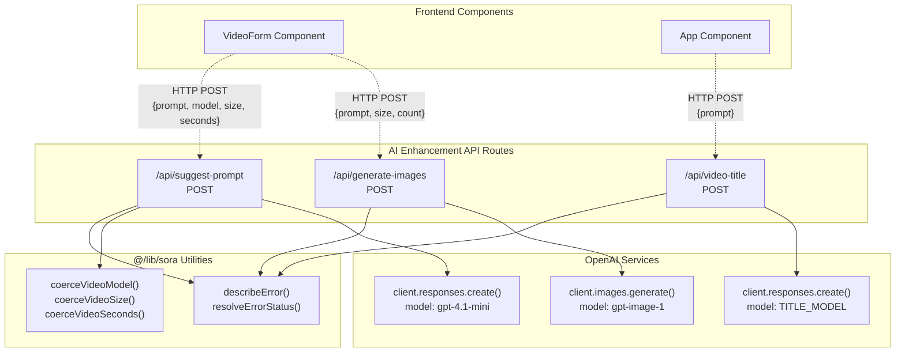
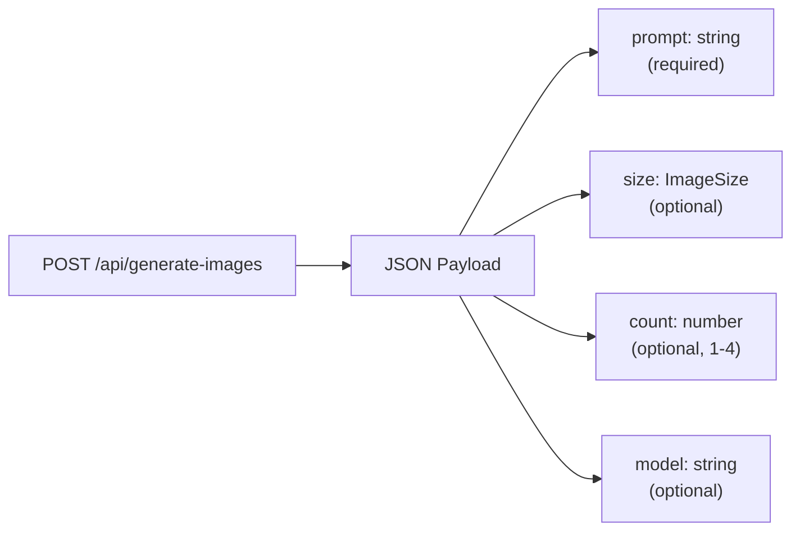
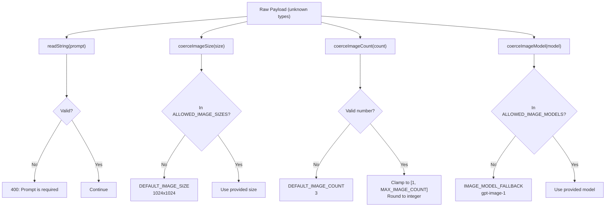
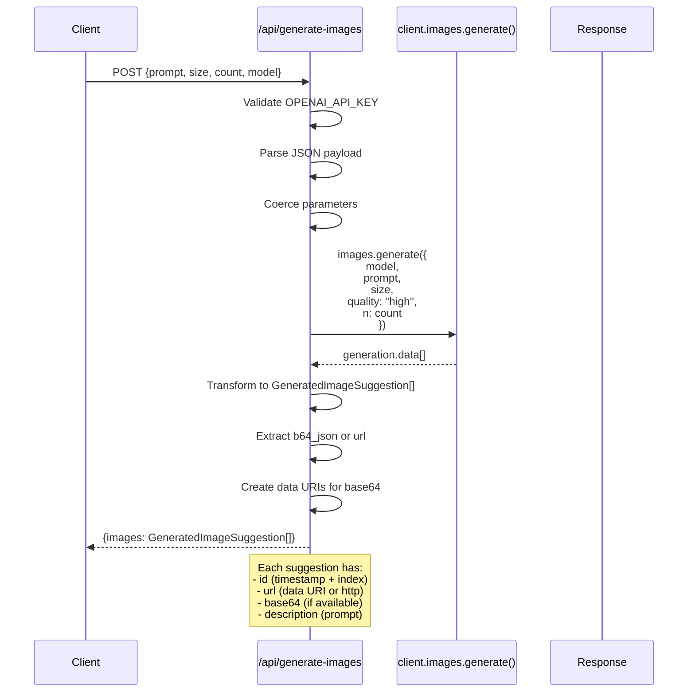
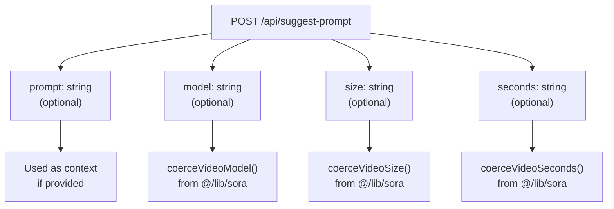
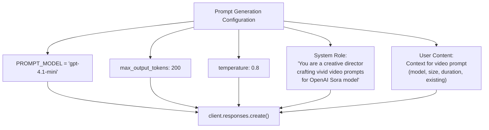
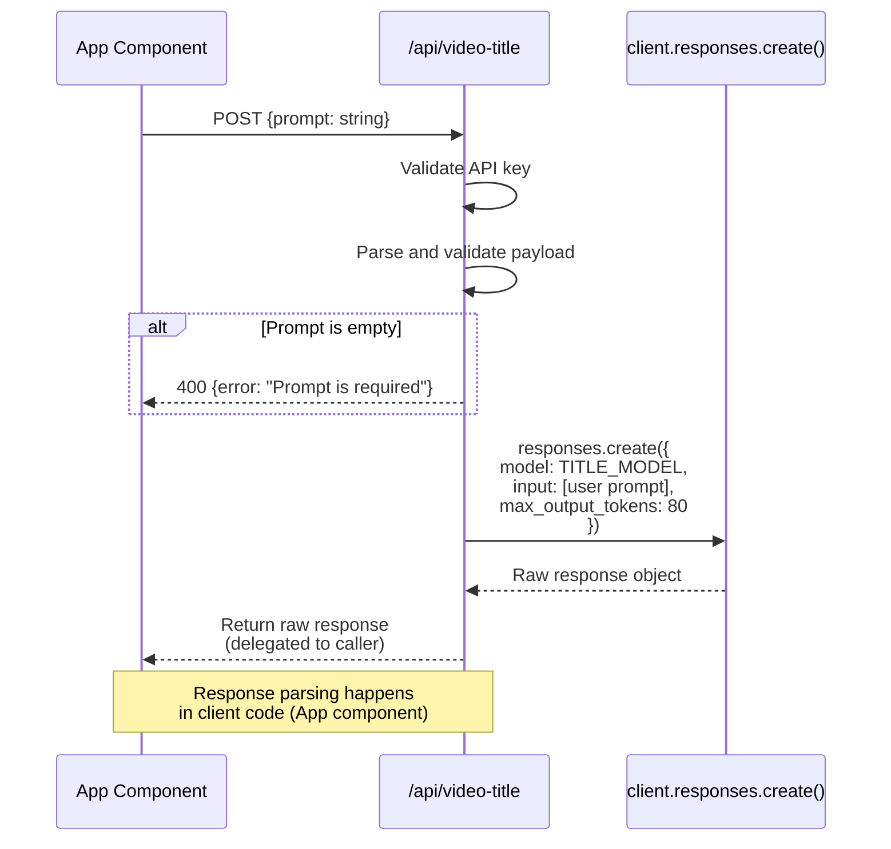
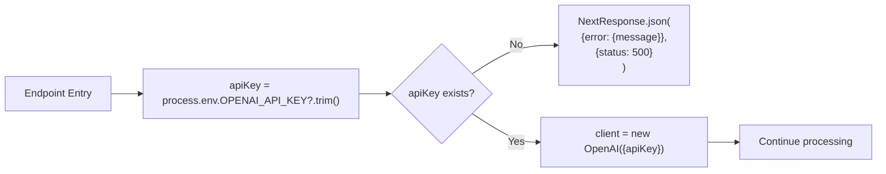
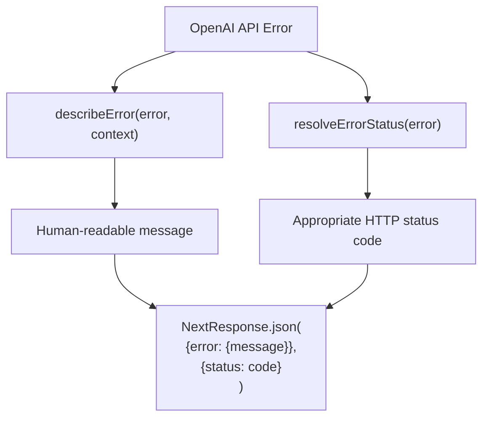
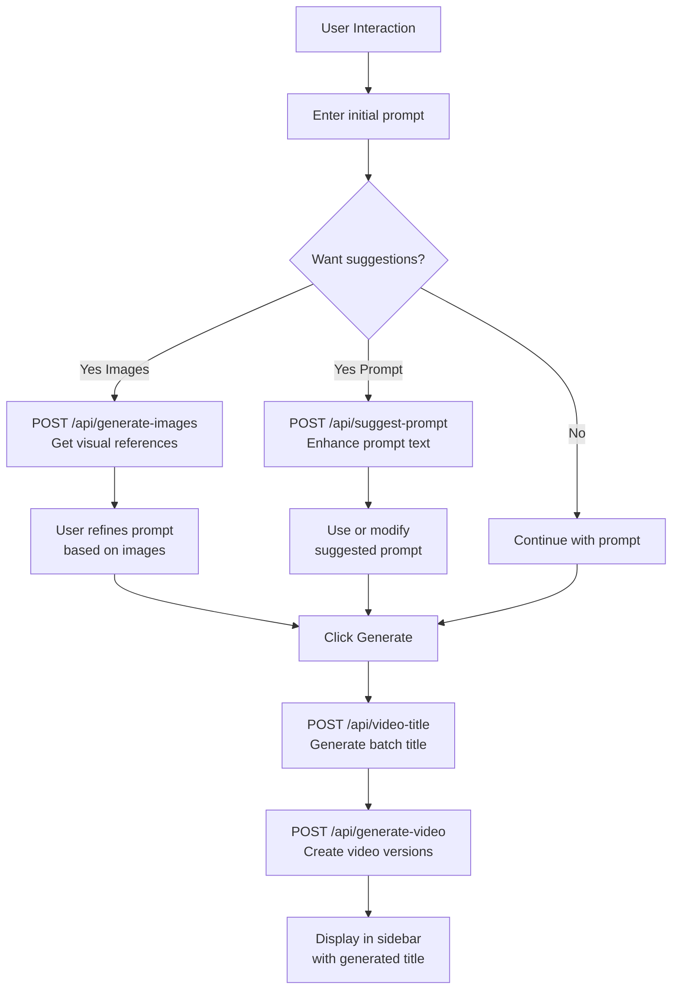

<!-- source: DeepWiki mcp.deepwiki.com · repo openai/openai-sora-sample-app · page 5.4 AI Enhancement Endpoints · fetched 2026-10-26 -->

# AI Enhancement Endpoints

<details>
<summary>Relevant source files</summary>

The following files were used as context for generating this wiki page:

- [app/api/generate-images/route.ts](app/api/generate-images/route.ts)
- [app/api/suggest-prompt/route.ts](app/api/suggest-prompt/route.ts)
- [app/api/video-title/route.ts](app/api/video-title/route.ts)

</details>


## Purpose and Scope

This document describes the three AI enhancement endpoints that provide auxiliary AI capabilities to improve the video creation experience. These endpoints use OpenAI's image and text generation models to assist users with prompt refinement, visual suggestions, and content titling. 

For core video generation functionality, see [Video Generation Endpoint](#5.1) and [Video Remix Endpoint](#5.2). For video status polling and content retrieval, see [Video Retrieval Endpoints](#5.3).

## Overview

The application provides three enhancement endpoints that leverage different OpenAI models:

| Endpoint | Model | Purpose | Output |
|----------|-------|---------|--------|
| `/api/generate-images` | `gpt-image-1` | Generate visual suggestions based on prompts | Array of base64-encoded or URL images |
| `/api/suggest-prompt` | `gpt-4.1-mini` | Optimize and enhance user prompts | Text suggestion for video prompt |
| `/api/video-title` | `gpt-4.1-mini` (via `TITLE_MODEL`) | Generate reel-style titles | Short video title text |

All three endpoints follow the standard API route pattern: validate API key, parse input, call external service, normalize response, handle errors. They integrate with different OpenAI service categories to provide complementary features to the core video generation workflow.

**Sources:** [app/api/generate-images/route.ts:1-135](), [app/api/suggest-prompt/route.ts:1-135](), [app/api/video-title/route.ts:1-59]()

## Endpoint Integration Architecture



**Sources:** [app/api/generate-images/route.ts:72-135](), [app/api/suggest-prompt/route.ts:63-135](), [app/api/video-title/route.ts:6-59]()

## Generate Images Endpoint

### Purpose

The `/api/generate-images` endpoint generates visual suggestions to help users visualize and refine their video prompts. It uses OpenAI's `gpt-image-1` model to create high-quality images based on the user's text description.

**Sources:** [app/api/generate-images/route.ts:1-135]()

### Request Structure



**Payload Schema:**

| Field | Type | Default | Validation | Description |
|-------|------|---------|------------|-------------|
| `prompt` | `string` | *required* | Non-empty string | Text description for image generation |
| `size` | `ImageSize` | `"1024x1024"` | Must be in `ALLOWED_IMAGE_SIZES` | Output image dimensions |
| `count` | `number` | `3` | `1` to `MAX_IMAGE_COUNT` (4) | Number of images to generate |
| `model` | `string` | `"gpt-image-1"` | Must be in `ALLOWED_IMAGE_MODELS` | Image generation model |

**Sources:** [app/api/generate-images/route.ts:6-30]()

### Validation and Coercion

The endpoint uses dedicated coercion functions to safely handle untrusted input:



**Allowed Image Sizes:** `256x256`, `512x512`, `1024x1024`, `1024x1536`, `1536x1024`, `1024x1792`, `1792x1024`, `auto`

**Coercion Functions:**
- `readString()` [app/api/generate-images/route.ts:32-33]() - Extracts and trims string values
- `readNumber()` [app/api/generate-images/route.ts:35-46]() - Parses numeric values from strings or numbers
- `coerceImageCount()` [app/api/generate-images/route.ts:48-54]() - Clamps count to valid range
- `coerceImageModel()` [app/api/generate-images/route.ts:56-61]() - Validates against whitelist
- `coerceImageSize()` [app/api/generate-images/route.ts:63-70]() - Validates size parameter

**Sources:** [app/api/generate-images/route.ts:6-70]()

### Image Generation Flow



**Sources:** [app/api/generate-images/route.ts:103-129]()

### Response Transformation

The endpoint transforms OpenAI's image generation response into a normalized `GeneratedImageSuggestion[]` array:

**Transformation Logic [app/api/generate-images/route.ts:112-127]():**

1. Iterate through `generation.data` entries
2. Extract `b64_json` or fallback to `url` field
3. If `b64_json` exists, construct data URI: `data:image/png;base64,${base64}`
4. Generate unique ID: `generated-${Date.now()}-${index}`
5. Attach original `prompt` as `description`
6. Filter out entries without valid URL or base64 data

**Response Type:**

```typescript
{
  images: Array<{
    id: string;           // "generated-{timestamp}-{index}"
    url: string;          // Data URI or HTTP URL
    base64: string | null; // Base64 string if available
    description: string;   // Original prompt
  }>
}
```

**Sources:** [app/api/generate-images/route.ts:112-129]()

### Error Handling

The endpoint uses centralized error utilities from `@/lib/sora`:

| Error Scenario | Status Code | Response |
|----------------|-------------|----------|
| Missing `OPENAI_API_KEY` | 500 | `{error: {message: "OPENAI_API_KEY is not configured"}}` |
| Invalid JSON payload | 400 | `{error: {message: "Invalid JSON payload"}}` |
| Missing prompt | 400 | `{error: {message: "Prompt is required"}}` |
| OpenAI API error | Variable | `{error: {message: describeError(...)}}` |

The `resolveErrorStatus()` function maps OpenAI error types to appropriate HTTP status codes, while `describeError()` provides human-readable error messages.

**Sources:** [app/api/generate-images/route.ts:72-89](), [app/api/generate-images/route.ts:130-134]()

## Suggest Prompt Endpoint

### Purpose

The `/api/suggest-prompt` endpoint uses `gpt-4.1-mini` to optimize and enhance user-provided prompts, taking into account the target video model, size, and duration parameters. It acts as a creative director to generate more vivid and effective video prompts.

**Sources:** [app/api/suggest-prompt/route.ts:1-135]()

### Request Structure



**Sources:** [app/api/suggest-prompt/route.ts:13-22](), [app/api/suggest-prompt/route.ts:79-92]()

### Context Building

The endpoint constructs context for the prompt suggestion by gathering video generation parameters:

**Context Structure [app/api/suggest-prompt/route.ts:84-92]():**

```
Target model: {coerced_model}
Frame size: {coerced_size}
Duration: {coerced_seconds} seconds
[Existing prompt: {existing_prompt}]  // Only if provided
```

This context is passed to the AI model to generate prompts optimized for the specific video generation parameters.

**Coercion Functions from `@/lib/sora`:**
- `coerceVideoModel()` - Validates and coerces video model selection
- `coerceVideoSize()` - Validates frame dimensions
- `coerceVideoSeconds()` - Validates and coerces duration

**Sources:** [app/api/suggest-prompt/route.ts:4-9](), [app/api/suggest-prompt/route.ts:80-88]()

### AI Model Configuration



**API Call Structure [app/api/suggest-prompt/route.ts:95-119]():**

- **Model:** `gpt-4.1-mini` (constant)
- **Max Output Tokens:** 200
- **Temperature:** 0.8 (encourages creative variation)
- **System Role:** Positions AI as creative director for Sora prompts
- **User Input:** Formatted context with video parameters

**Sources:** [app/api/suggest-prompt/route.ts:11-119]()

### Response Extraction

The endpoint uses a flexible response extraction strategy to handle various OpenAI response formats:

```mermaid
graph TB
    Response["OpenAI Response"]
    
    Response --> Extract["extractTextFromResponse()"]
    
    Extract --> Check1{Has output_text?}
    Check1 -->|Yes| Join1["Join array items"]
    Check1 -->|No| Check2{Has output?}
    
    Check2 -->|Yes| Gather1["gatherText(output)"]
    Check2 -->|No| Check3{Has choices[0]?}
    
    Check3 -->|Yes| Gather2["gatherText(choices[0].message.content)"]
    Check3 -->|No| Check4{Has text or result?}
    
    Check4 -->|Yes| Gather3["gatherText(text or result)"]
    Check4 -->|No| Empty["Return empty string"]
    
    Join1 --> Result["Extracted Text"]
    Gather1 --> Result
    Gather2 --> Result
    Gather3 --> Result
    Empty --> Result
```

**Extraction Functions:**
- `gatherText()` [app/api/suggest-prompt/route.ts:23-40]() - Recursively extracts text from nested objects
- `extractTextFromResponse()` [app/api/suggest-prompt/route.ts:42-61]() - Tries multiple response format patterns

The extraction handles various response shapes:
- `{ output_text: string[] }` - Array of text segments
- `{ output: any }` - Generic output field
- `{ choices: [{message: {content: any}}] }` - Standard chat completion format
- `{ text: any }` or `{ result: any }` - Alternative formats

**Sources:** [app/api/suggest-prompt/route.ts:23-61](), [app/api/suggest-prompt/route.ts:121-127]()

### Response Format

**Success Response:**

```json
{
  "prompt": "A cinematic shot of..."
}
```

**Error Responses:**

| Scenario | Status | Response |
|----------|--------|----------|
| Empty suggestion | 502 | `{error: {message: "Prompt suggestion unavailable. Try again."}}` |
| API key missing | 500 | `{error: {message: "OPENAI_API_KEY is not configured"}}` |
| Invalid JSON | 400 | `{error: {message: "Invalid JSON payload"}}` |
| OpenAI error | Variable | `{error: {message: describeError(...)}}` |

**Sources:** [app/api/suggest-prompt/route.ts:121-134]()

## Video Title Endpoint

### Purpose

The `/api/video-title` endpoint generates short, reel-style titles for videos based on their prompts. It uses the `TITLE_MODEL` (referenced from `@/utils/titles`) to create engaging titles suitable for social media sharing.

**Sources:** [app/api/video-title/route.ts:1-59]()

### Request and Response Flow



**Sources:** [app/api/video-title/route.ts:6-59]()

### Implementation Details

**Request Validation [app/api/video-title/route.ts:15-34]():**

1. Parse incoming JSON payload
2. Extract `prompt` field and trim whitespace
3. Verify prompt is non-empty string
4. Return 400 error if validation fails

**API Call Configuration [app/api/video-title/route.ts:36-51]():**

- **Model:** `TITLE_MODEL` (imported from `@/utils/titles`)
- **Max Output Tokens:** 80 (short titles only)
- **Prompt Template:** `"Propose a short reel-style title for this video prompt (don't include quotes around the title): {prompt}"`
- **Role:** User role (no system prompt)

**Key Difference from Other Endpoints:**

This endpoint returns the raw OpenAI response object without parsing or normalization. The calling code (App component) is responsible for extracting the title text using the same `extractTextFromResponse()` pattern or similar logic.

**Sources:** [app/api/video-title/route.ts:36-53]()

### Error Handling

Standard error handling pattern:

| Error Type | Status Code | Message Source |
|------------|-------------|----------------|
| Missing API key | 500 | `"OPENAI_API_KEY is not configured"` |
| Invalid JSON | 400 | `"Invalid JSON payload"` |
| Missing prompt | 400 | `"Prompt is required"` |
| OpenAI API error | Variable | `describeError(error, "Failed to generate title")` |

**Sources:** [app/api/video-title/route.ts:6-11](), [app/api/video-title/route.ts:15-23](), [app/api/video-title/route.ts:29-34](), [app/api/video-title/route.ts:54-58]()

## Common Patterns

### API Key Validation

All three endpoints share identical API key validation logic:



**Implementation locations:**
- [app/api/generate-images/route.ts:73-79]()
- [app/api/suggest-prompt/route.ts:64-70]()
- [app/api/video-title/route.ts:7-13]()

**Sources:** All three route files

### Request Parsing Pattern

Standard JSON parsing with error handling:

```typescript
let payload: <PayloadType>;
try {
  payload = (await request.json()) as <PayloadType>;
} catch {
  return NextResponse.json(
    { error: { message: "Invalid JSON payload" } },
    { status: 400 }
  );
}
```

**Implementation locations:**
- [app/api/generate-images/route.ts:81-89]()
- [app/api/suggest-prompt/route.ts:72-76]()
- [app/api/video-title/route.ts:15-23]()

**Sources:** All three route files

### Error Response Structure

All endpoints use centralized error handling from `@/lib/sora`:



**Shared utilities:**
- `describeError()` - Converts errors to user-friendly messages
- `resolveErrorStatus()` - Maps error types to HTTP status codes

**Sources:** [app/api/generate-images/route.ts:3](), [app/api/suggest-prompt/route.ts:3-9](), [app/api/video-title/route.ts:3]()

### Client Instantiation

All endpoints create OpenAI client instances identically:

```typescript
const client = new OpenAI({ apiKey });
```

This pattern ensures consistent authentication and configuration across all AI service integrations.

**Sources:** [app/api/generate-images/route.ts:79](), [app/api/suggest-prompt/route.ts:70](), [app/api/video-title/route.ts:13]()

## Integration with Video Workflow



**Integration Points:**

1. **Image Suggestions:** Called from `VideoForm` when user requests visual ideas
2. **Prompt Enhancement:** Called from `VideoForm` when user requests prompt optimization
3. **Title Generation:** Called from `App.handleCreateVideo()` before batch video creation

**Sources:** Overall architecture understanding from diagrams

## Usage Recommendations

### Generate Images

**Best Practices:**
- Use descriptive prompts for better image suggestions
- Request 3-4 images for variety
- Match `size` parameter to target video size for consistency
- Images are returned as data URIs (base64) for immediate display

**Use Cases:**
- Visual brainstorming before video creation
- Reference images for complex scene descriptions
- Style exploration for artistic prompts

**Sources:** [app/api/generate-images/route.ts:1-135]()

### Suggest Prompt

**Best Practices:**
- Provide existing prompt as context for refinement
- Include target video parameters (model, size, duration) for optimized suggestions
- Use suggested prompts as starting points, not final versions
- Higher temperature (0.8) encourages creative variations

**Use Cases:**
- Improving vague or generic prompts
- Adapting prompts for different video durations
- Learning effective prompt structures
- Generating alternative prompt ideas

**Sources:** [app/api/suggest-prompt/route.ts:1-135]()

### Video Title

**Best Practices:**
- Generate titles after prompt finalization
- Titles are optimized for short-form content (reel-style)
- 80 token limit ensures concise output
- Used primarily for batch generation identification

**Use Cases:**
- Automatic naming of video batches
- Consistent title format across multiple versions
- Social media-friendly title generation

**Sources:** [app/api/video-title/route.ts:1-59]()

---

