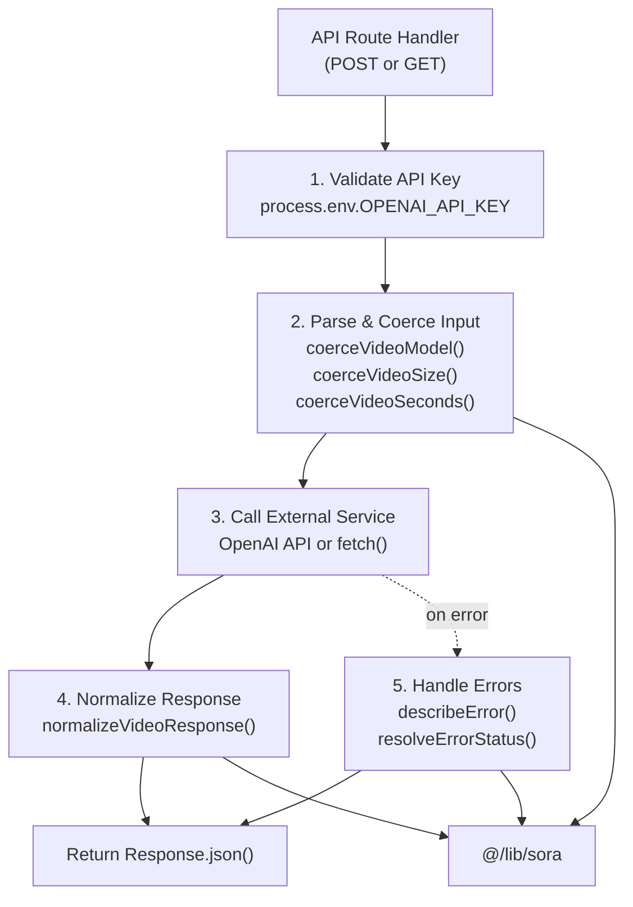
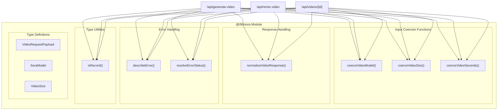
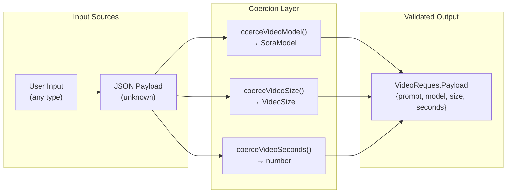
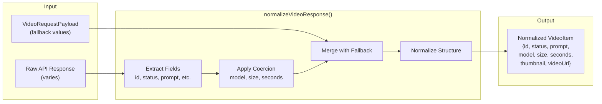
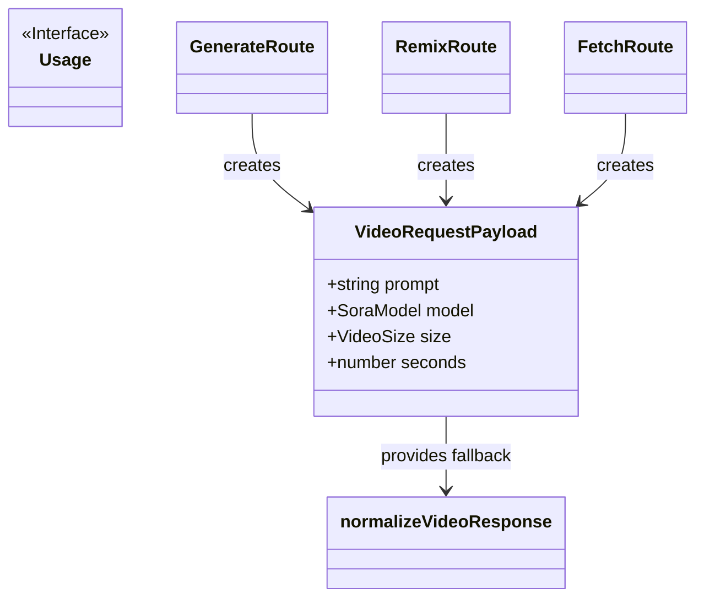
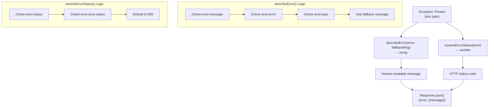
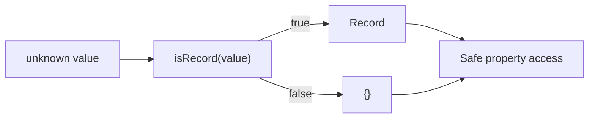
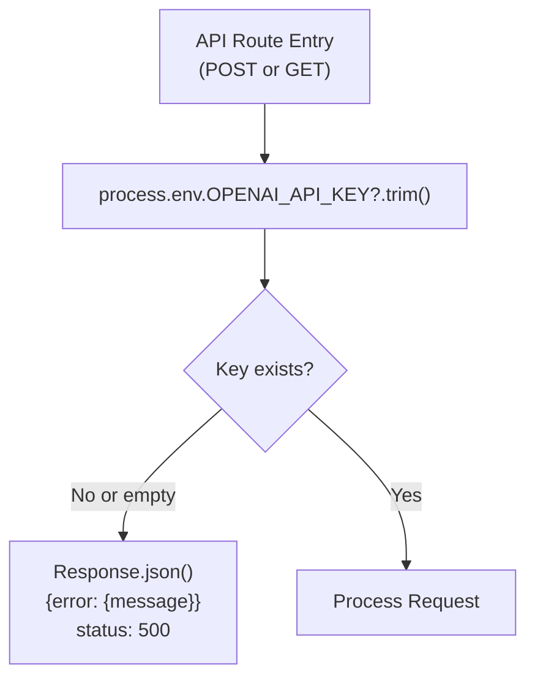

<!-- source: DeepWiki mcp.deepwiki.com · repo openai/openai-sora-sample-app · page 6 Shared Utilities & Patterns · fetched 2026-10-26 -->

# Shared Utilities & Patterns

<details>
<summary>Relevant source files</summary>

The following files were used as context for generating this wiki page:

- [app/api/generate-video/route.ts](app/api/generate-video/route.ts)
- [app/api/remix-video/route.ts](app/api/remix-video/route.ts)
- [app/api/videos/[id]/route.ts](app/api/videos/[id]/route.ts)

</details>


## Purpose & Scope

This document covers the shared utilities, helper functions, and common patterns used throughout the Sora Sample App. The primary focus is on the `@/lib/sora` module, which provides centralized utilities for input coercion, response normalization, and error handling that are used consistently across all API routes.

For details on specific API endpoints, see [API Layer](#5). For information on type definitions and data structures used in the application, see [Type Definitions & Data Structures](#6.2). For focused coverage of error handling, see [Error Handling Patterns](#6.3).

## Common API Route Pattern

All API routes in the application follow an identical five-step pattern, enabled by shared utilities from `@/lib/sora`:



**Sources:** [app/api/generate-video/route.ts:1-143](), [app/api/remix-video/route.ts:1-59](), [app/api/videos/[id]/route.ts:1-65]()

### Pattern Implementation Example

The following table shows how the three main video-related API routes implement this pattern:

| Step | `/api/generate-video` | `/api/remix-video` | `/api/videos/[id]` |
|------|---------------------|-------------------|-------------------|
| **1. Validate API Key** | Lines 21-25 | Lines 14-18 | Lines 17-21 |
| **2. Parse & Coerce** | Lines 37-56 (prompt, model, size, seconds) | Lines 29-46 (videoId, prompt, model, size, seconds) | Lines 25-56 (id, prompt from response) |
| **3. Call Service** | Lines 68-122 (fetch with FormData or JSON) | Line 49 (OpenAI SDK `post`) | Line 35 (OpenAI SDK `get`) |
| **4. Normalize** | Line 135 | Line 52 | Line 58 |
| **5. Error Handling** | Lines 126-142 | Lines 55-58 | Lines 61-64 |

**Sources:** [app/api/generate-video/route.ts:1-143](), [app/api/remix-video/route.ts:1-59](), [app/api/videos/[id]/route.ts:1-65]()

## The @/lib/sora Module Organization

The `@/lib/sora` module serves as a centralized library of utilities for working with video generation APIs. All API routes import from this module to ensure consistent data handling.



**Sources:** [app/api/generate-video/route.ts:2-11](), [app/api/remix-video/route.ts:2-11](), [app/api/videos/[id]/route.ts:2-11]()

## Input Coercion Functions

Input coercion functions transform untrusted or loosely-typed input values into validated, strongly-typed values with sensible defaults. This approach provides both safety and user-friendliness by accepting various input formats while ensuring type safety.

### Coercion Pipeline



**Sources:** [app/api/generate-video/route.ts:48-56](), [app/api/remix-video/route.ts:41-46](), [app/api/videos/[id]/route.ts:43-56]()

### Coercion Function Usage

Each coercion function is called with a nullable string input and returns a validated value:

| Function | Input Type | Output Type | Default | Purpose |
|----------|-----------|-------------|---------|---------|
| `coerceVideoModel()` | `string \| null` | `SoraModel` | (first valid model) | Validates and normalizes video model names |
| `coerceVideoSize()` | `string \| null` | `VideoSize` | (first valid size) | Validates video dimensions (e.g., "1920x1080") |
| `coerceVideoSeconds()` | `string \| null` | `number` | (default duration) | Validates and parses video duration |

**Example Usage in `/api/generate-video`:**

```typescript
const model = coerceVideoModel(
  typeof payload.model === "string" ? payload.model : null
);
const size = coerceVideoSize(
  typeof payload.size === "string" ? payload.size : null
);
const seconds = coerceVideoSeconds(
  payload.seconds != null ? String(payload.seconds) : null
);
```

**Sources:** [app/api/generate-video/route.ts:48-56]()

## Response Normalization

The `normalizeVideoResponse()` function ensures that responses from the OpenAI API are transformed into a consistent shape expected by the frontend, regardless of variations in the API response format.



**Sources:** [app/api/generate-video/route.ts:135](), [app/api/remix-video/route.ts:52](), [app/api/videos/[id]/route.ts:58]()

### Normalization Strategy

The normalization function serves three purposes:

1. **Field Extraction**: Extracts relevant fields from the raw API response
2. **Type Coercion**: Applies coercion functions to ensure type safety
3. **Fallback Values**: Uses the `VideoRequestPayload` fallback when fields are missing from the response

**Usage Pattern:**
```typescript
const videoPayload: VideoRequestPayload = {
  prompt,
  model,
  size,
  seconds,
};

// After API call
const normalized = normalizeVideoResponse(result, videoPayload);
return Response.json(normalized);
```

**Sources:** [app/api/generate-video/route.ts:60-65](), [app/api/generate-video/route.ts:135-136]()

## Type Definitions

### VideoRequestPayload

The `VideoRequestPayload` type represents the validated parameters for video generation requests:



**Sources:** [app/api/generate-video/route.ts:10](), [app/api/remix-video/route.ts:10](), [app/api/videos/[id]/route.ts:10]()

### Type Usage in API Routes

All three video API routes construct a `VideoRequestPayload` object to pass to `normalizeVideoResponse()` as fallback values:

**Generate Video Route:**
```typescript
const videoPayload: VideoRequestPayload = {
  prompt,
  model,
  size,
  seconds,
};
```
[app/api/generate-video/route.ts:60-65]()

**Remix Video Route:**
```typescript
const fallback: VideoRequestPayload = {
  prompt,
  model: coerceVideoModel(typeof payload.model === "string" ? payload.model : null),
  size: coerceVideoSize(typeof payload.size === "string" ? payload.size : null),
  seconds: coerceVideoSeconds(payload.seconds != null ? String(payload.seconds) : null),
};
```
[app/api/remix-video/route.ts:41-46]()

**Fetch Video Route:**
```typescript
const fallback: VideoRequestPayload = {
  prompt,
  model: coerceVideoModel(
    typeof videoRecord.model === "string" ? videoRecord.model : null
  ),
  size: coerceVideoSize(
    typeof videoRecord.size === "string" ? videoRecord.size : null
  ),
  seconds: coerceVideoSeconds(
    videoRecord.seconds !== undefined && videoRecord.seconds !== null
      ? String(videoRecord.seconds)
      : null
  ),
};
```
[app/api/videos/[id]/route.ts:43-56]()

## Error Handling Utilities

The `@/lib/sora` module provides two complementary error handling utilities used in all API routes' catch blocks.

### Error Handling Flow



**Sources:** [app/api/generate-video/route.ts:126-142](), [app/api/remix-video/route.ts:54-58](), [app/api/videos/[id]/route.ts:60-64]()

### Error Handling Pattern

All API routes follow this pattern in their catch blocks:

```typescript
catch (error) {
  const message = describeError(error, "Failed to [action]");
  const status = resolveErrorStatus(error);
  return Response.json({ error: { message } }, { status });
}
```

**Examples:**

| Route | Fallback Message | Source |
|-------|------------------|--------|
| `/api/generate-video` | "Failed to create video" | [Line 126]() and [Line 139]() |
| `/api/remix-video` | "Failed to remix video" | [Line 55]() |
| `/api/videos/[id]` | "Failed to fetch video" | [Line 61]() |

**Sources:** [app/api/generate-video/route.ts:126](), [app/api/generate-video/route.ts:139](), [app/api/remix-video/route.ts:55](), [app/api/videos/[id]/route.ts:61]()

### describeError() Function

The `describeError()` function extracts human-readable error messages from various error shapes:

**Inspection Order:**
1. `error.message` (standard Error object)
2. `error.error.message` (OpenAI SDK error structure)
3. `error.type` (alternative error format)
4. Fallback message (provided by caller)

**Usage:**
```typescript
const message = describeError(result, "Failed to create video");
```
[app/api/generate-video/route.ts:126]()

### resolveErrorStatus() Function

The `resolveErrorStatus()` function determines the appropriate HTTP status code for error responses:

**Inspection Order:**
1. `error.status` (direct status code)
2. `error.error.status` (nested status code)
3. Default to `500` (Internal Server Error)

**Usage:**
```typescript
const status = resolveErrorStatus(error);
return Response.json({ error: { message } }, { status });
```
[app/api/generate-video/route.ts:140-141]()

## Utility Functions

### isRecord() Type Guard

The `isRecord()` function is a type guard that safely checks if a value is a non-null object (record type). It's used throughout the codebase to validate unknown payloads before property access.



**Usage Pattern:**
```typescript
let rawPayload: unknown;
try {
  rawPayload = await request.json();
} catch {
  return Response.json(
    { error: { message: "Invalid JSON payload" } },
    { status: 400 }
  );
}

const payload = isRecord(rawPayload) ? rawPayload : {};
```

**Sources:** [app/api/generate-video/route.ts:27-37](), [app/api/remix-video/route.ts:22-29](), [app/api/videos/[id]/route.ts:36]()

### Property Access After isRecord()

Once a value is validated with `isRecord()`, properties can be safely accessed with type checking:

```typescript
const payload = isRecord(rawPayload) ? rawPayload : {};

const prompt =
  typeof payload.prompt === "string" ? payload.prompt.trim() : "";
const model = coerceVideoModel(
  typeof payload.model === "string" ? payload.model : null
);
```

**Sources:** [app/api/generate-video/route.ts:37-50]()

## Environment Variable Validation

All API routes validate the `OPENAI_API_KEY` environment variable before processing requests:



**Standard Pattern:**
```typescript
export async function POST(request: Request) {
  const apiKey = process.env.OPENAI_API_KEY?.trim();
  if (!apiKey) {
    const message = "OPENAI_API_KEY is not configured";
    return Response.json({ error: { message } }, { status: 500 });
  }
  
  // ... rest of route logic
}
```

**Sources:** [app/api/generate-video/route.ts:21-25](), [app/api/remix-video/route.ts:14-18](), [app/api/videos/[id]/route.ts:17-21]()

### Additional Environment Variables

The `/api/generate-video` route also supports optional organization and project ID headers:

```typescript
const organization = process.env.OPENAI_ORG_ID?.trim();
if (organization) {
  headers["OpenAI-Organization"] = organization;
}
const project = process.env.OPENAI_PROJECT_ID?.trim();
if (project) {
  headers["OpenAI-Project"] = project;
}
```

**Sources:** [app/api/generate-video/route.ts:75-82]()

## Summary

The shared utilities and patterns documented here provide the foundation for consistent, safe, and maintainable API route implementations:

| Pattern | Purpose | Key Functions |
|---------|---------|---------------|
| **Input Coercion** | Transform untrusted inputs to typed values | `coerceVideoModel()`, `coerceVideoSize()`, `coerceVideoSeconds()` |
| **Response Normalization** | Ensure consistent response shape | `normalizeVideoResponse()` |
| **Error Handling** | Extract human-readable messages and HTTP status codes | `describeError()`, `resolveErrorStatus()` |
| **Type Safety** | Validate object types before property access | `isRecord()` |
| **Environment Validation** | Ensure required API keys are configured | Direct `process.env` checks |

By centralizing these utilities in the `@/lib/sora` module, the codebase achieves:
- **Consistency**: All API routes follow identical patterns
- **Type Safety**: Coercion functions ensure valid types throughout the request pipeline
- **Error Resilience**: Standardized error handling provides clear feedback to clients
- **Maintainability**: Changes to shared logic only need to be made in one place

**Sources:** [app/api/generate-video/route.ts:1-143](), [app/api/remix-video/route.ts:1-59](), [app/api/videos/[id]/route.ts:1-65]()

---

