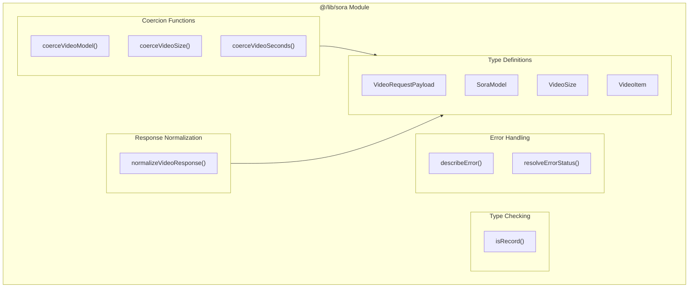
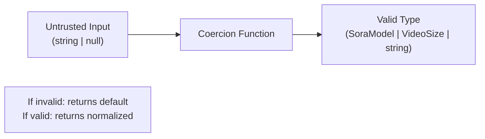
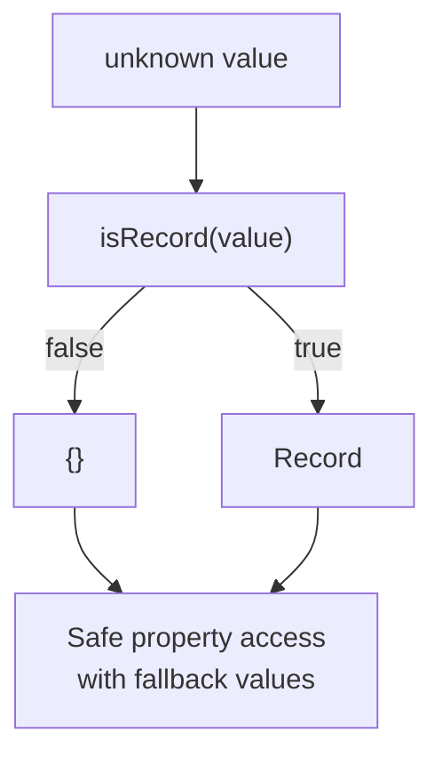
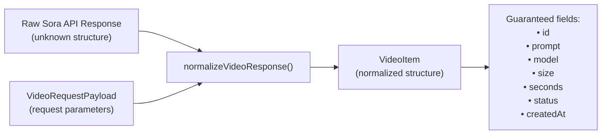
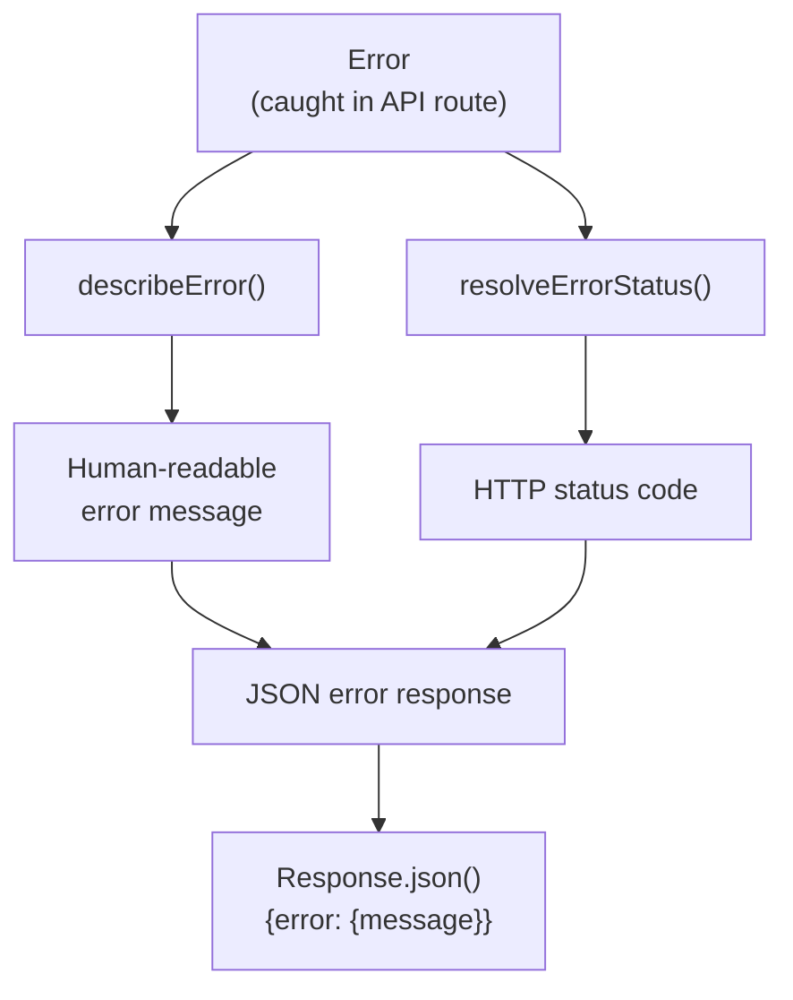
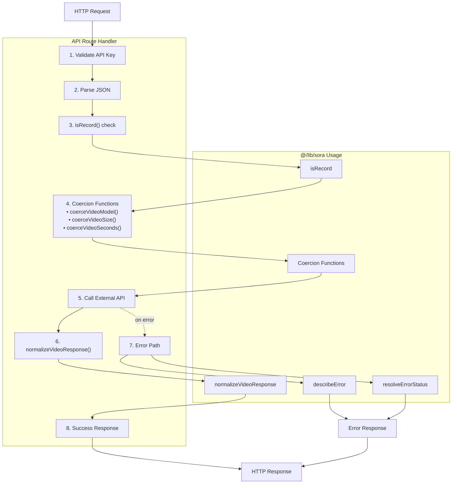

<!-- source: DeepWiki mcp.deepwiki.com · repo openai/openai-sora-sample-app · page 6.1 Sora Utility Library · fetched 2026-10-26 -->

# Sora Utility Library

<details>
<summary>Relevant source files</summary>

The following files were used as context for generating this wiki page:

- [app/api/generate-video/route.ts](app/api/generate-video/route.ts)
- [app/api/remix-video/route.ts](app/api/remix-video/route.ts)
- [app/api/suggest-prompt/route.ts](app/api/suggest-prompt/route.ts)
- [app/api/videos/[id]/route.ts](app/api/videos/[id]/route.ts)

</details>


The `@/lib/sora` module provides a centralized collection of utilities for data coercion, validation, normalization, and error handling used across all API routes. This library ensures consistent request parameter validation, response formatting, and error messaging throughout the API layer, eliminating duplication and enforcing uniform behavior across video generation, remix, and retrieval endpoints.

For information about how API routes use these utilities, see [API Layer](#5). For type definitions in detail, see [Type Definitions & Data Structures](#6.2). For error handling patterns, see [Error Handling Patterns](#6.3).

## Library Structure

The `@/lib/sora` module exports three categories of utilities that work together to provide a complete data validation and transformation pipeline:



**Sources:** [app/api/generate-video/route.ts:2-11](), [app/api/remix-video/route.ts:2-11](), [app/api/suggest-prompt/route.ts:3-9](), [app/api/videos/[id]/route.ts:2-11]()

## Coercion Functions

The coercion functions validate and normalize untrusted input values, converting them to valid types with sensible defaults. These functions are essential for handling user input and ensuring API requests contain valid parameters.

### Function Overview

| Function | Purpose | Return Type | Default Value |
|----------|---------|-------------|---------------|
| `coerceVideoModel()` | Validates and normalizes video model identifier | `SoraModel` | Platform-specific default model |
| `coerceVideoSize()` | Validates and normalizes video resolution | `VideoSize` | Platform-specific default size |
| `coerceVideoSeconds()` | Validates and normalizes video duration | `string` | Platform-specific default duration |

### Usage Pattern

All API routes that accept video generation parameters follow this pattern:



**Example Usage in generate-video:**

[app/api/generate-video/route.ts:48-56]() demonstrates the standard coercion pattern:
- Line 48-50: `coerceVideoModel()` validates model parameter
- Line 51-53: `coerceVideoSize()` validates size parameter
- Line 54-56: `coerceVideoSeconds()` validates duration parameter

Each function receives a nullable string and returns a guaranteed-valid value, eliminating the need for null checks in downstream code.

**Example Usage in remix-video:**

[app/api/remix-video/route.ts:41-46]() shows coercion used as fallback values:
- The `fallback` object uses all three coercion functions
- These provide default values when the remix response lacks parameter information

**Example Usage in suggest-prompt:**

[app/api/suggest-prompt/route.ts:80-82]() demonstrates coercion for context building:
- Coerced values populate context lines for the AI prompt
- Ensures consistent model/size/duration strings regardless of input quality

**Sources:** [app/api/generate-video/route.ts:48-56](), [app/api/remix-video/route.ts:41-46](), [app/api/suggest-prompt/route.ts:80-82](), [app/api/videos/[id]/route.ts:43-56]()

## Type Checking Utilities

### `isRecord()` Function

The `isRecord()` utility provides runtime type checking to safely handle unknown JSON payloads. It returns `true` if the value is a non-null object (excluding arrays), enabling safe property access without type assertions.



**Usage in generate-video:**

[app/api/generate-video/route.ts:37]() uses `isRecord()` to safely convert parsed JSON:
```typescript
const payload = isRecord(rawPayload) ? rawPayload : {};
```

This pattern ensures that even if JSON parsing succeeds but returns an unexpected type (like an array or primitive), the code can safely access properties with proper fallback handling.

**Usage in remix-video:**

[app/api/remix-video/route.ts:29]() follows the same pattern for request payload validation.

**Usage in videos/[id]:**

[app/api/videos/[id]/route.ts:36]() applies `isRecord()` to the Sora API response before extracting video metadata.

**Sources:** [app/api/generate-video/route.ts:37](), [app/api/remix-video/route.ts:29](), [app/api/videos/[id]/route.ts:36]()

## Response Normalization

### `normalizeVideoResponse()` Function

The `normalizeVideoResponse()` function transforms raw Sora API responses into a consistent `VideoItem` structure used throughout the application. It accepts two parameters:

1. **response**: The raw video object from the Sora API
2. **fallback**: A `VideoRequestPayload` containing default values for missing fields



### Normalization Strategy

The function employs a multi-stage fallback strategy to handle incomplete or malformed API responses:

1. **Primary**: Extract values from the raw response
2. **Secondary**: Use fallback payload values if response fields are missing
3. **Tertiary**: Apply coercion functions to ensure valid types
4. **Final**: Use sensible defaults for critical fields

**Usage in generate-video:**

[app/api/generate-video/route.ts:135-136]() normalizes the video creation response:
- The `videoPayload` object serves as the fallback
- Contains the exact parameters sent in the request
- Ensures client receives back at least what it sent

**Usage in remix-video:**

[app/api/remix-video/route.ts:52]() normalizes remix responses using request parameters as fallback.

**Usage in videos/[id]:**

[app/api/videos/[id]/route.ts:43-59]() demonstrates sophisticated fallback construction:
- Lines 38-41: Extracts prompt from response
- Lines 43-56: Builds `fallback` object using coercion functions on response fields
- Line 58: Normalizes with constructed fallback

This approach ensures that even if the Sora API response omits certain fields, the client receives a complete `VideoItem` with all required properties.

**Sources:** [app/api/generate-video/route.ts:135-136](), [app/api/remix-video/route.ts:52](), [app/api/videos/[id]/route.ts:58]()

## Error Handling

The library provides two complementary error handling utilities that work together to produce consistent error responses across all API routes.

### Error Handling Flow



### `describeError()` Function

Extracts or generates human-readable error messages from various error types. Accepts two parameters:

1. **error**: The error value (can be any type)
2. **fallbackMessage**: Default message if error cannot be described

The function handles multiple error shapes:
- OpenAI SDK errors with structured error objects
- Fetch API errors with response bodies
- Standard JavaScript Error objects
- Raw string errors
- Unknown error types

**Usage Pattern:**

All API routes use `describeError()` in their catch blocks:

[app/api/generate-video/route.ts:126]() in the success path error handler:
```typescript
const message = describeError(result, "Failed to create video");
```

[app/api/generate-video/route.ts:139]() in the catch block:
```typescript
const message = describeError(error, "Failed to create video");
```

[app/api/remix-video/route.ts:55](), [app/api/suggest-prompt/route.ts:131](), [app/api/videos/[id]/route.ts:61]() all follow identical patterns.

### `resolveErrorStatus()` Function

Determines the appropriate HTTP status code for an error. Returns standard HTTP codes based on error type:
- `400` for validation errors
- `401` for authentication errors
- `429` for rate limiting
- `500` for server errors
- `502` for upstream service failures

**Usage Pattern:**

Every API route pairs `resolveErrorStatus()` with `describeError()`:

[app/api/generate-video/route.ts:127-132]() demonstrates status resolution with fallback:
```typescript
const derivedStatus = result ? resolveErrorStatus(result) : undefined;
const status = typeof derivedStatus === "number" && derivedStatus > 0
  ? derivedStatus
  : response.status || 500;
```

[app/api/generate-video/route.ts:140]() shows the standard pattern:
```typescript
const status = resolveErrorStatus(error);
```

[app/api/remix-video/route.ts:56](), [app/api/suggest-prompt/route.ts:132](), [app/api/videos/[id]/route.ts:62]() use the same pattern.

### Error Response Structure

All API routes return errors in a consistent format:

```typescript
{
  error: {
    message: string  // From describeError()
  }
}
```

With HTTP status code from `resolveErrorStatus()`.

**Sources:** [app/api/generate-video/route.ts:126-141](), [app/api/remix-video/route.ts:54-58](), [app/api/suggest-prompt/route.ts:130-134](), [app/api/videos/[id]/route.ts:60-64]()

## Type Definitions

The library exports TypeScript types that define the structure of video-related data throughout the application.

### `VideoRequestPayload`

Represents the parameters used to create or remix a video:

```typescript
{
  prompt: string
  model: SoraModel
  size: VideoSize
  seconds: string
}
```

This type appears in:
- [app/api/generate-video/route.ts:10,60-65]() - imported and used for payload construction
- [app/api/remix-video/route.ts:10,41-46]() - imported and used for fallback construction
- [app/api/videos/[id]/route.ts:10,43-56]() - imported and used for fallback construction

### Additional Types

The library likely exports additional types referenced in the imports but not explicitly visible in the provided files:

| Type | Likely Purpose |
|------|----------------|
| `SoraModel` | Union type of valid Sora model identifiers |
| `VideoSize` | Union type of valid video resolutions |
| `VideoItem` | Complete video object structure with metadata and status |

**Sources:** [app/api/generate-video/route.ts:10](), [app/api/remix-video/route.ts:10](), [app/api/videos/[id]/route.ts:10]()

## Integration Across API Routes

All API routes follow a standardized pattern that leverages the Sora utility library at every stage:



### Route-by-Route Library Usage

| Route | Coercion | Type Check | Normalization | Error Handling |
|-------|----------|------------|---------------|----------------|
| `/api/generate-video` | Lines 48-56 | Line 37 | Line 135 | Lines 126, 139-140 |
| `/api/remix-video` | Lines 43-46 | Line 29 | Line 52 | Lines 55-56 |
| `/api/suggest-prompt` | Lines 80-82 | N/A | N/A | Lines 131-132 |
| `/api/videos/[id]` | Lines 45-55 | Line 36 | Line 58 | Lines 61-62 |

This consistent usage pattern means:
- All routes validate inputs the same way
- All routes format responses identically
- All routes handle errors uniformly
- Adding new routes follows established conventions

**Sources:** [app/api/generate-video/route.ts:37,48-56,126,135,139-140](), [app/api/remix-video/route.ts:29,43-46,52,55-56](), [app/api/suggest-prompt/route.ts:80-82,131-132](), [app/api/videos/[id]/route.ts:36,45-55,58,61-62]()

## Design Principles

The Sora utility library embodies several key design principles:

### 1. Type Safety Through Coercion

Rather than rejecting invalid inputs, coercion functions transform them into valid values. This approach:
- Reduces request failures due to minor input variations
- Provides sensible defaults for optional parameters
- Simplifies API route logic by eliminating defensive checks

### 2. Defensive Response Handling

The `normalizeVideoResponse()` function with fallback parameters ensures the application can handle:
- Incomplete API responses
- API version changes that add/remove fields
- Transient network issues that corrupt responses

### 3. Centralized Error Translation

By handling error description and status resolution in one place:
- Client receives consistent error messages
- Error handling logic doesn't scatter across routes
- Error message improvements benefit all endpoints simultaneously

### 4. Runtime Type Validation

The `isRecord()` utility enables safe handling of untrusted JSON:
- No unsafe type assertions
- Graceful handling of malformed payloads
- Type-safe property access patterns

**Sources:** [app/api/generate-video/route.ts:2-11,37,48-56,126-141](), [app/api/remix-video/route.ts:2-11,29,43-46,52-58](), [app/api/suggest-prompt/route.ts:3-9,80-82,130-134](), [app/api/videos/[id]/route.ts:2-11,36,43-64]()

---

