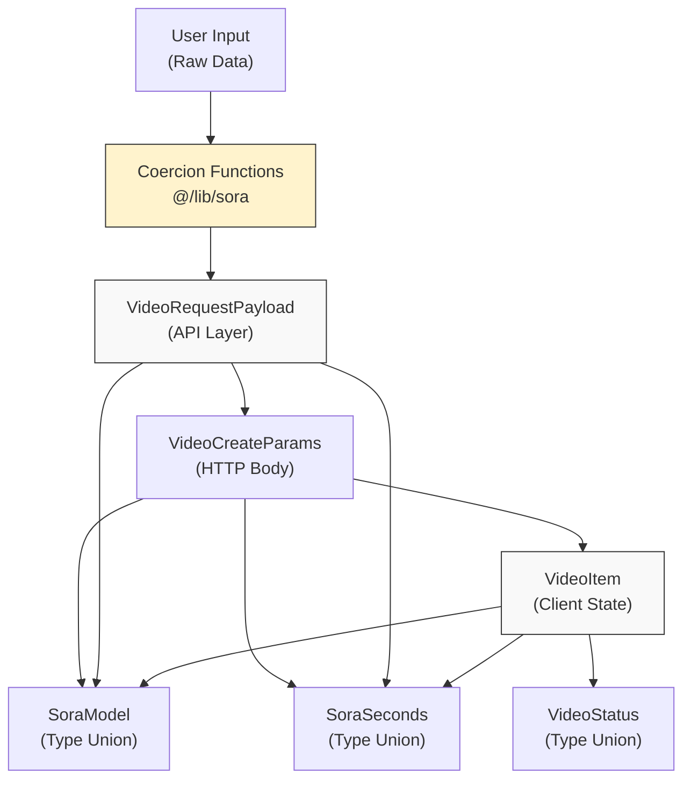
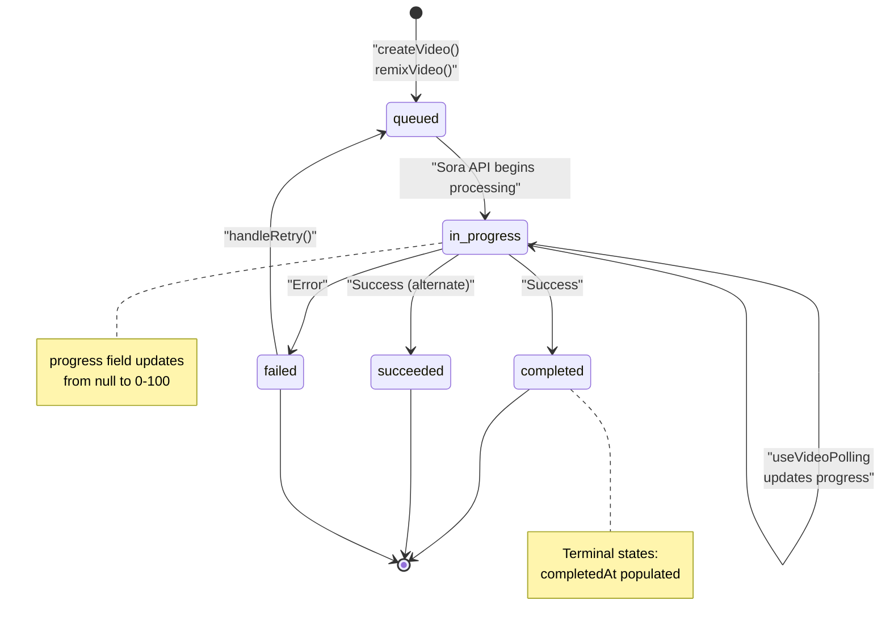
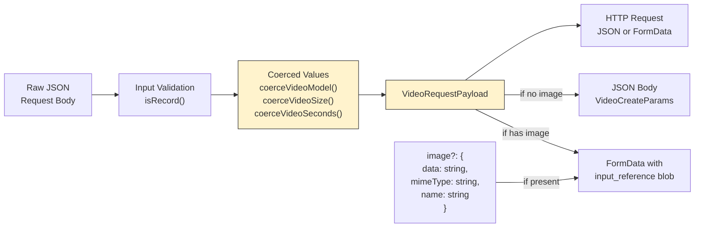
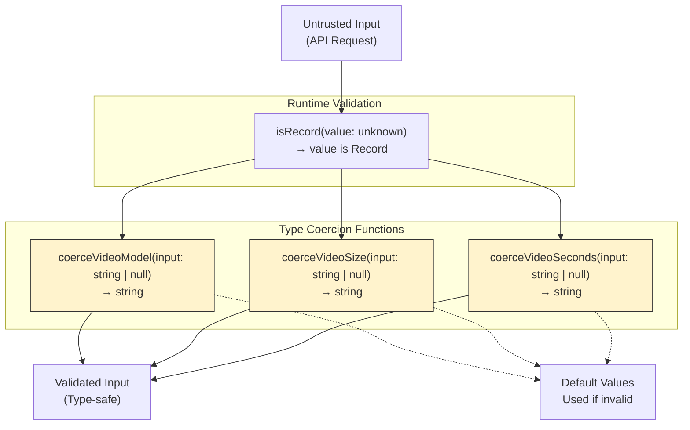
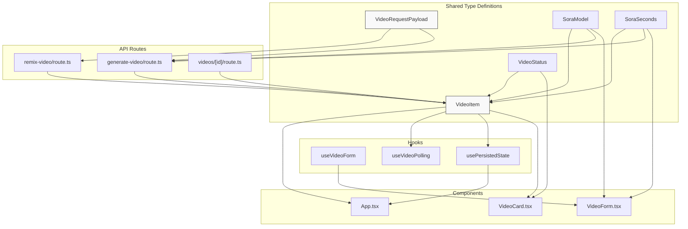

<!-- source: DeepWiki mcp.deepwiki.com · repo openai/openai-sora-sample-app · page 6.2 Type Definitions & Data Structures · fetched 2026-10-26 -->

# Type Definitions & Data Structures

<details>
<summary>Relevant source files</summary>

The following files were used as context for generating this wiki page:

- [app/api/generate-video/route.ts](app/api/generate-video/route.ts)
- [components/VideoCard.tsx](components/VideoCard.tsx)
- [components/VideoForm.tsx](components/VideoForm.tsx)

</details>


This document catalogs the TypeScript types, interfaces, and data structures used throughout the Sora Sample App. These type definitions establish contracts for data exchange between the frontend, API layer, and external services. For information about utility functions that operate on these types, see [Sora Utility Library](#6.1). For error handling structures, see [Error Handling Patterns](#6.3).

## Core Video Data Structures

### VideoItem

The `VideoItem` interface is the central data structure representing a video throughout its lifecycle. It is stored in the client-side state and persisted in localStorage.

**Key Fields:**

| Field | Type | Purpose |
|-------|------|---------|
| `id` | `string` | Unique video identifier from Sora API |
| `status` | `VideoStatus` | Current processing status (`queued`, `in_progress`, `completed`, `failed`) |
| `prompt` | `string` | Text description used to generate the video |
| `model` | `string` | Sora model used (e.g., `sora-1.0-turbo`) |
| `size` | `string` | Video dimensions (e.g., `1920x1080`) |
| `seconds` | `string` | Duration in seconds |
| `title` | `string \| null` | Generated or user-provided title |
| `remixId` | `string \| null` | ID of source video if this is a remix |
| `createdAt` | `string` | ISO timestamp of creation |
| `completedAt` | `string \| null` | ISO timestamp of completion |
| `progress` | `number \| null` | Progress percentage (0-100) for `in_progress` status |
| `error` | `unknown` | Error information if status is `failed` |
| `downloaded` | `boolean` | Whether user has downloaded this video |

**Sources:** [components/VideoCard.tsx:24](), [components/utils/video.ts]()

### VideoRequestPayload

The `VideoRequestPayload` interface defines the normalized structure sent to external video generation APIs. It is constructed after input coercion in API routes.

```typescript
type VideoRequestPayload = {
  prompt: string;
  model: string;
  size: string;
  seconds: string;
}
```

This structure is used internally by API routes after validating and coercing user input. The actual HTTP requests may vary (JSON or FormData) but are normalized to this shape for processing.

**Sources:** [app/api/generate-video/route.ts:10](), [app/api/generate-video/route.ts:60-65]()

### Type Relationships Diagram



**Sources:** [app/api/generate-video/route.ts:2-11](), [components/VideoCard.tsx:20-26]()

## Video Configuration Types

### SoraModel

The `SoraModel` type represents available Sora video generation models. This is typically a string literal union type defining valid model identifiers.

```typescript
type SoraModel = "sora-1.0-turbo" | /* other models */
```

Used in:
- `VideoForm` component for model selection
- API routes for validation via `coerceVideoModel`
- `VideoItem` to record which model generated the video

**Sources:** [components/VideoForm.tsx:36](), [app/api/generate-video/route.ts:3]()

### SoraSeconds

The `SoraSeconds` type defines valid video duration values. It constrains the available duration options.

```typescript
type SoraSeconds = "5" | "10" | /* other durations */
```

The `SECONDS_OPTIONS` constant provides the list of available values for UI selection.

**Sources:** [components/VideoForm.tsx:34-38](), [app/api/generate-video/route.ts:4]()

### SizeOptionGroups

The `SizeOptionGroups` interface organizes video dimensions by orientation:

```typescript
type SizeOptionGroups = {
  portrait: string[];
  landscape: string[];
}
```

This structure supports the grouped size selection UI in `VideoForm`, where sizes are displayed under "Portrait" and "Landscape" categories.

**Sources:** [components/VideoForm.tsx:35](), [components/VideoForm.tsx:180-197]()

### VideoCreateParams

The `VideoCreateParams` type defines the JSON body structure for video creation requests:

```typescript
type VideoCreateParams = {
  prompt: string;
  model: string;
  size: string;
  seconds: string;
}
```

This is the HTTP request body format when creating videos without an image reference. When an image is included, the request uses FormData instead.

**Sources:** [app/api/generate-video/route.ts:13-18](), [app/api/generate-video/route.ts:111-116]()

## Status & Lifecycle Types

### VideoStatus

The `VideoStatus` type defines the possible states of a video throughout its lifecycle:

```typescript
type VideoStatus = 
  | "queued"
  | "in_progress" 
  | "completed"
  | "succeeded"
  | "failed"
```

Status progression:
1. `queued` - Video creation request accepted, waiting to process
2. `in_progress` - Video is actively being generated
3. `completed` / `succeeded` - Video generation finished successfully (terminal states)
4. `failed` - Video generation encountered an error (terminal state)

Helper functions check status categories:
- `isCompletedStatus(status)` - Returns `true` for `completed` or `succeeded`
- `isFailedStatus(status)` - Returns `true` for `failed`

**Sources:** [components/VideoCard.tsx:25](), [components/VideoCard.tsx:59-84]()

### Status State Machine



**Sources:** [components/VideoCard.tsx:59-100](), [components/VideoCard.tsx:162-238]()

## UI Support Types

### ImagePreviewMeta

The `ImagePreviewMeta` interface contains metadata about uploaded or generated images used as input references:

```typescript
type ImagePreviewMeta = {
  name: string;
  width: number;
  height: number;
}
```

This data is displayed in the `VideoForm` below the image preview thumbnail, showing the filename and dimensions.

**Sources:** [components/VideoForm.tsx:39](), [components/VideoForm.tsx:302-307]()

### GeneratedImageSuggestion

The `GeneratedImageSuggestion` interface represents AI-generated image options created from a text prompt:

```typescript
type GeneratedImageSuggestion = {
  id: string;
  url: string;
  description?: string;
}
```

These suggestions are generated via the `/api/generate-images` endpoint using the gpt-image-1 model and displayed as selectable options in the `VideoForm`.

**Sources:** [components/VideoForm.tsx:40](), [components/VideoForm.tsx:122-125](), [components/VideoForm.tsx:561-601]()

### BatchProgressState

The `BatchProgressState` interface tracks progress when generating multiple video versions:

```typescript
type BatchProgressState = {
  total: number;
  current: number;
}
```

Used to display "Generating version X of Y..." feedback during batch operations initiated by the `versionsCount` parameter.

**Sources:** [components/VideoForm.tsx:97-100](), [components/VideoForm.tsx:603-611]()

## API Request/Response Structures

### Request Flow with Types



**Sources:** [app/api/generate-video/route.ts:20-66](), [app/api/generate-video/route.ts:84-122]()

### Image Input Structure

When an image is provided as input reference, the request includes:

```typescript
type ImageInputData = {
  data: string;        // Base64-encoded image data
  mimeType?: string;   // MIME type (defaults to "image/png")
  name?: string;       // Filename (defaults to "input-reference")
}
```

This structure is parsed from the request payload and converted to a Blob for FormData submission to the Sora API.

**Sources:** [app/api/generate-video/route.ts:58](), [app/api/generate-video/route.ts:85-102]()

### Response Normalization

API responses from external services are normalized to the `VideoItem` structure:

```typescript
function normalizeVideoResponse(
  result: unknown, 
  payload: VideoRequestPayload
): VideoItem
```

This function in `@/lib/sora` transforms external API responses into the consistent `VideoItem` shape used throughout the client application.

**Sources:** [app/api/generate-video/route.ts:8](), [app/api/generate-video/route.ts:135]()

## Type Coercion Pattern

### Coercion Function Signatures



**Sources:** [app/api/generate-video/route.ts:2-11](), [app/api/generate-video/route.ts:48-56]()

All coercion functions follow a defensive pattern: they accept nullable strings, validate against known values, and return safe defaults if validation fails. This ensures API routes never pass invalid data to external services.

## Component Prop Types

### VideoCardProps

The `VideoCardProps` interface defines the contract between the `VideoCard` component and its parent:

```typescript
interface VideoCardProps {
  item: VideoItem;
  thumbnailUrl?: string;
  onDownload: (item: VideoItem) => AsyncMaybe;
  onPlayPreview: (item: VideoItem) => AsyncMaybe;
  onRemix: (item: VideoItem) => AsyncMaybe;
  onRetry: (item: VideoItem) => AsyncMaybe;
  onRefresh: (item: VideoItem) => AsyncMaybe;
  onRemove: (item: VideoItem) => AsyncMaybe;
  isRefreshing: boolean;
  isPreviewing: boolean;
  previewLoading: boolean;
}

type AsyncMaybe = void | Promise<unknown>;
```

The `AsyncMaybe` type allows callback handlers to be synchronous or asynchronous, providing flexibility for state updates and API calls.

**Sources:** [components/VideoCard.tsx:28-42]()

### VideoFormProps

The `VideoFormProps` interface defines the extensive contract for the `VideoForm` component:

```typescript
interface VideoFormProps {
  // Form state
  prompt: string;
  model: SoraModel;
  size: string;
  seconds: SoraSeconds;
  versionsCount: number;
  remixId: string;
  
  // Change handlers
  onPromptChange: (value: string) => void;
  onModelChange: (value: SoraModel) => void;
  onSizeChange: (value: string) => void;
  onSecondsChange: (value: SoraSeconds) => void;
  onVersionsCountChange: (value: number) => void;
  onRemixIdChange: (value: string) => void;
  
  // Configuration
  modelOptions: readonly SoraModel[];
  sizeOptionGroups: SizeOptionGroups;
  
  // Image handling
  onImageSelect: (event: ChangeEvent<HTMLInputElement>) => AsyncMaybe;
  imagePreviewUrl: string | null;
  imagePreviewMeta: ImagePreviewMeta | null;
  
  // AI features
  onGenerateImages: () => AsyncMaybe;
  generatingImages: boolean;
  generatedImages: GeneratedImageSuggestion[];
  onSelectGeneratedImage: (image: GeneratedImageSuggestion) => AsyncMaybe;
  selectedGeneratedImageId: string | null;
  generatedImageError: string;
  onGeneratePrompt?: () => AsyncMaybe;
  generatingPrompt?: boolean;
  
  // Submission
  onSubmit: () => AsyncMaybe;
  onClear: () => void;
  submitting: boolean;
  canSubmit: boolean;
  
  // Batch operations
  generatingTitle: boolean;
  currentTitle: string;
  batchProgress: BatchProgressState | null;
  
  // Feature flags
  remixDisabled: boolean;
}
```

**Sources:** [components/VideoForm.tsx:102-136]()

## Type Usage Map



**Sources:** [app/api/generate-video/route.ts](), [components/VideoCard.tsx](), [components/VideoForm.tsx]()

---

