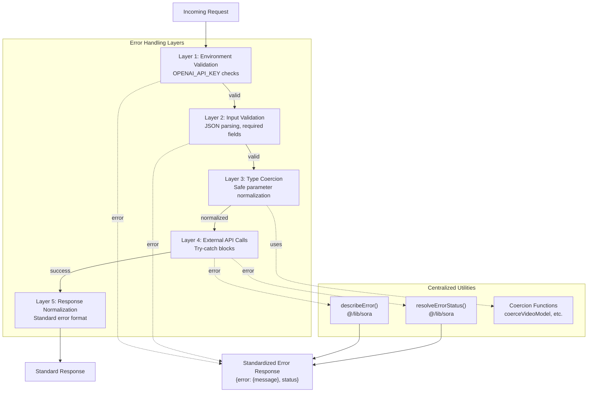
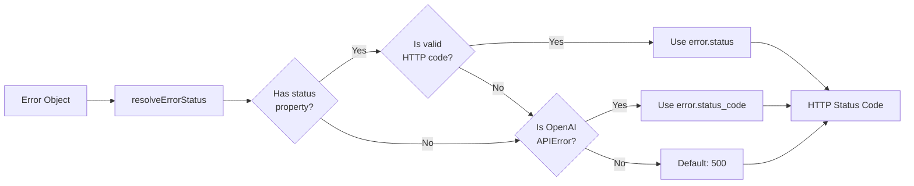
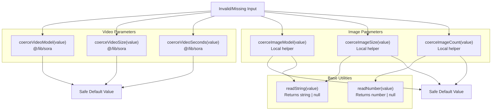
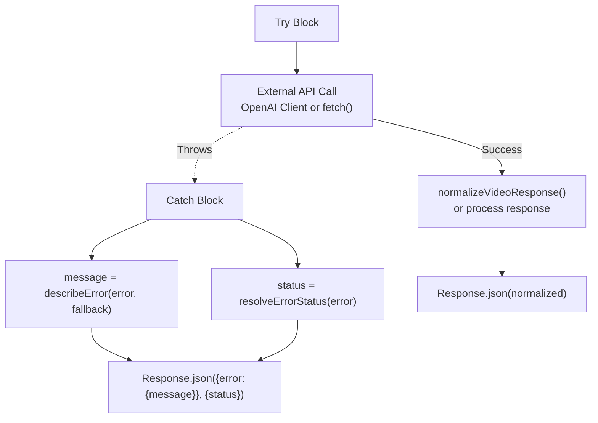
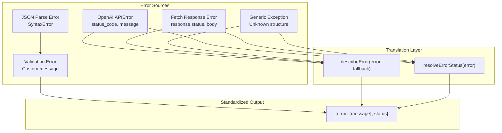

<!-- source: DeepWiki mcp.deepwiki.com · repo openai/openai-sora-sample-app · page 6.3 Error Handling Patterns · fetched 2026-10-26 -->

# Error Handling Patterns

<details>
<summary>Relevant source files</summary>

The following files were used as context for generating this wiki page:

- [app/api/generate-images/route.ts](app/api/generate-images/route.ts)
- [app/api/generate-video/route.ts](app/api/generate-video/route.ts)
- [app/api/remix-video/route.ts](app/api/remix-video/route.ts)
- [app/api/videos/[id]/route.ts](app/api/videos/[id]/route.ts)

</details>


## Purpose and Scope

This document describes the centralized error handling patterns used throughout the Sora Sample App. The system employs a consistent, layered approach to error handling that ensures all API routes return standardized error responses with appropriate HTTP status codes and human-readable messages.

For implementation details of the core error utilities, see [Sora Utility Library](#6.1). For information on how these patterns are applied in specific API endpoints, see [API Layer](#5).

---

## Error Handling Architecture

The application implements a **defense-in-depth** strategy with multiple error handling layers:



**Sources:** [app/api/generate-video/route.ts:20-143](), [app/api/remix-video/route.ts:13-59](), [app/api/videos/[id]/route.ts:13-65](), [app/api/generate-images/route.ts:72-135]()

---

## Centralized Error Utilities

### describeError Function

The `describeError` function extracts human-readable error messages from various error types and provides fallback messages when extraction fails.

**Function Signature:**
```typescript
describeError(error: unknown, fallback: string): string
```

**Usage Pattern Across All Routes:**

| Route | Fallback Message | Line Reference |
|-------|-----------------|----------------|
| `/api/generate-video` | "Failed to create video" | [app/api/generate-video/route.ts:126](), [app/api/generate-video/route.ts:139]() |
| `/api/remix-video` | "Failed to remix video" | [app/api/remix-video/route.ts:55]() |
| `/api/videos/[id]` | "Failed to fetch video" | [app/api/videos/[id]/route.ts:61]() |
| `/api/generate-images` | "Failed to generate images" | [app/api/generate-images/route.ts:131]() |

**Sources:** [app/api/generate-video/route.ts:6](), [app/api/remix-video/route.ts:6](), [app/api/videos/[id]/route.ts:6](), [app/api/generate-images/route.ts:3]()

### resolveErrorStatus Function

The `resolveErrorStatus` function determines the appropriate HTTP status code based on the error type and structure.

**Function Signature:**
```typescript
resolveErrorStatus(error: unknown): number
```

**Default Status Codes:**



**Sources:** [app/api/generate-video/route.ts:9](), [app/api/remix-video/route.ts:9](), [app/api/videos/[id]/route.ts:9](), [app/api/generate-images/route.ts:3]()

---

## Standard Error Response Format

All API routes return errors in a consistent JSON structure:

```typescript
{
  error: {
    message: string
  }
}
```

**HTTP Response Structure:**

| Component | Type | Source | Example |
|-----------|------|--------|---------|
| Body | JSON | `{ error: { message } }` | `{ error: { message: "Prompt is required" } }` |
| Status Code | number | `resolveErrorStatus(error)` | `400`, `500`, etc. |
| Content-Type | string | `application/json` | Auto-set by `Response.json()` |

**Sources:** [app/api/generate-video/route.ts:24](), [app/api/remix-video/route.ts:17](), [app/api/videos/[id]/route.ts:20](), [app/api/generate-images/route.ts:76]()

---

## Error Handling Layers in Detail

### Layer 1: Environment Validation

All routes validate the presence of `OPENAI_API_KEY` before processing requests.

**Pattern:**
```typescript
const apiKey = process.env.OPENAI_API_KEY?.trim();
if (!apiKey) {
  const message = "OPENAI_API_KEY is not configured";
  return Response.json({ error: { message } }, { status: 500 });
}
```

**Occurrences:**
- [app/api/generate-video/route.ts:21-25]()
- [app/api/remix-video/route.ts:14-18]()
- [app/api/videos/[id]/route.ts:17-21]()
- [app/api/generate-images/route.ts:73-77]()

**Sources:** All API route files

### Layer 2: Input Validation

Routes validate JSON payload structure and required fields with specific error messages.

**JSON Parsing Protection:**
```typescript
let rawPayload: unknown;
try {
  rawPayload = await request.json();
} catch {
  return Response.json(
    { error: { message: "Invalid JSON payload" } },
    { status: 400 }
  );
}
```

**Required Field Validation Examples:**

| Route | Required Field | Validation Code | Status |
|-------|----------------|-----------------|--------|
| `generate-video` | `prompt` | [app/api/generate-video/route.ts:39-46]() | 400 |
| `remix-video` | `videoId` | [app/api/remix-video/route.ts:31-34]() | 400 |
| `remix-video` | `prompt` | [app/api/remix-video/route.ts:36-39]() | 400 |
| `videos/[id]` | `id` (param) | [app/api/videos/[id]/route.ts:26-32]() | 400 |
| `generate-images` | `prompt` | [app/api/generate-images/route.ts:91-97]() | 400 |

**Sources:** [app/api/generate-video/route.ts:27-46](), [app/api/remix-video/route.ts:22-39](), [app/api/videos/[id]/route.ts:26-32](), [app/api/generate-images/route.ts:81-97]()

### Layer 3: Type Coercion

Rather than rejecting invalid types, routes use **coercion functions** to normalize inputs to safe defaults.

**Coercion Functions Used:**



**Coercion in Practice:**

| Function | Invalid Input Handling | Example |
|----------|----------------------|---------|
| `coerceVideoModel` | Returns fallback model | [app/api/generate-video/route.ts:48-50]() |
| `coerceVideoSize` | Returns default size | [app/api/generate-video/route.ts:51-53]() |
| `coerceVideoSeconds` | Returns default duration | [app/api/generate-video/route.ts:54-56]() |
| `coerceImageCount` | Clamps to [1, MAX] | [app/api/generate-images/route.ts:48-54]() |
| `coerceImageSize` | Returns default size | [app/api/generate-images/route.ts:63-70]() |

**Key Principle:** Coercion functions **never throw errors**; they always return valid values, preventing type-related failures.

**Sources:** [app/api/generate-video/route.ts:3-6](), [app/api/remix-video/route.ts:3-6](), [app/api/videos/[id]/route.ts:3-6](), [app/api/generate-images/route.ts:32-70]()

### Layer 4: External API Error Handling

All external service calls are wrapped in try-catch blocks that use centralized error utilities.

**Standard Try-Catch Pattern:**



**Implementation Examples:**

**Generate Video Route:**
```typescript
try {
  // External API call at lines 104-122
  const response = await fetch(endpoint, { ... });
  const result = await response.json().catch(() => null);
  
  if (!response.ok || !result) {
    const message = describeError(result, "Failed to create video");
    const status = resolveErrorStatus(result);
    return Response.json({ error: { message } }, { status });
  }
  
  const normalized = normalizeVideoResponse(result, videoPayload);
  return Response.json(normalized);
} catch (error) {
  const message = describeError(error, "Failed to create video");
  const status = resolveErrorStatus(error);
  return Response.json({ error: { message } }, { status });
}
```
[app/api/generate-video/route.ts:67-142]()

**Remix Video Route:**
```typescript
try {
  const video = await client.post(`/videos/${videoId}/remix`, { body: { prompt } });
  const normalized = normalizeVideoResponse(video, fallback);
  return Response.json(normalized);
} catch (error) {
  const message = describeError(error, "Failed to remix video");
  const status = resolveErrorStatus(error);
  return Response.json({ error: { message } }, { status });
}
```
[app/api/remix-video/route.ts:48-59]()

**Sources:** [app/api/generate-video/route.ts:67-142](), [app/api/remix-video/route.ts:48-59](), [app/api/videos/[id]/route.ts:34-64](), [app/api/generate-images/route.ts:103-134]()

### Layer 5: Response Handling

The `generate-video` route demonstrates **dual error handling** for both HTTP errors and catch block errors:

**HTTP Error Response Handling:**
```typescript
const result = await response.json().catch(() => null);
if (!response.ok || !result) {
  const message = describeError(result, "Failed to create video");
  const derivedStatus = result ? resolveErrorStatus(result) : undefined;
  const status = typeof derivedStatus === "number" && derivedStatus > 0
    ? derivedStatus
    : response.status || 500;
  return Response.json({ error: { message } }, { status });
}
```
[app/api/generate-video/route.ts:124-133]()

This pattern:
1. Attempts to parse error body as JSON
2. Falls back to `null` if parsing fails
3. Uses `describeError` to extract message from error body
4. Prioritizes derived status from error body, falls back to HTTP status
5. Defaults to 500 if no valid status is available

**Sources:** [app/api/generate-video/route.ts:124-133]()

---

## Error Source Translation

The system translates errors from multiple sources into consistent responses:

| Error Source | Detection Method | Message Extraction | Status Extraction |
|--------------|------------------|-------------------|------------------|
| OpenAI API Errors | `instanceof OpenAI.APIError` | `error.message` | `error.status_code` |
| Fetch Response Errors | `!response.ok` | Error body or fallback | `response.status` |
| JSON Parse Errors | `try-catch` | Fixed: "Invalid JSON payload" | Fixed: 400 |
| Validation Errors | Explicit checks | Fixed per validation | Fixed: 400 or 500 |
| Generic Exceptions | `catch (error)` | `describeError()` fallback | `resolveErrorStatus()` default |

**Error Translation Flow:**



**Sources:** [app/api/generate-video/route.ts:124-142](), [app/api/remix-video/route.ts:54-58](), [app/api/videos/[id]/route.ts:60-64](), [app/api/generate-images/route.ts:130-134]()

---

## Error Handling Best Practices

The codebase demonstrates several best practices consistently applied across all routes:

### 1. Fail Fast with Early Returns

All validation checks return immediately on failure, avoiding nested conditionals:

```typescript
if (!apiKey) {
  return Response.json({ error: { message: "..." } }, { status: 500 });
}
// Continue with valid apiKey
```

**Sources:** [app/api/generate-video/route.ts:21-25](), [app/api/remix-video/route.ts:14-18]()

### 2. Explicit Error Context

Each catch block provides context-specific fallback messages:

```typescript
catch (error) {
  const message = describeError(error, "Failed to create video");  // Context-specific
  // vs. generic "An error occurred"
}
```

**Sources:** [app/api/generate-video/route.ts:137-142](), [app/api/remix-video/route.ts:54-58]()

### 3. Safe JSON Parsing

JSON parsing failures are caught and converted to 400 errors:

```typescript
try {
  rawPayload = await request.json();
} catch {
  return Response.json(
    { error: { message: "Invalid JSON payload" } },
    { status: 400 }
  );
}
```

**Sources:** [app/api/generate-video/route.ts:27-35](), [app/api/remix-video/route.ts:22-27]()

### 4. Defensive Type Checking

Routes use type guards and coercion rather than assuming types:

```typescript
const payload = isRecord(rawPayload) ? rawPayload : {};
const prompt = typeof payload.prompt === "string" ? payload.prompt.trim() : "";
```

**Sources:** [app/api/generate-video/route.ts:37-40](), [app/api/remix-video/route.ts:29-36]()

### 5. Centralized Utilities Over Duplication

All routes import and use shared error utilities instead of implementing custom error handling:

**Import Pattern:**
```typescript
import {
  describeError,
  resolveErrorStatus,
  // ... other utilities
} from "@/lib/sora";
```

**Sources:** [app/api/generate-video/route.ts:2-11](), [app/api/remix-video/route.ts:1-11](), [app/api/videos/[id]/route.ts:1-11](), [app/api/generate-images/route.ts:3]()

### 6. Logging for Debugging

The `generate-video` route includes console logging in the catch block for debugging server-side errors:

```typescript
catch (error) {
  console.error("generate-video error", error);
  const message = describeError(error, "Failed to create video");
  // ...
}
```

This is the only route that logs errors, suggesting a potential inconsistency or higher priority for debugging video generation failures.

**Sources:** [app/api/generate-video/route.ts:138]()

---

## Summary Table: Error Handling by Route

| Route | Validation Errors | Coercion Used | External Errors | Response Format | 
|-------|------------------|---------------|-----------------|-----------------|
| `/api/generate-video` | API key, JSON, prompt | ✓ (model, size, seconds) | fetch + describeError/resolveErrorStatus | Standard JSON |
| `/api/remix-video` | API key, JSON, videoId, prompt | ✓ (model, size, seconds) | OpenAI client + describeError/resolveErrorStatus | Standard JSON |
| `/api/videos/[id]` | API key, video id | ✓ (model, size, seconds) | OpenAI client + describeError/resolveErrorStatus | Standard JSON |
| `/api/generate-images` | API key, JSON, prompt | ✓ (count, size, model) | OpenAI client + describeError/resolveErrorStatus | Standard JSON |

**Key Insight:** All routes follow the identical error handling pattern, differing only in specific validation requirements and coercion parameters.

**Sources:** All API route files

---

