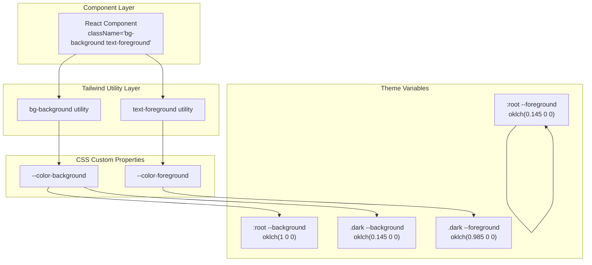
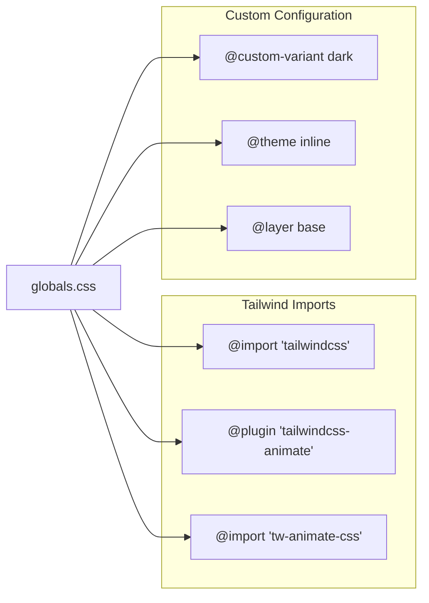
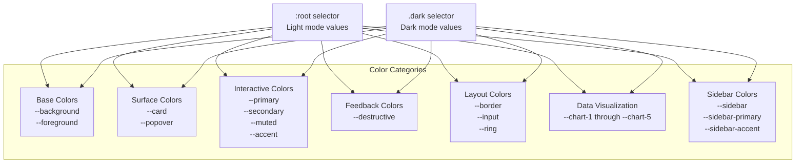
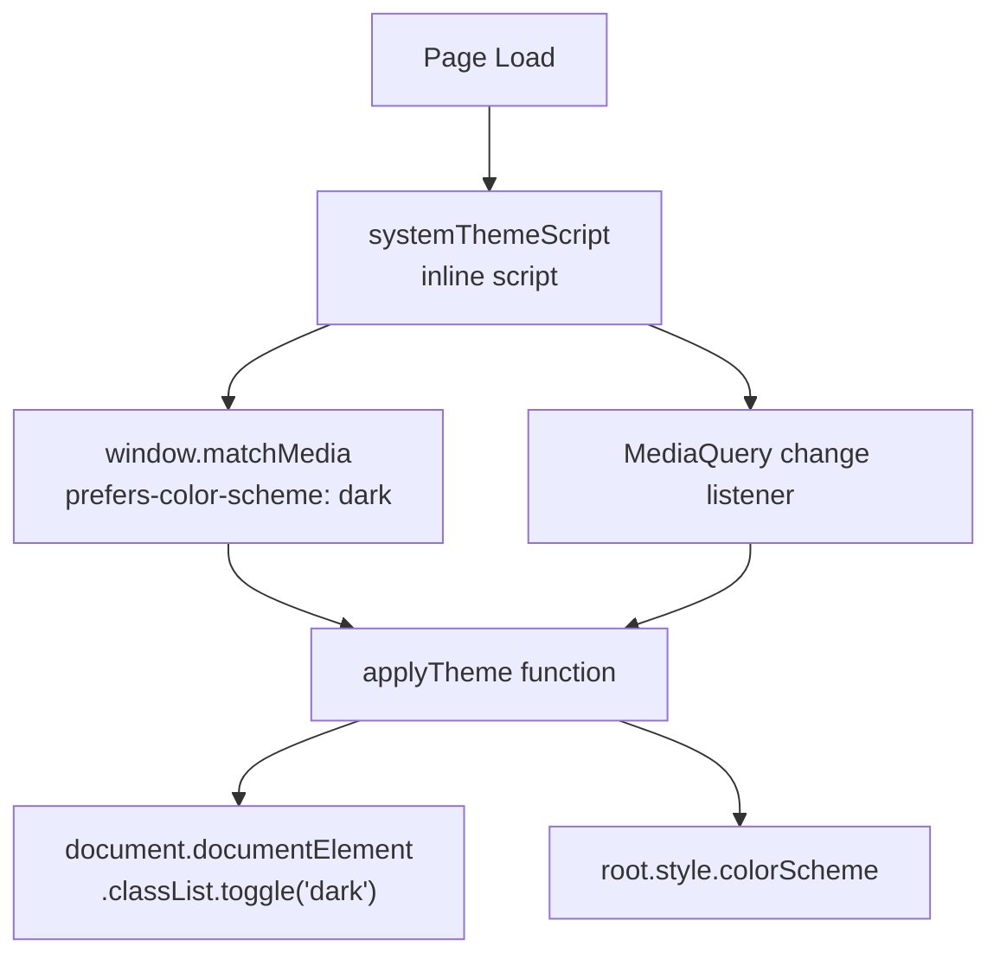
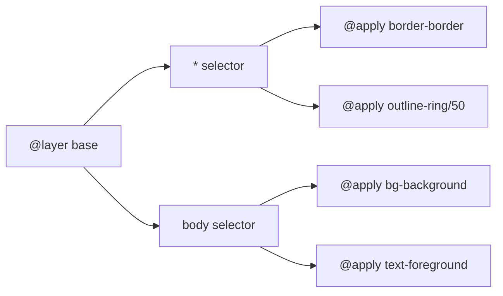
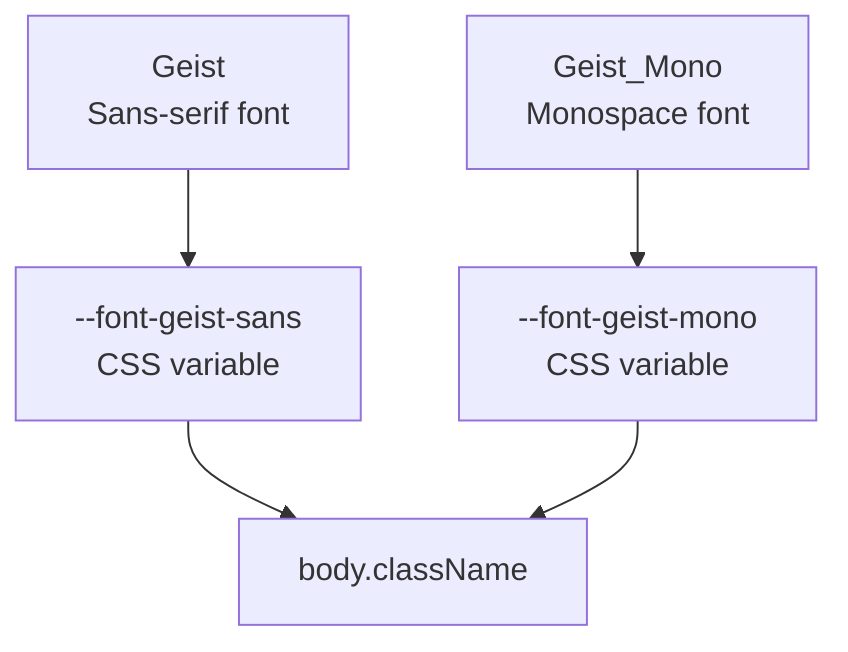

<!-- source: DeepWiki mcp.deepwiki.com · repo openai/openai-sora-sample-app · page 7 Styling & Theming · fetched 2026-10-26 -->

# Styling & Theming

<details>
<summary>Relevant source files</summary>

The following files were used as context for generating this wiki page:

- [app/globals.css](app/globals.css)
- [app/layout.tsx](app/layout.tsx)

</details>


## Purpose and Scope

This document describes the styling and theming architecture of the Sora Sample App. It covers the Tailwind CSS configuration, CSS custom property-based theming system, color palette definitions for light and dark modes, and the runtime theme switching mechanism. For detailed information about the theme system and dark mode switching logic, see [Theme System & Dark Mode](#7.1). For font configuration details, see [Typography & Fonts](#7.2).

## Styling Architecture Overview

The application uses a modern CSS architecture built on three core technologies:

| Technology | Purpose | Configuration Location |
|------------|---------|------------------------|
| Tailwind CSS v4 | Utility-first CSS framework | [app/globals.css:1]() |
| CSS Custom Properties | Theme variable system | [app/globals.css:46-115]() |
| OKLCH Color Space | Color definitions | [app/globals.css:49-114]() |

The styling system follows a layered approach where Tailwind utilities reference CSS custom properties, which in turn reference theme-specific color values. This indirection enables runtime theme switching without recompiling CSS.



**Diagram: CSS Variable Resolution Flow**

Sources: [app/globals.css:1-124]()

## Tailwind CSS Configuration

The application uses Tailwind CSS v4 with several plugins and custom configuration defined in the global stylesheet:



**Diagram: Tailwind CSS Module Structure**

### Custom Dark Mode Variant

The dark mode variant is defined using a custom selector pattern:

[app/globals.css:6]()
```
@custom-variant dark (&:is(.dark *));
```

This configuration ensures that any element with the `dark:` prefix only applies when the element is a descendant of an element with the `.dark` class, enabling scoped dark mode styling.

### Theme Inline Configuration

The `@theme inline` block [app/globals.css:8-44]() maps Tailwind color utilities to CSS custom properties. This creates a bridge between Tailwind's utility classes and the theme variable system:

| Tailwind Utility | CSS Custom Property | Theme Variable |
|-----------------|---------------------|----------------|
| `bg-background` | `--color-background` | `--background` |
| `text-foreground` | `--color-foreground` | `--foreground` |
| `border-border` | `--color-border` | `--border` |
| `bg-primary` | `--color-primary` | `--primary` |
| `text-muted-foreground` | `--color-muted-foreground` | `--muted-foreground` |

Additionally, radius utilities are computed from a base `--radius` variable:
- `--radius-sm`: `calc(var(--radius) - 4px)` (0.225rem)
- `--radius-md`: `calc(var(--radius) - 2px)` (0.425rem)
- `--radius-lg`: `var(--radius)` (0.625rem)
- `--radius-xl`: `calc(var(--radius) + 4px)` (1.025rem)

Sources: [app/globals.css:1-44]()

## CSS Custom Properties System

The theming system defines all color and styling variables as CSS custom properties, organized into semantic categories:



**Diagram: CSS Custom Property Organization**

### Color Palette Structure

All colors are defined using the OKLCH color space, which provides perceptually uniform color manipulation. The format is `oklch(lightness chroma hue)` or `oklch(lightness chroma hue / alpha)`.

**Light Mode Color Palette** (`:root` selector [app/globals.css:46-80]()):

| Variable | Value | Description |
|----------|-------|-------------|
| `--background` | `oklch(1 0 0)` | Pure white background |
| `--foreground` | `oklch(0.145 0 0)` | Near-black text |
| `--primary` | `oklch(0.205 0 0)` | Dark primary action color |
| `--secondary` | `oklch(0.97 0 0)` | Light secondary surfaces |
| `--muted` | `oklch(0.97 0 0)` | Muted background color |
| `--border` | `oklch(0.922 0 0)` | Light gray borders |
| `--destructive` | `oklch(0.577 0.245 27.325)` | Red for destructive actions |

**Dark Mode Color Palette** (`.dark` selector [app/globals.css:82-115]()):

| Variable | Value | Description |
|----------|-------|-------------|
| `--background` | `oklch(0.145 0 0)` | Near-black background |
| `--foreground` | `oklch(0.985 0 0)` | Near-white text |
| `--primary` | `oklch(0.922 0 0)` | Light primary action color |
| `--secondary` | `oklch(0.269 0 0)` | Dark secondary surfaces |
| `--muted` | `oklch(0.269 0 0)` | Muted background color |
| `--border` | `oklch(1 0 0 / 10%)` | Semi-transparent white borders |
| `--destructive` | `oklch(0.704 0.191 22.216)` | Lighter red for dark backgrounds |

Note how the light and dark mode palettes often invert the lightness values (e.g., `--primary` goes from `0.205` to `0.922`), while maintaining semantic meaning.

Sources: [app/globals.css:46-115]()

## Dark Mode Implementation

The dark mode system uses a class-based approach with runtime JavaScript detection of system preferences. The implementation consists of two parts: the theme detection script and the CSS class toggle.

### Runtime Theme Detection Script

The theme detection script is injected inline in the document head to prevent flash of unstyled content (FOUC):



**Diagram: Dark Mode Initialization Flow**

The script [app/layout.tsx:29-39]() performs the following operations:

1. **Query System Preference**: Uses `window.matchMedia('(prefers-color-scheme: dark)')` to detect the system's color scheme preference
2. **Apply Theme Function**: Defines `applyTheme(isDark)` which:
   - Toggles the `.dark` class on `document.documentElement`
   - Sets `root.style.colorScheme` to match the theme
3. **Initial Application**: Immediately applies the theme based on `mediaQuery.matches`
4. **Listen for Changes**: Registers an event listener to respond to system preference changes at runtime

### CSS Class Toggle Mechanism

The `.dark` class triggers all dark mode color overrides [app/globals.css:82-115](). When present on the root `<html>` element, it overrides the `:root` color definitions with dark mode values. The custom variant defined at [app/globals.css:6]() ensures that Tailwind's `dark:` utilities only activate within the `.dark` scope.

### Hydration Suppression

The `<html>` element includes `suppressHydrationWarning` [app/layout.tsx:42]() to prevent React hydration warnings caused by the inline script modifying the DOM before React hydration completes.

Sources: [app/layout.tsx:29-52](), [app/globals.css:6](), [app/globals.css:82-115]()

## Base Layer Styles

The `@layer base` block [app/globals.css:117-124]() applies global styles using Tailwind's `@apply` directive:



**Diagram: Base Layer Style Application**

- **Universal Selector** [app/globals.css:118-120](): Applies `border-border` to set consistent border colors and `outline-ring/50` for focus outlines with 50% opacity
- **Body Selector** [app/globals.css:121-123](): Applies `bg-background` and `text-foreground` to establish the base color scheme for the entire application

Sources: [app/globals.css:117-124]()

## Font Configuration

The application uses two Google Fonts from the Geist family, configured with CSS variables for flexible usage across the codebase:



**Diagram: Font Configuration Flow**

### Font Definitions

Two font instances are created using Next.js's `next/font/google` module [app/layout.tsx:5-13]():

| Font | Variable | Subsets | Usage |
|------|----------|---------|-------|
| `Geist` | `--font-geist-sans` | `["latin"]` | Primary sans-serif text |
| `Geist_Mono` | `--font-geist-mono` | `["latin"]` | Monospace code/technical text |

### Application to Body

Both font variables are applied to the `<body>` element through the `className` prop [app/layout.tsx:44]():

```
className={`${geistSans.variable} ${geistMono.variable} antialiased ...`}
```

The `antialiased` utility applies font smoothing for improved text rendering. Font variables can then be referenced throughout the application using Tailwind's `font-sans` and `font-mono` utilities, or by directly referencing the CSS variables in custom styles.

Sources: [app/layout.tsx:1-53]()

## Integration with Component Styles

The theming system integrates seamlessly with React components through Tailwind utility classes. Components reference semantic color names rather than hard-coded values, ensuring they automatically adapt to theme changes:

| Pattern | Example | Benefit |
|---------|---------|---------|
| Semantic backgrounds | `bg-background`, `bg-card` | Adapts to light/dark mode |
| Semantic text colors | `text-foreground`, `text-muted-foreground` | Maintains readability across themes |
| Semantic borders | `border-border`, `border-input` | Consistent visual hierarchy |
| Dark mode overrides | `dark:bg-secondary` | Explicit dark mode customization |

This approach ensures that all UI components defined in [Frontend Components](#4) automatically support theming without requiring theme-specific code or prop drilling.

Sources: [app/globals.css:1-124](), [app/layout.tsx:1-53]()

---

