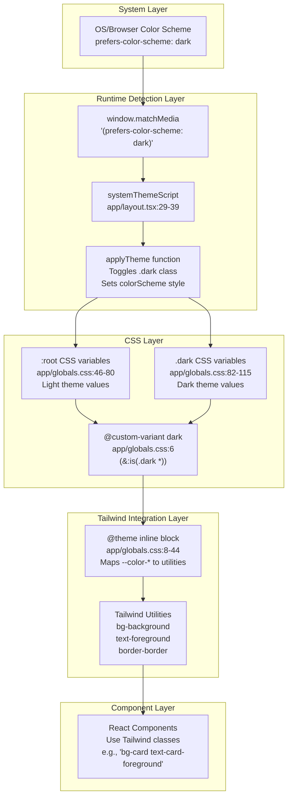
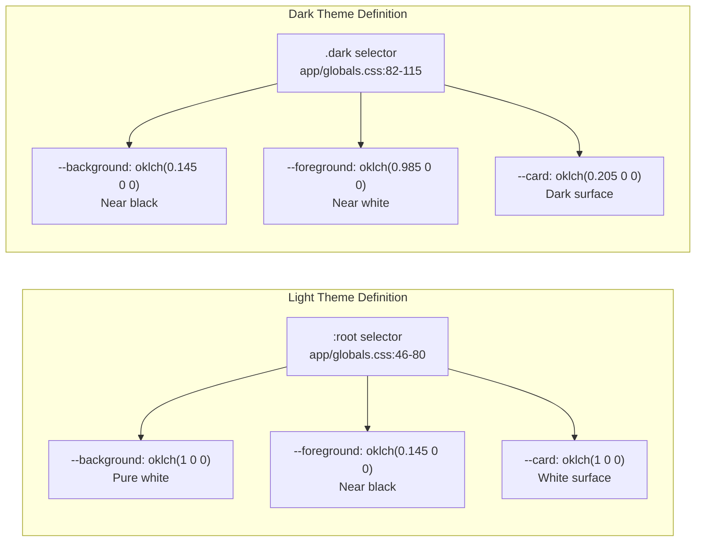
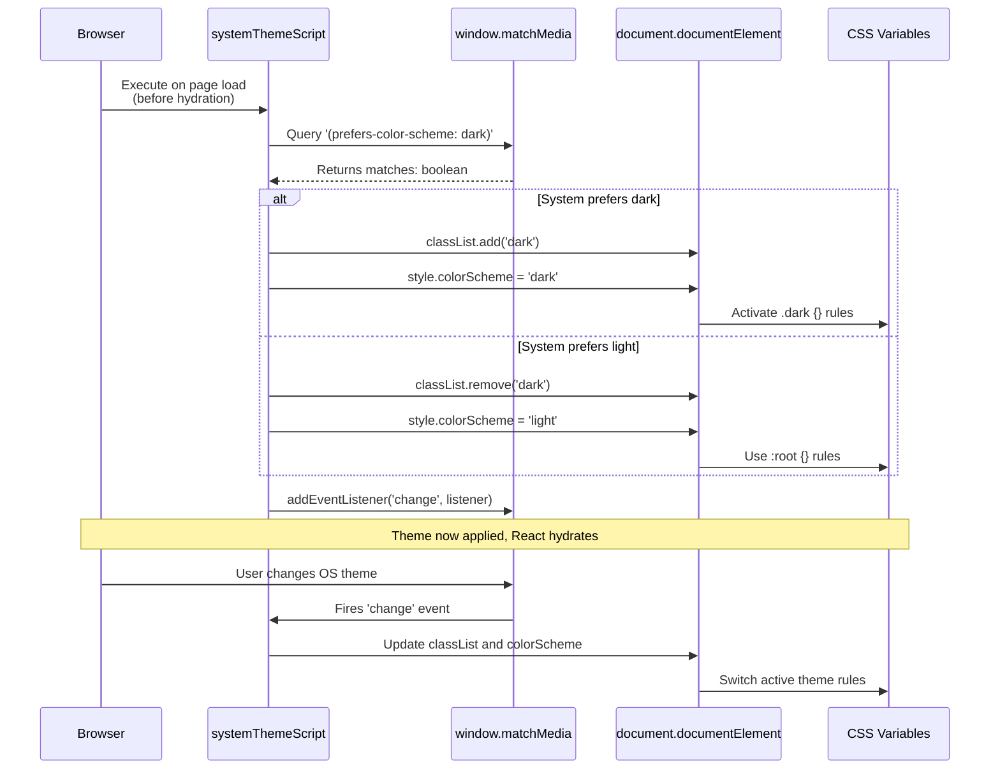
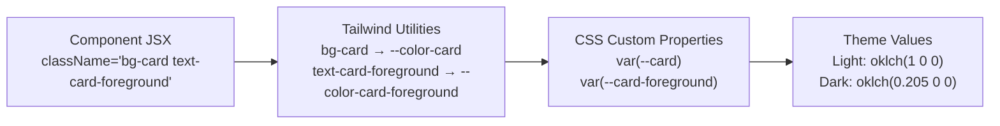

<!-- source: DeepWiki mcp.deepwiki.com · repo openai/openai-sora-sample-app · page 7.1 Theme System & Dark Mode · fetched 2026-10-26 -->

# Theme System & Dark Mode

<details>
<summary>Relevant source files</summary>

The following files were used as context for generating this wiki page:

- [app/globals.css](app/globals.css)
- [app/layout.tsx](app/layout.tsx)

</details>


## Purpose and Scope

This document explains the CSS custom property-based theming system and automatic dark mode implementation in the Sora Sample App. The theme system provides a comprehensive set of color tokens that adapt to the user's system color scheme preference without requiring client-side JavaScript state management or manual toggle controls.

For information about font configuration and typography, see [Typography & Fonts](#7.2). For styling conventions and Tailwind CSS configuration, see [Styling & Theming](#7).

**Sources:** [app/globals.css:1-125](), [app/layout.tsx:1-54]()

---

## Theme System Architecture

The theming system consists of three layers: CSS custom properties that define color values, Tailwind CSS utilities that reference these properties, and a runtime script that applies the appropriate theme based on system preferences.

### Theme Architecture Diagram



**Sources:** [app/globals.css:1-125](), [app/layout.tsx:29-39]()

---

## CSS Custom Properties System

The theme system uses CSS custom properties (CSS variables) to define all color values. These properties are organized into semantic token categories that describe their purpose rather than their specific color values.

### Color Token Categories

The system defines the following semantic color token groups:

| Token Category | Purpose | Example Properties |
|----------------|---------|-------------------|
| Surface Colors | Background and card surfaces | `--background`, `--card`, `--popover` |
| Text Colors | Foreground text on various surfaces | `--foreground`, `--card-foreground`, `--popover-foreground` |
| Interactive Colors | Primary and secondary interactive elements | `--primary`, `--primary-foreground`, `--secondary`, `--secondary-foreground` |
| Subdued Colors | Muted and accent colors for less prominent UI | `--muted`, `--muted-foreground`, `--accent`, `--accent-foreground` |
| Feedback Colors | States and validation | `--destructive` |
| Border & Input | Form and border styling | `--border`, `--input`, `--ring` |
| Chart Colors | Data visualization palette | `--chart-1` through `--chart-5` |
| Sidebar Colors | Sidebar-specific theming | `--sidebar`, `--sidebar-primary`, `--sidebar-accent`, etc. |

**Sources:** [app/globals.css:46-80](), [app/globals.css:82-115]()

### Property Definition Pattern

Each color token is defined twice in the CSS: once for light mode in the `:root` selector and once for dark mode in the `.dark` class selector.



**Sources:** [app/globals.css:46-80](), [app/globals.css:82-115]()

### Color Format: OKLCH

All color values use the OKLCH color space, specified as `oklch(lightness chroma hue)` or `oklch(lightness chroma hue / alpha)`. OKLCH provides perceptually uniform color manipulation and better interpolation than traditional RGB or HSL.

**Light Mode Examples:**
- `--background: oklch(1 0 0)` - Maximum lightness, no chroma (pure white)
- `--foreground: oklch(0.145 0 0)` - Low lightness, no chroma (near black)
- `--destructive: oklch(0.577 0.245 27.325)` - Mid lightness, high chroma, orange-red hue

**Dark Mode Examples:**
- `--background: oklch(0.145 0 0)` - Low lightness (dark gray/black)
- `--foreground: oklch(0.985 0 0)` - High lightness (near white)
- `--border: oklch(1 0 0 / 10%)` - White with 10% opacity

**Sources:** [app/globals.css:46-115]()

---

## Tailwind CSS Integration

The `@theme inline` block maps CSS custom properties to Tailwind CSS color utilities, enabling semantic color usage throughout React components.

### Theme Mapping Block

[app/globals.css:8-44]() defines the mapping between CSS variables and Tailwind color tokens:

```
@theme inline {
  --color-background: var(--background);
  --color-foreground: var(--foreground);
  --color-card: var(--card);
  // ... 40+ color mappings
}
```

This mapping allows components to use Tailwind utilities like `bg-background`, `text-foreground`, and `border-border` which automatically resolve to the appropriate theme values.

### Custom Dark Variant

[app/globals.css:6]() defines a custom Tailwind variant for dark mode targeting:

```
@custom-variant dark (&:is(.dark *));
```

This variant enables dark-mode-specific utilities (e.g., `dark:bg-accent`) that apply only when an ancestor element has the `dark` class.

### Base Layer Styles

[app/globals.css:117-124]() applies theme colors to base HTML elements:

```
@layer base {
  * {
    @apply border-border outline-ring/50;
  }
  body {
    @apply bg-background text-foreground;
  }
}
```

These styles ensure consistent theming across all elements without requiring explicit class application.

**Sources:** [app/globals.css:6-44](), [app/globals.css:117-124]()

---

## Runtime Theme Detection

The application automatically detects and applies the user's system color scheme preference without requiring manual theme selection or client-side state management.

### Theme Detection Flow



**Sources:** [app/layout.tsx:29-39]()

### System Theme Script Implementation

The `systemThemeScript` in [app/layout.tsx:29-39]() is an immediately-invoked function expression (IIFE) that runs before React hydration:

```javascript
const systemThemeScript = `(() => {
  const mediaQuery = window.matchMedia('(prefers-color-scheme: dark)');
  const applyTheme = (isDark) => {
    const root = document.documentElement;
    root.classList.toggle('dark', isDark);
    root.style.colorScheme = isDark ? 'dark' : 'light';
  };
  applyTheme(mediaQuery.matches);
  const listener = (event) => applyTheme(event.matches);
  mediaQuery.addEventListener ? 
    mediaQuery.addEventListener('change', listener) : 
    mediaQuery.addListener(listener);
})();
```

**Key Behaviors:**
1. **Immediate Execution**: Runs synchronously before HTML rendering completes
2. **Media Query Detection**: Uses `window.matchMedia('(prefers-color-scheme: dark)')` to detect system preference
3. **Class Toggle**: Adds/removes the `dark` class on `document.documentElement`
4. **Color Scheme Property**: Sets the CSS `color-scheme` property for native element styling
5. **Dynamic Updates**: Listens for system theme changes and updates automatically
6. **Fallback Handling**: Uses both modern `addEventListener` and legacy `addListener` for browser compatibility

**Sources:** [app/layout.tsx:29-39]()

### Script Injection Point

[app/layout.tsx:46-48]() injects the theme script as the first element in the `<body>`, ensuring it executes before any content renders:

```tsx
<script
  dangerouslySetInnerHTML={{ __html: systemThemeScript }}
/>
```

The `<html>` element includes `suppressHydrationWarning` ([app/layout.tsx:42]()) to prevent React from warning about the `dark` class mismatch between server and client, since the theme is detected and applied client-side.

**Sources:** [app/layout.tsx:42-48]()

---

## Theme Application in Components

React components use Tailwind CSS utility classes that reference the theme system's color tokens.

### Component Theme Usage Pattern



**Example Component Usage:**
- `className="bg-background text-foreground"` - Main application surface
- `className="bg-card text-card-foreground border border-border"` - Card component
- `className="bg-primary text-primary-foreground"` - Primary button
- `className="bg-muted text-muted-foreground"` - Subdued element

**Sources:** [app/globals.css:8-44](), [app/layout.tsx:44]()

---

## Layout Integration

The `RootLayout` component in [app/layout.tsx:24-53]() establishes the theme foundation for the entire application.

### Root Layout Theme Setup

**HTML Element Configuration:**
- `lang="en"` - Language attribute for accessibility
- `className="h-full"` - Full viewport height
- `suppressHydrationWarning` - Prevents React hydration warnings for client-side theme application

**Body Element Configuration:**
- Font variables: `${geistSans.variable} ${geistMono.variable}` (see [Typography & Fonts](#7.2))
- `antialiased` - Font smoothing
- `h-full` - Full height
- `bg-background text-foreground` - Theme colors applied

**Script Injection:**
The `systemThemeScript` is injected as the first child of `<body>` to ensure theme application before visible content renders, preventing flash of unstyled content (FOUC) or theme flicker.

**Sources:** [app/layout.tsx:24-53]()

---

## Theme System Summary

The theme system provides automatic, seamless dark mode support through:

| Aspect | Implementation |
|--------|---------------|
| **Color Definition** | CSS custom properties in `:root` and `.dark` selectors |
| **Color Format** | OKLCH color space for perceptual uniformity |
| **Tailwind Integration** | `@theme inline` block maps variables to utilities |
| **Detection** | `window.matchMedia` queries system preference |
| **Application** | Inline script toggles `dark` class before hydration |
| **Updates** | Event listener responds to system theme changes |
| **Component Usage** | Semantic Tailwind classes (e.g., `bg-background`) |

This architecture eliminates the need for:
- Manual theme toggle controls
- Client-side theme state management
- localStorage persistence
- Server-side theme cookies
- Flash of unstyled content on page load

**Sources:** [app/globals.css:1-125](), [app/layout.tsx:1-54]()

---

