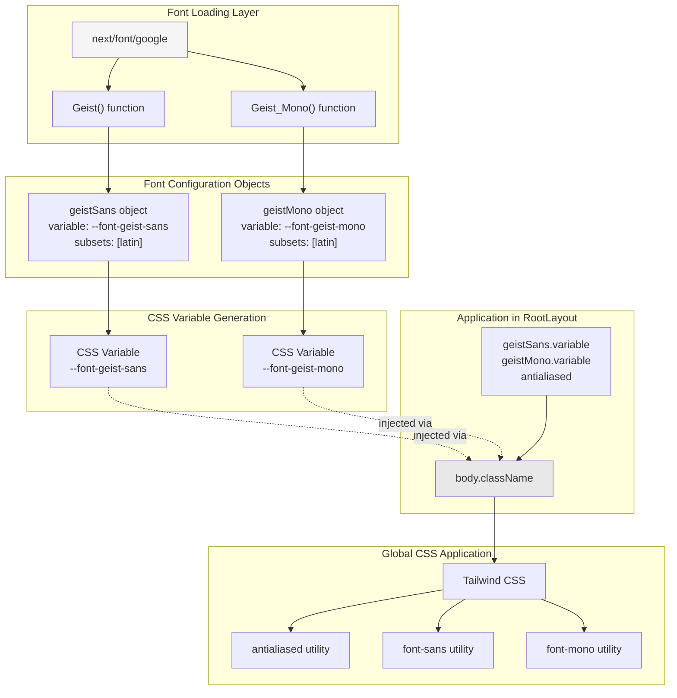
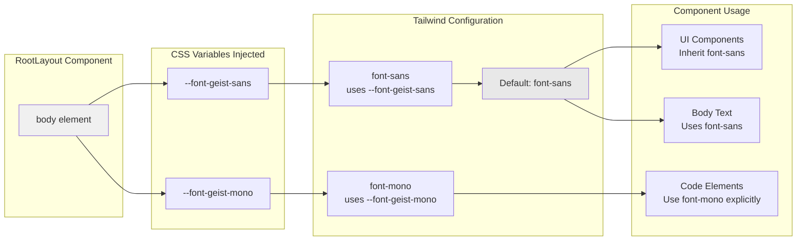
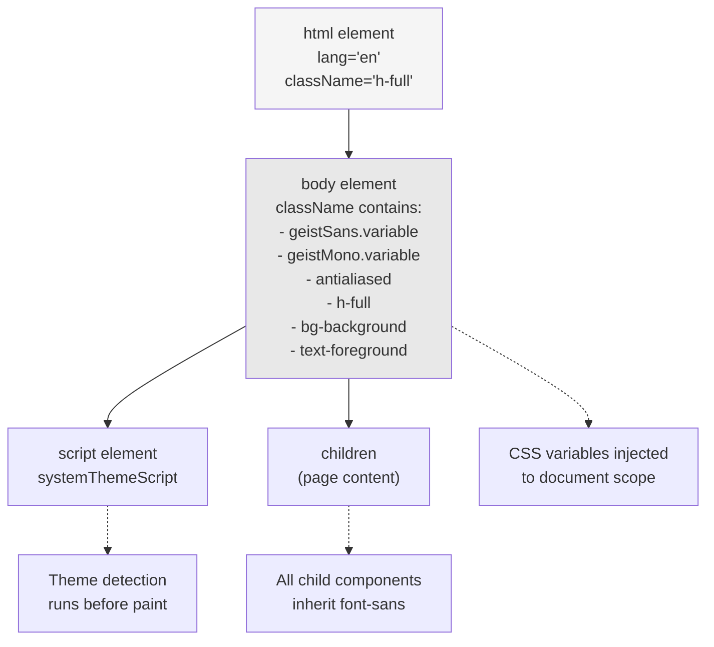

<!-- source: DeepWiki mcp.deepwiki.com · repo openai/openai-sora-sample-app · page 7.2 Typography & Fonts · fetched 2026-10-26 -->

# Typography & Fonts

<details>
<summary>Relevant source files</summary>

The following files were used as context for generating this wiki page:

- [app/globals.css](app/globals.css)
- [app/layout.tsx](app/layout.tsx)

</details>


## Purpose and Scope

This document describes the typography system used in the Sora Sample App, including font loading, configuration, and application through CSS variables. The application uses two typefaces from Google Fonts—Geist for general text and Geist Mono for monospaced content—both loaded and optimized through Next.js's font optimization system.

For information about the overall theme system and color scheme configuration, see [Theme System & Dark Mode](#7.1).

---

## Font Configuration

The application loads two typefaces using Next.js's `next/font/google` module, which provides automatic font optimization, self-hosting, and zero layout shift.

### Geist Sans

The primary typeface for all body text, headings, and UI elements is **Geist**, configured in [app/layout.tsx:5-8]():

```typescript
const geistSans = Geist({
  variable: "--font-geist-sans",
  subsets: ["latin"],
});
```

| Configuration | Value |
|--------------|-------|
| Font Family | Geist |
| CSS Variable | `--font-geist-sans` |
| Subsets | `["latin"]` |
| Usage | Body text, headings, UI components |

### Geist Mono

The monospaced typeface for code and technical content is **Geist Mono**, configured in [app/layout.tsx:10-13]():

```typescript
const geistMono = Geist_Mono({
  variable: "--font-geist-mono",
  subsets: ["latin"],
});
```

| Configuration | Value |
|--------------|-------|
| Font Family | Geist Mono |
| CSS Variable | `--font-geist-mono` |
| Subsets | `["latin"]` |
| Usage | Code blocks, technical data display |

**Sources:** [app/layout.tsx:1-13]()

---

## Font Loading Architecture

The following diagram illustrates how fonts are loaded, configured, and applied throughout the application:



**Sources:** [app/layout.tsx:5-13,44](), [app/globals.css:1-4]()

---

## CSS Variable Integration

The font CSS variables are applied to the document through the `body` element's `className` attribute in [app/layout.tsx:44]():

```typescript
className={`${geistSans.variable} ${geistMono.variable} antialiased h-full bg-background text-foreground`}
```

This generates a className string that includes:

1. `${geistSans.variable}` - Injects the `--font-geist-sans` CSS variable
2. `${geistMono.variable}` - Injects the `--font-geist-mono` CSS variable  
3. `antialiased` - Applies font smoothing via Tailwind utility

### How Next.js Font Variables Work

When Next.js loads the font configuration objects (`geistSans` and `geistMono`), it:

1. Downloads and optimizes the font files during build
2. Generates a `.variable` property containing a unique CSS class
3. Injects CSS that defines the custom property with the font family
4. Ensures zero layout shift by including font metrics

The generated CSS approximately follows this pattern:

```css
.variable-class-name {
  --font-geist-sans: 'Geist', sans-serif;
  --font-geist-mono: 'Geist Mono', monospace;
}
```

**Sources:** [app/layout.tsx:44]()

---

## Typography Rendering

### Font Antialiasing

The application applies subpixel font smoothing through the `antialiased` Tailwind utility class on the `body` element. This is defined in the base layer of [app/globals.css:117-124]():

```css
@layer base {
  * {
    @apply border-border outline-ring/50;
  }
  body {
    @apply bg-background text-foreground;
  }
}
```

The `antialiased` class (from Tailwind CSS) applies:

```css
-webkit-font-smoothing: antialiased;
-moz-osx-font-smoothing: grayscale;
```

This ensures consistent, smooth text rendering across different operating systems and browsers.

### Font Application Flow



**Sources:** [app/layout.tsx:44](), [app/globals.css:121-123]()

---

## Usage in Components

### Default Font Application

All components in the application inherit Geist Sans by default through the CSS cascade, as the font variables are applied at the `body` level in [app/layout.tsx:43-45]().

### Monospace Font Usage

To apply Geist Mono for code or technical content, components can use the Tailwind `font-mono` utility class:

```tsx
<code className="font-mono">sample code</code>
```

The `font-mono` utility automatically resolves to the `--font-geist-mono` CSS variable configured in the Tailwind theme.

---

## Typography System Summary

The following table summarizes the complete typography configuration:

| Aspect | Configuration | Location |
|--------|--------------|----------|
| Primary Font | Geist (sans-serif) | [app/layout.tsx:5-8]() |
| Monospace Font | Geist Mono | [app/layout.tsx:10-13]() |
| Font Loading | `next/font/google` | [app/layout.tsx:2]() |
| CSS Variables | `--font-geist-sans`, `--font-geist-mono` | [app/layout.tsx:6,11]() |
| Application Point | `body.className` | [app/layout.tsx:44]() |
| Font Smoothing | `antialiased` class | [app/layout.tsx:44]() |
| Character Subset | Latin | [app/layout.tsx:7,12]() |

**Sources:** [app/layout.tsx:1-54](), [app/globals.css:117-124]()

---

## Technical Implementation Details

### Next.js Font Optimization

The `next/font/google` loader provides several optimizations:

1. **Self-Hosting** - Font files are downloaded and served from the application domain, eliminating external requests
2. **Zero Layout Shift** - Font metrics are calculated and included inline to prevent content reflow
3. **Automatic Subsetting** - Only the requested character subsets (Latin) are included to reduce file size
4. **CSS Variable Strategy** - Fonts are exposed as CSS custom properties for flexible application

### HTML Structure

The complete HTML structure showing font application:



**Sources:** [app/layout.tsx:41-52]()

---

## Integration with Theme System

The typography system works in conjunction with the theme system documented in [Theme System & Dark Mode](#7.1). Both light and dark themes use the same font configuration, ensuring consistent typography across color schemes.

The font rendering remains constant while color values change based on the `.dark` class toggle, as defined in [app/globals.css:46-115]().

**Sources:** [app/globals.css:46-115]()

---

