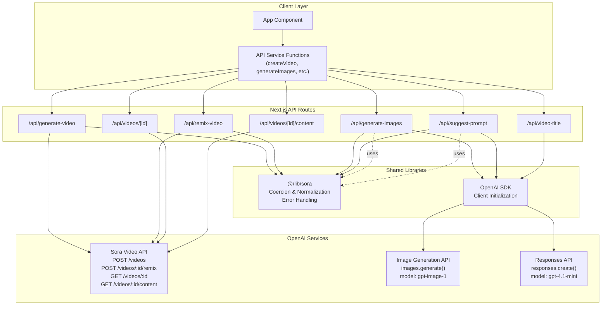
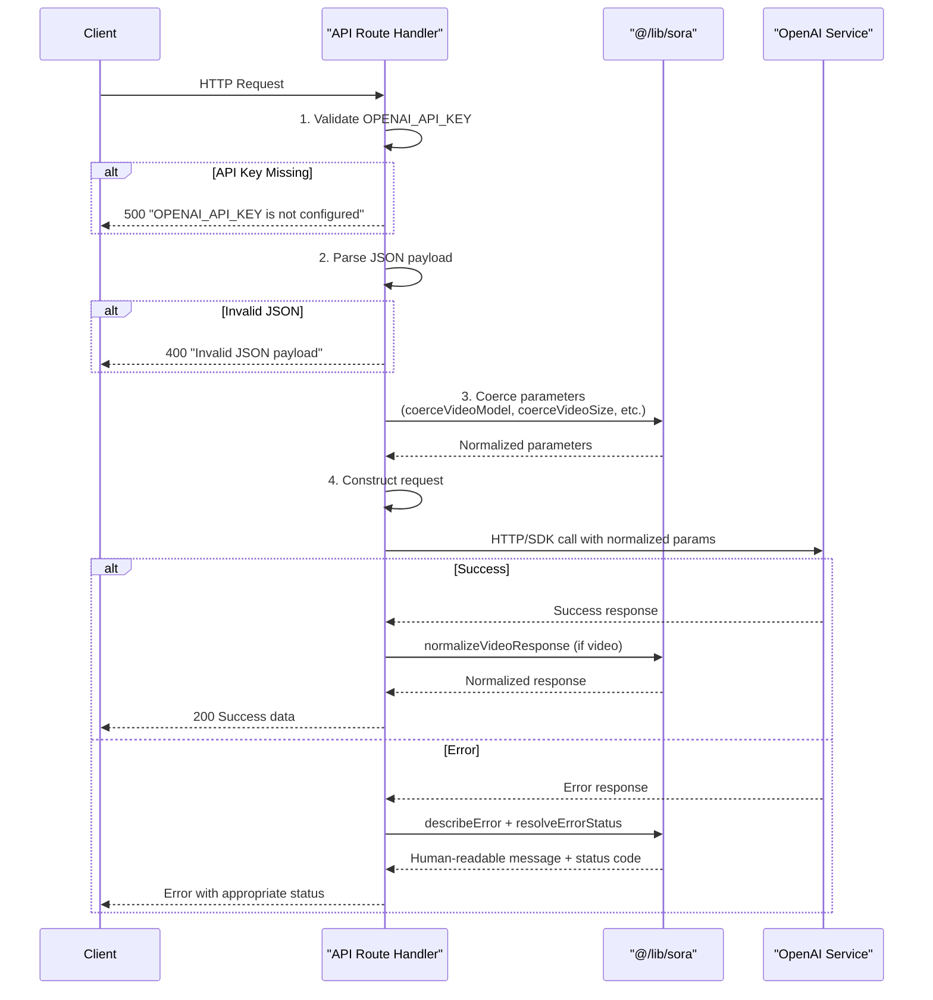
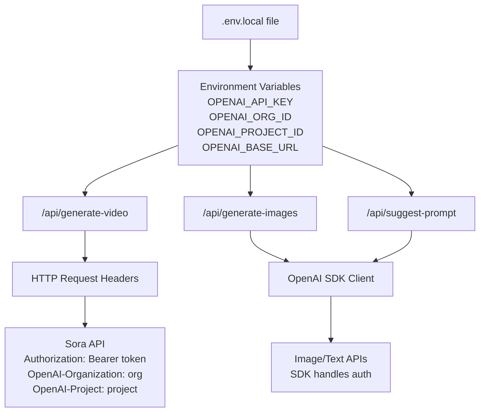
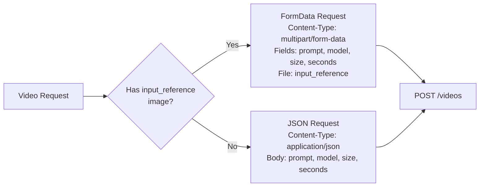
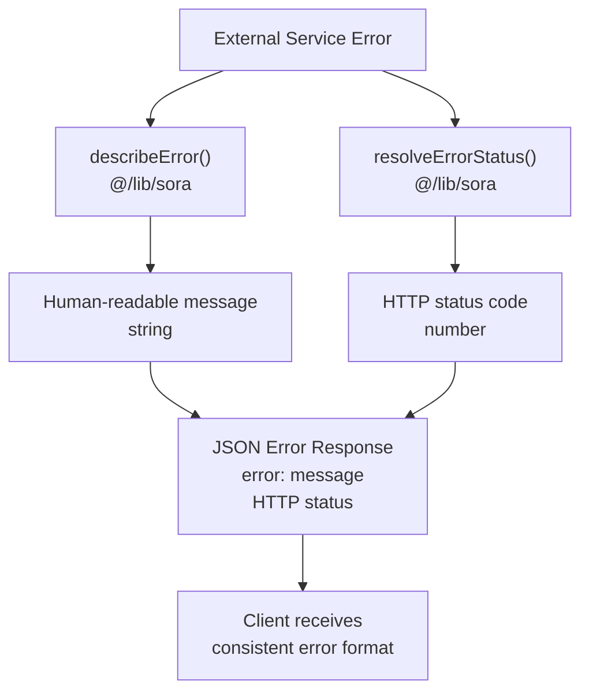

<!-- source: DeepWiki mcp.deepwiki.com · repo openai/openai-sora-sample-app · page 8 External Service Integration · fetched 2026-10-26 -->

# External Service Integration

<details>
<summary>Relevant source files</summary>

The following files were used as context for generating this wiki page:

- [app/api/generate-images/route.ts](app/api/generate-images/route.ts)
- [app/api/generate-video/route.ts](app/api/generate-video/route.ts)
- [app/api/suggest-prompt/route.ts](app/api/suggest-prompt/route.ts)

</details>


## Purpose and Scope

This document describes how the Sora Sample App integrates with OpenAI's external services. It covers the common patterns, authentication mechanisms, and request/response handling used across all API integrations. For detailed documentation of specific endpoints, see [OpenAI Sora Video API](#8.1) and [Image & Text Generation APIs](#8.2).

## Overview of External Services

The application integrates with three categories of OpenAI services:

| Service Category | Models/APIs Used | Primary Purpose | API Routes |
|-----------------|------------------|-----------------|------------|
| Video Generation | Sora API | Create, remix, and manage video content | `/api/generate-video`, `/api/remix-video`, `/api/videos/[id]`, `/api/videos/[id]/content` |
| Image Generation | gpt-image-1 | Generate visual suggestions for video prompts | `/api/generate-images` |
| Text Generation | gpt-4.1-mini | Enhance prompts and generate video titles | `/api/suggest-prompt`, `/api/video-title` |

All integrations follow a consistent pattern: validate credentials, construct requests with coerced parameters, handle responses with normalization, and provide consistent error handling.

**Sources:** [app/api/generate-images/route.ts](), [app/api/generate-video/route.ts](), [app/api/suggest-prompt/route.ts]()

## Integration Architecture

The following diagram shows how API routes integrate with external OpenAI services:



The architecture separates concerns into three layers:

1. **Client Layer**: Makes HTTP requests to Next.js API routes
2. **API Layer**: Validates, transforms, and forwards requests to OpenAI services
3. **External Services**: OpenAI's production APIs

**Sources:** [app/api/generate-video/route.ts](), [app/api/generate-images/route.ts](), [app/api/suggest-prompt/route.ts]()

## Common Integration Patterns

All API routes follow a standardized integration pattern:



**Sources:** [app/api/generate-video/route.ts:20-143](), [app/api/generate-images/route.ts:72-135](), [app/api/suggest-prompt/route.ts:63-135]()

### Pattern Components

Each integration includes these five standard steps:

1. **API Key Validation** - Checks for `OPENAI_API_KEY` environment variable [app/api/generate-video/route.ts:21-25]()
2. **Payload Parsing** - Parses JSON with error handling [app/api/generate-video/route.ts:27-35]()
3. **Parameter Coercion** - Uses `@/lib/sora` utilities to normalize inputs [app/api/generate-video/route.ts:48-56]()
4. **Service Invocation** - Calls OpenAI service with normalized parameters
5. **Error Handling** - Uses `describeError` and `resolveErrorStatus` for consistent error responses [app/api/generate-video/route.ts:138-141]()

**Sources:** [app/api/generate-video/route.ts](), [app/api/generate-images/route.ts](), [app/api/suggest-prompt/route.ts]()

## Service Configuration

### Environment Variables

All external service integrations require configuration via environment variables:

| Variable | Required | Purpose | Used By |
|----------|----------|---------|---------|
| `OPENAI_API_KEY` | Yes | Authentication token for all OpenAI APIs | All routes |
| `OPENAI_BASE_URL` | No | Override default API endpoint (default: `https://api.openai.com/v1`) | Video generation routes |
| `OPENAI_ORG_ID` | No | Organization identifier for request routing | Video generation routes |
| `OPENAI_PROJECT_ID` | No | Project identifier for billing and access control | Video generation routes |

**Sources:** [app/api/generate-video/route.ts:21-22](), [app/api/generate-video/route.ts:69-82](), [app/api/generate-images/route.ts:73-76]()

### Client Initialization

The application uses two approaches for client initialization:

#### SDK-Based Client (Image & Text Generation)

Routes using the OpenAI SDK instantiate a client object:

```typescript
const client = new OpenAI({ apiKey });
```

This approach is used by:
- [app/api/generate-images/route.ts:79]() - Image generation
- [app/api/suggest-prompt/route.ts:70]() - Prompt suggestions

#### Raw HTTP Client (Video Generation)

Video generation routes construct HTTP requests manually to support multipart/form-data uploads:

```typescript
const endpointBase = process.env.OPENAI_BASE_URL?.trim() || "https://api.openai.com/v1";
const endpoint = `${endpointBase.replace(/\/$/, "")}/videos`;
const headers: Record<string, string> = {
  Authorization: `Bearer ${apiKey}`,
};
```

This approach allows fine-grained control over request construction, particularly for handling image input references [app/api/generate-video/route.ts:68-83]().

**Sources:** [app/api/generate-video/route.ts:68-122](), [app/api/generate-images/route.ts:79](), [app/api/suggest-prompt/route.ts:70]()

## Authentication Flow

The following diagram illustrates how authentication credentials flow through the system:



### Authentication Steps

1. **Environment Loading**: Variables are loaded from `.env.local` at runtime
2. **Route-Level Validation**: Each route validates `OPENAI_API_KEY` exists [app/api/generate-video/route.ts:21-25]()
3. **Header Construction**: Video routes manually construct authorization headers [app/api/generate-video/route.ts:71-82]()
4. **SDK Authentication**: Image/text routes pass API key to OpenAI SDK constructor [app/api/generate-images/route.ts:79]()
5. **Optional Identifiers**: Organization and project IDs are added when configured [app/api/generate-video/route.ts:75-82]()

**Sources:** [app/api/generate-video/route.ts:21-82](), [app/api/generate-images/route.ts:73-79]()

## Request Construction

### Video Generation Requests

Video generation supports two request formats based on whether an image reference is provided:



#### JSON Request (Text-Only)

When no image is provided, the request uses JSON encoding [app/api/generate-video/route.ts:110-122]():

```typescript
headers["Content-Type"] = "application/json";
const payload: VideoCreateParams = {
  prompt,
  model,
  size,
  seconds,
};
response = await fetch(endpoint, {
  method: "POST",
  headers,
  body: JSON.stringify(payload),
});
```

#### FormData Request (With Image)

When an image reference is provided, the request uses multipart encoding [app/api/generate-video/route.ts:85-108]():

```typescript
const formData = new FormData();
formData.set("prompt", prompt);
formData.set("model", model);
formData.set("size", size);
formData.set("seconds", seconds);

const buffer = Buffer.from(String(imageData.data), "base64");
const blob = new Blob([buffer], { type: mimeType });
formData.append("input_reference", blob, filename);

response = await fetch(endpoint, {
  method: "POST",
  headers,
  body: formData,
});
```

**Sources:** [app/api/generate-video/route.ts:85-122]()

### Image Generation Requests

Image generation uses the OpenAI SDK's `images.generate` method [app/api/generate-images/route.ts:104-110]():

```typescript
const generation = await client.images.generate({
  model,
  prompt,
  size,
  quality: "high",
  n: count,
});
```

Parameters are coerced before submission:
- `model` via `coerceImageModel` [app/api/generate-images/route.ts:56-61]()
- `size` via `coerceImageSize` [app/api/generate-images/route.ts:63-70]()
- `count` via `coerceImageCount` [app/api/generate-images/route.ts:48-54]()

**Sources:** [app/api/generate-images/route.ts:99-110]()

### Text Generation Requests

Text generation uses the OpenAI SDK's `responses.create` method [app/api/suggest-prompt/route.ts:95-119]():

```typescript
const response = await client.responses.create({
  model: PROMPT_MODEL,
  max_output_tokens: 200,
  temperature: 0.8,
  input: [
    {
      role: "system",
      content: [
        {
          type: "input_text",
          text: "You are a creative director crafting vivid video prompts...",
        },
      ],
    },
    {
      role: "user",
      content: [
        {
          type: "input_text",
          text: `Context for the video prompt:\n${contextLines.join("\n")}`,
        },
      ],
    },
  ],
});
```

The prompt model is hardcoded as `gpt-4.1-mini` [app/api/suggest-prompt/route.ts:11]().

**Sources:** [app/api/suggest-prompt/route.ts:11](), [app/api/suggest-prompt/route.ts:95-119]()

## Response Handling

### Response Normalization

Each service type has custom response handling:

| Service | Normalization Function | Purpose |
|---------|----------------------|---------|
| Video Generation | `normalizeVideoResponse` from `@/lib/sora` | Ensures consistent `VideoItem` structure |
| Image Generation | Custom reducer logic | Transforms API response to `GeneratedImageSuggestion[]` |
| Text Generation | `extractTextFromResponse` | Extracts text from various response formats |

#### Video Response Normalization

Video responses are normalized through `@/lib/sora` [app/api/generate-video/route.ts:135-136]():

```typescript
const normalized = normalizeVideoResponse(result, videoPayload);
return Response.json(normalized);
```

#### Image Response Transformation

Image responses are transformed into a standardized format [app/api/generate-images/route.ts:112-128]():

```typescript
const suggestions = (generation.data ?? []).reduce<GeneratedImageSuggestion[]>(
  (acc, entry, index) => {
    const base64 = entry.b64_json ?? null;
    const url = base64
      ? `data:image/png;base64,${base64}`
      : readString(entry.url);
    if (!url) return acc;
    acc.push({
      id: `generated-${Date.now()}-${index}`,
      url,
      base64,
      description: prompt,
    });
    return acc;
  },
  []
);
```

#### Text Response Extraction

Text responses use a fallback extraction strategy [app/api/suggest-prompt/route.ts:42-61]():

```typescript
const extractTextFromResponse = (response: unknown): string => {
  const output = (response as { output_text?: string[] }).output_text;
  if (Array.isArray(output) && output.length) {
    return output.join(" ");
  }

  const generic = gatherText((response as { output?: unknown }).output);
  if (generic.trim()) return generic;

  const choiceContent = gatherText(
    (response as { choices?: Array<{ message?: { content?: unknown } }> })
      .choices?.[0]?.message?.content,
  );
  if (choiceContent.trim()) return choiceContent;

  return (
    gatherText((response as { text?: unknown }).text)
    || gatherText((response as { result?: unknown }).result)
  );
};
```

This function handles multiple response formats by checking common field names.

**Sources:** [app/api/generate-video/route.ts:135-136](), [app/api/generate-images/route.ts:112-128](), [app/api/suggest-prompt/route.ts:42-61]()

## Error Handling

### Centralized Error Utilities

All routes use two shared error handling functions from `@/lib/sora`:

1. **`describeError`**: Converts errors to human-readable messages
2. **`resolveErrorStatus`**: Determines appropriate HTTP status codes



**Sources:** [app/api/generate-video/route.ts:138-141](), [app/api/generate-images/route.ts:131-133](), [app/api/suggest-prompt/route.ts:131-133]()

### Error Handling Examples

#### Video Generation Error

```typescript
catch (error) {
  console.error("generate-video error", error);
  const message = describeError(error, "Failed to create video");
  const status = resolveErrorStatus(error);
  return Response.json({ error: { message } }, { status });
}
```

[app/api/generate-video/route.ts:137-142]()

#### Image Generation Error

```typescript
catch (error) {
  const message = describeError(error, "Failed to generate images");
  const status = resolveErrorStatus(error);
  return NextResponse.json({ error: { message } }, { status });
}
```

[app/api/generate-images/route.ts:130-134]()

#### Prompt Suggestion Error

```typescript
catch (error) {
  const message = describeError(error, "Failed to generate prompt suggestion");
  const status = resolveErrorStatus(error);
  return NextResponse.json({ error: { message } }, { status });
}
```

[app/api/suggest-prompt/route.ts:130-134]()

### Response Validation

Before normalizing responses, routes validate that the external service returned valid data [app/api/generate-video/route.ts:124-133]():

```typescript
const result = await response.json().catch(() => null);
if (!response.ok || !result) {
  const message = describeError(result, "Failed to create video");
  const derivedStatus = result ? resolveErrorStatus(result) : undefined;
  const status =
    typeof derivedStatus === "number" && derivedStatus > 0
      ? derivedStatus
      : response.status || 500;
  return Response.json({ error: { message } }, { status });
}
```

**Sources:** [app/api/generate-video/route.ts:124-133](), [app/api/generate-images/route.ts:130-134](), [app/api/suggest-prompt/route.ts:130-134]()

## Integration Summary

The external service integration layer provides:

1. **Unified Authentication**: All routes validate and use `OPENAI_API_KEY` consistently
2. **Request Standardization**: Parameter coercion ensures valid inputs to external services
3. **Response Normalization**: Each service type has specialized response transformation
4. **Error Consistency**: Centralized error handling provides uniform client experience
5. **Configuration Flexibility**: Environment variables allow deployment-time customization

This architecture enables the application to integrate with multiple OpenAI services while maintaining consistent patterns and error handling throughout the codebase.

**Sources:** [app/api/generate-video/route.ts](), [app/api/generate-images/route.ts](), [app/api/suggest-prompt/route.ts]()

---

