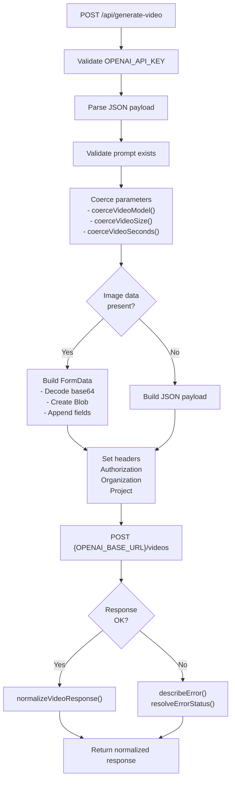
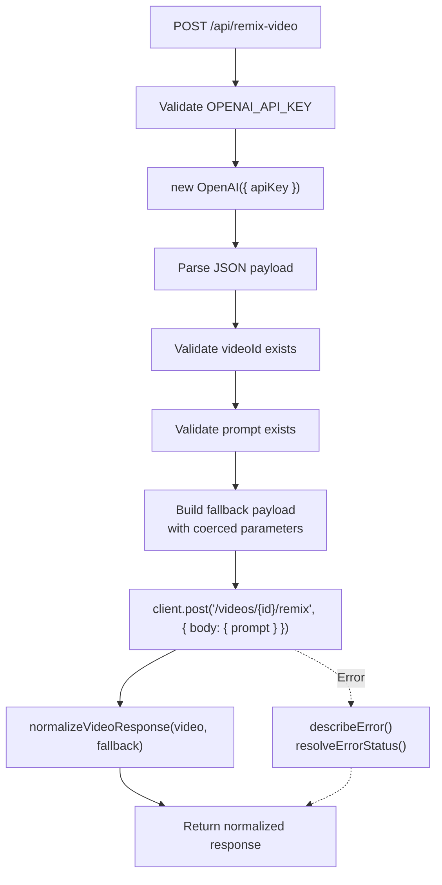
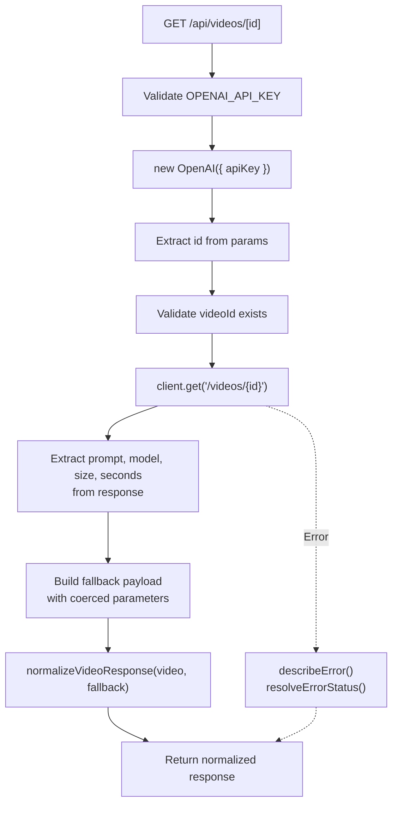
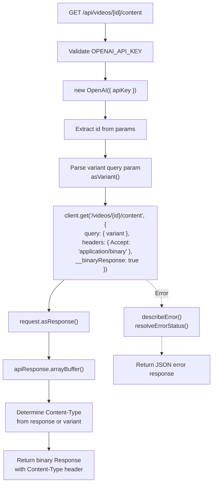
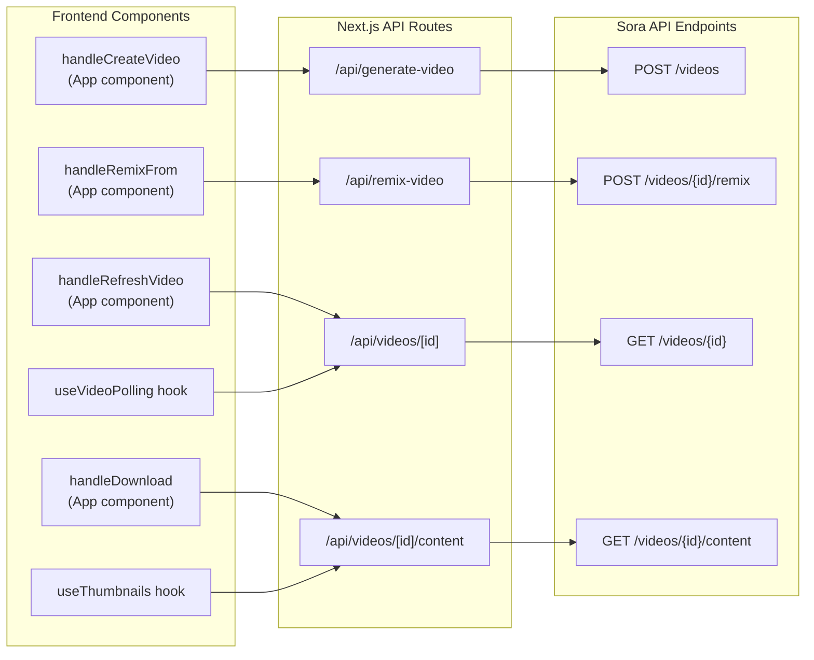

<!-- source: DeepWiki mcp.deepwiki.com · repo openai/openai-sora-sample-app · page 8.1 OpenAI Sora Video API · fetched 2026-10-26 -->

# OpenAI Sora Video API

<details>
<summary>Relevant source files</summary>

The following files were used as context for generating this wiki page:

- [app/api/generate-video/route.ts](app/api/generate-video/route.ts)
- [app/api/remix-video/route.ts](app/api/remix-video/route.ts)
- [app/api/videos/[id]/content/route.ts](app/api/videos/[id]/content/route.ts)
- [app/api/videos/[id]/route.ts](app/api/videos/[id]/route.ts)

</details>


## Purpose and Scope

This document details the integration between the Sora Sample App and OpenAI's Sora Video API. It covers the four primary API operations used: video creation, video remixing, status polling, and binary content retrieval. The document explains how each Next.js API route wraps the corresponding Sora API endpoint, including authentication, request construction, and response normalization.

For information about how these API routes are called from the frontend, see [API Layer](#5). For details on the shared utility functions used for data coercion and normalization, see [Sora Utility Library](#6.1).

---

## API Overview

The application integrates with four Sora API endpoints, each wrapped by a corresponding Next.js API route:

| Operation | Sora API Endpoint | Next.js Route | HTTP Method |
|-----------|------------------|---------------|-------------|
| Create Video | `/videos` | `/api/generate-video` | POST |
| Remix Video | `/videos/{id}/remix` | `/api/remix-video` | POST |
| Poll Status | `/videos/{id}` | `/api/videos/[id]` | GET |
| Fetch Content | `/videos/{id}/content` | `/api/videos/[id]/content` | GET |

### Authentication Configuration

All Sora API requests use the following authentication mechanism:

```
Authorization: Bearer {OPENAI_API_KEY}
```

Optional headers are added when environment variables are configured:

- `OpenAI-Organization`: Set from `OPENAI_ORG_ID` if present
- `OpenAI-Project`: Set from `OPENAI_PROJECT_ID` if present

The base URL for all requests defaults to `https://api.openai.com/v1` but can be overridden via the `OPENAI_BASE_URL` environment variable.

**Sources:** [app/api/generate-video/route.ts:21-82](), [app/api/remix-video/route.ts:14-20]()

---

## Video Creation

### Endpoint: POST /videos

The video creation operation supports two request formats depending on whether an input reference image is provided.

#### Request Format: Text-Only

When no image is provided, the request uses `application/json` content type:

```json
{
  "prompt": "string",
  "model": "sora-1.0",
  "size": "1920x1080",
  "seconds": "5"
}
```

#### Request Format: With Input Reference Image

When an image is provided, the request uses `multipart/form-data` with FormData construction:

```
prompt: "string"
model: "sora-1.0"
size: "1920x1080"
seconds: "5"
input_reference: [Blob]
```

The image is processed as follows:
1. Base64-encoded image data is decoded to a Buffer [app/api/generate-video/route.ts:92]()
2. A Blob is created with the appropriate MIME type [app/api/generate-video/route.ts:101]()
3. The Blob is appended to FormData with a filename [app/api/generate-video/route.ts:102]()

### Request Flow Diagram



### Parameter Coercion

All input parameters are coerced to valid values using utility functions:

| Parameter | Function | Default Value |
|-----------|----------|---------------|
| `model` | `coerceVideoModel()` | First available model |
| `size` | `coerceVideoSize()` | First available size |
| `seconds` | `coerceVideoSeconds()` | First available duration |

**Sources:** [app/api/generate-video/route.ts:20-143]()

---

## Video Remixing

### Endpoint: POST /videos/{id}/remix

Video remixing creates a variation of an existing video using a new prompt. This operation uses the OpenAI SDK client instead of direct fetch calls.

### Request Format

```json
{
  "videoId": "string",
  "prompt": "string",
  "model": "sora-1.0",
  "size": "1920x1080",
  "seconds": "5"
}
```

The `model`, `size`, and `seconds` parameters serve as fallback values for response normalization but are not sent to the Sora API. The remix endpoint only accepts `videoId` and `prompt`.

### Implementation Pattern



The fallback payload is constructed with coerced parameters to ensure consistent response structure even if the Sora API response is incomplete [app/api/remix-video/route.ts:41-46]().

**Sources:** [app/api/remix-video/route.ts:13-59]()

---

## Status Polling

### Endpoint: GET /videos/{id}

The status polling endpoint retrieves the current state of a video generation job. This is used by `useVideoPolling` hook for periodic status updates.

### Request Flow



### Response Normalization

The polling endpoint performs defensive normalization:

1. Extracts prompt from the response if available [app/api/videos/[id]/route.ts:38-41]()
2. Coerces model, size, and seconds parameters from the response [app/api/videos/[id]/route.ts:45-55]()
3. Passes these as fallback values to `normalizeVideoResponse()` [app/api/videos/[id]/route.ts:58]()

This ensures that even if the Sora API returns incomplete data, the response will have valid values for all required fields.

**Sources:** [app/api/videos/[id]/route.ts:13-65]()

---

## Binary Content Retrieval

### Endpoint: GET /videos/{id}/content

The content endpoint retrieves binary video or thumbnail data. It supports three content variants via query parameter.

### Supported Variants

| Variant | Query Parameter | Content Type | Usage |
|---------|----------------|--------------|-------|
| `video` | `?variant=video` | `video/mp4` | Full video playback |
| `thumbnail` | `?variant=thumbnail` | `image/png` | Video preview images |
| `spritesheet` | `?variant=spritesheet` | `image/png` | Timeline thumbnails |

### Implementation Details

The endpoint uses the OpenAI SDK's binary response feature:



### Variant Validation

The `asVariant()` helper function strictly validates the variant parameter [app/api/videos/[id]/content/route.ts:4-10]():

```typescript
"video" | "thumbnail" | "spritesheet" | undefined
```

If an invalid variant is provided, it returns `undefined`, causing the query parameter to be omitted.

### Content-Type Resolution

The Content-Type header is determined with the following priority:
1. Content-Type from Sora API response
2. `image/png` if variant is `thumbnail`
3. `video/mp4` as default

**Sources:** [app/api/videos/[id]/content/route.ts:1-54]()

---

## Request/Response Integration Map

The following diagram maps application components to Sora API endpoints:



**Sources:** [app/api/generate-video/route.ts](), [app/api/remix-video/route.ts](), [app/api/videos/[id]/route.ts](), [app/api/videos/[id]/content/route.ts]()

---

## Error Handling

All Sora API routes follow a consistent error handling pattern using two utility functions:

### describeError()

Converts error objects into human-readable messages. Handles:
- OpenAI API error responses with nested error structures
- Network errors with status codes
- Generic exceptions

### resolveErrorStatus()

Extracts or infers appropriate HTTP status codes from errors:
- Returns `error.status` if present
- Returns `error.code` if numeric
- Falls back to 500 for unknown errors

### Error Response Format

All routes return errors in a consistent JSON structure:

```json
{
  "error": {
    "message": "string"
  }
}
```

### Common Error Scenarios

| Scenario | Status Code | Handler Location |
|----------|-------------|-----------------|
| Missing API key | 500 | All routes (first check) |
| Invalid JSON payload | 400 | POST routes |
| Missing required field | 400 | All routes (validation) |
| Sora API error | Varies | Derived from error response |
| Network error | 500 | Catch block |

**Sources:** [app/api/generate-video/route.ts:137-142](), [app/api/remix-video/route.ts:54-58](), [app/api/videos/[id]/route.ts:60-64](), [app/api/videos/[id]/content/route.ts:49-53]()

---

## SDK vs Direct Fetch Usage

The application uses two different methods to communicate with the Sora API:

### Direct Fetch (generate-video)

The video generation route uses `fetch()` directly [app/api/generate-video/route.ts:104-121]() to support FormData with binary image uploads. This approach is necessary because the OpenAI SDK's current version may not fully support multipart/form-data requests with custom file attachments.

### OpenAI SDK (other routes)

All other routes use the OpenAI SDK client [app/api/remix-video/route.ts:20]() for simplified error handling and automatic request construction. The SDK provides:
- Automatic header management
- Type-safe request building
- Consistent error response formats
- Binary response handling via `__binaryResponse: true` flag

**Sources:** [app/api/generate-video/route.ts:68-122](), [app/api/remix-video/route.ts:13-59](), [app/api/videos/[id]/route.ts:23-35](), [app/api/videos/[id]/content/route.ts:19-36]()

---

