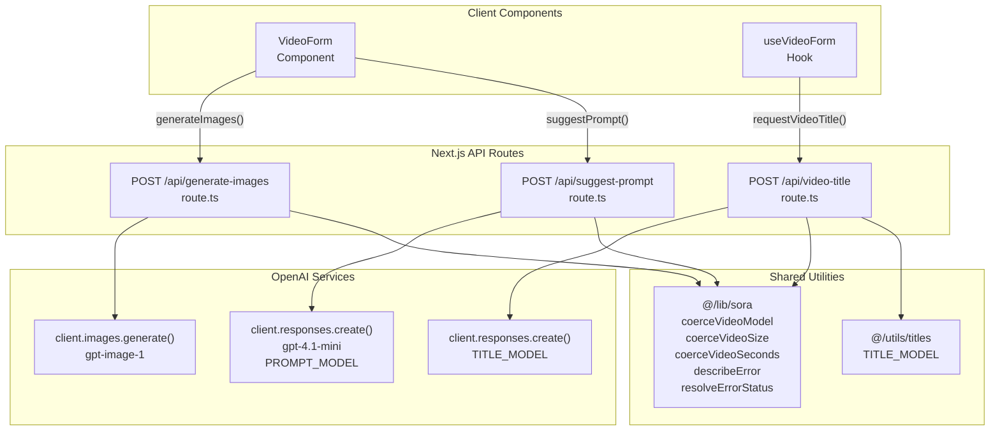
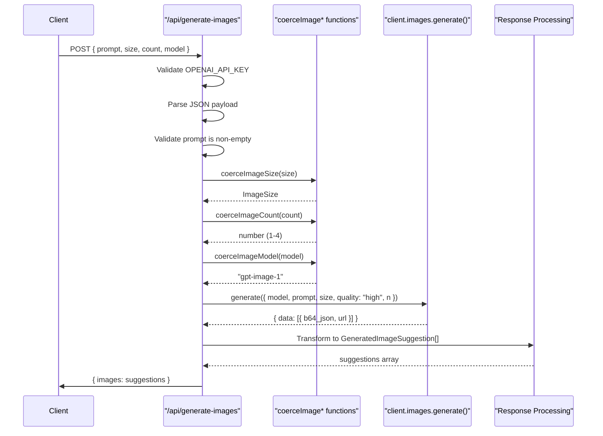
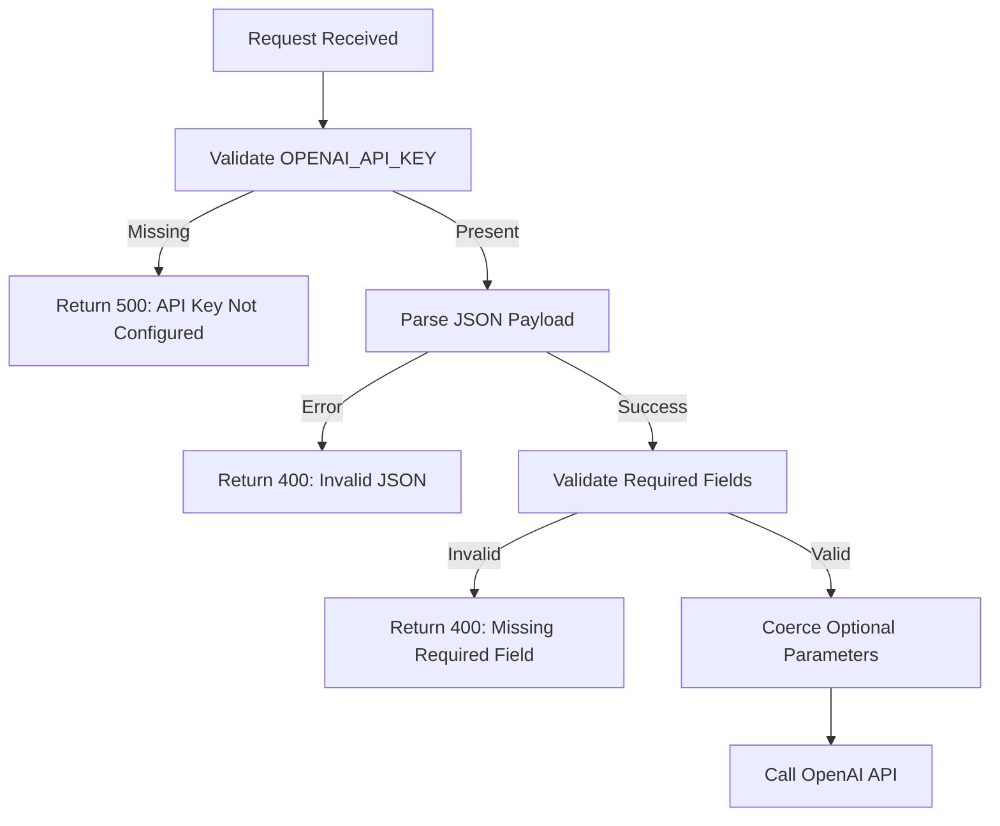
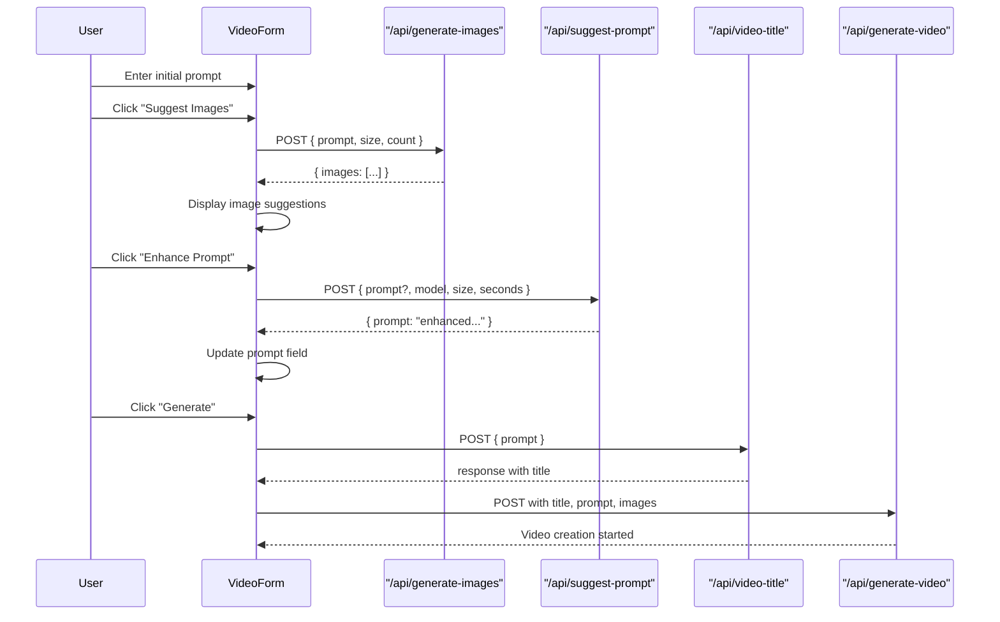

<!-- source: DeepWiki mcp.deepwiki.com · repo openai/openai-sora-sample-app · page 8.2 Image & Text Generation APIs · fetched 2026-10-26 -->

# Image & Text Generation APIs

<details>
<summary>Relevant source files</summary>

The following files were used as context for generating this wiki page:

- [app/api/generate-images/route.ts](app/api/generate-images/route.ts)
- [app/api/suggest-prompt/route.ts](app/api/suggest-prompt/route.ts)
- [app/api/video-title/route.ts](app/api/video-title/route.ts)

</details>


## Purpose and Scope

This document describes the application's integration with OpenAI's image and text generation services. The application uses two distinct AI capabilities beyond video generation: **gpt-image-1** for generating visual reference images and **gpt-4.1-mini** for text generation tasks (prompt enhancement and title generation). These APIs enhance the user experience by providing intelligent suggestions and visual aids during the video creation process.

For integration with the Sora Video API (video generation, remixing, and status polling), see [OpenAI Sora Video API](#8.1).

---

## Overview

The application exposes three API endpoints that integrate with OpenAI's non-video services:

| Endpoint | OpenAI Service | Model | Purpose |
|----------|---------------|-------|---------|
| `/api/generate-images` | Images API | `gpt-image-1` | Generate visual reference images from text prompts |
| `/api/suggest-prompt` | Responses API | `gpt-4.1-mini` | Enhance or generate creative video prompts |
| `/api/video-title` | Responses API | `TITLE_MODEL` | Generate short reel-style titles for videos |

All three endpoints follow the standard API pattern established in [API Layer](#5): API key validation, input coercion, external service call, response normalization, and error handling.

Sources: [app/api/generate-images/route.ts:1-136](), [app/api/suggest-prompt/route.ts:1-136](), [app/api/video-title/route.ts:1-60]()

---

## Integration Architecture



**Diagram: API Endpoints and OpenAI Service Integration**

This diagram shows how the three enhancement endpoints integrate with OpenAI services. Each endpoint maintains a dedicated connection to its respective OpenAI API, while sharing common utilities for validation and error handling.

Sources: [app/api/generate-images/route.ts:1-136](), [app/api/suggest-prompt/route.ts:1-136](), [app/api/video-title/route.ts:1-60]()

---

## Image Generation API

### Endpoint Details

The `/api/generate-images` endpoint generates visual reference images using OpenAI's `gpt-image-1` model. This provides users with visual suggestions based on their text prompts, which can serve as creative inspiration or direct input for image-to-video generation.

**Route Handler:** [app/api/generate-images/route.ts:72-135]()

### Request Payload

```typescript
interface GenerateImagesPayload {
  prompt?: unknown;      // Required: text description for image generation
  size?: unknown;        // Optional: output image size
  count?: unknown;       // Optional: number of images to generate (1-4)
  model?: unknown;       // Optional: image model to use
}
```

### Input Validation and Coercion

The endpoint implements strict input coercion to ensure valid parameters:

| Function | Source Lines | Behavior |
|----------|-------------|----------|
| `readString()` | [app/api/generate-images/route.ts:32-33]() | Extracts and trims string values; returns `null` for invalid inputs |
| `readNumber()` | [app/api/generate-images/route.ts:35-46]() | Parses numeric values from number or string types; handles string-to-number conversion |
| `coerceImageModel()` | [app/api/generate-images/route.ts:56-61]() | Validates against `ALLOWED_IMAGE_MODELS` set; defaults to `IMAGE_MODEL_FALLBACK` ("gpt-image-1") |
| `coerceImageSize()` | [app/api/generate-images/route.ts:63-70]() | Validates against `ALLOWED_IMAGE_SIZES` set; defaults to "1024x1024" |
| `coerceImageCount()` | [app/api/generate-images/route.ts:48-54]() | Clamps value between 1 and `MAX_IMAGE_COUNT` (4); defaults to 3 |

**Constants:**
- `IMAGE_MODEL_FALLBACK = "gpt-image-1"` [app/api/generate-images/route.ts:6]()
- `MAX_IMAGE_COUNT = 4` [app/api/generate-images/route.ts:8]()
- `DEFAULT_IMAGE_COUNT = 3` [app/api/generate-images/route.ts:9]()
- `DEFAULT_IMAGE_SIZE = "1024x1024"` [app/api/generate-images/route.ts:13]()

**Allowed Sizes:** [app/api/generate-images/route.ts:14-23]()
```
256x256, 512x512, 1024x1024, 1024x1536, 1536x1024, 1024x1792, 1792x1024, auto
```

Sources: [app/api/generate-images/route.ts:6-70]()

### OpenAI API Integration



**Diagram: Image Generation Request Flow**

Sources: [app/api/generate-images/route.ts:72-135]()

The actual OpenAI API call occurs at [app/api/generate-images/route.ts:104-110]():

```typescript
const generation = await client.images.generate({
  model,
  prompt,
  size,
  quality: "high",
  n: count,
});
```

### Response Processing

The endpoint transforms OpenAI's response into a standardized `GeneratedImageSuggestion` array. The processing logic [app/api/generate-images/route.ts:112-127]() handles both base64-encoded images and URL references:

**Response Transformation:**
1. Iterate through `generation.data` array
2. Extract `b64_json` or `url` from each entry
3. Convert base64 to data URL format: `data:image/png;base64,${base64}`
4. Create `GeneratedImageSuggestion` objects with:
   - `id`: Timestamp-based unique identifier
   - `url`: Data URL or direct URL
   - `base64`: Raw base64 string (if available)
   - `description`: Original prompt text

**Type Definition:**
```typescript
interface GeneratedImageSuggestion {
  id: string;
  url: string;
  base64: string | null;
  description: string;
}
```

Sources: [app/api/generate-images/route.ts:112-129]()

---

## Text Generation APIs

The application uses OpenAI's Responses API with the `gpt-4.1-mini` model for two distinct text generation tasks: prompt enhancement and title generation.

### Prompt Suggestion Endpoint

**Route Handler:** [app/api/suggest-prompt/route.ts:63-135]()

The `/api/suggest-prompt` endpoint generates or enhances video prompts by leveraging context about the target video parameters.

#### Request Payload

```typescript
interface SuggestPromptPayload {
  prompt?: unknown;      // Optional: existing prompt to enhance
  model?: unknown;       // Video model (for context)
  size?: unknown;        // Video size (for context)
  seconds?: unknown;     // Video duration (for context)
}
```

#### Context-Aware Generation

The endpoint constructs contextual information to guide the language model [app/api/suggest-prompt/route.ts:84-92]():

```typescript
const contextLines = [
  `Target model: ${model}`,
  `Frame size: ${size}`,
  `Duration: ${seconds} seconds`,
];

if (existingPrompt) {
  contextLines.push(`Existing prompt: ${existingPrompt}`);
}
```

This context ensures generated prompts are appropriate for the specified video parameters. The endpoint reuses video parameter coercion functions from `@/lib/sora` [app/api/suggest-prompt/route.ts:80-82]():
- `coerceVideoModel()`
- `coerceVideoSize()`
- `coerceVideoSeconds()`

#### OpenAI Responses API Call

The endpoint uses the Responses API with a system message defining the assistant's role [app/api/suggest-prompt/route.ts:95-119]():

```typescript
const response = await client.responses.create({
  model: PROMPT_MODEL,              // "gpt-4.1-mini"
  max_output_tokens: 200,
  temperature: 0.8,
  input: [
    {
      role: "system",
      content: [
        {
          type: "input_text",
          text: "You are a creative director crafting vivid video prompts..."
        }
      ]
    },
    {
      role: "user",
      content: [
        {
          type: "input_text",
          text: `Context for the video prompt:\n${contextLines.join("\n")}`
        }
      ]
    }
  ]
});
```

**Model Configuration:**
- `PROMPT_MODEL = "gpt-4.1-mini"` [app/api/suggest-prompt/route.ts:11]()
- `temperature: 0.8` - Higher temperature for creative suggestions
- `max_output_tokens: 200` - Sufficient for detailed prompts

Sources: [app/api/suggest-prompt/route.ts:11-119]()

#### Response Extraction

The endpoint implements a flexible response extraction function `extractTextFromResponse()` [app/api/suggest-prompt/route.ts:42-61]() that handles multiple response formats:

**Extraction Priority:**
1. `output_text[]` array - Join all elements
2. `output` field - Recursively gather text via `gatherText()`
3. `choices[0].message.content` - Standard chat completion format
4. `text` field - Fallback text property
5. `result` field - Final fallback

The `gatherText()` helper [app/api/suggest-prompt/route.ts:23-40]() recursively traverses response objects to extract text content from nested structures.

Sources: [app/api/suggest-prompt/route.ts:23-61]()

### Video Title Endpoint

**Route Handler:** [app/api/video-title/route.ts:6-59]()

The `/api/video-title` endpoint generates concise, reel-style titles for videos based on their prompts.

#### Request Payload

```typescript
interface VideoTitlePayload {
  prompt: string;  // Required: video prompt to generate title from
}
```

#### OpenAI API Call

The title generation uses a simpler API call structure [app/api/video-title/route.ts:37-51]():

```typescript
const response = await client.responses.create({
  model: TITLE_MODEL,
  input: [
    {
      role: "user",
      content: [
        {
          type: "input_text",
          text: `Propose a short reel-style title for this video prompt (don't include quotes around the title): ${prompt}`
        }
      ]
    }
  ],
  max_output_tokens: 80
});
```

**Model Configuration:**
- `TITLE_MODEL` - Imported from `@/utils/titles` [app/api/video-title/route.ts:4]()
- `max_output_tokens: 80` - Limited for concise titles
- No system message - Direct user instruction

The response is returned directly without additional processing [app/api/video-title/route.ts:53](), allowing the client to extract the title using its own logic.

Sources: [app/api/video-title/route.ts:4-59]()

---

## Common Patterns

### Input Validation Pattern

All three endpoints follow a consistent validation pattern:



**Diagram: Common Input Validation Flow**

Sources: [app/api/generate-images/route.ts:72-102](), [app/api/suggest-prompt/route.ts:63-82](), [app/api/video-title/route.ts:6-34]()

### Error Handling Pattern

All endpoints use the shared error handling utilities from `@/lib/sora`:

| Function | Purpose | Source |
|----------|---------|--------|
| `describeError()` | Convert error objects to human-readable messages | [app/api/generate-images/route.ts:131]() |
| `resolveErrorStatus()` | Determine appropriate HTTP status code from error | [app/api/generate-images/route.ts:132]() |

**Standard Error Response Structure:**
```typescript
return NextResponse.json(
  { error: { message } },
  { status }
);
```

This pattern appears in all error handling blocks:
- [app/api/generate-images/route.ts:130-134]()
- [app/api/suggest-prompt/route.ts:130-134]()
- [app/api/video-title/route.ts:54-58]()

Sources: [app/api/generate-images/route.ts:3-4](), [app/api/generate-images/route.ts:130-134]()

### OpenAI Client Initialization

All endpoints share identical client initialization logic:

```typescript
const apiKey = process.env.OPENAI_API_KEY?.trim();
if (!apiKey) {
  const message = "OPENAI_API_KEY is not configured";
  return NextResponse.json({ error: { message } }, { status: 500 });
}

const client = new OpenAI({ apiKey });
```

This pattern appears at:
- [app/api/generate-images/route.ts:73-79]()
- [app/api/suggest-prompt/route.ts:64-70]()
- [app/api/video-title/route.ts:7-13]()

Sources: [app/api/generate-images/route.ts:73-79](), [app/api/suggest-prompt/route.ts:64-70](), [app/api/video-title/route.ts:7-13]()

---

## API Comparison

### Request/Response Structure

```mermaid
graph TB
    subgraph ImageGen["Image Generation"]
        IReq["Request<br/>{ prompt, size, count, model }"]
        IProc["Processing<br/>• Coerce size to ImageSize<br/>• Coerce count to 1-4<br/>• Coerce model to gpt-image-1"]
        ICall["API Call<br/>client.images.generate()"]
        IResp["Response<br/>{ images: GeneratedImageSuggestion[] }"]
        
        IReq --> IProc
        IProc --> ICall
        ICall --> IResp
    end
    
    subgraph PromptSuggest["Prompt Suggestion"]
        PReq["Request<br/>{ prompt?, model?, size?, seconds? }"]
        PProc["Processing<br/>• Coerce video parameters<br/>• Build context lines<br/>• Create system/user messages"]
        PCall["API Call<br/>client.responses.create()"]
        PResp["Response<br/>{ prompt: string }"]
        
        PReq --> PProc
        PProc --> PCall
        PCall --> PResp
    end
    
    subgraph TitleGen["Title Generation"]
        TReq["Request<br/>{ prompt }"]
        TProc["Processing<br/>• Validate prompt exists<br/>• Create user message"]
        TCall["API Call<br/>client.responses.create()"]
        TResp["Response<br/>OpenAI Response Object"]
        
        TReq --> TProc
        TProc --> TCall
        TCall --> TResp
    end
```



**Diagram: Request Processing Comparison**

Sources: [app/api/generate-images/route.ts:72-135](), [app/api/suggest-prompt/route.ts:63-135](), [app/api/video-title/route.ts:6-59]()

### Functional Differences

| Aspect | Image Generation | Prompt Suggestion | Title Generation |
|--------|-----------------|-------------------|------------------|
| **API Used** | Images API | Responses API | Responses API |
| **Model** | `gpt-image-1` | `gpt-4.1-mini` | `TITLE_MODEL` |
| **Input Complexity** | Simple: text prompt + options | Complex: context-aware | Simple: text prompt only |
| **Output Type** | Array of image data | Single text string | Raw response object |
| **Response Processing** | Heavy: transform to suggestions | Medium: text extraction | Light: direct return |
| **Temperature** | N/A (image model) | 0.8 (creative) | Default |
| **Token Limit** | N/A | 200 tokens | 80 tokens |
| **System Message** | No | Yes (creative director) | No |

Sources: [app/api/generate-images/route.ts:1-136](), [app/api/suggest-prompt/route.ts:1-136](), [app/api/video-title/route.ts:1-60]()

---

## Integration with Video Generation Flow

These enhancement APIs integrate into the video creation workflow:



**Diagram: Enhancement APIs in Video Creation Flow**

The enhancement APIs are optional steps that improve the user experience but are not required for video generation. Users can:
1. Generate visual references before creating videos
2. Enhance their prompts with AI suggestions
3. Receive auto-generated titles for their videos

Sources: [app/api/generate-images/route.ts:1-136](), [app/api/suggest-prompt/route.ts:1-136](), [app/api/video-title/route.ts:1-60]()

---

## Summary

The image and text generation APIs provide three distinct enhancement capabilities:

1. **Image Generation** (`/api/generate-images`)
   - Uses `gpt-image-1` for visual reference generation
   - Returns 1-4 images in data URL format
   - Supports multiple aspect ratios and sizes

2. **Prompt Suggestion** (`/api/suggest-prompt`)
   - Uses `gpt-4.1-mini` with context awareness
   - Considers target video model, size, and duration
   - Provides creative prompt enhancements

3. **Title Generation** (`/api/video-title`)
   - Uses `TITLE_MODEL` for concise titles
   - Generates reel-style titles from prompts
   - Returns raw OpenAI response for flexible processing

All three endpoints share common patterns for validation, error handling, and OpenAI client initialization, ensuring consistent behavior across the API layer.

Sources: [app/api/generate-images/route.ts:1-136](), [app/api/suggest-prompt/route.ts:1-136](), [app/api/video-title/route.ts:1-60]()

---

