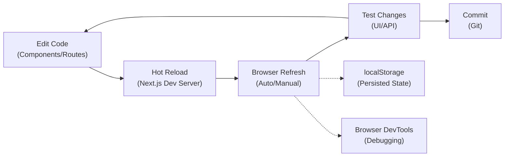
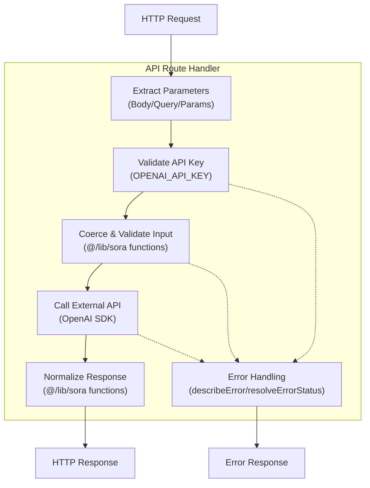
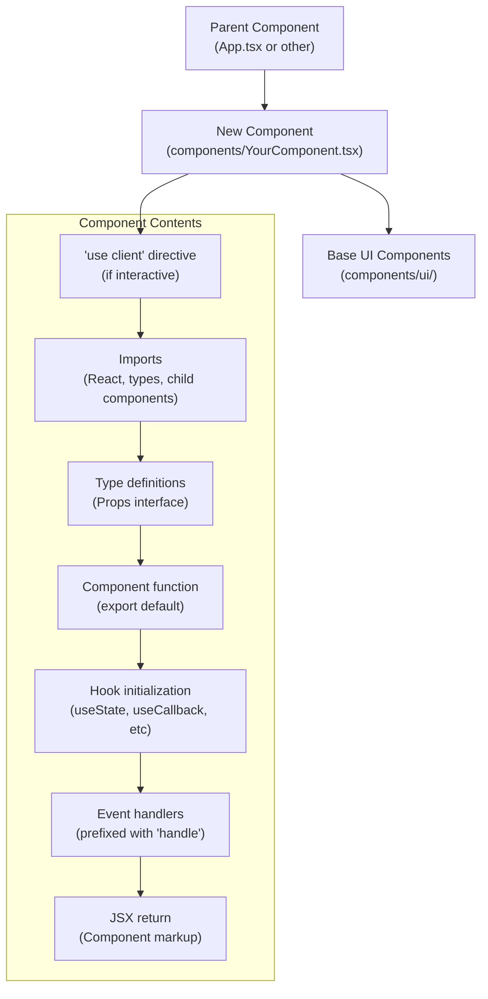
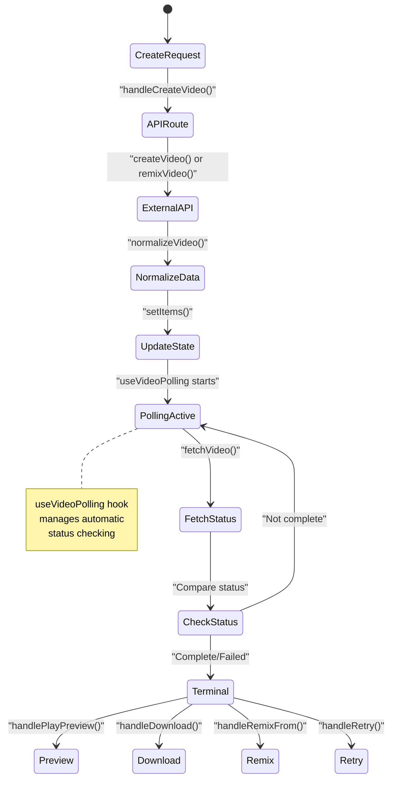

<!-- source: DeepWiki mcp.deepwiki.com · repo openai/openai-sora-sample-app · page 9 Development Guide · fetched 2026-10-26 -->

# Development Guide

<details>
<summary>Relevant source files</summary>

The following files were used as context for generating this wiki page:

- [.gitignore](.gitignore)
- [README.md](README.md)
- [components/App.tsx](components/App.tsx)

</details>


This document provides practical guidance for developers working on the Sora Sample App codebase. It covers project organization, development workflows, coding conventions, and patterns for extending the application with new features.

For initial setup and configuration, see [Getting Started](#2). For architectural concepts and system design, see [Architecture](#3). For detailed documentation of existing components and APIs, see [Frontend Components](#4) and [API Layer](#5).

---

## Development Environment Setup

The application is a Next.js 15 project using TypeScript, React 19, and Tailwind CSS. Development requires Node.js and npm.

### Required Tools

| Tool | Purpose | Configuration |
|------|---------|---------------|
| Node.js | Runtime environment | Version specified in package.json |
| npm | Package management | Used for dependency installation |
| TypeScript | Type checking | Configured via tsconfig.json |
| Next.js | Framework | App Router architecture |
| ESLint | Code linting | Configured via eslint.config.mjs |

### Environment Variables

All API routes require `OPENAI_API_KEY` at runtime. Optional variables include `OPENAI_BASE_URL` for custom endpoints. See [Configuration & Environment](#2.1) for complete details.

**Sources:** [README.md:32-40](), [.gitignore:33-34]()

---

## Project Structure

The codebase follows Next.js App Router conventions with clear separation between client components, API routes, and shared utilities.

### Directory Organization

```mermaid
graph TB
    Root["Repository Root"]
    
    App["app/<br/>(Next.js App Router)"]
    Components["components/<br/>(React Components)"]
    Hooks["hooks/<br/>(Custom Hooks)"]
    Lib["lib/<br/>(Shared Utilities)"]
    Services["services/<br/>(API Clients)"]
    Utils["utils/<br/>(Helper Functions)"]
    Public["public/<br/>(Static Assets)"]
    
    Root --> App
    Root --> Components
    Root --> Hooks
    Root --> Lib
    Root --> Services
    Root --> Utils
    Root --> Public
    
    AppLayout["layout.tsx<br/>(Root Layout)"]
    AppPage["page.tsx<br/>(Main Page)"]
    AppAPI["api/<br/>(Route Handlers)"]
    AppGlobals["globals.css<br/>(Global Styles)"]
    
    App --> AppLayout
    App --> AppPage
    App --> AppAPI
    App --> AppGlobals
    
    APIGenerate["generate-video/route.ts"]
    APIRemix["remix-video/route.ts"]
    APIVideos["videos/[id]/route.ts"]
    APIContent["videos/[id]/content/route.ts"]
    APIImages["generate-images/route.ts"]
    APISuggest["suggest-prompt/route.ts"]
    APITitle["video-title/route.ts"]
    
    AppAPI --> APIGenerate
    AppAPI --> APIRemix
    AppAPI --> APIVideos
    AppAPI --> APIContent
    AppAPI --> APIImages
    AppAPI --> APISuggest
    AppAPI --> APITitle
    
    CompApp["App.tsx<br/>(Main Orchestrator)"]
    CompForm["VideoForm.tsx"]
    CompSidebar["VideoSidebar.tsx"]
    CompCard["VideoCard.tsx"]
    CompPreview["VideoPreviewOverlay.tsx"]
    CompUI["ui/<br/>(Base Components)"]
    
    Components --> CompApp
    Components --> CompForm
    Components --> CompSidebar
    Components --> CompCard
    Components --> CompPreview
    Components --> CompUI
    
    HookState["usePersistedState.ts"]
    HookForm["useVideoForm.ts"]
    HookPreview["usePreview.ts"]
    HookPolling["useVideoPolling.ts"]
    HookThumbs["useThumbnails.ts"]
    
    Hooks --> HookState
    Hooks --> HookForm
    Hooks --> HookPreview
    Hooks --> HookPolling
    Hooks --> HookThumbs
    
    LibSora["sora.ts<br/>(Video Utilities)"]
    
    Lib --> LibSora
    
    ServAPI["soraApi.ts<br/>(API Service Layer)"]
    
    Services --> ServAPI
    
    UtilsVideo["video.ts"]
    UtilsTitles["titles.ts"]
    
    Utils --> UtilsVideo
    Utils --> UtilsTitles
```



**Key Directories:**

- **`app/`**: Next.js App Router structure containing pages, layouts, and API routes
- **`components/`**: React components organized by feature, with `ui/` subdirectory for base components
- **`hooks/`**: Custom React hooks for state management and side effects
- **`lib/`**: Shared utility modules, notably `sora.ts` for video data handling
- **`services/`**: Client-side API service layer for communicating with route handlers
- **`utils/`**: Helper functions for formatting, validation, and data transformation
- **`public/`**: Static assets served directly

**Sources:** [README.md:1-118]()

---

## Development Workflow

### Running the Development Server

```bash
npm install
npm run dev
```

The application runs at `http://localhost:3000` with hot module reloading enabled.

### Development Flow Diagram



### Common Development Commands

| Command | Purpose |
|---------|---------|
| `npm run dev` | Start development server |
| `npm run build` | Build production bundle |
| `npm run start` | Run production server |
| `npm run lint` | Run ESLint checks |

**Sources:** [README.md:49-62]()

---

## Code Conventions and Patterns

### TypeScript Usage

All source files use TypeScript with strict type checking enabled. Key patterns:

- **Type imports**: Use `import type` for type-only imports to optimize bundle size
- **Type coercion**: Centralized in `@/lib/sora` for consistent handling of API responses
- **Type definitions**: Located in utility modules, e.g., `VideoItem` in [utils/video.ts]()

### Component Patterns

#### Client Component Declaration

All interactive components must include `"use client"` directive:

```typescript
"use client";

import { useState } from "react";
// Component implementation
```

**Example:** [components/App.tsx:1]()

#### Component Organization

Components follow a consistent structure:

1. Imports (React, types, child components, hooks, utilities)
2. Type definitions for props/state
3. Component function
4. Custom hooks initialization
5. Event handlers (using `useCallback`)
6. Effects (using `useEffect`)
7. JSX return

**Example:** [components/App.tsx:72-783]()

### Custom Hook Pattern

Custom hooks encapsulate reusable stateful logic:

```typescript
function useHookName(params) {
  const [state, setState] = useState(initialValue);
  
  const handler = useCallback(() => {
    // Logic
  }, [dependencies]);
  
  return { state, handler };
}
```

Hooks are located in `hooks/` directory and follow `use*` naming convention.

**Sources:** [components/App.tsx:1-783]()

---

## API Route Pattern

All API routes follow a consistent pattern for reliability and maintainability.

### Standard API Route Structure



### API Route Template

Every route in `app/api/` follows this structure:

1. **Import required modules** from OpenAI SDK and `@/lib/sora`
2. **Extract request data** from body, query parameters, or URL params
3. **Validate API key** existence and format
4. **Coerce inputs** using functions like `coerceVideoModel`, `coerceVideoSize`, `coerceVideoSeconds`
5. **Call external service** with validated parameters
6. **Normalize response** using functions like `normalizeVideoResponse`
7. **Handle errors** with `describeError` and `resolveErrorStatus`

**Sources:** Architecture diagrams provided

---

## Adding New Features

### Adding a New API Endpoint

#### Step 1: Create Route Handler

Create file in `app/api/[endpoint-name]/route.ts`:

```typescript
import { NextRequest, NextResponse } from "next/server";
import OpenAI from "openai";
import { coerceVideoModel, describeError, resolveErrorStatus } from "@/lib/sora";

export async function POST(request: NextRequest) {
  try {
    // 1. Validate API key
    const apiKey = process.env.OPENAI_API_KEY;
    if (!apiKey) {
      return NextResponse.json(
        { error: "Missing API key" },
        { status: 500 }
      );
    }

    // 2. Parse request body
    const body = await request.json();
    
    // 3. Coerce and validate inputs
    const model = coerceVideoModel(body.model);
    
    // 4. Call OpenAI API
    const client = new OpenAI({ apiKey });
    const response = await client.someMethod({
      model,
      // other params
    });

    // 5. Return normalized response
    return NextResponse.json(response);
    
  } catch (error) {
    const status = resolveErrorStatus(error);
    const message = describeError(error);
    return NextResponse.json({ error: message }, { status });
  }
}
```

#### Step 2: Add Service Layer Function

Create wrapper in `services/soraApi.ts`:

```typescript
export async function yourNewEndpoint<T>(params: YourParams): Promise<T> {
  const response = await fetch("/api/your-endpoint", {
    method: "POST",
    headers: { "Content-Type": "application/json" },
    body: JSON.stringify(params),
  });
  
  if (!response.ok) {
    const error = await response.json();
    throw new Error(error.error || "Request failed");
  }
  
  return response.json();
}
```

#### Step 3: Use in Components

Import and use the service function:

```typescript
import { yourNewEndpoint } from "@/services/soraApi";

const handleAction = async () => {
  try {
    const result = await yourNewEndpoint({ /* params */ });
    // Handle result
  } catch (error) {
    console.error("Action failed", error);
  }
};
```

**Sources:** Architecture diagrams, [components/App.tsx:36-43]()

---

### Adding a New UI Component

#### Component Structure



#### Step 1: Create Component File

Create `components/YourComponent.tsx`:

```typescript
"use client";

import { useCallback, useState } from "react";
import { Button } from "@/components/ui/button";

interface YourComponentProps {
  onAction: () => void;
  // other props
}

export default function YourComponent({ onAction }: YourComponentProps) {
  const [localState, setLocalState] = useState(initialValue);
  
  const handleClick = useCallback(() => {
    // Logic
    onAction();
  }, [onAction]);
  
  return (
    <div className="your-classes">
      <Button onClick={handleClick}>Action</Button>
    </div>
  );
}
```

#### Step 2: Integrate with Parent

Add to `App.tsx` or other parent component:

```typescript
import YourComponent from "@/components/YourComponent";

// In component body:
const handleYourAction = useCallback(() => {
  // Handle action
}, [dependencies]);

// In JSX:
<YourComponent onAction={handleYourAction} />
```

#### Step 3: Add Styling

Use Tailwind utility classes or add custom styles to `app/globals.css` using CSS custom properties:

```css
.your-custom-class {
  color: var(--color-foreground);
  background: var(--color-background);
}
```

**Sources:** [components/App.tsx:1-783]()

---

### Adding a New State Management Hook

Custom hooks centralize stateful logic for reusability:

#### Step 1: Create Hook File

Create `hooks/useYourHook.ts`:

```typescript
import { useCallback, useState } from "react";

interface UseYourHookOptions {
  // Options
}

export default function useYourHook(options: UseYourHookOptions) {
  const [state, setState] = useState(initialValue);
  
  const action = useCallback(async () => {
    // Logic
    setState(newValue);
  }, [dependencies]);
  
  return {
    state,
    action,
  };
}
```

#### Step 2: Use in Components

```typescript
import useYourHook from "@/hooks/useYourHook";

const { state, action } = useYourHook({ options });
```

**Sources:** [components/App.tsx:15-19]()

---

## Key Development Patterns

### Pattern 1: Video Lifecycle Management



**Key Functions:**
- [components/App.tsx:215-374]() - `handleCreateVideo`
- [components/App.tsx:376-404]() - `handleDownload`
- [components/App.tsx:475-494]() - `handleRemixFrom`
- [components/App.tsx:507-540]() - `handleRetry`

### Pattern 2: Error Handling

Errors are handled consistently across all API routes using `@/lib/sora` utilities:

```typescript
try {
  // API call
} catch (error) {
  const status = resolveErrorStatus(error);
  const message = describeError(error);
  return NextResponse.json({ error: message }, { status });
}
```

**Key Functions:**
- `describeError` - Converts errors to human-readable messages
- `resolveErrorStatus` - Maps errors to appropriate HTTP status codes

### Pattern 3: Data Coercion

All API inputs are coerced to valid values using `@/lib/sora` functions:

```typescript
import { coerceVideoModel, coerceVideoSize, coerceVideoSeconds } from "@/lib/sora";

const model = coerceVideoModel(rawModel);
const size = coerceVideoSize(rawSize, model);
const seconds = coerceVideoSeconds(rawSeconds);
```

This ensures type safety and valid values even with untrusted input.

### Pattern 4: State Persistence

The `usePersistedState` hook provides localStorage integration:

```typescript
const [items, setItems] = usePersistedState<VideoItem[]>("sora.items", []);
```

Data is automatically serialized to/from localStorage with the specified key.

**Example:** [components/App.tsx:73]()

**Sources:** [components/App.tsx:1-783](), Architecture diagrams

---

## Testing and Debugging

### Local Storage Management

Video history and preferences persist in browser localStorage:

| Key | Content | Purpose |
|-----|---------|---------|
| `sora.items` | `VideoItem[]` | Video generation history |
| `sora.preview` | Preview state | Preview URLs cache |

**Debugging:** Use browser DevTools → Application → Local Storage to inspect or clear data.

### API Testing

Test API routes directly using curl or Postman:

```bash
curl -X POST http://localhost:3000/api/generate-video \
  -H "Content-Type: application/json" \
  -d '{"prompt":"test","model":"sora-2","size":"1280x720","seconds":"4"}'
```

### Console Logging

The application uses `console.error` and `console.log` throughout for debugging. Key locations:

- [components/App.tsx:140-142]() - Preview prefetch errors
- [components/App.tsx:186]() - Video refresh errors
- [components/App.tsx:350-355]() - Video creation errors

### Network Debugging

Monitor API calls in browser DevTools → Network tab. Look for:
- `/api/generate-video` - Video creation requests
- `/api/videos/[id]` - Status polling requests
- `/api/videos/[id]/content` - Video download requests

**Sources:** [components/App.tsx:1-783]()

---

## Common Development Tasks

### Task: Clear All Video History

```typescript
// In browser console:
localStorage.removeItem('sora.items');
location.reload();
```

### Task: Add New Video Model

1. Update `MODEL_OPTIONS` in `utils/video.ts`
2. Update `coerceVideoModel` validation in `@/lib/sora`
3. Update size compatibility in `sanitizeSizeForModel`

### Task: Modify Video Form Fields

1. Add state to `useVideoForm` hook
2. Add UI input to `VideoForm` component
3. Pass new parameter to `createVideo` or `remixVideo` service function
4. Update API route to handle new parameter

### Task: Add New AI Integration

1. Create new API route in `app/api/[endpoint]/route.ts`
2. Add service function to `services/soraApi.ts`
3. Create UI trigger in appropriate component
4. Add state management if needed

**Sources:** [README.md:64-110](), [components/App.tsx:1-783]()

---

## Environment and Configuration Files

| File | Purpose | Should Commit? |
|------|---------|----------------|
| `.env.local` | Local API keys | No (in .gitignore) |
| `.gitignore` | Files to exclude | Yes |
| `tsconfig.json` | TypeScript config | Yes |
| `tailwind.config.ts` | Tailwind settings | Yes |
| `next.config.ts` | Next.js config | Yes |
| `package.json` | Dependencies | Yes |
| `eslint.config.mjs` | Linting rules | Yes |

**Important:** Never commit `.env*` files containing API keys.

**Sources:** [.gitignore:33-34](), [README.md:36-40]()

---

## Contributing Guidelines

The repository accepts contributions but reviews may be limited. When contributing:

1. **Follow existing patterns** - Match the coding style and architecture
2. **Test thoroughly** - Verify changes work with actual API calls
3. **Update documentation** - Add comments and update README if needed
4. **Use TypeScript strictly** - Maintain type safety throughout
5. **Handle errors gracefully** - Use centralized error handling utilities

**Sources:** [README.md:111-113]()

---

