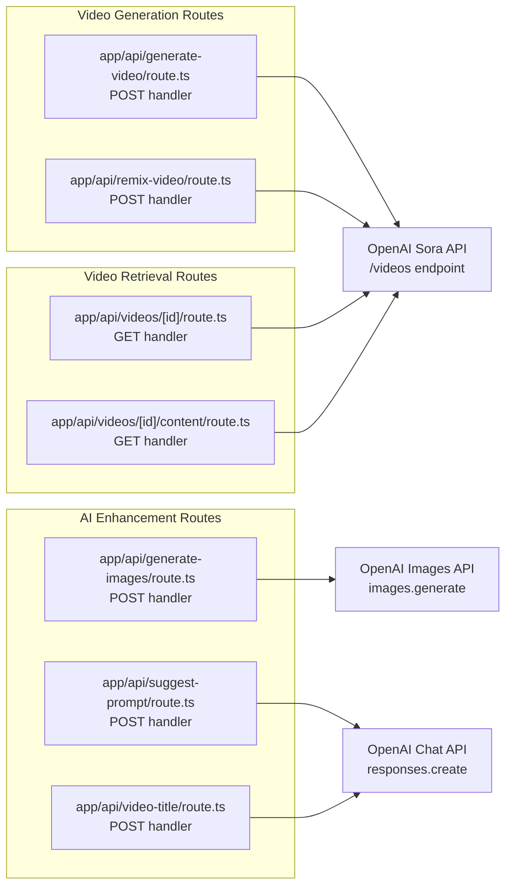
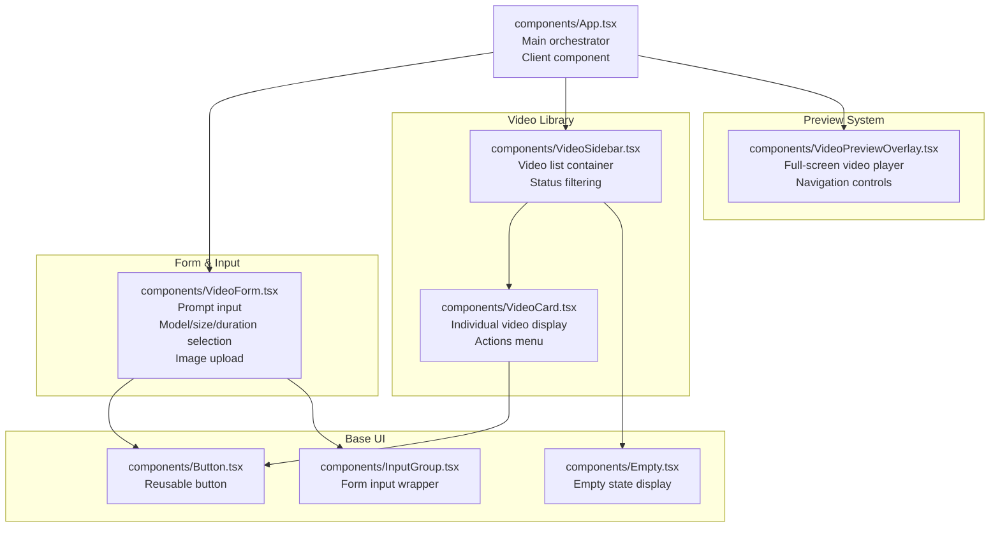
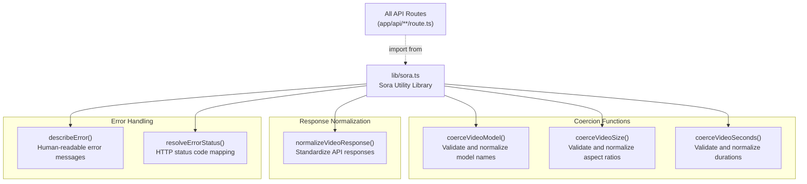
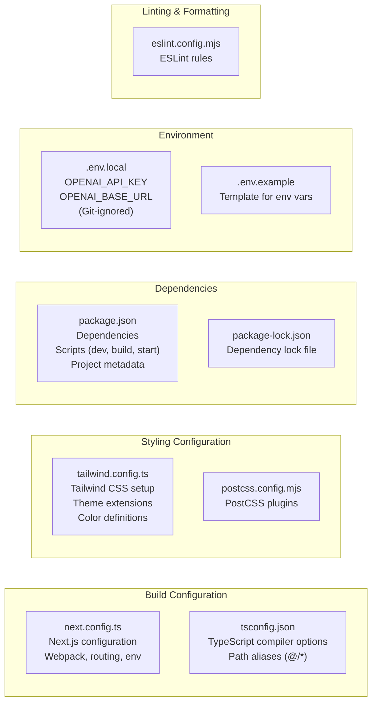

<!-- source: DeepWiki mcp.deepwiki.com · repo openai/openai-sora-sample-app · page 9.1 Project Structure · fetched 2026-10-26 -->

# Project Structure

<details>
<summary>Relevant source files</summary>

The following files were used as context for generating this wiki page:

- [README.md](README.md)
- [app/layout.tsx](app/layout.tsx)
- [app/page.tsx](app/page.tsx)

</details>


## Purpose and Scope

This document describes the physical organization of files and directories in the Sora Sample App repository. It explains how the Next.js App Router structure is utilized, where different types of code reside, and the conventions followed for organizing components, API routes, utilities, and configuration files.

For information about the logical architecture and data flow patterns, see [Architecture](#3). For guidance on extending the application with new features, see [Adding New Features](#9.2).

## Directory Layout Overview

The application follows the Next.js 13+ App Router convention, where the `app/` directory contains both page components and API routes. Shared code lives in top-level directories (`components/`, `lib/`, `utils/`) and is imported using the `@/` path alias.

```mermaid
graph TB
    Root["Repository Root"]
    
    Root --> App["app/<br/>(Next.js App Router)"]
    Root --> Components["components/<br/>(React Components)"]
    Root --> Lib["lib/<br/>(Shared Libraries)"]
    Root --> Utils["utils/<br/>(Helper Functions)"]
    Root --> Public["public/<br/>(Static Assets)"]
    Root --> Config["Configuration Files"]
    
    App --> AppLayout["layout.tsx<br/>(Root Layout)"]
    App --> AppPage["page.tsx<br/>(Home Page)"]
    App --> AppGlobals["globals.css<br/>(Global Styles)"]
    App --> ApiDir["api/<br/>(API Routes)"]
    
    ApiDir --> GenVideo["generate-video/route.ts"]
    ApiDir --> RemixVideo["remix-video/route.ts"]
    ApiDir --> GenImages["generate-images/route.ts"]
    ApiDir --> SuggestPrompt["suggest-prompt/route.ts"]
    ApiDir --> VideoTitle["video-title/route.ts"]
    ApiDir --> VideosDir["videos/[id]/<br/>(Dynamic Routes)"]
    
    VideosDir --> VideoStatus["route.ts<br/>(Status Polling)"]
    VideosDir --> VideoContent["content/route.ts<br/>(Binary Content)"]
    
    Components --> AppComp["App.tsx<br/>(Main Orchestrator)"]
    Components --> VideoForm["VideoForm.tsx"]
    Components --> VideoSidebar["VideoSidebar.tsx"]
    Components --> VideoCard["VideoCard.tsx"]
    Components --> VideoPreview["VideoPreviewOverlay.tsx"]
    Components --> BaseUI["Base UI Components"]
    
    Lib --> SoraLib["sora.ts<br/>(Sora Utilities)"]
    
    Utils --> UtilFns["Formatters & Helpers"]
    
    Public --> Assets["Images & Icons"]
    
    Config --> Package["package.json"]
    Config --> TSConfig["tsconfig.json"]
    Config --> TailwindConfig["tailwind.config.ts"]
    Config --> NextConfig["next.config.ts"]
    Config --> EnvLocal[".env.local<br/>(Git-ignored)"]
```



**Sources:** [README.md:1-118](), [app/layout.tsx:1-54](), [app/page.tsx:1-7]()

## Next.js App Router Structure

The application uses the Next.js App Router (version 13+), which co-locates routing, layouts, and API routes within the `app/` directory. This structure provides file-system based routing where folders define URL segments and special files define UI and behavior.

### Core App Files

| File | Purpose | Key Responsibilities |
|------|---------|---------------------|
| `app/layout.tsx` | Root Layout | Defines HTML structure, loads fonts (Geist Sans, Geist Mono), implements dark mode script, sets metadata |
| `app/page.tsx` | Home Page | Renders the main `App` component (client-side) |
| `app/globals.css` | Global Styles | Defines CSS custom properties for theming, Tailwind directives, component-specific styles |

The root layout [app/layout.tsx:24-53]() wraps all pages and includes:
- Font configuration using `next/font/google`
- Metadata for SEO and browser tabs
- An inline script for system theme detection [app/layout.tsx:29-39]()
- CSS variable assignment via className

The home page [app/page.tsx:1-7]() is a minimal client component that delegates all logic to the `App` component.

**Sources:** [app/layout.tsx:1-54](), [app/page.tsx:1-7]()

## API Routes Organization

API routes live under `app/api/` and follow Next.js conventions where each route is a `route.ts` file exporting HTTP method handlers (`GET`, `POST`, etc.). Dynamic segments use bracket notation `[param]`.



### Route Directory Mapping

| API Route Path | File System Location | HTTP Method | Purpose |
|---------------|---------------------|-------------|---------|
| `/api/generate-video` | `app/api/generate-video/route.ts` | POST | Create new video from prompt and optional image |
| `/api/remix-video` | `app/api/remix-video/route.ts` | POST | Remix existing video with new parameters |
| `/api/videos/:id` | `app/api/videos/[id]/route.ts` | GET | Poll video generation status |
| `/api/videos/:id/content` | `app/api/videos/[id]/content/route.ts` | GET | Fetch binary video content |
| `/api/generate-images` | `app/api/generate-images/route.ts` | POST | Generate image suggestions |
| `/api/suggest-prompt` | `app/api/suggest-prompt/route.ts` | POST | Optimize user prompt |
| `/api/video-title` | `app/api/video-title/route.ts` | POST | Generate descriptive title |

All routes follow a consistent pattern: validate API key, parse/coerce input using `@/lib/sora` utilities, call external service, normalize response, and handle errors uniformly. See [API Layer](#5) for detailed endpoint documentation.

**Sources:** [README.md:14-91](), High-level diagrams (Diagram 1, Diagram 6)

## Component Organization

React components are organized in the `components/` directory with a flat structure. The main application logic resides in `App.tsx`, while specialized components handle specific UI concerns.



### Component File Responsibilities

| Component File | Exports | Key Responsibilities |
|---------------|---------|---------------------|
| `components/App.tsx` | `App` | State management via hooks, event handlers, coordination between child components |
| `components/VideoForm.tsx` | `VideoForm` | User input collection, model/size/duration selection, image upload handling |
| `components/VideoSidebar.tsx` | `VideoSidebar` | Video library display, filtering, batch actions |
| `components/VideoCard.tsx` | `VideoCard` | Individual video item rendering, action buttons (remix, retry, download, preview) |
| `components/VideoPreviewOverlay.tsx` | `VideoPreviewOverlay` | Full-screen video playback, navigation between videos |
| `components/Button.tsx` | `Button` | Styled button component with loading states |
| `components/Empty.tsx` | `Empty` | Empty state message display |
| `components/InputGroup.tsx` | `InputGroup` | Labeled form input wrapper |

The `App` component serves as the central orchestrator, managing state through custom hooks and passing props and callbacks to child components. See [Application Shell](#4.1) for detailed component hierarchy documentation.

**Sources:** High-level diagrams (Diagram 1, Diagram 3)

## Shared Libraries and Utilities

### Library Structure

The `lib/` directory contains business logic libraries shared across the application. Currently, it houses the critical `sora.ts` module:



**Key exports from `lib/sora.ts`:**
- Type definitions: `SoraModel`, `VideoSize`, `VideoDuration`
- Coercion functions: `coerceVideoModel`, `coerceVideoSize`, `coerceVideoSeconds`
- Response normalizers: `normalizeVideoResponse`
- Error utilities: `describeError`, `resolveErrorStatus`

### Utility Functions

The `utils/` directory contains general-purpose helper functions used primarily in the frontend:

| Utility Category | Location | Purpose |
|-----------------|----------|---------|
| Formatters | `utils/` | Format timestamps, file sizes, durations for display |
| Helpers | `utils/` | Common operations like debouncing, validation, data transformation |

These utilities are imported using the `@/utils` path alias throughout components.

**Sources:** High-level diagrams (Diagram 2, Diagram 5)

## Static Assets and Public Files

The `public/` directory contains static assets served directly by Next.js:

| Asset Type | Files | Usage |
|-----------|-------|-------|
| Icons | `sora-2.png` | Application favicon [app/layout.tsx:20-21]() |
| Images | `sora-demo-visual.jpg` | README documentation [README.md:10]() |

Static files in `public/` are accessible at the root URL path (e.g., `/sora-2.png`).

**Sources:** [README.md:10](), [app/layout.tsx:20-21]()

## Configuration Files

Configuration files at the repository root define build behavior, TypeScript settings, styling, and dependencies:



### Key Configuration Files

| File | Purpose | Key Settings |
|------|---------|-------------|
| `tsconfig.json` | TypeScript configuration | Path aliases: `@/*` maps to `./*`, allowing imports like `@/components/App` |
| `next.config.ts` | Next.js configuration | Build settings, API routes, static file handling |
| `tailwind.config.ts` | Tailwind CSS configuration | Custom colors, theme extensions, dark mode support |
| `package.json` | Project manifest | Dependencies: `next`, `react`, `openai` SDK; Scripts: `dev`, `build`, `start`, `lint` |
| `.env.local` | Environment variables | `OPENAI_API_KEY`, optional `OPENAI_BASE_URL` (git-ignored for security) |

The TypeScript path alias configuration enables clean imports throughout the codebase. Instead of relative paths like `../../components/App`, code uses `@/components/App`.

**Sources:** [README.md:31-40]()

## Path Alias Convention

The `@/` prefix is configured in `tsconfig.json` as a path alias pointing to the repository root. This convention is used consistently throughout the codebase:

```typescript
// Instead of relative imports:
import { App } from '../../components/App';
import { coerceVideoModel } from '../../lib/sora';

// Use path alias imports:
import { App } from '@/components/App';
import { coerceVideoModel } from '@/lib/sora';
```

**Common import patterns:**
- `@/components/*` - React components
- `@/lib/*` - Shared business logic libraries
- `@/utils/*` - Helper functions
- `@/app/*` - Page components and API routes (less common, usually imported implicitly)

This convention improves code readability and makes refactoring easier since import paths don't break when moving files.

**Sources:** High-level diagrams (Diagram 1, Diagram 2)

## File Naming Conventions

The project follows Next.js and React community conventions for file naming:

| File Type | Convention | Examples |
|-----------|-----------|----------|
| React Components | PascalCase | `App.tsx`, `VideoForm.tsx`, `VideoCard.tsx` |
| API Routes | `route.ts` in named directory | `app/api/generate-video/route.ts` |
| Utility Libraries | camelCase | `lib/sora.ts`, `utils/formatters.ts` |
| Style Files | lowercase with extension | `globals.css` |
| Configuration | lowercase with dots | `next.config.ts`, `tailwind.config.ts` |

Dynamic route segments use bracket notation (e.g., `[id]`) as specified by Next.js App Router conventions.

**Sources:** [app/layout.tsx:1-54](), [app/page.tsx:1-7]()

## Development Workflow Files

Additional files support the development workflow:

| File | Purpose |
|------|---------|
| `.gitignore` | Excludes `node_modules/`, `.next/`, `.env.local`, build artifacts |
| `README.md` | Project documentation, setup instructions, feature overview |
| `LICENSE` | MIT license file |
| `eslint.config.mjs` | Linting rules for code quality |

The `.gitignore` file ensures sensitive data (API keys in `.env.local`) and generated files (`.next/` build directory) are not committed to version control.

**Sources:** [README.md:1-118]()

---

