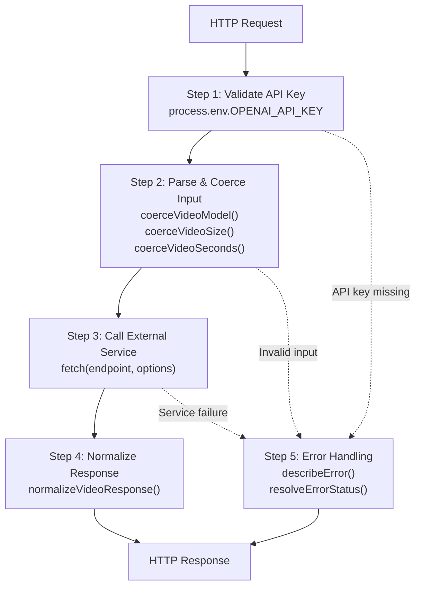
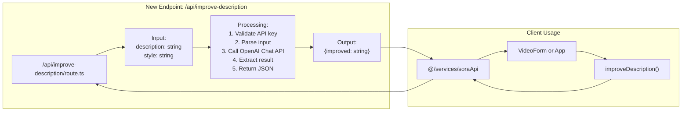
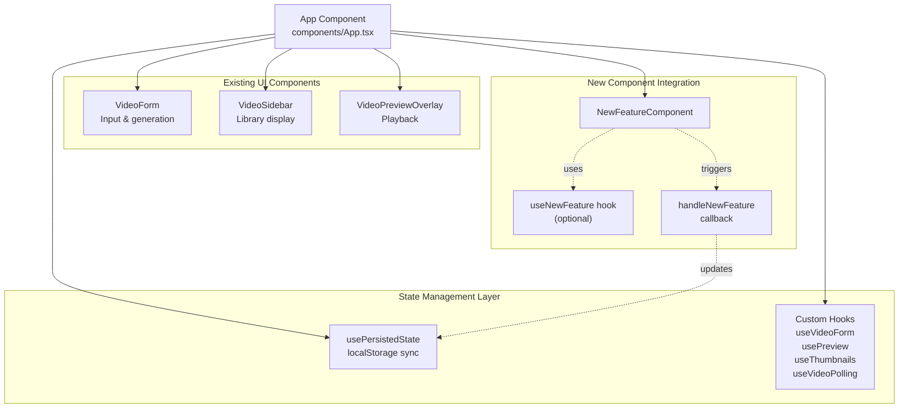
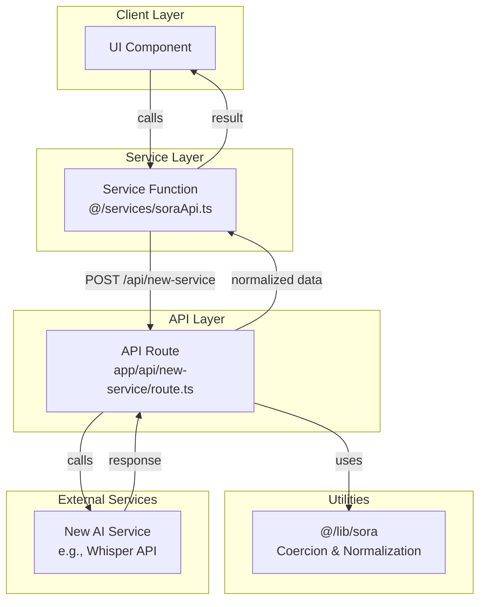
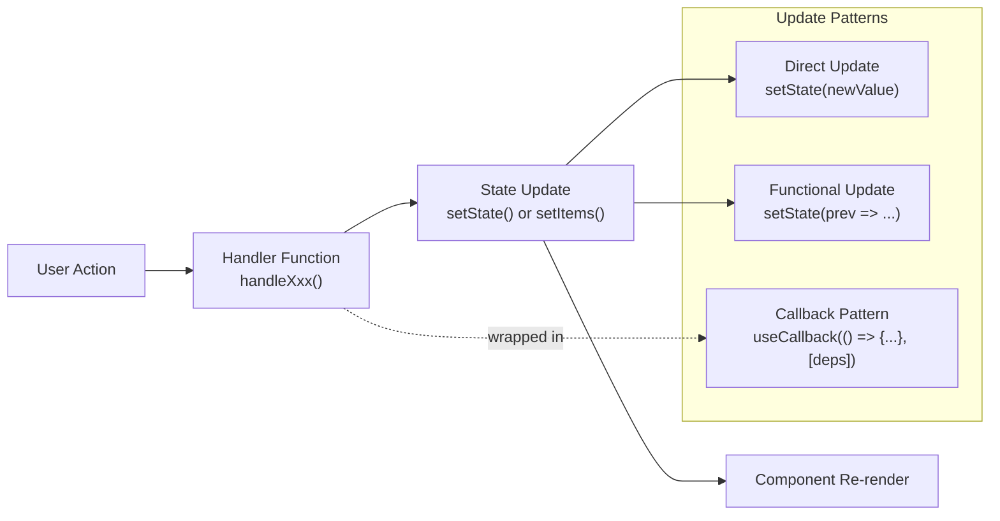

<!-- source: DeepWiki mcp.deepwiki.com · repo openai/openai-sora-sample-app · page 9.2 Adding New Features · fetched 2026-10-26 -->

# Adding New Features

<details>
<summary>Relevant source files</summary>

The following files were used as context for generating this wiki page:

- [app/api/generate-video/route.ts](app/api/generate-video/route.ts)
- [components/App.tsx](components/App.tsx)
- [components/VideoForm.tsx](components/VideoForm.tsx)

</details>


This document provides guidance for developers extending the Sora Sample App with new functionality. It covers the patterns and conventions for adding API endpoints, UI components, and external service integrations. For general project structure information, see [Project Structure](#9.1). For details on existing utilities, see [Sora Utility Library](#6.1).

## Overview of Extension Points

The application provides three primary extension points for new features:

| Extension Type | Location | Common Use Cases |
|---------------|----------|------------------|
| **API Endpoints** | `app/api/` | External service integration, data processing |
| **UI Components** | `components/` | User interactions, display logic |
| **Shared Utilities** | `lib/`, `utils/` | Cross-cutting logic, data transformations |
| **Custom Hooks** | `hooks/` | Reusable state management, side effects |

Sources: [app/api/generate-video/route.ts](), [components/App.tsx](), [components/VideoForm.tsx]()

## Adding New API Endpoints

### Standard API Route Pattern

All API routes follow a consistent five-step pattern established in the codebase:



**Diagram: API Route Processing Pattern**

Sources: [app/api/generate-video/route.ts:20-143]()

### Implementation Template

When creating a new API endpoint, follow this structure:

**Step 1: API Key Validation** [app/api/generate-video/route.ts:21-25]()
```typescript
const apiKey = process.env.OPENAI_API_KEY?.trim();
if (!apiKey) {
  return Response.json(
    { error: { message: "OPENAI_API_KEY is not configured" } },
    { status: 500 }
  );
}
```

**Step 2: Input Parsing and Coercion** [app/api/generate-video/route.ts:27-56]()
- Use `isRecord()` to safely check payload structure
- Apply coercion functions from `@/lib/sora` for type safety
- Validate required fields early

**Step 3: External Service Call** [app/api/generate-video/route.ts:68-122]()
- Construct endpoint URL from `process.env.OPENAI_BASE_URL`
- Include organization/project headers if configured
- Handle both JSON and FormData payloads as needed

**Step 4: Response Normalization** [app/api/generate-video/route.ts:135-136]()
- Use normalization functions from `@/lib/sora`
- Ensure consistent response structure

**Step 5: Error Handling** [app/api/generate-video/route.ts:137-142]()
- Use `describeError()` for human-readable messages
- Use `resolveErrorStatus()` for HTTP status codes
- Always return structured error JSON

Sources: [app/api/generate-video/route.ts]()

### Example: Adding a New AI Enhancement Endpoint



**Diagram: New Endpoint Integration Flow**

Create the endpoint file at `app/api/improve-description/route.ts`:

1. **Define input types** using coercion patterns
2. **Implement POST handler** following the five-step pattern
3. **Add service function** in `services/soraApi.ts`
4. **Integrate with UI** by calling the service from components

Sources: [app/api/generate-video/route.ts](), [components/App.tsx:36-43]()

## Adding New UI Components

### Component Integration Points



**Diagram: Component Integration Architecture**

Sources: [components/App.tsx:72-783](), [components/VideoForm.tsx]()

### Component Development Pattern

**1. Create the Component File**

Place new components in `components/` directory. Use TypeScript with explicit prop types:

```typescript
// components/NewFeature.tsx
export interface NewFeatureProps {
  data: DataType;
  onAction: (result: ResultType) => void;
  loading?: boolean;
}

export function NewFeature({ data, onAction, loading }: NewFeatureProps) {
  // Implementation
}
```

**2. Add State Management Hook (if needed)**

For complex state, create a custom hook in `hooks/`:

```typescript
// hooks/useNewFeature.ts
export function useNewFeature(initialValue: Type) {
  const [state, setState] = useState<Type>(initialValue);
  
  const updateState = useCallback((newValue: Type) => {
    setState(newValue);
  }, []);
  
  return { state, updateState };
}
```

Pattern reference: [components/App.tsx:103-125]() shows the `useVideoForm` integration pattern.

**3. Integrate with App Component**

Add state and handlers to `App` component [components/App.tsx]():

```typescript
// In App component
const { state, updateState } = useNewFeature(initialValue);

const handleNewFeatureAction = useCallback(async (input: InputType) => {
  try {
    const result = await callService(input);
    updateState(result);
  } catch (error) {
    console.error('Action failed', error);
  }
}, [updateState]);

// Pass to component
<NewFeature 
  data={state}
  onAction={handleNewFeatureAction}
/>
```

**4. Use Shared UI Components**

Leverage existing base components from `components/ui/`:
- `Button` for actions
- `Input` for text fields
- `Select` for dropdowns
- `Card` for content containers

Sources: [components/App.tsx](), [components/VideoForm.tsx](), [components/ui/button.tsx]()

### Styling Conventions

Follow the established styling patterns:

| Pattern | Usage | Example |
|---------|-------|---------|
| **Tailwind Classes** | Primary styling method | `className="flex items-center gap-2"` |
| **CSS Variables** | Theme-aware colors | `bg-card`, `text-foreground`, `border-border` |
| **Dark Mode** | Automatic via `.dark` class | `dark:bg-neutral-800` |
| **Component Variants** | Via `cn()` utility | [components/VideoForm.tsx:286-289]() |

Sources: [components/VideoForm.tsx](), [app/globals.css]()

## Adding New AI Service Integrations

### Service Integration Architecture



**Diagram: AI Service Integration Pattern**

Sources: [components/App.tsx:36-43](), [app/api/generate-video/route.ts]()

### Implementation Steps

**Step 1: Create Service Function**

Add the client-side service function to `services/soraApi.ts`:

```typescript
// services/soraApi.ts
export async function callNewAIService<T = unknown>(params: {
  input: string;
  options?: Record<string, unknown>;
}): Promise<T> {
  const response = await fetch('/api/new-service', {
    method: 'POST',
    headers: { 'Content-Type': 'application/json' },
    body: JSON.stringify(params),
  });
  
  if (!response.ok) {
    const error = await response.json().catch(() => null);
    throw new Error(error?.error?.message || 'Service call failed');
  }
  
  return response.json();
}
```

Pattern reference: [components/App.tsx:293-300]() shows service call pattern.

**Step 2: Create API Route**

Implement the API route following the standard pattern:

```typescript
// app/api/new-service/route.ts
import { describeError, resolveErrorStatus } from "@/lib/sora";

export async function POST(request: Request) {
  // Step 1: Validate API key
  const apiKey = process.env.OPENAI_API_KEY?.trim();
  if (!apiKey) {
    return Response.json(
      { error: { message: "OPENAI_API_KEY is not configured" } },
      { status: 500 }
    );
  }
  
  // Step 2: Parse input
  const payload = await request.json();
  
  // Step 3: Call external service
  try {
    const response = await fetch(externalServiceUrl, {
      method: 'POST',
      headers: {
        'Authorization': `Bearer ${apiKey}`,
        'Content-Type': 'application/json',
      },
      body: JSON.stringify(payload),
    });
    
    // Step 4: Normalize response
    const result = await response.json();
    return Response.json(result);
    
  } catch (error) {
    // Step 5: Error handling
    const message = describeError(error, 'Service call failed');
    const status = resolveErrorStatus(error);
    return Response.json({ error: { message } }, { status });
  }
}
```

**Step 3: Add Utility Functions (if needed)**

If the new service requires specialized data handling, add coercion and normalization functions to `lib/sora/`:

```typescript
// lib/sora/newServiceUtils.ts
export function coerceNewServiceInput(value: unknown): string {
  if (typeof value === 'string' && value.trim()) {
    return value.trim();
  }
  return 'default-value';
}

export function normalizeNewServiceResponse(
  response: Record<string, unknown>
): NormalizedType {
  return {
    field: response.field ?? '',
    // ... other normalizations
  };
}
```

**Step 4: Integrate with UI**

Add UI controls and handlers in the appropriate component:

```typescript
// In App.tsx or relevant component
const [newServiceResult, setNewServiceResult] = useState<ResultType | null>(null);
const [newServiceLoading, setNewServiceLoading] = useState(false);

const handleCallNewService = useCallback(async (input: string) => {
  setNewServiceLoading(true);
  try {
    const result = await callNewAIService({ input });
    setNewServiceResult(result);
  } catch (error) {
    console.error('Service call failed', error);
  } finally {
    setNewServiceLoading(false);
  }
}, []);
```

Sources: [components/App.tsx:630-671](), [app/api/generate-video/route.ts]()

## Common Patterns and Best Practices

### State Update Patterns



**Diagram: State Management Patterns**

**Direct Updates** [components/App.tsx:241]()
- Use for simple state that doesn't depend on previous value
- Example: `setCurrentTitle("")`

**Functional Updates** [components/App.tsx:328-341]()
- Use when new state depends on previous state
- Ensures correct state with concurrent updates
- Example: `setItems(prev => [normalized, ...prev])`

**Callback Memoization** [components/App.tsx:215-374]()
- Wrap handlers in `useCallback` to prevent unnecessary re-renders
- Include all dependencies in dependency array
- Example: `const handleCreateVideo = useCallback(async () => {...}, [deps])`

Sources: [components/App.tsx]()

### Error Handling

All error handling should use the centralized utilities:

| Function | Purpose | Usage |
|----------|---------|-------|
| `describeError()` | Human-readable error messages | [app/api/generate-video/route.ts:126]() |
| `resolveErrorStatus()` | HTTP status code extraction | [app/api/generate-video/route.ts:127]() |
| `try-catch` blocks | Async error capture | [app/api/generate-video/route.ts:137-142]() |

```typescript
// Error handling pattern
try {
  const result = await externalCall();
  return Response.json(result);
} catch (error) {
  console.error('Operation failed', error);
  const message = describeError(error, 'Default message');
  const status = resolveErrorStatus(error);
  return Response.json({ error: { message } }, { status });
}
```

Sources: [app/api/generate-video/route.ts:137-142](), [lib/sora/]()

### Type Safety

Maintain type safety throughout the feature:

1. **Define explicit types** for props, state, and API responses
2. **Use coercion functions** for untrusted inputs [app/api/generate-video/route.ts:48-56]()
3. **Type guard functions** like `isRecord()` for runtime checks [app/api/generate-video/route.ts:37]()
4. **Generic type parameters** for flexible service functions [components/App.tsx:179]()

Sources: [app/api/generate-video/route.ts](), [lib/sora/]()

## Testing Considerations

When adding new features, ensure:

1. **API endpoints** can be tested independently via HTTP clients
2. **Service functions** handle both success and error cases
3. **Components** work with loading, error, and success states
4. **State updates** are idempotent and don't cause race conditions
5. **Error messages** are informative and actionable

Sources: [components/App.tsx](), [app/api/generate-video/route.ts]()

## Feature Integration Checklist

Before considering a new feature complete:

- [ ] API endpoint follows five-step pattern
- [ ] Coercion/normalization utilities added to `@/lib/sora` if needed
- [ ] Service function added to `services/soraApi.ts`
- [ ] Component integrated with App state management
- [ ] Handlers wrapped in `useCallback` with correct dependencies
- [ ] Error handling uses `describeError()` and `resolveErrorStatus()`
- [ ] Loading states implemented for async operations
- [ ] TypeScript types defined for all data structures
- [ ] Styling uses Tailwind classes and CSS variables
- [ ] Dark mode support verified (if UI changes)

Sources: [components/App.tsx](), [app/api/generate-video/route.ts](), [components/VideoForm.tsx]()