# Page: Overview

# Overview

<details>
<summary>Relevant source files</summary>

The following files were used as context for generating this wiki page:

- [LICENSE](LICENSE)
- [README.md](README.md)
- [components/App.tsx](components/App.tsx)

</details>


This document introduces the Sora Sample App repository. It explains the purpose of the project, its high-level architecture, and how the main systems and code entities relate to each other. The Sora Sample App is a frontend application for generating, remixing, and managing videos using OpenAI's Sora models and related AI services.

This page covers the overall system design, major workflows, and the mapping between user-facing features and code entities. For details on setup, see [Getting Started](#2). For a deep dive into the architecture, see [Architecture](#3).

---

## Purpose and Scope

The Sora Sample App demonstrates how to build a web-based video generation experience using OpenAI's Sora Video API, along with image and text generation models. It provides:

- A browser-based UI for entering prompts, configuring video parameters, and managing video runs.
- Integration with OpenAI APIs for video, image, and text generation.
- State management and persistence for user sessions and video history.
- A reference implementation for error handling, theming, and extensibility.

This document provides a high-level summary of the system, its main components, and how code entities map to user-facing features.

**For details on individual subsystems, see:**
- [Architecture](#3)
- [Frontend Components](#4)
- [API Layer](#5)
- [External Service Integration](#8)

**Sources:**  
[README.md:1-118]()

---

## High-Level System Architecture

The Sora Sample App follows a three-tier architecture:

1. **Client Layer (Browser):** React-based UI for user interaction and state management.
2. **API Layer (Next.js Routes):** Server-side endpoints for business logic and external API integration.
3. **External Services:** OpenAI APIs for video, image, and text generation.

### Diagram: "Overall System Architecture"

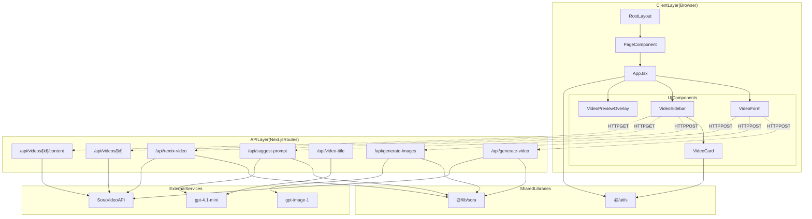

**Sources:**  
[README.md:1-118]()  
[components/App.tsx:1-783]()

---

## Mapping Features to Code Entities

The following table summarizes how user-facing features are implemented in code:

| Feature                        | Code Entity / File(s)                | Description                                      |
|---------------------------------|--------------------------------------|--------------------------------------------------|
| Video Generation (Prompt, Model, Size, Duration) | `VideoForm` (`components/VideoForm.tsx`), `App` (`components/App.tsx`) | UI for input, state management, and submission   |
| Video Remixing                 | `VideoSidebar`, `App`                | UI and logic for remixing existing videos        |
| Video Status Polling           | `useVideoPolling` (`hooks/useVideoPolling.ts`) | Polls video status from API                      |
| Video Preview & Download       | `VideoPreviewOverlay`, `App`         | Fullscreen preview and download logic            |
| Image Suggestions              | `generateImages` (`services/soraApi.ts`), `App` | Calls image generation API, manages results      |
| Prompt Optimization            | `suggestVideoPrompt` (`services/soraApi.ts`), `App` | Calls text generation API for prompt suggestions |
| State Persistence              | `usePersistedState` (`hooks/usePersistedState.ts`) | Persists video history in localStorage           |
| Error Handling                 | `@/lib/sora`                         | Centralized error formatting and status mapping  |

**Sources:**  
[components/App.tsx:1-783]()  
[README.md:12-21]()

---

## Bridging User Workflows to Code Entities

### Diagram: "User Workflow to Code Entity Mapping"

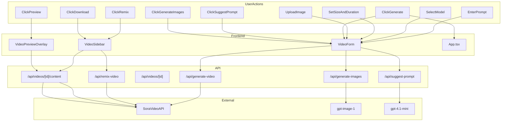

**Sources:**  
[components/App.tsx:1-783]()  
[README.md:64-110]()

---

## Key Integration Points

The application integrates with OpenAI services through well-defined API routes. Each route corresponds to a specific workflow:

| API Route                    | External Service      | Purpose                                 |
|------------------------------|----------------------|-----------------------------------------|
| `/api/generate-video`        | Sora Video API       | Create new video                        |
| `/api/remix-video`           | Sora Video API       | Remix existing video                    |
| `/api/videos/[id]`           | Sora Video API       | Poll video status                       |
| `/api/videos/[id]/content`   | Sora Video API       | Download video content                  |
| `/api/generate-images`       | gpt-image-1          | Generate image suggestions              |
| `/api/suggest-prompt`        | gpt-4.1-mini         | Suggest/optimize prompts                |
| `/api/video-title`           | gpt-4.1-mini         | Generate video titles                   |

**Sources:**  
[README.md:14-21, 64-110]()  
[components/App.tsx:36-43, 215-360]()

---

## Video Lifecycle Overview

Videos in the Sora Sample App follow a defined lifecycle:

1. **Form Input:** User enters parameters.
2. **Title Generation:** Optionally auto-generates a title.
3. **Batch Creation:** Supports multiple versions in one submission.
4. **Queued/In Progress:** Video jobs are queued and processed by the Sora API.
5. **Polling:** Status is polled until completion.
6. **Completed:** Video is available for preview, download, remix, or retry.
7. **Terminal States:** Completed, succeeded, or failed.

### Diagram: "Video Lifecycle State Machine"

```mermaid
stateDiagram-v2
    [*] --> "FormInput"
    "FormInput" --> "TitleGeneration": "ClickGenerate"
    "TitleGeneration" --> "BatchCreation": "requestVideoTitle()"
    "BatchCreation" --> "Creating": "Loop versionsCount"
    "Creating" --> "Queued": "createVideo/remixVideo"
    "Queued" --> "InProgress": "SoraAPI processing"
    "InProgress" --> "Polling": "useVideoPolling"
    "Polling" --> "InProgress": "Status not complete"
    "Polling" --> "Completed": "Status complete"
    "Completed" --> "Previewable": "Added to sidebar"
    "Completed" --> "Downloadable": "Can download"
    "Completed" --> "Remixable": "Can remix"
    "Previewable" --> "Previewing": "handlePlayPreview"
    "Downloadable" --> "Downloaded": "handleDownload"
    "Remixable" --> "FormInput": "handleRemixFrom"
    "InProgress" --> "Failed": "Error from API"
    "Failed" --> "Retrying": "handleRetry"
    "Retrying" --> "Creating"
    "Completed" --> "Refreshing": "handleRefreshVideo"
    "Refreshing" --> "Completed"
```

**Sources:**  
[components/App.tsx:215-360, 508-540]()  
[README.md:15-21, 93-110]()

---

## Licensing

The Sora Sample App is licensed under the MIT License.

**Sources:**  
[LICENSE:1-22]()  
[README.md:115-117]()

---

## Summary

The Sora Sample App provides a reference implementation for building video generation experiences using OpenAI's Sora models. It demonstrates best practices in API integration, state management, error handling, and user experience for generative video applications.

For further details on setup, architecture, or specific components, refer to the relevant sections in this documentation.

**Sources:**  
[README.md:1-118]()  
[components/App.tsx:1-783]()  
[LICENSE:1-22]()

---

# Page: Getting Started

# Getting Started

<details>
<summary>Relevant source files</summary>

The following files were used as context for generating this wiki page:

- [.gitignore](.gitignore)
- [README.md](README.md)

</details>


This page guides you through the initial setup, installation, and execution of the Sora Sample App. It covers prerequisites, repository cloning, dependency installation, basic configuration, and starting the development server. For detailed configuration options and environment variables, see [Configuration & Environment](#2.1).

## Prerequisites

Before installing the Sora Sample App, ensure you have the following:

| Requirement | Description | Verification Command |
|-------------|-------------|---------------------|
| **Sora API Access** | Limited availability access to OpenAI's Sora Video API | Obtain from [OpenAI waitlist](https://openai.com/waitlist/sora) or account team |
| **OpenAI API Key** | Valid API key with Sora permissions | Test at [platform.openai.com](https://platform.openai.com) |
| **Node.js** | JavaScript runtime (v18 or higher recommended) | `node --version` |
| **npm** | Package manager (included with Node.js) | `npm --version` |

**Sources:** [README.md:26-29]()

## Installation Flow

The following diagram illustrates the complete setup process from prerequisites through first run:

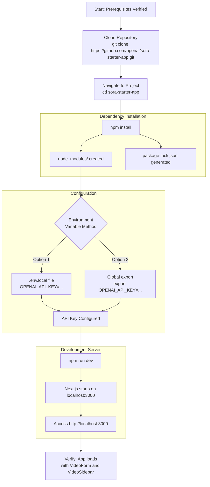

**Sources:** [README.md:42-62]()

## Step-by-Step Installation

### 1. Clone the Repository

```bash
git clone https://github.com/openai/sora-starter-app.git
cd sora-starter-app
```

This creates a local copy of the repository with the following structure:

```
sora-starter-app/
├── app/              # Next.js App Router directory
├── components/       # React components
├── lib/             # Shared utilities
├── public/          # Static assets
├── package.json     # Dependencies and scripts
└── tsconfig.json    # TypeScript configuration
```

**Sources:** [README.md:42-46]()

### 2. Install Dependencies

Run the following command in the project root:

```bash
npm install
```

This command:
- Reads dependency specifications from `package.json`
- Downloads and installs all required packages into `node_modules/`
- Generates `package-lock.json` for reproducible builds
- Installs Next.js, React, OpenAI SDK, and other required libraries

The `.gitignore` file ensures that `node_modules/` and build artifacts are excluded from version control.

**Sources:** [README.md:48-54](), [.gitignore:3-11]()

### 3. Configure Environment Variables

The application requires at minimum the `OPENAI_API_KEY` environment variable. You have two configuration options:

#### Option 1: Create `.env.local` File (Recommended)

Create a file named `.env.local` in the project root:

```bash
OPENAI_API_KEY="sk-proj-..."
```

The `.env.local` file is automatically:
- Loaded by Next.js at runtime
- Excluded from version control via `.gitignore` ([.gitignore:34]())
- Scoped to local development only

#### Option 2: Global Environment Export

Export the variable in your shell environment:

```bash
export OPENAI_API_KEY="sk-proj-..."
```

This makes the variable available system-wide but requires re-export in each new terminal session.

For complete environment variable documentation including `OPENAI_BASE_URL` and other optional settings, see [Configuration & Environment](#2.1).

**Sources:** [README.md:31-40](), [.gitignore:33-34]()

## Running the Development Server

### Start the Application

Execute the development script:

```bash
npm run dev
```

This command:
- Compiles TypeScript files
- Starts the Next.js development server
- Enables hot module replacement (HMR)
- Makes the app available at `http://localhost:3000`

### Development Server Initialization

The following diagram shows what happens when you run `npm run dev`:

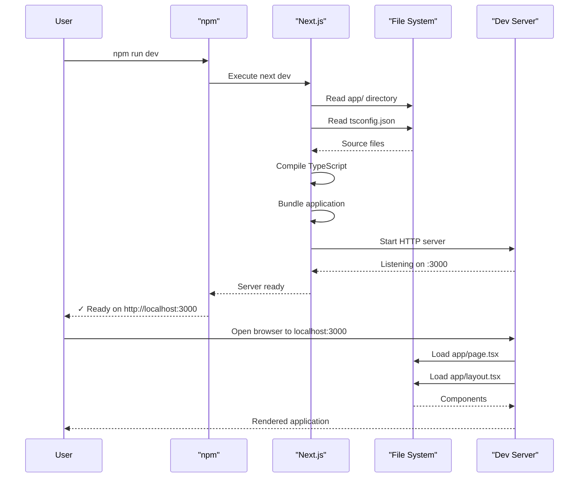

**Sources:** [README.md:57-62]()

## Verifying the Installation

Once the development server starts, navigate to `http://localhost:3000` in your browser. You should see:

| Component | Expected Behavior |
|-----------|------------------|
| **VideoForm** | Left panel with prompt input, model selector, size/duration options |
| **VideoSidebar** | Right panel labeled "History" (empty on first run) |
| **Theme Toggle** | Dark/light mode switcher in the interface |
| **API Key Status** | No error messages about missing API key |

### First Request Test

To verify the API integration is functional:

1. Enter a simple prompt in the text area (e.g., "A sunset over mountains")
2. Select a model from the dropdown (`sora-2` or `sora-2-pro`)
3. Click **Generate**
4. Observe that the request initiates without authentication errors

If you see authentication errors, verify your `OPENAI_API_KEY` is correctly set and you have Sora API access.

**Sources:** [README.md:68-73]()

## Project File Structure

After installation, your project contains these key directories and files:

```mermaid
graph TB
    Root["Project Root"]
    
    subgraph "Source Code"
        App["app/<br/>Next.js App Router"]
        Components["components/<br/>React UI Components"]
        Lib["lib/<br/>Shared Utilities"]
        Utils["utils/<br/>Helper Functions"]
    end
    
    subgraph "Configuration"
        PackageJSON["package.json<br/>Dependencies"]
        TSConfig["tsconfig.json<br/>TypeScript Config"]
        TailwindConfig["tailwind.config.ts<br/>Styling Config"]
        NextConfig["next.config.ts<br/>Next.js Config"]
    end
    
    subgraph "Runtime Files (Generated)"
        NodeModules["node_modules/<br/>Installed Packages"]
        NextDir[".next/<br/>Build Output"]
        EnvLocal[".env.local<br/>Environment Variables"]
    end
    
    subgraph "Static Assets"
        Public["public/<br/>Images & Fonts"]
    end
    
    Root --> App
    Root --> Components
    Root --> Lib
    Root --> Utils
    
    Root --> PackageJSON
    Root --> TSConfig
    Root --> TailwindConfig
    Root --> NextConfig
    
    Root --> NodeModules
    Root --> NextDir
    Root --> EnvLocal
    Root --> Public
```

**Sources:** [.gitignore:3-41](), [README.md:1-23]()

## Common Setup Issues

| Issue | Symptom | Resolution |
|-------|---------|-----------|
| **Missing API Key** | Error: "Missing OPENAI_API_KEY" on generation | Verify `.env.local` exists and contains valid key |
| **No Sora Access** | 403 Forbidden errors | Confirm Sora API access through OpenAI account |
| **Port Already in Use** | Error: "Port 3000 is already in use" | Stop other services on port 3000 or use `npm run dev -- -p 3001` |
| **Module Not Found** | TypeScript or import errors | Delete `node_modules/` and run `npm install` again |
| **Build Errors** | TypeScript compilation failures | Ensure Node.js version is 18+ |

## Next Steps

After successful installation and verification:

1. **Explore Configuration**: See [Configuration & Environment](#2.1) for advanced settings like `OPENAI_BASE_URL`
2. **Understand Architecture**: Review [Architecture](#3) to understand the three-tier design
3. **Generate Your First Video**: Follow the workflow in [Video Generation Endpoint](#5.1)
4. **Review Components**: Examine [Frontend Components](#4) to understand the UI structure

**Sources:** [README.md:64-110]()

---

# Page: Configuration & Environment

# Configuration & Environment

<details>
<summary>Relevant source files</summary>

The following files were used as context for generating this wiki page:

- [README.md](README.md)
- [app/api/generate-images/route.ts](app/api/generate-images/route.ts)
- [app/api/generate-video/route.ts](app/api/generate-video/route.ts)

</details>


This document details all environment variables, configuration options, and setup requirements for the Sora Sample App. It covers both required and optional environment variables, configuration methods, and how these settings propagate through the application. For information about the OpenAI service integration patterns, see [External Service Integration](#8).

## Environment Variables

The application requires specific environment variables to function correctly. All API routes validate these variables before processing requests.

### Required Variables

| Variable | Purpose | Validation Location |
|----------|---------|---------------------|
| `OPENAI_API_KEY` | Authentication token for OpenAI API requests | All API routes |

The `OPENAI_API_KEY` is the only mandatory configuration. Every API route performs validation at the entry point:

**Video Generation Routes:**
- [app/api/generate-video/route.ts:21-25]()
- [app/api/remix-video/route.ts:22-26]()

**AI Enhancement Routes:**
- [app/api/generate-images/route.ts:73-77]()
- [app/api/suggest-prompt/route.ts:26-30]()
- [app/api/video-title/route.ts:23-27]()

**Video Retrieval Routes:**
- [app/api/videos/[id]/route.ts:14-18]()
- [app/api/videos/[id]/content/route.ts:13-17]()

### Optional Variables

| Variable | Purpose | Default Value | Usage Location |
|----------|---------|---------------|----------------|
| `OPENAI_BASE_URL` | Custom API endpoint URL | `https://api.openai.com/v1` | [app/api/generate-video/route.ts:68-70]() |
| `OPENAI_ORG_ID` | Organization identifier for team accounts | None | [app/api/generate-video/route.ts:75-78]() |
| `OPENAI_PROJECT_ID` | Project identifier for scoped API access | None | [app/api/generate-video/route.ts:79-82]() |

The `OPENAI_BASE_URL` enables routing requests to alternative endpoints or proxy servers. The `OPENAI_ORG_ID` and `OPENAI_PROJECT_ID` variables support multi-tenant OpenAI accounts by scoping API requests to specific organizations and projects.

**Sources:** [app/api/generate-video/route.ts:68-82](), [app/api/remix-video/route.ts:67-81]()

### Environment Variable Access Pattern

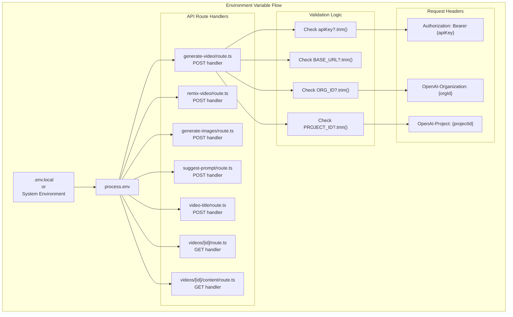

**Sources:** [app/api/generate-video/route.ts:21-25,68-82](), [app/api/generate-images/route.ts:73-79](), [app/api/suggest-prompt/route.ts:26-30](), [app/api/video-title/route.ts:23-27](), [app/api/videos/[id]/route.ts:14-18](), [app/api/videos/[id]/content/route.ts:13-17]()

## Configuration Methods

The application supports two methods for providing environment variables, following standard Next.js conventions.

### Local Environment File (.env.local)

Create a `.env.local` file in the project root directory:

```bash
OPENAI_API_KEY="your-openai-api-key"
OPENAI_BASE_URL="https://api.openai.com/v1"
OPENAI_ORG_ID="org-xxxxx"
OPENAI_PROJECT_ID="proj-xxxxx"
```

This file is automatically loaded by Next.js and excluded from version control via `.gitignore`. This is the recommended approach for local development.

**Sources:** [README.md:36-40]()

### Global System Environment

Export environment variables at the system level before starting the application:

```bash
export OPENAI_API_KEY="your-openai-api-key"
export OPENAI_BASE_URL="https://api.openai.com/v1"
npm run dev
```

This method is suitable for production deployments where environment variables are managed by hosting platforms or container orchestration systems.

**Sources:** [README.md:35]()

## Runtime Configuration Constants

The application defines several configuration constants for API behavior. These are hardcoded but can be modified by developers extending the codebase.

### Video Generation Defaults

| Configuration | Value | Location |
|--------------|-------|----------|
| Default Model | `sora-2-pro` | [lib/sora.ts:7]() |
| Allowed Models | `sora-2`, `sora-2-pro` | [lib/sora.ts:8]() |
| Default Size | `1280x720` | [lib/sora.ts:26]() |
| Allowed Sizes | `1280x720`, `1920x1080`, `1080x1920` | [lib/sora.ts:27-31]() |
| Default Duration | `8` seconds | [lib/sora.ts:38]() |
| Allowed Durations | `4`, `8`, `12` seconds | [lib/sora.ts:39]() |

**Sources:** [lib/sora.ts:7-39]()

### Image Generation Defaults

| Configuration | Value | Location |
|--------------|-------|----------|
| Default Model | `gpt-image-1` | [app/api/generate-images/route.ts:6]() |
| Allowed Models | `gpt-image-1` | [app/api/generate-images/route.ts:7]() |
| Max Image Count | `4` | [app/api/generate-images/route.ts:8]() |
| Default Count | `3` | [app/api/generate-images/route.ts:9]() |
| Default Size | `1024x1024` | [app/api/generate-images/route.ts:13]() |
| Allowed Sizes | `256x256`, `512x512`, `1024x1024`, `1024x1536`, `1536x1024`, `1024x1792`, `1792x1024`, `auto` | [app/api/generate-images/route.ts:14-23]() |

**Sources:** [app/api/generate-images/route.ts:6-23]()

### Text Generation Configuration

| Configuration | Value | Location |
|--------------|-------|----------|
| Prompt Model | `gpt-4.1-mini` | [app/api/suggest-prompt/route.ts:4]() |
| Title Model | `gpt-4o-mini` | [app/api/video-title/route.ts:6]() |
| Title Max Tokens | `24` | [app/api/video-title/route.ts:7]() |

**Sources:** [app/api/suggest-prompt/route.ts:4](), [app/api/video-title/route.ts:6-7]()

## Configuration Validation & Coercion

The application implements robust validation and coercion logic to handle untrusted or malformed configuration inputs. This pattern is centralized in the `@/lib/sora` module.

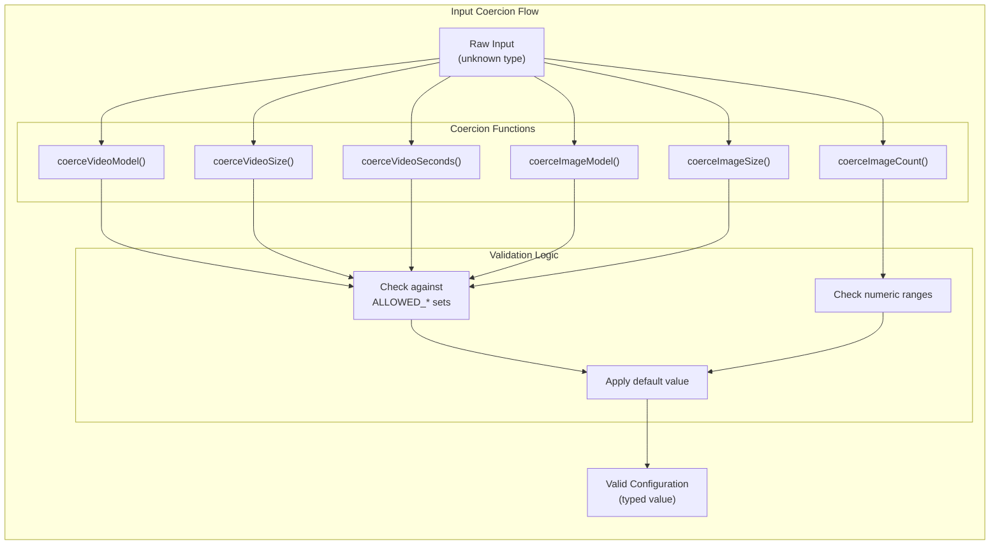

**Sources:** [lib/sora.ts:13-57](), [app/api/generate-images/route.ts:32-70]()

### Video Parameter Coercion

The `coerceVideoModel()`, `coerceVideoSize()`, and `coerceVideoSeconds()` functions ensure that user-provided values conform to allowed sets:

- **Model Coercion** [lib/sora.ts:13-17](): Validates against `ALLOWED_VIDEO_MODELS`, falls back to `VIDEO_MODEL_FALLBACK`
- **Size Coercion** [lib/sora.ts:26-34](): Validates against `ALLOWED_VIDEO_SIZES`, falls back to `VIDEO_SIZE_FALLBACK`
- **Duration Coercion** [lib/sora.ts:38-45](): Validates against `ALLOWED_VIDEO_SECONDS`, falls back to `VIDEO_SECONDS_FALLBACK`

Each coercion function:
1. Accepts `unknown` type to handle untrusted inputs
2. Returns `null` for invalid non-string inputs
3. Trims and validates string inputs
4. Checks membership in allowed sets
5. Returns default fallback for invalid values

**Sources:** [lib/sora.ts:13-45]()

### Image Parameter Coercion

Image generation endpoints implement similar coercion patterns:

- **Model Coercion** [app/api/generate-images/route.ts:56-61](): Validates against `ALLOWED_IMAGE_MODELS`
- **Size Coercion** [app/api/generate-images/route.ts:63-70](): Validates against `ALLOWED_IMAGE_SIZES`
- **Count Coercion** [app/api/generate-images/route.ts:48-54](): Clamps between `1` and `MAX_IMAGE_COUNT`, rounds to integer

**Sources:** [app/api/generate-images/route.ts:48-70]()

## Configuration Error Handling

When environment variables are missing or invalid, the application returns standardized error responses using the `describeError()` and `resolveErrorStatus()` utilities from `@/lib/sora`.

### Missing API Key Response

All API routes return consistent error responses when `OPENAI_API_KEY` is not configured:

```typescript
// Example from generate-video/route.ts
if (!apiKey) {
  const message = "OPENAI_API_KEY is not configured";
  return Response.json({ error: { message } }, { status: 500 });
}
```

**Response Structure:**
```json
{
  "error": {
    "message": "OPENAI_API_KEY is not configured"
  }
}
```

**HTTP Status Code:** `500 Internal Server Error`

**Sources:** [app/api/generate-video/route.ts:21-25](), [app/api/remix-video/route.ts:22-26](), [app/api/generate-images/route.ts:73-77]()

### Invalid Configuration Values

When coercion functions receive invalid values, they silently apply defaults rather than raising errors. This defensive approach ensures the application remains functional even with malformed inputs.

For example, if a client sends `model: "invalid-model"`, the system applies the fallback value without interrupting the request flow.

**Sources:** [lib/sora.ts:13-45](), [app/api/generate-images/route.ts:48-70]()

## Configuration Propagation Through Request Lifecycle

The following diagram illustrates how configuration values flow from environment variables through API routes to external service requests.

```mermaid
graph TB
    subgraph "Configuration Lifecycle"
        Env[".env.local or<br/>System Environment"]
        
        subgraph "API Route Handler Entry"
            ReadEnv["Read from process.env"]
            ValidateKey["Validate OPENAI_API_KEY"]
            ReadOptional["Read optional configs<br/>(BASE_URL, ORG_ID, PROJECT_ID)"]
        end
        
        subgraph "Request Parsing"
            ParseBody["Parse request.json()"]
            ExtractParams["Extract user parameters<br/>(model, size, seconds, etc)"]
        end
        
        subgraph "Coercion & Validation"
            ApplyCoercion["Apply coercion functions<br/>(coerceVideoModel, etc)"]
            BuildPayload["Build VideoRequestPayload<br/>or ImageGenerateParams"]
        end
        
        subgraph "External API Request"
            BuildHeaders["Build headers<br/>(Authorization, Org, Project)"]
            BuildEndpoint["Build endpoint URL<br/>using BASE_URL"]
            SendRequest["Send fetch() or<br/>OpenAI SDK call"]
        end
        
        ExternalService["OpenAI API<br/>(Sora, Images, Chat)"]
        
        Env --> ReadEnv
        ReadEnv --> ValidateKey
        ReadEnv --> ReadOptional
        ValidateKey --> ParseBody
        ParseBody --> ExtractParams
        ExtractParams --> ApplyCoercion
        ApplyCoercion --> BuildPayload
        BuildPayload --> BuildHeaders
        ReadOptional --> BuildHeaders
        ReadOptional --> BuildEndpoint
        BuildHeaders --> SendRequest
        BuildEndpoint --> SendRequest
        SendRequest --> ExternalService
    end
```

**Sources:** [app/api/generate-video/route.ts:20-142](), [app/api/generate-images/route.ts:72-135](), [app/api/suggest-prompt/route.ts:25-77]()

## Configuration File Reference

The following table maps configuration concerns to their implementation locations:

| Configuration Type | File Path | Lines | Description |
|-------------------|-----------|-------|-------------|
| Video Model Defaults | `lib/sora.ts` | 7-8 | Model fallback and allowed set |
| Video Size Defaults | `lib/sora.ts` | 26-31 | Size fallback and allowed set |
| Video Duration Defaults | `lib/sora.ts` | 38-39 | Duration fallback and allowed set |
| Video Model Coercion | `lib/sora.ts` | 13-17 | Input validation logic |
| Video Size Coercion | `lib/sora.ts` | 26-34 | Input validation logic |
| Video Duration Coercion | `lib/sora.ts` | 38-45 | Input validation logic |
| Image Model Defaults | `app/api/generate-images/route.ts` | 6-7 | Model fallback and allowed set |
| Image Size Defaults | `app/api/generate-images/route.ts` | 13-23 | Size fallback and allowed set |
| Image Count Limits | `app/api/generate-images/route.ts` | 8-9 | Max and default count |
| Image Model Coercion | `app/api/generate-images/route.ts` | 56-61 | Input validation logic |
| Image Size Coercion | `app/api/generate-images/route.ts` | 63-70 | Input validation logic |
| Image Count Coercion | `app/api/generate-images/route.ts` | 48-54 | Input validation logic |
| Prompt Generation Model | `app/api/suggest-prompt/route.ts` | 4 | Chat model for prompt suggestions |
| Title Generation Model | `app/api/video-title/route.ts` | 6 | Chat model for title generation |
| Title Max Tokens | `app/api/video-title/route.ts` | 7 | Token limit for titles |

**Sources:** [lib/sora.ts:7-45](), [app/api/generate-images/route.ts:6-70](), [app/api/suggest-prompt/route.ts:4](), [app/api/video-title/route.ts:6-7]()

---

# Page: Architecture

# Architecture

<details>
<summary>Relevant source files</summary>

The following files were used as context for generating this wiki page:

- [app/layout.tsx](app/layout.tsx)
- [app/page.tsx](app/page.tsx)
- [components/App.tsx](components/App.tsx)

</details>


This document provides a comprehensive overview of the system architecture for the Sora Sample App. It describes the three-tier design pattern, component relationships, and integration points with external services. For detailed information about specific subsystems, see:
- Client-side state management patterns: [Client-Side State Management](#3.1)
- Video creation and status tracking: [Video Lifecycle](#3.2)  
- Request/response patterns and data transformations: [Data Flow & Communication](#3.3)

## Three-Tier Architecture Overview

The application follows a clear separation of concerns across three architectural tiers: client-side rendering, API middleware, and external service integration.

### Architecture Diagram

```mermaid
graph TB
    subgraph Browser["Browser Tier"]
        RootLayout["app/layout.tsx<br/>RootLayout"]
        PageComp["app/page.tsx<br/>Page"]
        AppComp["components/App.tsx<br/>App"]
        
        subgraph Components["UI Components"]
            VideoForm["components/VideoForm.tsx"]
            VideoSidebar["components/VideoSidebar.tsx"]
            VideoCard["components/VideoCard.tsx"]
            VideoPreview["components/VideoPreviewOverlay.tsx"]
        end
        
        subgraph Hooks["Custom Hooks"]
            PersistedState["hooks/usePersistedState.ts"]
            VideoForm2["hooks/useVideoForm.ts"]
            Preview["hooks/usePreview.ts"]
            Thumbnails["hooks/useThumbnails.ts"]
            Polling["hooks/useVideoPolling.ts"]
        end
    end
    
    subgraph API["API Tier - Next.js Routes"]
        GenVideo["app/api/generate-video/route.ts"]
        RemixVideo["app/api/remix-video/route.ts"]
        GenImages["app/api/generate-images/route.ts"]
        SuggestPrompt["app/api/suggest-prompt/route.ts"]
        VideoTitle["app/api/video-title/route.ts"]
        FetchVideo["app/api/videos/[id]/route.ts"]
        VideoContent["app/api/videos/[id]/content/route.ts"]
    end
    
    subgraph External["External Services"]
        SoraAPI["OpenAI Sora API<br/>/v1/videos/*"]
        ImageAPI["OpenAI Images API<br/>gpt-image-1"]
        ChatAPI["OpenAI Chat API<br/>gpt-4.1-mini"]
    end
    
    subgraph Shared["Shared Libraries"]
        LibSora["lib/sora.ts"]
        UtilsVideo["utils/video.ts"]
        ServiceAPI["services/soraApi.ts"]
    end
    
    RootLayout --> PageComp
    PageComp --> AppComp
    AppComp --> VideoForm
    AppComp --> VideoSidebar
    AppComp --> VideoPreview
    VideoSidebar --> VideoCard
    
    AppComp --> PersistedState
    AppComp --> VideoForm2
    AppComp --> Preview
    AppComp --> Thumbnails
    AppComp --> Polling
    
    VideoForm -.->|HTTP| GenVideo
    VideoForm -.->|HTTP| GenImages
    VideoForm -.->|HTTP| SuggestPrompt
    AppComp -.->|HTTP| VideoTitle
    
    VideoSidebar -.->|HTTP| RemixVideo
    Polling -.->|HTTP| FetchVideo
    VideoSidebar -.->|HTTP| VideoContent
    
    GenVideo --> LibSora
    RemixVideo --> LibSora
    GenImages --> LibSora
    
    GenVideo --> SoraAPI
    RemixVideo --> SoraAPI
    FetchVideo --> SoraAPI
    VideoContent --> SoraAPI
    GenImages --> ImageAPI
    SuggestPrompt --> ChatAPI
    VideoTitle --> ChatAPI
    
    AppComp --> UtilsVideo
    AppComp --> ServiceAPI
```

**Sources:** [app/layout.tsx:1-54](), [app/page.tsx:1-8](), [components/App.tsx:1-784]()

### Tier Responsibilities

| Tier | Purpose | Key Technologies | Entry Points |
|------|---------|------------------|--------------|
| **Browser** | UI rendering, user interaction, state management | React, TypeScript, Tailwind CSS | [app/layout.tsx]() |
| **API** | Request validation, business logic, external service integration | Next.js API Routes, TypeScript | [app/api/*]() |
| **External** | AI model inference, video generation | OpenAI API | Environment: `OPENAI_API_KEY` |

**Sources:** [app/layout.tsx:1-54](), [app/api/generate-video/route.ts]()

## Component Architecture

The client tier is organized around a central orchestrator component with specialized child components and custom hooks for state management.

### Component Hierarchy

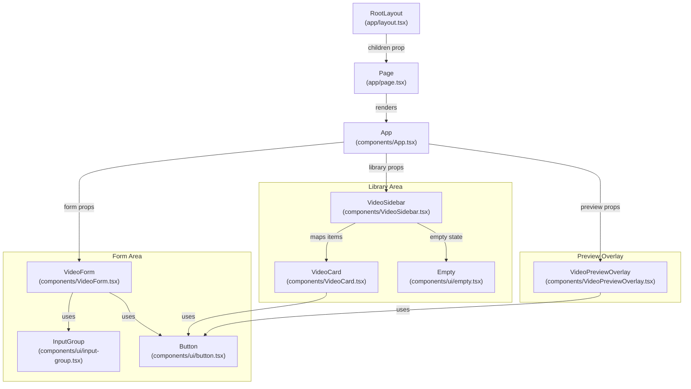

**Sources:** [app/layout.tsx:24-53](), [app/page.tsx:1-8](), [components/App.tsx:72-783]()

### Core Component Responsibilities

**`App` Component** ([components/App.tsx:72-783]())
- Central state orchestrator managing all application state
- Coordinates between UI components and API services
- Implements event handlers for user actions: `handleCreateVideo`, `handleRemixFrom`, `handleRetry`, `handleDownload`, `handlePlayPreview`, `handleRefreshVideo`
- Manages batch video generation with progress tracking

**`VideoForm` Component** ([components/VideoForm.tsx]())
- Collects user input for video generation parameters
- Supports text prompts, model selection, size/duration configuration
- Handles image upload and AI-generated image suggestions
- Integrates with `/api/generate-images` and `/api/suggest-prompt`

**`VideoSidebar` Component** ([components/VideoSidebar.tsx]())
- Displays video library in reverse chronological order
- Shows thumbnail previews via `useThumbnails` hook
- Provides actions: preview, download, remix, retry, refresh, remove
- Responsive design with mobile overlay support

**`VideoPreviewOverlay` Component** ([components/VideoPreviewOverlay.tsx]())
- Full-screen video preview with navigation controls
- Supports previous/next navigation through video library
- Displays video metadata (prompt, model, size, duration)
- Download functionality from preview interface

**Sources:** [components/App.tsx:72-783](), [components/VideoForm.tsx](), [components/VideoSidebar.tsx](), [components/VideoPreviewOverlay.tsx]()

## State Management Architecture

The application uses a hooks-based state management pattern with clear separation of concerns.

### State Management Flow

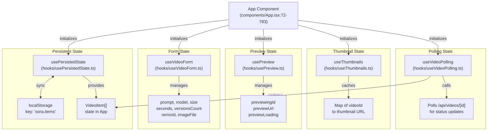

**Sources:** [components/App.tsx:15-19](), [components/App.tsx:73-126]()

### Hook Usage Pattern

| Hook | File | State Managed | Purpose |
|------|------|---------------|---------|
| `usePersistedState` | [hooks/usePersistedState.ts]() | `VideoItem[]` | Persists video library to `localStorage` |
| `useVideoForm` | [hooks/useVideoForm.ts]() | Form parameters | Manages video generation form state |
| `usePreview` | [hooks/usePreview.ts]() | Preview state | Handles video preview loading and display |
| `useThumbnails` | [hooks/useThumbnails.ts]() | Thumbnail URLs | Caches video thumbnail URLs |
| `useVideoPolling` | [hooks/useVideoPolling.ts]() | Polling logic | Polls Sora API for video status updates |

**Sources:** [components/App.tsx:15-19](), [components/App.tsx:73-131]()

## API Layer Architecture

The API tier implements a consistent request handling pattern across all endpoints with shared validation and error handling logic.

### API Route Structure

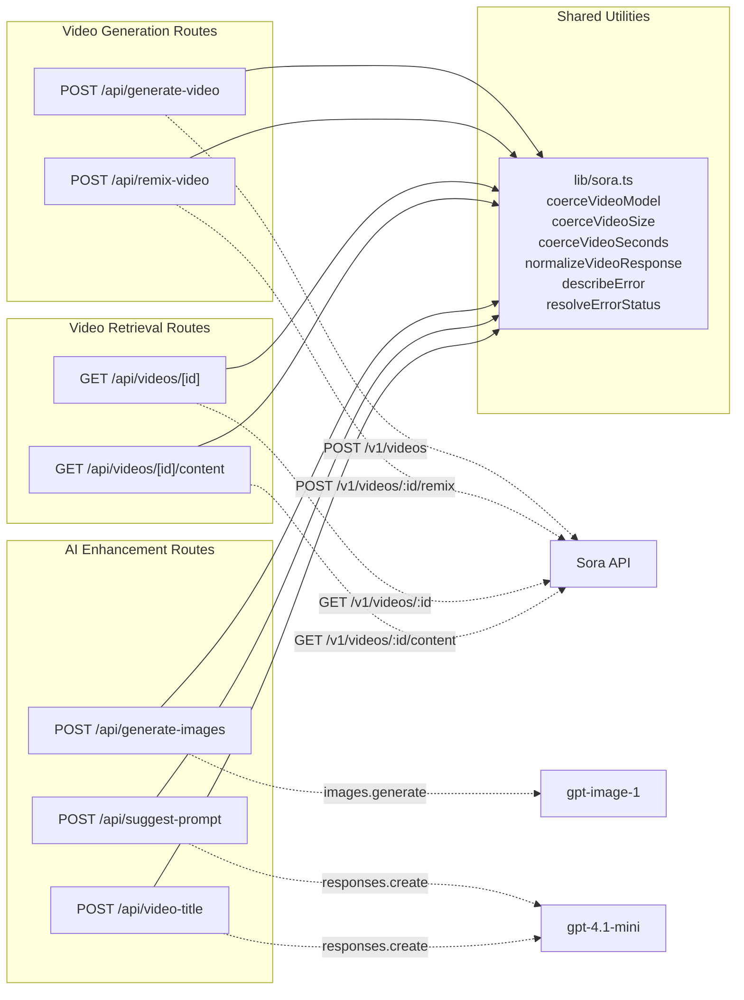

**Sources:** [app/api/generate-video/route.ts](), [app/api/remix-video/route.ts](), [lib/sora.ts]()

### Common API Route Pattern

Every API route follows this standardized flow:

1. **Authentication**: Validate `OPENAI_API_KEY` from environment
2. **Request Parsing**: Extract and parse request body/parameters
3. **Input Coercion**: Use `lib/sora.ts` functions to normalize inputs
4. **External Service Call**: Invoke OpenAI API with normalized parameters
5. **Response Normalization**: Transform API response to standard format
6. **Error Handling**: Use `describeError` and `resolveErrorStatus` for consistent error responses

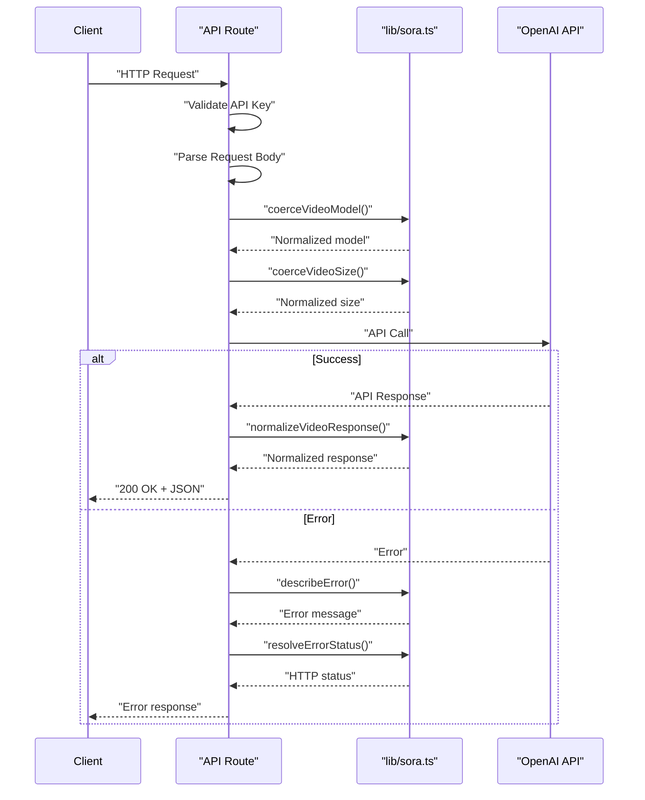

**Sources:** [app/api/generate-video/route.ts](), [lib/sora.ts]()

### API Route Details

| Route | Method | File | External Endpoint | Purpose |
|-------|--------|------|-------------------|---------|
| `/api/generate-video` | POST | [app/api/generate-video/route.ts]() | `POST /v1/videos` | Create new video from text/image |
| `/api/remix-video` | POST | [app/api/remix-video/route.ts]() | `POST /v1/videos/:id/remix` | Create variation of existing video |
| `/api/videos/[id]` | GET | [app/api/videos/[id]/route.ts]() | `GET /v1/videos/:id` | Poll video status |
| `/api/videos/[id]/content` | GET | [app/api/videos/[id]/content/route.ts]() | `GET /v1/videos/:id/content` | Download video binary |
| `/api/generate-images` | POST | [app/api/generate-images/route.ts]() | `images.generate` | Generate image suggestions |
| `/api/suggest-prompt` | POST | [app/api/suggest-prompt/route.ts]() | `responses.create` | Enhance user prompt |
| `/api/video-title` | POST | [app/api/video-title/route.ts]() | `responses.create` | Generate video title |

**Sources:** [app/api/]() directory structure

## External Service Integration

The application integrates with three distinct OpenAI service categories, each accessed through dedicated API routes.

### Service Integration Points

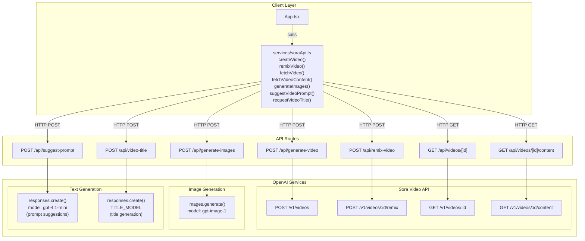

**Sources:** [services/soraApi.ts](), [components/App.tsx:36-43]()

### Service Configuration

| Service | Model/Endpoint | Configuration | Usage |
|---------|----------------|---------------|-------|
| **Sora Video** | `/v1/videos/*` | `OPENAI_BASE_URL`, `OPENAI_API_KEY` | Video generation and remixing |
| **Image Generation** | `gpt-image-1` | `OPENAI_API_KEY` | Generate image suggestions ([components/App.tsx:61]()) |
| **Text Generation** | `gpt-4.1-mini` | `OPENAI_API_KEY` | Prompt enhancement and title generation |

**Sources:** [app/api/generate-video/route.ts](), [app/api/generate-images/route.ts](), [app/api/suggest-prompt/route.ts]()

## Cross-Cutting Concerns

Several architectural patterns are applied consistently across the entire application.

### Theming System

The application implements a CSS custom property-based theming system with runtime dark mode detection:

- Theme initialization: [app/layout.tsx:29-39]() - Inline script detects system preference
- CSS variables: [app/globals.css]() - Defines color palette for light and dark modes
- Class toggling: `.dark` class applied to `<html>` element controls theme
- Color scheme: `root.style.colorScheme` set to `'dark'` or `'light'`

**Sources:** [app/layout.tsx:29-39](), [app/globals.css]()

### Error Handling Pattern

All errors flow through centralized utilities in `lib/sora.ts`:

```typescript
// Pattern used in all API routes
try {
  // API call
} catch (error) {
  const message = describeError(error);      // Human-readable message
  const status = resolveErrorStatus(error);  // HTTP status code
  return new Response(JSON.stringify({ error: message }), { status });
}
```

Functions:
- `describeError`: Converts any error type to human-readable message
- `resolveErrorStatus`: Maps error types to appropriate HTTP status codes

**Sources:** [lib/sora.ts](), [app/api/generate-video/route.ts]()

### Data Validation & Coercion

Input validation uses type coercion functions to handle untrusted user input:

| Function | File | Purpose |
|----------|------|---------|
| `coerceVideoModel` | [lib/sora.ts]() | Validates and normalizes model names |
| `coerceVideoSize` | [lib/sora.ts]() | Validates video dimensions |
| `coerceVideoSeconds` | [lib/sora.ts]() | Validates video duration |
| `normalizeVideoResponse` | [lib/sora.ts]() | Normalizes API responses to `VideoItem` type |

**Sources:** [lib/sora.ts](), [utils/video.ts]()

### Binary Content Delivery

Video content is delivered through a dedicated streaming endpoint:
- Client requests: [services/soraApi.ts]() - `fetchVideoContent` function
- API route: [app/api/videos/[id]/content/route.ts]() - Streams binary from Sora API
- Return type: `Blob` for browser-native video playback
- Usage: Thumbnails via `useThumbnails`, previews via `usePreview`, downloads via `handleDownload`

**Sources:** [app/api/videos/[id]/content/route.ts](), [services/soraApi.ts](), [hooks/useThumbnails.ts](), [hooks/usePreview.ts]()

### Persistence Strategy

The application uses `localStorage` for client-side persistence without server-side sessions:
- Implementation: [hooks/usePersistedState.ts]() - Generic hook for any state type
- Primary usage: [components/App.tsx:73]() - `usePersistedState<VideoItem[]>("sora.items", [])`
- Storage key: `"sora.items"` contains array of `VideoItem` objects
- Synchronization: Automatic on every state change

**Sources:** [hooks/usePersistedState.ts](), [components/App.tsx:73]()

---

# Page: Client-Side State Management

# Client-Side State Management

<details>
<summary>Relevant source files</summary>

The following files were used as context for generating this wiki page:

- [components/App.tsx](components/App.tsx)
- [components/VideoForm.tsx](components/VideoForm.tsx)

</details>


## Purpose and Scope

This document describes the client-side state management architecture of the Sora Sample App. It covers the custom React hooks pattern used to organize state, the localStorage persistence layer, and how state flows between components. For information about the video lifecycle and status transitions, see [Video Lifecycle](#3.2). For details on API communication patterns, see [Data Flow & Communication](#3.3).

## State Management Architecture

The application uses a custom hooks pattern to separate state concerns into focused, reusable modules. The main `App` component orchestrates these hooks and manages additional local UI state.

**State Management Layers**

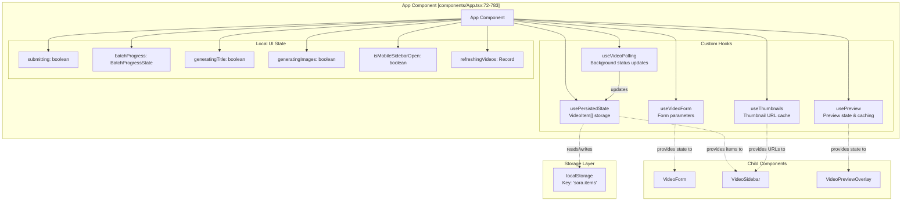

Sources: [components/App.tsx:72-198]()

## Persistent State Layer

### usePersistedState Hook

The `usePersistedState` hook provides localStorage-backed state persistence for the video library. It is instantiated once in the `App` component to maintain the collection of `VideoItem` objects across browser sessions.

**Usage Pattern**

```
[components/App.tsx:73]
const [items, setItems] = usePersistedState<VideoItem[]>("sora.items", []);
```

The hook manages:
- Reading initial state from `localStorage` on mount
- Writing state changes back to `localStorage` on every update
- Type-safe state with TypeScript generics
- Fallback to default value if localStorage is unavailable

**State Structure**

| Field | Type | Description |
|-------|------|-------------|
| Key | `"sora.items"` | localStorage key identifier |
| Value | `VideoItem[]` | Array of video generation records |
| Default | `[]` | Empty array if no saved state exists |

**Update Patterns**

The `setItems` function is used throughout the App component to modify the video library:

- **Adding new videos**: [components/App.tsx:328-341]() - Prepends new videos to the array
- **Updating existing videos**: [components/App.tsx:162-171]() - Maps over array and applies updater function
- **Removing videos**: [components/App.tsx:499]() - Filters out specific video by id
- **Marking as downloaded**: [components/App.tsx:386-392]() - Updates individual item properties

Sources: [components/App.tsx:15](), [components/App.tsx:73](), [components/App.tsx:162-171](), [components/App.tsx:328-341](), [components/App.tsx:386-392](), [components/App.tsx:499]()

## Form State Management

### useVideoForm Hook

The `useVideoForm` hook encapsulates all form input state and logic for video generation parameters. It provides state variables, setters, and utility functions for form management.

**State Variables Provided**

```
[components/App.tsx:103-125]
const {
  prompt, setPrompt,
  model, setModel,
  size, setSize,
  seconds, setSeconds,
  versionsCount, setVersionsCount,
  remixId, setRemixId,
  imageFile,
  imagePreviewUrl,
  imagePreviewMeta,
  handleImageSelect,
  handleGeneratedImageDataUrl,
  handleGeneratedImageUrl,
  clearForm: resetFormFields,
  applyVideoToForm,
  sizeOptionGroups,
} = useVideoForm();
```

**Form State Categories**

| Category | State Variables | Purpose |
|----------|----------------|---------|
| Text Input | `prompt: string` | User-provided video description |
| Model Selection | `model: SoraModel` | Selected Sora model variant |
| Size Configuration | `size: string`, `sizeOptionGroups: SizeOptionGroups` | Video dimensions and available options |
| Duration | `seconds: SoraSeconds` | Video length in seconds |
| Batch Generation | `versionsCount: number` | Number of versions to generate |
| Remix | `remixId: string` | ID of video to remix from |
| Image Input | `imageFile: File \| null`, `imagePreviewUrl: string \| null`, `imagePreviewMeta: ImagePreviewMeta \| null` | Uploaded reference image data |

**Utility Functions**

- `handleImageSelect`: Processes file input change events for image uploads
- `handleGeneratedImageDataUrl`: Converts data URL to File for generated images
- `handleGeneratedImageUrl`: Fetches URL and converts to File for generated images
- `clearForm`: Resets all form fields to defaults
- `applyVideoToForm`: Populates form with existing video parameters (used for remix/retry)

Sources: [components/App.tsx:18](), [components/App.tsx:103-125](), [components/VideoForm.tsx:102-136]()

## Preview State Management

### usePreview Hook

The `usePreview` hook manages video preview playback state and implements a caching layer for video blob URLs to optimize preview loading performance.

**Preview State Interface**

```
[components/App.tsx:63-70]
const preview = usePreview();
const previewState: SidebarPreviewState = {
  previewingId: preview.previewingId,
  previewLoading: preview.previewLoading,
};
```

**State Properties**

| Property | Type | Description |
|----------|------|-------------|
| `previewingId` | `string \| null` | ID of currently previewing video |
| `previewLoading` | `boolean` | Whether preview is loading |
| `previewUrl` | `string \| null` | Blob URL for current preview video |

**Methods**

- `playPreview(videoId: string)`: Loads and displays video preview
- `clearPreview()`: Closes preview and cleans up blob URLs
- `prefetchPreviews(videoIds: string[])`: Pre-loads video blobs into cache for faster playback

**Prefetch Strategy**

The App component prefetches all completed videos on mount and when the list changes:

```
[components/App.tsx:136-143]
useEffect(() => {
  const ids = previewableItems
    .map((item) => item.id)
    .filter((id): id is string => Boolean(id));
  prefetchPreviews(ids).catch((error) => {
    console.error("Preview prefetch failed", error);
  });
}, [prefetchPreviews, previewableItems]);
```

Sources: [components/App.tsx:16](), [components/App.tsx:63-70](), [components/App.tsx:127-143](), [components/App.tsx:428-442]()

## Thumbnail Management

### useThumbnails Hook

The `useThumbnails` hook provides a mapping of video IDs to thumbnail blob URLs, managing the lifecycle of thumbnail data fetching and URL creation.

**Usage Pattern**

```
[components/App.tsx:130]
const thumbnails = useThumbnails({ items });
```

**Return Type**

The hook returns a `Record<string, string>` mapping video IDs to blob URLs for thumbnails. This is passed directly to the `VideoSidebar` component for display in video cards.

**Lifecycle Management**

- Automatically fetches thumbnails for new videos with completed status
- Creates and manages blob URLs for binary thumbnail data
- Cleans up blob URLs when component unmounts or items change
- Memoizes results to prevent unnecessary re-renders

Sources: [components/App.tsx:17](), [components/App.tsx:130]()

## Polling State Management

### useVideoPolling Hook

The `useVideoPolling` hook implements background polling for video generation status updates. It automatically polls the status endpoint for videos that are in non-terminal states.

**Usage Pattern**

```
[components/App.tsx:198]
useVideoPolling({ items, onUpdate: handleUpdateItem });
```

**Configuration**

| Parameter | Type | Description |
|-----------|------|-------------|
| `items` | `VideoItem[]` | Current list of videos to monitor |
| `onUpdate` | `(id: string, updater: (item: VideoItem) => VideoItem) => void` | Callback to update individual video state |

**Polling Behavior**

The hook:
- Identifies videos with non-terminal status (`queued`, `in_progress`, etc.)
- Polls the `/api/videos/[id]` endpoint at regular intervals
- Invokes `onUpdate` callback when status changes
- Automatically stops polling when videos reach terminal states (`completed`, `failed`)
- Handles multiple concurrent video generations

**Status Update Flow**

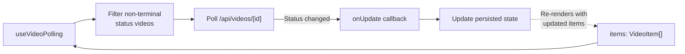

Sources: [components/App.tsx:19](), [components/App.tsx:162-171](), [components/App.tsx:198]()

## Local Component State

In addition to custom hooks, the `App` component maintains several pieces of local state for UI-specific concerns that don't require persistence or complex logic.

**UI State Variables**

| Variable | Type | Purpose | Set By |
|----------|------|---------|--------|
| `submitting` | `boolean` | Form submission in progress | [components/App.tsx:262](), [components/App.tsx:357]() |
| `batchProgress` | `BatchProgressState \| null` | Current batch generation progress | [components/App.tsx:280]() |
| `currentTitle` | `string` | Generated title for current batch | [components/App.tsx:275]() |
| `generatingTitle` | `boolean` | Title generation in progress | [components/App.tsx:268](), [components/App.tsx:273]() |
| `downloadingAll` | `boolean` | Bulk download operation active | [components/App.tsx:414](), [components/App.tsx:424]() |
| `generatingImages` | `boolean` | Image suggestion generation active | [components/App.tsx:566](), [components/App.tsx:597]() |
| `generatedImages` | `GeneratedImageSuggestion[]` | AI-generated image suggestions | [components/App.tsx:587]() |
| `generatedImageError` | `string` | Error message for image generation | [components/App.tsx:595]() |
| `selectedGeneratedImageId` | `string \| null` | Currently selected generated image | [components/App.tsx:611]() |
| `generatingPrompt` | `boolean` | Prompt suggestion in progress | [components/App.tsx:632](), [components/App.tsx:659]() |
| `isMobileSidebarOpen` | `boolean` | Mobile sidebar visibility | [components/App.tsx:96](), [components/App.tsx:100]() |
| `refreshingVideos` | `Record<string, boolean>` | Per-video refresh operation state | [components/App.tsx:177](), [components/App.tsx:188-192]() |

**BatchProgressState Structure**

```typescript
interface BatchProgressState {
  total: number;    // Total versions to generate
  current: number;  // Current version being generated
}
```

Sources: [components/App.tsx:74-93](), [components/VideoForm.tsx:97-100]()

## State Update Patterns

### Update Item Pattern

The `handleUpdateItem` function provides a centralized pattern for updating individual videos in the persisted array:

```
[components/App.tsx:162-171]
const handleUpdateItem = useCallback(
  (id: string, updater: (existing: VideoItem) => VideoItem) => {
    setItems((prev) =>
      prev.map((existing) =>
        existing.id === id ? updater(existing) : existing
      )
    );
  },
  [setItems]
);
```

This pattern is used by:
- **Video polling**: [components/App.tsx:198]() - Updates status from API responses
- **Video refresh**: [components/App.tsx:182-184]() - Manual status refresh

**State Flow Diagram**

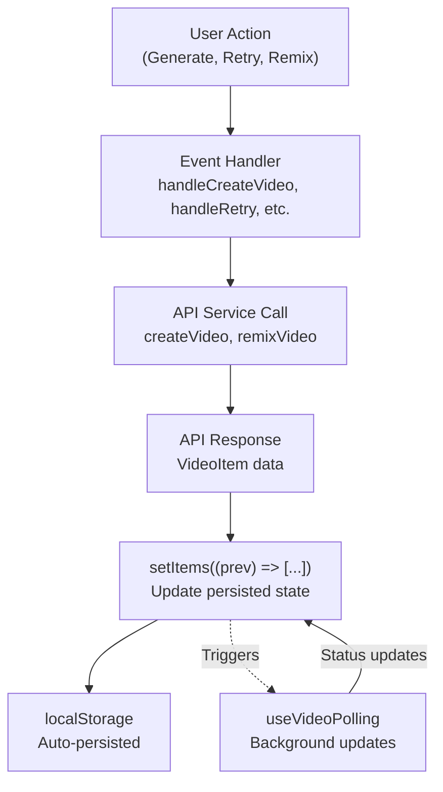

Sources: [components/App.tsx:162-171](), [components/App.tsx:215-374]()

## State-to-Props Pattern

The `App` component follows a unidirectional data flow pattern, passing state down to child components via props and receiving updates via callback props.

**VideoForm Props Mapping**

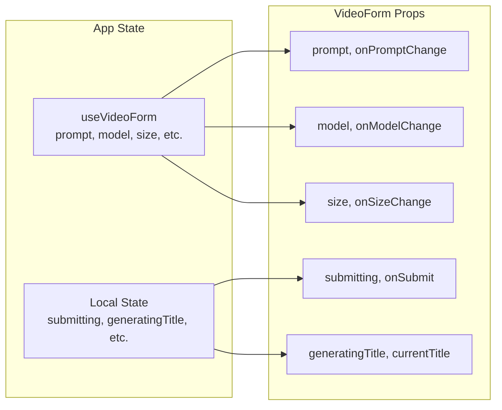

**Key Prop Patterns**

| Component | State Inputs | Callback Outputs |
|-----------|--------------|------------------|
| `VideoForm` | `prompt`, `model`, `size`, `seconds`, `versionsCount`, `submitting`, `generatingTitle` | `onPromptChange`, `onModelChange`, `onSubmit`, `onClear`, `onGeneratePrompt` |
| `VideoSidebar` | `items`, `thumbnails`, `previewState`, `downloadingAll`, `refreshingMap` | `onDownloadAll`, `onDownload`, `onPlayPreview`, `onRemix`, `onRetry`, `onRefresh`, `onRemove` |
| `VideoPreviewOverlay` | `previewingId`, `previewUrl`, `previewLoading`, `currentPreviewItem` | `onClose`, `onPrev`, `onNext`, `onDownload` |

**Example: Form State Flow**

```
User types in VideoForm textarea
  ↓
onPromptChange(value) callback invoked
  ↓
[components/App.tsx:673-679] handlePromptChange
  ↓
setPrompt(value) from useVideoForm
  ↓
VideoForm re-renders with new prompt prop
```

Sources: [components/App.tsx:721-757](), [components/App.tsx:684-699](), [components/App.tsx:769-780]()

## State Initialization and Effects

### Initial State Loading

The application initializes state in the following order:

1. **Persistent state**: `usePersistedState` reads from localStorage immediately
2. **Form state**: `useVideoForm` initializes with defaults
3. **Preview state**: `usePreview` starts with no active preview
4. **Derived state**: Computed from persistent state (e.g., `previewableItems`)

### Side Effects

**Preview Prefetch Effect**

```
[components/App.tsx:136-143]
useEffect(() => {
  const ids = previewableItems
    .map((item) => item.id)
    .filter((id): id is string => Boolean(id));
  prefetchPreviews(ids).catch((error) => {
    console.error("Preview prefetch failed", error);
  });
}, [prefetchPreviews, previewableItems]);
```

This effect runs whenever `previewableItems` changes, ensuring all completed videos have their previews ready.

**Size Option Synchronization**

[components/VideoForm.tsx:203-209]() - The VideoForm component maintains internal `sizeSelectionKey` state that syncs with the external `size` prop, preserving orientation preference during updates.

Sources: [components/App.tsx:136-143](), [components/VideoForm.tsx:199-209]()

## Memory Management

The state management layer includes several memory cleanup strategies:

### Blob URL Cleanup

Both `usePreview` and `useThumbnails` hooks manage blob URLs that must be explicitly revoked to prevent memory leaks:

- Preview URLs are revoked when cleared via `clearPreview()`
- Thumbnail URLs are revoked when the hook unmounts or items change
- Download URLs are revoked after download completes: [components/App.tsx:385]()

### Effect Dependencies

All hooks use proper dependency arrays to ensure effects run only when necessary, preventing unnecessary re-renders and state updates.

Sources: [components/App.tsx:376-404](), [components/App.tsx:385]()

---

# Page: Video Lifecycle

# Video Lifecycle

<details>
<summary>Relevant source files</summary>

The following files were used as context for generating this wiki page:

- [app/api/generate-video/route.ts](app/api/generate-video/route.ts)
- [app/api/videos/[id]/route.ts](app/api/videos/[id]/route.ts)
- [components/App.tsx](components/App.tsx)

</details>


This document describes the complete lifecycle of a video from initial creation through terminal states, including status polling, batch generation, error handling, and post-completion operations. For information about the API layer that powers video operations, see [API Layer](#5). For details on client-side state management, see [Client-Side State Management](#3.1).

## Lifecycle Overview

Videos progress through a well-defined sequence of states from user input to completion. The system supports batch creation of multiple versions, automatic status polling, and various post-completion actions.

### Video State Machine

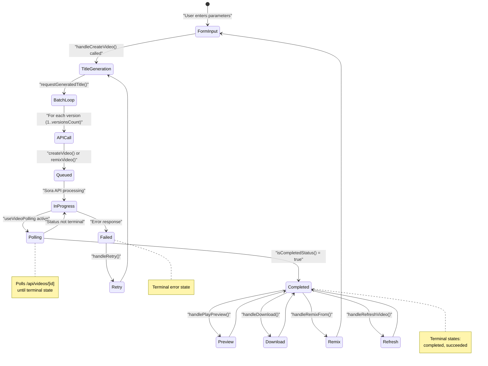

**Sources:** [components/App.tsx:215-374](), [components/App.tsx:198]()

## Creation Phase

### Initial Request

Video creation begins when the user clicks the generate button, triggering the `handleCreateVideo` function. This function orchestrates the entire creation flow including validation, title generation, and batch processing.

```mermaid
graph TB
    User["User clicks Generate"] --> handleCreateVideo["handleCreateVideo()"]
    handleCreateVideo --> ValidatePrompt["ensurePrompt()"]
    ValidatePrompt --> CheckPrompt{"Prompt valid?"}
    CheckPrompt -->|No| Abort["Exit early"]
    CheckPrompt -->|Yes| SanitizeParams["sanitizeModel()<br/>sanitizeSizeForModel()"]
    SanitizeParams --> CheckRemix{"isRemix?"}
    CheckRemix -->|Yes + imageFile| Alert["Log IMAGE_INPUT_ALERT"]
    Alert --> Abort
    CheckRemix -->|No| Continue["Continue to title generation"]
    CheckRemix -->|Yes, no image| Continue
    
    Continue --> setSubmitting["setSubmitting(true)<br/>setBatchProgress(null)"]
```

**Sources:** [components/App.tsx:215-274]()

### Title Generation

Before creating videos, the system generates a descriptive title using the `requestVideoTitle` API endpoint. This step can be skipped if a title is provided in the `overrideTitle` parameter.

| Step | Function | API Route | Fallback |
|------|----------|-----------|----------|
| Set generating flag | `setGeneratingTitle(true)` | - | - |
| Request title | `requestGeneratedTitle()` | `/api/video-title` | First 60 chars of prompt |
| Extract title | `extractTitleFromResponse()` | - | "Untitled Video" |
| Limit length | `.slice(0, 80)` | - | - |
| Clear flag | `setGeneratingTitle(false)` | - | - |

**Sources:** [components/App.tsx:200-213](), [components/App.tsx:265-275]()

### Batch Creation Loop

The system supports creating multiple versions of a video in a single operation. The `versionsCount` parameter controls how many versions are generated.

```mermaid
graph TB
    StartBatch["runs = versionsCount || 1"] --> LoopCheck{"runIndex < runs?"}
    LoopCheck -->|No| Complete["setBatchProgress(null)<br/>setSubmitting(false)"]
    LoopCheck -->|Yes| UpdateProgress["setBatchProgress({<br/>  total: runs,<br/>  current: runIndex + 1<br/>})"]
    UpdateProgress --> CheckType{"isRemix?"}
    
    CheckType -->|Yes| RemixCall["remixVideo({<br/>  videoId,<br/>  prompt,<br/>  model,<br/>  size,<br/>  seconds<br/>})"]
    CheckType -->|No| CreateCall["createVideo({<br/>  prompt,<br/>  model,<br/>  size,<br/>  seconds,<br/>  imageFile<br/>})"]
    
    RemixCall --> Normalize["normalizeVideo(rawItem)"]
    CreateCall --> Normalize
    Normalize --> UpdateState["setItems(prev => [normalized, ...prev])"]
    UpdateState --> Delay{"runIndex < runs - 1?"}
    Delay -->|Yes| Wait["setTimeout(1000ms)"]
    Delay -->|No| Increment["runIndex++"]
    Wait --> Increment
    Increment --> LoopCheck
```

**Sources:** [components/App.tsx:277-346]()

### Video Item Construction

After receiving a response from the API, the system constructs a `VideoItem` object with normalized fields:

```mermaid
graph LR
    APIResponse["API Response"] --> RawItem["Build rawItem object"]
    RawItem --> prompt["prompt: effectivePromptRaw"]
    RawItem --> model["model: effectiveModel"]
    RawItem --> size["size: effectiveSize"]
    RawItem --> seconds["seconds: effectiveSeconds"]
    RawItem --> remix["remix_video_id"]
    RawItem --> image["image_input_required"]
    RawItem --> error["error: payload.error"]
    RawItem --> created["createdAt: ISO string<br/>created_at: Unix timestamp"]
    RawItem --> retry["retry_of: replaceId"]
    RawItem --> title["title: videoTitle"]
    
    title --> Normalize["normalizeVideo(rawItem)"]
    retry --> Normalize
    created --> Normalize
    error --> Normalize
    image --> Normalize
    remix --> Normalize
    seconds --> Normalize
    size --> Normalize
    model --> Normalize
    prompt --> Normalize
    
    Normalize --> VideoItem["VideoItem (normalized)"]
```

**Sources:** [components/App.tsx:302-326]()

## Status Tracking Phase

### Polling Mechanism

Once a video enters the queue, the `useVideoPolling` hook automatically polls its status until it reaches a terminal state. The polling system operates independently for each video.

```mermaid
graph TB
    Mount["useVideoPolling hook mounted"] --> FilterItems["Filter items needing polling"]
    FilterItems --> Check{"Any items with<br/>non-terminal status?"}
    Check -->|No| Wait["Wait for next interval"]
    Check -->|Yes| PollEach["For each pollable item"]
    PollEach --> FetchAPI["fetchVideo({ videoId })"]
    FetchAPI --> UpdateItem["onUpdate(id, updater)"]
    UpdateItem --> CheckStatus{"isCompletedStatus()?"}
    CheckStatus -->|Yes| StopPolling["Stop polling this item"]
    CheckStatus -->|No| ContinuePolling["Continue polling"]
    StopPolling --> Wait
    ContinuePolling --> Wait
    Wait --> FilterItems
```

The polling loop calls `GET /api/videos/[id]` which internally calls `client.get(/videos/${videoId})` on the OpenAI SDK.

**Sources:** [components/App.tsx:198](), [app/api/videos/[id]/route.ts:34-58]()

### Status Updates

Status updates occur through the `handleUpdateItem` callback, which uses an updater function pattern to ensure atomic state updates:

```mermaid
graph LR
    PollResult["Poll result"] --> handleUpdateItem["handleUpdateItem(id, updater)"]
    handleUpdateItem --> setItems["setItems(prev => prev.map())"]
    setItems --> FindItem{"existing.id === id?"}
    FindItem -->|Yes| ApplyUpdater["updater(existing)"]
    FindItem -->|No| KeepOriginal["Return existing"]
    ApplyUpdater --> Merged["Updated VideoItem"]
    KeepOriginal --> Array["Array of VideoItems"]
    Merged --> Array
    Array --> Render["Re-render UI"]
```

**Sources:** [components/App.tsx:162-171]()

## Terminal States

### Completed State

A video reaches the completed state when `isCompletedStatus(item.status)` returns `true`. In this state, the video becomes available for preview, download, and remixing.

**Terminal Status Values:**
- `completed`
- `succeeded`

Videos in completed state are:
1. Included in `previewableItems` filter [components/App.tsx:131-134]()
2. Available for download via `handleDownload` [components/App.tsx:376-404]()
3. Can be remixed via `handleRemixFrom` [components/App.tsx:475-494]()
4. Displayed with a thumbnail in the sidebar [components/VideoSidebar.tsx]()

**Sources:** [components/App.tsx:131-134](), [components/App.tsx:407-409]()

### Failed State

Videos enter the failed state when an error occurs during processing. Failed videos can be retried using `handleRetry`.

```mermaid
graph TB
    Failed["Video status: failed"] --> VideoCard["VideoCard displays error"]
    VideoCard --> RetryButton["User clicks Retry"]
    RetryButton --> handleRetry["handleRetry(item)"]
    handleRetry --> ApplyForm["applyVideoToForm(item, nextPrompt)"]
    ApplyForm --> CheckImage{"item.image_input_required?"}
    CheckImage -->|Yes| Alert["Log IMAGE_INPUT_ALERT<br/>scrollToTop()"]
    CheckImage -->|No| Recreate["handleCreateVideo({<br/>  overridePrompt,<br/>  overrideModel,<br/>  overrideSize,<br/>  overrideSeconds,<br/>  overrideRemixId,<br/>  overrideTitle,<br/>  replaceId: item.id<br/>})"]
    Recreate --> Replace["Replace existing item in array"]
```

**Sources:** [components/App.tsx:507-540]()

## Post-Completion Operations

### Preview

The preview system allows full-screen playback of completed videos through the `VideoPreviewOverlay` component.

```mermaid
graph TB
    UserClick["User clicks preview"] --> handlePlayPreview["handlePlayPreview(item)"]
    handlePlayPreview --> CloseSidebar["closeMobileSidebar()"]
    CloseSidebar --> PlayPreview["preview.playPreview(item.id)"]
    PlayPreview --> FetchContent["Fetch video content blob"]
    FetchContent --> CreateURL["URL.createObjectURL(blob)"]
    CreateURL --> SetState["Set previewingId & previewUrl"]
    SetState --> Overlay["VideoPreviewOverlay displays"]
    
    Overlay --> Navigate{"User navigation?"}
    Navigate -->|Previous| HandlePrev["handlePreviewNavigate(-1)"]
    Navigate -->|Next| HandleNext["handlePreviewNavigate(1)"]
    Navigate -->|Close| HandleClose["handlePreviewClose()"]
    
    HandlePrev --> CalcIndex["Calculate targetIndex"]
    HandleNext --> CalcIndex
    CalcIndex --> PlayNext["preview.playPreview(targetItem.id)"]
    PlayNext --> FetchContent
    
    HandleClose --> Clear["preview.clearPreview()"]
```

**Sources:** [components/App.tsx:428-464](), [components/App.tsx:770-780]()

### Download

Videos can be downloaded individually or in batch using the download system.

| Operation | Function | Behavior |
|-----------|----------|----------|
| Single download | `handleDownload(item)` | Fetches blob, creates download link, marks as downloaded |
| Batch download | `handleDownloadAll()` | Downloads all completed videos with 400ms delay between each |
| Mark downloaded | `setItems(prev => ...)` | Updates `downloaded: true` flag on item |

```mermaid
graph TB
    Download["handleDownload(item)"] --> FetchBlob["fetchVideoContent({ videoId })"]
    FetchBlob --> CreateURL["URL.createObjectURL(blob)"]
    CreateURL --> CreateAnchor["document.createElement('a')"]
    CreateAnchor --> SetHref["anchor.href = url"]
    SetHref --> SetDownload["anchor.download = buildDownloadName()"]
    SetDownload --> Click["anchor.click()"]
    Click --> Revoke["URL.revokeObjectURL(url)"]
    Revoke --> MarkDownloaded["Update item: { downloaded: true }"]
```

**Sources:** [components/App.tsx:376-404](), [components/App.tsx:406-426]()

### Remix

Remixing creates a new video based on an existing one's parameters. The remix operation populates the form and sets the `remixId` field.

```mermaid
graph TB
    RemixClick["User clicks Remix"] --> handleRemixFrom["handleRemixFrom(item)"]
    handleRemixFrom --> EnsurePrompt["ensurePrompt(item, prompt)"]
    EnsurePrompt --> ApplyForm["applyVideoToForm(item, nextPrompt)"]
    ApplyForm --> SetFields["Set form fields:<br/>- prompt<br/>- model<br/>- size<br/>- seconds"]
    SetFields --> SetRemixId["setRemixId(item.id)"]
    SetRemixId --> SetTitle["setCurrentTitle(item.title)"]
    SetTitle --> ClearPreview["preview.clearPreview()"]
    ClearPreview --> Scroll["scrollToTop()"]
    Scroll --> Ready["Form ready for modification"]
    Ready --> Generate["User modifies & generates"]
    Generate --> RemixAPI["POST /api/remix-video"]
```

When the user submits, the system detects `remixId` and calls `remixVideo` instead of `createVideo`:

```mermaid
graph LR
    Submit["handleCreateVideo()"] --> CheckRemix{"remixId set?"}
    CheckRemix -->|Yes| RemixCall["remixVideo({<br/>  videoId: remixId,<br/>  prompt,<br/>  model,<br/>  size,<br/>  seconds<br/>})"]
    CheckRemix -->|No| CreateCall["createVideo({<br/>  prompt,<br/>  model,<br/>  size,<br/>  seconds,<br/>  imageFile<br/>})"]
    RemixCall --> StoreRemixId["Store remix_video_id in item"]
    CreateCall --> NoRemixId["remix_video_id: null"]
```

**Sources:** [components/App.tsx:475-494](), [components/App.tsx:284-291]()

### Retry

The retry operation recreates a failed video with the same parameters, optionally replacing the failed item.

**Retry Flow:**
1. Apply failed video parameters to form
2. Check for `image_input_required` flag - if set, alert user and stop
3. Call `handleCreateVideo` with `replaceId: item.id`
4. Replace existing item in state array instead of prepending

**Key Difference from Remix:**
- Retry: Uses `replaceId` parameter, replaces item in-place [components/App.tsx:328-340]()
- Remix: Creates new item, preserves original [components/App.tsx:340]()

**Sources:** [components/App.tsx:507-540]()

### Refresh

The refresh operation manually polls a video's current status, useful for debugging or checking stale items.

```mermaid
graph TB
    RefreshClick["User clicks Refresh"] --> handleRefreshVideo["handleRefreshVideo(item)"]
    handleRefreshVideo --> CheckRefreshing{"Already refreshing?"}
    CheckRefreshing -->|Yes| Skip["Return early"]
    CheckRefreshing -->|No| SetFlag["setRefreshingVideos({ [id]: true })"]
    SetFlag --> FetchAPI["fetchVideo({ videoId })"]
    FetchAPI --> Update["handleUpdateItem(id, updater)"]
    Update --> Normalize["normalizeVideo(payload, current)"]
    Normalize --> ClearFlag["delete refreshingVideos[id]"]
```

The `refreshingVideos` state object tracks which videos are currently being refreshed to prevent duplicate requests.

**Sources:** [components/App.tsx:173-196](), [components/App.tsx:91-93]()

## State Management

### VideoItem Structure

The `VideoItem` type represents a video throughout its lifecycle. Key fields include:

| Field | Type | Purpose |
|-------|------|---------|
| `id` | `string` | Unique identifier from API |
| `status` | `string` | Current processing status |
| `prompt` | `string` | Generation prompt |
| `model` | `SoraModel` | Model identifier (e.g., "sora-turbo-latest") |
| `size` | `string` | Video dimensions (e.g., "1920x1080") |
| `seconds` | `string` | Duration in seconds |
| `title` | `string` | Human-readable title |
| `remix_video_id` | `string \| null` | Parent video ID if this is a remix |
| `retry_of` | `string \| null` | Original video ID if this is a retry |
| `image_input_required` | `boolean` | Whether image input was used |
| `downloaded` | `boolean` | Download tracking flag |
| `createdAt` | `string` | ISO timestamp |
| `created_at` | `number` | Unix timestamp |
| `error` | `unknown` | Error details if failed |

**Sources:** [components/App.tsx:302-324]()

### Persistence

Video items persist in localStorage using the `usePersistedState` hook:

```mermaid
graph LR
    Hook["usePersistedState('sora.items', [])"] --> LocalStorage["localStorage"]
    LocalStorage --> Parse["JSON.parse()"]
    Parse --> InitialState["Initial items array"]
    
    StateUpdate["setItems(updater)"] --> Serialize["JSON.stringify()"]
    Serialize --> Store["localStorage.setItem()"]
    Store --> LocalStorage
```

The persistence key is `"sora.items"` and the state is automatically synchronized with localStorage on every update.

**Sources:** [components/App.tsx:73](), [hooks/usePersistedState.tsx]()

### Lifecycle State Flags

The `App` component maintains several flags that track lifecycle state:

| State Variable | Type | Purpose |
|----------------|------|---------|
| `submitting` | `boolean` | Video creation in progress |
| `batchProgress` | `BatchProgressState \| null` | Current/total for batch operations |
| `generatingTitle` | `boolean` | Title generation in progress |
| `downloadingAll` | `boolean` | Batch download in progress |
| `refreshingVideos` | `Record<string, boolean>` | Per-video refresh flags |
| `currentTitle` | `string` | Currently generated title |

**Sources:** [components/App.tsx:74-93]()

---

# Page: Data Flow & Communication

# Data Flow & Communication

<details>
<summary>Relevant source files</summary>

The following files were used as context for generating this wiki page:

- [app/api/generate-video/route.ts](app/api/generate-video/route.ts)
- [components/App.tsx](components/App.tsx)
- [components/VideoSidebar.tsx](components/VideoSidebar.tsx)

</details>


## Purpose and Scope

This document describes how data flows through the Sora Sample App, from user interactions in the browser to external API calls and back. It covers the request/response patterns, data transformation pipelines, polling mechanisms, and binary content delivery strategies used throughout the application.

For information about state management patterns and hooks, see [Client-Side State Management](#3.1). For information about video status transitions and lifecycle stages, see [Video Lifecycle](#3.2). For details about specific API endpoints, see [API Layer](#5).

---

## Communication Architecture Overview

The application uses a three-tier communication architecture with strict separation of concerns:

1. **Client Layer**: React components trigger actions and consume data through props and callbacks
2. **API Layer**: Next.js API routes validate inputs, transform data, and proxy requests to external services
3. **External Services Layer**: OpenAI APIs (Sora, Image Generation, Chat Completion) provide AI capabilities

All communication between tiers uses HTTP/HTTPS protocols. There are no WebSocket connections; real-time updates are achieved through client-initiated polling.

**Key Communication Patterns:**

| Pattern | Usage | Implementation |
|---------|-------|----------------|
| Request/Response | Video generation, image generation, prompt suggestions | Standard HTTP POST/GET |
| Status Polling | Video completion tracking | Client-initiated periodic GET requests |
| Binary Streaming | Video content delivery | HTTP GET with blob response |
| Form Submission | Video creation with image inputs | FormData with multipart/form-data |

Sources: [app/api/generate-video/route.ts:1-144](), [components/App.tsx:1-784]()

---

## Request Flow: Video Generation

### Complete Request/Response Cycle

The following diagram shows how a video generation request flows through the system, including all major code entities involved:

```mermaid
sequenceDiagram
    participant User
    participant VideoForm
    participant App["App.handleCreateVideo"]
    participant createVideo["services/soraApi.createVideo"]
    participant Route["app/api/generate-video/route.ts"]
    participant Coercion["@/lib/sora coercion functions"]
    participant SoraAPI["OpenAI Sora API /videos"]
    participant Normalize["@/lib/sora normalizeVideoResponse"]
    participant State["usePersistedState"]

    User->>VideoForm: "Enter prompt, click Generate"
    VideoForm->>App: "onSubmit()"
    App->>App: "requestGeneratedTitle(prompt)"
    App->>createVideo: "{prompt, model, size, seconds, imageFile}"
    createVideo->>Route: "POST /api/generate-video"
    
    Route->>Route: "Validate OPENAI_API_KEY"
    Route->>Coercion: "coerceVideoModel(model)"
    Route->>Coercion: "coerceVideoSize(size)"
    Route->>Coercion: "coerceVideoSeconds(seconds)"
    
    alt "With image input"
        Route->>Route: "Construct FormData"
        Route->>Route: "Buffer.from(base64)"
        Route->>SoraAPI: "POST FormData"
    else "Text only"
        Route->>Route: "Construct JSON payload"
        Route->>SoraAPI: "POST JSON"
    end
    
    SoraAPI-->>Route: "Raw video response"
    Route->>Normalize: "normalizeVideoResponse(result, payload)"
    Normalize-->>Route: "Normalized VideoItem"
    Route-->>createVideo: "Response.json(normalized)"
    createVideo-->>App: "VideoItem data"
    
    App->>App: "normalizeVideo(rawItem)"
    App->>State: "setItems([normalized, ...prev])"
    State-->>VideoForm: "Re-render with new item"
```

**Sources:** [components/App.tsx:215-374](), [app/api/generate-video/route.ts:20-143]()

---

## Data Transformation Pipeline

All data passes through a standardized transformation pipeline to ensure type safety and API compatibility.

### Input Coercion Pipeline

```mermaid
graph LR
    subgraph "Client Input"
        UserInput["User Input<br/>(untrusted)"]
    end
    
    subgraph "API Route Validation"
        ValidateKey["Validate API Key<br/>line 21-25"]
        ParseJSON["Parse JSON<br/>line 28-35"]
        CoerceModel["coerceVideoModel()<br/>line 48-50"]
        CoerceSize["coerceVideoSize()<br/>line 51-53"]
        CoerceSeconds["coerceVideoSeconds()<br/>line 54-56"]
        ValidatePrompt["Validate prompt<br/>line 39-46"]
    end
    
    subgraph "Output"
        SafePayload["VideoRequestPayload<br/>(type-safe)"]
    end
    
    UserInput --> ParseJSON
    ParseJSON --> ValidateKey
    ValidateKey --> ValidatePrompt
    ValidatePrompt --> CoerceModel
    CoerceModel --> CoerceSize
    CoerceSize --> CoerceSeconds
    CoerceSeconds --> SafePayload
```

**Key Coercion Functions:**

| Function | Input | Output | Default |
|----------|-------|--------|---------|
| `coerceVideoModel` | string \| null | SoraModel | "sora-1.1" |
| `coerceVideoSize` | string \| null | string | "1920x1080" |
| `coerceVideoSeconds` | string \| null | string | "5" |

These functions are located in `@/lib/sora` and ensure that invalid or missing parameters are replaced with safe defaults rather than causing runtime errors.

**Sources:** [app/api/generate-video/route.ts:48-56]()

---

### Response Normalization Pipeline

After receiving responses from external APIs, all data is normalized into a consistent `VideoItem` structure:

```mermaid
graph LR
    subgraph "External API Response"
        RawResponse["Raw API Response<br/>(varying formats)"]
    end
    
    subgraph "Normalization Layer"
        NormalizeFunc["normalizeVideoResponse()<br/>@/lib/sora"]
        ExtractFields["Extract standard fields<br/>(id, status, created_at)"]
        MapStatus["Map status strings<br/>(queued → in_progress)"]
        AddMetadata["Add request metadata<br/>(prompt, model, size)"]
    end
    
    subgraph "Application State"
        VideoItem["VideoItem<br/>(standardized)"]
    end
    
    RawResponse --> NormalizeFunc
    NormalizeFunc --> ExtractFields
    ExtractFields --> MapStatus
    MapStatus --> AddMetadata
    AddMetadata --> VideoItem
```

The normalization process handles multiple response formats from the Sora API and ensures that the application always works with a consistent data structure, regardless of API version differences.

**Sources:** [app/api/generate-video/route.ts:135-136](), [components/App.tsx:302-327]()

---

## Status Polling Mechanism

Videos are created asynchronously by the Sora API. The application uses client-side polling to track completion status.

### Polling Architecture

```mermaid
graph TB
    subgraph "Client Side"
        useVideoPolling["useVideoPolling hook"]
        PollingState["items: VideoItem[]"]
        Timer["setInterval timer"]
    end
    
    subgraph "API Route"
        GetVideo["GET /api/videos/[id]"]
        FetchSora["fetch Sora API"]
    end
    
    subgraph "External Service"
        SoraStatus["Sora API<br/>GET /videos/:id"]
    end
    
    subgraph "Status Updates"
        HandleUpdate["onUpdate callback"]
        UpdateState["setItems(updated)"]
    end
    
    PollingState -->|"Filter non-terminal"| useVideoPolling
    useVideoPolling -->|"Every N seconds"| Timer
    Timer -->|"For each video"| GetVideo
    GetVideo --> FetchSora
    FetchSora --> SoraStatus
    SoraStatus -->|"Status response"| FetchSora
    FetchSora -->|"Normalized data"| GetVideo
    GetVideo --> HandleUpdate
    HandleUpdate --> UpdateState
    UpdateState --> PollingState
```

**Polling Logic:**

1. The `useVideoPolling` hook identifies videos with non-terminal statuses (not "completed", "succeeded", or "failed")
2. For each such video, it periodically calls `fetchVideo({ videoId })` 
3. The API route [app/api/videos/[id]/route.ts]() proxies to the Sora API
4. Responses are normalized and passed to the `onUpdate` callback
5. The callback updates the specific item in the `items` array
6. React re-renders components with updated video status

**Terminal States:** Once a video reaches a terminal state, polling stops for that video to reduce unnecessary API calls.

**Sources:** [components/App.tsx:198]()

---

## Binary Content Delivery

Video content is delivered as binary blobs through a separate endpoint to support preview and download functionality.

### Content Streaming Flow

```mermaid
sequenceDiagram
    participant User
    participant VideoCard
    participant Handler["App.handleDownload<br/>or<br/>App.handlePlayPreview"]
    participant Service["services/soraApi"]
    participant ContentRoute["app/api/videos/[id]/content"]
    participant SoraAPI["Sora API<br/>GET /videos/:id/content"]
    participant Browser

    User->>VideoCard: "Click Download/Preview"
    VideoCard->>Handler: "onDownload(item)"
    Handler->>Service: "fetchVideoContent({videoId})"
    Service->>ContentRoute: "GET /api/videos/[id]/content"
    
    ContentRoute->>ContentRoute: "Validate API key"
    ContentRoute->>SoraAPI: "GET /videos/:id/content"
    SoraAPI-->>ContentRoute: "Binary video stream"
    ContentRoute->>ContentRoute: "response.blob()"
    ContentRoute-->>Service: "Blob object"
    Service-->>Handler: "Blob object"
    
    alt "Download"
        Handler->>Handler: "URL.createObjectURL(blob)"
        Handler->>Browser: "anchor.download = filename"
        Handler->>Browser: "anchor.click()"
        Handler->>Handler: "URL.revokeObjectURL(url)"
    else "Preview"
        Handler->>Handler: "Store in preview cache"
        Handler->>Browser: "Set video.src to blob URL"
    end
```

**Key Implementation Details:**

- **Download Path**: [components/App.tsx:376-404]() creates an anchor element with the blob URL and triggers a click
- **Preview Path**: The `usePreview` hook maintains a cache of blob URLs for instant playback
- **Memory Management**: Blob URLs are revoked after use to prevent memory leaks
- **Content Type**: The API route preserves the `content-type` header from the Sora API response

**Sources:** [components/App.tsx:376-404](), [components/App.tsx:428-442]()

---

## Multi-Request Form Data Construction

When creating videos with image inputs, the application constructs a `FormData` object to support multipart uploads.

### Image Input Processing

```mermaid
graph TB
    subgraph "Client: VideoForm"
        FileInput["<input type='file'>"]
        Base64["Convert to base64<br/>FileReader.readAsDataURL"]
        ImageData["imageData object<br/>{data, mimeType, name}"]
    end
    
    subgraph "Client: App.handleCreateVideo"
        CreatePayload["createVideo({<br/>prompt, model,<br/>size, seconds,<br/>imageFile<br/>})"]
    end
    
    subgraph "API Route: /api/generate-video"
        CheckImage["if (imageData?.data)"]
        FormData["new FormData()"]
        SetFields["formData.set('prompt')<br/>formData.set('model')<br/>formData.set('size')<br/>formData.set('seconds')"]
        Buffer["Buffer.from(data, 'base64')"]
        Blob["new Blob([buffer], {type})"]
        Append["formData.append(<br/>'input_reference',<br/>blob, filename)"]
        Post["POST with FormData body"]
    end
    
    FileInput --> Base64
    Base64 --> ImageData
    ImageData --> CreatePayload
    CreatePayload --> CheckImage
    CheckImage -->|"has image"| FormData
    FormData --> SetFields
    SetFields --> Buffer
    Buffer --> Blob
    Blob --> Append
    Append --> Post
    
    CheckImage -->|"no image"| JSONPost["POST with JSON body"]
```

**Multi-Step Process:**

1. **Client-side encoding** [useVideoForm hook](): User selects file → Convert to base64 data URL → Store in component state
2. **API-side decoding** [app/api/generate-video/route.ts:85-102](): Extract base64 string → Convert to Buffer → Create Blob with MIME type → Append to FormData
3. **HTTP transmission**: FormData automatically sets `Content-Type: multipart/form-data` boundary
4. **Sora API processing**: Receives multipart upload with `input_reference` field

**Sources:** [app/api/generate-video/route.ts:85-108]()

---

## Error Communication Pattern

Errors are communicated through a standardized format across all API routes.

### Error Flow

```mermaid
graph TB
    subgraph "Error Origin"
        ExternalErr["External API error"]
        ValidationErr["Validation error"]
        NetworkErr["Network error"]
    end
    
    subgraph "API Route Error Handling"
        Catch["try/catch block"]
        DescribeErr["describeError(error, fallback)<br/>@/lib/sora"]
        ResolveStatus["resolveErrorStatus(error)<br/>@/lib/sora"]
        ErrorJSON["Response.json({<br/>error: {message}<br/>}, {status})"]
    end
    
    subgraph "Client Error Handling"
        ServiceCatch["services/soraApi catch"]
        Log["console.error()"]
        UIFeedback["Error state or alert"]
    end
    
    ExternalErr --> Catch
    ValidationErr --> Catch
    NetworkErr --> Catch
    
    Catch --> DescribeErr
    Catch --> ResolveStatus
    DescribeErr --> ErrorJSON
    ResolveStatus --> ErrorJSON
    
    ErrorJSON --> ServiceCatch
    ServiceCatch --> Log
    ServiceCatch --> UIFeedback
```

**Error Response Structure:**

```typescript
{
  error: {
    message: string  // Human-readable error description
  }
}
```

**HTTP Status Codes:**

- `400`: Invalid request parameters (e.g., missing prompt)
- `401`: Authentication failure (invalid API key)
- `429`: Rate limit exceeded
- `500`: Server error or external API failure

**Error Utilities:**

- `describeError(error, fallback)`: Extracts human-readable error messages from various error formats
- `resolveErrorStatus(error)`: Maps error types to appropriate HTTP status codes

**Sources:** [app/api/generate-video/route.ts:125-142]()

---

## State Synchronization

State updates flow unidirectionally from API responses to UI components through the `App` component.

### State Update Propagation

```mermaid
graph TB
    subgraph "Data Sources"
        CreateAPI["createVideo API response"]
        PollingAPI["fetchVideo API response"]
        RemixAPI["remixVideo API response"]
    end
    
    subgraph "App Component State"
        HandleUpdate["handleUpdateItem callback"]
        SetItems["setItems(updater)"]
        PersistedState["usePersistedState<br/>localStorage sync"]
    end
    
    subgraph "Derived State"
        Thumbnails["useThumbnails<br/>(computed URLs)"]
        Previewable["previewableItems<br/>(filter completed)"]
        PreviewIndex["currentPreviewIndex<br/>(find active)"]
    end
    
    subgraph "UI Components"
        VideoSidebar["VideoSidebar<br/>(items prop)"]
        VideoCard["VideoCard[]<br/>(item prop)"]
        VideoForm["VideoForm<br/>(state feedback)"]
    end
    
    CreateAPI --> SetItems
    PollingAPI --> HandleUpdate
    RemixAPI --> SetItems
    
    HandleUpdate --> SetItems
    SetItems --> PersistedState
    PersistedState --> Thumbnails
    PersistedState --> Previewable
    PersistedState --> PreviewIndex
    
    PersistedState --> VideoSidebar
    Thumbnails --> VideoSidebar
    VideoSidebar --> VideoCard
    
    Previewable --> VideoForm
```

**Update Patterns:**

1. **Full Replacement** [components/App.tsx:328-341](): New videos are prepended to the `items` array
2. **Selective Update** [components/App.tsx:162-171](): Individual items are updated by mapping over the array and replacing matching IDs
3. **Automatic Persistence**: The `usePersistedState` hook automatically syncs changes to `localStorage`
4. **Reactive Recomputation**: Derived state (thumbnails, previewable items) automatically recomputes when source data changes

**Sources:** [components/App.tsx:162-171](), [components/App.tsx:328-341]()

---

## Cross-Component Communication

Components communicate through callbacks passed down from the `App` component, following the "lifting state up" pattern.

### Event Handler Wiring

| UI Action | Component | Handler | API Call | State Update |
|-----------|-----------|---------|----------|--------------|
| Generate Video | VideoForm | `onSubmit` → `handleCreateVideo` | `createVideo` | `setItems([new, ...prev])` |
| Remix Video | VideoCard | `onRemix` → `handleRemixFrom` | None (immediate) | `applyVideoToForm` |
| Retry Video | VideoCard | `onRetry` → `handleRetry` | `createVideo` | `setItems(replace)` |
| Download Video | VideoCard | `onDownload` → `handleDownload` | `fetchVideoContent` | `setItems(mark downloaded)` |
| Preview Video | VideoCard | `onPlayPreview` → `handlePlayPreview` | `fetchVideoContent` (cached) | `preview.playPreview` |
| Refresh Status | VideoCard | `onRefresh` → `handleRefreshVideo` | `fetchVideo` | `handleUpdateItem` |
| Generate Images | VideoForm | `onGenerateImages` → `handleGenerateInputImages` | `generateImages` | `setGeneratedImages` |
| Suggest Prompt | VideoForm | `onGeneratePrompt` → `handleSuggestPrompt` | `suggestVideoPrompt` | `setPrompt` |

**Sources:** [components/App.tsx:681-783](), [components/VideoSidebar.tsx:22-37]()

---

## API Service Layer

The `services/soraApi` module provides a typed interface to all API routes, abstracting HTTP details from React components.

### Service Function Pattern

All service functions follow this pattern:

```typescript
export async function serviceName<T>(params): Promise<T> {
  const response = await fetch('/api/endpoint', {
    method: 'POST',
    headers: { 'Content-Type': 'application/json' },
    body: JSON.stringify(params)
  });
  
  if (!response.ok) {
    const error = await response.json();
    throw new Error(error?.error?.message || 'Request failed');
  }
  
  return response.json();
}
```

**Available Service Functions:**

- `createVideo`: POST /api/generate-video
- `remixVideo`: POST /api/remix-video
- `fetchVideo`: GET /api/videos/[id]
- `fetchVideoContent`: GET /api/videos/[id]/content (returns Blob)
- `generateImages`: POST /api/generate-images
- `suggestVideoPrompt`: POST /api/suggest-prompt
- `requestVideoTitle`: POST /api/video-title

These functions provide type-safe interfaces and consistent error handling for all API interactions.

**Sources:** [components/App.tsx:36-43]()

---

# Page: Frontend Components

# Frontend Components

<details>
<summary>Relevant source files</summary>

The following files were used as context for generating this wiki page:

- [app/layout.tsx](app/layout.tsx)
- [app/page.tsx](app/page.tsx)
- [components/App.tsx](components/App.tsx)

</details>


## Purpose and Scope

This document provides an overview of the React component architecture in the Sora Sample App, including the component hierarchy, responsibilities, and data flow patterns. It covers the structural organization of UI components from the application shell down to individual UI elements.

For detailed information about specific component systems, see:
- Application shell components ([RootLayout](#4.1), [Page](#4.1), [App](#4.1))
- Video generation form ([VideoForm](#4.2))
- Video library display ([VideoSidebar](#4.3), [VideoCard](#4.3))
- Video preview and playback ([VideoPreviewOverlay](#4.4))
- Reusable UI primitives ([Button](#4.5), [InputGroup](#4.5))

For state management patterns used by these components, see [Client-Side State Management](#3.1).

---

## Component Hierarchy

The application follows a clear component hierarchy with the `App` component serving as the central orchestrator.

### Component Tree Structure

```mermaid
graph TD
    RootLayout["RootLayout<br/>(app/layout.tsx)"]
    Page["Page<br/>(app/page.tsx)"]
    App["App<br/>(components/App.tsx)"]
    
    subgraph "Main Content Area"
        Header["Header Section<br/>(title + mobile menu button)"]
        VideoForm["VideoForm<br/>(components/VideoForm.tsx)"]
    end
    
    subgraph "Sidebar Content"
        VideoSidebar["VideoSidebar<br/>(components/VideoSidebar.tsx)"]
        VideoCard["VideoCard<br/>(individual items)"]
    end
    
    subgraph "Overlay Layer"
        LoadingSpinner["Loading Spinner<br/>(conditional)"]
        VideoPreviewOverlay["VideoPreviewOverlay<br/>(components/VideoPreviewOverlay.tsx)"]
    end
    
    subgraph "Base UI Components"
        Button["Button<br/>(components/ui/button.tsx)"]
        InputGroup["InputGroup<br/>(components/ui/input-group.tsx)"]
        Empty["Empty<br/>(components/ui/empty.tsx)"]
    end
    
    RootLayout --> Page
    Page --> App
    App --> Header
    App --> VideoForm
    App --> VideoSidebar
    App --> LoadingSpinner
    App --> VideoPreviewOverlay
    
    VideoSidebar --> VideoCard
    VideoForm --> Button
    VideoForm --> InputGroup
    VideoSidebar --> Button
    VideoSidebar --> Empty
    
    style App fill:#f0f0f0,stroke:#333,stroke-width:3px
    style VideoForm fill:#f9f9f9,stroke:#333,stroke-width:2px
    style VideoSidebar fill:#f9f9f9,stroke:#333,stroke-width:2px
    style VideoPreviewOverlay fill:#f9f9f9,stroke:#333,stroke-width:2px
```

**Sources:** [app/layout.tsx:24-53](), [app/page.tsx:1-8](), [components/App.tsx:72-783]()

---

## Core Components Overview

### Application Shell Components

| Component | File Path | Responsibility |
|-----------|-----------|----------------|
| `RootLayout` | `app/layout.tsx` | Provides HTML structure, font configuration, theme system, and metadata |
| `Page` | `app/page.tsx` | Next.js page component that renders the `App` component |
| `App` | `components/App.tsx` | Main application orchestrator managing state, event handlers, and component composition |

The application shell establishes the foundation for the entire UI. `RootLayout` configures theming via a system preference script [app/layout.tsx:29-39]() and applies Geist font variables [app/layout.tsx:5-13](). The `Page` component serves as a thin wrapper that delegates to `App` [app/page.tsx:5-7]().

**Sources:** [app/layout.tsx:1-54](), [app/page.tsx:1-8](), [components/App.tsx:72]()

### Primary Feature Components

| Component | Purpose | Key Props/Callbacks |
|-----------|---------|---------------------|
| `VideoForm` | Video generation input interface | `prompt`, `model`, `size`, `seconds`, `versionsCount`, `onSubmit`, `onGenerateImages` |
| `VideoSidebar` | Video library display and management | `items`, `thumbnails`, `onDownload`, `onPlayPreview`, `onRemix`, `onRetry` |
| `VideoPreviewOverlay` | Full-screen video playback | `isOpen`, `item`, `previewUrl`, `onClose`, `onPrev`, `onNext` |

These components implement the three main user-facing features:
1. **VideoForm** handles all video generation parameters and image input [components/App.tsx:721-757]()
2. **VideoSidebar** displays the persistent video library with action buttons [components/App.tsx:684-699]()
3. **VideoPreviewOverlay** provides immersive video playback [components/App.tsx:769-780]()

**Sources:** [components/App.tsx:7-14](), [components/App.tsx:684-780]()

---

## Component Responsibilities and State Flow

### App Component Architecture

The `App` component serves as the central state manager and event coordinator. It maintains application state through custom hooks and passes both state and callbacks down to child components.

```mermaid
graph TB
    subgraph "App Component State Management"
        direction TB
        
        App["App Component<br/>(components/App.tsx:72)"]
        
        subgraph "Custom Hooks"
            usePersistedState["usePersistedState<br/>(VideoItem[])"]
            useVideoForm["useVideoForm<br/>(form parameters)"]
            usePreview["usePreview<br/>(preview state)"]
            useThumbnails["useThumbnails<br/>(thumbnail URLs)"]
            useVideoPolling["useVideoPolling<br/>(status updates)"]
        end
        
        subgraph "Local State"
            submitting["submitting: boolean"]
            batchProgress["batchProgress: BatchProgressState"]
            currentTitle["currentTitle: string"]
            generatingImages["generatingImages: boolean"]
            generatedImages["generatedImages: GeneratedImageSuggestion[]"]
            isMobileSidebarOpen["isMobileSidebarOpen: boolean"]
            refreshingVideos["refreshingVideos: Record<string, boolean>"]
        end
    end
    
    App --> usePersistedState
    App --> useVideoForm
    App --> usePreview
    App --> useThumbnails
    App --> useVideoPolling
    
    App --> submitting
    App --> batchProgress
    App --> currentTitle
    App --> generatingImages
    App --> generatedImages
    App --> isMobileSidebarOpen
    App --> refreshingVideos
```

**Sources:** [components/App.tsx:72-93](), [components/App.tsx:103-125]()

### Event Handler Pattern

The `App` component implements event handlers that orchestrate complex workflows involving multiple API calls and state updates.

**Key Event Handlers:**

| Handler | Purpose | API Calls | State Updates |
|---------|---------|-----------|---------------|
| `handleCreateVideo` | Create new video or remix | `requestVideoTitle`, `createVideo`/`remixVideo` | `items`, `submitting`, `batchProgress`, `currentTitle` |
| `handleDownload` | Download video content | `fetchVideoContent` | `items` (marks downloaded) |
| `handlePlayPreview` | Open video preview | `preview.playPreview` | Preview state via hook |
| `handleRemixFrom` | Load video into form for remixing | None | Form state via `applyVideoToForm` |
| `handleRetry` | Retry failed video generation | `createVideo` | `items` (replaces failed item) |
| `handleRefreshVideo` | Manually refresh video status | `fetchVideo` | `items` (updates single item) |

**Sources:** [components/App.tsx:215-374]() (handleCreateVideo), [components/App.tsx:376-404]() (handleDownload), [components/App.tsx:428-442]() (handlePlayPreview), [components/App.tsx:475-494]() (handleRemixFrom), [components/App.tsx:507-540]() (handleRetry), [components/App.tsx:173-196]() (handleRefreshVideo)

---

## Component-to-API Integration

Components interact with external services through API service functions imported from `@/services/soraApi`.

```mermaid
graph LR
    subgraph "Component Layer"
        VideoForm_comp["VideoForm Component"]
        VideoSidebar_comp["VideoSidebar Component"]
        App_comp["App Component"]
    end
    
    subgraph "Event Handlers in App"
        handleCreateVideo["handleCreateVideo<br/>(line 215)"]
        handleGenerateInputImages["handleGenerateInputImages<br/>(line 555)"]
        handleSuggestPrompt["handleSuggestPrompt<br/>(line 630)"]
        handleDownload["handleDownload<br/>(line 376)"]
        handleRefreshVideo["handleRefreshVideo<br/>(line 173)"]
    end
    
    subgraph "API Services"
        createVideo["createVideo<br/>(services/soraApi)"]
        remixVideo["remixVideo<br/>(services/soraApi)"]
        requestVideoTitle["requestVideoTitle<br/>(services/soraApi)"]
        generateImages["generateImages<br/>(services/soraApi)"]
        suggestVideoPrompt["suggestVideoPrompt<br/>(services/soraApi)"]
        fetchVideoContent["fetchVideoContent<br/>(services/soraApi)"]
        fetchVideo["fetchVideo<br/>(services/soraApi)"]
    end
    
    VideoForm_comp --> |"onSubmit callback"| handleCreateVideo
    VideoForm_comp --> |"onGenerateImages callback"| handleGenerateInputImages
    VideoForm_comp --> |"onGeneratePrompt callback"| handleSuggestPrompt
    
    VideoSidebar_comp --> |"onDownload callback"| handleDownload
    VideoSidebar_comp --> |"onRefresh callback"| handleRefreshVideo
    
    handleCreateVideo --> createVideo
    handleCreateVideo --> remixVideo
    handleCreateVideo --> requestVideoTitle
    handleGenerateInputImages --> generateImages
    handleSuggestPrompt --> suggestVideoPrompt
    handleDownload --> fetchVideoContent
    handleRefreshVideo --> fetchVideo
```

**Sources:** [components/App.tsx:35-43]() (imports), [components/App.tsx:215-374]() (handleCreateVideo), [components/App.tsx:555-604]() (handleGenerateInputImages), [components/App.tsx:630-671]() (handleSuggestPrompt)

---

## Data Flow Patterns

### Unidirectional Data Flow

The application follows React's unidirectional data flow pattern: state lives in `App` or custom hooks, flows down as props to child components, and updates propagate back up through callbacks.

```mermaid
sequenceDiagram
    participant User
    participant VideoForm
    participant App
    participant API
    participant State
    
    User->>VideoForm: "Click Generate button"
    VideoForm->>App: "onSubmit() callback"
    App->>State: "setSubmitting(true)"
    App->>API: "requestVideoTitle()"
    API-->>App: "title response"
    App->>State: "setCurrentTitle(title)"
    
    loop "For each version"
        App->>API: "createVideo()"
        API-->>App: "video response"
        App->>State: "setItems([newVideo, ...prev])"
        State-->>VideoSidebar: "items prop updates"
        VideoSidebar-->>User: "New video card appears"
    end
    
    App->>State: "setSubmitting(false)"
    State-->>VideoForm: "submitting prop updates"
    VideoForm-->>User: "Button re-enabled"
```

**Sources:** [components/App.tsx:215-374]() (handleCreateVideo flow), [components/App.tsx:721-757]() (VideoForm props), [components/App.tsx:684-699]() (VideoSidebar props)

### Prop Passing Structure

The `App` component passes state and callbacks to child components through props:

**VideoForm Props Flow:**
```typescript
// Form state from useVideoForm hook
prompt, model, size, seconds, versionsCount, remixId

// Image generation state
generatingImages, generatedImages, selectedGeneratedImageId, generatedImageError

// UI state
submitting, generatingTitle, generatingPrompt, currentTitle, batchProgress

// Callbacks
onPromptChange, onModelChange, onSizeChange, onSecondsChange, 
onSubmit, onGenerateImages, onGeneratePrompt, onClear
```

**VideoSidebar Props Flow:**
```typescript
// Data
items, thumbnails

// Preview state
previewState: { previewingId, previewLoading }

// Action callbacks
onDownload, onPlayPreview, onRemix, onRetry, onRefresh, onRemove, onDownloadAll

// UI state
downloadingAll, refreshingMap, isMobileOpen, onMobileClose
```

**Sources:** [components/App.tsx:721-757]() (VideoForm props), [components/App.tsx:684-699]() (VideoSidebar props)

---

## Component Layout Structure

The `App` component organizes the UI into a responsive layout with a sidebar and main content area.

### Responsive Layout Architecture

```mermaid
graph TB
    subgraph "Root Container (flex min-h-screen)"
        direction TB
        
        subgraph "Main Flex Row (lg:flex-row)"
            direction LR
            
            VideoSidebar_layout["VideoSidebar<br/>(order-1 on desktop)<br/>(overlay on mobile)"]
            
            subgraph "Main Content Area (flex-1)"
                direction TB
                Header_layout["Header<br/>(title + menu button)"]
                VideoForm_layout["VideoForm<br/>(generation parameters)"]
            end
        end
        
        subgraph "Overlay Layer (fixed inset-0)"
            LoadingSpinner_layout["Loading Spinner<br/>(z-40, conditional)"]
            VideoPreviewOverlay_layout["VideoPreviewOverlay<br/>(z-50, conditional)"]
        end
    end
    
    VideoSidebar_layout -.->|"lg:static"| Main
    VideoSidebar_layout -.->|"mobile:fixed"| Overlay
```

The layout uses Tailwind CSS classes for responsive behavior:
- **Desktop (lg+):** Sidebar is `order-1` and appears on the left, main content is `order-2` on the right [components/App.tsx:682-759]()
- **Mobile:** Sidebar becomes a fixed overlay controlled by `isMobileSidebarOpen` state [components/App.tsx:90]()
- **Overlays:** Loading spinner and preview use `fixed inset-0` with high z-index for modal behavior [components/App.tsx:761-780]()

**Sources:** [components/App.tsx:681-783]()

---

## Component State Synchronization

### Video Item Lifecycle

Components stay synchronized with video state through shared access to the `items` array from `usePersistedState`.

```mermaid
stateDiagram-v2
    [*] --> FormInput: "User configures parameters"
    
    FormInput --> Creating: "handleCreateVideo()"
    Creating --> ItemAdded: "setItems([newVideo, ...prev])"
    
    ItemAdded --> Polling: "useVideoPolling monitors"
    Polling --> ItemUpdated: "handleUpdateItem(id, updater)"
    ItemUpdated --> Polling: "Status not complete"
    ItemUpdated --> DisplayComplete: "Status complete"
    
    DisplayComplete --> PreviewOpen: "handlePlayPreview()"
    DisplayComplete --> Downloading: "handleDownload()"
    DisplayComplete --> RemixForm: "handleRemixFrom()"
    
    PreviewOpen --> DisplayComplete: "handlePreviewClose()"
    Downloading --> DownloadMarked: "item.downloaded = true"
    RemixForm --> FormInput: "Form populated with item data"
    
    DisplayComplete --> Refreshing: "handleRefreshVideo()"
    Refreshing --> ItemUpdated: "Manual status update"
    
    DisplayComplete --> Retrying: "handleRetry() on failed"
    Retrying --> Creating: "Retry with same params"
    
    note right of ItemAdded
        Item added to items array
        VideoSidebar renders VideoCard
        useVideoPolling starts monitoring
    end note
```

**Sources:** [components/App.tsx:162-171]() (handleUpdateItem), [components/App.tsx:198]() (useVideoPolling), [components/App.tsx:327-341]() (setItems in handleCreateVideo)

---

## Component Communication Patterns

### Callback-Based Communication

Child components communicate with `App` through callback props, following React's standard pattern.

**Example: VideoSidebar to App Communication**

```typescript
// In App component [components/App.tsx:684-699]
<VideoSidebar
  items={items}
  onDownload={handleDownload}      // Single video download
  onPlayPreview={handlePlayPreview}  // Open preview overlay
  onRemix={handleRemixFrom}        // Load into form
  onRetry={handleRetry}            // Retry failed generation
  onRefresh={handleRefreshVideo}   // Manual status refresh
  onRemove={handleRemove}          // Delete from library
  onDownloadAll={handleDownloadAll} // Bulk download
  // ... other props
/>
```

Each callback handler in `App` performs specific operations:
- **State mutations:** Update `items` array via `setItems`
- **API calls:** Invoke service functions from `@/services/soraApi`
- **Side effects:** Navigate to preview, scroll to top, close mobile sidebar
- **Form updates:** Populate form fields via `applyVideoToForm`

**Sources:** [components/App.tsx:684-699]() (VideoSidebar callbacks), [components/App.tsx:376-540]() (handler implementations)

### Hook-Mediated State

Some state is managed through custom hooks that provide both state and actions:

```typescript
// Preview state hook [components/App.tsx:63-70]
const { preview, previewState } = usePreviewState();
// preview provides: playPreview(), clearPreview(), prefetchPreviews()
// previewState provides: { previewingId, previewLoading }

// Form state hook [components/App.tsx:103-125]
const {
  prompt, setPrompt,
  model, setModel,
  size, setSize,
  // ... other form fields and setters
  clearForm: resetFormFields,
  applyVideoToForm,
} = useVideoForm();
```

These hooks encapsulate related state and logic, exposing only the necessary interface to `App`.

**Sources:** [components/App.tsx:63-70]() (usePreviewState), [components/App.tsx:103-125]() (useVideoForm)

---

## Component Mounting and Lifecycle

### Effect-Based Operations

The `App` component uses React effects for operations that depend on state changes:

**Preview Prefetching Effect:**
```typescript
// [components/App.tsx:136-143]
useEffect(() => {
  const ids = previewableItems
    .map((item) => item.id)
    .filter((id): id is string => Boolean(id));
  prefetchPreviews(ids).catch((error) => {
    console.error("Preview prefetch failed", error);
  });
}, [prefetchPreviews, previewableItems]);
```

This effect runs whenever `previewableItems` changes, proactively loading video content for instant preview playback.

**Polling via Custom Hook:**

The `useVideoPolling` hook monitors incomplete videos and automatically updates their status [components/App.tsx:198](). This hook-based approach keeps polling logic separate from the component while still triggering state updates through the `onUpdate` callback.

**Sources:** [components/App.tsx:136-143]() (prefetch effect), [components/App.tsx:198]() (useVideoPolling)

---

## Summary Table: Component Ecosystem

| Component | File | Primary Responsibility | Key State | Key Callbacks |
|-----------|------|----------------------|-----------|--------------|
| `RootLayout` | app/layout.tsx | App shell, theme, fonts | N/A (stateless) | N/A |
| `Page` | app/page.tsx | Next.js page wrapper | N/A (stateless) | N/A |
| `App` | components/App.tsx | State orchestration | `items`, `submitting`, form state | All handlers |
| `VideoForm` | components/VideoForm.tsx | Input collection | Managed by `App` | `onSubmit`, `onGenerateImages` |
| `VideoSidebar` | components/VideoSidebar.tsx | Video library display | Managed by `App` | `onDownload`, `onPlayPreview`, `onRemix` |
| `VideoPreviewOverlay` | components/VideoPreviewOverlay.tsx | Full-screen playback | Managed by `usePreview` | `onClose`, `onPrev`, `onNext` |

**Sources:** [app/layout.tsx:24-53](), [app/page.tsx:1-8](), [components/App.tsx:72-783]()

---

# Page: Application Shell

# Application Shell

<details>
<summary>Relevant source files</summary>

The following files were used as context for generating this wiki page:

- [app/layout.tsx](app/layout.tsx)
- [app/page.tsx](app/page.tsx)
- [components/App.tsx](components/App.tsx)

</details>


## Purpose and Scope

The Application Shell encompasses the foundational structure of the Sora Sample App, consisting of three core layers: the `RootLayout` component that establishes global styling and theme infrastructure, the `Page` component that serves as the Next.js page entry point, and the `App` component that orchestrates application state and UI composition. This document covers the initialization flow, theme system setup, and how these components integrate to form the executable application.

For detailed information about individual UI components rendered within the shell, see [Video Form Component](#4.2), [Video Sidebar & Library](#4.3), and [Video Preview System](#4.4). For state management patterns used by the App component, see [Client-Side State Management](#3.1).

---

## Component Hierarchy

The application shell follows a three-tier hierarchy where each layer has a distinct responsibility:

**Component Stack Diagram**

```mermaid
graph TB
    RootLayout["RootLayout<br/>(app/layout.tsx)"]
    Page["Page<br/>(app/page.tsx)"]
    App["App<br/>(components/App.tsx)"]
    
    subgraph "UI Components"
        VideoForm["VideoForm"]
        VideoSidebar["VideoSidebar"]
        VideoPreviewOverlay["VideoPreviewOverlay"]
    end
    
    subgraph "State Hooks"
        usePersistedState["usePersistedState"]
        useVideoForm["useVideoForm"]
        usePreview["usePreview"]
        useThumbnails["useThumbnails"]
        useVideoPolling["useVideoPolling"]
    end
    
    RootLayout -->|"children prop"| Page
    Page -->|"renders"| App
    App -->|"imports & uses"| VideoForm
    App -->|"imports & uses"| VideoSidebar
    App -->|"imports & uses"| VideoPreviewOverlay
    
    App -.->|"state"| usePersistedState
    App -.->|"state"| useVideoForm
    App -.->|"state"| usePreview
    App -.->|"state"| useThumbnails
    App -.->|"state"| useVideoPolling
```

Sources: [app/layout.tsx:24-53](), [app/page.tsx:1-7](), [components/App.tsx:72-783]()

---

## RootLayout Component

The `RootLayout` component ([app/layout.tsx:24-53]()) provides the HTML document structure, font configuration, metadata, and theme system initialization.

### Font Configuration

Two Google Fonts are loaded and exposed as CSS custom properties:

| Font | Variable | Subsets | Purpose |
|------|----------|---------|---------|
| Geist | `--font-geist-sans` | latin | Primary UI font |
| Geist Mono | `--font-geist-mono` | latin | Monospace text |

The font variables are applied to the `<body>` element's `className` at [app/layout.tsx:44](), making them available globally throughout the application.

Sources: [app/layout.tsx:5-13](), [app/layout.tsx:44]()

### Application Metadata

The component defines standard Next.js metadata:

```typescript
title: "Sora Sample App"
description: "Sample frontend for generating videos with the OpenAI Sora models"
icon: "/sora-2.png"
```

Sources: [app/layout.tsx:15-22]()

### Theme System Initialization

**Theme Initialization Flow**

```mermaid
sequenceDiagram
    participant Browser
    participant systemThemeScript
    participant mediaQuery
    participant documentElement
    
    Browser->>systemThemeScript: Execute inline script
    systemThemeScript->>mediaQuery: window.matchMedia('(prefers-color-scheme: dark)')
    mediaQuery-->>systemThemeScript: isDark boolean
    systemThemeScript->>documentElement: classList.toggle('dark', isDark)
    systemThemeScript->>documentElement: style.colorScheme = isDark ? 'dark' : 'light'
    systemThemeScript->>mediaQuery: addEventListener('change', listener)
    Note over mediaQuery: Runtime theme switching enabled
```

The `systemThemeScript` ([app/layout.tsx:29-39]()) is an inline script that executes before React hydration to prevent theme flashing. It:

1. Queries the system theme preference using `window.matchMedia('(prefers-color-scheme: dark)')`
2. Applies the `.dark` class to `document.documentElement` if dark mode is detected
3. Sets the `colorScheme` CSS property to match
4. Registers an event listener to respond to system theme changes at runtime

The script is injected using `dangerouslySetInnerHTML` ([app/layout.tsx:46-48]()) and executes synchronously before the React application mounts, ensuring no visual theme flash occurs.

Sources: [app/layout.tsx:29-39](), [app/layout.tsx:42-52]()

---

## Page Component

The `Page` component ([app/page.tsx:5-7]()) serves as a minimal Next.js page entry point. It is marked with the `"use client"` directive to enable client-side interactivity and simply renders the `App` component:

```typescript
export default function Page() {
  return <App />;
}
```

This separation allows the layout (server-rendered) to remain distinct from the interactive application (client-rendered).

Sources: [app/page.tsx:1-7]()

---

## App Component

The `App` component ([components/App.tsx:72-783]()) is the primary orchestrator, managing all application state, coordinating API calls, and composing the UI.

### State Management Architecture

**State Management Mapping**

```mermaid
graph LR
    subgraph "Custom Hooks"
        H1["usePersistedState<br/>(items: VideoItem[])"]
        H2["useVideoForm<br/>(form parameters)"]
        H3["usePreview<br/>(preview state)"]
        H4["useThumbnails<br/>(thumbnail URLs)"]
        H5["useVideoPolling<br/>(status updates)"]
    end
    
    subgraph "Local State"
        S1["submitting: boolean"]
        S2["batchProgress: BatchProgressState"]
        S3["currentTitle: string"]
        S4["generatingTitle: boolean"]
        S5["generatedImages: GeneratedImageSuggestion[]"]
        S6["isMobileSidebarOpen: boolean"]
        S7["refreshingVideos: Record<string, boolean>"]
    end
    
    subgraph "Derived State"
        D1["previewState: SidebarPreviewState"]
        D2["previewableItems: VideoItem[]"]
        D3["currentPreviewIndex: number"]
        D4["derivedPromptForImages: string"]
    end
    
    H1 --> D2
    H3 --> D1
    H5 -.->|"polls & updates"| H1
```

The App component uses a combination of custom hooks for complex state and local `useState` for simpler values:

| State Type | Hook/State | Storage | Purpose |
|------------|------------|---------|---------|
| Persistent | `usePersistedState<VideoItem[]>` | localStorage | Video library |
| Form | `useVideoForm` | React state | Generation parameters |
| Preview | `usePreview` | React state | Video playback |
| Thumbnails | `useThumbnails` | React state | Thumbnail URLs |
| Polling | `useVideoPolling` | React state | Background updates |
| UI | Various `useState` | React state | UI toggles, loading states |

Sources: [components/App.tsx:73-93](), [components/App.tsx:103-125](), [components/App.tsx:127-134]()

### Event Handler Mapping

The App component defines numerous event handlers that bridge UI interactions to state changes and API calls:

**Handler to API Service Mapping**

```mermaid
graph TB
    subgraph "Event Handlers in App.tsx"
        H1["handleCreateVideo<br/>(lines 215-374)"]
        H2["handleRemixFrom<br/>(lines 475-494)"]
        H3["handleRetry<br/>(lines 507-540)"]
        H4["handleDownload<br/>(lines 376-404)"]
        H5["handleDownloadAll<br/>(lines 406-426)"]
        H6["handlePlayPreview<br/>(lines 428-442)"]
        H7["handleRefreshVideo<br/>(lines 173-196)"]
        H8["handleGenerateInputImages<br/>(lines 555-604)"]
        H9["handleSuggestPrompt<br/>(lines 630-671)"]
    end
    
    subgraph "API Service Functions"
        API1["createVideo"]
        API2["remixVideo"]
        API3["fetchVideo"]
        API4["fetchVideoContent"]
        API5["generateImages"]
        API6["requestVideoTitle"]
        API7["suggestVideoPrompt"]
    end
    
    H1 --> API1
    H1 --> API2
    H1 --> API6
    H2 -.->|"updates form state"| H1
    H3 --> H1
    H4 --> API4
    H5 --> H4
    H6 -.->|"uses preview hook"| API3
    H7 --> API3
    H8 --> API5
    H9 --> API7
```

Sources: [components/App.tsx:215-374](), [components/App.tsx:376-404](), [components/App.tsx:428-442](), [components/App.tsx:475-494](), [components/App.tsx:507-540](), [components/App.tsx:555-604](), [components/App.tsx:630-671]()

### Key Handler Implementations

**Video Creation Flow (`handleCreateVideo`)**

The primary video creation handler ([components/App.tsx:215-374]()) implements a multi-step process:

1. **Validation**: Ensures a prompt exists ([components/App.tsx:227-239]())
2. **Title Generation**: Requests an AI-generated title ([components/App.tsx:265-274]())
3. **Batch Loop**: Creates multiple versions if requested ([components/App.tsx:278-346]())
4. **API Call**: Invokes either `createVideo` or `remixVideo` based on `remixId` ([components/App.tsx:283-300]())
5. **State Update**: Normalizes response and adds to items list ([components/App.tsx:302-342]())

The handler supports override options for retry scenarios ([components/App.tsx:45-53]()).

**Retry Mechanism (`handleRetry`)**

The retry handler ([components/App.tsx:507-540]()) reconstructs the original request parameters from a failed `VideoItem` and re-invokes `handleCreateVideo` with the `replaceId` option. If the original video required an image input, it alerts the user and stops ([components/App.tsx:516-520]()).

**Preview System (`handlePlayPreview`)**

The preview handler ([components/App.tsx:428-442]()) closes the mobile sidebar and delegates to the `preview.playPreview` method from the `usePreview` hook, which fetches video content and displays the overlay.

Sources: [components/App.tsx:215-374](), [components/App.tsx:507-540](), [components/App.tsx:428-442]()

### UI Composition

The App component renders a flex-based layout with three primary UI regions:

**Application Layout Structure**

```mermaid
graph TB
    Root["div.flex.min-h-screen<br/>(line 682)"]
    FlexRow["div.flex.flex-1<br/>(line 683)"]
    Sidebar["VideoSidebar<br/>(lines 684-699)"]
    Main["main.flex-1<br/>(lines 700-759)"]
    Header["header<br/>(lines 702-720)"]
    Form["VideoForm<br/>(lines 721-757)"]
    SpinnerOverlay["Loading Spinner<br/>(lines 761-768)"]
    PreviewOverlay["VideoPreviewOverlay<br/>(lines 769-780)"]
    
    Root --> FlexRow
    Root --> SpinnerOverlay
    Root --> PreviewOverlay
    FlexRow --> Sidebar
    FlexRow --> Main
    Main --> Header
    Main --> Form
```

The layout uses Tailwind CSS classes for responsive behavior:
- **Mobile**: Sidebar hidden by default, toggled via menu button ([components/App.tsx:697-698]())
- **Desktop (`lg:`)**: Sidebar always visible, flex-row layout ([components/App.tsx:683]())

Sources: [components/App.tsx:681-781]()

---

## Initialization and Lifecycle

**Application Startup Sequence**

```mermaid
sequenceDiagram
    participant Browser
    participant RootLayout
    participant systemThemeScript
    participant Page
    participant App
    participant Hooks
    participant Components
    
    Browser->>RootLayout: Server-side render
    RootLayout->>systemThemeScript: Inject inline script
    systemThemeScript->>Browser: Apply theme before hydration
    Browser->>Page: Client-side hydration
    Page->>App: Render <App />
    App->>Hooks: Initialize state hooks
    Hooks-->>App: Return state & handlers
    App->>Components: Render UI components
    Components-->>Browser: Interactive application ready
```

1. **Server Rendering**: Next.js renders `RootLayout` with HTML structure, fonts, and metadata
2. **Theme Script**: `systemThemeScript` executes before React hydration to set `.dark` class
3. **Hydration**: React hydrates the `Page` component marked with `"use client"`
4. **App Initialization**: `App` component initializes all state hooks
5. **Hook Execution**: Custom hooks load persisted state, set up polling, configure form
6. **Component Rendering**: UI components receive props and render interactive interface

Sources: [app/layout.tsx:24-53](), [app/layout.tsx:29-39](), [app/page.tsx:1-7](), [components/App.tsx:72-125]()

---

## Props and Data Flow

The `App` component follows a unidirectional data flow pattern:

| Source | Target | Data Type | Flow Direction |
|--------|--------|-----------|----------------|
| `usePersistedState` | `VideoSidebar` | `VideoItem[]` | State → Props |
| `useVideoForm` | `VideoForm` | Form parameters | State → Props |
| `usePreview` | `VideoPreviewOverlay` | Preview state | State → Props |
| `useThumbnails` | `VideoSidebar` | Thumbnail URLs | State → Props |
| `VideoForm` | `handleCreateVideo` | Callback invocation | Events → Handlers |
| `VideoSidebar` | `handleRemix`, `handleRetry`, etc. | Callback invocation | Events → Handlers |

All state updates flow through handlers in the `App` component, which then propagate to child components via props. This centralized approach ensures predictable state management and simplifies debugging.

Sources: [components/App.tsx:103-125](), [components/App.tsx:684-699](), [components/App.tsx:721-757](), [components/App.tsx:769-780]()

---

## Mobile Responsiveness

The application shell implements responsive behavior through state and conditional rendering:

| Screen Size | Sidebar Behavior | Toggle Mechanism |
|-------------|------------------|------------------|
| Mobile (`< lg`) | Hidden by default, overlay when open | `isMobileSidebarOpen` state |
| Desktop (`≥ lg`) | Always visible, fixed position | CSS classes (`lg:block`) |

The mobile menu button ([components/App.tsx:710-719]()) is hidden on desktop via the `lg:hidden` class. Opening the sidebar ([components/App.tsx:99-101]()) sets `isMobileSidebarOpen` to `true`, which the `VideoSidebar` component uses to display an overlay ([components/App.tsx:697]()).

Sources: [components/App.tsx:90](), [components/App.tsx:95-101](), [components/App.tsx:697-698](), [components/App.tsx:710-719]()

---

# Page: Video Form Component

# Video Form Component

<details>
<summary>Relevant source files</summary>

The following files were used as context for generating this wiki page:

- [components/App.tsx](components/App.tsx)
- [components/VideoForm.tsx](components/VideoForm.tsx)

</details>


The VideoForm component is the primary user input interface for video generation. It provides controls for prompt entry, model/size/duration configuration, image input (both local uploads and AI-generated suggestions), and submission handling. The component is a controlled form that receives all state and callbacks from its parent App component.

For information about the parent application shell that manages state and orchestrates this component, see [Application Shell](#4.1). For details on the video library display, see [Video Sidebar & Library](#4.3).

---

## Component Overview

The VideoForm component is defined in [components/VideoForm.tsx:138-618]() and used by the App component in [components/App.tsx:721-757](). It follows a fully controlled component pattern, receiving all state via props and communicating changes through callback functions.

### VideoFormProps Interface

The component accepts 35 props covering form state, callbacks, and status indicators:

| Prop Category | Props | Purpose |
|--------------|-------|---------|
| **Prompt** | `prompt`, `onPromptChange` | Text description of desired video |
| **Model** | `model`, `onModelChange`, `modelOptions` | Sora model selection |
| **Size** | `size`, `onSizeChange`, `sizeOptionGroups` | Video dimensions |
| **Duration** | `seconds`, `onSecondsChange` | Video length (5s or 10s) |
| **Batch** | `versionsCount`, `onVersionsCountChange` | Number of variants to generate |
| **Remix** | `remixId`, `onRemixIdChange`, `remixDisabled` | Existing video to remix from |
| **Local Image** | `onImageSelect`, `imagePreviewUrl`, `imagePreviewMeta` | User-uploaded image handling |
| **AI Images** | `onGenerateImages`, `generatingImages`, `generatedImages`, `onSelectGeneratedImage`, `selectedGeneratedImageId`, `generatedImageError` | AI-generated image suggestions |
| **Actions** | `onSubmit`, `onClear`, `onGeneratePrompt`, `generatingPrompt` | Form submission and enhancement |
| **Status** | `submitting`, `canSubmit`, `generatingTitle`, `currentTitle`, `batchProgress` | Operation state indicators |

**Sources:** [components/VideoForm.tsx:102-136]()

### Component Hierarchy in Application

```mermaid
graph TB
    App["App Component<br/>(components/App.tsx)"]
    
    subgraph "State Hooks"
        useVideoForm["useVideoForm<br/>Form parameters"]
        usePersistedState["usePersistedState<br/>Video items"]
        Other["Other hooks<br/>(preview, thumbnails, polling)"]
    end
    
    VideoForm["VideoForm<br/>(components/VideoForm.tsx)"]
    
    subgraph "VideoForm Sections"
        RemixInput["Remix ID Input<br/>lines 244-258"]
        PromptArea["Prompt Input Group<br/>lines 260-460"]
        ActionButtons["Action Buttons<br/>lines 463-539"]
        StatusDisplays["Status Displays<br/>lines 542-612"]
    end
    
    subgraph "Nested Components"
        InputGroup["InputGroup<br/>ui/input-group"]
        Select["Select<br/>ui/select"]
        Button["Button<br/>ui/button"]
        Tooltip["Tooltip<br/>ui/tooltip"]
    end
    
    App --> useVideoForm
    App --> usePersistedState
    App --> Other
    
    App -->|"35 props"| VideoForm
    
    VideoForm --> RemixInput
    VideoForm --> PromptArea
    VideoForm --> ActionButtons
    VideoForm --> StatusDisplays
    
    PromptArea --> InputGroup
    PromptArea --> Select
    ActionButtons --> Button
    ActionButtons --> Tooltip
```

**Sources:** [components/App.tsx:721-757](), [components/VideoForm.tsx:138-172]()

---

## Form Structure and Layout

The VideoForm component is structured as a Card with CardContent containing four main sections organized vertically:

```mermaid
graph TB
    Card["Card<br/>border-none shadow-none"]
    CardContent["CardContent<br/>flex flex-col space-y-6"]
    
    MainSection["Main Section<br/>rounded-xl border bg-card/80<br/>lines 242-540"]
    
    subgraph "Main Section Contents"
        RemixField["Remix ID Field<br/>lines 244-258"]
        InputGroupWrapper["InputGroup Wrapper<br/>lines 260-460"]
        ActionRow["Action Button Row<br/>lines 463-539"]
    end
    
    subgraph "InputGroup Internal Structure"
        TextareaWrapper["Textarea Container<br/>with image preview"]
        ImagePreview["Image Preview<br/>64x64 thumbnail"]
        Textarea["Textarea<br/>min-h-[220px]"]
        ClearButton["Clear Button (X)<br/>absolute top-right"]
        Addon["InputGroupAddon<br/>align=block-end"]
        FileInput["Hidden file input"]
        ControlsRow["Controls Row<br/>flex overflow-x-auto"]
    end
    
    subgraph "Controls in Row"
        AddImageBtn["Add Image Button"]
        ModelSelect["Model Select"]
        SizeSelect["Size Select"]
        SecondsSelect["Seconds Select"]
        VersionsSelect["Versions Select"]
    end
    
    StatusSection["Status Section<br/>lines 542-612<br/>space-y-4"]
    
    subgraph "Status Displays"
        TitleGen["Title Generation<br/>Loader + text"]
        TitleResult["Generated Title<br/>border bg-card/80"]
        ImageError["Image Error<br/>text-destructive"]
        ImageGrid["Generated Images Grid<br/>2-4 columns"]
        BatchProgress["Batch Progress<br/>Loader + text"]
    end
    
    Card --> CardContent
    CardContent --> MainSection
    CardContent --> StatusSection
    
    MainSection --> RemixField
    MainSection --> InputGroupWrapper
    MainSection --> ActionRow
    
    InputGroupWrapper --> TextareaWrapper
    TextareaWrapper --> ImagePreview
    TextareaWrapper --> Textarea
    TextareaWrapper --> ClearButton
    InputGroupWrapper --> Addon
    Addon --> FileInput
    Addon --> ControlsRow
    
    ControlsRow --> AddImageBtn
    ControlsRow --> ModelSelect
    ControlsRow --> SizeSelect
    ControlsRow --> SecondsSelect
    ControlsRow --> VersionsSelect
    
    StatusSection --> TitleGen
    StatusSection --> TitleResult
    StatusSection --> ImageError
    StatusSection --> ImageGrid
    StatusSection --> BatchProgress
```

**Sources:** [components/VideoForm.tsx:240-614]()

---

## Form Controls

### Model Selection

The model select control allows users to choose between available Sora models. It's implemented using the Select component from `ui/select`:

- **Location:** [components/VideoForm.tsx:337-364]()
- **Value:** `model` prop (type `SoraModel`)
- **Options:** `modelOptions` prop array
- **Change Handler:** `onModelChange(value as SoraModel)`
- **Disabled State:** When `remixDisabled` is true
- **Styling:** Uses `CONTROL_TRIGGER_CLASS` for consistent appearance

The control displays "Model" as a label and the selected model value using `SelectValue`.

### Size Selection with Orientation Groups

Size selection is more complex, supporting both portrait and landscape orientations. The component maintains an internal `sizeSelectionKey` state that encodes both orientation and size:

```mermaid
graph LR
    subgraph "Size Key Format"
        Key["orientation|size<br/>e.g., 'portrait|720x1280'"]
    end
    
    subgraph "Size Management Functions"
        formatSizeKey["formatSizeKey()<br/>lines 48-49"]
        parseSizeKey["parseSizeKey()<br/>lines 51-58"]
        deriveSizeKey["deriveSizeKey()<br/>lines 60-82"]
    end
    
    subgraph "State Synchronization"
        LocalState["sizeSelectionKey<br/>useState"]
        PropValue["size prop"]
        Groups["sizeOptionGroups prop"]
    end
    
    subgraph "Size Sections"
        Portrait["Portrait Section<br/>portrait options"]
        Landscape["Landscape Section<br/>landscape options"]
    end
    
    formatSizeKey -->|"creates"| Key
    Key -->|"parsed by"| parseSizeKey
    deriveSizeKey -->|"generates"| Key
    
    PropValue -->|"useEffect"| deriveSizeKey
    Groups --> deriveSizeKey
    deriveSizeKey --> LocalState
    
    LocalState -->|"displayed in"| Portrait
    LocalState -->|"displayed in"| Landscape
```

**Key Code Sections:**
- **Size key encoding:** [components/VideoForm.tsx:48-82]()
- **Internal state:** [components/VideoForm.tsx:199-209]()
- **Select rendering:** [components/VideoForm.tsx:366-398]()
- **Section mapping:** [components/VideoForm.tsx:180-197]()

The size select is organized into sections by orientation, with each section filtered to show only non-empty option arrays from `sizeOptionGroups`.

### Duration (Seconds) Selection

The seconds control allows users to choose video duration:

- **Location:** [components/VideoForm.tsx:400-427]()
- **Value:** `seconds` prop (type `SoraSeconds`)
- **Options:** `SECONDS_OPTIONS` constant from `utils/video`
- **Change Handler:** `onSecondsChange(value as SoraSeconds)`
- **Disabled State:** When `remixDisabled` is true

### Versions Count Selection

The versions control specifies how many variants to generate in a batch:

- **Location:** [components/VideoForm.tsx:429-456]()
- **Internal Value:** [components/VideoForm.tsx:174-178]() - normalized to 1-4 range
- **Options:** `VERSION_OPTIONS = [1, 2, 3, 4]` ([components/VideoForm.tsx:44]())
- **Change Handler:** `handleVersionChange` [components/VideoForm.tsx:221-224]()
- **Not Disabled:** This control remains enabled even during remix

### Remix ID Input

A simple text input for specifying an existing video ID to remix:

- **Location:** [components/VideoForm.tsx:244-258]()
- **Value:** `remixId` prop
- **Change Handler:** `onRemixIdChange(event.target.value)`
- **Placeholder:** `"video_..."`
- **Styling:** Borderless bottom-border style for inline appearance

**Sources:** [components/VideoForm.tsx:244-258](), [components/VideoForm.tsx:337-456]()

---

## Image Input System

The VideoForm supports two image input methods: local file upload and AI-generated image suggestions.

### Local File Upload Flow

```mermaid
sequenceDiagram
    participant User
    participant AddImageBtn as "Add Image Button"
    participant FileInput as "Hidden File Input"
    participant Handler as "handleLocalImageSelect"
    participant Parent as "App Component"
    participant Form as "useVideoForm Hook"
    
    User->>AddImageBtn: Click "Add image"
    AddImageBtn->>FileInput: triggerFileDialog()<br/>fileInputRef.current.click()
    FileInput->>User: Show file picker
    User->>FileInput: Select image file
    FileInput->>Handler: onChange event
    Handler->>Handler: setCurrentTitle("")<br/>setSelectedGeneratedImageId(null)
    Handler->>Parent: onImageSelect(event)
    Parent->>Form: handleImageSelect(event)
    Form->>Form: Read file, create preview URL
    Form-->>Parent: Update imageFile, imagePreviewUrl
    Parent-->>VideoForm: Props update
    VideoForm->>VideoForm: Display 64x64 preview<br/>in prompt area
```

**Key Code Sections:**
- **File input element:** [components/VideoForm.tsx:314-323]()
- **Trigger function:** [components/VideoForm.tsx:232-235]()
- **Add image button:** [components/VideoForm.tsx:325-334]()
- **Image preview display:** [components/VideoForm.tsx:268-281]()
- **Image metadata display:** [components/VideoForm.tsx:302-307]()
- **App handler:** [components/App.tsx:542-553]()

**File Constraints:**
- **Accepted formats:** `image/png`, `image/jpeg`, `image/webp`
- **Disabled when:** `remixDisabled` is true (remix mode doesn't support image input)

### AI-Generated Image Suggestions

The component can request AI-generated images based on the current prompt, displaying them in a grid for selection:

```mermaid
graph TB
    GenerateBtn["Generate Image Button<br/>lines 495-515"]
    Handler["handleGenerateInputImages<br/>App.tsx:555-604"]
    
    subgraph "Validation & Preparation"
        CheckPrompt["Check derivedPromptForImages"]
        NormalizeCount["Normalize count 1-4"]
        ClearState["Clear previous images"]
    end
    
    subgraph "API Call"
        GenImages["generateImages()<br/>services/soraApi"]
        APIRoute["/api/generate-images"]
        OpenAI["gpt-image-1 model"]
    end
    
    subgraph "Display Results"
        SetImages["setGeneratedImages(images)"]
        Grid["Image Grid<br/>lines 561-600"]
        SelectBtn["Image Select Buttons"]
    end
    
    subgraph "Selection Flow"
        SelectHandler["handleGeneratedImageSelect<br/>App.tsx:606-628"]
        DataURL["handleGeneratedImageDataUrl"]
        RemoteURL["handleGeneratedImageUrl"]
        ApplyImage["Apply to form"]
    end
    
    GenerateBtn -->|"onClick"| Handler
    Handler --> CheckPrompt
    Handler --> NormalizeCount
    Handler --> ClearState
    Handler --> GenImages
    
    GenImages --> APIRoute
    APIRoute --> OpenAI
    OpenAI --> SetImages
    SetImages --> Grid
    Grid --> SelectBtn
    
    SelectBtn -->|"onClick"| SelectHandler
    SelectHandler --> DataURL
    SelectHandler --> RemoteURL
    DataURL --> ApplyImage
    RemoteURL --> ApplyImage
```

**Key Features:**
- **Image count:** Based on `versionsCount` prop, normalized to 1-4 ([components/App.tsx:572-578]())
- **Image size:** Calculated from current video size - portrait videos get `1024x1536`, landscape get `1536x1024` ([components/App.tsx:158-161]())
- **Selection state:** `selectedGeneratedImageId` tracks which generated image is active ([components/App.tsx:86-88]())
- **Grid layout:** Responsive 2-4 column grid ([components/VideoForm.tsx:566]())
- **Visual feedback:** Selected images show indigo border and ring ([components/VideoForm.tsx:579-582]())

**Sources:** [components/VideoForm.tsx:314-334](), [components/VideoForm.tsx:561-600](), [components/App.tsx:542-604](), [components/App.tsx:606-628]()

---

## Prompt Enhancement Features

### Prompt Generation

The "Generate prompt" button uses AI to enhance or create a prompt based on the current input:

- **Button location:** [components/VideoForm.tsx:468-484]()
- **Tooltip:** [components/VideoForm.tsx:487-490]() - explains it uses current prompt or requires one
- **Enabled condition:** `hasPrompt && onGeneratePrompt` ([components/VideoForm.tsx:474]())
- **Handler:** `handleSuggestPrompt` in App component ([components/App.tsx:630-671]())
- **Loading state:** Shows `Loader2` spinner when `generatingPrompt` is true

The handler:
1. Clears current title
2. Calls `suggestVideoPrompt()` API service
3. Validates and trims the response
4. Updates prompt state
5. Clears generated images and selection

### Image Generation

The "Generate image" button creates AI image suggestions:

- **Button location:** [components/VideoForm.tsx:495-515]()
- **Tooltip:** Same as prompt generation ([components/VideoForm.tsx:517-520]())
- **Enabled condition:** `hasPrompt && !remixDisabled && !generatingImages` ([components/VideoForm.tsx:499-501]())
- **Handler:** `handleGenerateInputImages` ([components/App.tsx:555-604]())
- **Loading state:** Shows `Loader2` spinner during generation

**Prompt Derivation:**
The prompt used for image generation is derived via `useMemo` from the current prompt state ([components/App.tsx:157]()):
```
const derivedPromptForImages = useMemo(() => prompt.trim(), [prompt]);
```

**Sources:** [components/VideoForm.tsx:468-520](), [components/App.tsx:630-671](), [components/App.tsx:555-604]()

---

## Submit Flow and State Management

### Video Generation Submit

```mermaid
sequenceDiagram
    participant User
    participant GenerateBtn as "Generate Video Button"
    participant Form as "VideoForm"
    participant App as "App.handleCreateVideo"
    
    participant TitleAPI as "requestVideoTitle API"
    participant CreateAPI as "createVideo/remixVideo API"
    
    User->>GenerateBtn: Click "Generate video"
    Note over GenerateBtn: Disabled if !canSubmit<br/>or submitting=true
    
    GenerateBtn->>Form: onSubmit()
    Form->>App: handleCreateVideo()
    
    Note over App: setSubmitting(true)<br/>setCurrentTitle("")
    
    App->>App: Validate prompt
    App->>App: Sanitize parameters
    
    opt Title not overridden
        App->>App: setGeneratingTitle(true)
        App->>TitleAPI: requestGeneratedTitle()
        TitleAPI-->>App: Generated title
        App->>App: setCurrentTitle(title)<br/>setGeneratingTitle(false)
    end
    
    loop For each version (1 to versionsCount)
        opt Batch size > 1
            App->>App: setBatchProgress({total, current})
        end
        
        alt Is remix
            App->>CreateAPI: remixVideo()
        else Fresh creation
            App->>CreateAPI: createVideo()
        end
        
        CreateAPI-->>App: Video payload
        App->>App: normalizeVideo()<br/>Add to items
        
        opt More versions remaining
            App->>App: Wait 1 second
        end
    end
    
    App->>App: setSubmitting(false)<br/>setBatchProgress(null)<br/>setRemixId("")
```

**Key Submit Logic:**
- **Submit button:** [components/VideoForm.tsx:522-536]()
- **Disabled conditions:** `submitting || !canSubmit` ([components/VideoForm.tsx:526]())
- **canSubmit:** Evaluated as `prompt.trim().length > 0` in App ([components/App.tsx:752]())
- **Main handler:** `handleCreateVideo` ([components/App.tsx:215-374]())

### Form Clear/Reset

The clear button (X icon) in the top-right of the prompt area triggers `onClear`:

- **Button location:** [components/VideoForm.tsx:291-300]()
- **Handler:** `handleResetForm` in App ([components/App.tsx:466-473]())
- **Actions:**
  - Calls `resetFormFields()` from useVideoForm hook
  - Clears current title
  - Clears preview
  - Clears generated images and selection
  - Clears any image errors

**Sources:** [components/VideoForm.tsx:522-536](), [components/VideoForm.tsx:291-300](), [components/App.tsx:215-374](), [components/App.tsx:466-473]()

---

## Status Feedback and Progress Indicators

The VideoForm displays various status indicators below the main form controls:

### Title Generation Status

When a title is being generated for a new video:

- **Loading state:** [components/VideoForm.tsx:543-548]()
- **Displays:** `Loader2` spinner with text "Generating title..."
- **Controlled by:** `generatingTitle` prop

Once complete:

- **Result display:** [components/VideoForm.tsx:550-555]()
- **Shows:** "Generated title: {currentTitle}" in a bordered card
- **Visible when:** `!generatingTitle && currentTitle` is truthy

### Generated Images Grid

When AI-generated image suggestions are available:

- **Container:** [components/VideoForm.tsx:561-601]()
- **Header:** "GENERATED SUGGESTIONS" label
- **Grid layout:** 2-4 columns responsive (`grid-cols-2 sm:grid-cols-3 lg:grid-cols-4`)
- **Items:** Clickable buttons with image thumbnails (h-24)
- **Selection highlight:** Indigo border and ring when `selectedGeneratedImageId === image.id`

### Image Error Display

If image generation fails:

- **Location:** [components/VideoForm.tsx:557-559]()
- **Styling:** `text-xs text-destructive` (red error text)
- **Content:** `generatedImageError` prop

### Batch Progress Indicator

During multi-version generation:

- **Location:** [components/VideoForm.tsx:603-611]()
- **Visible when:** `batchProgress && batchProgress.total > 1`
- **Displays:** `Loader2` spinner with text "Generating version {current} of {total}..."
- **Type:** `BatchProgressState` with `total` and `current` numbers

**Progress Flow:**
```mermaid
stateDiagram-v2
    [*] --> Idle: Form ready
    Idle --> GeneratingTitle: User submits
    GeneratingTitle --> BatchLoop: Title complete
    
    state BatchLoop {
        [*] --> CreateVersion: Start version N
        CreateVersion --> UpdateProgress: Set progress N/total
        UpdateProgress --> APICall: Call create/remix API
        APICall --> Normalize: Response received
        Normalize --> Wait: Delay 1s
        Wait --> CreateVersion: Next version
        CreateVersion --> [*]: All versions done
    }
    
    BatchLoop --> Complete: Reset state
    Complete --> Idle: Ready for next
```

**Sources:** [components/VideoForm.tsx:543-611](), [components/App.tsx:275-346]()

---

## Integration with App Component

The VideoForm is a presentation component with no internal business logic. All state management and side effects occur in the parent App component:

| Responsibility | Location in App |
|----------------|-----------------|
| **Form state** | `useVideoForm()` hook ([components/App.tsx:103-125]()) |
| **Persistent storage** | `usePersistedState()` for video items ([components/App.tsx:73]()) |
| **Image handling** | `handleLocalImageSelect`, `handleGenerateInputImages`, `handleGeneratedImageSelect` ([components/App.tsx:542-628]()) |
| **Prompt enhancement** | `handleSuggestPrompt` ([components/App.tsx:630-671]()) |
| **Video creation** | `handleCreateVideo` ([components/App.tsx:215-374]()) |
| **Title generation** | `requestGeneratedTitle` ([components/App.tsx:200-213]()) |
| **Form reset** | `handleResetForm` ([components/App.tsx:466-473]()) |

### Prop Binding Example

The VideoForm receives its props from App at [components/App.tsx:721-757]():

```
<VideoForm
  prompt={prompt}
  onPromptChange={handlePromptChange}
  model={model}
  onModelChange={(value) => setModel(sanitizeModel(value))}
  // ... 30 more props
  submitting={submitting}
  canSubmit={prompt.trim().length > 0}
  batchProgress={batchProgress}
/>
```

The unidirectional data flow ensures:
1. VideoForm displays current state
2. User interactions trigger callbacks
3. App component updates state
4. Props flow back to VideoForm
5. VideoForm re-renders with new state

**Sources:** [components/App.tsx:72-672](), [components/App.tsx:721-757]()

---

# Page: Video Sidebar & Library

# Video Sidebar & Library

<details>
<summary>Relevant source files</summary>

The following files were used as context for generating this wiki page:

- [components/App.tsx](components/App.tsx)
- [components/VideoCard.tsx](components/VideoCard.tsx)
- [components/VideoSidebar.tsx](components/VideoSidebar.tsx)

</details>


The Video Sidebar & Library system displays a persistent collection of generated videos in a sidebar panel, showing thumbnails, metadata, status information, and providing actions for each video. This component serves as the primary interface for viewing, managing, and interacting with the video library stored in client-side state.

For information about video generation and form input, see [Video Form Component](#4.2). For details on full-screen video playback, see [Video Preview System](#4.4). For state persistence mechanisms, see [Client-Side State Management](#3.1).

## Component Architecture

The sidebar system consists of two primary components: `VideoSidebar` as the container and `VideoCard` as the individual video display unit.

**Component Hierarchy Diagram**

```mermaid
graph TB
    App["App Component<br/>(components/App.tsx)"]
    VideoSidebar["VideoSidebar<br/>(components/VideoSidebar.tsx)"]
    VideoCard["VideoCard<br/>(components/VideoCard.tsx)"]
    Empty["Empty State<br/>(components/ui/empty)"]
    Button["Button<br/>(components/ui/button)"]
    Card["Card/CardContent<br/>(components/ui)"]
    
    App -->|"items: VideoItem[]"| VideoSidebar
    App -->|"thumbnails: Record<string, string>"| VideoSidebar
    App -->|"action handlers"| VideoSidebar
    App -->|"previewState: SidebarPreviewState"| VideoSidebar
    
    VideoSidebar -->|"items.length === 0"| Empty
    VideoSidebar -->|"items.map()"| VideoCard
    
    VideoCard --> Card
    VideoCard --> Button
    VideoSidebar --> Button
    
    subgraph "State Sources"
        usePersistedState["usePersistedState<br/>('sora.items')"]
        useThumbnails["useThumbnails<br/>({items})"]
        usePreview["usePreview<br/>()"]
    end
    
    App --> usePersistedState
    App --> useThumbnails
    App --> usePreview
```

Sources: [components/App.tsx:11-13](), [components/App.tsx:684-699](), [components/VideoSidebar.tsx:1-13](), [components/VideoCard.tsx:1-14]()

## VideoSidebar Component

The `VideoSidebar` component is the container for the video library. It manages the display of multiple video items, provides bulk actions, and adapts its layout for mobile devices.

### Component Props

| Prop | Type | Purpose |
|------|------|---------|
| `items` | `VideoItem[]` | Array of all generated videos |
| `thumbnails` | `Record<string, string>` | Map of video IDs to thumbnail URLs |
| `onDownloadAll` | `() => void` | Handler for batch download action |
| `downloadingAll` | `boolean` | Loading state for batch download |
| `onDownload` | `(item: VideoItem) => AsyncMaybe` | Handler for individual video download |
| `onPlayPreview` | `(item: VideoItem) => AsyncMaybe` | Handler for video preview playback |
| `onRemix` | `(item: VideoItem) => AsyncMaybe` | Handler to populate form with video parameters |
| `onRetry` | `(item: VideoItem) => AsyncMaybe` | Handler to retry failed video generation |
| `onRefresh` | `(item: VideoItem) => AsyncMaybe` | Handler to refresh video status |
| `onRemove` | `(item: VideoItem) => AsyncMaybe` | Handler to remove video from library |
| `refreshingMap` | `Record<string, boolean>` | Map of video IDs currently being refreshed |
| `previewState` | `SidebarPreviewState` | Current preview loading and active ID state |
| `isMobileOpen` | `boolean` | Mobile sidebar visibility state |
| `onMobileClose` | `() => void` | Handler to close mobile sidebar |

Sources: [components/VideoSidebar.tsx:15-37]()

### Layout Structure

The sidebar uses a fixed-position layout on desktop and a modal overlay on mobile devices. The component adapts between a 30-32rem wide sidebar (desktop) and full-screen overlay (mobile).

```mermaid
graph TB
    Aside["<aside> Container<br/>Responsive layout classes"]
    Header["Header Section<br/>Title + Download All button"]
    Content["Content Area<br/>Scrollable video list"]
    
    Aside --> Header
    Aside --> Content
    
    Header --> LibraryLabel["'Library' label<br/>(uppercase tracking)"]
    Header --> Title["'Your generations'<br/>(text-xl font-semibold)"]
    Header --> Hint["Download hint text<br/>(expiry warning)"]
    Header --> DownloadAllBtn["Download All button<br/>(disabled if none ready)"]
    Header --> CloseBtn["Close button<br/>(mobile only)"]
    
    Content --> EmptyState["Empty State<br/>when items.length === 0"]
    Content --> VideoList["Video List<br/>items.map() -> VideoCard"]
    
    EmptyState --> PlayCircleIcon["PlayCircle icon"]
    EmptyState --> EmptyText["'No videos generated yet'"]
    
    VideoList --> MultipleCards["Multiple VideoCard instances"]
```

Sources: [components/VideoSidebar.tsx:68-166]()

The sidebar container uses conditional class names to handle responsive behavior [components/VideoSidebar.tsx:68-73]():
- On mobile: Fixed overlay (`fixed inset-0 z-50`) when `isMobileOpen` is true
- On desktop: Sticky sidebar (`lg:sticky lg:top-0`) always visible
- Conditional display: `hidden` by default, `lg:flex` on large screens

### Download All Feature

The sidebar provides a bulk download action that iterates through all completed videos. The feature tracks downloadable videos using a computed value.

```mermaid
graph LR
    hasDownloadable["hasDownloadable<br/>(useMemo)"]
    DownloadAllBtn["Download All Button"]
    handleDownloadAll["App.handleDownloadAll"]
    
    items["items array"] -->|"filter completed & !downloaded"| hasDownloadable
    hasDownloadable -->|"disables button"| DownloadAllBtn
    DownloadAllBtn -->|"onClick"| handleDownloadAll
    
    handleDownloadAll --> FilterReady["Filter ready items"]
    FilterReady --> LoopDownload["Loop with 400ms delay"]
    LoopDownload --> handleDownload["handleDownload(entry)"]
    handleDownload --> FetchBlob["fetchVideoContent"]
    FetchBlob --> CreateAnchor["Create <a> and trigger click"]
    CreateAnchor --> UpdateItem["Mark item.downloaded = true"]
```

Sources: [components/VideoSidebar.tsx:55-61](), [components/App.tsx:406-426]()

The `hasDownloadable` computed value [components/VideoSidebar.tsx:55-61]() filters items where:
1. `item.id` is truthy
2. `isCompletedStatus(item.status)` returns true
3. `item.downloaded` is falsy

The download hint displays either "Downloading completed videos…" during the batch operation or "Downloads may expire after one hour." as a static warning [components/VideoSidebar.tsx:63-65]().

## VideoCard Component

The `VideoCard` component renders an individual video item with its thumbnail, metadata, status indicators, and action buttons. Each card displays differently based on the video's current status.

### Card Layout

The card uses a responsive grid layout that stacks vertically on mobile and displays horizontally on desktop.

```mermaid
graph TB
    Card["<Card> Container<br/>rounded-xl border hover:bg-card"]
    CardContent["<CardContent> p-0"]
    Grid["Grid Layout<br/>md:grid-cols-[200px_1fr]"]
    
    Card --> CardContent
    CardContent --> Grid
    
    Grid --> ThumbnailArea["Thumbnail Area<br/>200px wide (desktop)"]
    Grid --> InfoArea["Info Area<br/>flex-1"]
    
    ThumbnailArea --> ThumbnailImg["Thumbnail <br/>or gradient placeholder"]
    ThumbnailArea --> PlayOverlay["Play button overlay<br/>hover:bg-black/15"]
    
    InfoArea --> RemoveBtn["Remove button<br/>(X icon, top-right)"]
    InfoArea --> TitleRow["Title & Status"]
    InfoArea --> IdCopy["ID + Copy button"]
    InfoArea --> PromptText["Prompt text<br/>line-clamp-2"]
    InfoArea --> MetaChips["Meta chips<br/>(seconds, model, size)"]
    InfoArea --> ProgressBar["Progress bar<br/>(if in_progress)"]
    InfoArea --> ActionButtons["Action buttons<br/>(status-dependent)"]
```

Sources: [components/VideoCard.tsx:267-412]()

### Status-Based UI States

The card displays different UI elements based on the video's status. The status badge and action buttons adapt dynamically.

**Status Badge Mapping**

| Status | Label | Visual Style | Border/Background |
|--------|-------|--------------|-------------------|
| `completed` | "Ready" | Green | `border-emerald-500/30 bg-emerald-500/10 text-emerald-500` |
| `succeeded` | "Ready" | Green | `border-emerald-500/30 bg-emerald-500/10 text-emerald-500` |
| `queued` | "Queued" | Blue | `border-blue-500/30 bg-blue-500/10 text-blue-500` |
| `in_progress` | "Processing" | Amber | `border-amber-500/30 bg-amber-500/10 text-amber-500` |
| `failed` | "Failed" | Red | `border-destructive/40 bg-destructive/10 text-destructive` |
| Other | Formatted | Gray | `border-border/60 bg-muted/60 text-muted-foreground` |

Sources: [components/VideoCard.tsx:59-100]()

**Status-Based Action Rendering**

```mermaid
stateDiagram-v2
    [*] --> CheckStatus
    
    CheckStatus --> Completed: isCompletedStatus(item.status)
    CheckStatus --> Failed: isFailedStatus(item.status)
    CheckStatus --> Processing: otherwise
    
    Completed --> DownloadBtn: Render Download button
    Completed --> RemixBtn: Render Remix button
    
    Failed --> ErrorBanner: Display error reason
    Failed --> RetryBtn: Render Retry button
    
    Processing --> SpinnerBadge: Display processing badge
    Processing --> RefreshBtn: Render Refresh button
```

Sources: [components/VideoCard.tsx:162-239]()

The `renderActions` function [components/VideoCard.tsx:162-239]() implements this logic:
- **Completed state** [components/VideoCard.tsx:163-189](): Shows Download and Remix buttons
- **Failed state** [components/VideoCard.tsx:192-214](): Shows error reason with Retry button
- **Processing state** [components/VideoCard.tsx:216-238](): Shows spinner badge with Refresh button

### Progress Indicator

When a video is in the `in_progress` state, the card displays a progress bar if the `progress` field contains a numeric value.

The progress calculation [components/VideoCard.tsx:245-253]():
1. Extract `item.progress` and format as percentage using `formatProgressPercent`
2. Check if status is `"in_progress"` and progress exists
3. Clamp progress width between 0-100%
4. Display amber-colored progress bar

Sources: [components/VideoCard.tsx:245-253](), [components/VideoCard.tsx:392-404]()

### Metadata Display

The card displays three types of metadata:

1. **Meta chips** [components/VideoCard.tsx:255-259](): Displays `seconds`, `model`, and `size` as small badges
2. **Prompt text** [components/VideoCard.tsx:260-264](): Shows stored prompt or falls back to `ensurePrompt(item, "")`. Italicized if fallback is used
3. **Completion metadata** [components/VideoCard.tsx:146-160](): Shows completion time and generation duration when `completedAt` is present

```mermaid
graph LR
    item["VideoItem"]
    
    item --> seconds["item.seconds"]
    item --> model["item.model"]
    item --> size["item.size"]
    
    item --> storedPrompt["item.prompt"]
    item --> fallback["ensurePrompt(item, '')"]
    
    item --> completedAt["item.completedAt"]
    item --> createdAt["item.createdAt"]
    
    seconds --> MetaChips["Meta chip badges"]
    model --> MetaChips
    size --> MetaChips
    
    storedPrompt -->|"if empty"| fallback
    storedPrompt --> PromptDisplay["Prompt text<br/>(line-clamp-2)"]
    fallback --> PromptDisplay
    
    completedAt --> formatDateTime["formatDateTime()"]
    completedAt --> formatDuration["formatDurationMinutes()"]
    createdAt --> formatDuration
    
    formatDateTime --> CompletionTime["'Completed ...'"]
    formatDuration --> Duration["Generation duration"]
```

Sources: [components/VideoCard.tsx:255-264](), [components/VideoCard.tsx:146-160]()

### Copy to Clipboard

The card provides copy-to-clipboard functionality for both the video ID and the prompt text. A temporary "copied" state shows a checkmark icon for 1500ms.

The `handleCopy` function [components/VideoCard.tsx:128-144]():
1. Trims the value to copy
2. Calls `navigator.clipboard.writeText()`
3. Sets `copiedKey` state to either `"id"` or `"prompt"`
4. Clears the state after 1500ms using `setTimeout`

Sources: [components/VideoCard.tsx:115-144]()

## State Management & Data Flow

The sidebar receives all its data and handlers from the parent `App` component, following a unidirectional data flow pattern.

**Data Flow Diagram**

```mermaid
graph TB
    subgraph "App Component State"
        items["items<br/>(usePersistedState)"]
        thumbnails["thumbnails<br/>(useThumbnails)"]
        preview["preview<br/>(usePreview)"]
        refreshingVideos["refreshingVideos<br/>(useState)"]
        downloadingAll["downloadingAll<br/>(useState)"]
    end
    
    subgraph "Computed Values"
        previewState["previewState<br/>(derived from preview)"]
        hasDownloadable["hasDownloadable<br/>(useMemo in sidebar)"]
    end
    
    subgraph "Action Handlers"
        handleDownload["handleDownload"]
        handleDownloadAll["handleDownloadAll"]
        handlePlayPreview["handlePlayPreview"]
        handleRemixFrom["handleRemixFrom"]
        handleRetry["handleRetry"]
        handleRefreshVideo["handleRefreshVideo"]
        handleRemove["handleRemove"]
    end
    
    subgraph "VideoSidebar Props"
        sidebarItems["items prop"]
        sidebarThumbnails["thumbnails prop"]
        sidebarPreviewState["previewState prop"]
        sidebarHandlers["action handler props"]
    end
    
    items --> sidebarItems
    thumbnails --> sidebarThumbnails
    preview --> previewState
    previewState --> sidebarPreviewState
    
    handleDownload --> sidebarHandlers
    handleDownloadAll --> sidebarHandlers
    handlePlayPreview --> sidebarHandlers
    handleRemixFrom --> sidebarHandlers
    handleRetry --> sidebarHandlers
    handleRefreshVideo --> sidebarHandlers
    handleRemove --> sidebarHandlers
    
    sidebarItems --> VideoCard1["VideoCard"]
    sidebarThumbnails --> VideoCard1
    sidebarPreviewState --> VideoCard1
    sidebarHandlers --> VideoCard1
```

Sources: [components/App.tsx:73](), [components/App.tsx:130-143](), [components/App.tsx:63-70](), [components/App.tsx:684-699]()

### SidebarPreviewState

The `SidebarPreviewState` type [components/VideoSidebar.tsx:17-20]() provides preview-related state to the sidebar:

```typescript
type SidebarPreviewState = {
  previewingId: string | null;
  previewLoading: boolean;
};
```

This derived state is created in the `App` component [components/App.tsx:63-70]():
1. Calls `usePreview()` hook
2. Extracts `previewingId` and `previewLoading`
3. Packages into `SidebarPreviewState` object
4. Passes to `VideoSidebar` as `previewState` prop

Sources: [components/VideoSidebar.tsx:17-20](), [components/App.tsx:63-70]()

## Action Handlers

Each action handler in the `App` component performs a specific operation on video items. These handlers are passed as props to the sidebar and executed when users interact with video cards.

### Download Actions

**Individual Download** [components/App.tsx:376-404]():
1. Calls `fetchVideoContent({ videoId: item.id })` to retrieve binary blob
2. Creates object URL with `URL.createObjectURL(blob)`
3. Creates temporary `<a>` element with `download` attribute
4. Triggers click event programmatically
5. Revokes object URL
6. Updates item with `downloaded: true` flag

**Batch Download All** [components/App.tsx:406-426]():
1. Filters items to find completed videos not yet downloaded
2. Returns early if no downloadable items exist
3. Sets `downloadingAll` state to true
4. Loops through ready items, calling `handleDownload` for each
5. Adds 400ms delay between downloads to avoid overwhelming the browser
6. Clears `downloadingAll` state when complete

Sources: [components/App.tsx:376-404](), [components/App.tsx:406-426]()

### Preview Action

The `handlePlayPreview` handler [components/App.tsx:428-442]():
1. Closes mobile sidebar via `closeMobileSidebar()`
2. Calls `preview.playPreview(item.id)` from the `usePreview` hook
3. Catches and logs any errors

The preview mechanism loads the video content into the `VideoPreviewOverlay` component (see [Video Preview System](#4.4)).

Sources: [components/App.tsx:428-442]()

### Remix Action

The `handleRemixFrom` handler [components/App.tsx:475-494]() prepopulates the video form with parameters from an existing video:
1. Calls `ensurePrompt(item, prompt)` to determine the prompt text
2. Calls `applyVideoToForm(item, nextPrompt)` to populate form fields
3. Sets `remixId` to the video's ID
4. Sets `currentTitle` to the video's title
5. Clears preview state
6. Scrolls to top of page
7. Closes mobile sidebar

This action allows users to create variations by modifying parameters of existing videos.

Sources: [components/App.tsx:475-494]()

### Retry Action

The `handleRetry` handler [components/App.tsx:507-540]() attempts to regenerate a failed video:
1. Calls `ensurePrompt(item, prompt)` and `applyVideoToForm(item, nextPrompt)`
2. Sets `remixId` to the original remix video ID (if any)
3. Closes mobile sidebar
4. If the video required an image input, displays alert and scrolls to top
5. Otherwise, calls `handleCreateVideo` with override parameters:
   - `replaceId: item.id` to replace the failed video in the list
   - Other parameters from the original video

The `replaceId` mechanism [components/App.tsx:327-341]() updates the existing item in place rather than adding a new one.

Sources: [components/App.tsx:507-540](), [components/App.tsx:327-341]()

### Refresh Action

The `handleRefreshVideo` handler [components/App.tsx:173-196]() manually fetches updated status for a video:
1. Checks if video is already being refreshed (prevents duplicate requests)
2. Sets `refreshingVideos[item.id]` to true
3. Calls `fetchVideo({ videoId: item.id })` API
4. Normalizes response using `normalizeVideo(payload, current)`
5. Updates item via `handleUpdateItem` callback
6. Clears refreshing flag in finally block

This action is used when polling hasn't yet picked up status changes or when users want immediate feedback.

Sources: [components/App.tsx:173-196]()

### Remove Action

The `handleRemove` handler [components/App.tsx:496-505]():
1. Filters out the item with matching ID from the `items` array
2. If the removed item is currently being previewed, calls `preview.clearPreview()`

This permanently removes the video from the client-side library stored in localStorage.

Sources: [components/App.tsx:496-505]()

## Empty State

When no videos have been generated, the sidebar displays an empty state using the `Empty` component from the UI library.

```mermaid
graph TB
    Condition["items.length === 0"]
    EmptyContainer["<Empty> component<br/>max-w-sm border-none"]
    
    Condition -->|true| EmptyContainer
    Condition -->|false| VideoList["Video list rendering"]
    
    EmptyContainer --> EmptyHeader["<EmptyHeader>"]
    EmptyHeader --> EmptyMedia["<EmptyMedia variant='icon'>"]
    EmptyHeader --> EmptyTitle["<EmptyTitle>"]
    EmptyHeader --> EmptyDescription["<EmptyDescription>"]
    
    EmptyMedia --> PlayCircleIcon["<PlayCircle> icon<br/>h-6 w-6"]
    EmptyTitle --> TitleText["'No videos generated yet'"]
    EmptyDescription --> DescText["'Start by generating videos...'"]
```

Sources: [components/VideoSidebar.tsx:128-142]()

The empty state component is centered vertically and horizontally within the content area and uses the `PlayCircle` icon from `lucide-react` to represent video content.

## Mobile Responsiveness

The sidebar implements a responsive design that transforms between a sidebar layout (desktop) and a modal overlay (mobile).

### Responsive Behavior

**Desktop (lg and above)**:
- Fixed width sidebar: `lg:w-[30rem] xl:w-[32rem]`
- Sticky positioning: `lg:sticky lg:top-0`
- Always visible: `lg:flex`
- Border right: `lg:border-r`

**Mobile (below lg breakpoint)**:
- Full-screen overlay: `fixed inset-0 z-50`
- Controlled visibility: Shown when `isMobileOpen` is true, otherwise `hidden`
- Close button visible: `lg:hidden` on close button
- Hamburger menu in header to open: [components/App.tsx:710-719]()

Sources: [components/VideoSidebar.tsx:68-73](), [components/App.tsx:710-719]()

### Mobile State Management

The mobile sidebar state is managed in the `App` component:

```mermaid
graph LR
    isMobileSidebarOpen["isMobileSidebarOpen<br/>(useState<boolean>)"]
    
    openMobileSidebar["openMobileSidebar<br/>setMobileSidebarOpen(true)"]
    closeMobileSidebar["closeMobileSidebar<br/>setMobileSidebarOpen(false)"]
    
    MenuButton["Menu button<br/>(header, mobile only)"]
    CloseButton["X button<br/>(sidebar header)"]
    Preview["handlePlayPreview"]
    Remix["handleRemixFrom"]
    Retry["handleRetry"]
    
    MenuButton -->|onClick| openMobileSidebar
    CloseButton -->|onClick| closeMobileSidebar
    Preview -->|calls| closeMobileSidebar
    Remix -->|calls| closeMobileSidebar
    Retry -->|calls| closeMobileSidebar
    
    openMobileSidebar --> isMobileSidebarOpen
    closeMobileSidebar --> isMobileSidebarOpen
    
    isMobileSidebarOpen -->|prop| VideoSidebar["VideoSidebar<br/>isMobileOpen prop"]
```

Sources: [components/App.tsx:90](), [components/App.tsx:95-101](), [components/App.tsx:431](), [components/App.tsx:484](), [components/App.tsx:515]()

The sidebar automatically closes when certain actions are triggered to return focus to the main form area. This includes:
- Playing a video preview [components/App.tsx:431]()
- Remixing from a video [components/App.tsx:484]()
- Retrying a failed video [components/App.tsx:515]()

## Thumbnail Management

Video thumbnails are provided by the `useThumbnails` hook and passed to the sidebar as a mapping of video IDs to thumbnail URLs.

```mermaid
graph TB
    items["items: VideoItem[]"]
    useThumbnails["useThumbnails({items})"]
    thumbnails["thumbnails<br/>Record<string, string>"]
    
    items -->|input| useThumbnails
    useThumbnails -->|returns| thumbnails
    
    thumbnails -->|prop| VideoSidebar
    VideoSidebar -->|"thumbnails[item.id]"| VideoCard
    
    VideoCard --> CheckThumbnail["thumbnailUrl exists?"]
    CheckThumbnail -->|yes| ImgElement[" element<br/>object-cover"]
    CheckThumbnail -->|no| Placeholder["Gradient placeholder<br/>from-muted/70"]
```

Sources: [components/App.tsx:130](), [components/VideoSidebar.tsx:149](), [components/VideoCard.tsx:271-280]()

The `VideoCard` component renders either:
1. An `` element when `thumbnailUrl` is provided [components/VideoCard.tsx:272-277]()
2. A gradient placeholder `<div>` when no thumbnail is available [components/VideoCard.tsx:279]()

The thumbnail display includes a hover scale effect (`group-hover:scale-[1.02]`) for visual feedback [components/VideoCard.tsx:276]().

---

# Page: Video Preview System

# Video Preview System

<details>
<summary>Relevant source files</summary>

The following files were used as context for generating this wiki page:

- [components/App.tsx](components/App.tsx)
- [components/VideoPreviewOverlay.tsx](components/VideoPreviewOverlay.tsx)

</details>


The Video Preview System provides full-screen video playback functionality with navigation controls, metadata display, and keyboard shortcuts. It manages the preview overlay interface where users can watch generated videos, navigate between completed videos, copy video metadata, and download content.

For information about video generation and form controls, see [Video Form Component](#4.2). For details on the video library display, see [Video Sidebar & Library](#4.3). For the underlying state management, see [Client-Side State Management](#3.1).

## System Purpose and Scope

The Video Preview System handles:
- Full-screen video playback in an overlay modal
- Sequential navigation between completed videos
- Video metadata display (title, ID, model, size, duration)
- Keyboard shortcuts for preview control
- Copy-to-clipboard functionality for video IDs and prompts
- Download integration for saving videos locally
- URL prefetching for smooth navigation
- Aspect ratio preservation and responsive video rendering

This system does not handle video generation, status polling, or video library display—those are covered in other components.

**Sources:** [components/VideoPreviewOverlay.tsx:1-319](), [components/App.tsx:1-784]()

## Architecture Overview

The preview system consists of three main layers: state management (via `usePreview` hook), orchestration logic in the `App` component, and presentation through the `VideoPreviewOverlay` component.

### Preview System Components

```mermaid
graph TB
    subgraph "App Component Orchestration"
        AppComp["App Component"]
        PreviewHook["usePreview hook"]
        PreviewState["usePreviewState helper"]
        
        HandlePlay["handlePlayPreview()"]
        HandleClose["handlePreviewClose()"]
        HandleNavigate["handlePreviewNavigate()"]
        HandleDownload["handleDownload()"]
    end
    
    subgraph "Preview State"
        PreviewingId["previewingId: string | null"]
        PreviewUrl["previewUrl: string | null"]
        PreviewLoading["previewLoading: boolean"]
        CachedUrls["URL Cache Map"]
    end
    
    subgraph "VideoPreviewOverlay Component"
        Overlay["VideoPreviewOverlay"]
        VideoElement["<video> element"]
        NavButtons["Previous/Next Buttons"]
        MetaDisplay["Metadata Display"]
        CopyButtons["Copy ID/Prompt Buttons"]
        DownloadBtn["Download Button"]
        CloseBtn["Close Button"]
    end
    
    subgraph "Data Sources"
        PreviewableItems["previewableItems<br/>filtered completed videos"]
        CurrentIndex["currentPreviewIndex"]
        CurrentItem["currentPreviewItem"]
        
        FetchContent["fetchVideoContent API"]
    end
    
    AppComp --> PreviewHook
    PreviewHook --> PreviewState
    PreviewState --> Overlay
    
    AppComp --> HandlePlay
    AppComp --> HandleClose
    AppComp --> HandleNavigate
    AppComp --> HandleDownload
    
    HandlePlay --> PreviewHook
    HandleClose --> PreviewHook
    HandleNavigate --> PreviewHook
    
    PreviewHook --> PreviewingId
    PreviewHook --> PreviewUrl
    PreviewHook --> PreviewLoading
    PreviewHook --> CachedUrls
    
    PreviewingId --> Overlay
    PreviewUrl --> VideoElement
    PreviewLoading --> Overlay
    
    Overlay --> VideoElement
    Overlay --> NavButtons
    Overlay --> MetaDisplay
    Overlay --> CopyButtons
    Overlay --> DownloadBtn
    Overlay --> CloseBtn
    
    NavButtons --> HandleNavigate
    CloseBtn --> HandleClose
    DownloadBtn --> HandleDownload
    
    AppComp --> PreviewableItems
    PreviewableItems --> CurrentIndex
    CurrentIndex --> CurrentItem
    CurrentItem --> Overlay
    
    HandleDownload --> FetchContent
```

**Diagram:** Component architecture showing state management, orchestration logic, and UI presentation layers

**Sources:** [components/App.tsx:63-70](), [components/App.tsx:127-156](), [components/VideoPreviewOverlay.tsx:17-28]()

## Preview State Management

The preview system uses the `usePreview` hook to manage preview state and URL caching. The `App` component wraps this with additional computed state.

### State Structure

| State Variable | Type | Purpose |
|---------------|------|---------|
| `previewingId` | `string \| null` | ID of currently previewed video |
| `previewUrl` | `string \| null` | Blob URL for current video |
| `previewLoading` | `boolean` | Whether preview is loading |
| URL cache (internal) | `Map<string, string>` | Cached blob URLs for prefetched videos |

### Computed Preview State

The `usePreviewState` helper function creates a simplified state object for passing to child components:

[components/App.tsx:63-70]()

```typescript
const usePreviewState = () => {
  const preview = usePreview();
  const previewState: SidebarPreviewState = {
    previewingId: preview.previewingId,
    previewLoading: preview.previewLoading,
  };
  return { preview, previewState };
};
```

### Previewable Items Filtering

The system maintains a filtered list of videos that can be previewed (completed videos with valid IDs):

[components/App.tsx:131-143]()

```typescript
const previewableItems = useMemo(
  () => items.filter((item) => item?.id && isCompletedStatus(item.status)),
  [items]
);

useEffect(() => {
  const ids = previewableItems
    .map((item) => item.id)
    .filter((id): id is string => Boolean(id));
  prefetchPreviews(ids).catch((error) => {
    console.error("Preview prefetch failed", error);
  });
}, [prefetchPreviews, previewableItems]);
```

This filtering ensures only videos with completed status are available for preview, and prefetches their URLs for smooth navigation.

**Sources:** [components/App.tsx:63-70](), [components/App.tsx:131-143](), [components/VideoSidebar.tsx:11-14]()

## Preview Navigation System

The navigation system allows users to move sequentially through completed videos. It maintains the current index and validates navigation bounds.

### Navigation State Computation

```mermaid
graph LR
    PreviewableItems["previewableItems array"]
    PreviewingId["preview.previewingId"]
    
    CurrentIndex["currentPreviewIndex<br/>findIndex()"]
    CurrentItem["currentPreviewItem<br/>previewableItems[index]"]
    
    HasPrev["hasPrevPreview<br/>index > 0"]
    HasNext["hasNextPreview<br/>index < length - 1"]
    
    PreviewableItems --> CurrentIndex
    PreviewingId --> CurrentIndex
    
    CurrentIndex --> CurrentItem
    CurrentIndex --> HasPrev
    CurrentIndex --> HasNext
    
    CurrentItem --> VideoPreviewOverlay
    HasPrev --> VideoPreviewOverlay
    HasNext --> VideoPreviewOverlay
```

**Diagram:** Navigation state derivation from preview and video list state

[components/App.tsx:145-156]()

```typescript
const currentPreviewIndex = useMemo(
  () =>
    previewableItems.findIndex((item) => item.id === preview.previewingId),
  [previewableItems, preview.previewingId]
);
const currentPreviewItem =
  currentPreviewIndex >= 0 ? previewableItems[currentPreviewIndex] : null;
const hasPrevPreview = currentPreviewIndex > 0;
const hasNextPreview =
  currentPreviewIndex >= 0 &&
  currentPreviewIndex < previewableItems.length - 1;
```

### Navigation Handler

The `handlePreviewNavigate` function manages directional navigation with bounds checking:

[components/App.tsx:448-464]()

```typescript
const handlePreviewNavigate = useCallback(
  (direction: number) => {
    if (currentPreviewIndex < 0) return;
    const targetIndex = currentPreviewIndex + direction;
    if (targetIndex < 0 || targetIndex >= previewableItems.length) return;
    const targetItem = previewableItems[targetIndex];
    if (!targetItem?.id) return;
    preview.playPreview(targetItem.id).catch((error) => {
      console.error(
        `Preview failed: ${
          error instanceof Error ? error.message : String(error)
        }`
      );
    });
  },
  [currentPreviewIndex, preview, previewableItems]
);
```

The handler:
1. Validates current index exists
2. Calculates target index with direction (+1 or -1)
3. Checks bounds to prevent overflow
4. Calls `preview.playPreview()` with target video ID

**Sources:** [components/App.tsx:145-156](), [components/App.tsx:448-464]()

## VideoPreviewOverlay Component

The `VideoPreviewOverlay` component renders the full-screen modal interface with video playback, metadata, and controls.

### Component Props Interface

[components/VideoPreviewOverlay.tsx:17-28]()

| Prop | Type | Description |
|------|------|-------------|
| `isOpen` | `boolean` | Controls overlay visibility |
| `item` | `VideoItem \| null` | Current video metadata |
| `previewUrl` | `string \| null` | Blob URL for video content |
| `loading` | `boolean` | Loading state for video fetch |
| `onClose` | `() => void` | Close handler |
| `onPrev` | `() => void` | Previous video handler |
| `onNext` | `() => void` | Next video handler |
| `hasPrev` | `boolean` | Whether previous video exists |
| `hasNext` | `boolean` | Whether next video exists |
| `onDownload` | `(item: VideoItem) => AsyncMaybe` | Download handler (optional) |

### Component Structure

```mermaid
graph TB
    Overlay["Overlay Container<br/>fixed inset-0 z-50"]
    Modal["Modal Card<br/>max-w-5xl h-[90vh]"]
    
    Header["Header Section<br/>border-b"]
    Content["Content Section<br/>flex-1 overflow-y-auto"]
    
    subgraph "Header Elements"
        TitleSection["Title & Metadata"]
        VideoId["Video ID<br/>with Copy Button"]
        MetaChips["Meta Chips<br/>seconds, model, size"]
        DownloadBtn["Download Button"]
        CloseBtn["Close Button"]
    end
    
    subgraph "Content Elements"
        VideoArea["Video Container<br/>relative flex-1"]
        VideoElement["<video> element<br/>with controls"]
        LoadingSpinner["Loading Spinner<br/>absolute overlay"]
        PrevButton["Previous Button<br/>absolute left"]
        NextButton["Next Button<br/>absolute right"]
        PromptSection["Prompt Display<br/>rounded card"]
        CopyPromptBtn["Copy Prompt Button"]
    end
    
    Overlay --> Modal
    Modal --> Header
    Modal --> Content
    
    Header --> TitleSection
    Header --> VideoId
    Header --> MetaChips
    Header --> DownloadBtn
    Header --> CloseBtn
    
    Content --> VideoArea
    VideoArea --> VideoElement
    VideoArea --> LoadingSpinner
    VideoArea --> PrevButton
    VideoArea --> NextButton
    Content --> PromptSection
    PromptSection --> CopyPromptBtn
```

**Diagram:** UI structure of VideoPreviewOverlay component

### Video Rendering with Aspect Ratio

The component dynamically preserves video aspect ratio by reading metadata:

[components/VideoPreviewOverlay.tsx:129-157]()

```typescript
const renderVideoArea = () => {
  if (previewUrl) {
    const aspectRatio = videoDimensions
      ? `${videoDimensions.width} / ${videoDimensions.height}`
      : undefined;

    return (
      <div
        className="flex max-h-full max-w-full items-center justify-center"
        style={
          aspectRatio
            ? { aspectRatio, maxHeight: "100%", maxWidth: "100%" }
            : { width: "100%", height: "100%" }
        }
      >
        <video
          key={previewUrl}
          src={previewUrl}
          controls
          onLoadedMetadata={(event) => {
            const { videoWidth, videoHeight } = event.currentTarget;
            if (videoWidth && videoHeight) {
              setVideoDimensions({ width: videoWidth, height: videoHeight });
            }
          }}
          className="max-h-full max-w-full rounded-lg bg-black"
        />
      </div>
    );
  }
  // ... fallback rendering
};
```

The system:
1. Stores video dimensions in component state
2. Clears dimensions when URL changes
3. Reads dimensions from `onLoadedMetadata` event
4. Applies CSS aspect ratio for proper scaling

**Sources:** [components/VideoPreviewOverlay.tsx:17-28](), [components/VideoPreviewOverlay.tsx:129-157](), [components/VideoPreviewOverlay.tsx:167-277]()

## Keyboard Shortcuts

The preview system supports keyboard navigation for improved user experience.

### Keyboard Event Handling

[components/VideoPreviewOverlay.tsx:50-73]()

```typescript
useEffect(() => {
  if (!isOpen) return undefined;

  const handleKeyDown = (event: KeyboardEvent) => {
    if (event.key === "Escape") {
      event.preventDefault();
      onClose();
    } else if (event.key === "ArrowLeft" && hasPrev) {
      event.preventDefault();
      onPrev();
    } else if (event.key === "ArrowRight" && hasNext) {
      event.preventDefault();
      onNext();
    }
  };

  const previousOverflow = document.body.style.overflow;
  document.body.style.overflow = "hidden";
  window.addEventListener("keydown", handleKeyDown);
  return () => {
    document.body.style.overflow = previousOverflow;
    window.removeEventListener("keydown", handleKeyDown);
  };
}, [hasNext, hasPrev, isOpen, onClose, onNext, onPrev]);
```

### Supported Shortcuts

| Key | Action | Condition |
|-----|--------|-----------|
| `Escape` | Close preview overlay | Always active when open |
| `ArrowLeft` | Navigate to previous video | `hasPrev` is true |
| `ArrowRight` | Navigate to next video | `hasNext` is true |

The keyboard handler also:
- Prevents default browser behavior for each shortcut
- Locks body scroll while overlay is open
- Restores scroll state on cleanup
- Respects navigation bounds (disables arrows at endpoints)

**Sources:** [components/VideoPreviewOverlay.tsx:50-73]()

## Metadata Display and Copy Functionality

The preview overlay displays comprehensive video metadata with copy-to-clipboard functionality.

### Metadata Display Logic

[components/VideoPreviewOverlay.tsx:118-127]()

```typescript
const metaChips = [
  item?.seconds ? `${item.seconds}s` : null,
  item?.model || null,
  item?.size || null,
].filter(Boolean) as string[];

const storedPrompt = item?.prompt?.toString().trim() || "";
const fallbackPrompt = ensurePrompt(item ?? undefined, "");
const promptText = storedPrompt || fallbackPrompt || "";
const isPromptFallback = !storedPrompt && Boolean(promptText);
```

The system:
- Creates metadata chips for duration, model, and size
- Filters out null/undefined values
- Falls back to `ensurePrompt()` utility if prompt is missing
- Indicates when fallback prompt is used (italic styling)

### Copy to Clipboard Implementation

[components/VideoPreviewOverlay.tsx:100-116]()

```typescript
const handleCopy = async (
  value: string | null | undefined,
  key: "id" | "prompt"
) => {
  const text = (value ?? "").toString().trim();
  if (!text) return;
  try {
    await navigator.clipboard.writeText(text);
    setCopiedKey(key);
    if (copyTimeoutRef.current) {
      clearTimeout(copyTimeoutRef.current);
    }
    copyTimeoutRef.current = setTimeout(() => setCopiedKey(null), 1500);
  } catch (error) {
    console.error("Failed to copy text", error);
  }
};
```

Features:
- Uses Clipboard API for reliable copying
- Shows visual confirmation (Check icon replaces Copy icon)
- Auto-resets confirmation after 1500ms
- Cleans up timeout on unmount
- Validates text exists before copying

### Metadata Display Areas

[components/VideoPreviewOverlay.tsx:179-215]()

The header displays:
- Video title (or "Untitled Video" fallback)
- Video ID with copy button
- Metadata chips (duration, model, size)

[components/VideoPreviewOverlay.tsx:278-311]()

The prompt section displays:
- Prompt text with copy button
- Italic styling for fallback prompts
- Whitespace-preserving layout (`whitespace-pre-line`)

**Sources:** [components/VideoPreviewOverlay.tsx:100-116](), [components/VideoPreviewOverlay.tsx:118-127](), [components/VideoPreviewOverlay.tsx:179-215](), [components/VideoPreviewOverlay.tsx:278-311]()

## Download Integration

The preview overlay integrates with the download system to allow users to save videos directly from the preview interface.

### Download Handler Integration

[components/App.tsx:428-442]()

The `App` component's `handlePlayPreview` function opens the overlay and passes the download handler:

```typescript
const handlePlayPreview = useCallback(
  async (item: VideoItem) => {
    try {
      closeMobileSidebar();
      await preview.playPreview(item.id);
    } catch (error) {
      console.error(
        `Preview failed: ${
          error instanceof Error ? error.message : String(error)
        }`
      );
    }
  },
  [closeMobileSidebar, preview]
);
```

[components/App.tsx:779-780]()

The overlay receives the download handler as a prop:

```typescript
<VideoPreviewOverlay
  // ... other props
  onDownload={handleDownload}
/>
```

### Download Button in Overlay

[components/VideoPreviewOverlay.tsx:90-98]()

The overlay component manages download state locally:

```typescript
const handleDownloadClick = async () => {
  if (!onDownload || !item?.id) return;
  setDownloading(true);
  try {
    await onDownload(item);
  } finally {
    setDownloading(false);
  }
};
```

[components/VideoPreviewOverlay.tsx:218-231]()

The download button shows loading state during download:
- Displays spinner icon when `downloading` is true
- Disabled when no item ID or no handler provided
- Positioned in header alongside close button

**Sources:** [components/VideoPreviewOverlay.tsx:90-98](), [components/VideoPreviewOverlay.tsx:218-231](), [components/App.tsx:428-442](), [components/App.tsx:779-780]()

## Loading States and Spinner Display

The preview system handles multiple loading states with appropriate visual feedback.

### Loading State Types

```mermaid
stateDiagram-v2
    [*] --> Closed: Preview not open
    Closed --> InitialLoad: User clicks play
    InitialLoad --> LoadingUrl: Fetching video URL
    LoadingUrl --> Displaying: URL retrieved
    Displaying --> NavigationLoad: User navigates
    NavigationLoad --> Displaying: New video loaded
    Displaying --> Closed: User closes
    
    note right of InitialLoad
        showPreviewSpinner = true
        Full-screen spinner overlay
    end note
    
    note right of LoadingUrl
        preview.previewLoading = true
        In-overlay spinner
    end note
    
    note right of NavigationLoad
        preview.previewLoading = true
        Overlay stays open
    end note
```

**Diagram:** Loading state transitions during preview lifecycle

### Full-Screen Loading Spinner

[components/App.tsx:156]()

```typescript
const showPreviewSpinner = preview.previewLoading && !preview.previewingId;
```

This spinner appears during initial preview load before the overlay opens:

[components/App.tsx:761-768]()

```typescript
{showPreviewSpinner ? (
  <div className="fixed inset-0 z-40 flex items-center justify-center bg-neutral-950/70 px-4 py-4 backdrop-blur">
    <div className="flex items-center gap-3 rounded-2xl border border-border/60 bg-card/95 px-4 py-3 text-sm font-medium text-foreground shadow-lg">
      <Loader2 className="h-4 w-4 animate-spin text-muted-foreground" />
      Loading preview…
    </div>
  </div>
) : null}
```

### In-Overlay Loading Spinner

[components/VideoPreviewOverlay.tsx:246-250]()

When navigating between videos, a spinner overlays the video area:

```typescript
{loading ? (
  <div className="absolute inset-0 flex items-center justify-center bg-black/30">
    <Loader2 className="h-12 w-12 animate-spin text-white" />
  </div>
) : null}
```

### Loading States Summary

| State | Condition | Display | Purpose |
|-------|-----------|---------|---------|
| Full-screen spinner | `preview.previewLoading && !preview.previewingId` | Fixed overlay with spinner | Initial load before overlay opens |
| In-overlay spinner | `loading` prop is true | Absolute positioned over video | Navigation between videos |
| No video fallback | `!previewUrl && !loading` | "Preview not available" message | URL fetch failed |

**Sources:** [components/App.tsx:156](), [components/App.tsx:761-768](), [components/VideoPreviewOverlay.tsx:160-164](), [components/VideoPreviewOverlay.tsx:246-250]()

## Preview Lifecycle Flow

The complete flow from opening a preview to closing it involves multiple system interactions.

```mermaid
sequenceDiagram
    participant User
    participant VideoCard
    participant App
    participant usePreview
    participant API
    participant Overlay
    
    User->>VideoCard: Click play button
    VideoCard->>App: onPlayPreview(item)
    App->>App: handlePlayPreview(item)
    App->>App: closeMobileSidebar()
    App->>usePreview: preview.playPreview(item.id)
    
    usePreview->>usePreview: Set previewLoading = true
    usePreview->>usePreview: Check URL cache
    
    alt URL not cached
        usePreview->>API: fetchVideoContent(videoId)
        API-->>usePreview: Blob data
        usePreview->>usePreview: Create blob URL
        usePreview->>usePreview: Cache URL
    end
    
    usePreview->>usePreview: Set previewingId = id
    usePreview->>usePreview: Set previewUrl = cached URL
    usePreview->>usePreview: Set previewLoading = false
    
    usePreview-->>App: State updated
    App->>Overlay: Render with item + previewUrl
    Overlay->>Overlay: Mount video element
    Overlay->>Overlay: Load metadata
    Overlay->>Overlay: Display video + controls
    
    User->>Overlay: Press ArrowRight
    Overlay->>App: onNext()
    App->>App: handlePreviewNavigate(1)
    App->>App: Calculate targetIndex
    App->>usePreview: preview.playPreview(targetItem.id)
    
    Note over usePreview,Overlay: Same fetch/cache process
    
    User->>Overlay: Press Escape
    Overlay->>App: onClose()
    App->>App: handlePreviewClose()
    App->>usePreview: preview.clearPreview()
    usePreview->>usePreview: Reset state
    usePreview-->>App: State cleared
    App->>Overlay: isOpen = false
    Overlay->>Overlay: Unmount
```

**Diagram:** Complete sequence diagram for preview lifecycle from open to close

**Sources:** [components/App.tsx:428-446](), [components/App.tsx:444-446](), [components/App.tsx:448-464](), [components/VideoPreviewOverlay.tsx:50-73]()

## Integration with App Component

The preview system integrates tightly with the `App` component's overall state management and event handling.

### Preview State Usage in App

[components/App.tsx:127-128]()

```typescript
const { preview, previewState } = usePreviewState();
const { prefetchPreviews } = preview;
```

The `App` component:
- Extracts preview hook and derived state
- Accesses `prefetchPreviews` for URL caching
- Passes `previewState` to `VideoSidebar` for highlighting active preview
- Uses preview methods for control

### Passing State to Overlay

[components/App.tsx:769-780]()

```typescript
<VideoPreviewOverlay
  isOpen={Boolean(preview.previewingId)}
  item={currentPreviewItem}
  previewUrl={preview.previewUrl}
  loading={preview.previewLoading}
  onClose={handlePreviewClose}
  onPrev={() => handlePreviewNavigate(-1)}
  onNext={() => handlePreviewNavigate(1)}
  hasPrev={hasPrevPreview}
  hasNext={hasNextPreview}
  onDownload={handleDownload}
/>
```

The overlay receives:
- Computed visibility state (`isOpen`)
- Current video item with full metadata
- Preview URL from cache
- Loading state
- Navigation handlers with direction
- Navigation availability flags
- Download integration

### Side Effects and Cleanup

The preview system cleans up state on various actions:

[components/App.tsx:466-473]()

```typescript
const handleResetForm = useCallback(() => {
  resetFormFields();
  setCurrentTitle("");
  preview.clearPreview();  // Close preview on form reset
  // ... other cleanup
}, [preview, resetFormFields, setCurrentTitle]);
```

[components/App.tsx:500-502]()

```typescript
if (preview.previewingId === item.id) {
  preview.clearPreview();  // Close preview when video removed
}
```

**Sources:** [components/App.tsx:127-128](), [components/App.tsx:466-473](), [components/App.tsx:500-502](), [components/App.tsx:769-780]()

---

# Page: Base UI Components

# Base UI Components

<details>
<summary>Relevant source files</summary>

The following files were used as context for generating this wiki page:

- [components/ui/button.tsx](components/ui/button.tsx)
- [components/ui/empty.tsx](components/ui/empty.tsx)
- [components/ui/input-group.tsx](components/ui/input-group.tsx)

</details>


## Purpose and Scope

This document covers the foundational, reusable UI components located in the `components/ui/` directory. These components provide the basic building blocks used throughout the application, including buttons, empty state displays, and input groups. These components are styled using Tailwind CSS and leverage class-variance-authority for variant management.

For application-specific components like VideoForm and VideoSidebar, see [Video Form Component](#4.2) and [Video Sidebar & Library](#4.3). For styling and theming system details, see [Styling & Theming](#7).

---

## Component Architecture

The base UI components follow a consistent architecture pattern using React `forwardRef`, TypeScript type definitions, and the `cn` utility from `@/lib/utils` for className merging.

### Component System Overview

```mermaid
graph TB
    subgraph "Base UI Components"
        Button["Button<br/>(button.tsx)"]
        Empty["Empty State System<br/>(empty.tsx)"]
        InputGroup["InputGroup System<br/>(input-group.tsx)"]
    end
    
    subgraph "Button Component"
        BComp["Button"]
        BVariants["buttonVariants<br/>(CVA)"]
        BComp --> BVariants
    end
    
    subgraph "Empty Component Suite"
        EComp["Empty"]
        EHeader["EmptyHeader"]
        EContent["EmptyContent"]
        EMedia["EmptyMedia"]
        ETitle["EmptyTitle"]
        EDesc["EmptyDescription"]
        
        EComp --> EHeader
        EComp --> EContent
        EHeader --> EMedia
        EHeader --> ETitle
        EHeader --> EDesc
    end
    
    subgraph "InputGroup Component Suite"
        IGComp["InputGroup"]
        IGAddon["InputGroupAddon"]
        IGInput["InputGroupInput"]
        IGTextarea["InputGroupTextarea"]
        IGButton["InputGroupButton"]
        IGText["InputGroupText"]
        
        IGComp --> IGAddon
        IGComp --> IGInput
        IGComp --> IGTextarea
        IGAddon --> IGButton
        IGAddon --> IGText
    end
    
    subgraph "Shared Dependencies"
        RadixSlot["@radix-ui/react-slot<br/>Slot component"]
        CVA["class-variance-authority<br/>cva()"]
        Utils["@/lib/utils<br/>cn()"]
    end
    
    Button --> RadixSlot
    Button --> CVA
    Button --> Utils
    
    Empty --> Utils
    
    InputGroup --> RadixSlot
    InputGroup --> Utils
    InputGroup --> Button
    
    style Button fill:#e1f5ff
    style Empty fill:#ffe1e1
    style InputGroup fill:#e1ffe4
```

**Sources:** [components/ui/button.tsx:1-58](), [components/ui/empty.tsx:1-98](), [components/ui/input-group.tsx:1-163]()

---

## Button Component

The `Button` component provides a flexible, variant-based button implementation with support for different sizes, styles, and the ability to render as a child component via Radix UI's `Slot`.

### Button Variants and Configuration

| Property | Type | Options | Default |
|----------|------|---------|---------|
| `variant` | string | `default`, `destructive`, `outline`, `secondary`, `ghost`, `link` | `default` |
| `size` | string | `default`, `sm`, `lg`, `icon` | `default` |
| `asChild` | boolean | `true`, `false` | `false` |

### Button Variant Mapping

```mermaid
graph LR
    subgraph "Button Component Structure"
        ButtonComp["Button<br/>forwardRef"]
        ButtonProps["ButtonProps<br/>interface"]
        ButtonVariants["buttonVariants<br/>CVA function"]
    end
    
    subgraph "Variant Styles"
        VDefault["default<br/>bg-primary + hover"]
        VDestructive["destructive<br/>bg-destructive + hover"]
        VOutline["outline<br/>border + bg-background"]
        VSecondary["secondary<br/>bg-secondary + hover"]
        VGhost["ghost<br/>hover only"]
        VLink["link<br/>underline"]
    end
    
    subgraph "Size Configurations"
        SDefault["default<br/>h-9 px-4 py-2"]
        SSm["sm<br/>h-8 px-3 text-xs"]
        SLg["lg<br/>h-10 px-8"]
        SIcon["icon<br/>h-9 w-9"]
    end
    
    ButtonVariants --> VDefault
    ButtonVariants --> VDestructive
    ButtonVariants --> VOutline
    ButtonVariants --> VSecondary
    ButtonVariants --> VGhost
    ButtonVariants --> VLink
    
    ButtonVariants --> SDefault
    ButtonVariants --> SSm
    ButtonVariants --> SLg
    ButtonVariants --> SIcon
    
    ButtonComp --> ButtonProps
    ButtonComp --> ButtonVariants
```

**Sources:** [components/ui/button.tsx:7-35]()

### Implementation Details

The `Button` component uses `class-variance-authority` to manage style variants. The `buttonVariants` function at [components/ui/button.tsx:7-35]() defines the base classes and all variant combinations. The base classes include:

- Flexbox layout with gap and alignment
- Rounded corners and text styling
- Transition effects and focus states
- Disabled state handling
- SVG child element styling

The component supports the `asChild` prop, which uses Radix UI's `Slot` component to render the button as a different element while maintaining button styling [components/ui/button.tsx:40-52]().

**Sources:** [components/ui/button.tsx:1-58]()

---

## Empty State Component

The `Empty` component system provides a composable empty state display with six related components that work together to create consistent empty state UI patterns.

### Empty Component Family

```mermaid
graph TB
    Empty["Empty<br/>Container component"]
    
    Empty --> EmptyHeader["EmptyHeader<br/>Header section"]
    Empty --> EmptyContent["EmptyContent<br/>Content section"]
    
    EmptyHeader --> EmptyMedia["EmptyMedia<br/>Icon/graphic container"]
    EmptyHeader --> EmptyTitle["EmptyTitle<br/>Heading text"]
    EmptyHeader --> EmptyDescription["EmptyDescription<br/>Description text"]
    
    subgraph "EmptyMedia Variants"
        MediaDefault["default<br/>h-20 w-20 rounded-full"]
        MediaIcon["icon<br/>h-14 w-14 rounded-full"]
    end
    
    EmptyMedia --> MediaDefault
    EmptyMedia --> MediaIcon
    
    subgraph "Styling"
        EmptyStyle["Dashed border<br/>Muted background<br/>Centered layout"]
    end
    
    Empty --> EmptyStyle
```

**Sources:** [components/ui/empty.tsx:1-98]()

### Component Structure

| Component | Purpose | Key Classes |
|-----------|---------|-------------|
| `Empty` | Root container | `flex`, `flex-col`, `items-center`, `justify-center`, `border-dashed`, `bg-muted/20` |
| `EmptyHeader` | Header section wrapper | `flex`, `flex-col`, `items-center`, `gap-2` |
| `EmptyContent` | Content/actions section | `mt-4`, `flex`, `flex-col`, `items-center`, `gap-2` |
| `EmptyMedia` | Icon/graphic container | `h-20 w-20` (default) or `h-14 w-14` (icon), `rounded-full`, `border-dashed` |
| `EmptyTitle` | Title heading | `text-lg`, `font-semibold`, `text-foreground` |
| `EmptyDescription` | Description text | `max-w-sm`, `text-sm`, `text-muted-foreground` |

### EmptyMedia Variant Configuration

The `EmptyMedia` component supports two variants through the `MEDIA_VARIANT_CLASSNAMES` mapping at [components/ui/empty.tsx:53-58]():

- **default**: Larger circular container (20x20) for prominent icons
- **icon**: Smaller circular container (14x14) for compact displays

**Sources:** [components/ui/empty.tsx:7-96]()

---

## InputGroup Component

The `InputGroup` component system provides a flexible container for grouped input controls with addons, buttons, and text labels. It supports multiple alignment options and composition patterns.

### InputGroup Component Hierarchy

```mermaid
graph TB
    IGRoot["InputGroup<br/>Root container"]
    
    subgraph "Child Components"
        IGAddon["InputGroupAddon<br/>Addon container"]
        IGInput["InputGroupInput<br/>Input element"]
        IGTextarea["InputGroupTextarea<br/>Textarea element"]
    end
    
    subgraph "Addon Content"
        IGButton["InputGroupButton<br/>Action button"]
        IGText["InputGroupText<br/>Label text"]
    end
    
    IGRoot --> IGAddon
    IGRoot --> IGInput
    IGRoot --> IGTextarea
    
    IGAddon --> IGButton
    IGAddon --> IGText
    
    subgraph "Alignment Options"
        AlignInlineStart["inline-start<br/>order-0"]
        AlignInlineEnd["inline-end<br/>order-1 ml-auto"]
        AlignBlockStart["block-start<br/>order-0 w-full"]
        AlignBlockEnd["block-end<br/>order-2 w-full"]
    end
    
    IGAddon --> AlignInlineStart
    IGAddon --> AlignInlineEnd
    IGAddon --> AlignBlockStart
    IGAddon --> AlignBlockEnd
```

**Sources:** [components/ui/input-group.tsx:1-163]()

### InputGroup Architecture

The `InputGroup` uses CSS order properties and flexbox to position addons and controls. The alignment system is defined at [components/ui/input-group.tsx:35-40]():

| Alignment | Order | Layout | Use Case |
|-----------|-------|--------|----------|
| `inline-start` | 0 | Inline flex | Left-aligned addon before input |
| `inline-end` | 1 | Inline flex with `ml-auto` | Right-aligned addon after input |
| `block-start` | 0 | Full width flex | Top addon above input |
| `block-end` | 2 | Full width flex | Bottom addon below input |

### Control Components

#### InputGroupInput

The `InputGroupInput` component at [components/ui/input-group.tsx:66-90]() provides a styled input element with `asChild` support via Radix UI's `Slot`. Shared control classes are defined at [components/ui/input-group.tsx:59-60]():

- `flex-1 min-w-0` for flexible width
- `rounded-xl border-0 bg-transparent` for seamless appearance
- `px-4 py-3` for consistent spacing
- Focus ring disabled (handled by parent `InputGroup`)

#### InputGroupTextarea

The `InputGroupTextarea` component at [components/ui/input-group.tsx:94-111]() extends the input styling with:

- `field-sizing-content` for content-based sizing
- `min-h-[180px]` minimum height
- `resize-none` to disable manual resizing
- `leading-relaxed` for better readability

#### InputGroupButton

The `InputGroupButton` at [components/ui/input-group.tsx:126-140]() wraps the base `Button` component with custom size variants:

| Size | Classes | Dimensions |
|------|---------|------------|
| `xs` | `h-7 px-2 text-xs` | Extra small |
| `icon-xs` | `h-7 w-7` | Extra small icon-only |
| `sm` | `h-8 px-3 text-sm` | Small |
| `icon-sm` | `h-8 w-8` | Small icon-only |

**Sources:** [components/ui/input-group.tsx:59-140]()

### Focus Management

The `InputGroup` root container handles focus states for all child controls through the `focus-within` pseudo-class at [components/ui/input-group.tsx:15]():

```
focus-within:ring-2 focus-within:ring-ring/40 focus-within:ring-offset-1
```

This provides a unified focus ring around the entire group, regardless of which internal control receives focus.

**Sources:** [components/ui/input-group.tsx:9-22]()

---

## Common Patterns and Utilities

### ForwardRef Pattern

All components use React's `forwardRef` to support ref forwarding, enabling parent components to access the underlying DOM element:

```mermaid
graph LR
    ParentComponent["Parent Component"]
    BaseUIComponent["Base UI Component<br/>(forwardRef)"]
    DOMElement["DOM Element"]
    
    ParentComponent -->|"ref prop"| BaseUIComponent
    BaseUIComponent -->|"forwards ref"| DOMElement
```

**Sources:** [components/ui/button.tsx:43-54](), [components/ui/empty.tsx:7-17](), [components/ui/input-group.tsx:9-22]()

### ClassName Merging with cn()

All components use the `cn` utility from `@/lib/utils` to merge Tailwind classes safely, preventing conflicts and ensuring proper class precedence:

1. Base classes from component definition
2. Variant classes (if applicable)
3. Custom classes from `className` prop

This pattern appears consistently across all three component files at:
- [components/ui/button.tsx:5,48]()
- [components/ui/empty.tsx:3,11]()
- [components/ui/input-group.tsx:5,14]()

### TypeScript Type Patterns

All components follow consistent TypeScript patterns:

| Pattern | Example | Usage |
|---------|---------|-------|
| Props extending HTML attributes | `React.ButtonHTMLAttributes<HTMLButtonElement>` | Button component |
| Props with discriminated unions | `variant?: "default" \| "icon"` | EmptyMedia variants |
| Props with omitted types | `Omit<ButtonProps, "size">` | InputGroupButton |

**Sources:** [components/ui/button.tsx:37-41](), [components/ui/empty.tsx:5,47-51](), [components/ui/input-group.tsx:62-64,115-117]()

### Display Name Assignment

All components set `displayName` for better debugging in React DevTools:

```
Button.displayName = "Button"
Empty.displayName = "Empty"
InputGroup.displayName = "InputGroup"
```

This practice ensures components appear with meaningful names in React DevTools and error messages.

**Sources:** [components/ui/button.tsx:55](), [components/ui/empty.tsx:19](), [components/ui/input-group.tsx:23]()

---

## Component Usage in Application

### Integration with Higher-Level Components

```mermaid
graph TB
    subgraph "Application Components"
        VideoForm["VideoForm<br/>(page 4.2)"]
        VideoSidebar["VideoSidebar<br/>(page 4.3)"]
        App["App Component<br/>(page 4.1)"]
    end
    
    subgraph "Base UI Components"
        Button["Button"]
        Empty["Empty"]
        InputGroup["InputGroup"]
    end
    
    VideoForm -->|"Generate button"| Button
    VideoForm -->|"Prompt input"| InputGroup
    VideoForm -->|"Image suggestions"| InputGroup
    
    VideoSidebar -->|"Action buttons"| Button
    VideoSidebar -->|"Empty library state"| Empty
    
    App -->|"Various actions"| Button
    
    style VideoForm fill:#e1f5ff
    style VideoSidebar fill:#e1f5ff
    style App fill:#e1f5ff
```

The base UI components are imported and used throughout the application to maintain visual consistency. For example:

- `Button` components appear in VideoForm for generation, in VideoSidebar for actions, and in VideoCard for operations
- `Empty` components display when the video library is empty
- `InputGroup` components provide the prompt textarea and other form inputs

**Sources:** [components/ui/button.tsx](), [components/ui/empty.tsx](), [components/ui/input-group.tsx]()

---

# Page: API Layer

# API Layer

<details>
<summary>Relevant source files</summary>

The following files were used as context for generating this wiki page:

- [app/api/generate-video/route.ts](app/api/generate-video/route.ts)
- [app/api/remix-video/route.ts](app/api/remix-video/route.ts)
- [app/api/videos/[id]/route.ts](app/api/videos/[id]/route.ts)

</details>


## Purpose and Scope

This document describes the Next.js API routes that comprise the backend layer of the Sora Sample App. These routes serve as the intermediary between the client-side UI and external OpenAI services, handling authentication, request validation, data coercion, and response normalization. 

For details on specific endpoints, see:
- Video generation: [Video Generation Endpoint](#5.1)
- Video remixing: [Video Remix Endpoint](#5.2)
- Video status and content: [Video Retrieval Endpoints](#5.3)
- AI-powered enhancements: [AI Enhancement Endpoints](#5.4)

For implementation details of the shared utilities used across all routes, see [Sora Utility Library](#6.1).

## API Routes Overview

The API layer consists of seven Next.js API routes, all located under the `app/api` directory:

| Route | Method | Purpose | External Service |
|-------|--------|---------|------------------|
| `/api/generate-video` | POST | Create new video from prompt | OpenAI Sora Video API |
| `/api/remix-video` | POST | Generate video variation from existing video | OpenAI Sora Video API |
| `/api/videos/[id]` | GET | Poll video generation status | OpenAI Sora Video API |
| `/api/videos/[id]/content` | GET | Retrieve binary video content | OpenAI Sora Video API |
| `/api/generate-images` | POST | Generate image suggestions for prompts | gpt-image-1 |
| `/api/suggest-prompt` | POST | Enhance user-provided prompts | gpt-4.1-mini |
| `/api/video-title` | POST | Generate titles for videos | gpt-4.1-mini |

Sources: [app/api/generate-video/route.ts](), [app/api/remix-video/route.ts](), [app/api/videos/[id]/route.ts]()

## Common Architectural Pattern

All API routes in the system follow an identical five-step pattern that ensures consistency, maintainability, and robust error handling:

```mermaid
graph TD
    Request["HTTP Request"] --> Step1["1. Validate API Key"]
    Step1 --> Step2["2. Parse and Coerce Input"]
    Step2 --> Step3["3. Call External Service"]
    Step3 --> Step4["4. Normalize Response"]
    Step3 -.->|"on error"| Step5["5. Handle Error"]
    Step4 --> Success["Return Success Response"]
    Step5 --> ErrorResponse["Return Error Response"]
    
    Step1 -.->|"uses"| EnvVar["process.env.OPENAI_API_KEY"]
    Step2 -.->|"uses"| CoerceFn["coerceVideoModel()<br/>coerceVideoSize()<br/>coerceVideoSeconds()<br/>isRecord()"]
    Step4 -.->|"uses"| NormFn["normalizeVideoResponse()"]
    Step5 -.->|"uses"| ErrFn["describeError()<br/>resolveErrorStatus()"]
    
    CoerceFn -.-> LibSora["@/lib/sora"]
    NormFn -.-> LibSora
    ErrFn -.-> LibSora
```

**Pattern Breakdown:**

### Step 1: API Key Validation

All routes begin by validating the `OPENAI_API_KEY` environment variable:

[app/api/generate-video/route.ts:21-25]()
```typescript
const apiKey = process.env.OPENAI_API_KEY?.trim();
if (!apiKey) {
  const message = "OPENAI_API_KEY is not configured";
  return Response.json({ error: { message } }, { status: 500 });
}
```

### Step 2: Parse and Coerce Input

Routes parse the incoming JSON payload and use coercion functions from `@/lib/sora` to ensure type safety:

[app/api/generate-video/route.ts:27-56]()

The coercion functions (`coerceVideoModel`, `coerceVideoSize`, `coerceVideoSeconds`) provide safe defaults when inputs are invalid or missing, ensuring the system always operates with valid parameters.

### Step 3: Call External Service

Routes make HTTP requests to OpenAI services using either the `fetch` API or the OpenAI SDK:

[app/api/generate-video/route.ts:68-122]()

### Step 4: Normalize Response

Responses from external services are normalized using `normalizeVideoResponse()` to ensure consistent data structures:

[app/api/generate-video/route.ts:135-136]()

### Step 5: Handle Errors

All errors are caught and processed through centralized error utilities:

[app/api/generate-video/route.ts:137-142]()

The `describeError()` function extracts human-readable error messages, while `resolveErrorStatus()` determines appropriate HTTP status codes.

Sources: [app/api/generate-video/route.ts:21-142](), [app/api/remix-video/route.ts:13-59](), [app/api/videos/[id]/route.ts:13-65]()

## Authentication and Configuration

### Environment Variables

The API layer requires the following environment variables for authentication and service configuration:

| Variable | Required | Purpose | Default |
|----------|----------|---------|---------|
| `OPENAI_API_KEY` | Yes | OpenAI API authentication key | None |
| `OPENAI_BASE_URL` | No | Custom API endpoint URL | `https://api.openai.com/v1` |
| `OPENAI_ORG_ID` | No | OpenAI organization identifier | None |
| `OPENAI_PROJECT_ID` | No | OpenAI project identifier | None |

### Header Construction

Routes construct HTTP headers with authentication credentials and optional organization/project identifiers:

[app/api/generate-video/route.ts:71-82]()

The `Authorization` header uses bearer token authentication. Optional `OpenAI-Organization` and `OpenAI-Project` headers are added when the corresponding environment variables are configured.

### API Client Initialization

Routes using the OpenAI SDK initialize the client with the API key:

[app/api/remix-video/route.ts:20]()

```typescript
const client = new OpenAI({ apiKey });
```

Sources: [app/api/generate-video/route.ts:68-82](), [app/api/remix-video/route.ts:20]()

## Request/Response Flow

The following diagram shows the complete data flow from client request to external service and back:

```mermaid
sequenceDiagram
    participant Client as "Client Application"
    participant Route as "API Route Handler"
    participant Coerce as "@/lib/sora Coercion"
    participant External as "OpenAI Service"
    participant Normalize as "@/lib/sora Normalization"
    participant Error as "@/lib/sora Error Handling"
    
    Client->>Route: "POST /api/generate-video<br/>{prompt, model, size, seconds}"
    
    Route->>Route: "Check OPENAI_API_KEY"
    alt API Key Missing
        Route-->>Client: "500 {error: message}"
    end
    
    Route->>Route: "Parse JSON payload"
    alt Invalid JSON
        Route-->>Client: "400 {error: message}"
    end
    
    Route->>Coerce: "coerceVideoModel(payload.model)"
    Coerce-->>Route: "Validated model value"
    
    Route->>Coerce: "coerceVideoSize(payload.size)"
    Coerce-->>Route: "Validated size value"
    
    Route->>Coerce: "coerceVideoSeconds(payload.seconds)"
    Coerce-->>Route: "Validated seconds value"
    
    Route->>External: "POST /videos<br/>{prompt, model, size, seconds}"
    
    alt Request Fails
        External-->>Route: "Error response"
        Route->>Error: "describeError(error)"
        Error-->>Route: "Human-readable message"
        Route->>Error: "resolveErrorStatus(error)"
        Error-->>Route: "HTTP status code"
        Route-->>Client: "Status {error: message}"
    end
    
    External-->>Route: "Raw video response"
    Route->>Normalize: "normalizeVideoResponse(response)"
    Normalize-->>Route: "Normalized VideoItem"
    Route-->>Client: "200 {VideoItem}"
```

**Key Flow Characteristics:**

1. **Synchronous Validation**: API key and JSON parsing validation occur synchronously before any external calls
2. **Progressive Coercion**: Input parameters are coerced one at a time using dedicated type-safe functions
3. **Error-First**: Errors are caught and normalized before being returned to the client
4. **Consistent Structure**: All responses follow a uniform structure through normalization

Sources: [app/api/generate-video/route.ts:20-143](), [app/api/remix-video/route.ts:13-59]()

## Data Coercion and Type Safety

### Input Coercion Functions

The API layer uses three primary coercion functions to ensure type-safe parameters:

| Function | Purpose | Returns | Source File |
|----------|---------|---------|-------------|
| `coerceVideoModel()` | Validates and defaults model parameter | `SoraModel` | `@/lib/sora` |
| `coerceVideoSize()` | Validates and defaults video dimensions | `string` | `@/lib/sora` |
| `coerceVideoSeconds()` | Validates and defaults video duration | `string` | `@/lib/sora` |
| `isRecord()` | Type guard for object validation | `boolean` | `@/lib/sora` |

### Type Coercion Pattern

Routes use a consistent pattern for coercing incoming parameters:

[app/api/generate-video/route.ts:48-56]()

This pattern:
1. Extracts the raw value from the payload
2. Performs type checking (`typeof payload.model === "string"`)
3. Passes the value (or `null`) to the coercion function
4. Receives a guaranteed valid value with appropriate defaults

### VideoRequestPayload Structure

Coerced parameters are collected into a `VideoRequestPayload` object:

[app/api/generate-video/route.ts:60-65]()

```typescript
const videoPayload: VideoRequestPayload = {
  prompt,
  model,
  size,
  seconds,
};
```

This structure serves as both a validated input container and fallback data for response normalization.

Sources: [app/api/generate-video/route.ts:48-65](), [app/api/remix-video/route.ts:41-46](), [app/api/videos/[id]/route.ts:43-56]()

## Image Data Handling

### FormData Construction

The `/api/generate-video` route supports optional image input for image-to-video generation. When an image is provided, the route constructs a `FormData` payload instead of JSON:

[app/api/generate-video/route.ts:85-108]()

**Image Processing Steps:**

1. **Extract Image Data**: Check for `payload.image.data` containing base64-encoded image
2. **Decode Base64**: Convert base64 string to `Buffer` using Node.js Buffer API
3. **Determine MIME Type**: Use provided `mimeType` or default to `"image/png"`
4. **Construct Blob**: Create `Blob` from buffer with appropriate MIME type
5. **Append to FormData**: Add blob to FormData with field name `"input_reference"`

### Conditional Request Format

The route branches based on image presence:

```mermaid
graph TD
    CheckImage{"payload.image.data != null"}
    CheckImage -->|"true"| FormDataPath["Construct FormData"]
    CheckImage -->|"false"| JSONPath["Construct JSON payload"]
    
    FormDataPath --> AddTextFields["formData.set('prompt', ...)<br/>formData.set('model', ...)<br/>formData.set('size', ...)<br/>formData.set('seconds', ...)"]
    AddTextFields --> DecodeImage["Buffer.from(imageData.data, 'base64')"]
    DecodeImage --> CreateBlob["new Blob([buffer], {type: mimeType})"]
    CreateBlob --> AppendImage["formData.append('input_reference', blob, filename)"]
    AppendImage --> SendFormData["fetch(endpoint, {body: formData})"]
    
    JSONPath --> SendJSON["fetch(endpoint, {body: JSON.stringify(payload)})"]
    
    SendFormData --> Response["Process Response"]
    SendJSON --> Response
```

Sources: [app/api/generate-video/route.ts:58-122]()

## Error Handling Strategy

### Centralized Error Processing

All API routes use the same error handling utilities from `@/lib/sora`:

| Function | Purpose | Return Type |
|----------|---------|-------------|
| `describeError(error, fallback)` | Extracts human-readable error message | `string` |
| `resolveErrorStatus(error)` | Determines appropriate HTTP status code | `number` |

### Error Response Structure

All error responses follow a consistent structure:

```typescript
Response.json({ error: { message: string } }, { status: number })
```

### Error Handling Locations

Routes handle errors in three locations:

**1. JSON Parse Errors**

[app/api/generate-video/route.ts:28-35]()

**2. API Response Errors**

[app/api/generate-video/route.ts:124-133]()

**3. Caught Exceptions**

[app/api/generate-video/route.ts:137-142]()

### Error Status Resolution

The error handling logic attempts to derive the most appropriate HTTP status code:

```mermaid
graph TD
    Error["Error Occurs"] --> ExtractResult["Extract result object"]
    ExtractResult --> CallResolve["resolveErrorStatus(result)"]
    CallResolve --> CheckDerived{"derivedStatus > 0"}
    
    CheckDerived -->|"true"| UseDerived["Use derived status"]
    CheckDerived -->|"false"| CheckResponseStatus{"response.status exists"}
    
    CheckResponseStatus -->|"true"| UseResponse["Use response.status"]
    CheckResponseStatus -->|"false"| UseDefault["Use default 500"]
    
    UseDerived --> ReturnStatus["Return error with status"]
    UseResponse --> ReturnStatus
    UseDefault --> ReturnStatus
```

Sources: [app/api/generate-video/route.ts:124-142](), [app/api/remix-video/route.ts:54-58](), [app/api/videos/[id]/route.ts:60-64]()

## Response Normalization

### normalizeVideoResponse Function

All video-related responses pass through the `normalizeVideoResponse()` function to ensure consistent structure:

[app/api/generate-video/route.ts:135-136]()

**Normalization Purpose:**

1. **Consistent Field Names**: Maps external API field names to internal schema
2. **Type Safety**: Ensures all fields have expected types
3. **Fallback Values**: Uses `VideoRequestPayload` to populate missing fields
4. **Status Standardization**: Normalizes various status representations

### Normalization Pattern

Routes provide both the raw external response and a fallback payload:

[app/api/videos/[id]/route.ts:43-58]()

The fallback `VideoRequestPayload` ensures that even if the external API response is incomplete, the normalized response contains all required fields.

### VideoItem Structure

The normalization process produces a `VideoItem` object with standardized fields:

- `id`: Video identifier
- `status`: Generation status (e.g., "queued", "in_progress", "completed")
- `prompt`: Text prompt used for generation
- `model`: Sora model identifier
- `size`: Video dimensions
- `seconds`: Video duration
- `created_at`: Creation timestamp
- Additional metadata fields

Sources: [app/api/generate-video/route.ts:135-136](), [app/api/remix-video/route.ts:52-53](), [app/api/videos/[id]/route.ts:58-59]()

## API Route Implementations

### Video Generation Route

**Path**: `app/api/generate-video/route.ts`

**Handler**: `POST` function

**Capabilities**:
- Text-to-video generation
- Image-to-video generation (with `input_reference`)
- Parameter validation and coercion
- FormData construction for multipart requests

**Key Implementation Details**:
- Supports base64-encoded image input
- Conditionally switches between JSON and FormData payloads
- Uses raw `fetch` API for maximum control over request format

[app/api/generate-video/route.ts:20-143]()

### Video Remix Route

**Path**: `app/api/remix-video/route.ts`

**Handler**: `POST` function

**Capabilities**:
- Creates video variations from existing videos
- Requires `videoId` and new `prompt`
- Maintains model/size/seconds from original video

**Key Implementation Details**:
- Uses OpenAI SDK's `client.post()` method
- Simpler payload structure (only prompt required)
- Passes fallback parameters for normalization

[app/api/remix-video/route.ts:13-59]()

### Video Status Route

**Path**: `app/api/videos/[id]/route.ts`

**Handler**: `GET` function

**Capabilities**:
- Polls video generation status
- Retrieves video metadata
- Used by `useVideoPolling` hook for status updates

**Key Implementation Details**:
- Dynamic route parameter `[id]`
- Extracts prompt from response for fallback
- Uses OpenAI SDK's `client.get()` method

[app/api/videos/[id]/route.ts:13-65]()

Sources: [app/api/generate-video/route.ts](), [app/api/remix-video/route.ts](), [app/api/videos/[id]/route.ts]()

## Route Handler Type Signatures

All route handlers follow Next.js App Router conventions:

### POST Handler Signature

```typescript
export async function POST(request: Request): Promise<Response>
```

### GET Handler Signature with Dynamic Route

```typescript
export async function GET(
  _request: Request,
  { params }: { params: Promise<{ id: string }> }
): Promise<Response>
```

**Parameter Notes**:
- `request`: Standard Web API Request object
- `params`: Next.js dynamic route parameters (always a Promise in Next.js 15+)
- Return type: Standard Web API Response object

### Async Parameter Resolution

Dynamic route parameters must be awaited in Next.js 15+:

[app/api/videos/[id]/route.ts:25-26]()

```typescript
const { id } = await params;
```

Sources: [app/api/generate-video/route.ts:20](), [app/api/remix-video/route.ts:13](), [app/api/videos/[id]/route.ts:13-15]()

## OpenAI SDK vs Fetch API

The API layer uses two different approaches for making external requests:

### Fetch API (Direct HTTP)

**Used in**: `app/api/generate-video/route.ts`

**Advantages**:
- Full control over request construction
- Required for multipart/form-data requests
- Custom header management

[app/api/generate-video/route.ts:104-108]()

### OpenAI SDK

**Used in**: `app/api/remix-video/route.ts`, `app/api/videos/[id]/route.ts`

**Advantages**:
- Simplified request syntax
- Automatic error handling
- Type-safe request/response objects

[app/api/remix-video/route.ts:49-51]()

**Decision Criteria**:

```mermaid
graph TD
    Start{"Request Type?"}
    Start -->|"Multipart/FormData"| UseFetch["Use fetch() API"]
    Start -->|"JSON Payload"| CheckComplexity{"Complex Request?"}
    
    CheckComplexity -->|"Simple GET/POST"| UseSDK["Use OpenAI SDK"]
    CheckComplexity -->|"Custom Headers"| UseFetch
    
    UseFetch --> ManualConstruct["Manual header construction<br/>Manual endpoint building<br/>FormData handling"]
    UseSDK --> SDKConvenience["client.get() or client.post()<br/>Automatic serialization"]
```

Sources: [app/api/generate-video/route.ts:104-122](), [app/api/remix-video/route.ts:49-51](), [app/api/videos/[id]/route.ts:35]()

## Summary

The API layer provides a consistent, maintainable backend architecture through:

1. **Uniform Pattern**: All routes follow the same five-step validation → coercion → call → normalize → error pattern
2. **Centralized Utilities**: Shared functions in `@/lib/sora` ensure consistency across all endpoints
3. **Type Safety**: Coercion functions guarantee valid parameters even with untrusted input
4. **Robust Error Handling**: Centralized error processing with human-readable messages and appropriate status codes
5. **Flexible Request Handling**: Support for both JSON and FormData payloads depending on requirements
6. **Response Normalization**: All external API responses are transformed into consistent `VideoItem` structures

This architecture allows the frontend to interact with a stable, predictable API surface while isolating external service integration complexity in the backend layer.

---

# Page: Video Generation Endpoint

# Video Generation Endpoint

<details>
<summary>Relevant source files</summary>

The following files were used as context for generating this wiki page:

- [app/api/generate-video/route.ts](app/api/generate-video/route.ts)
- [app/api/video-title/route.ts](app/api/video-title/route.ts)

</details>


## Purpose and Scope

This document details the `/api/generate-video` endpoint, which serves as the primary interface for creating new videos using OpenAI's Sora API. The endpoint accepts user-provided prompts and optional parameters, performs input validation and coercion, optionally handles image references, and forwards requests to the Sora video generation service.

For information about remixing existing videos, see [Video Remix Endpoint](#5.2). For polling video status and retrieving content, see [Video Retrieval Endpoints](#5.3). For AI-powered enhancements like prompt suggestions and title generation, see [AI Enhancement Endpoints](#5.4).

**Sources:** [app/api/generate-video/route.ts:1-143]()

---

## Endpoint Overview

The `/api/generate-video` endpoint is implemented as a Next.js API route handler that accepts POST requests and returns normalized video generation responses.

| Property | Value |
|----------|-------|
| **Route Path** | `/api/generate-video` |
| **HTTP Method** | `POST` |
| **Handler Function** | `POST` |
| **Content Types** | `application/json` (request), `multipart/form-data` (when image present) |
| **Authentication** | OpenAI API key via `OPENAI_API_KEY` environment variable |
| **External Service** | OpenAI Sora Video API (`/videos` endpoint) |

**Sources:** [app/api/generate-video/route.ts:20-143]()

---

## Request Processing Flow

The following diagram illustrates the complete request processing pipeline from initial validation through response normalization:

```mermaid
flowchart TD
    Start["POST Request"] --> ValidateKey["Validate OPENAI_API_KEY"]
    ValidateKey -->|Missing| Error500["Return 500: API key not configured"]
    ValidateKey -->|Present| ParseJSON["Parse JSON payload"]
    
    ParseJSON -->|Invalid JSON| Error400A["Return 400: Invalid JSON payload"]
    ParseJSON -->|Success| ValidatePrompt["Validate prompt field"]
    
    ValidatePrompt -->|Empty/Missing| Error400B["Return 400: Prompt is required"]
    ValidatePrompt -->|Valid| CoerceParams["Coerce parameters:<br/>- coerceVideoModel()<br/>- coerceVideoSize()<br/>- coerceVideoSeconds()"]
    
    CoerceParams --> CheckImage{"Image data present?"}
    
    CheckImage -->|Yes| BuildFormData["Build FormData:<br/>1. Add prompt, model, size, seconds<br/>2. Convert base64 to Buffer<br/>3. Create Blob with mimeType<br/>4. Append as input_reference"]
    CheckImage -->|No| BuildJSON["Build JSON payload:<br/>VideoCreateParams"]
    
    BuildFormData --> BuildHeaders["Build request headers:<br/>- Authorization<br/>- OpenAI-Organization (optional)<br/>- OpenAI-Project (optional)"]
    BuildJSON --> BuildHeaders
    
    BuildHeaders --> CallSora["POST to OpenAI Sora API<br/>{baseUrl}/videos"]
    
    CallSora --> CheckResponse{"Response OK?"}
    
    CheckResponse -->|Error| HandleError["describeError()<br/>resolveErrorStatus()"]
    CheckResponse -->|Success| Normalize["normalizeVideoResponse()"]
    
    HandleError --> ReturnError["Return error response<br/>with derived status"]
    Normalize --> ReturnSuccess["Return normalized<br/>video response"]
```

**Sources:** [app/api/generate-video/route.ts:20-143]()

---

## Request Payload Structure

The endpoint expects a JSON payload with the following structure:

| Field | Type | Required | Description | Coercion Function |
|-------|------|----------|-------------|-------------------|
| `prompt` | `string` | Yes | Text description of the video to generate | Trimmed, validated non-empty |
| `model` | `string` | No | Sora model identifier | `coerceVideoModel()` |
| `size` | `string` | No | Video dimensions (e.g., "1920x1080") | `coerceVideoSize()` |
| `seconds` | `string` or `number` | No | Video duration in seconds | `coerceVideoSeconds()` |
| `image` | `object` | No | Optional reference image for video generation | See Image Data Structure |

### Image Data Structure

When an `image` object is provided, it should contain:

| Field | Type | Description |
|-------|------|-------------|
| `data` | `string` | Base64-encoded image data |
| `mimeType` | `string` | MIME type (defaults to "image/png") |
| `name` | `string` | Filename (defaults to "input-reference") |

**Sources:** [app/api/generate-video/route.ts:37-66](), [app/api/generate-video/route.ts:85-102]()

---

## Parameter Coercion and Validation

The endpoint employs type-safe parameter coercion using utility functions from `@/lib/sora` to ensure valid inputs are sent to the Sora API:

```mermaid
flowchart LR
    RawPayload["Raw JSON Payload"] --> IsRecord["isRecord() check"]
    
    IsRecord --> ExtractFields["Extract fields"]
    
    ExtractFields --> PromptValidation["prompt: string.trim()<br/>Validate non-empty"]
    ExtractFields --> ModelCoercion["model: coerceVideoModel()"]
    ExtractFields --> SizeCoercion["size: coerceVideoSize()"]
    ExtractFields --> SecondsCoercion["seconds: coerceVideoSeconds()"]
    ExtractFields --> ImageExtraction["image: isRecord() check"]
    
    PromptValidation -->|Empty| RejectPrompt["400 Error"]
    PromptValidation -->|Valid| BuildPayload["VideoRequestPayload"]
    ModelCoercion --> BuildPayload
    SizeCoercion --> BuildPayload
    SecondsCoercion --> BuildPayload
    
    ImageExtraction --> BuildPayload
```

### Coercion Behavior

The coercion functions handle potentially invalid or missing inputs gracefully:

- **`coerceVideoModel()`**: Converts model string to a valid `SoraModel` type, applying defaults if invalid
- **`coerceVideoSize()`**: Normalizes size strings to valid video dimensions
- **`coerceVideoSeconds()`**: Converts duration values to valid time strings

These functions are documented in detail in [Sora Utility Library](#6.1).

**Sources:** [app/api/generate-video/route.ts:39-65](), [app/api/generate-video/route.ts:2-11]()

---

## Image Handling: FormData Construction

When an image is provided, the endpoint constructs a `multipart/form-data` request instead of a JSON request. This process involves several transformations:

```mermaid
flowchart TD
    ImageData["image: {<br/>data: base64 string,<br/>mimeType: string,<br/>name: string<br/>}"] --> ExtractBase64["Extract imageData.data"]
    
    ExtractBase64 --> ConvertBuffer["Buffer.from(data, 'base64')"]
    
    ConvertBuffer --> ExtractMime["Extract mimeType<br/>(default: 'image/png')"]
    ExtractBuffer["buffer: Buffer"] --> ExtractMime
    
    ExtractMime --> ExtractName["Extract filename<br/>(default: 'input-reference')"]
    
    ExtractName --> CreateBlob["new Blob([buffer], {type: mimeType})"]
    
    CreateBlob --> CreateFormData["new FormData()"]
    
    CreateFormData --> AddTextFields["formData.set():<br/>- prompt<br/>- model<br/>- size<br/>- seconds"]
    
    AddTextFields --> AppendBlob["formData.append()<br/>('input_reference', blob, filename)"]
    
    AppendBlob --> SendRequest["POST with FormData body<br/>(no Content-Type header)"]
```

### Code Implementation

The FormData construction occurs when `imageData?.data` is present:

[app/api/generate-video/route.ts:85-108]()

Key implementation details:
- Base64 string is converted to a Node.js `Buffer` using `Buffer.from()`
- Buffer is wrapped in a `Blob` with the appropriate MIME type
- Text parameters are added via `formData.set()`
- Image blob is added via `formData.append()` with the field name `"input_reference"`
- The `Content-Type` header is **not** set manually; the browser/fetch API sets it automatically with the multipart boundary

**Sources:** [app/api/generate-video/route.ts:85-108]()

---

## OpenAI Sora API Integration

The endpoint constructs requests to the OpenAI Sora API with proper authentication and organization/project headers:

### Endpoint Construction

```mermaid
flowchart LR
    EnvVars["Environment Variables"] --> BaseURL["OPENAI_BASE_URL<br/>(default: https://api.openai.com/v1)"]
    
    BaseURL --> StripSlash["Remove trailing slash"]
    StripSlash --> Append["Append '/videos'"]
    Append --> FinalEndpoint["Final endpoint URL"]
    
    EnvVars --> APIKey["OPENAI_API_KEY"]
    EnvVars --> OrgID["OPENAI_ORG_ID (optional)"]
    EnvVars --> ProjectID["OPENAI_PROJECT_ID (optional)"]
    
    APIKey --> AuthHeader["Authorization:<br/>Bearer {apiKey}"]
    OrgID --> OrgHeader["OpenAI-Organization:<br/>{organization}"]
    ProjectID --> ProjectHeader["OpenAI-Project:<br/>{project}"]
    
    AuthHeader --> Headers["Request Headers"]
    OrgHeader --> Headers
    ProjectHeader --> Headers
    
    FinalEndpoint --> Request["POST Request"]
    Headers --> Request
```

### Header Configuration

The following headers are configured based on environment variables:

| Header | Source | Required | Line Reference |
|--------|--------|----------|----------------|
| `Authorization` | `OPENAI_API_KEY` | Yes | [app/api/generate-video/route.ts:72]() |
| `OpenAI-Organization` | `OPENAI_ORG_ID` | No | [app/api/generate-video/route.ts:75-78]() |
| `OpenAI-Project` | `OPENAI_PROJECT_ID` | No | [app/api/generate-video/route.ts:79-82]() |
| `Content-Type` | N/A (FormData) or `"application/json"` | Conditional | [app/api/generate-video/route.ts:110]() |

**Sources:** [app/api/generate-video/route.ts:68-122]()

---

## Response Normalization

After receiving a response from the Sora API, the endpoint normalizes the data structure using the `normalizeVideoResponse()` function:

```mermaid
flowchart TD
    SoraResponse["Sora API Response<br/>(raw JSON)"] --> CheckOK{"response.ok?"}
    
    CheckOK -->|false| ParseError["Parse error body"]
    CheckOK -->|true| ParseSuccess["Parse success body"]
    
    ParseError --> DescribeError["describeError(result,<br/>'Failed to create video')"]
    ParseError --> ResolveStatus["resolveErrorStatus(result)"]
    
    DescribeError --> ErrorResponse["Return error JSON<br/>with derived status"]
    ResolveStatus --> ErrorResponse
    
    ParseSuccess --> Normalize["normalizeVideoResponse(<br/>result,<br/>videoPayload<br/>)"]
    
    Normalize --> AddMetadata["Add normalized fields:<br/>- id<br/>- status<br/>- model<br/>- size<br/>- seconds<br/>- prompt"]
    
    AddMetadata --> ReturnJSON["Return normalized JSON"]
```

### Normalization Function

The `normalizeVideoResponse()` function from `@/lib/sora` ensures consistent response structure regardless of variations in the Sora API response format. It:

1. Extracts the video `id` from the response
2. Normalizes the `status` field
3. Preserves the original request parameters (`model`, `size`, `seconds`, `prompt`)
4. Adds any additional metadata from the API response

This normalized structure is used throughout the application for type-safe video data handling. See [Type Definitions & Data Structures](#6.2) for details on the `VideoItem` type.

**Sources:** [app/api/generate-video/route.ts:124-136]()

---

## Error Handling Strategy

The endpoint employs a comprehensive error handling strategy using centralized utilities:

### Error Handling Flow

```mermaid
flowchart TD
    Start["Error Occurs"] --> CatchBlock["try-catch block"]
    
    CatchBlock --> ConsoleLog["console.error()<br/>'generate-video error'"]
    
    ConsoleLog --> DescribeErr["describeError(<br/>error,<br/>'Failed to create video'<br/>)"]
    
    ConsoleLog --> ResolveErr["resolveErrorStatus(error)"]
    
    DescribeErr --> Message["Human-readable<br/>error message"]
    ResolveErr --> Status["HTTP status code"]
    
    Message --> BuildResponse["Response.json({<br/>error: { message }<br/>})"]
    Status --> BuildResponse
    
    BuildResponse --> Return["Return error response"]
```

### Error Scenarios

| Scenario | Status Code | Message Source | Line Reference |
|----------|-------------|----------------|----------------|
| Missing API key | 500 | Hardcoded string | [app/api/generate-video/route.ts:22-25]() |
| Invalid JSON payload | 400 | Hardcoded string | [app/api/generate-video/route.ts:31-35]() |
| Missing prompt | 400 | Hardcoded string | [app/api/generate-video/route.ts:42-45]() |
| Sora API error (non-OK response) | Derived via `resolveErrorStatus()` | `describeError()` with fallback | [app/api/generate-video/route.ts:125-132]() |
| Network/exception error | Derived via `resolveErrorStatus()` | `describeError()` with fallback | [app/api/generate-video/route.ts:137-142]() |

### Error Utility Functions

- **`describeError(error, fallback)`**: Extracts human-readable error messages from various error formats (API errors, Error objects, unknown values)
- **`resolveErrorStatus(error)`**: Derives appropriate HTTP status codes from error objects

These utilities provide consistent error handling across all API routes. See [Error Handling Patterns](#6.3) for implementation details.

**Sources:** [app/api/generate-video/route.ts:126-142]()

---

## Type Definitions

The endpoint uses several key type definitions:

### VideoCreateParams

Internal type for the JSON payload sent to the Sora API when no image is present:

```typescript
type VideoCreateParams = {
  prompt: string;
  model: string;
  size: string;
  seconds: string;
};
```

[app/api/generate-video/route.ts:13-18]()

### VideoRequestPayload

Imported type from `@/lib/sora` that represents the coerced parameters before API submission:

```typescript
// From @/lib/sora
type VideoRequestPayload = {
  prompt: string;
  model: string;
  size: string;
  seconds: string;
};
```

This type is passed to `normalizeVideoResponse()` to preserve request metadata in the normalized response.

[app/api/generate-video/route.ts:60-65]()

**Sources:** [app/api/generate-video/route.ts:2-18]()

---

## Usage Example

The following diagram shows how a client application interacts with this endpoint:

```mermaid
sequenceDiagram
    participant Client as "Client (VideoForm)"
    participant API as "/api/generate-video"
    participant Coerce as "@/lib/sora utilities"
    participant Sora as "OpenAI Sora API"
    
    Client->>API: POST /api/generate-video<br/>{prompt, model, size, seconds, image}
    
    API->>API: Validate OPENAI_API_KEY
    API->>API: Parse JSON payload
    API->>API: Validate prompt
    
    API->>Coerce: coerceVideoModel(model)
    Coerce-->>API: Normalized model
    
    API->>Coerce: coerceVideoSize(size)
    Coerce-->>API: Normalized size
    
    API->>Coerce: coerceVideoSeconds(seconds)
    Coerce-->>API: Normalized seconds
    
    alt Image present
        API->>API: Convert base64 to Buffer
        API->>API: Create FormData with image blob
        API->>Sora: POST /videos (multipart/form-data)
    else No image
        API->>Sora: POST /videos (application/json)
    end
    
    Sora-->>API: Response (video object)
    
    API->>Coerce: normalizeVideoResponse(result, payload)
    Coerce-->>API: Normalized VideoItem
    
    API-->>Client: 200 OK {normalized video}
```

**Sources:** [app/api/generate-video/route.ts:20-143]()

---

## Environment Variables

The endpoint requires the following environment variables:

| Variable | Required | Purpose | Default |
|----------|----------|---------|---------|
| `OPENAI_API_KEY` | Yes | Authentication for OpenAI API | None |
| `OPENAI_BASE_URL` | No | Custom API endpoint base URL | `https://api.openai.com/v1` |
| `OPENAI_ORG_ID` | No | OpenAI organization identifier | None |
| `OPENAI_PROJECT_ID` | No | OpenAI project identifier | None |

See [Configuration & Environment](#2.1) for complete environment variable documentation.

**Sources:** [app/api/generate-video/route.ts:21](), [app/api/generate-video/route.ts:68-82]()

---

## Related Endpoints

This endpoint is part of the video generation workflow. Related endpoints include:

- **[Video Remix Endpoint](#5.2)**: `/api/remix-video` - Creates variations of existing videos
- **[Video Retrieval Endpoints](#5.3)**: `/api/videos/[id]` and `/api/videos/[id]/content` - Poll status and retrieve video content
- **[AI Enhancement Endpoints](#5.4)**: `/api/suggest-prompt`, `/api/generate-images`, `/api/video-title` - Enhance generation requests with AI suggestions

**Sources:** N/A (architectural context)

---

# Page: Video Remix Endpoint

# Video Remix Endpoint

<details>
<summary>Relevant source files</summary>

The following files were used as context for generating this wiki page:

- [app/api/generate-video/route.ts](app/api/generate-video/route.ts)
- [app/api/remix-video/route.ts](app/api/remix-video/route.ts)

</details>


## Purpose and Scope

The Video Remix Endpoint (`/api/remix-video`) enables users to create variations of existing videos by applying a new text prompt to an already-generated video. This endpoint serves as a wrapper around the OpenAI Sora API's remix functionality, providing parameter validation, error handling, and response normalization.

For information about creating new videos from scratch, see [Video Generation Endpoint](#5.1). For polling video status or retrieving content, see [Video Retrieval Endpoints](#5.3).

**Sources:** [app/api/remix-video/route.ts:1-59]()

---

## Endpoint Overview

The remix endpoint accepts a POST request containing a `videoId` and a new `prompt`, then forwards the request to the OpenAI Sora API's remix endpoint to generate a new video variation.

### Key Characteristics

| Property | Value |
|----------|-------|
| HTTP Method | POST |
| Route Path | `/api/remix-video` |
| Request Format | JSON |
| Authentication | Server-side via `OPENAI_API_KEY` |
| External API | `POST /videos/{videoId}/remix` |
| SDK Used | `openai` npm package |

**Sources:** [app/api/remix-video/route.ts:13-59]()

---

## Request Flow Diagram

```mermaid
sequenceDiagram
    participant Client as "Client (Browser)"
    participant Route as "/api/remix-video"
    participant Validation as "Validation Layer"
    participant Coercion as "@/lib/sora<br/>Coercion Functions"
    participant OpenAIClient as "OpenAI SDK"
    participant SoraAPI as "Sora API<br/>/videos/{id}/remix"
    participant Normalization as "normalizeVideoResponse"

    Client->>Route: POST /api/remix-video<br/>{videoId, prompt, model?, size?, seconds?}
    
    Route->>Validation: Check OPENAI_API_KEY
    alt API Key Missing
        Validation-->>Client: 500 Error
    end
    
    Route->>Validation: Parse JSON payload
    alt Invalid JSON
        Validation-->>Client: 400 Error
    end
    
    Route->>Validation: Validate videoId
    alt videoId Missing
        Validation-->>Client: 400 Error
    end
    
    Route->>Validation: Validate prompt
    alt prompt Missing
        Validation-->>Client: 400 Error
    end
    
    Route->>Coercion: coerceVideoModel(model)
    Route->>Coercion: coerceVideoSize(size)
    Route->>Coercion: coerceVideoSeconds(seconds)
    Coercion-->>Route: Fallback VideoRequestPayload
    
    Route->>OpenAIClient: client.post('/videos/{videoId}/remix', {prompt})
    OpenAIClient->>SoraAPI: POST /videos/{videoId}/remix
    SoraAPI-->>OpenAIClient: Video response
    OpenAIClient-->>Route: Raw API response
    
    Route->>Normalization: normalizeVideoResponse(video, fallback)
    Normalization-->>Route: Normalized VideoItem
    
    Route-->>Client: 200 OK with VideoItem
    
    alt Error Occurs
        Route->>Route: describeError(error)
        Route->>Route: resolveErrorStatus(error)
        Route-->>Client: Error response
    end
```

**Sources:** [app/api/remix-video/route.ts:13-59]()

---

## Request Parameters

### Required Parameters

The remix endpoint requires two mandatory parameters in the JSON request body:

| Parameter | Type | Validation | Description |
|-----------|------|------------|-------------|
| `videoId` | `string` | Must be non-empty after trimming | The ID of the existing video to remix |
| `prompt` | `string` | Must be non-empty after trimming | The new text prompt for the remix |

**Sources:** [app/api/remix-video/route.ts:31-39]()

### Optional Parameters (Fallback Only)

These parameters are accepted and coerced but are **not sent to the OpenAI API**. They serve only as fallback values for response normalization:

| Parameter | Type | Coercion Function | Default Value |
|-----------|------|-------------------|---------------|
| `model` | `string` | `coerceVideoModel()` | System default model |
| `size` | `string` | `coerceVideoSize()` | System default size |
| `seconds` | `string \| number` | `coerceVideoSeconds()` | System default duration |

**Sources:** [app/api/remix-video/route.ts:41-46]()

### Parameter Processing Example

```typescript
// Input validation
const videoId = typeof payload.videoId === "string" 
  ? payload.videoId.trim() 
  : "";

if (!videoId) {
  return Response.json(
    { error: { message: "videoId is required" } }, 
    { status: 400 }
  );
}

// Fallback construction (not sent to API)
const fallback: VideoRequestPayload = {
  prompt,
  model: coerceVideoModel(typeof payload.model === "string" ? payload.model : null),
  size: coerceVideoSize(typeof payload.size === "string" ? payload.size : null),
  seconds: coerceVideoSeconds(payload.seconds != null ? String(payload.seconds) : null),
};
```

**Sources:** [app/api/remix-video/route.ts:31-46]()

---

## API Integration Architecture

```mermaid
graph TB
    subgraph "Request Processing"
        Handler["POST Handler<br/>[route.ts:13]"]
        APIKey["API Key Validation<br/>[route.ts:14-18]"]
        JSONParse["JSON Parsing<br/>[route.ts:22-27]"]
        PayloadCheck["Payload Validation<br/>[route.ts:29]"]
    end
    
    subgraph "Parameter Validation"
        VideoIdCheck["videoId Validation<br/>[route.ts:31-34]"]
        PromptCheck["prompt Validation<br/>[route.ts:36-39]"]
        FallbackBuild["Fallback Construction<br/>[route.ts:41-46]"]
    end
    
    subgraph "External Service Call"
        ClientInit["new OpenAI({apiKey})<br/>[route.ts:20]"]
        RemixCall["client.post('/videos/{id}/remix')<br/>[route.ts:49-51]"]
        RemixBody["Body: {prompt}<br/>(only prompt sent)"]
    end
    
    subgraph "Response Processing"
        Normalize["normalizeVideoResponse()<br/>[route.ts:52]"]
        Return["Response.json(normalized)<br/>[route.ts:53]"]
    end
    
    subgraph "Error Handling"
        Catch["catch(error)<br/>[route.ts:54]"]
        Describe["describeError(error)<br/>[route.ts:55]"]
        ResolveStatus["resolveErrorStatus(error)<br/>[route.ts:56]"]
        ErrorReturn["Response.json(error)<br/>[route.ts:57]"]
    end
    
    Handler --> APIKey
    APIKey --> JSONParse
    JSONParse --> PayloadCheck
    PayloadCheck --> VideoIdCheck
    VideoIdCheck --> PromptCheck
    PromptCheck --> FallbackBuild
    
    FallbackBuild --> ClientInit
    ClientInit --> RemixCall
    RemixCall --> RemixBody
    RemixBody --> Normalize
    Normalize --> Return
    
    RemixCall -.->|"on error"| Catch
    Catch --> Describe
    Describe --> ResolveStatus
    ResolveStatus --> ErrorReturn
```

**Sources:** [app/api/remix-video/route.ts:13-59]()

---

## OpenAI SDK Usage

Unlike the Video Generation Endpoint which uses raw `fetch` calls, the remix endpoint utilizes the `openai` npm package's SDK client. This provides automatic request/response handling and error transformation.

### SDK Client Initialization

```typescript
const client = new OpenAI({ apiKey });
```

The client is initialized with the `OPENAI_API_KEY` from environment variables [app/api/remix-video/route.ts:20](). The SDK automatically handles:
- Base URL configuration (from `OPENAI_BASE_URL` environment variable if set)
- Organization and project ID headers
- Request serialization
- Error standardization

**Sources:** [app/api/remix-video/route.ts:1, 20]()

### Remix API Call

```typescript
const video = await client.post(`/videos/${videoId}/remix`, {
  body: { prompt },
});
```

The SDK's `post` method is used to call the remix endpoint [app/api/remix-video/route.ts:49-51](). Notably:
- Only the `prompt` is sent in the request body
- The `videoId` is part of the URL path
- No model, size, or seconds parameters are transmitted
- The SDK automatically adds authentication headers

**Sources:** [app/api/remix-video/route.ts:49-51]()

---

## Response Normalization

### Normalization Process

The raw API response is normalized using the `normalizeVideoResponse` function with the fallback parameters:

```typescript
const normalized = normalizeVideoResponse(video, fallback);
```

This ensures the response conforms to the `VideoItem` type structure expected by the frontend, even if the API response has missing or inconsistent fields [app/api/remix-video/route.ts:52]().

### Fallback Parameter Purpose

The `fallback` object constructed from optional parameters serves a specific purpose: when the API response doesn't include certain fields (e.g., `model`, `size`, `seconds`), the normalization function uses these fallback values to populate the `VideoItem` structure. This ensures consistent data shapes across all video items, regardless of what the API returns.

**Sources:** [app/api/remix-video/route.ts:41-52](), [app/api/generate-video/route.ts:135]()

---

## Error Handling

### Error Processing Pipeline

```mermaid
graph LR
    TryCatch["try-catch Block<br/>[route.ts:48-58]"]
    Describe["describeError(error, fallback)<br/>@/lib/sora"]
    Resolve["resolveErrorStatus(error)<br/>@/lib/sora"]
    Response["Response.json({error})<br/>with status code"]
    
    TryCatch -->|"error caught"| Describe
    Describe --> Resolve
    Resolve --> Response
```

### Error Types

The endpoint handles errors through the centralized `@/lib/sora` error utilities:

| Error Type | Status Code | Description |
|------------|-------------|-------------|
| Missing API Key | 500 | `OPENAI_API_KEY` not configured |
| Invalid JSON | 400 | Request body is not valid JSON |
| Missing `videoId` | 400 | Required parameter not provided |
| Missing `prompt` | 400 | Required parameter not provided |
| OpenAI API Error | Variable | Status determined by `resolveErrorStatus()` |
| Network Error | 500 | Connection or unexpected errors |

**Sources:** [app/api/remix-video/route.ts:14-18, 22-27, 31-39, 54-58]()

### Error Response Format

All errors return a standardized JSON structure:

```typescript
{
  error: {
    message: string  // Human-readable error description
  }
}
```

The `describeError()` function provides user-friendly error messages, while `resolveErrorStatus()` determines the appropriate HTTP status code [app/api/remix-video/route.ts:55-57]().

**Sources:** [app/api/remix-video/route.ts:17, 26, 33, 38, 55-57]()

---

## Comparison with Video Generation Endpoint

### Key Differences

| Aspect | Remix Endpoint | Generate-Video Endpoint |
|--------|----------------|-------------------------|
| **HTTP Client** | OpenAI SDK (`client.post`) | Raw `fetch` API |
| **Required Params** | `videoId`, `prompt` | `prompt` only |
| **Image Support** | ❌ No `input_reference` | ✅ Supports `input_reference` via FormData |
| **Parameters Sent** | Only `prompt` | `prompt`, `model`, `size`, `seconds` |
| **API Endpoint** | `/videos/{id}/remix` | `/videos` |
| **Request Body** | JSON only | JSON or FormData (if image present) |
| **Organization/Project Headers** | Automatic via SDK | Manual header construction |

**Sources:** [app/api/remix-video/route.ts:49-51](), [app/api/generate-video/route.ts:84-122]()

### Shared Patterns

Both endpoints share these common patterns:

1. **API Key Validation** - Both check for `OPENAI_API_KEY` at the start
2. **Parameter Coercion** - Both use `coerceVideoModel`, `coerceVideoSize`, `coerceVideoSeconds`
3. **Response Normalization** - Both use `normalizeVideoResponse` with fallback parameters
4. **Error Handling** - Both use `describeError` and `resolveErrorStatus`
5. **JSON Response Format** - Both return standardized JSON structures

**Sources:** [app/api/remix-video/route.ts:14-18, 41-46, 52, 55-57](), [app/api/generate-video/route.ts:21-25, 48-56, 135, 139-140]()

---

## Usage Context

### Frontend Integration

The remix endpoint is called by the client when users want to create variations of existing videos. The typical flow:

1. User views a completed video in the sidebar ([VideoSidebar](#4.3))
2. User clicks a "remix" action on a video card
3. Frontend calls `handleRemixFrom` in the [App component](#4.1)
4. `handleRemixFrom` populates the form with the video's prompt
5. User modifies the prompt and clicks generate
6. Frontend POSTs to `/api/remix-video` with the `videoId` and new prompt

The endpoint is not directly exposed in a dedicated service file, but is consumed through the browser's `fetch` API from the client-side code.

**Sources:** [app/api/remix-video/route.ts:13]()

---

## Implementation Details Summary

### Code Entity Mapping

```mermaid
graph TB
    subgraph "Route Handler"
        RouteFile["app/api/remix-video/route.ts"]
        POSTHandler["POST function<br/>[route.ts:13]"]
    end
    
    subgraph "Import Dependencies"
        OpenAISDK["OpenAI SDK<br/>openai package"]
        SoraLib["@/lib/sora module"]
    end
    
    subgraph "Coercion Functions"
        CoerceModel["coerceVideoModel()<br/>[@/lib/sora]"]
        CoerceSize["coerceVideoSize()<br/>[@/lib/sora]"]
        CoerceSeconds["coerceVideoSeconds()<br/>[@/lib/sora]"]
    end
    
    subgraph "Normalization & Errors"
        NormalizeResp["normalizeVideoResponse()<br/>[@/lib/sora]"]
        DescribeErr["describeError()<br/>[@/lib/sora]"]
        ResolveStatus["resolveErrorStatus()<br/>[@/lib/sora]"]
    end
    
    subgraph "Helper Functions"
        IsRecord["isRecord()<br/>[@/lib/sora]"]
    end
    
    subgraph "Type Definitions"
        VideoReqPayload["VideoRequestPayload<br/>[@/lib/sora]"]
    end
    
    RouteFile --> POSTHandler
    POSTHandler --> OpenAISDK
    POSTHandler --> SoraLib
    
    SoraLib --> CoerceModel
    SoraLib --> CoerceSize
    SoraLib --> CoerceSeconds
    SoraLib --> NormalizeResp
    SoraLib --> DescribeErr
    SoraLib --> ResolveStatus
    SoraLib --> IsRecord
    SoraLib --> VideoReqPayload
```

**Sources:** [app/api/remix-video/route.ts:1-11]()

### Environment Variables

| Variable | Required | Purpose |
|----------|----------|---------|
| `OPENAI_API_KEY` | ✅ Yes | Authentication for OpenAI API calls |
| `OPENAI_BASE_URL` | ❌ No | SDK automatically uses if configured |
| `OPENAI_ORG_ID` | ❌ No | SDK automatically adds header if configured |
| `OPENAI_PROJECT_ID` | ❌ No | SDK automatically adds header if configured |

**Sources:** [app/api/remix-video/route.ts:14]()

---

## Security Considerations

### Server-Side Only

The `OPENAI_API_KEY` is only accessed server-side in the API route, never exposed to the client. All authentication happens within the Next.js API route [app/api/remix-video/route.ts:14]().

### Input Sanitization

- `videoId` is trimmed and validated for non-empty strings [app/api/remix-video/route.ts:31]()
- `prompt` is trimmed and validated for non-empty strings [app/api/remix-video/route.ts:36]()
- JSON payload is type-checked using `isRecord` helper [app/api/remix-video/route.ts:29]()
- All optional parameters go through type coercion functions

**Sources:** [app/api/remix-video/route.ts:29-46]()

---

# Page: Video Retrieval Endpoints

# Video Retrieval Endpoints

<details>
<summary>Relevant source files</summary>

The following files were used as context for generating this wiki page:

- [app/api/videos/[id]/content/route.ts](app/api/videos/[id]/content/route.ts)
- [app/api/videos/[id]/route.ts](app/api/videos/[id]/route.ts)

</details>


This document describes the two API endpoints responsible for retrieving video data after generation: the status polling endpoint for fetching video metadata and completion status, and the content endpoint for retrieving binary video files, thumbnails, and spritesheets. These endpoints enable the client to monitor video generation progress and download completed videos.

For information about creating new videos, see [Video Generation Endpoint](#5.1). For information about creating video variations, see [Video Remix Endpoint](#5.2).

## Overview

The application provides two distinct retrieval endpoints to separate concerns between metadata/status retrieval and binary content delivery:

| Endpoint | Purpose | Response Type |
|----------|---------|---------------|
| `GET /api/videos/[id]` | Polls video generation status and retrieves normalized metadata | JSON |
| `GET /api/videos/[id]/content` | Retrieves binary video content (video file, thumbnail, or spritesheet) | Binary (video/mp4, image/png) |

Both endpoints follow the common API pattern of validating the `OPENAI_API_KEY`, making requests to the OpenAI Sora API, and providing standardized error handling through the `@/lib/sora` utilities.

**Sources:** [app/api/videos/[id]/route.ts:1-66](), [app/api/videos/[id]/content/route.ts:1-55]()

## Endpoint Routing Architecture

```mermaid
graph TB
    subgraph "Client Layer"
        PollingHook["useVideoPolling<br/>(hooks)"]
        FetchService["fetchVideo()<br/>(client service)"]
        ContentService["fetchVideoContent()<br/>(client service)"]
        DownloadHandler["handleDownload()<br/>(App component)"]
        RefreshHandler["handleRefreshVideo()<br/>(App component)"]
    end
    
    subgraph "API Routes"
        StatusRoute["GET /api/videos/[id]<br/>route.ts"]
        ContentRoute["GET /api/videos/[id]/content<br/>route.ts"]
    end
    
    subgraph "OpenAI Sora API"
        SoraStatus["GET /videos/{id}"]
        SoraContent["GET /videos/{id}/content"]
    end
    
    subgraph "Shared Utilities"
        NormalizeFn["normalizeVideoResponse()"]
        CoerceFns["coerceVideoModel()<br/>coerceVideoSize()<br/>coerceVideoSeconds()"]
        ErrorFns["describeError()<br/>resolveErrorStatus()"]
    end
    
    PollingHook -->|"polls periodically"| FetchService
    RefreshHandler -->|"manual refresh"| FetchService
    DownloadHandler -->|"fetch binary"| ContentService
    
    FetchService -->|"HTTP GET"| StatusRoute
    ContentService -->|"HTTP GET with ?variant"| ContentRoute
    
    StatusRoute -->|"client.get()"| SoraStatus
    ContentRoute -->|"client.get() with __binaryResponse"| SoraContent
    
    StatusRoute --> NormalizeFn
    StatusRoute --> CoerceFns
    StatusRoute --> ErrorFns
    ContentRoute --> ErrorFns
```

**Sources:** [app/api/videos/[id]/route.ts:1-66](), [app/api/videos/[id]/content/route.ts:1-55]()

## Status Polling Endpoint

### Route Implementation

The status polling endpoint is implemented at [app/api/videos/[id]/route.ts:13-65]() as a Next.js API route handler that accepts a dynamic `id` parameter.

**Request Format:**
```
GET /api/videos/{videoId}
```

The endpoint performs the following operations in sequence:

1. **API Key Validation** [app/api/videos/[id]/route.ts:17-21]() - Verifies `OPENAI_API_KEY` environment variable exists
2. **Parameter Extraction** [app/api/videos/[id]/route.ts:25-32]() - Extracts and validates the video ID from URL parameters
3. **External API Call** [app/api/videos/[id]/route.ts:35]() - Calls `client.get(/videos/${videoId})` on the OpenAI client
4. **Response Normalization** [app/api/videos/[id]/route.ts:36-58]() - Constructs fallback payload and normalizes response
5. **Error Handling** [app/api/videos/[id]/route.ts:60-64]() - Catches errors and returns standardized error responses

### Response Normalization Process

```mermaid
graph LR
    RawResponse["Raw Sora API<br/>Response"]
    RecordCheck["isRecord()<br/>validation"]
    ExtractFields["Extract:<br/>prompt, model,<br/>size, seconds"]
    CoerceFunctions["coerceVideoModel()<br/>coerceVideoSize()<br/>coerceVideoSeconds()"]
    FallbackPayload["VideoRequestPayload<br/>fallback object"]
    NormalizeCall["normalizeVideoResponse()<br/>(video, fallback)"]
    NormalizedJSON["Normalized JSON<br/>response"]
    
    RawResponse --> RecordCheck
    RecordCheck --> ExtractFields
    ExtractFields --> CoerceFunctions
    CoerceFunctions --> FallbackPayload
    RawResponse --> NormalizeCall
    FallbackPayload --> NormalizeCall
    NormalizeCall --> NormalizedJSON
```

The normalization process [app/api/videos/[id]/route.ts:36-58]() constructs a `VideoRequestPayload` fallback object containing:

| Field | Source | Coercion Function |
|-------|--------|-------------------|
| `prompt` | `videoRecord.prompt` | String trimming |
| `model` | `videoRecord.model` | `coerceVideoModel()` |
| `size` | `videoRecord.size` | `coerceVideoSize()` |
| `seconds` | `videoRecord.seconds` | `coerceVideoSeconds()` |

This fallback ensures the response always contains valid, typed parameters even if the Sora API returns unexpected values. The `normalizeVideoResponse()` function from `@/lib/sora` [app/api/videos/[id]/route.ts:58]() then uses this fallback to produce a consistent response shape.

**Sources:** [app/api/videos/[id]/route.ts:13-65](), [lib/sora.ts]()

### Error Handling

The endpoint wraps the API call in a try-catch block [app/api/videos/[id]/route.ts:60-64]() and uses two utility functions for consistent error handling:

- `describeError(error, context)` - Generates human-readable error messages
- `resolveErrorStatus(error)` - Maps error types to appropriate HTTP status codes

Error responses follow a standardized format:
```json
{
  "error": {
    "message": "Human-readable error description"
  }
}
```

**Sources:** [app/api/videos/[id]/route.ts:60-64](), [lib/sora.ts]()

## Content Retrieval Endpoint

### Route Implementation

The binary content endpoint is implemented at [app/api/videos/[id]/content/route.ts:12-54]() and supports retrieving different content variants through query parameters.

**Request Format:**
```
GET /api/videos/{videoId}/content?variant={video|thumbnail|spritesheet}
```

### Variant Parameter Handling

The `asVariant()` helper function [app/api/videos/[id]/content/route.ts:4-10]() validates and coerces the `variant` query parameter:

```mermaid
graph LR
    QueryParam["URL query<br/>?variant=X"]
    AsVariant["asVariant()<br/>validation"]
    ValidValues["'video'<br/>'thumbnail'<br/>'spritesheet'"]
    Undefined["undefined<br/>(default)"]
    
    QueryParam --> AsVariant
    AsVariant -->|"valid value"| ValidValues
    AsVariant -->|"null or invalid"| Undefined
```

**Supported Variants:**

| Variant | Description | Typical Content-Type |
|---------|-------------|---------------------|
| `video` | Full video file | `video/mp4` |
| `thumbnail` | Static preview image | `image/png` |
| `spritesheet` | Contact sheet of frames | `image/png` |
| (none) | Default video content | `video/mp4` |

**Sources:** [app/api/videos/[id]/content/route.ts:4-10]()

### Binary Response Handling

The endpoint uses the OpenAI SDK's binary response mode [app/api/videos/[id]/content/route.ts:31-48]():

```mermaid
graph TB
    ClientGet["client.get()<br/>with __binaryResponse: true"]
    ApiResponse["OpenAI API Response<br/>(binary stream)"]
    AsResponse["request.asResponse()"]
    ArrayBuffer["apiResponse.arrayBuffer()"]
    ContentType["Extract Content-Type header<br/>or infer from variant"]
    NewResponse["new Response(arrayBuffer)<br/>with Content-Type"]
    
    ClientGet --> ApiResponse
    ApiResponse --> AsResponse
    AsResponse --> ArrayBuffer
    AsResponse --> ContentType
    ArrayBuffer --> NewResponse
    ContentType --> NewResponse
```

**Implementation Details:**

1. **Binary Request** [app/api/videos/[id]/content/route.ts:31-35]() - Makes GET request with `__binaryResponse: true` flag and `Accept: application/binary` header
2. **Response Conversion** [app/api/videos/[id]/content/route.ts:37]() - Calls `asResponse()` to get raw HTTP response
3. **Buffer Extraction** [app/api/videos/[id]/content/route.ts:39]() - Converts response to `ArrayBuffer`
4. **Content-Type Detection** [app/api/videos/[id]/content/route.ts:40-41]() - Uses header value or infers based on variant (thumbnails default to `image/png`, otherwise `video/mp4`)
5. **Response Construction** [app/api/videos/[id]/content/route.ts:43-48]() - Returns new `Response` object with binary data and appropriate headers

**Sources:** [app/api/videos/[id]/content/route.ts:31-48]()

## Client Integration Pattern

The retrieval endpoints are consumed by client-side code through dedicated service functions and React hooks:

```mermaid
graph TB
    subgraph "useVideoPolling Hook"
        PollingState["Polling state:<br/>active video IDs"]
        PollingInterval["setInterval<br/>(every N seconds)"]
        PollingLogic["For each active video:<br/>fetch status"]
    end
    
    subgraph "Service Functions"
        FetchVideo["fetchVideo(id)<br/>→ GET /api/videos/[id]"]
        FetchContent["fetchVideoContent(id, variant?)<br/>→ GET /api/videos/[id]/content"]
    end
    
    subgraph "App Component Handlers"
        HandleRefresh["handleRefreshVideo(id)"]
        HandleDownload["handleDownload(id)"]
        HandlePreview["handlePlayPreview(id)"]
    end
    
    subgraph "Video State Updates"
        PersistedState["usePersistedState<br/>VideoItem[]"]
        StatusUpdate["Update video.status<br/>and metadata"]
    end
    
    PollingInterval --> PollingLogic
    PollingLogic --> FetchVideo
    HandleRefresh --> FetchVideo
    HandleDownload --> FetchContent
    HandlePreview --> FetchContent
    
    FetchVideo -->|"on response"| StatusUpdate
    StatusUpdate --> PersistedState
```

**Polling Lifecycle:**

1. After video creation, the video ID is added to the polling set
2. `useVideoPolling` hook periodically calls `fetchVideo()` for each active video
3. When response indicates terminal status (`completed`, `succeeded`, `failed`), polling stops for that video
4. Status updates are merged into the `VideoItem[]` array via `usePersistedState`

**Content Retrieval Use Cases:**

| Use Case | Handler | Variant | Purpose |
|----------|---------|---------|---------|
| Preview playback | `handlePlayPreview` | `video` | Display full video in overlay |
| Download to disk | `handleDownload` | `video` | Save video file locally |
| Thumbnail display | `useThumbnails` | `thumbnail` | Show preview in sidebar |

**Sources:** Based on system architecture from high-level diagrams

## Error Scenarios

Both endpoints handle errors consistently using the `@/lib/sora` utilities:

**Common Error Cases:**

| Error Type | Status Code | Example Message |
|------------|-------------|-----------------|
| Missing API key | 500 | "OPENAI_API_KEY is not configured" |
| Missing video ID | 400 | "Video id is required" |
| Not found | 404 | "Video not found" (via `resolveErrorStatus`) |
| API error | 500 | Custom message via `describeError` |

The error handling pattern [app/api/videos/[id]/route.ts:60-64](), [app/api/videos/[id]/content/route.ts:49-53]() ensures:

1. All errors return JSON with `{ error: { message: string } }` structure
2. HTTP status codes are appropriate to the error type
3. Error messages are user-friendly and actionable

**Sources:** [app/api/videos/[id]/route.ts:60-64](), [app/api/videos/[id]/content/route.ts:49-53]()

## Implementation Summary

The video retrieval endpoints provide a clean separation of concerns:

- **Status endpoint** focuses on metadata and state management, with extensive normalization to ensure type safety
- **Content endpoint** handles binary data streaming with variant support for different content types
- Both endpoints share common patterns (API key validation, error handling) while optimizing for their specific use cases
- Integration with client hooks enables automatic polling and seamless content delivery to UI components

**Sources:** [app/api/videos/[id]/route.ts:1-66](), [app/api/videos/[id]/content/route.ts:1-55]()

---

# Page: AI Enhancement Endpoints

# AI Enhancement Endpoints

<details>
<summary>Relevant source files</summary>

The following files were used as context for generating this wiki page:

- [app/api/generate-images/route.ts](app/api/generate-images/route.ts)
- [app/api/suggest-prompt/route.ts](app/api/suggest-prompt/route.ts)
- [app/api/video-title/route.ts](app/api/video-title/route.ts)

</details>


## Purpose and Scope

This document describes the three AI enhancement endpoints that provide auxiliary AI capabilities to improve the video creation experience. These endpoints use OpenAI's image and text generation models to assist users with prompt refinement, visual suggestions, and content titling. 

For core video generation functionality, see [Video Generation Endpoint](#5.1) and [Video Remix Endpoint](#5.2). For video status polling and content retrieval, see [Video Retrieval Endpoints](#5.3).

## Overview

The application provides three enhancement endpoints that leverage different OpenAI models:

| Endpoint | Model | Purpose | Output |
|----------|-------|---------|--------|
| `/api/generate-images` | `gpt-image-1` | Generate visual suggestions based on prompts | Array of base64-encoded or URL images |
| `/api/suggest-prompt` | `gpt-4.1-mini` | Optimize and enhance user prompts | Text suggestion for video prompt |
| `/api/video-title` | `gpt-4.1-mini` (via `TITLE_MODEL`) | Generate reel-style titles | Short video title text |

All three endpoints follow the standard API route pattern: validate API key, parse input, call external service, normalize response, handle errors. They integrate with different OpenAI service categories to provide complementary features to the core video generation workflow.

**Sources:** [app/api/generate-images/route.ts:1-135](), [app/api/suggest-prompt/route.ts:1-135](), [app/api/video-title/route.ts:1-59]()

## Endpoint Integration Architecture

```mermaid
graph TB
    subgraph Frontend["Frontend Components"]
        VideoForm["VideoForm Component"]
        App["App Component"]
    end
    
    subgraph EnhancementAPI["AI Enhancement API Routes"]
        GenImages["/api/generate-images<br/>POST"]
        SuggestPrompt["/api/suggest-prompt<br/>POST"]
        VideoTitle["/api/video-title<br/>POST"]
    end
    
    subgraph OpenAIServices["OpenAI Services"]
        ImageModel["client.images.generate()<br/>model: gpt-image-1"]
        PromptModel["client.responses.create()<br/>model: gpt-4.1-mini"]
        TitleModel["client.responses.create()<br/>model: TITLE_MODEL"]
    end
    
    subgraph SharedUtils["@/lib/sora Utilities"]
        Coerce["coerceVideoModel()<br/>coerceVideoSize()<br/>coerceVideoSeconds()"]
        ErrorUtils["describeError()<br/>resolveErrorStatus()"]
    end
    
    VideoForm -.->|"HTTP POST<br/>{prompt, size, count}"| GenImages
    VideoForm -.->|"HTTP POST<br/>{prompt, model, size, seconds}"| SuggestPrompt
    App -.->|"HTTP POST<br/>{prompt}"| VideoTitle
    
    GenImages --> ImageModel
    SuggestPrompt --> PromptModel
    VideoTitle --> TitleModel
    
    SuggestPrompt --> Coerce
    GenImages --> ErrorUtils
    SuggestPrompt --> ErrorUtils
    VideoTitle --> ErrorUtils
```

**Sources:** [app/api/generate-images/route.ts:72-135](), [app/api/suggest-prompt/route.ts:63-135](), [app/api/video-title/route.ts:6-59]()

## Generate Images Endpoint

### Purpose

The `/api/generate-images` endpoint generates visual suggestions to help users visualize and refine their video prompts. It uses OpenAI's `gpt-image-1` model to create high-quality images based on the user's text description.

**Sources:** [app/api/generate-images/route.ts:1-135]()

### Request Structure

```mermaid
graph LR
    Request["POST /api/generate-images"]
    Payload["JSON Payload"]
    
    Request --> Payload
    
    Payload --> Prompt["prompt: string<br/>(required)"]
    Payload --> Size["size: ImageSize<br/>(optional)"]
    Payload --> Count["count: number<br/>(optional, 1-4)"]
    Payload --> Model["model: string<br/>(optional)"]
```

**Payload Schema:**

| Field | Type | Default | Validation | Description |
|-------|------|---------|------------|-------------|
| `prompt` | `string` | *required* | Non-empty string | Text description for image generation |
| `size` | `ImageSize` | `"1024x1024"` | Must be in `ALLOWED_IMAGE_SIZES` | Output image dimensions |
| `count` | `number` | `3` | `1` to `MAX_IMAGE_COUNT` (4) | Number of images to generate |
| `model` | `string` | `"gpt-image-1"` | Must be in `ALLOWED_IMAGE_MODELS` | Image generation model |

**Sources:** [app/api/generate-images/route.ts:6-30]()

### Validation and Coercion

The endpoint uses dedicated coercion functions to safely handle untrusted input:

```mermaid
graph TB
    RawPayload["Raw Payload (unknown types)"]
    
    RawPayload --> ReadPrompt["readString(prompt)"]
    RawPayload --> CoerceSize["coerceImageSize(size)"]
    RawPayload --> CoerceCount["coerceImageCount(count)"]
    RawPayload --> CoerceModel["coerceImageModel(model)"]
    
    ReadPrompt --> ValidatePrompt{Valid?}
    ValidatePrompt -->|No| Return400["400: Prompt is required"]
    ValidatePrompt -->|Yes| Continue["Continue"]
    
    CoerceSize --> SizeCheck{In ALLOWED_IMAGE_SIZES?}
    SizeCheck -->|No| DefaultSize["DEFAULT_IMAGE_SIZE<br/>1024x1024"]
    SizeCheck -->|Yes| UseSize["Use provided size"]
    
    CoerceCount --> CountCheck{Valid number?}
    CountCheck -->|No| DefaultCount["DEFAULT_IMAGE_COUNT<br/>3"]
    CountCheck -->|Yes| ClampCount["Clamp to [1, MAX_IMAGE_COUNT]<br/>Round to integer"]
    
    CoerceModel --> ModelCheck{In ALLOWED_IMAGE_MODELS?}
    ModelCheck -->|No| FallbackModel["IMAGE_MODEL_FALLBACK<br/>gpt-image-1"]
    ModelCheck -->|Yes| UseModel["Use provided model"]
```

**Allowed Image Sizes:** `256x256`, `512x512`, `1024x1024`, `1024x1536`, `1536x1024`, `1024x1792`, `1792x1024`, `auto`

**Coercion Functions:**
- `readString()` [app/api/generate-images/route.ts:32-33]() - Extracts and trims string values
- `readNumber()` [app/api/generate-images/route.ts:35-46]() - Parses numeric values from strings or numbers
- `coerceImageCount()` [app/api/generate-images/route.ts:48-54]() - Clamps count to valid range
- `coerceImageModel()` [app/api/generate-images/route.ts:56-61]() - Validates against whitelist
- `coerceImageSize()` [app/api/generate-images/route.ts:63-70]() - Validates size parameter

**Sources:** [app/api/generate-images/route.ts:6-70]()

### Image Generation Flow

```mermaid
sequenceDiagram
    participant Client
    participant Route as /api/generate-images
    participant OpenAI as client.images.generate()
    participant Response
    
    Client->>Route: POST {prompt, size, count, model}
    
    Route->>Route: Validate OPENAI_API_KEY
    Route->>Route: Parse JSON payload
    Route->>Route: Coerce parameters
    
    Route->>OpenAI: images.generate({<br/>  model,<br/>  prompt,<br/>  size,<br/>  quality: "high",<br/>  n: count<br/>})
    
    OpenAI-->>Route: generation.data[]
    
    Route->>Route: Transform to GeneratedImageSuggestion[]
    Route->>Route: Extract b64_json or url
    Route->>Route: Create data URIs for base64
    
    Route-->>Client: {images: GeneratedImageSuggestion[]}
    
    Note over Route: Each suggestion has:<br/>- id (timestamp + index)<br/>- url (data URI or http)<br/>- base64 (if available)<br/>- description (prompt)
```

**Sources:** [app/api/generate-images/route.ts:103-129]()

### Response Transformation

The endpoint transforms OpenAI's image generation response into a normalized `GeneratedImageSuggestion[]` array:

**Transformation Logic [app/api/generate-images/route.ts:112-127]():**

1. Iterate through `generation.data` entries
2. Extract `b64_json` or fallback to `url` field
3. If `b64_json` exists, construct data URI: `data:image/png;base64,${base64}`
4. Generate unique ID: `generated-${Date.now()}-${index}`
5. Attach original `prompt` as `description`
6. Filter out entries without valid URL or base64 data

**Response Type:**

```typescript
{
  images: Array<{
    id: string;           // "generated-{timestamp}-{index}"
    url: string;          // Data URI or HTTP URL
    base64: string | null; // Base64 string if available
    description: string;   // Original prompt
  }>
}
```

**Sources:** [app/api/generate-images/route.ts:112-129]()

### Error Handling

The endpoint uses centralized error utilities from `@/lib/sora`:

| Error Scenario | Status Code | Response |
|----------------|-------------|----------|
| Missing `OPENAI_API_KEY` | 500 | `{error: {message: "OPENAI_API_KEY is not configured"}}` |
| Invalid JSON payload | 400 | `{error: {message: "Invalid JSON payload"}}` |
| Missing prompt | 400 | `{error: {message: "Prompt is required"}}` |
| OpenAI API error | Variable | `{error: {message: describeError(...)}}` |

The `resolveErrorStatus()` function maps OpenAI error types to appropriate HTTP status codes, while `describeError()` provides human-readable error messages.

**Sources:** [app/api/generate-images/route.ts:72-89](), [app/api/generate-images/route.ts:130-134]()

## Suggest Prompt Endpoint

### Purpose

The `/api/suggest-prompt` endpoint uses `gpt-4.1-mini` to optimize and enhance user-provided prompts, taking into account the target video model, size, and duration parameters. It acts as a creative director to generate more vivid and effective video prompts.

**Sources:** [app/api/suggest-prompt/route.ts:1-135]()

### Request Structure

```mermaid
graph TB
    Request["POST /api/suggest-prompt"]
    
    Request --> Prompt["prompt: string<br/>(optional)"]
    Request --> Model["model: string<br/>(optional)"]
    Request --> Size["size: string<br/>(optional)"]
    Request --> Seconds["seconds: string<br/>(optional)"]
    
    Model --> CoerceModel["coerceVideoModel()<br/>from @/lib/sora"]
    Size --> CoerceSize["coerceVideoSize()<br/>from @/lib/sora"]
    Seconds --> CoerceSeconds["coerceVideoSeconds()<br/>from @/lib/sora"]
    
    Prompt --> Optional["Used as context<br/>if provided"]
```

**Sources:** [app/api/suggest-prompt/route.ts:13-22](), [app/api/suggest-prompt/route.ts:79-92]()

### Context Building

The endpoint constructs context for the prompt suggestion by gathering video generation parameters:

**Context Structure [app/api/suggest-prompt/route.ts:84-92]():**

```
Target model: {coerced_model}
Frame size: {coerced_size}
Duration: {coerced_seconds} seconds
[Existing prompt: {existing_prompt}]  // Only if provided
```

This context is passed to the AI model to generate prompts optimized for the specific video generation parameters.

**Coercion Functions from `@/lib/sora`:**
- `coerceVideoModel()` - Validates and coerces video model selection
- `coerceVideoSize()` - Validates frame dimensions
- `coerceVideoSeconds()` - Validates and coerces duration

**Sources:** [app/api/suggest-prompt/route.ts:4-9](), [app/api/suggest-prompt/route.ts:80-88]()

### AI Model Configuration

```mermaid
graph TB
    Config["Prompt Generation Configuration"]
    
    Config --> ModelConst["PROMPT_MODEL = 'gpt-4.1-mini'"]
    Config --> MaxTokens["max_output_tokens: 200"]
    Config --> Temp["temperature: 0.8"]
    
    Config --> SystemPrompt["System Role:<br/>'You are a creative director<br/>crafting vivid video prompts<br/>for OpenAI Sora model'"]
    
    Config --> UserPrompt["User Content:<br/>Context for video prompt<br/>(model, size, duration, existing)"]
    
    ModelConst --> Generate["client.responses.create()"]
    MaxTokens --> Generate
    Temp --> Generate
    SystemPrompt --> Generate
    UserPrompt --> Generate
```

**API Call Structure [app/api/suggest-prompt/route.ts:95-119]():**

- **Model:** `gpt-4.1-mini` (constant)
- **Max Output Tokens:** 200
- **Temperature:** 0.8 (encourages creative variation)
- **System Role:** Positions AI as creative director for Sora prompts
- **User Input:** Formatted context with video parameters

**Sources:** [app/api/suggest-prompt/route.ts:11-119]()

### Response Extraction

The endpoint uses a flexible response extraction strategy to handle various OpenAI response formats:

```mermaid
graph TB
    Response["OpenAI Response"]
    
    Response --> Extract["extractTextFromResponse()"]
    
    Extract --> Check1{Has output_text?}
    Check1 -->|Yes| Join1["Join array items"]
    Check1 -->|No| Check2{Has output?}
    
    Check2 -->|Yes| Gather1["gatherText(output)"]
    Check2 -->|No| Check3{Has choices[0]?}
    
    Check3 -->|Yes| Gather2["gatherText(choices[0].message.content)"]
    Check3 -->|No| Check4{Has text or result?}
    
    Check4 -->|Yes| Gather3["gatherText(text or result)"]
    Check4 -->|No| Empty["Return empty string"]
    
    Join1 --> Result["Extracted Text"]
    Gather1 --> Result
    Gather2 --> Result
    Gather3 --> Result
    Empty --> Result
```

**Extraction Functions:**
- `gatherText()` [app/api/suggest-prompt/route.ts:23-40]() - Recursively extracts text from nested objects
- `extractTextFromResponse()` [app/api/suggest-prompt/route.ts:42-61]() - Tries multiple response format patterns

The extraction handles various response shapes:
- `{ output_text: string[] }` - Array of text segments
- `{ output: any }` - Generic output field
- `{ choices: [{message: {content: any}}] }` - Standard chat completion format
- `{ text: any }` or `{ result: any }` - Alternative formats

**Sources:** [app/api/suggest-prompt/route.ts:23-61](), [app/api/suggest-prompt/route.ts:121-127]()

### Response Format

**Success Response:**

```json
{
  "prompt": "A cinematic shot of..."
}
```

**Error Responses:**

| Scenario | Status | Response |
|----------|--------|----------|
| Empty suggestion | 502 | `{error: {message: "Prompt suggestion unavailable. Try again."}}` |
| API key missing | 500 | `{error: {message: "OPENAI_API_KEY is not configured"}}` |
| Invalid JSON | 400 | `{error: {message: "Invalid JSON payload"}}` |
| OpenAI error | Variable | `{error: {message: describeError(...)}}` |

**Sources:** [app/api/suggest-prompt/route.ts:121-134]()

## Video Title Endpoint

### Purpose

The `/api/video-title` endpoint generates short, reel-style titles for videos based on their prompts. It uses the `TITLE_MODEL` (referenced from `@/utils/titles`) to create engaging titles suitable for social media sharing.

**Sources:** [app/api/video-title/route.ts:1-59]()

### Request and Response Flow

```mermaid
sequenceDiagram
    participant Client as App Component
    participant Route as /api/video-title
    participant OpenAI as client.responses.create()
    
    Client->>Route: POST {prompt: string}
    
    Route->>Route: Validate API key
    Route->>Route: Parse and validate payload
    
    alt Prompt is empty
        Route-->>Client: 400 {error: "Prompt is required"}
    end
    
    Route->>OpenAI: responses.create({<br/>  model: TITLE_MODEL,<br/>  input: [user prompt],<br/>  max_output_tokens: 80<br/>})
    
    OpenAI-->>Route: Raw response object
    
    Route-->>Client: Return raw response<br/>(delegated to caller)
    
    Note over Route,Client: Response parsing happens<br/>in client code (App component)
```

**Sources:** [app/api/video-title/route.ts:6-59]()

### Implementation Details

**Request Validation [app/api/video-title/route.ts:15-34]():**

1. Parse incoming JSON payload
2. Extract `prompt` field and trim whitespace
3. Verify prompt is non-empty string
4. Return 400 error if validation fails

**API Call Configuration [app/api/video-title/route.ts:36-51]():**

- **Model:** `TITLE_MODEL` (imported from `@/utils/titles`)
- **Max Output Tokens:** 80 (short titles only)
- **Prompt Template:** `"Propose a short reel-style title for this video prompt (don't include quotes around the title): {prompt}"`
- **Role:** User role (no system prompt)

**Key Difference from Other Endpoints:**

This endpoint returns the raw OpenAI response object without parsing or normalization. The calling code (App component) is responsible for extracting the title text using the same `extractTextFromResponse()` pattern or similar logic.

**Sources:** [app/api/video-title/route.ts:36-53]()

### Error Handling

Standard error handling pattern:

| Error Type | Status Code | Message Source |
|------------|-------------|----------------|
| Missing API key | 500 | `"OPENAI_API_KEY is not configured"` |
| Invalid JSON | 400 | `"Invalid JSON payload"` |
| Missing prompt | 400 | `"Prompt is required"` |
| OpenAI API error | Variable | `describeError(error, "Failed to generate title")` |

**Sources:** [app/api/video-title/route.ts:6-11](), [app/api/video-title/route.ts:15-23](), [app/api/video-title/route.ts:29-34](), [app/api/video-title/route.ts:54-58]()

## Common Patterns

### API Key Validation

All three endpoints share identical API key validation logic:

```mermaid
graph LR
    Start["Endpoint Entry"]
    
    Start --> ReadKey["apiKey = process.env.OPENAI_API_KEY?.trim()"]
    ReadKey --> Check{apiKey exists?}
    
    Check -->|No| Error["NextResponse.json(<br/>{error: {message}},<br/>{status: 500}<br/>)"]
    Check -->|Yes| CreateClient["client = new OpenAI({apiKey})"]
    
    CreateClient --> Continue["Continue processing"]
```

**Implementation locations:**
- [app/api/generate-images/route.ts:73-79]()
- [app/api/suggest-prompt/route.ts:64-70]()
- [app/api/video-title/route.ts:7-13]()

**Sources:** All three route files

### Request Parsing Pattern

Standard JSON parsing with error handling:

```typescript
let payload: <PayloadType>;
try {
  payload = (await request.json()) as <PayloadType>;
} catch {
  return NextResponse.json(
    { error: { message: "Invalid JSON payload" } },
    { status: 400 }
  );
}
```

**Implementation locations:**
- [app/api/generate-images/route.ts:81-89]()
- [app/api/suggest-prompt/route.ts:72-76]()
- [app/api/video-title/route.ts:15-23]()

**Sources:** All three route files

### Error Response Structure

All endpoints use centralized error handling from `@/lib/sora`:

```mermaid
graph TB
    Error["OpenAI API Error"]
    
    Error --> Describe["describeError(error, context)"]
    Error --> Status["resolveErrorStatus(error)"]
    
    Describe --> Message["Human-readable message"]
    Status --> Code["Appropriate HTTP status code"]
    
    Message --> Response["NextResponse.json(<br/>{error: {message}},<br/>{status: code}<br/>)"]
    Code --> Response
```

**Shared utilities:**
- `describeError()` - Converts errors to user-friendly messages
- `resolveErrorStatus()` - Maps error types to HTTP status codes

**Sources:** [app/api/generate-images/route.ts:3](), [app/api/suggest-prompt/route.ts:3-9](), [app/api/video-title/route.ts:3]()

### Client Instantiation

All endpoints create OpenAI client instances identically:

```typescript
const client = new OpenAI({ apiKey });
```

This pattern ensures consistent authentication and configuration across all AI service integrations.

**Sources:** [app/api/generate-images/route.ts:79](), [app/api/suggest-prompt/route.ts:70](), [app/api/video-title/route.ts:13]()

## Integration with Video Workflow

```mermaid
graph TB
    User["User Interaction"]
    
    User --> EnterPrompt["Enter initial prompt"]
    
    EnterPrompt --> Choice1{Want suggestions?}
    Choice1 -->|Yes Images| GenImages["POST /api/generate-images<br/>Get visual references"]
    Choice1 -->|Yes Prompt| SuggestPrompt["POST /api/suggest-prompt<br/>Enhance prompt text"]
    Choice1 -->|No| Continue["Continue with prompt"]
    
    GenImages --> RefinePrompt["User refines prompt<br/>based on images"]
    SuggestPrompt --> UseOrModify["Use or modify<br/>suggested prompt"]
    
    RefinePrompt --> Generate["Click Generate"]
    UseOrModify --> Generate
    Continue --> Generate
    
    Generate --> TitleGen["POST /api/video-title<br/>Generate batch title"]
    
    TitleGen --> CreateVideos["POST /api/generate-video<br/>Create video versions"]
    
    CreateVideos --> Display["Display in sidebar<br/>with generated title"]
```

**Integration Points:**

1. **Image Suggestions:** Called from `VideoForm` when user requests visual ideas
2. **Prompt Enhancement:** Called from `VideoForm` when user requests prompt optimization
3. **Title Generation:** Called from `App.handleCreateVideo()` before batch video creation

**Sources:** Overall architecture understanding from diagrams

## Usage Recommendations

### Generate Images

**Best Practices:**
- Use descriptive prompts for better image suggestions
- Request 3-4 images for variety
- Match `size` parameter to target video size for consistency
- Images are returned as data URIs (base64) for immediate display

**Use Cases:**
- Visual brainstorming before video creation
- Reference images for complex scene descriptions
- Style exploration for artistic prompts

**Sources:** [app/api/generate-images/route.ts:1-135]()

### Suggest Prompt

**Best Practices:**
- Provide existing prompt as context for refinement
- Include target video parameters (model, size, duration) for optimized suggestions
- Use suggested prompts as starting points, not final versions
- Higher temperature (0.8) encourages creative variations

**Use Cases:**
- Improving vague or generic prompts
- Adapting prompts for different video durations
- Learning effective prompt structures
- Generating alternative prompt ideas

**Sources:** [app/api/suggest-prompt/route.ts:1-135]()

### Video Title

**Best Practices:**
- Generate titles after prompt finalization
- Titles are optimized for short-form content (reel-style)
- 80 token limit ensures concise output
- Used primarily for batch generation identification

**Use Cases:**
- Automatic naming of video batches
- Consistent title format across multiple versions
- Social media-friendly title generation

**Sources:** [app/api/video-title/route.ts:1-59]()

---

# Page: Shared Utilities & Patterns

# Shared Utilities & Patterns

<details>
<summary>Relevant source files</summary>

The following files were used as context for generating this wiki page:

- [app/api/generate-video/route.ts](app/api/generate-video/route.ts)
- [app/api/remix-video/route.ts](app/api/remix-video/route.ts)
- [app/api/videos/[id]/route.ts](app/api/videos/[id]/route.ts)

</details>


## Purpose & Scope

This document covers the shared utilities, helper functions, and common patterns used throughout the Sora Sample App. The primary focus is on the `@/lib/sora` module, which provides centralized utilities for input coercion, response normalization, and error handling that are used consistently across all API routes.

For details on specific API endpoints, see [API Layer](#5). For information on type definitions and data structures used in the application, see [Type Definitions & Data Structures](#6.2). For focused coverage of error handling, see [Error Handling Patterns](#6.3).

## Common API Route Pattern

All API routes in the application follow an identical five-step pattern, enabled by shared utilities from `@/lib/sora`:

```mermaid
graph TB
    Route["API Route Handler<br/>(POST or GET)"]
    Step1["1. Validate API Key<br/>process.env.OPENAI_API_KEY"]
    Step2["2. Parse & Coerce Input<br/>coerceVideoModel()<br/>coerceVideoSize()<br/>coerceVideoSeconds()"]
    Step3["3. Call External Service<br/>OpenAI API or fetch()"]
    Step4["4. Normalize Response<br/>normalizeVideoResponse()"]
    Step5["5. Handle Errors<br/>describeError()<br/>resolveErrorStatus()"]
    
    Route --> Step1
    Step1 --> Step2
    Step2 --> Step3
    Step3 --> Step4
    Step3 -.->|on error| Step5
    Step4 --> Return["Return Response.json()"]
    Step5 --> Return
    
    Step2 --> LibSora["@/lib/sora"]
    Step4 --> LibSora
    Step5 --> LibSora
```

**Sources:** [app/api/generate-video/route.ts:1-143](), [app/api/remix-video/route.ts:1-59](), [app/api/videos/[id]/route.ts:1-65]()

### Pattern Implementation Example

The following table shows how the three main video-related API routes implement this pattern:

| Step | `/api/generate-video` | `/api/remix-video` | `/api/videos/[id]` |
|------|---------------------|-------------------|-------------------|
| **1. Validate API Key** | Lines 21-25 | Lines 14-18 | Lines 17-21 |
| **2. Parse & Coerce** | Lines 37-56 (prompt, model, size, seconds) | Lines 29-46 (videoId, prompt, model, size, seconds) | Lines 25-56 (id, prompt from response) |
| **3. Call Service** | Lines 68-122 (fetch with FormData or JSON) | Line 49 (OpenAI SDK `post`) | Line 35 (OpenAI SDK `get`) |
| **4. Normalize** | Line 135 | Line 52 | Line 58 |
| **5. Error Handling** | Lines 126-142 | Lines 55-58 | Lines 61-64 |

**Sources:** [app/api/generate-video/route.ts:1-143](), [app/api/remix-video/route.ts:1-59](), [app/api/videos/[id]/route.ts:1-65]()

## The @/lib/sora Module Organization

The `@/lib/sora` module serves as a centralized library of utilities for working with video generation APIs. All API routes import from this module to ensure consistent data handling.

```mermaid
graph TB
    subgraph LibSora["@/lib/sora Module"]
        subgraph InputCoercion["Input Coercion Functions"]
            CoerceModel["coerceVideoModel()"]
            CoerceSize["coerceVideoSize()"]
            CoerceSeconds["coerceVideoSeconds()"]
        end
        
        subgraph ResponseHandling["Response Handling"]
            Normalize["normalizeVideoResponse()"]
        end
        
        subgraph ErrorHandling["Error Handling"]
            Describe["describeError()"]
            ResolveStatus["resolveErrorStatus()"]
        end
        
        subgraph TypeUtilities["Type Utilities"]
            IsRecord["isRecord()"]
        end
        
        subgraph TypeDefs["Type Definitions"]
            VideoRequestPayload["VideoRequestPayload"]
            SoraModel["SoraModel"]
            VideoSize["VideoSize"]
        end
    end
    
    GenerateRoute["/api/generate-video"]
    RemixRoute["/api/remix-video"]
    FetchRoute["/api/videos/[id]"]
    
    GenerateRoute --> CoerceModel
    GenerateRoute --> CoerceSize
    GenerateRoute --> CoerceSeconds
    GenerateRoute --> Normalize
    GenerateRoute --> Describe
    GenerateRoute --> ResolveStatus
    GenerateRoute --> IsRecord
    
    RemixRoute --> CoerceModel
    RemixRoute --> CoerceSize
    RemixRoute --> CoerceSeconds
    RemixRoute --> Normalize
    RemixRoute --> Describe
    RemixRoute --> ResolveStatus
    RemixRoute --> IsRecord
    
    FetchRoute --> CoerceModel
    FetchRoute --> CoerceSize
    FetchRoute --> CoerceSeconds
    FetchRoute --> Normalize
    FetchRoute --> Describe
    FetchRoute --> ResolveStatus
    FetchRoute --> IsRecord
```

**Sources:** [app/api/generate-video/route.ts:2-11](), [app/api/remix-video/route.ts:2-11](), [app/api/videos/[id]/route.ts:2-11]()

## Input Coercion Functions

Input coercion functions transform untrusted or loosely-typed input values into validated, strongly-typed values with sensible defaults. This approach provides both safety and user-friendliness by accepting various input formats while ensuring type safety.

### Coercion Pipeline

```mermaid
graph LR
    subgraph "Input Sources"
        UserInput["User Input<br/>(any type)"]
        JSONPayload["JSON Payload<br/>(unknown)"]
    end
    
    subgraph "Coercion Layer"
        CoerceModel["coerceVideoModel()<br/>→ SoraModel"]
        CoerceSize["coerceVideoSize()<br/>→ VideoSize"]
        CoerceSeconds["coerceVideoSeconds()<br/>→ number"]
    end
    
    subgraph "Validated Output"
        TypedPayload["VideoRequestPayload<br/>{prompt, model, size, seconds}"]
    end
    
    UserInput --> JSONPayload
    JSONPayload --> CoerceModel
    JSONPayload --> CoerceSize
    JSONPayload --> CoerceSeconds
    
    CoerceModel --> TypedPayload
    CoerceSize --> TypedPayload
    CoerceSeconds --> TypedPayload
```

**Sources:** [app/api/generate-video/route.ts:48-56](), [app/api/remix-video/route.ts:41-46](), [app/api/videos/[id]/route.ts:43-56]()

### Coercion Function Usage

Each coercion function is called with a nullable string input and returns a validated value:

| Function | Input Type | Output Type | Default | Purpose |
|----------|-----------|-------------|---------|---------|
| `coerceVideoModel()` | `string \| null` | `SoraModel` | (first valid model) | Validates and normalizes video model names |
| `coerceVideoSize()` | `string \| null` | `VideoSize` | (first valid size) | Validates video dimensions (e.g., "1920x1080") |
| `coerceVideoSeconds()` | `string \| null` | `number` | (default duration) | Validates and parses video duration |

**Example Usage in `/api/generate-video`:**

```typescript
const model = coerceVideoModel(
  typeof payload.model === "string" ? payload.model : null
);
const size = coerceVideoSize(
  typeof payload.size === "string" ? payload.size : null
);
const seconds = coerceVideoSeconds(
  payload.seconds != null ? String(payload.seconds) : null
);
```

**Sources:** [app/api/generate-video/route.ts:48-56]()

## Response Normalization

The `normalizeVideoResponse()` function ensures that responses from the OpenAI API are transformed into a consistent shape expected by the frontend, regardless of variations in the API response format.

```mermaid
graph LR
    subgraph "Input"
        RawResponse["Raw API Response<br/>(varies)"]
        Fallback["VideoRequestPayload<br/>(fallback values)"]
    end
    
    subgraph "normalizeVideoResponse()"
        Extract["Extract Fields<br/>id, status, prompt, etc."]
        Coerce["Apply Coercion<br/>model, size, seconds"]
        Merge["Merge with Fallback"]
        Normalize["Normalize Structure"]
    end
    
    subgraph "Output"
        VideoItem["Normalized VideoItem<br/>{id, status, prompt,<br/>model, size, seconds,<br/>thumbnail, videoUrl}"]
    end
    
    RawResponse --> Extract
    Fallback --> Merge
    Extract --> Coerce
    Coerce --> Merge
    Merge --> Normalize
    Normalize --> VideoItem
```

**Sources:** [app/api/generate-video/route.ts:135](), [app/api/remix-video/route.ts:52](), [app/api/videos/[id]/route.ts:58]()

### Normalization Strategy

The normalization function serves three purposes:

1. **Field Extraction**: Extracts relevant fields from the raw API response
2. **Type Coercion**: Applies coercion functions to ensure type safety
3. **Fallback Values**: Uses the `VideoRequestPayload` fallback when fields are missing from the response

**Usage Pattern:**
```typescript
const videoPayload: VideoRequestPayload = {
  prompt,
  model,
  size,
  seconds,
};

// After API call
const normalized = normalizeVideoResponse(result, videoPayload);
return Response.json(normalized);
```

**Sources:** [app/api/generate-video/route.ts:60-65](), [app/api/generate-video/route.ts:135-136]()

## Type Definitions

### VideoRequestPayload

The `VideoRequestPayload` type represents the validated parameters for video generation requests:

```mermaid
classDiagram
    class VideoRequestPayload {
        +string prompt
        +SoraModel model
        +VideoSize size
        +number seconds
    }
    
    class Usage {
        <<Interface>>
    }
    
    GenerateRoute --> VideoRequestPayload : creates
    RemixRoute --> VideoRequestPayload : creates
    FetchRoute --> VideoRequestPayload : creates
    VideoRequestPayload --> normalizeVideoResponse : provides fallback
```

**Sources:** [app/api/generate-video/route.ts:10](), [app/api/remix-video/route.ts:10](), [app/api/videos/[id]/route.ts:10]()

### Type Usage in API Routes

All three video API routes construct a `VideoRequestPayload` object to pass to `normalizeVideoResponse()` as fallback values:

**Generate Video Route:**
```typescript
const videoPayload: VideoRequestPayload = {
  prompt,
  model,
  size,
  seconds,
};
```
[app/api/generate-video/route.ts:60-65]()

**Remix Video Route:**
```typescript
const fallback: VideoRequestPayload = {
  prompt,
  model: coerceVideoModel(typeof payload.model === "string" ? payload.model : null),
  size: coerceVideoSize(typeof payload.size === "string" ? payload.size : null),
  seconds: coerceVideoSeconds(payload.seconds != null ? String(payload.seconds) : null),
};
```
[app/api/remix-video/route.ts:41-46]()

**Fetch Video Route:**
```typescript
const fallback: VideoRequestPayload = {
  prompt,
  model: coerceVideoModel(
    typeof videoRecord.model === "string" ? videoRecord.model : null
  ),
  size: coerceVideoSize(
    typeof videoRecord.size === "string" ? videoRecord.size : null
  ),
  seconds: coerceVideoSeconds(
    videoRecord.seconds !== undefined && videoRecord.seconds !== null
      ? String(videoRecord.seconds)
      : null
  ),
};
```
[app/api/videos/[id]/route.ts:43-56]()

## Error Handling Utilities

The `@/lib/sora` module provides two complementary error handling utilities used in all API routes' catch blocks.

### Error Handling Flow

```mermaid
graph TB
    Exception["Exception Thrown<br/>(any type)"]
    
    DescribeError["describeError(error, fallbackMsg)<br/>→ string"]
    ResolveStatus["resolveErrorStatus(error)<br/>→ number"]
    
    subgraph "describeError() Logic"
        CheckMessage["Check error.message"]
        CheckError["Check error.error"]
        CheckType["Check error.type"]
        UseFallback["Use fallback message"]
        
        CheckMessage --> CheckError
        CheckError --> CheckType
        CheckType --> UseFallback
    end
    
    subgraph "resolveErrorStatus() Logic"
        CheckStatus["Check error.status"]
        CheckErrorStatus["Check error.error.status"]
        Default500["Default to 500"]
        
        CheckStatus --> CheckErrorStatus
        CheckErrorStatus --> Default500
    end
    
    Exception --> DescribeError
    Exception --> ResolveStatus
    
    DescribeError --> HumanMessage["Human-readable message"]
    ResolveStatus --> HTTPStatus["HTTP status code"]
    
    HumanMessage --> ErrorResponse["Response.json()<br/>{error: {message}}"]
    HTTPStatus --> ErrorResponse
```

**Sources:** [app/api/generate-video/route.ts:126-142](), [app/api/remix-video/route.ts:54-58](), [app/api/videos/[id]/route.ts:60-64]()

### Error Handling Pattern

All API routes follow this pattern in their catch blocks:

```typescript
catch (error) {
  const message = describeError(error, "Failed to [action]");
  const status = resolveErrorStatus(error);
  return Response.json({ error: { message } }, { status });
}
```

**Examples:**

| Route | Fallback Message | Source |
|-------|------------------|--------|
| `/api/generate-video` | "Failed to create video" | [Line 126]() and [Line 139]() |
| `/api/remix-video` | "Failed to remix video" | [Line 55]() |
| `/api/videos/[id]` | "Failed to fetch video" | [Line 61]() |

**Sources:** [app/api/generate-video/route.ts:126](), [app/api/generate-video/route.ts:139](), [app/api/remix-video/route.ts:55](), [app/api/videos/[id]/route.ts:61]()

### describeError() Function

The `describeError()` function extracts human-readable error messages from various error shapes:

**Inspection Order:**
1. `error.message` (standard Error object)
2. `error.error.message` (OpenAI SDK error structure)
3. `error.type` (alternative error format)
4. Fallback message (provided by caller)

**Usage:**
```typescript
const message = describeError(result, "Failed to create video");
```
[app/api/generate-video/route.ts:126]()

### resolveErrorStatus() Function

The `resolveErrorStatus()` function determines the appropriate HTTP status code for error responses:

**Inspection Order:**
1. `error.status` (direct status code)
2. `error.error.status` (nested status code)
3. Default to `500` (Internal Server Error)

**Usage:**
```typescript
const status = resolveErrorStatus(error);
return Response.json({ error: { message } }, { status });
```
[app/api/generate-video/route.ts:140-141]()

## Utility Functions

### isRecord() Type Guard

The `isRecord()` function is a type guard that safely checks if a value is a non-null object (record type). It's used throughout the codebase to validate unknown payloads before property access.

```mermaid
graph LR
    UnknownValue["unknown value"]
    isRecord["isRecord(value)"]
    Record["Record<string, unknown>"]
    EmptyObject["{}"]
    
    UnknownValue --> isRecord
    isRecord -->|"true"| Record
    isRecord -->|"false"| EmptyObject
    
    Record --> SafeAccess["Safe property access"]
    EmptyObject --> SafeAccess
```

**Usage Pattern:**
```typescript
let rawPayload: unknown;
try {
  rawPayload = await request.json();
} catch {
  return Response.json(
    { error: { message: "Invalid JSON payload" } },
    { status: 400 }
  );
}

const payload = isRecord(rawPayload) ? rawPayload : {};
```

**Sources:** [app/api/generate-video/route.ts:27-37](), [app/api/remix-video/route.ts:22-29](), [app/api/videos/[id]/route.ts:36]()

### Property Access After isRecord()

Once a value is validated with `isRecord()`, properties can be safely accessed with type checking:

```typescript
const payload = isRecord(rawPayload) ? rawPayload : {};

const prompt =
  typeof payload.prompt === "string" ? payload.prompt.trim() : "";
const model = coerceVideoModel(
  typeof payload.model === "string" ? payload.model : null
);
```

**Sources:** [app/api/generate-video/route.ts:37-50]()

## Environment Variable Validation

All API routes validate the `OPENAI_API_KEY` environment variable before processing requests:

```mermaid
graph TB
    RouteEntry["API Route Entry<br/>(POST or GET)"]
    CheckKey["process.env.OPENAI_API_KEY?.trim()"]
    HasKey{"Key exists?"}
    Return500["Response.json()<br/>{error: {message}}<br/>status: 500"]
    ProcessRequest["Process Request"]
    
    RouteEntry --> CheckKey
    CheckKey --> HasKey
    HasKey -->|"No or empty"| Return500
    HasKey -->|"Yes"| ProcessRequest
```

**Standard Pattern:**
```typescript
export async function POST(request: Request) {
  const apiKey = process.env.OPENAI_API_KEY?.trim();
  if (!apiKey) {
    const message = "OPENAI_API_KEY is not configured";
    return Response.json({ error: { message } }, { status: 500 });
  }
  
  // ... rest of route logic
}
```

**Sources:** [app/api/generate-video/route.ts:21-25](), [app/api/remix-video/route.ts:14-18](), [app/api/videos/[id]/route.ts:17-21]()

### Additional Environment Variables

The `/api/generate-video` route also supports optional organization and project ID headers:

```typescript
const organization = process.env.OPENAI_ORG_ID?.trim();
if (organization) {
  headers["OpenAI-Organization"] = organization;
}
const project = process.env.OPENAI_PROJECT_ID?.trim();
if (project) {
  headers["OpenAI-Project"] = project;
}
```

**Sources:** [app/api/generate-video/route.ts:75-82]()

## Summary

The shared utilities and patterns documented here provide the foundation for consistent, safe, and maintainable API route implementations:

| Pattern | Purpose | Key Functions |
|---------|---------|---------------|
| **Input Coercion** | Transform untrusted inputs to typed values | `coerceVideoModel()`, `coerceVideoSize()`, `coerceVideoSeconds()` |
| **Response Normalization** | Ensure consistent response shape | `normalizeVideoResponse()` |
| **Error Handling** | Extract human-readable messages and HTTP status codes | `describeError()`, `resolveErrorStatus()` |
| **Type Safety** | Validate object types before property access | `isRecord()` |
| **Environment Validation** | Ensure required API keys are configured | Direct `process.env` checks |

By centralizing these utilities in the `@/lib/sora` module, the codebase achieves:
- **Consistency**: All API routes follow identical patterns
- **Type Safety**: Coercion functions ensure valid types throughout the request pipeline
- **Error Resilience**: Standardized error handling provides clear feedback to clients
- **Maintainability**: Changes to shared logic only need to be made in one place

**Sources:** [app/api/generate-video/route.ts:1-143](), [app/api/remix-video/route.ts:1-59](), [app/api/videos/[id]/route.ts:1-65]()

---

# Page: Sora Utility Library

# Sora Utility Library

<details>
<summary>Relevant source files</summary>

The following files were used as context for generating this wiki page:

- [app/api/generate-video/route.ts](app/api/generate-video/route.ts)
- [app/api/remix-video/route.ts](app/api/remix-video/route.ts)
- [app/api/suggest-prompt/route.ts](app/api/suggest-prompt/route.ts)
- [app/api/videos/[id]/route.ts](app/api/videos/[id]/route.ts)

</details>


The `@/lib/sora` module provides a centralized collection of utilities for data coercion, validation, normalization, and error handling used across all API routes. This library ensures consistent request parameter validation, response formatting, and error messaging throughout the API layer, eliminating duplication and enforcing uniform behavior across video generation, remix, and retrieval endpoints.

For information about how API routes use these utilities, see [API Layer](#5). For type definitions in detail, see [Type Definitions & Data Structures](#6.2). For error handling patterns, see [Error Handling Patterns](#6.3).

## Library Structure

The `@/lib/sora` module exports three categories of utilities that work together to provide a complete data validation and transformation pipeline:

```mermaid
graph TB
    subgraph LibSora["@/lib/sora Module"]
        subgraph Coercion["Coercion Functions"]
            coerceVideoModel["coerceVideoModel()"]
            coerceVideoSize["coerceVideoSize()"]
            coerceVideoSeconds["coerceVideoSeconds()"]
        end
        
        subgraph TypeChecking["Type Checking"]
            isRecord["isRecord()"]
        end
        
        subgraph Normalization["Response Normalization"]
            normalizeVideoResponse["normalizeVideoResponse()"]
        end
        
        subgraph ErrorHandling["Error Handling"]
            describeError["describeError()"]
            resolveErrorStatus["resolveErrorStatus()"]
        end
        
        subgraph Types["Type Definitions"]
            VideoRequestPayload["VideoRequestPayload"]
            SoraModel["SoraModel"]
            VideoSize["VideoSize"]
            VideoItem["VideoItem"]
        end
    end
    
    Coercion --> Types
    Normalization --> Types
```

**Sources:** [app/api/generate-video/route.ts:2-11](), [app/api/remix-video/route.ts:2-11](), [app/api/suggest-prompt/route.ts:3-9](), [app/api/videos/[id]/route.ts:2-11]()

## Coercion Functions

The coercion functions validate and normalize untrusted input values, converting them to valid types with sensible defaults. These functions are essential for handling user input and ensuring API requests contain valid parameters.

### Function Overview

| Function | Purpose | Return Type | Default Value |
|----------|---------|-------------|---------------|
| `coerceVideoModel()` | Validates and normalizes video model identifier | `SoraModel` | Platform-specific default model |
| `coerceVideoSize()` | Validates and normalizes video resolution | `VideoSize` | Platform-specific default size |
| `coerceVideoSeconds()` | Validates and normalizes video duration | `string` | Platform-specific default duration |

### Usage Pattern

All API routes that accept video generation parameters follow this pattern:

```mermaid
graph LR
    Input["Untrusted Input<br/>(string | null)"]
    Coerce["Coercion Function"]
    Valid["Valid Type<br/>(SoraModel | VideoSize | string)"]
    
    Input --> Coerce
    Coerce --> Valid
    
    Note["If invalid: returns default<br/>If valid: returns normalized"]
```

**Example Usage in generate-video:**

[app/api/generate-video/route.ts:48-56]() demonstrates the standard coercion pattern:
- Line 48-50: `coerceVideoModel()` validates model parameter
- Line 51-53: `coerceVideoSize()` validates size parameter
- Line 54-56: `coerceVideoSeconds()` validates duration parameter

Each function receives a nullable string and returns a guaranteed-valid value, eliminating the need for null checks in downstream code.

**Example Usage in remix-video:**

[app/api/remix-video/route.ts:41-46]() shows coercion used as fallback values:
- The `fallback` object uses all three coercion functions
- These provide default values when the remix response lacks parameter information

**Example Usage in suggest-prompt:**

[app/api/suggest-prompt/route.ts:80-82]() demonstrates coercion for context building:
- Coerced values populate context lines for the AI prompt
- Ensures consistent model/size/duration strings regardless of input quality

**Sources:** [app/api/generate-video/route.ts:48-56](), [app/api/remix-video/route.ts:41-46](), [app/api/suggest-prompt/route.ts:80-82](), [app/api/videos/[id]/route.ts:43-56]()

## Type Checking Utilities

### `isRecord()` Function

The `isRecord()` utility provides runtime type checking to safely handle unknown JSON payloads. It returns `true` if the value is a non-null object (excluding arrays), enabling safe property access without type assertions.

```mermaid
graph TB
    Unknown["unknown value"]
    Check["isRecord(value)"]
    EmptyObj["{}"]
    TypedObj["Record<string, unknown>"]
    
    Unknown --> Check
    Check -->|"false"| EmptyObj
    Check -->|"true"| TypedObj
    
    EmptyObj --> SafeAccess["Safe property access<br/>with fallback values"]
    TypedObj --> SafeAccess
```

**Usage in generate-video:**

[app/api/generate-video/route.ts:37]() uses `isRecord()` to safely convert parsed JSON:
```typescript
const payload = isRecord(rawPayload) ? rawPayload : {};
```

This pattern ensures that even if JSON parsing succeeds but returns an unexpected type (like an array or primitive), the code can safely access properties with proper fallback handling.

**Usage in remix-video:**

[app/api/remix-video/route.ts:29]() follows the same pattern for request payload validation.

**Usage in videos/[id]:**

[app/api/videos/[id]/route.ts:36]() applies `isRecord()` to the Sora API response before extracting video metadata.

**Sources:** [app/api/generate-video/route.ts:37](), [app/api/remix-video/route.ts:29](), [app/api/videos/[id]/route.ts:36]()

## Response Normalization

### `normalizeVideoResponse()` Function

The `normalizeVideoResponse()` function transforms raw Sora API responses into a consistent `VideoItem` structure used throughout the application. It accepts two parameters:

1. **response**: The raw video object from the Sora API
2. **fallback**: A `VideoRequestPayload` containing default values for missing fields

```mermaid
graph LR
    RawResponse["Raw Sora API Response<br/>(unknown structure)"]
    Fallback["VideoRequestPayload<br/>(request parameters)"]
    Normalize["normalizeVideoResponse()"]
    VideoItem["VideoItem<br/>(normalized structure)"]
    
    RawResponse --> Normalize
    Fallback --> Normalize
    Normalize --> VideoItem
    
    VideoItem --> Fields["Guaranteed fields:<br/>• id<br/>• prompt<br/>• model<br/>• size<br/>• seconds<br/>• status<br/>• createdAt"]
```

### Normalization Strategy

The function employs a multi-stage fallback strategy to handle incomplete or malformed API responses:

1. **Primary**: Extract values from the raw response
2. **Secondary**: Use fallback payload values if response fields are missing
3. **Tertiary**: Apply coercion functions to ensure valid types
4. **Final**: Use sensible defaults for critical fields

**Usage in generate-video:**

[app/api/generate-video/route.ts:135-136]() normalizes the video creation response:
- The `videoPayload` object serves as the fallback
- Contains the exact parameters sent in the request
- Ensures client receives back at least what it sent

**Usage in remix-video:**

[app/api/remix-video/route.ts:52]() normalizes remix responses using request parameters as fallback.

**Usage in videos/[id]:**

[app/api/videos/[id]/route.ts:43-59]() demonstrates sophisticated fallback construction:
- Lines 38-41: Extracts prompt from response
- Lines 43-56: Builds `fallback` object using coercion functions on response fields
- Line 58: Normalizes with constructed fallback

This approach ensures that even if the Sora API response omits certain fields, the client receives a complete `VideoItem` with all required properties.

**Sources:** [app/api/generate-video/route.ts:135-136](), [app/api/remix-video/route.ts:52](), [app/api/videos/[id]/route.ts:58]()

## Error Handling

The library provides two complementary error handling utilities that work together to produce consistent error responses across all API routes.

### Error Handling Flow

```mermaid
graph TB
    Error["Error<br/>(caught in API route)"]
    Describe["describeError()"]
    Resolve["resolveErrorStatus()"]
    Message["Human-readable<br/>error message"]
    Status["HTTP status code"]
    Response["JSON error response"]
    
    Error --> Describe
    Error --> Resolve
    Describe --> Message
    Resolve --> Status
    Message --> Response
    Status --> Response
    
    Response --> Client["Response.json()<br/>{error: {message}}"]
```

### `describeError()` Function

Extracts or generates human-readable error messages from various error types. Accepts two parameters:

1. **error**: The error value (can be any type)
2. **fallbackMessage**: Default message if error cannot be described

The function handles multiple error shapes:
- OpenAI SDK errors with structured error objects
- Fetch API errors with response bodies
- Standard JavaScript Error objects
- Raw string errors
- Unknown error types

**Usage Pattern:**

All API routes use `describeError()` in their catch blocks:

[app/api/generate-video/route.ts:126]() in the success path error handler:
```typescript
const message = describeError(result, "Failed to create video");
```

[app/api/generate-video/route.ts:139]() in the catch block:
```typescript
const message = describeError(error, "Failed to create video");
```

[app/api/remix-video/route.ts:55](), [app/api/suggest-prompt/route.ts:131](), [app/api/videos/[id]/route.ts:61]() all follow identical patterns.

### `resolveErrorStatus()` Function

Determines the appropriate HTTP status code for an error. Returns standard HTTP codes based on error type:
- `400` for validation errors
- `401` for authentication errors
- `429` for rate limiting
- `500` for server errors
- `502` for upstream service failures

**Usage Pattern:**

Every API route pairs `resolveErrorStatus()` with `describeError()`:

[app/api/generate-video/route.ts:127-132]() demonstrates status resolution with fallback:
```typescript
const derivedStatus = result ? resolveErrorStatus(result) : undefined;
const status = typeof derivedStatus === "number" && derivedStatus > 0
  ? derivedStatus
  : response.status || 500;
```

[app/api/generate-video/route.ts:140]() shows the standard pattern:
```typescript
const status = resolveErrorStatus(error);
```

[app/api/remix-video/route.ts:56](), [app/api/suggest-prompt/route.ts:132](), [app/api/videos/[id]/route.ts:62]() use the same pattern.

### Error Response Structure

All API routes return errors in a consistent format:

```typescript
{
  error: {
    message: string  // From describeError()
  }
}
```

With HTTP status code from `resolveErrorStatus()`.

**Sources:** [app/api/generate-video/route.ts:126-141](), [app/api/remix-video/route.ts:54-58](), [app/api/suggest-prompt/route.ts:130-134](), [app/api/videos/[id]/route.ts:60-64]()

## Type Definitions

The library exports TypeScript types that define the structure of video-related data throughout the application.

### `VideoRequestPayload`

Represents the parameters used to create or remix a video:

```typescript
{
  prompt: string
  model: SoraModel
  size: VideoSize
  seconds: string
}
```

This type appears in:
- [app/api/generate-video/route.ts:10,60-65]() - imported and used for payload construction
- [app/api/remix-video/route.ts:10,41-46]() - imported and used for fallback construction
- [app/api/videos/[id]/route.ts:10,43-56]() - imported and used for fallback construction

### Additional Types

The library likely exports additional types referenced in the imports but not explicitly visible in the provided files:

| Type | Likely Purpose |
|------|----------------|
| `SoraModel` | Union type of valid Sora model identifiers |
| `VideoSize` | Union type of valid video resolutions |
| `VideoItem` | Complete video object structure with metadata and status |

**Sources:** [app/api/generate-video/route.ts:10](), [app/api/remix-video/route.ts:10](), [app/api/videos/[id]/route.ts:10]()

## Integration Across API Routes

All API routes follow a standardized pattern that leverages the Sora utility library at every stage:

```mermaid
graph TB
    Request["HTTP Request"]
    
    subgraph RouteHandler["API Route Handler"]
        Validate["1. Validate API Key"]
        Parse["2. Parse JSON"]
        TypeCheck["3. isRecord() check"]
        Coerce["4. Coercion Functions<br/>• coerceVideoModel()<br/>• coerceVideoSize()<br/>• coerceVideoSeconds()"]
        Call["5. Call External API"]
        Normalize["6. normalizeVideoResponse()"]
        ErrorPath["7. Error Path"]
        Success["8. Success Response"]
    end
    
    subgraph LibSoraUsage["@/lib/sora Usage"]
        TC[isRecord]
        CF[Coercion Functions]
        NF[normalizeVideoResponse]
        DE[describeError]
        RS[resolveErrorStatus]
    end
    
    Request --> Validate
    Validate --> Parse
    Parse --> TypeCheck
    TypeCheck --> TC
    TC --> Coerce
    Coerce --> CF
    CF --> Call
    Call --> Normalize
    Call -.->|on error| ErrorPath
    Normalize --> NF
    NF --> Success
    ErrorPath --> DE
    ErrorPath --> RS
    DE --> ErrorResponse["Error Response"]
    RS --> ErrorResponse
    
    Success --> Response["HTTP Response"]
    ErrorResponse --> Response
```

### Route-by-Route Library Usage

| Route | Coercion | Type Check | Normalization | Error Handling |
|-------|----------|------------|---------------|----------------|
| `/api/generate-video` | Lines 48-56 | Line 37 | Line 135 | Lines 126, 139-140 |
| `/api/remix-video` | Lines 43-46 | Line 29 | Line 52 | Lines 55-56 |
| `/api/suggest-prompt` | Lines 80-82 | N/A | N/A | Lines 131-132 |
| `/api/videos/[id]` | Lines 45-55 | Line 36 | Line 58 | Lines 61-62 |

This consistent usage pattern means:
- All routes validate inputs the same way
- All routes format responses identically
- All routes handle errors uniformly
- Adding new routes follows established conventions

**Sources:** [app/api/generate-video/route.ts:37,48-56,126,135,139-140](), [app/api/remix-video/route.ts:29,43-46,52,55-56](), [app/api/suggest-prompt/route.ts:80-82,131-132](), [app/api/videos/[id]/route.ts:36,45-55,58,61-62]()

## Design Principles

The Sora utility library embodies several key design principles:

### 1. Type Safety Through Coercion

Rather than rejecting invalid inputs, coercion functions transform them into valid values. This approach:
- Reduces request failures due to minor input variations
- Provides sensible defaults for optional parameters
- Simplifies API route logic by eliminating defensive checks

### 2. Defensive Response Handling

The `normalizeVideoResponse()` function with fallback parameters ensures the application can handle:
- Incomplete API responses
- API version changes that add/remove fields
- Transient network issues that corrupt responses

### 3. Centralized Error Translation

By handling error description and status resolution in one place:
- Client receives consistent error messages
- Error handling logic doesn't scatter across routes
- Error message improvements benefit all endpoints simultaneously

### 4. Runtime Type Validation

The `isRecord()` utility enables safe handling of untrusted JSON:
- No unsafe type assertions
- Graceful handling of malformed payloads
- Type-safe property access patterns

**Sources:** [app/api/generate-video/route.ts:2-11,37,48-56,126-141](), [app/api/remix-video/route.ts:2-11,29,43-46,52-58](), [app/api/suggest-prompt/route.ts:3-9,80-82,130-134](), [app/api/videos/[id]/route.ts:2-11,36,43-64]()

---

# Page: Type Definitions & Data Structures

# Type Definitions & Data Structures

<details>
<summary>Relevant source files</summary>

The following files were used as context for generating this wiki page:

- [app/api/generate-video/route.ts](app/api/generate-video/route.ts)
- [components/VideoCard.tsx](components/VideoCard.tsx)
- [components/VideoForm.tsx](components/VideoForm.tsx)

</details>


This document catalogs the TypeScript types, interfaces, and data structures used throughout the Sora Sample App. These type definitions establish contracts for data exchange between the frontend, API layer, and external services. For information about utility functions that operate on these types, see [Sora Utility Library](#6.1). For error handling structures, see [Error Handling Patterns](#6.3).

## Core Video Data Structures

### VideoItem

The `VideoItem` interface is the central data structure representing a video throughout its lifecycle. It is stored in the client-side state and persisted in localStorage.

**Key Fields:**

| Field | Type | Purpose |
|-------|------|---------|
| `id` | `string` | Unique video identifier from Sora API |
| `status` | `VideoStatus` | Current processing status (`queued`, `in_progress`, `completed`, `failed`) |
| `prompt` | `string` | Text description used to generate the video |
| `model` | `string` | Sora model used (e.g., `sora-1.0-turbo`) |
| `size` | `string` | Video dimensions (e.g., `1920x1080`) |
| `seconds` | `string` | Duration in seconds |
| `title` | `string \| null` | Generated or user-provided title |
| `remixId` | `string \| null` | ID of source video if this is a remix |
| `createdAt` | `string` | ISO timestamp of creation |
| `completedAt` | `string \| null` | ISO timestamp of completion |
| `progress` | `number \| null` | Progress percentage (0-100) for `in_progress` status |
| `error` | `unknown` | Error information if status is `failed` |
| `downloaded` | `boolean` | Whether user has downloaded this video |

**Sources:** [components/VideoCard.tsx:24](), [components/utils/video.ts]()

### VideoRequestPayload

The `VideoRequestPayload` interface defines the normalized structure sent to external video generation APIs. It is constructed after input coercion in API routes.

```typescript
type VideoRequestPayload = {
  prompt: string;
  model: string;
  size: string;
  seconds: string;
}
```

This structure is used internally by API routes after validating and coercing user input. The actual HTTP requests may vary (JSON or FormData) but are normalized to this shape for processing.

**Sources:** [app/api/generate-video/route.ts:10](), [app/api/generate-video/route.ts:60-65]()

### Type Relationships Diagram

```mermaid
graph TB
    VideoItem["VideoItem<br/>(Client State)"]
    VideoRequestPayload["VideoRequestPayload<br/>(API Layer)"]
    VideoCreateParams["VideoCreateParams<br/>(HTTP Body)"]
    
    SoraModel["SoraModel<br/>(Type Union)"]
    VideoStatus["VideoStatus<br/>(Type Union)"]
    SoraSeconds["SoraSeconds<br/>(Type Union)"]
    
    VideoItem --> VideoStatus
    VideoItem --> SoraModel
    VideoItem --> SoraSeconds
    
    VideoRequestPayload --> SoraModel
    VideoRequestPayload --> SoraSeconds
    
    VideoCreateParams --> SoraModel
    VideoCreateParams --> SoraSeconds
    
    UserInput["User Input<br/>(Raw Data)"]
    CoercionFunctions["Coercion Functions<br/>@/lib/sora"]
    
    UserInput --> CoercionFunctions
    CoercionFunctions --> VideoRequestPayload
    VideoRequestPayload --> VideoCreateParams
    VideoCreateParams --> VideoItem
    
    style VideoItem fill:#f9f9f9,stroke:#333
    style VideoRequestPayload fill:#f9f9f9,stroke:#333
    style CoercionFunctions fill:#fff3cd,stroke:#333
```

**Sources:** [app/api/generate-video/route.ts:2-11](), [components/VideoCard.tsx:20-26]()

## Video Configuration Types

### SoraModel

The `SoraModel` type represents available Sora video generation models. This is typically a string literal union type defining valid model identifiers.

```typescript
type SoraModel = "sora-1.0-turbo" | /* other models */
```

Used in:
- `VideoForm` component for model selection
- API routes for validation via `coerceVideoModel`
- `VideoItem` to record which model generated the video

**Sources:** [components/VideoForm.tsx:36](), [app/api/generate-video/route.ts:3]()

### SoraSeconds

The `SoraSeconds` type defines valid video duration values. It constrains the available duration options.

```typescript
type SoraSeconds = "5" | "10" | /* other durations */
```

The `SECONDS_OPTIONS` constant provides the list of available values for UI selection.

**Sources:** [components/VideoForm.tsx:34-38](), [app/api/generate-video/route.ts:4]()

### SizeOptionGroups

The `SizeOptionGroups` interface organizes video dimensions by orientation:

```typescript
type SizeOptionGroups = {
  portrait: string[];
  landscape: string[];
}
```

This structure supports the grouped size selection UI in `VideoForm`, where sizes are displayed under "Portrait" and "Landscape" categories.

**Sources:** [components/VideoForm.tsx:35](), [components/VideoForm.tsx:180-197]()

### VideoCreateParams

The `VideoCreateParams` type defines the JSON body structure for video creation requests:

```typescript
type VideoCreateParams = {
  prompt: string;
  model: string;
  size: string;
  seconds: string;
}
```

This is the HTTP request body format when creating videos without an image reference. When an image is included, the request uses FormData instead.

**Sources:** [app/api/generate-video/route.ts:13-18](), [app/api/generate-video/route.ts:111-116]()

## Status & Lifecycle Types

### VideoStatus

The `VideoStatus` type defines the possible states of a video throughout its lifecycle:

```typescript
type VideoStatus = 
  | "queued"
  | "in_progress" 
  | "completed"
  | "succeeded"
  | "failed"
```

Status progression:
1. `queued` - Video creation request accepted, waiting to process
2. `in_progress` - Video is actively being generated
3. `completed` / `succeeded` - Video generation finished successfully (terminal states)
4. `failed` - Video generation encountered an error (terminal state)

Helper functions check status categories:
- `isCompletedStatus(status)` - Returns `true` for `completed` or `succeeded`
- `isFailedStatus(status)` - Returns `true` for `failed`

**Sources:** [components/VideoCard.tsx:25](), [components/VideoCard.tsx:59-84]()

### Status State Machine

```mermaid
stateDiagram-v2
    [*] --> queued: "createVideo()<br/>remixVideo()"
    
    queued --> in_progress: "Sora API begins processing"
    in_progress --> in_progress: "useVideoPolling<br/>updates progress"
    
    in_progress --> completed: "Success"
    in_progress --> succeeded: "Success (alternate)"
    in_progress --> failed: "Error"
    
    completed --> [*]
    succeeded --> [*]
    failed --> [*]
    
    failed --> queued: "handleRetry()"
    
    note right of in_progress
        progress field updates
        from null to 0-100
    end note
    
    note right of completed
        Terminal states:
        completedAt populated
    end note
```

**Sources:** [components/VideoCard.tsx:59-100](), [components/VideoCard.tsx:162-238]()

## UI Support Types

### ImagePreviewMeta

The `ImagePreviewMeta` interface contains metadata about uploaded or generated images used as input references:

```typescript
type ImagePreviewMeta = {
  name: string;
  width: number;
  height: number;
}
```

This data is displayed in the `VideoForm` below the image preview thumbnail, showing the filename and dimensions.

**Sources:** [components/VideoForm.tsx:39](), [components/VideoForm.tsx:302-307]()

### GeneratedImageSuggestion

The `GeneratedImageSuggestion` interface represents AI-generated image options created from a text prompt:

```typescript
type GeneratedImageSuggestion = {
  id: string;
  url: string;
  description?: string;
}
```

These suggestions are generated via the `/api/generate-images` endpoint using the gpt-image-1 model and displayed as selectable options in the `VideoForm`.

**Sources:** [components/VideoForm.tsx:40](), [components/VideoForm.tsx:122-125](), [components/VideoForm.tsx:561-601]()

### BatchProgressState

The `BatchProgressState` interface tracks progress when generating multiple video versions:

```typescript
type BatchProgressState = {
  total: number;
  current: number;
}
```

Used to display "Generating version X of Y..." feedback during batch operations initiated by the `versionsCount` parameter.

**Sources:** [components/VideoForm.tsx:97-100](), [components/VideoForm.tsx:603-611]()

## API Request/Response Structures

### Request Flow with Types

```mermaid
graph LR
    RawJSON["Raw JSON<br/>Request Body"]
    Validation["Input Validation<br/>isRecord()"]
    CoercedValues["Coerced Values<br/>coerceVideoModel()<br/>coerceVideoSize()<br/>coerceVideoSeconds()"]
    Payload["VideoRequestPayload"]
    RequestBody["HTTP Request<br/>JSON or FormData"]
    
    RawJSON --> Validation
    Validation --> CoercedValues
    CoercedValues --> Payload
    Payload --> RequestBody
    
    ImageData["image?: {<br/>data: string,<br/>mimeType: string,<br/>name: string<br/>}"]
    FormData["FormData with<br/>input_reference blob"]
    JSONBody["JSON Body<br/>VideoCreateParams"]
    
    ImageData -->|"if present"| FormData
    Payload -->|"if no image"| JSONBody
    Payload -->|"if has image"| FormData
    
    style Payload fill:#fff3cd,stroke:#333
    style CoercedValues fill:#fff3cd,stroke:#333
```

**Sources:** [app/api/generate-video/route.ts:20-66](), [app/api/generate-video/route.ts:84-122]()

### Image Input Structure

When an image is provided as input reference, the request includes:

```typescript
type ImageInputData = {
  data: string;        // Base64-encoded image data
  mimeType?: string;   // MIME type (defaults to "image/png")
  name?: string;       // Filename (defaults to "input-reference")
}
```

This structure is parsed from the request payload and converted to a Blob for FormData submission to the Sora API.

**Sources:** [app/api/generate-video/route.ts:58](), [app/api/generate-video/route.ts:85-102]()

### Response Normalization

API responses from external services are normalized to the `VideoItem` structure:

```typescript
function normalizeVideoResponse(
  result: unknown, 
  payload: VideoRequestPayload
): VideoItem
```

This function in `@/lib/sora` transforms external API responses into the consistent `VideoItem` shape used throughout the client application.

**Sources:** [app/api/generate-video/route.ts:8](), [app/api/generate-video/route.ts:135]()

## Type Coercion Pattern

### Coercion Function Signatures

```mermaid
graph TB
    subgraph "Type Coercion Functions"
        CoerceModel["coerceVideoModel(input: string | null)<br/>→ string"]
        CoerceSize["coerceVideoSize(input: string | null)<br/>→ string"]
        CoerceSeconds["coerceVideoSeconds(input: string | null)<br/>→ string"]
    end
    
    subgraph "Runtime Validation"
        IsRecord["isRecord(value: unknown)<br/>→ value is Record<string, unknown>"]
    end
    
    UntrustedInput["Untrusted Input<br/>(API Request)"]
    ValidatedInput["Validated Input<br/>(Type-safe)"]
    
    UntrustedInput --> IsRecord
    IsRecord --> CoerceModel
    IsRecord --> CoerceSize
    IsRecord --> CoerceSeconds
    
    CoerceModel --> ValidatedInput
    CoerceSize --> ValidatedInput
    CoerceSeconds --> ValidatedInput
    
    DefaultValues["Default Values<br/>Used if invalid"]
    
    CoerceModel -.-> DefaultValues
    CoerceSize -.-> DefaultValues
    CoerceSeconds -.-> DefaultValues
    
    style CoerceModel fill:#fff3cd,stroke:#333
    style CoerceSize fill:#fff3cd,stroke:#333
    style CoerceSeconds fill:#fff3cd,stroke:#333
```

**Sources:** [app/api/generate-video/route.ts:2-11](), [app/api/generate-video/route.ts:48-56]()

All coercion functions follow a defensive pattern: they accept nullable strings, validate against known values, and return safe defaults if validation fails. This ensures API routes never pass invalid data to external services.

## Component Prop Types

### VideoCardProps

The `VideoCardProps` interface defines the contract between the `VideoCard` component and its parent:

```typescript
interface VideoCardProps {
  item: VideoItem;
  thumbnailUrl?: string;
  onDownload: (item: VideoItem) => AsyncMaybe;
  onPlayPreview: (item: VideoItem) => AsyncMaybe;
  onRemix: (item: VideoItem) => AsyncMaybe;
  onRetry: (item: VideoItem) => AsyncMaybe;
  onRefresh: (item: VideoItem) => AsyncMaybe;
  onRemove: (item: VideoItem) => AsyncMaybe;
  isRefreshing: boolean;
  isPreviewing: boolean;
  previewLoading: boolean;
}

type AsyncMaybe = void | Promise<unknown>;
```

The `AsyncMaybe` type allows callback handlers to be synchronous or asynchronous, providing flexibility for state updates and API calls.

**Sources:** [components/VideoCard.tsx:28-42]()

### VideoFormProps

The `VideoFormProps` interface defines the extensive contract for the `VideoForm` component:

```typescript
interface VideoFormProps {
  // Form state
  prompt: string;
  model: SoraModel;
  size: string;
  seconds: SoraSeconds;
  versionsCount: number;
  remixId: string;
  
  // Change handlers
  onPromptChange: (value: string) => void;
  onModelChange: (value: SoraModel) => void;
  onSizeChange: (value: string) => void;
  onSecondsChange: (value: SoraSeconds) => void;
  onVersionsCountChange: (value: number) => void;
  onRemixIdChange: (value: string) => void;
  
  // Configuration
  modelOptions: readonly SoraModel[];
  sizeOptionGroups: SizeOptionGroups;
  
  // Image handling
  onImageSelect: (event: ChangeEvent<HTMLInputElement>) => AsyncMaybe;
  imagePreviewUrl: string | null;
  imagePreviewMeta: ImagePreviewMeta | null;
  
  // AI features
  onGenerateImages: () => AsyncMaybe;
  generatingImages: boolean;
  generatedImages: GeneratedImageSuggestion[];
  onSelectGeneratedImage: (image: GeneratedImageSuggestion) => AsyncMaybe;
  selectedGeneratedImageId: string | null;
  generatedImageError: string;
  onGeneratePrompt?: () => AsyncMaybe;
  generatingPrompt?: boolean;
  
  // Submission
  onSubmit: () => AsyncMaybe;
  onClear: () => void;
  submitting: boolean;
  canSubmit: boolean;
  
  // Batch operations
  generatingTitle: boolean;
  currentTitle: string;
  batchProgress: BatchProgressState | null;
  
  // Feature flags
  remixDisabled: boolean;
}
```

**Sources:** [components/VideoForm.tsx:102-136]()

## Type Usage Map

```mermaid
graph TB
    subgraph "Shared Type Definitions"
        VideoItem
        VideoRequestPayload
        SoraModel
        SoraSeconds
        VideoStatus
    end
    
    subgraph "API Routes"
        GenerateRoute["generate-video/route.ts"]
        RemixRoute["remix-video/route.ts"]
        FetchRoute["videos/[id]/route.ts"]
    end
    
    subgraph "Components"
        VideoForm["VideoForm.tsx"]
        VideoCard["VideoCard.tsx"]
        App["App.tsx"]
    end
    
    subgraph "Hooks"
        UseVideoForm["useVideoForm"]
        UsePersistedState["usePersistedState"]
        UseVideoPolling["useVideoPolling"]
    end
    
    VideoItem --> VideoCard
    VideoItem --> UsePersistedState
    VideoItem --> UseVideoPolling
    VideoItem --> App
    
    VideoRequestPayload --> GenerateRoute
    VideoRequestPayload --> RemixRoute
    
    SoraModel --> VideoForm
    SoraModel --> GenerateRoute
    SoraModel --> VideoItem
    
    SoraSeconds --> VideoForm
    SoraSeconds --> GenerateRoute
    SoraSeconds --> VideoItem
    
    VideoStatus --> VideoCard
    VideoStatus --> VideoItem
    
    GenerateRoute --> VideoItem
    RemixRoute --> VideoItem
    FetchRoute --> VideoItem
    
    UseVideoForm --> VideoForm
    UsePersistedState --> App
    
    style VideoItem fill:#f9f9f9,stroke:#333
    style VideoRequestPayload fill:#f9f9f9,stroke:#333
```

**Sources:** [app/api/generate-video/route.ts](), [components/VideoCard.tsx](), [components/VideoForm.tsx]()

---

# Page: Error Handling Patterns

# Error Handling Patterns

<details>
<summary>Relevant source files</summary>

The following files were used as context for generating this wiki page:

- [app/api/generate-images/route.ts](app/api/generate-images/route.ts)
- [app/api/generate-video/route.ts](app/api/generate-video/route.ts)
- [app/api/remix-video/route.ts](app/api/remix-video/route.ts)
- [app/api/videos/[id]/route.ts](app/api/videos/[id]/route.ts)

</details>


## Purpose and Scope

This document describes the centralized error handling patterns used throughout the Sora Sample App. The system employs a consistent, layered approach to error handling that ensures all API routes return standardized error responses with appropriate HTTP status codes and human-readable messages.

For implementation details of the core error utilities, see [Sora Utility Library](#6.1). For information on how these patterns are applied in specific API endpoints, see [API Layer](#5).

---

## Error Handling Architecture

The application implements a **defense-in-depth** strategy with multiple error handling layers:

```mermaid
graph TB
    subgraph "Error Handling Layers"
        L1["Layer 1: Environment Validation<br/>OPENAI_API_KEY checks"]
        L2["Layer 2: Input Validation<br/>JSON parsing, required fields"]
        L3["Layer 3: Type Coercion<br/>Safe parameter normalization"]
        L4["Layer 4: External API Calls<br/>Try-catch blocks"]
        L5["Layer 5: Response Normalization<br/>Standard error format"]
    end
    
    subgraph "Centralized Utilities"
        describeError["describeError()<br/>@/lib/sora"]
        resolveErrorStatus["resolveErrorStatus()<br/>@/lib/sora"]
        coercion["Coercion Functions<br/>coerceVideoModel, etc."]
    end
    
    Request[Incoming Request] --> L1
    L1 -->|valid| L2
    L1 -.->|error| ErrorResponse
    L2 -->|valid| L3
    L2 -.->|error| ErrorResponse
    L3 -->|normalized| L4
    L3 -.->|uses| coercion
    L4 -->|success| L5
    L4 -.->|error| describeError
    L4 -.->|error| resolveErrorStatus
    describeError --> ErrorResponse
    resolveErrorStatus --> ErrorResponse
    L5 --> Response[Standard Response]
    
    ErrorResponse["Standardized Error Response<br/>{error: {message}, status}"]
```

**Sources:** [app/api/generate-video/route.ts:20-143](), [app/api/remix-video/route.ts:13-59](), [app/api/videos/[id]/route.ts:13-65](), [app/api/generate-images/route.ts:72-135]()

---

## Centralized Error Utilities

### describeError Function

The `describeError` function extracts human-readable error messages from various error types and provides fallback messages when extraction fails.

**Function Signature:**
```typescript
describeError(error: unknown, fallback: string): string
```

**Usage Pattern Across All Routes:**

| Route | Fallback Message | Line Reference |
|-------|-----------------|----------------|
| `/api/generate-video` | "Failed to create video" | [app/api/generate-video/route.ts:126](), [app/api/generate-video/route.ts:139]() |
| `/api/remix-video` | "Failed to remix video" | [app/api/remix-video/route.ts:55]() |
| `/api/videos/[id]` | "Failed to fetch video" | [app/api/videos/[id]/route.ts:61]() |
| `/api/generate-images` | "Failed to generate images" | [app/api/generate-images/route.ts:131]() |

**Sources:** [app/api/generate-video/route.ts:6](), [app/api/remix-video/route.ts:6](), [app/api/videos/[id]/route.ts:6](), [app/api/generate-images/route.ts:3]()

### resolveErrorStatus Function

The `resolveErrorStatus` function determines the appropriate HTTP status code based on the error type and structure.

**Function Signature:**
```typescript
resolveErrorStatus(error: unknown): number
```

**Default Status Codes:**

```mermaid
graph LR
    Error[Error Object] --> resolveErrorStatus
    
    resolveErrorStatus --> Check1{Has status<br/>property?}
    Check1 -->|Yes| Check2{Is valid<br/>HTTP code?}
    Check1 -->|No| Check3{Is OpenAI<br/>APIError?}
    Check2 -->|Yes| UseProperty[Use error.status]
    Check2 -->|No| Check3
    Check3 -->|Yes| UseStatusCode[Use error.status_code]
    Check3 -->|No| Default500[Default: 500]
    
    UseProperty --> Return
    UseStatusCode --> Return
    Default500 --> Return
    Return[HTTP Status Code]
```

**Sources:** [app/api/generate-video/route.ts:9](), [app/api/remix-video/route.ts:9](), [app/api/videos/[id]/route.ts:9](), [app/api/generate-images/route.ts:3]()

---

## Standard Error Response Format

All API routes return errors in a consistent JSON structure:

```typescript
{
  error: {
    message: string
  }
}
```

**HTTP Response Structure:**

| Component | Type | Source | Example |
|-----------|------|--------|---------|
| Body | JSON | `{ error: { message } }` | `{ error: { message: "Prompt is required" } }` |
| Status Code | number | `resolveErrorStatus(error)` | `400`, `500`, etc. |
| Content-Type | string | `application/json` | Auto-set by `Response.json()` |

**Sources:** [app/api/generate-video/route.ts:24](), [app/api/remix-video/route.ts:17](), [app/api/videos/[id]/route.ts:20](), [app/api/generate-images/route.ts:76]()

---

## Error Handling Layers in Detail

### Layer 1: Environment Validation

All routes validate the presence of `OPENAI_API_KEY` before processing requests.

**Pattern:**
```typescript
const apiKey = process.env.OPENAI_API_KEY?.trim();
if (!apiKey) {
  const message = "OPENAI_API_KEY is not configured";
  return Response.json({ error: { message } }, { status: 500 });
}
```

**Occurrences:**
- [app/api/generate-video/route.ts:21-25]()
- [app/api/remix-video/route.ts:14-18]()
- [app/api/videos/[id]/route.ts:17-21]()
- [app/api/generate-images/route.ts:73-77]()

**Sources:** All API route files

### Layer 2: Input Validation

Routes validate JSON payload structure and required fields with specific error messages.

**JSON Parsing Protection:**
```typescript
let rawPayload: unknown;
try {
  rawPayload = await request.json();
} catch {
  return Response.json(
    { error: { message: "Invalid JSON payload" } },
    { status: 400 }
  );
}
```

**Required Field Validation Examples:**

| Route | Required Field | Validation Code | Status |
|-------|----------------|-----------------|--------|
| `generate-video` | `prompt` | [app/api/generate-video/route.ts:39-46]() | 400 |
| `remix-video` | `videoId` | [app/api/remix-video/route.ts:31-34]() | 400 |
| `remix-video` | `prompt` | [app/api/remix-video/route.ts:36-39]() | 400 |
| `videos/[id]` | `id` (param) | [app/api/videos/[id]/route.ts:26-32]() | 400 |
| `generate-images` | `prompt` | [app/api/generate-images/route.ts:91-97]() | 400 |

**Sources:** [app/api/generate-video/route.ts:27-46](), [app/api/remix-video/route.ts:22-39](), [app/api/videos/[id]/route.ts:26-32](), [app/api/generate-images/route.ts:81-97]()

### Layer 3: Type Coercion

Rather than rejecting invalid types, routes use **coercion functions** to normalize inputs to safe defaults.

**Coercion Functions Used:**

```mermaid
graph TB
    subgraph "Video Parameters"
        coerceVideoModel["coerceVideoModel(value)<br/>@/lib/sora"]
        coerceVideoSize["coerceVideoSize(value)<br/>@/lib/sora"]
        coerceVideoSeconds["coerceVideoSeconds(value)<br/>@/lib/sora"]
    end
    
    subgraph "Image Parameters"
        coerceImageModel["coerceImageModel(value)<br/>Local helper"]
        coerceImageSize["coerceImageSize(value)<br/>Local helper"]
        coerceImageCount["coerceImageCount(value)<br/>Local helper"]
    end
    
    subgraph "Base Utilities"
        readString["readString(value)<br/>Returns string | null"]
        readNumber["readNumber(value)<br/>Returns number | null"]
    end
    
    coerceImageModel --> readString
    coerceImageSize --> readString
    coerceImageCount --> readNumber
    
    InvalidInput[Invalid/Missing Input] --> coerceVideoModel
    InvalidInput --> coerceVideoSize
    InvalidInput --> coerceVideoSeconds
    InvalidInput --> coerceImageModel
    InvalidInput --> coerceImageSize
    InvalidInput --> coerceImageCount
    
    coerceVideoModel --> SafeDefault1[Safe Default Value]
    coerceVideoSize --> SafeDefault1
    coerceVideoSeconds --> SafeDefault1
    coerceImageModel --> SafeDefault2[Safe Default Value]
    coerceImageSize --> SafeDefault2
    coerceImageCount --> SafeDefault2
```

**Coercion in Practice:**

| Function | Invalid Input Handling | Example |
|----------|----------------------|---------|
| `coerceVideoModel` | Returns fallback model | [app/api/generate-video/route.ts:48-50]() |
| `coerceVideoSize` | Returns default size | [app/api/generate-video/route.ts:51-53]() |
| `coerceVideoSeconds` | Returns default duration | [app/api/generate-video/route.ts:54-56]() |
| `coerceImageCount` | Clamps to [1, MAX] | [app/api/generate-images/route.ts:48-54]() |
| `coerceImageSize` | Returns default size | [app/api/generate-images/route.ts:63-70]() |

**Key Principle:** Coercion functions **never throw errors**; they always return valid values, preventing type-related failures.

**Sources:** [app/api/generate-video/route.ts:3-6](), [app/api/remix-video/route.ts:3-6](), [app/api/videos/[id]/route.ts:3-6](), [app/api/generate-images/route.ts:32-70]()

### Layer 4: External API Error Handling

All external service calls are wrapped in try-catch blocks that use centralized error utilities.

**Standard Try-Catch Pattern:**

```mermaid
graph TB
    TryBlock[Try Block] --> ExternalCall["External API Call<br/>OpenAI Client or fetch()"]
    ExternalCall -->|Success| Normalize["normalizeVideoResponse()<br/>or process response"]
    ExternalCall -.->|Throws| CatchBlock[Catch Block]
    
    CatchBlock --> DescribeError["message = describeError(error, fallback)"]
    CatchBlock --> ResolveStatus["status = resolveErrorStatus(error)"]
    
    DescribeError --> ErrorJSON
    ResolveStatus --> ErrorJSON
    
    ErrorJSON["Response.json({error: {message}}, {status})"]
    Normalize --> SuccessJSON["Response.json(normalized)"]
```

**Implementation Examples:**

**Generate Video Route:**
```typescript
try {
  // External API call at lines 104-122
  const response = await fetch(endpoint, { ... });
  const result = await response.json().catch(() => null);
  
  if (!response.ok || !result) {
    const message = describeError(result, "Failed to create video");
    const status = resolveErrorStatus(result);
    return Response.json({ error: { message } }, { status });
  }
  
  const normalized = normalizeVideoResponse(result, videoPayload);
  return Response.json(normalized);
} catch (error) {
  const message = describeError(error, "Failed to create video");
  const status = resolveErrorStatus(error);
  return Response.json({ error: { message } }, { status });
}
```
[app/api/generate-video/route.ts:67-142]()

**Remix Video Route:**
```typescript
try {
  const video = await client.post(`/videos/${videoId}/remix`, { body: { prompt } });
  const normalized = normalizeVideoResponse(video, fallback);
  return Response.json(normalized);
} catch (error) {
  const message = describeError(error, "Failed to remix video");
  const status = resolveErrorStatus(error);
  return Response.json({ error: { message } }, { status });
}
```
[app/api/remix-video/route.ts:48-59]()

**Sources:** [app/api/generate-video/route.ts:67-142](), [app/api/remix-video/route.ts:48-59](), [app/api/videos/[id]/route.ts:34-64](), [app/api/generate-images/route.ts:103-134]()

### Layer 5: Response Handling

The `generate-video` route demonstrates **dual error handling** for both HTTP errors and catch block errors:

**HTTP Error Response Handling:**
```typescript
const result = await response.json().catch(() => null);
if (!response.ok || !result) {
  const message = describeError(result, "Failed to create video");
  const derivedStatus = result ? resolveErrorStatus(result) : undefined;
  const status = typeof derivedStatus === "number" && derivedStatus > 0
    ? derivedStatus
    : response.status || 500;
  return Response.json({ error: { message } }, { status });
}
```
[app/api/generate-video/route.ts:124-133]()

This pattern:
1. Attempts to parse error body as JSON
2. Falls back to `null` if parsing fails
3. Uses `describeError` to extract message from error body
4. Prioritizes derived status from error body, falls back to HTTP status
5. Defaults to 500 if no valid status is available

**Sources:** [app/api/generate-video/route.ts:124-133]()

---

## Error Source Translation

The system translates errors from multiple sources into consistent responses:

| Error Source | Detection Method | Message Extraction | Status Extraction |
|--------------|------------------|-------------------|------------------|
| OpenAI API Errors | `instanceof OpenAI.APIError` | `error.message` | `error.status_code` |
| Fetch Response Errors | `!response.ok` | Error body or fallback | `response.status` |
| JSON Parse Errors | `try-catch` | Fixed: "Invalid JSON payload" | Fixed: 400 |
| Validation Errors | Explicit checks | Fixed per validation | Fixed: 400 or 500 |
| Generic Exceptions | `catch (error)` | `describeError()` fallback | `resolveErrorStatus()` default |

**Error Translation Flow:**

```mermaid
graph TB
    subgraph "Error Sources"
        OpenAIError["OpenAI.APIError<br/>status_code, message"]
        FetchError["Fetch Response Error<br/>response.status, body"]
        JSONError["JSON Parse Error<br/>SyntaxError"]
        ValidationError["Validation Error<br/>Custom message"]
        GenericError["Generic Exception<br/>Unknown structure"]
    end
    
    subgraph "Translation Layer"
        describeError["describeError(error, fallback)"]
        resolveErrorStatus["resolveErrorStatus(error)"]
    end
    
    subgraph "Standardized Output"
        StandardError["{error: {message}, status}"]
    end
    
    OpenAIError --> describeError
    FetchError --> describeError
    JSONError --> ValidationError
    GenericError --> describeError
    
    OpenAIError --> resolveErrorStatus
    FetchError --> resolveErrorStatus
    GenericError --> resolveErrorStatus
    
    ValidationError --> StandardError
    describeError --> StandardError
    resolveErrorStatus --> StandardError
```

**Sources:** [app/api/generate-video/route.ts:124-142](), [app/api/remix-video/route.ts:54-58](), [app/api/videos/[id]/route.ts:60-64](), [app/api/generate-images/route.ts:130-134]()

---

## Error Handling Best Practices

The codebase demonstrates several best practices consistently applied across all routes:

### 1. Fail Fast with Early Returns

All validation checks return immediately on failure, avoiding nested conditionals:

```typescript
if (!apiKey) {
  return Response.json({ error: { message: "..." } }, { status: 500 });
}
// Continue with valid apiKey
```

**Sources:** [app/api/generate-video/route.ts:21-25](), [app/api/remix-video/route.ts:14-18]()

### 2. Explicit Error Context

Each catch block provides context-specific fallback messages:

```typescript
catch (error) {
  const message = describeError(error, "Failed to create video");  // Context-specific
  // vs. generic "An error occurred"
}
```

**Sources:** [app/api/generate-video/route.ts:137-142](), [app/api/remix-video/route.ts:54-58]()

### 3. Safe JSON Parsing

JSON parsing failures are caught and converted to 400 errors:

```typescript
try {
  rawPayload = await request.json();
} catch {
  return Response.json(
    { error: { message: "Invalid JSON payload" } },
    { status: 400 }
  );
}
```

**Sources:** [app/api/generate-video/route.ts:27-35](), [app/api/remix-video/route.ts:22-27]()

### 4. Defensive Type Checking

Routes use type guards and coercion rather than assuming types:

```typescript
const payload = isRecord(rawPayload) ? rawPayload : {};
const prompt = typeof payload.prompt === "string" ? payload.prompt.trim() : "";
```

**Sources:** [app/api/generate-video/route.ts:37-40](), [app/api/remix-video/route.ts:29-36]()

### 5. Centralized Utilities Over Duplication

All routes import and use shared error utilities instead of implementing custom error handling:

**Import Pattern:**
```typescript
import {
  describeError,
  resolveErrorStatus,
  // ... other utilities
} from "@/lib/sora";
```

**Sources:** [app/api/generate-video/route.ts:2-11](), [app/api/remix-video/route.ts:1-11](), [app/api/videos/[id]/route.ts:1-11](), [app/api/generate-images/route.ts:3]()

### 6. Logging for Debugging

The `generate-video` route includes console logging in the catch block for debugging server-side errors:

```typescript
catch (error) {
  console.error("generate-video error", error);
  const message = describeError(error, "Failed to create video");
  // ...
}
```

This is the only route that logs errors, suggesting a potential inconsistency or higher priority for debugging video generation failures.

**Sources:** [app/api/generate-video/route.ts:138]()

---

## Summary Table: Error Handling by Route

| Route | Validation Errors | Coercion Used | External Errors | Response Format | 
|-------|------------------|---------------|-----------------|-----------------|
| `/api/generate-video` | API key, JSON, prompt | ✓ (model, size, seconds) | fetch + describeError/resolveErrorStatus | Standard JSON |
| `/api/remix-video` | API key, JSON, videoId, prompt | ✓ (model, size, seconds) | OpenAI client + describeError/resolveErrorStatus | Standard JSON |
| `/api/videos/[id]` | API key, video id | ✓ (model, size, seconds) | OpenAI client + describeError/resolveErrorStatus | Standard JSON |
| `/api/generate-images` | API key, JSON, prompt | ✓ (count, size, model) | OpenAI client + describeError/resolveErrorStatus | Standard JSON |

**Key Insight:** All routes follow the identical error handling pattern, differing only in specific validation requirements and coercion parameters.

**Sources:** All API route files

---

# Page: Styling & Theming

# Styling & Theming

<details>
<summary>Relevant source files</summary>

The following files were used as context for generating this wiki page:

- [app/globals.css](app/globals.css)
- [app/layout.tsx](app/layout.tsx)

</details>


## Purpose and Scope

This document describes the styling and theming architecture of the Sora Sample App. It covers the Tailwind CSS configuration, CSS custom property-based theming system, color palette definitions for light and dark modes, and the runtime theme switching mechanism. For detailed information about the theme system and dark mode switching logic, see [Theme System & Dark Mode](#7.1). For font configuration details, see [Typography & Fonts](#7.2).

## Styling Architecture Overview

The application uses a modern CSS architecture built on three core technologies:

| Technology | Purpose | Configuration Location |
|------------|---------|------------------------|
| Tailwind CSS v4 | Utility-first CSS framework | [app/globals.css:1]() |
| CSS Custom Properties | Theme variable system | [app/globals.css:46-115]() |
| OKLCH Color Space | Color definitions | [app/globals.css:49-114]() |

The styling system follows a layered approach where Tailwind utilities reference CSS custom properties, which in turn reference theme-specific color values. This indirection enables runtime theme switching without recompiling CSS.

```mermaid
graph TB
    subgraph "Component Layer"
        Component["React Component<br/>className='bg-background text-foreground'"]
    end
    
    subgraph "Tailwind Utility Layer"
        BGUtil["bg-background utility"]
        TextUtil["text-foreground utility"]
    end
    
    subgraph "CSS Custom Properties"
        ColorBG["--color-background"]
        ColorFG["--color-foreground"]
    end
    
    subgraph "Theme Variables"
        RootBG[":root --background<br/>oklch(1 0 0)"]
        DarkBG[".dark --background<br/>oklch(0.145 0 0)"]
        RootFG[":root --foreground<br/>oklch(0.145 0 0)"]
        DarkFG[".dark --foreground<br/>oklch(0.985 0 0)"]
    end
    
    Component --> BGUtil
    Component --> TextUtil
    BGUtil --> ColorBG
    TextUtil --> ColorFG
    ColorBG --> RootBG
    ColorBG --> DarkBG
    RootFG --> RootFG
    ColorFG --> DarkFG
```

**Diagram: CSS Variable Resolution Flow**

Sources: [app/globals.css:1-124]()

## Tailwind CSS Configuration

The application uses Tailwind CSS v4 with several plugins and custom configuration defined in the global stylesheet:

```mermaid
graph LR
    GlobalCSS["globals.css"]
    
    subgraph "Tailwind Imports"
        TW["@import 'tailwindcss'"]
        Animate["@plugin 'tailwindcss-animate'"]
        AnimateCSS["@import 'tw-animate-css'"]
    end
    
    subgraph "Custom Configuration"
        DarkVariant["@custom-variant dark"]
        ThemeInline["@theme inline"]
        BaseLayer["@layer base"]
    end
    
    GlobalCSS --> TW
    GlobalCSS --> Animate
    GlobalCSS --> AnimateCSS
    GlobalCSS --> DarkVariant
    GlobalCSS --> ThemeInline
    GlobalCSS --> BaseLayer
```

**Diagram: Tailwind CSS Module Structure**

### Custom Dark Mode Variant

The dark mode variant is defined using a custom selector pattern:

[app/globals.css:6]()
```
@custom-variant dark (&:is(.dark *));
```

This configuration ensures that any element with the `dark:` prefix only applies when the element is a descendant of an element with the `.dark` class, enabling scoped dark mode styling.

### Theme Inline Configuration

The `@theme inline` block [app/globals.css:8-44]() maps Tailwind color utilities to CSS custom properties. This creates a bridge between Tailwind's utility classes and the theme variable system:

| Tailwind Utility | CSS Custom Property | Theme Variable |
|-----------------|---------------------|----------------|
| `bg-background` | `--color-background` | `--background` |
| `text-foreground` | `--color-foreground` | `--foreground` |
| `border-border` | `--color-border` | `--border` |
| `bg-primary` | `--color-primary` | `--primary` |
| `text-muted-foreground` | `--color-muted-foreground` | `--muted-foreground` |

Additionally, radius utilities are computed from a base `--radius` variable:
- `--radius-sm`: `calc(var(--radius) - 4px)` (0.225rem)
- `--radius-md`: `calc(var(--radius) - 2px)` (0.425rem)
- `--radius-lg`: `var(--radius)` (0.625rem)
- `--radius-xl`: `calc(var(--radius) + 4px)` (1.025rem)

Sources: [app/globals.css:1-44]()

## CSS Custom Properties System

The theming system defines all color and styling variables as CSS custom properties, organized into semantic categories:

```mermaid
graph TB
    subgraph "Color Categories"
        Base["Base Colors<br/>--background<br/>--foreground"]
        Surface["Surface Colors<br/>--card<br/>--popover"]
        Interactive["Interactive Colors<br/>--primary<br/>--secondary<br/>--muted<br/>--accent"]
        Feedback["Feedback Colors<br/>--destructive"]
        Layout["Layout Colors<br/>--border<br/>--input<br/>--ring"]
        Data["Data Visualization<br/>--chart-1 through --chart-5"]
        Sidebar["Sidebar Colors<br/>--sidebar<br/>--sidebar-primary<br/>--sidebar-accent"]
    end
    
    Root[":root selector<br/>Light mode values"]
    Dark[".dark selector<br/>Dark mode values"]
    
    Root --> Base
    Root --> Surface
    Root --> Interactive
    Root --> Feedback
    Root --> Layout
    Root --> Data
    Root --> Sidebar
    
    Dark --> Base
    Dark --> Surface
    Dark --> Interactive
    Dark --> Feedback
    Dark --> Layout
    Dark --> Data
    Dark --> Sidebar
```

**Diagram: CSS Custom Property Organization**

### Color Palette Structure

All colors are defined using the OKLCH color space, which provides perceptually uniform color manipulation. The format is `oklch(lightness chroma hue)` or `oklch(lightness chroma hue / alpha)`.

**Light Mode Color Palette** (`:root` selector [app/globals.css:46-80]()):

| Variable | Value | Description |
|----------|-------|-------------|
| `--background` | `oklch(1 0 0)` | Pure white background |
| `--foreground` | `oklch(0.145 0 0)` | Near-black text |
| `--primary` | `oklch(0.205 0 0)` | Dark primary action color |
| `--secondary` | `oklch(0.97 0 0)` | Light secondary surfaces |
| `--muted` | `oklch(0.97 0 0)` | Muted background color |
| `--border` | `oklch(0.922 0 0)` | Light gray borders |
| `--destructive` | `oklch(0.577 0.245 27.325)` | Red for destructive actions |

**Dark Mode Color Palette** (`.dark` selector [app/globals.css:82-115]()):

| Variable | Value | Description |
|----------|-------|-------------|
| `--background` | `oklch(0.145 0 0)` | Near-black background |
| `--foreground` | `oklch(0.985 0 0)` | Near-white text |
| `--primary` | `oklch(0.922 0 0)` | Light primary action color |
| `--secondary` | `oklch(0.269 0 0)` | Dark secondary surfaces |
| `--muted` | `oklch(0.269 0 0)` | Muted background color |
| `--border` | `oklch(1 0 0 / 10%)` | Semi-transparent white borders |
| `--destructive` | `oklch(0.704 0.191 22.216)` | Lighter red for dark backgrounds |

Note how the light and dark mode palettes often invert the lightness values (e.g., `--primary` goes from `0.205` to `0.922`), while maintaining semantic meaning.

Sources: [app/globals.css:46-115]()

## Dark Mode Implementation

The dark mode system uses a class-based approach with runtime JavaScript detection of system preferences. The implementation consists of two parts: the theme detection script and the CSS class toggle.

### Runtime Theme Detection Script

The theme detection script is injected inline in the document head to prevent flash of unstyled content (FOUC):

```mermaid
graph TB
    PageLoad["Page Load"]
    Script["systemThemeScript<br/>inline script"]
    MediaQuery["window.matchMedia<br/>prefers-color-scheme: dark"]
    ApplyTheme["applyTheme function"]
    ToggleClass["document.documentElement<br/>.classList.toggle('dark')"]
    SetColorScheme["root.style.colorScheme"]
    Listener["MediaQuery change listener"]
    
    PageLoad --> Script
    Script --> MediaQuery
    MediaQuery --> ApplyTheme
    ApplyTheme --> ToggleClass
    ApplyTheme --> SetColorScheme
    Script --> Listener
    Listener --> ApplyTheme
```

**Diagram: Dark Mode Initialization Flow**

The script [app/layout.tsx:29-39]() performs the following operations:

1. **Query System Preference**: Uses `window.matchMedia('(prefers-color-scheme: dark)')` to detect the system's color scheme preference
2. **Apply Theme Function**: Defines `applyTheme(isDark)` which:
   - Toggles the `.dark` class on `document.documentElement`
   - Sets `root.style.colorScheme` to match the theme
3. **Initial Application**: Immediately applies the theme based on `mediaQuery.matches`
4. **Listen for Changes**: Registers an event listener to respond to system preference changes at runtime

### CSS Class Toggle Mechanism

The `.dark` class triggers all dark mode color overrides [app/globals.css:82-115](). When present on the root `<html>` element, it overrides the `:root` color definitions with dark mode values. The custom variant defined at [app/globals.css:6]() ensures that Tailwind's `dark:` utilities only activate within the `.dark` scope.

### Hydration Suppression

The `<html>` element includes `suppressHydrationWarning` [app/layout.tsx:42]() to prevent React hydration warnings caused by the inline script modifying the DOM before React hydration completes.

Sources: [app/layout.tsx:29-52](), [app/globals.css:6](), [app/globals.css:82-115]()

## Base Layer Styles

The `@layer base` block [app/globals.css:117-124]() applies global styles using Tailwind's `@apply` directive:

```mermaid
graph LR
    LayerBase["@layer base"]
    Universal["* selector"]
    Body["body selector"]
    
    BorderBorder["@apply border-border"]
    OutlineRing["@apply outline-ring/50"]
    BGBackground["@apply bg-background"]
    TextForeground["@apply text-foreground"]
    
    LayerBase --> Universal
    LayerBase --> Body
    Universal --> BorderBorder
    Universal --> OutlineRing
    Body --> BGBackground
    Body --> TextForeground
```

**Diagram: Base Layer Style Application**

- **Universal Selector** [app/globals.css:118-120](): Applies `border-border` to set consistent border colors and `outline-ring/50` for focus outlines with 50% opacity
- **Body Selector** [app/globals.css:121-123](): Applies `bg-background` and `text-foreground` to establish the base color scheme for the entire application

Sources: [app/globals.css:117-124]()

## Font Configuration

The application uses two Google Fonts from the Geist family, configured with CSS variables for flexible usage across the codebase:

```mermaid
graph TB
    GeistSans["Geist<br/>Sans-serif font"]
    GeistMono["Geist_Mono<br/>Monospace font"]
    
    SansVariable["--font-geist-sans<br/>CSS variable"]
    MonoVariable["--font-geist-mono<br/>CSS variable"]
    
    BodyClass["body.className"]
    
    GeistSans --> SansVariable
    GeistMono --> MonoVariable
    SansVariable --> BodyClass
    MonoVariable --> BodyClass
```

**Diagram: Font Configuration Flow**

### Font Definitions

Two font instances are created using Next.js's `next/font/google` module [app/layout.tsx:5-13]():

| Font | Variable | Subsets | Usage |
|------|----------|---------|-------|
| `Geist` | `--font-geist-sans` | `["latin"]` | Primary sans-serif text |
| `Geist_Mono` | `--font-geist-mono` | `["latin"]` | Monospace code/technical text |

### Application to Body

Both font variables are applied to the `<body>` element through the `className` prop [app/layout.tsx:44]():

```
className={`${geistSans.variable} ${geistMono.variable} antialiased ...`}
```

The `antialiased` utility applies font smoothing for improved text rendering. Font variables can then be referenced throughout the application using Tailwind's `font-sans` and `font-mono` utilities, or by directly referencing the CSS variables in custom styles.

Sources: [app/layout.tsx:1-53]()

## Integration with Component Styles

The theming system integrates seamlessly with React components through Tailwind utility classes. Components reference semantic color names rather than hard-coded values, ensuring they automatically adapt to theme changes:

| Pattern | Example | Benefit |
|---------|---------|---------|
| Semantic backgrounds | `bg-background`, `bg-card` | Adapts to light/dark mode |
| Semantic text colors | `text-foreground`, `text-muted-foreground` | Maintains readability across themes |
| Semantic borders | `border-border`, `border-input` | Consistent visual hierarchy |
| Dark mode overrides | `dark:bg-secondary` | Explicit dark mode customization |

This approach ensures that all UI components defined in [Frontend Components](#4) automatically support theming without requiring theme-specific code or prop drilling.

Sources: [app/globals.css:1-124](), [app/layout.tsx:1-53]()

---

# Page: Theme System & Dark Mode

# Theme System & Dark Mode

<details>
<summary>Relevant source files</summary>

The following files were used as context for generating this wiki page:

- [app/globals.css](app/globals.css)
- [app/layout.tsx](app/layout.tsx)

</details>


## Purpose and Scope

This document explains the CSS custom property-based theming system and automatic dark mode implementation in the Sora Sample App. The theme system provides a comprehensive set of color tokens that adapt to the user's system color scheme preference without requiring client-side JavaScript state management or manual toggle controls.

For information about font configuration and typography, see [Typography & Fonts](#7.2). For styling conventions and Tailwind CSS configuration, see [Styling & Theming](#7).

**Sources:** [app/globals.css:1-125](), [app/layout.tsx:1-54]()

---

## Theme System Architecture

The theming system consists of three layers: CSS custom properties that define color values, Tailwind CSS utilities that reference these properties, and a runtime script that applies the appropriate theme based on system preferences.

### Theme Architecture Diagram

```mermaid
graph TB
    subgraph "System Layer"
        OSPref["OS/Browser Color Scheme<br/>prefers-color-scheme: dark"]
    end
    
    subgraph "Runtime Detection Layer"
        Script["systemThemeScript<br/>app/layout.tsx:29-39"]
        MediaQuery["window.matchMedia<br/>'(prefers-color-scheme: dark)'"]
        DOMManipulation["applyTheme function<br/>Toggles .dark class<br/>Sets colorScheme style"]
    end
    
    subgraph "CSS Layer"
        RootVars[":root CSS variables<br/>app/globals.css:46-80<br/>Light theme values"]
        DarkVars[".dark CSS variables<br/>app/globals.css:82-115<br/>Dark theme values"]
        CustomVariant["@custom-variant dark<br/>app/globals.css:6<br/>(&:is(.dark *))"]
    end
    
    subgraph "Tailwind Integration Layer"
        ThemeInline["@theme inline block<br/>app/globals.css:8-44<br/>Maps --color-* to utilities"]
        TailwindUtils["Tailwind Utilities<br/>bg-background<br/>text-foreground<br/>border-border"]
    end
    
    subgraph "Component Layer"
        Components["React Components<br/>Use Tailwind classes<br/>e.g., 'bg-card text-card-foreground'"]
    end
    
    OSPref --> MediaQuery
    MediaQuery --> Script
    Script --> DOMManipulation
    DOMManipulation --> DarkVars
    DOMManipulation --> RootVars
    
    RootVars --> CustomVariant
    DarkVars --> CustomVariant
    CustomVariant --> ThemeInline
    ThemeInline --> TailwindUtils
    TailwindUtils --> Components
```

**Sources:** [app/globals.css:1-125](), [app/layout.tsx:29-39]()

---

## CSS Custom Properties System

The theme system uses CSS custom properties (CSS variables) to define all color values. These properties are organized into semantic token categories that describe their purpose rather than their specific color values.

### Color Token Categories

The system defines the following semantic color token groups:

| Token Category | Purpose | Example Properties |
|----------------|---------|-------------------|
| Surface Colors | Background and card surfaces | `--background`, `--card`, `--popover` |
| Text Colors | Foreground text on various surfaces | `--foreground`, `--card-foreground`, `--popover-foreground` |
| Interactive Colors | Primary and secondary interactive elements | `--primary`, `--primary-foreground`, `--secondary`, `--secondary-foreground` |
| Subdued Colors | Muted and accent colors for less prominent UI | `--muted`, `--muted-foreground`, `--accent`, `--accent-foreground` |
| Feedback Colors | States and validation | `--destructive` |
| Border & Input | Form and border styling | `--border`, `--input`, `--ring` |
| Chart Colors | Data visualization palette | `--chart-1` through `--chart-5` |
| Sidebar Colors | Sidebar-specific theming | `--sidebar`, `--sidebar-primary`, `--sidebar-accent`, etc. |

**Sources:** [app/globals.css:46-80](), [app/globals.css:82-115]()

### Property Definition Pattern

Each color token is defined twice in the CSS: once for light mode in the `:root` selector and once for dark mode in the `.dark` class selector.

```mermaid
graph LR
    subgraph "Light Theme Definition"
        Root[":root selector<br/>app/globals.css:46-80"]
        LightBg["--background: oklch(1 0 0)<br/>Pure white"]
        LightFg["--foreground: oklch(0.145 0 0)<br/>Near black"]
        LightCard["--card: oklch(1 0 0)<br/>White surface"]
    end
    
    subgraph "Dark Theme Definition"
        Dark[".dark selector<br/>app/globals.css:82-115"]
        DarkBg["--background: oklch(0.145 0 0)<br/>Near black"]
        DarkFg["--foreground: oklch(0.985 0 0)<br/>Near white"]
        DarkCard["--card: oklch(0.205 0 0)<br/>Dark surface"]
    end
    
    Root --> LightBg
    Root --> LightFg
    Root --> LightCard
    
    Dark --> DarkBg
    Dark --> DarkFg
    Dark --> DarkCard
```

**Sources:** [app/globals.css:46-80](), [app/globals.css:82-115]()

### Color Format: OKLCH

All color values use the OKLCH color space, specified as `oklch(lightness chroma hue)` or `oklch(lightness chroma hue / alpha)`. OKLCH provides perceptually uniform color manipulation and better interpolation than traditional RGB or HSL.

**Light Mode Examples:**
- `--background: oklch(1 0 0)` - Maximum lightness, no chroma (pure white)
- `--foreground: oklch(0.145 0 0)` - Low lightness, no chroma (near black)
- `--destructive: oklch(0.577 0.245 27.325)` - Mid lightness, high chroma, orange-red hue

**Dark Mode Examples:**
- `--background: oklch(0.145 0 0)` - Low lightness (dark gray/black)
- `--foreground: oklch(0.985 0 0)` - High lightness (near white)
- `--border: oklch(1 0 0 / 10%)` - White with 10% opacity

**Sources:** [app/globals.css:46-115]()

---

## Tailwind CSS Integration

The `@theme inline` block maps CSS custom properties to Tailwind CSS color utilities, enabling semantic color usage throughout React components.

### Theme Mapping Block

[app/globals.css:8-44]() defines the mapping between CSS variables and Tailwind color tokens:

```
@theme inline {
  --color-background: var(--background);
  --color-foreground: var(--foreground);
  --color-card: var(--card);
  // ... 40+ color mappings
}
```

This mapping allows components to use Tailwind utilities like `bg-background`, `text-foreground`, and `border-border` which automatically resolve to the appropriate theme values.

### Custom Dark Variant

[app/globals.css:6]() defines a custom Tailwind variant for dark mode targeting:

```
@custom-variant dark (&:is(.dark *));
```

This variant enables dark-mode-specific utilities (e.g., `dark:bg-accent`) that apply only when an ancestor element has the `dark` class.

### Base Layer Styles

[app/globals.css:117-124]() applies theme colors to base HTML elements:

```
@layer base {
  * {
    @apply border-border outline-ring/50;
  }
  body {
    @apply bg-background text-foreground;
  }
}
```

These styles ensure consistent theming across all elements without requiring explicit class application.

**Sources:** [app/globals.css:6-44](), [app/globals.css:117-124]()

---

## Runtime Theme Detection

The application automatically detects and applies the user's system color scheme preference without requiring manual theme selection or client-side state management.

### Theme Detection Flow

```mermaid
sequenceDiagram
    participant Browser
    participant Script as systemThemeScript
    participant MediaQuery as window.matchMedia
    participant DOM as document.documentElement
    participant CSS as CSS Variables
    
    Browser->>Script: Execute on page load<br/>(before hydration)
    Script->>MediaQuery: Query '(prefers-color-scheme: dark)'
    MediaQuery-->>Script: Returns matches: boolean
    
    alt System prefers dark
        Script->>DOM: classList.add('dark')
        Script->>DOM: style.colorScheme = 'dark'
        DOM->>CSS: Activate .dark {} rules
    else System prefers light
        Script->>DOM: classList.remove('dark')
        Script->>DOM: style.colorScheme = 'light'
        DOM->>CSS: Use :root {} rules
    end
    
    Script->>MediaQuery: addEventListener('change', listener)
    
    Note over Browser,CSS: Theme now applied, React hydrates
    
    Browser->>MediaQuery: User changes OS theme
    MediaQuery->>Script: Fires 'change' event
    Script->>DOM: Update classList and colorScheme
    DOM->>CSS: Switch active theme rules
```

**Sources:** [app/layout.tsx:29-39]()

### System Theme Script Implementation

The `systemThemeScript` in [app/layout.tsx:29-39]() is an immediately-invoked function expression (IIFE) that runs before React hydration:

```javascript
const systemThemeScript = `(() => {
  const mediaQuery = window.matchMedia('(prefers-color-scheme: dark)');
  const applyTheme = (isDark) => {
    const root = document.documentElement;
    root.classList.toggle('dark', isDark);
    root.style.colorScheme = isDark ? 'dark' : 'light';
  };
  applyTheme(mediaQuery.matches);
  const listener = (event) => applyTheme(event.matches);
  mediaQuery.addEventListener ? 
    mediaQuery.addEventListener('change', listener) : 
    mediaQuery.addListener(listener);
})();
```

**Key Behaviors:**
1. **Immediate Execution**: Runs synchronously before HTML rendering completes
2. **Media Query Detection**: Uses `window.matchMedia('(prefers-color-scheme: dark)')` to detect system preference
3. **Class Toggle**: Adds/removes the `dark` class on `document.documentElement`
4. **Color Scheme Property**: Sets the CSS `color-scheme` property for native element styling
5. **Dynamic Updates**: Listens for system theme changes and updates automatically
6. **Fallback Handling**: Uses both modern `addEventListener` and legacy `addListener` for browser compatibility

**Sources:** [app/layout.tsx:29-39]()

### Script Injection Point

[app/layout.tsx:46-48]() injects the theme script as the first element in the `<body>`, ensuring it executes before any content renders:

```tsx
<script
  dangerouslySetInnerHTML={{ __html: systemThemeScript }}
/>
```

The `<html>` element includes `suppressHydrationWarning` ([app/layout.tsx:42]()) to prevent React from warning about the `dark` class mismatch between server and client, since the theme is detected and applied client-side.

**Sources:** [app/layout.tsx:42-48]()

---

## Theme Application in Components

React components use Tailwind CSS utility classes that reference the theme system's color tokens.

### Component Theme Usage Pattern

```mermaid
graph LR
    Component["Component JSX<br/>className='bg-card text-card-foreground'"]
    TailwindUtil["Tailwind Utilities<br/>bg-card → --color-card<br/>text-card-foreground → --color-card-foreground"]
    CSSVar["CSS Custom Properties<br/>var(--card)<br/>var(--card-foreground)"]
    ThemeValue["Theme Values<br/>Light: oklch(1 0 0)<br/>Dark: oklch(0.205 0 0)"]
    
    Component --> TailwindUtil
    TailwindUtil --> CSSVar
    CSSVar --> ThemeValue
```

**Example Component Usage:**
- `className="bg-background text-foreground"` - Main application surface
- `className="bg-card text-card-foreground border border-border"` - Card component
- `className="bg-primary text-primary-foreground"` - Primary button
- `className="bg-muted text-muted-foreground"` - Subdued element

**Sources:** [app/globals.css:8-44](), [app/layout.tsx:44]()

---

## Layout Integration

The `RootLayout` component in [app/layout.tsx:24-53]() establishes the theme foundation for the entire application.

### Root Layout Theme Setup

**HTML Element Configuration:**
- `lang="en"` - Language attribute for accessibility
- `className="h-full"` - Full viewport height
- `suppressHydrationWarning` - Prevents React hydration warnings for client-side theme application

**Body Element Configuration:**
- Font variables: `${geistSans.variable} ${geistMono.variable}` (see [Typography & Fonts](#7.2))
- `antialiased` - Font smoothing
- `h-full` - Full height
- `bg-background text-foreground` - Theme colors applied

**Script Injection:**
The `systemThemeScript` is injected as the first child of `<body>` to ensure theme application before visible content renders, preventing flash of unstyled content (FOUC) or theme flicker.

**Sources:** [app/layout.tsx:24-53]()

---

## Theme System Summary

The theme system provides automatic, seamless dark mode support through:

| Aspect | Implementation |
|--------|---------------|
| **Color Definition** | CSS custom properties in `:root` and `.dark` selectors |
| **Color Format** | OKLCH color space for perceptual uniformity |
| **Tailwind Integration** | `@theme inline` block maps variables to utilities |
| **Detection** | `window.matchMedia` queries system preference |
| **Application** | Inline script toggles `dark` class before hydration |
| **Updates** | Event listener responds to system theme changes |
| **Component Usage** | Semantic Tailwind classes (e.g., `bg-background`) |

This architecture eliminates the need for:
- Manual theme toggle controls
- Client-side theme state management
- localStorage persistence
- Server-side theme cookies
- Flash of unstyled content on page load

**Sources:** [app/globals.css:1-125](), [app/layout.tsx:1-54]()

---

# Page: Typography & Fonts

# Typography & Fonts

<details>
<summary>Relevant source files</summary>

The following files were used as context for generating this wiki page:

- [app/globals.css](app/globals.css)
- [app/layout.tsx](app/layout.tsx)

</details>


## Purpose and Scope

This document describes the typography system used in the Sora Sample App, including font loading, configuration, and application through CSS variables. The application uses two typefaces from Google Fonts—Geist for general text and Geist Mono for monospaced content—both loaded and optimized through Next.js's font optimization system.

For information about the overall theme system and color scheme configuration, see [Theme System & Dark Mode](#7.1).

---

## Font Configuration

The application loads two typefaces using Next.js's `next/font/google` module, which provides automatic font optimization, self-hosting, and zero layout shift.

### Geist Sans

The primary typeface for all body text, headings, and UI elements is **Geist**, configured in [app/layout.tsx:5-8]():

```typescript
const geistSans = Geist({
  variable: "--font-geist-sans",
  subsets: ["latin"],
});
```

| Configuration | Value |
|--------------|-------|
| Font Family | Geist |
| CSS Variable | `--font-geist-sans` |
| Subsets | `["latin"]` |
| Usage | Body text, headings, UI components |

### Geist Mono

The monospaced typeface for code and technical content is **Geist Mono**, configured in [app/layout.tsx:10-13]():

```typescript
const geistMono = Geist_Mono({
  variable: "--font-geist-mono",
  subsets: ["latin"],
});
```

| Configuration | Value |
|--------------|-------|
| Font Family | Geist Mono |
| CSS Variable | `--font-geist-mono` |
| Subsets | `["latin"]` |
| Usage | Code blocks, technical data display |

**Sources:** [app/layout.tsx:1-13]()

---

## Font Loading Architecture

The following diagram illustrates how fonts are loaded, configured, and applied throughout the application:

```mermaid
graph TB
    subgraph "Font Loading Layer"
        NextFont["next/font/google"]
        GeistImport["Geist() function"]
        GeistMonoImport["Geist_Mono() function"]
        
        NextFont --> GeistImport
        NextFont --> GeistMonoImport
    end
    
    subgraph "Font Configuration Objects"
        GeistSans["geistSans object<br/>variable: --font-geist-sans<br/>subsets: [latin]"]
        GeistMono["geistMono object<br/>variable: --font-geist-mono<br/>subsets: [latin]"]
        
        GeistImport --> GeistSans
        GeistMonoImport --> GeistMono
    end
    
    subgraph "CSS Variable Generation"
        FontVarSans["CSS Variable<br/>--font-geist-sans"]
        FontVarMono["CSS Variable<br/>--font-geist-mono"]
        
        GeistSans --> FontVarSans
        GeistMono --> FontVarMono
    end
    
    subgraph "Application in RootLayout"
        BodyClass["body.className"]
        ClassString["geistSans.variable<br/>geistMono.variable<br/>antialiased"]
        
        FontVarSans -.->|"injected via"| BodyClass
        FontVarMono -.->|"injected via"| BodyClass
        ClassString --> BodyClass
    end
    
    subgraph "Global CSS Application"
        TailwindCSS["Tailwind CSS"]
        AntiAliased["antialiased utility"]
        FontSans["font-sans utility"]
        FontMono["font-mono utility"]
        
        TailwindCSS --> AntiAliased
        TailwindCSS --> FontSans
        TailwindCSS --> FontMono
    end
    
    BodyClass --> TailwindCSS
    
    style NextFont fill:#f5f5f5
    style BodyClass fill:#e8e8e8
```

**Sources:** [app/layout.tsx:5-13,44](), [app/globals.css:1-4]()

---

## CSS Variable Integration

The font CSS variables are applied to the document through the `body` element's `className` attribute in [app/layout.tsx:44]():

```typescript
className={`${geistSans.variable} ${geistMono.variable} antialiased h-full bg-background text-foreground`}
```

This generates a className string that includes:

1. `${geistSans.variable}` - Injects the `--font-geist-sans` CSS variable
2. `${geistMono.variable}` - Injects the `--font-geist-mono` CSS variable  
3. `antialiased` - Applies font smoothing via Tailwind utility

### How Next.js Font Variables Work

When Next.js loads the font configuration objects (`geistSans` and `geistMono`), it:

1. Downloads and optimizes the font files during build
2. Generates a `.variable` property containing a unique CSS class
3. Injects CSS that defines the custom property with the font family
4. Ensures zero layout shift by including font metrics

The generated CSS approximately follows this pattern:

```css
.variable-class-name {
  --font-geist-sans: 'Geist', sans-serif;
  --font-geist-mono: 'Geist Mono', monospace;
}
```

**Sources:** [app/layout.tsx:44]()

---

## Typography Rendering

### Font Antialiasing

The application applies subpixel font smoothing through the `antialiased` Tailwind utility class on the `body` element. This is defined in the base layer of [app/globals.css:117-124]():

```css
@layer base {
  * {
    @apply border-border outline-ring/50;
  }
  body {
    @apply bg-background text-foreground;
  }
}
```

The `antialiased` class (from Tailwind CSS) applies:

```css
-webkit-font-smoothing: antialiased;
-moz-osx-font-smoothing: grayscale;
```

This ensures consistent, smooth text rendering across different operating systems and browsers.

### Font Application Flow

```mermaid
graph LR
    subgraph "RootLayout Component"
        BodyElement["body element"]
    end
    
    subgraph "CSS Variables Injected"
        VarSans["--font-geist-sans"]
        VarMono["--font-geist-mono"]
    end
    
    subgraph "Tailwind Configuration"
        FontSansConfig["font-sans<br/>uses --font-geist-sans"]
        FontMonoConfig["font-mono<br/>uses --font-geist-mono"]
        DefaultFont["Default: font-sans"]
    end
    
    subgraph "Component Usage"
        UIComponents["UI Components<br/>Inherit font-sans"]
        CodeBlocks["Code Elements<br/>Use font-mono explicitly"]
        BodyText["Body Text<br/>Uses font-sans"]
    end
    
    BodyElement --> VarSans
    BodyElement --> VarMono
    
    VarSans --> FontSansConfig
    VarMono --> FontMonoConfig
    
    FontSansConfig --> DefaultFont
    DefaultFont --> UIComponents
    DefaultFont --> BodyText
    
    FontMonoConfig --> CodeBlocks
    
    style BodyElement fill:#f0f0f0
    style DefaultFont fill:#e8e8e8
```

**Sources:** [app/layout.tsx:44](), [app/globals.css:121-123]()

---

## Usage in Components

### Default Font Application

All components in the application inherit Geist Sans by default through the CSS cascade, as the font variables are applied at the `body` level in [app/layout.tsx:43-45]().

### Monospace Font Usage

To apply Geist Mono for code or technical content, components can use the Tailwind `font-mono` utility class:

```tsx
<code className="font-mono">sample code</code>
```

The `font-mono` utility automatically resolves to the `--font-geist-mono` CSS variable configured in the Tailwind theme.

---

## Typography System Summary

The following table summarizes the complete typography configuration:

| Aspect | Configuration | Location |
|--------|--------------|----------|
| Primary Font | Geist (sans-serif) | [app/layout.tsx:5-8]() |
| Monospace Font | Geist Mono | [app/layout.tsx:10-13]() |
| Font Loading | `next/font/google` | [app/layout.tsx:2]() |
| CSS Variables | `--font-geist-sans`, `--font-geist-mono` | [app/layout.tsx:6,11]() |
| Application Point | `body.className` | [app/layout.tsx:44]() |
| Font Smoothing | `antialiased` class | [app/layout.tsx:44]() |
| Character Subset | Latin | [app/layout.tsx:7,12]() |

**Sources:** [app/layout.tsx:1-54](), [app/globals.css:117-124]()

---

## Technical Implementation Details

### Next.js Font Optimization

The `next/font/google` loader provides several optimizations:

1. **Self-Hosting** - Font files are downloaded and served from the application domain, eliminating external requests
2. **Zero Layout Shift** - Font metrics are calculated and included inline to prevent content reflow
3. **Automatic Subsetting** - Only the requested character subsets (Latin) are included to reduce file size
4. **CSS Variable Strategy** - Fonts are exposed as CSS custom properties for flexible application

### HTML Structure

The complete HTML structure showing font application:

```mermaid
graph TB
    HTML["html element<br/>lang='en'<br/>className='h-full'"]
    Body["body element<br/>className contains:<br/>- geistSans.variable<br/>- geistMono.variable<br/>- antialiased<br/>- h-full<br/>- bg-background<br/>- text-foreground"]
    Script["script element<br/>systemThemeScript"]
    Children["children<br/>(page content)"]
    
    HTML --> Body
    Body --> Script
    Body --> Children
    
    Note1["CSS variables injected<br/>to document scope"]
    Note2["Theme detection<br/>runs before paint"]
    Note3["All child components<br/>inherit font-sans"]
    
    Body -.-> Note1
    Script -.-> Note2
    Children -.-> Note3
    
    style HTML fill:#f5f5f5
    style Body fill:#e8e8e8
```

**Sources:** [app/layout.tsx:41-52]()

---

## Integration with Theme System

The typography system works in conjunction with the theme system documented in [Theme System & Dark Mode](#7.1). Both light and dark themes use the same font configuration, ensuring consistent typography across color schemes.

The font rendering remains constant while color values change based on the `.dark` class toggle, as defined in [app/globals.css:46-115]().

**Sources:** [app/globals.css:46-115]()

---

# Page: External Service Integration

# External Service Integration

<details>
<summary>Relevant source files</summary>

The following files were used as context for generating this wiki page:

- [app/api/generate-images/route.ts](app/api/generate-images/route.ts)
- [app/api/generate-video/route.ts](app/api/generate-video/route.ts)
- [app/api/suggest-prompt/route.ts](app/api/suggest-prompt/route.ts)

</details>


## Purpose and Scope

This document describes how the Sora Sample App integrates with OpenAI's external services. It covers the common patterns, authentication mechanisms, and request/response handling used across all API integrations. For detailed documentation of specific endpoints, see [OpenAI Sora Video API](#8.1) and [Image & Text Generation APIs](#8.2).

## Overview of External Services

The application integrates with three categories of OpenAI services:

| Service Category | Models/APIs Used | Primary Purpose | API Routes |
|-----------------|------------------|-----------------|------------|
| Video Generation | Sora API | Create, remix, and manage video content | `/api/generate-video`, `/api/remix-video`, `/api/videos/[id]`, `/api/videos/[id]/content` |
| Image Generation | gpt-image-1 | Generate visual suggestions for video prompts | `/api/generate-images` |
| Text Generation | gpt-4.1-mini | Enhance prompts and generate video titles | `/api/suggest-prompt`, `/api/video-title` |

All integrations follow a consistent pattern: validate credentials, construct requests with coerced parameters, handle responses with normalization, and provide consistent error handling.

**Sources:** [app/api/generate-images/route.ts](), [app/api/generate-video/route.ts](), [app/api/suggest-prompt/route.ts]()

## Integration Architecture

The following diagram shows how API routes integrate with external OpenAI services:

```mermaid
graph TB
    subgraph ClientLayer["Client Layer"]
        AppComponent["App Component"]
        APIServices["API Service Functions<br/>(createVideo, generateImages, etc.)"]
    end
    
    subgraph APILayer["Next.js API Routes"]
        GenVideo["/api/generate-video"]
        RemixVideo["/api/remix-video"]
        FetchVideo["/api/videos/[id]"]
        ContentVideo["/api/videos/[id]/content"]
        GenImages["/api/generate-images"]
        SuggestPrompt["/api/suggest-prompt"]
        VideoTitle["/api/video-title"]
    end
    
    subgraph ExternalServices["OpenAI Services"]
        SoraVideoAPI["Sora Video API<br/>POST /videos<br/>POST /videos/:id/remix<br/>GET /videos/:id<br/>GET /videos/:id/content"]
        ImageAPI["Image Generation API<br/>images.generate()<br/>model: gpt-image-1"]
        ChatAPI["Responses API<br/>responses.create()<br/>model: gpt-4.1-mini"]
    end
    
    subgraph SharedLibs["Shared Libraries"]
        LibSora["@/lib/sora<br/>Coercion & Normalization<br/>Error Handling"]
        OpenAISDK["OpenAI SDK<br/>Client Initialization"]
    end
    
    AppComponent --> APIServices
    APIServices --> GenVideo
    APIServices --> RemixVideo
    APIServices --> FetchVideo
    APIServices --> ContentVideo
    APIServices --> GenImages
    APIServices --> SuggestPrompt
    APIServices --> VideoTitle
    
    GenVideo --> LibSora
    RemixVideo --> LibSora
    GenImages --> LibSora
    SuggestPrompt --> LibSora
    
    GenVideo --> SoraVideoAPI
    RemixVideo --> SoraVideoAPI
    FetchVideo --> SoraVideoAPI
    ContentVideo --> SoraVideoAPI
    
    GenImages --> OpenAISDK
    SuggestPrompt --> OpenAISDK
    VideoTitle --> OpenAISDK
    
    OpenAISDK --> ImageAPI
    OpenAISDK --> ChatAPI
    
    GenImages -.->|uses| LibSora
    SuggestPrompt -.->|uses| LibSora
```

The architecture separates concerns into three layers:

1. **Client Layer**: Makes HTTP requests to Next.js API routes
2. **API Layer**: Validates, transforms, and forwards requests to OpenAI services
3. **External Services**: OpenAI's production APIs

**Sources:** [app/api/generate-video/route.ts](), [app/api/generate-images/route.ts](), [app/api/suggest-prompt/route.ts]()

## Common Integration Patterns

All API routes follow a standardized integration pattern:

```mermaid
sequenceDiagram
    participant Client
    participant APIRoute as "API Route Handler"
    participant LibSora as "@/lib/sora"
    participant OpenAI as "OpenAI Service"
    
    Client->>APIRoute: HTTP Request
    
    APIRoute->>APIRoute: 1. Validate OPENAI_API_KEY
    alt API Key Missing
        APIRoute-->>Client: 500 "OPENAI_API_KEY is not configured"
    end
    
    APIRoute->>APIRoute: 2. Parse JSON payload
    alt Invalid JSON
        APIRoute-->>Client: 400 "Invalid JSON payload"
    end
    
    APIRoute->>LibSora: 3. Coerce parameters<br/>(coerceVideoModel, coerceVideoSize, etc.)
    LibSora-->>APIRoute: Normalized parameters
    
    APIRoute->>APIRoute: 4. Construct request
    APIRoute->>OpenAI: HTTP/SDK call with normalized params
    
    alt Success
        OpenAI-->>APIRoute: Success response
        APIRoute->>LibSora: normalizeVideoResponse (if video)
        LibSora-->>APIRoute: Normalized response
        APIRoute-->>Client: 200 Success data
    else Error
        OpenAI-->>APIRoute: Error response
        APIRoute->>LibSora: describeError + resolveErrorStatus
        LibSora-->>APIRoute: Human-readable message + status code
        APIRoute-->>Client: Error with appropriate status
    end
```

**Sources:** [app/api/generate-video/route.ts:20-143](), [app/api/generate-images/route.ts:72-135](), [app/api/suggest-prompt/route.ts:63-135]()

### Pattern Components

Each integration includes these five standard steps:

1. **API Key Validation** - Checks for `OPENAI_API_KEY` environment variable [app/api/generate-video/route.ts:21-25]()
2. **Payload Parsing** - Parses JSON with error handling [app/api/generate-video/route.ts:27-35]()
3. **Parameter Coercion** - Uses `@/lib/sora` utilities to normalize inputs [app/api/generate-video/route.ts:48-56]()
4. **Service Invocation** - Calls OpenAI service with normalized parameters
5. **Error Handling** - Uses `describeError` and `resolveErrorStatus` for consistent error responses [app/api/generate-video/route.ts:138-141]()

**Sources:** [app/api/generate-video/route.ts](), [app/api/generate-images/route.ts](), [app/api/suggest-prompt/route.ts]()

## Service Configuration

### Environment Variables

All external service integrations require configuration via environment variables:

| Variable | Required | Purpose | Used By |
|----------|----------|---------|---------|
| `OPENAI_API_KEY` | Yes | Authentication token for all OpenAI APIs | All routes |
| `OPENAI_BASE_URL` | No | Override default API endpoint (default: `https://api.openai.com/v1`) | Video generation routes |
| `OPENAI_ORG_ID` | No | Organization identifier for request routing | Video generation routes |
| `OPENAI_PROJECT_ID` | No | Project identifier for billing and access control | Video generation routes |

**Sources:** [app/api/generate-video/route.ts:21-22](), [app/api/generate-video/route.ts:69-82](), [app/api/generate-images/route.ts:73-76]()

### Client Initialization

The application uses two approaches for client initialization:

#### SDK-Based Client (Image & Text Generation)

Routes using the OpenAI SDK instantiate a client object:

```typescript
const client = new OpenAI({ apiKey });
```

This approach is used by:
- [app/api/generate-images/route.ts:79]() - Image generation
- [app/api/suggest-prompt/route.ts:70]() - Prompt suggestions

#### Raw HTTP Client (Video Generation)

Video generation routes construct HTTP requests manually to support multipart/form-data uploads:

```typescript
const endpointBase = process.env.OPENAI_BASE_URL?.trim() || "https://api.openai.com/v1";
const endpoint = `${endpointBase.replace(/\/$/, "")}/videos`;
const headers: Record<string, string> = {
  Authorization: `Bearer ${apiKey}`,
};
```

This approach allows fine-grained control over request construction, particularly for handling image input references [app/api/generate-video/route.ts:68-83]().

**Sources:** [app/api/generate-video/route.ts:68-122](), [app/api/generate-images/route.ts:79](), [app/api/suggest-prompt/route.ts:70]()

## Authentication Flow

The following diagram illustrates how authentication credentials flow through the system:

```mermaid
graph TB
    EnvFile[".env.local file"]
    EnvVars["Environment Variables<br/>OPENAI_API_KEY<br/>OPENAI_ORG_ID<br/>OPENAI_PROJECT_ID<br/>OPENAI_BASE_URL"]
    
    APIRoute1["/api/generate-video"]
    APIRoute2["/api/generate-images"]
    APIRoute3["/api/suggest-prompt"]
    
    HTTPHeaders["HTTP Request Headers"]
    SDKClient["OpenAI SDK Client"]
    
    SoraAPI["Sora API<br/>Authorization: Bearer token<br/>OpenAI-Organization: org<br/>OpenAI-Project: project"]
    OtherAPIs["Image/Text APIs<br/>SDK handles auth"]
    
    EnvFile --> EnvVars
    EnvVars --> APIRoute1
    EnvVars --> APIRoute2
    EnvVars --> APIRoute3
    
    APIRoute1 --> HTTPHeaders
    HTTPHeaders --> SoraAPI
    
    APIRoute2 --> SDKClient
    APIRoute3 --> SDKClient
    SDKClient --> OtherAPIs
```

### Authentication Steps

1. **Environment Loading**: Variables are loaded from `.env.local` at runtime
2. **Route-Level Validation**: Each route validates `OPENAI_API_KEY` exists [app/api/generate-video/route.ts:21-25]()
3. **Header Construction**: Video routes manually construct authorization headers [app/api/generate-video/route.ts:71-82]()
4. **SDK Authentication**: Image/text routes pass API key to OpenAI SDK constructor [app/api/generate-images/route.ts:79]()
5. **Optional Identifiers**: Organization and project IDs are added when configured [app/api/generate-video/route.ts:75-82]()

**Sources:** [app/api/generate-video/route.ts:21-82](), [app/api/generate-images/route.ts:73-79]()

## Request Construction

### Video Generation Requests

Video generation supports two request formats based on whether an image reference is provided:

```mermaid
graph LR
    VideoRequest["Video Request"]
    
    HasImage{"Has input_reference<br/>image?"}
    
    FormData["FormData Request<br/>Content-Type: multipart/form-data<br/>Fields: prompt, model, size, seconds<br/>File: input_reference"]
    
    JSON["JSON Request<br/>Content-Type: application/json<br/>Body: prompt, model, size, seconds"]
    
    SoraAPI["POST /videos"]
    
    VideoRequest --> HasImage
    HasImage -->|Yes| FormData
    HasImage -->|No| JSON
    FormData --> SoraAPI
    JSON --> SoraAPI
```

#### JSON Request (Text-Only)

When no image is provided, the request uses JSON encoding [app/api/generate-video/route.ts:110-122]():

```typescript
headers["Content-Type"] = "application/json";
const payload: VideoCreateParams = {
  prompt,
  model,
  size,
  seconds,
};
response = await fetch(endpoint, {
  method: "POST",
  headers,
  body: JSON.stringify(payload),
});
```

#### FormData Request (With Image)

When an image reference is provided, the request uses multipart encoding [app/api/generate-video/route.ts:85-108]():

```typescript
const formData = new FormData();
formData.set("prompt", prompt);
formData.set("model", model);
formData.set("size", size);
formData.set("seconds", seconds);

const buffer = Buffer.from(String(imageData.data), "base64");
const blob = new Blob([buffer], { type: mimeType });
formData.append("input_reference", blob, filename);

response = await fetch(endpoint, {
  method: "POST",
  headers,
  body: formData,
});
```

**Sources:** [app/api/generate-video/route.ts:85-122]()

### Image Generation Requests

Image generation uses the OpenAI SDK's `images.generate` method [app/api/generate-images/route.ts:104-110]():

```typescript
const generation = await client.images.generate({
  model,
  prompt,
  size,
  quality: "high",
  n: count,
});
```

Parameters are coerced before submission:
- `model` via `coerceImageModel` [app/api/generate-images/route.ts:56-61]()
- `size` via `coerceImageSize` [app/api/generate-images/route.ts:63-70]()
- `count` via `coerceImageCount` [app/api/generate-images/route.ts:48-54]()

**Sources:** [app/api/generate-images/route.ts:99-110]()

### Text Generation Requests

Text generation uses the OpenAI SDK's `responses.create` method [app/api/suggest-prompt/route.ts:95-119]():

```typescript
const response = await client.responses.create({
  model: PROMPT_MODEL,
  max_output_tokens: 200,
  temperature: 0.8,
  input: [
    {
      role: "system",
      content: [
        {
          type: "input_text",
          text: "You are a creative director crafting vivid video prompts...",
        },
      ],
    },
    {
      role: "user",
      content: [
        {
          type: "input_text",
          text: `Context for the video prompt:\n${contextLines.join("\n")}`,
        },
      ],
    },
  ],
});
```

The prompt model is hardcoded as `gpt-4.1-mini` [app/api/suggest-prompt/route.ts:11]().

**Sources:** [app/api/suggest-prompt/route.ts:11](), [app/api/suggest-prompt/route.ts:95-119]()

## Response Handling

### Response Normalization

Each service type has custom response handling:

| Service | Normalization Function | Purpose |
|---------|----------------------|---------|
| Video Generation | `normalizeVideoResponse` from `@/lib/sora` | Ensures consistent `VideoItem` structure |
| Image Generation | Custom reducer logic | Transforms API response to `GeneratedImageSuggestion[]` |
| Text Generation | `extractTextFromResponse` | Extracts text from various response formats |

#### Video Response Normalization

Video responses are normalized through `@/lib/sora` [app/api/generate-video/route.ts:135-136]():

```typescript
const normalized = normalizeVideoResponse(result, videoPayload);
return Response.json(normalized);
```

#### Image Response Transformation

Image responses are transformed into a standardized format [app/api/generate-images/route.ts:112-128]():

```typescript
const suggestions = (generation.data ?? []).reduce<GeneratedImageSuggestion[]>(
  (acc, entry, index) => {
    const base64 = entry.b64_json ?? null;
    const url = base64
      ? `data:image/png;base64,${base64}`
      : readString(entry.url);
    if (!url) return acc;
    acc.push({
      id: `generated-${Date.now()}-${index}`,
      url,
      base64,
      description: prompt,
    });
    return acc;
  },
  []
);
```

#### Text Response Extraction

Text responses use a fallback extraction strategy [app/api/suggest-prompt/route.ts:42-61]():

```typescript
const extractTextFromResponse = (response: unknown): string => {
  const output = (response as { output_text?: string[] }).output_text;
  if (Array.isArray(output) && output.length) {
    return output.join(" ");
  }

  const generic = gatherText((response as { output?: unknown }).output);
  if (generic.trim()) return generic;

  const choiceContent = gatherText(
    (response as { choices?: Array<{ message?: { content?: unknown } }> })
      .choices?.[0]?.message?.content,
  );
  if (choiceContent.trim()) return choiceContent;

  return (
    gatherText((response as { text?: unknown }).text)
    || gatherText((response as { result?: unknown }).result)
  );
};
```

This function handles multiple response formats by checking common field names.

**Sources:** [app/api/generate-video/route.ts:135-136](), [app/api/generate-images/route.ts:112-128](), [app/api/suggest-prompt/route.ts:42-61]()

## Error Handling

### Centralized Error Utilities

All routes use two shared error handling functions from `@/lib/sora`:

1. **`describeError`**: Converts errors to human-readable messages
2. **`resolveErrorStatus`**: Determines appropriate HTTP status codes

```mermaid
graph TB
    ExternalError["External Service Error"]
    
    DescribeError["describeError()<br/>@/lib/sora"]
    ResolveStatus["resolveErrorStatus()<br/>@/lib/sora"]
    
    ErrorMessage["Human-readable message<br/>string"]
    StatusCode["HTTP status code<br/>number"]
    
    ErrorResponse["JSON Error Response<br/>error: message<br/>HTTP status"]
    
    Client["Client receives<br/>consistent error format"]
    
    ExternalError --> DescribeError
    ExternalError --> ResolveStatus
    
    DescribeError --> ErrorMessage
    ResolveStatus --> StatusCode
    
    ErrorMessage --> ErrorResponse
    StatusCode --> ErrorResponse
    
    ErrorResponse --> Client
```

**Sources:** [app/api/generate-video/route.ts:138-141](), [app/api/generate-images/route.ts:131-133](), [app/api/suggest-prompt/route.ts:131-133]()

### Error Handling Examples

#### Video Generation Error

```typescript
catch (error) {
  console.error("generate-video error", error);
  const message = describeError(error, "Failed to create video");
  const status = resolveErrorStatus(error);
  return Response.json({ error: { message } }, { status });
}
```

[app/api/generate-video/route.ts:137-142]()

#### Image Generation Error

```typescript
catch (error) {
  const message = describeError(error, "Failed to generate images");
  const status = resolveErrorStatus(error);
  return NextResponse.json({ error: { message } }, { status });
}
```

[app/api/generate-images/route.ts:130-134]()

#### Prompt Suggestion Error

```typescript
catch (error) {
  const message = describeError(error, "Failed to generate prompt suggestion");
  const status = resolveErrorStatus(error);
  return NextResponse.json({ error: { message } }, { status });
}
```

[app/api/suggest-prompt/route.ts:130-134]()

### Response Validation

Before normalizing responses, routes validate that the external service returned valid data [app/api/generate-video/route.ts:124-133]():

```typescript
const result = await response.json().catch(() => null);
if (!response.ok || !result) {
  const message = describeError(result, "Failed to create video");
  const derivedStatus = result ? resolveErrorStatus(result) : undefined;
  const status =
    typeof derivedStatus === "number" && derivedStatus > 0
      ? derivedStatus
      : response.status || 500;
  return Response.json({ error: { message } }, { status });
}
```

**Sources:** [app/api/generate-video/route.ts:124-133](), [app/api/generate-images/route.ts:130-134](), [app/api/suggest-prompt/route.ts:130-134]()

## Integration Summary

The external service integration layer provides:

1. **Unified Authentication**: All routes validate and use `OPENAI_API_KEY` consistently
2. **Request Standardization**: Parameter coercion ensures valid inputs to external services
3. **Response Normalization**: Each service type has specialized response transformation
4. **Error Consistency**: Centralized error handling provides uniform client experience
5. **Configuration Flexibility**: Environment variables allow deployment-time customization

This architecture enables the application to integrate with multiple OpenAI services while maintaining consistent patterns and error handling throughout the codebase.

**Sources:** [app/api/generate-video/route.ts](), [app/api/generate-images/route.ts](), [app/api/suggest-prompt/route.ts]()

---

# Page: OpenAI Sora Video API

# OpenAI Sora Video API

<details>
<summary>Relevant source files</summary>

The following files were used as context for generating this wiki page:

- [app/api/generate-video/route.ts](app/api/generate-video/route.ts)
- [app/api/remix-video/route.ts](app/api/remix-video/route.ts)
- [app/api/videos/[id]/content/route.ts](app/api/videos/[id]/content/route.ts)
- [app/api/videos/[id]/route.ts](app/api/videos/[id]/route.ts)

</details>


## Purpose and Scope

This document details the integration between the Sora Sample App and OpenAI's Sora Video API. It covers the four primary API operations used: video creation, video remixing, status polling, and binary content retrieval. The document explains how each Next.js API route wraps the corresponding Sora API endpoint, including authentication, request construction, and response normalization.

For information about how these API routes are called from the frontend, see [API Layer](#5). For details on the shared utility functions used for data coercion and normalization, see [Sora Utility Library](#6.1).

---

## API Overview

The application integrates with four Sora API endpoints, each wrapped by a corresponding Next.js API route:

| Operation | Sora API Endpoint | Next.js Route | HTTP Method |
|-----------|------------------|---------------|-------------|
| Create Video | `/videos` | `/api/generate-video` | POST |
| Remix Video | `/videos/{id}/remix` | `/api/remix-video` | POST |
| Poll Status | `/videos/{id}` | `/api/videos/[id]` | GET |
| Fetch Content | `/videos/{id}/content` | `/api/videos/[id]/content` | GET |

### Authentication Configuration

All Sora API requests use the following authentication mechanism:

```
Authorization: Bearer {OPENAI_API_KEY}
```

Optional headers are added when environment variables are configured:

- `OpenAI-Organization`: Set from `OPENAI_ORG_ID` if present
- `OpenAI-Project`: Set from `OPENAI_PROJECT_ID` if present

The base URL for all requests defaults to `https://api.openai.com/v1` but can be overridden via the `OPENAI_BASE_URL` environment variable.

**Sources:** [app/api/generate-video/route.ts:21-82](), [app/api/remix-video/route.ts:14-20]()

---

## Video Creation

### Endpoint: POST /videos

The video creation operation supports two request formats depending on whether an input reference image is provided.

#### Request Format: Text-Only

When no image is provided, the request uses `application/json` content type:

```json
{
  "prompt": "string",
  "model": "sora-1.0",
  "size": "1920x1080",
  "seconds": "5"
}
```

#### Request Format: With Input Reference Image

When an image is provided, the request uses `multipart/form-data` with FormData construction:

```
prompt: "string"
model: "sora-1.0"
size: "1920x1080"
seconds: "5"
input_reference: [Blob]
```

The image is processed as follows:
1. Base64-encoded image data is decoded to a Buffer [app/api/generate-video/route.ts:92]()
2. A Blob is created with the appropriate MIME type [app/api/generate-video/route.ts:101]()
3. The Blob is appended to FormData with a filename [app/api/generate-video/route.ts:102]()

### Request Flow Diagram

```mermaid
flowchart TD
    Start["POST /api/generate-video"] --> ValidateKey["Validate OPENAI_API_KEY"]
    ValidateKey --> ParseJSON["Parse JSON payload"]
    ParseJSON --> ValidatePrompt["Validate prompt exists"]
    ValidatePrompt --> Coerce["Coerce parameters<br/>- coerceVideoModel()<br/>- coerceVideoSize()<br/>- coerceVideoSeconds()"]
    Coerce --> CheckImage{"Image data<br/>present?"}
    CheckImage -->|Yes| BuildFormData["Build FormData<br/>- Decode base64<br/>- Create Blob<br/>- Append fields"]
    CheckImage -->|No| BuildJSON["Build JSON payload"]
    BuildFormData --> SetHeaders["Set headers<br/>Authorization<br/>Organization<br/>Project"]
    BuildJSON --> SetHeaders
    SetHeaders --> PostVideos["POST {OPENAI_BASE_URL}/videos"]
    PostVideos --> CheckResponse{"Response<br/>OK?"}
    CheckResponse -->|No| HandleError["describeError()<br/>resolveErrorStatus()"]
    CheckResponse -->|Yes| Normalize["normalizeVideoResponse()"]
    Normalize --> Return["Return normalized response"]
    HandleError --> Return
```

### Parameter Coercion

All input parameters are coerced to valid values using utility functions:

| Parameter | Function | Default Value |
|-----------|----------|---------------|
| `model` | `coerceVideoModel()` | First available model |
| `size` | `coerceVideoSize()` | First available size |
| `seconds` | `coerceVideoSeconds()` | First available duration |

**Sources:** [app/api/generate-video/route.ts:20-143]()

---

## Video Remixing

### Endpoint: POST /videos/{id}/remix

Video remixing creates a variation of an existing video using a new prompt. This operation uses the OpenAI SDK client instead of direct fetch calls.

### Request Format

```json
{
  "videoId": "string",
  "prompt": "string",
  "model": "sora-1.0",
  "size": "1920x1080",
  "seconds": "5"
}
```

The `model`, `size`, and `seconds` parameters serve as fallback values for response normalization but are not sent to the Sora API. The remix endpoint only accepts `videoId` and `prompt`.

### Implementation Pattern

```mermaid
flowchart TD
    Start["POST /api/remix-video"] --> ValidateKey["Validate OPENAI_API_KEY"]
    ValidateKey --> CreateClient["new OpenAI({ apiKey })"]
    CreateClient --> ParseJSON["Parse JSON payload"]
    ParseJSON --> ValidateVideoId["Validate videoId exists"]
    ValidateVideoId --> ValidatePrompt["Validate prompt exists"]
    ValidatePrompt --> BuildFallback["Build fallback payload<br/>with coerced parameters"]
    BuildFallback --> PostRemix["client.post('/videos/{id}/remix', { body: { prompt } })"]
    PostRemix --> Normalize["normalizeVideoResponse(video, fallback)"]
    Normalize --> Return["Return normalized response"]
    
    PostRemix -.->|Error| HandleError["describeError()<br/>resolveErrorStatus()"]
    HandleError -.-> Return
```

The fallback payload is constructed with coerced parameters to ensure consistent response structure even if the Sora API response is incomplete [app/api/remix-video/route.ts:41-46]().

**Sources:** [app/api/remix-video/route.ts:13-59]()

---

## Status Polling

### Endpoint: GET /videos/{id}

The status polling endpoint retrieves the current state of a video generation job. This is used by `useVideoPolling` hook for periodic status updates.

### Request Flow

```mermaid
flowchart TD
    Start["GET /api/videos/[id]"] --> ValidateKey["Validate OPENAI_API_KEY"]
    ValidateKey --> CreateClient["new OpenAI({ apiKey })"]
    CreateClient --> ExtractId["Extract id from params"]
    ExtractId --> ValidateId["Validate videoId exists"]
    ValidateId --> GetVideo["client.get('/videos/{id}')"]
    GetVideo --> ExtractFields["Extract prompt, model, size, seconds<br/>from response"]
    ExtractFields --> BuildFallback["Build fallback payload<br/>with coerced parameters"]
    BuildFallback --> Normalize["normalizeVideoResponse(video, fallback)"]
    Normalize --> Return["Return normalized response"]
    
    GetVideo -.->|Error| HandleError["describeError()<br/>resolveErrorStatus()"]
    HandleError -.-> Return
```

### Response Normalization

The polling endpoint performs defensive normalization:

1. Extracts prompt from the response if available [app/api/videos/[id]/route.ts:38-41]()
2. Coerces model, size, and seconds parameters from the response [app/api/videos/[id]/route.ts:45-55]()
3. Passes these as fallback values to `normalizeVideoResponse()` [app/api/videos/[id]/route.ts:58]()

This ensures that even if the Sora API returns incomplete data, the response will have valid values for all required fields.

**Sources:** [app/api/videos/[id]/route.ts:13-65]()

---

## Binary Content Retrieval

### Endpoint: GET /videos/{id}/content

The content endpoint retrieves binary video or thumbnail data. It supports three content variants via query parameter.

### Supported Variants

| Variant | Query Parameter | Content Type | Usage |
|---------|----------------|--------------|-------|
| `video` | `?variant=video` | `video/mp4` | Full video playback |
| `thumbnail` | `?variant=thumbnail` | `image/png` | Video preview images |
| `spritesheet` | `?variant=spritesheet` | `image/png` | Timeline thumbnails |

### Implementation Details

The endpoint uses the OpenAI SDK's binary response feature:

```mermaid
flowchart TD
    Start["GET /api/videos/[id]/content"] --> ValidateKey["Validate OPENAI_API_KEY"]
    ValidateKey --> CreateClient["new OpenAI({ apiKey })"]
    CreateClient --> ExtractId["Extract id from params"]
    ExtractId --> ParseVariant["Parse variant query param<br/>asVariant()"]
    ParseVariant --> BuildRequest["client.get('/videos/{id}/content', {<br/>  query: { variant },<br/>  headers: { Accept: 'application/binary' },<br/>  __binaryResponse: true<br/>})"]
    BuildRequest --> AsResponse["request.asResponse()"]
    AsResponse --> GetBuffer["apiResponse.arrayBuffer()"]
    GetBuffer --> DetermineType["Determine Content-Type<br/>from response or variant"]
    DetermineType --> Return["Return binary Response<br/>with Content-Type header"]
    
    BuildRequest -.->|Error| HandleError["describeError()<br/>resolveErrorStatus()"]
    HandleError -.-> ReturnError["Return JSON error response"]
```

### Variant Validation

The `asVariant()` helper function strictly validates the variant parameter [app/api/videos/[id]/content/route.ts:4-10]():

```typescript
"video" | "thumbnail" | "spritesheet" | undefined
```

If an invalid variant is provided, it returns `undefined`, causing the query parameter to be omitted.

### Content-Type Resolution

The Content-Type header is determined with the following priority:
1. Content-Type from Sora API response
2. `image/png` if variant is `thumbnail`
3. `video/mp4` as default

**Sources:** [app/api/videos/[id]/content/route.ts:1-54]()

---

## Request/Response Integration Map

The following diagram maps application components to Sora API endpoints:

```mermaid
flowchart LR
    subgraph Client["Frontend Components"]
        HandleCreate["handleCreateVideo<br/>(App component)"]
        HandleRemix["handleRemixFrom<br/>(App component)"]
        HandleRefresh["handleRefreshVideo<br/>(App component)"]
        HandleDownload["handleDownload<br/>(App component)"]
        PollingHook["useVideoPolling hook"]
        ThumbHook["useThumbnails hook"]
    end
    
    subgraph NextAPI["Next.js API Routes"]
        GenRoute["/api/generate-video"]
        RemixRoute["/api/remix-video"]
        StatusRoute["/api/videos/[id]"]
        ContentRoute["/api/videos/[id]/content"]
    end
    
    subgraph SoraAPI["Sora API Endpoints"]
        PostVideos["POST /videos"]
        PostRemix["POST /videos/{id}/remix"]
        GetVideo["GET /videos/{id}"]
        GetContent["GET /videos/{id}/content"]
    end
    
    HandleCreate --> GenRoute
    HandleRemix --> RemixRoute
    HandleRefresh --> StatusRoute
    PollingHook --> StatusRoute
    HandleDownload --> ContentRoute
    ThumbHook --> ContentRoute
    
    GenRoute --> PostVideos
    RemixRoute --> PostRemix
    StatusRoute --> GetVideo
    ContentRoute --> GetContent
```

**Sources:** [app/api/generate-video/route.ts](), [app/api/remix-video/route.ts](), [app/api/videos/[id]/route.ts](), [app/api/videos/[id]/content/route.ts]()

---

## Error Handling

All Sora API routes follow a consistent error handling pattern using two utility functions:

### describeError()

Converts error objects into human-readable messages. Handles:
- OpenAI API error responses with nested error structures
- Network errors with status codes
- Generic exceptions

### resolveErrorStatus()

Extracts or infers appropriate HTTP status codes from errors:
- Returns `error.status` if present
- Returns `error.code` if numeric
- Falls back to 500 for unknown errors

### Error Response Format

All routes return errors in a consistent JSON structure:

```json
{
  "error": {
    "message": "string"
  }
}
```

### Common Error Scenarios

| Scenario | Status Code | Handler Location |
|----------|-------------|-----------------|
| Missing API key | 500 | All routes (first check) |
| Invalid JSON payload | 400 | POST routes |
| Missing required field | 400 | All routes (validation) |
| Sora API error | Varies | Derived from error response |
| Network error | 500 | Catch block |

**Sources:** [app/api/generate-video/route.ts:137-142](), [app/api/remix-video/route.ts:54-58](), [app/api/videos/[id]/route.ts:60-64](), [app/api/videos/[id]/content/route.ts:49-53]()

---

## SDK vs Direct Fetch Usage

The application uses two different methods to communicate with the Sora API:

### Direct Fetch (generate-video)

The video generation route uses `fetch()` directly [app/api/generate-video/route.ts:104-121]() to support FormData with binary image uploads. This approach is necessary because the OpenAI SDK's current version may not fully support multipart/form-data requests with custom file attachments.

### OpenAI SDK (other routes)

All other routes use the OpenAI SDK client [app/api/remix-video/route.ts:20]() for simplified error handling and automatic request construction. The SDK provides:
- Automatic header management
- Type-safe request building
- Consistent error response formats
- Binary response handling via `__binaryResponse: true` flag

**Sources:** [app/api/generate-video/route.ts:68-122](), [app/api/remix-video/route.ts:13-59](), [app/api/videos/[id]/route.ts:23-35](), [app/api/videos/[id]/content/route.ts:19-36]()

---

# Page: Image & Text Generation APIs

# Image & Text Generation APIs

<details>
<summary>Relevant source files</summary>

The following files were used as context for generating this wiki page:

- [app/api/generate-images/route.ts](app/api/generate-images/route.ts)
- [app/api/suggest-prompt/route.ts](app/api/suggest-prompt/route.ts)
- [app/api/video-title/route.ts](app/api/video-title/route.ts)

</details>


## Purpose and Scope

This document describes the application's integration with OpenAI's image and text generation services. The application uses two distinct AI capabilities beyond video generation: **gpt-image-1** for generating visual reference images and **gpt-4.1-mini** for text generation tasks (prompt enhancement and title generation). These APIs enhance the user experience by providing intelligent suggestions and visual aids during the video creation process.

For integration with the Sora Video API (video generation, remixing, and status polling), see [OpenAI Sora Video API](#8.1).

---

## Overview

The application exposes three API endpoints that integrate with OpenAI's non-video services:

| Endpoint | OpenAI Service | Model | Purpose |
|----------|---------------|-------|---------|
| `/api/generate-images` | Images API | `gpt-image-1` | Generate visual reference images from text prompts |
| `/api/suggest-prompt` | Responses API | `gpt-4.1-mini` | Enhance or generate creative video prompts |
| `/api/video-title` | Responses API | `TITLE_MODEL` | Generate short reel-style titles for videos |

All three endpoints follow the standard API pattern established in [API Layer](#5): API key validation, input coercion, external service call, response normalization, and error handling.

Sources: [app/api/generate-images/route.ts:1-136](), [app/api/suggest-prompt/route.ts:1-136](), [app/api/video-title/route.ts:1-60]()

---

## Integration Architecture

```mermaid
graph TB
    subgraph Client["Client Components"]
        VideoForm["VideoForm<br/>Component"]
        FormHooks["useVideoForm<br/>Hook"]
    end
    
    subgraph APIRoutes["Next.js API Routes"]
        GenImages["POST /api/generate-images<br/>route.ts"]
        SuggestPrompt["POST /api/suggest-prompt<br/>route.ts"]
        VideoTitle["POST /api/video-title<br/>route.ts"]
    end
    
    subgraph OpenAIServices["OpenAI Services"]
        ImageAPI["client.images.generate()<br/>gpt-image-1"]
        ResponseAPI1["client.responses.create()<br/>gpt-4.1-mini<br/>PROMPT_MODEL"]
        ResponseAPI2["client.responses.create()<br/>TITLE_MODEL"]
    end
    
    subgraph SharedUtils["Shared Utilities"]
        SoraLib["@/lib/sora<br/>coerceVideoModel<br/>coerceVideoSize<br/>coerceVideoSeconds<br/>describeError<br/>resolveErrorStatus"]
        TitlesUtil["@/utils/titles<br/>TITLE_MODEL"]
    end
    
    VideoForm -->|"generateImages()"| GenImages
    VideoForm -->|"suggestPrompt()"| SuggestPrompt
    FormHooks -->|"requestVideoTitle()"| VideoTitle
    
    GenImages --> ImageAPI
    SuggestPrompt --> ResponseAPI1
    VideoTitle --> ResponseAPI2
    
    GenImages --> SoraLib
    SuggestPrompt --> SoraLib
    VideoTitle --> SoraLib
    VideoTitle --> TitlesUtil
```

**Diagram: API Endpoints and OpenAI Service Integration**

This diagram shows how the three enhancement endpoints integrate with OpenAI services. Each endpoint maintains a dedicated connection to its respective OpenAI API, while sharing common utilities for validation and error handling.

Sources: [app/api/generate-images/route.ts:1-136](), [app/api/suggest-prompt/route.ts:1-136](), [app/api/video-title/route.ts:1-60]()

---

## Image Generation API

### Endpoint Details

The `/api/generate-images` endpoint generates visual reference images using OpenAI's `gpt-image-1` model. This provides users with visual suggestions based on their text prompts, which can serve as creative inspiration or direct input for image-to-video generation.

**Route Handler:** [app/api/generate-images/route.ts:72-135]()

### Request Payload

```typescript
interface GenerateImagesPayload {
  prompt?: unknown;      // Required: text description for image generation
  size?: unknown;        // Optional: output image size
  count?: unknown;       // Optional: number of images to generate (1-4)
  model?: unknown;       // Optional: image model to use
}
```

### Input Validation and Coercion

The endpoint implements strict input coercion to ensure valid parameters:

| Function | Source Lines | Behavior |
|----------|-------------|----------|
| `readString()` | [app/api/generate-images/route.ts:32-33]() | Extracts and trims string values; returns `null` for invalid inputs |
| `readNumber()` | [app/api/generate-images/route.ts:35-46]() | Parses numeric values from number or string types; handles string-to-number conversion |
| `coerceImageModel()` | [app/api/generate-images/route.ts:56-61]() | Validates against `ALLOWED_IMAGE_MODELS` set; defaults to `IMAGE_MODEL_FALLBACK` ("gpt-image-1") |
| `coerceImageSize()` | [app/api/generate-images/route.ts:63-70]() | Validates against `ALLOWED_IMAGE_SIZES` set; defaults to "1024x1024" |
| `coerceImageCount()` | [app/api/generate-images/route.ts:48-54]() | Clamps value between 1 and `MAX_IMAGE_COUNT` (4); defaults to 3 |

**Constants:**
- `IMAGE_MODEL_FALLBACK = "gpt-image-1"` [app/api/generate-images/route.ts:6]()
- `MAX_IMAGE_COUNT = 4` [app/api/generate-images/route.ts:8]()
- `DEFAULT_IMAGE_COUNT = 3` [app/api/generate-images/route.ts:9]()
- `DEFAULT_IMAGE_SIZE = "1024x1024"` [app/api/generate-images/route.ts:13]()

**Allowed Sizes:** [app/api/generate-images/route.ts:14-23]()
```
256x256, 512x512, 1024x1024, 1024x1536, 1536x1024, 1024x1792, 1792x1024, auto
```

Sources: [app/api/generate-images/route.ts:6-70]()

### OpenAI API Integration

```mermaid
sequenceDiagram
    participant Client
    participant Route as "/api/generate-images"
    participant Coercion as "coerceImage* functions"
    participant OpenAI as "client.images.generate()"
    participant Response as "Response Processing"
    
    Client->>Route: POST { prompt, size, count, model }
    Route->>Route: Validate OPENAI_API_KEY
    Route->>Route: Parse JSON payload
    Route->>Route: Validate prompt is non-empty
    Route->>Coercion: coerceImageSize(size)
    Coercion-->>Route: ImageSize
    Route->>Coercion: coerceImageCount(count)
    Coercion-->>Route: number (1-4)
    Route->>Coercion: coerceImageModel(model)
    Coercion-->>Route: "gpt-image-1"
    
    Route->>OpenAI: generate({ model, prompt, size, quality: "high", n })
    OpenAI-->>Route: { data: [{ b64_json, url }] }
    
    Route->>Response: Transform to GeneratedImageSuggestion[]
    Response-->>Route: suggestions array
    Route->>Client: { images: suggestions }
```

**Diagram: Image Generation Request Flow**

Sources: [app/api/generate-images/route.ts:72-135]()

The actual OpenAI API call occurs at [app/api/generate-images/route.ts:104-110]():

```typescript
const generation = await client.images.generate({
  model,
  prompt,
  size,
  quality: "high",
  n: count,
});
```

### Response Processing

The endpoint transforms OpenAI's response into a standardized `GeneratedImageSuggestion` array. The processing logic [app/api/generate-images/route.ts:112-127]() handles both base64-encoded images and URL references:

**Response Transformation:**
1. Iterate through `generation.data` array
2. Extract `b64_json` or `url` from each entry
3. Convert base64 to data URL format: `data:image/png;base64,${base64}`
4. Create `GeneratedImageSuggestion` objects with:
   - `id`: Timestamp-based unique identifier
   - `url`: Data URL or direct URL
   - `base64`: Raw base64 string (if available)
   - `description`: Original prompt text

**Type Definition:**
```typescript
interface GeneratedImageSuggestion {
  id: string;
  url: string;
  base64: string | null;
  description: string;
}
```

Sources: [app/api/generate-images/route.ts:112-129]()

---

## Text Generation APIs

The application uses OpenAI's Responses API with the `gpt-4.1-mini` model for two distinct text generation tasks: prompt enhancement and title generation.

### Prompt Suggestion Endpoint

**Route Handler:** [app/api/suggest-prompt/route.ts:63-135]()

The `/api/suggest-prompt` endpoint generates or enhances video prompts by leveraging context about the target video parameters.

#### Request Payload

```typescript
interface SuggestPromptPayload {
  prompt?: unknown;      // Optional: existing prompt to enhance
  model?: unknown;       // Video model (for context)
  size?: unknown;        // Video size (for context)
  seconds?: unknown;     // Video duration (for context)
}
```

#### Context-Aware Generation

The endpoint constructs contextual information to guide the language model [app/api/suggest-prompt/route.ts:84-92]():

```typescript
const contextLines = [
  `Target model: ${model}`,
  `Frame size: ${size}`,
  `Duration: ${seconds} seconds`,
];

if (existingPrompt) {
  contextLines.push(`Existing prompt: ${existingPrompt}`);
}
```

This context ensures generated prompts are appropriate for the specified video parameters. The endpoint reuses video parameter coercion functions from `@/lib/sora` [app/api/suggest-prompt/route.ts:80-82]():
- `coerceVideoModel()`
- `coerceVideoSize()`
- `coerceVideoSeconds()`

#### OpenAI Responses API Call

The endpoint uses the Responses API with a system message defining the assistant's role [app/api/suggest-prompt/route.ts:95-119]():

```typescript
const response = await client.responses.create({
  model: PROMPT_MODEL,              // "gpt-4.1-mini"
  max_output_tokens: 200,
  temperature: 0.8,
  input: [
    {
      role: "system",
      content: [
        {
          type: "input_text",
          text: "You are a creative director crafting vivid video prompts..."
        }
      ]
    },
    {
      role: "user",
      content: [
        {
          type: "input_text",
          text: `Context for the video prompt:\n${contextLines.join("\n")}`
        }
      ]
    }
  ]
});
```

**Model Configuration:**
- `PROMPT_MODEL = "gpt-4.1-mini"` [app/api/suggest-prompt/route.ts:11]()
- `temperature: 0.8` - Higher temperature for creative suggestions
- `max_output_tokens: 200` - Sufficient for detailed prompts

Sources: [app/api/suggest-prompt/route.ts:11-119]()

#### Response Extraction

The endpoint implements a flexible response extraction function `extractTextFromResponse()` [app/api/suggest-prompt/route.ts:42-61]() that handles multiple response formats:

**Extraction Priority:**
1. `output_text[]` array - Join all elements
2. `output` field - Recursively gather text via `gatherText()`
3. `choices[0].message.content` - Standard chat completion format
4. `text` field - Fallback text property
5. `result` field - Final fallback

The `gatherText()` helper [app/api/suggest-prompt/route.ts:23-40]() recursively traverses response objects to extract text content from nested structures.

Sources: [app/api/suggest-prompt/route.ts:23-61]()

### Video Title Endpoint

**Route Handler:** [app/api/video-title/route.ts:6-59]()

The `/api/video-title` endpoint generates concise, reel-style titles for videos based on their prompts.

#### Request Payload

```typescript
interface VideoTitlePayload {
  prompt: string;  // Required: video prompt to generate title from
}
```

#### OpenAI API Call

The title generation uses a simpler API call structure [app/api/video-title/route.ts:37-51]():

```typescript
const response = await client.responses.create({
  model: TITLE_MODEL,
  input: [
    {
      role: "user",
      content: [
        {
          type: "input_text",
          text: `Propose a short reel-style title for this video prompt (don't include quotes around the title): ${prompt}`
        }
      ]
    }
  ],
  max_output_tokens: 80
});
```

**Model Configuration:**
- `TITLE_MODEL` - Imported from `@/utils/titles` [app/api/video-title/route.ts:4]()
- `max_output_tokens: 80` - Limited for concise titles
- No system message - Direct user instruction

The response is returned directly without additional processing [app/api/video-title/route.ts:53](), allowing the client to extract the title using its own logic.

Sources: [app/api/video-title/route.ts:4-59]()

---

## Common Patterns

### Input Validation Pattern

All three endpoints follow a consistent validation pattern:

```mermaid
graph TD
    Start["Request Received"]
    ValidateKey["Validate OPENAI_API_KEY"]
    KeyMissing["Return 500: API Key Not Configured"]
    ParseJSON["Parse JSON Payload"]
    JSONInvalid["Return 400: Invalid JSON"]
    ValidateInput["Validate Required Fields"]
    InputInvalid["Return 400: Missing Required Field"]
    CoerceParams["Coerce Optional Parameters"]
    CallAPI["Call OpenAI API"]
    
    Start --> ValidateKey
    ValidateKey -->|Missing| KeyMissing
    ValidateKey -->|Present| ParseJSON
    ParseJSON -->|Error| JSONInvalid
    ParseJSON -->|Success| ValidateInput
    ValidateInput -->|Invalid| InputInvalid
    ValidateInput -->|Valid| CoerceParams
    CoerceParams --> CallAPI
```

**Diagram: Common Input Validation Flow**

Sources: [app/api/generate-images/route.ts:72-102](), [app/api/suggest-prompt/route.ts:63-82](), [app/api/video-title/route.ts:6-34]()

### Error Handling Pattern

All endpoints use the shared error handling utilities from `@/lib/sora`:

| Function | Purpose | Source |
|----------|---------|--------|
| `describeError()` | Convert error objects to human-readable messages | [app/api/generate-images/route.ts:131]() |
| `resolveErrorStatus()` | Determine appropriate HTTP status code from error | [app/api/generate-images/route.ts:132]() |

**Standard Error Response Structure:**
```typescript
return NextResponse.json(
  { error: { message } },
  { status }
);
```

This pattern appears in all error handling blocks:
- [app/api/generate-images/route.ts:130-134]()
- [app/api/suggest-prompt/route.ts:130-134]()
- [app/api/video-title/route.ts:54-58]()

Sources: [app/api/generate-images/route.ts:3-4](), [app/api/generate-images/route.ts:130-134]()

### OpenAI Client Initialization

All endpoints share identical client initialization logic:

```typescript
const apiKey = process.env.OPENAI_API_KEY?.trim();
if (!apiKey) {
  const message = "OPENAI_API_KEY is not configured";
  return NextResponse.json({ error: { message } }, { status: 500 });
}

const client = new OpenAI({ apiKey });
```

This pattern appears at:
- [app/api/generate-images/route.ts:73-79]()
- [app/api/suggest-prompt/route.ts:64-70]()
- [app/api/video-title/route.ts:7-13]()

Sources: [app/api/generate-images/route.ts:73-79](), [app/api/suggest-prompt/route.ts:64-70](), [app/api/video-title/route.ts:7-13]()

---

## API Comparison

### Request/Response Structure

```mermaid
graph TB
    subgraph ImageGen["Image Generation"]
        IReq["Request<br/>{ prompt, size, count, model }"]
        IProc["Processing<br/>• Coerce size to ImageSize<br/>• Coerce count to 1-4<br/>• Coerce model to gpt-image-1"]
        ICall["API Call<br/>client.images.generate()"]
        IResp["Response<br/>{ images: GeneratedImageSuggestion[] }"]
        
        IReq --> IProc
        IProc --> ICall
        ICall --> IResp
    end
    
    subgraph PromptSuggest["Prompt Suggestion"]
        PReq["Request<br/>{ prompt?, model?, size?, seconds? }"]
        PProc["Processing<br/>• Coerce video parameters<br/>• Build context lines<br/>• Create system/user messages"]
        PCall["API Call<br/>client.responses.create()"]
        PResp["Response<br/>{ prompt: string }"]
        
        PReq --> PProc
        PProc --> PCall
        PCall --> PResp
    end
    
    subgraph TitleGen["Title Generation"]
        TReq["Request<br/>{ prompt }"]
        TProc["Processing<br/>• Validate prompt exists<br/>• Create user message"]
        TCall["API Call<br/>client.responses.create()"]
        TResp["Response<br/>OpenAI Response Object"]
        
        TReq --> TProc
        TProc --> TCall
        TCall --> TResp
    end
```

**Diagram: Request Processing Comparison**

Sources: [app/api/generate-images/route.ts:72-135](), [app/api/suggest-prompt/route.ts:63-135](), [app/api/video-title/route.ts:6-59]()

### Functional Differences

| Aspect | Image Generation | Prompt Suggestion | Title Generation |
|--------|-----------------|-------------------|------------------|
| **API Used** | Images API | Responses API | Responses API |
| **Model** | `gpt-image-1` | `gpt-4.1-mini` | `TITLE_MODEL` |
| **Input Complexity** | Simple: text prompt + options | Complex: context-aware | Simple: text prompt only |
| **Output Type** | Array of image data | Single text string | Raw response object |
| **Response Processing** | Heavy: transform to suggestions | Medium: text extraction | Light: direct return |
| **Temperature** | N/A (image model) | 0.8 (creative) | Default |
| **Token Limit** | N/A | 200 tokens | 80 tokens |
| **System Message** | No | Yes (creative director) | No |

Sources: [app/api/generate-images/route.ts:1-136](), [app/api/suggest-prompt/route.ts:1-136](), [app/api/video-title/route.ts:1-60]()

---

## Integration with Video Generation Flow

These enhancement APIs integrate into the video creation workflow:

```mermaid
sequenceDiagram
    participant User
    participant VideoForm
    participant ImageAPI as "/api/generate-images"
    participant PromptAPI as "/api/suggest-prompt"
    participant TitleAPI as "/api/video-title"
    participant VideoAPI as "/api/generate-video"
    
    User->>VideoForm: Enter initial prompt
    User->>VideoForm: Click "Suggest Images"
    VideoForm->>ImageAPI: POST { prompt, size, count }
    ImageAPI-->>VideoForm: { images: [...] }
    VideoForm->>VideoForm: Display image suggestions
    
    User->>VideoForm: Click "Enhance Prompt"
    VideoForm->>PromptAPI: POST { prompt?, model, size, seconds }
    PromptAPI-->>VideoForm: { prompt: "enhanced..." }
    VideoForm->>VideoForm: Update prompt field
    
    User->>VideoForm: Click "Generate"
    VideoForm->>TitleAPI: POST { prompt }
    TitleAPI-->>VideoForm: response with title
    VideoForm->>VideoAPI: POST with title, prompt, images
    VideoAPI-->>VideoForm: Video creation started
```

**Diagram: Enhancement APIs in Video Creation Flow**

The enhancement APIs are optional steps that improve the user experience but are not required for video generation. Users can:
1. Generate visual references before creating videos
2. Enhance their prompts with AI suggestions
3. Receive auto-generated titles for their videos

Sources: [app/api/generate-images/route.ts:1-136](), [app/api/suggest-prompt/route.ts:1-136](), [app/api/video-title/route.ts:1-60]()

---

## Summary

The image and text generation APIs provide three distinct enhancement capabilities:

1. **Image Generation** (`/api/generate-images`)
   - Uses `gpt-image-1` for visual reference generation
   - Returns 1-4 images in data URL format
   - Supports multiple aspect ratios and sizes

2. **Prompt Suggestion** (`/api/suggest-prompt`)
   - Uses `gpt-4.1-mini` with context awareness
   - Considers target video model, size, and duration
   - Provides creative prompt enhancements

3. **Title Generation** (`/api/video-title`)
   - Uses `TITLE_MODEL` for concise titles
   - Generates reel-style titles from prompts
   - Returns raw OpenAI response for flexible processing

All three endpoints share common patterns for validation, error handling, and OpenAI client initialization, ensuring consistent behavior across the API layer.

Sources: [app/api/generate-images/route.ts:1-136](), [app/api/suggest-prompt/route.ts:1-136](), [app/api/video-title/route.ts:1-60]()

---

# Page: Development Guide

# Development Guide

<details>
<summary>Relevant source files</summary>

The following files were used as context for generating this wiki page:

- [.gitignore](.gitignore)
- [README.md](README.md)
- [components/App.tsx](components/App.tsx)

</details>


This document provides practical guidance for developers working on the Sora Sample App codebase. It covers project organization, development workflows, coding conventions, and patterns for extending the application with new features.

For initial setup and configuration, see [Getting Started](#2). For architectural concepts and system design, see [Architecture](#3). For detailed documentation of existing components and APIs, see [Frontend Components](#4) and [API Layer](#5).

---

## Development Environment Setup

The application is a Next.js 15 project using TypeScript, React 19, and Tailwind CSS. Development requires Node.js and npm.

### Required Tools

| Tool | Purpose | Configuration |
|------|---------|---------------|
| Node.js | Runtime environment | Version specified in package.json |
| npm | Package management | Used for dependency installation |
| TypeScript | Type checking | Configured via tsconfig.json |
| Next.js | Framework | App Router architecture |
| ESLint | Code linting | Configured via eslint.config.mjs |

### Environment Variables

All API routes require `OPENAI_API_KEY` at runtime. Optional variables include `OPENAI_BASE_URL` for custom endpoints. See [Configuration & Environment](#2.1) for complete details.

**Sources:** [README.md:32-40](), [.gitignore:33-34]()

---

## Project Structure

The codebase follows Next.js App Router conventions with clear separation between client components, API routes, and shared utilities.

### Directory Organization

```mermaid
graph TB
    Root["Repository Root"]
    
    App["app/<br/>(Next.js App Router)"]
    Components["components/<br/>(React Components)"]
    Hooks["hooks/<br/>(Custom Hooks)"]
    Lib["lib/<br/>(Shared Utilities)"]
    Services["services/<br/>(API Clients)"]
    Utils["utils/<br/>(Helper Functions)"]
    Public["public/<br/>(Static Assets)"]
    
    Root --> App
    Root --> Components
    Root --> Hooks
    Root --> Lib
    Root --> Services
    Root --> Utils
    Root --> Public
    
    AppLayout["layout.tsx<br/>(Root Layout)"]
    AppPage["page.tsx<br/>(Main Page)"]
    AppAPI["api/<br/>(Route Handlers)"]
    AppGlobals["globals.css<br/>(Global Styles)"]
    
    App --> AppLayout
    App --> AppPage
    App --> AppAPI
    App --> AppGlobals
    
    APIGenerate["generate-video/route.ts"]
    APIRemix["remix-video/route.ts"]
    APIVideos["videos/[id]/route.ts"]
    APIContent["videos/[id]/content/route.ts"]
    APIImages["generate-images/route.ts"]
    APISuggest["suggest-prompt/route.ts"]
    APITitle["video-title/route.ts"]
    
    AppAPI --> APIGenerate
    AppAPI --> APIRemix
    AppAPI --> APIVideos
    AppAPI --> APIContent
    AppAPI --> APIImages
    AppAPI --> APISuggest
    AppAPI --> APITitle
    
    CompApp["App.tsx<br/>(Main Orchestrator)"]
    CompForm["VideoForm.tsx"]
    CompSidebar["VideoSidebar.tsx"]
    CompCard["VideoCard.tsx"]
    CompPreview["VideoPreviewOverlay.tsx"]
    CompUI["ui/<br/>(Base Components)"]
    
    Components --> CompApp
    Components --> CompForm
    Components --> CompSidebar
    Components --> CompCard
    Components --> CompPreview
    Components --> CompUI
    
    HookState["usePersistedState.ts"]
    HookForm["useVideoForm.ts"]
    HookPreview["usePreview.ts"]
    HookPolling["useVideoPolling.ts"]
    HookThumbs["useThumbnails.ts"]
    
    Hooks --> HookState
    Hooks --> HookForm
    Hooks --> HookPreview
    Hooks --> HookPolling
    Hooks --> HookThumbs
    
    LibSora["sora.ts<br/>(Video Utilities)"]
    
    Lib --> LibSora
    
    ServAPI["soraApi.ts<br/>(API Service Layer)"]
    
    Services --> ServAPI
    
    UtilsVideo["video.ts"]
    UtilsTitles["titles.ts"]
    
    Utils --> UtilsVideo
    Utils --> UtilsTitles
```

**Key Directories:**

- **`app/`**: Next.js App Router structure containing pages, layouts, and API routes
- **`components/`**: React components organized by feature, with `ui/` subdirectory for base components
- **`hooks/`**: Custom React hooks for state management and side effects
- **`lib/`**: Shared utility modules, notably `sora.ts` for video data handling
- **`services/`**: Client-side API service layer for communicating with route handlers
- **`utils/`**: Helper functions for formatting, validation, and data transformation
- **`public/`**: Static assets served directly

**Sources:** [README.md:1-118]()

---

## Development Workflow

### Running the Development Server

```bash
npm install
npm run dev
```

The application runs at `http://localhost:3000` with hot module reloading enabled.

### Development Flow Diagram

```mermaid
graph LR
    Edit["Edit Code<br/>(Components/Routes)"]
    HMR["Hot Reload<br/>(Next.js Dev Server)"]
    Browser["Browser Refresh<br/>(Auto/Manual)"]
    Test["Test Changes<br/>(UI/API)"]
    Commit["Commit<br/>(Git)"]
    
    Edit --> HMR
    HMR --> Browser
    Browser --> Test
    Test --> Edit
    Test --> Commit
    
    LocalStorage["localStorage<br/>(Persisted State)"]
    DevTools["Browser DevTools<br/>(Debugging)"]
    
    Browser -.-> LocalStorage
    Browser -.-> DevTools
```

### Common Development Commands

| Command | Purpose |
|---------|---------|
| `npm run dev` | Start development server |
| `npm run build` | Build production bundle |
| `npm run start` | Run production server |
| `npm run lint` | Run ESLint checks |

**Sources:** [README.md:49-62]()

---

## Code Conventions and Patterns

### TypeScript Usage

All source files use TypeScript with strict type checking enabled. Key patterns:

- **Type imports**: Use `import type` for type-only imports to optimize bundle size
- **Type coercion**: Centralized in `@/lib/sora` for consistent handling of API responses
- **Type definitions**: Located in utility modules, e.g., `VideoItem` in [utils/video.ts]()

### Component Patterns

#### Client Component Declaration

All interactive components must include `"use client"` directive:

```typescript
"use client";

import { useState } from "react";
// Component implementation
```

**Example:** [components/App.tsx:1]()

#### Component Organization

Components follow a consistent structure:

1. Imports (React, types, child components, hooks, utilities)
2. Type definitions for props/state
3. Component function
4. Custom hooks initialization
5. Event handlers (using `useCallback`)
6. Effects (using `useEffect`)
7. JSX return

**Example:** [components/App.tsx:72-783]()

### Custom Hook Pattern

Custom hooks encapsulate reusable stateful logic:

```typescript
function useHookName(params) {
  const [state, setState] = useState(initialValue);
  
  const handler = useCallback(() => {
    // Logic
  }, [dependencies]);
  
  return { state, handler };
}
```

Hooks are located in `hooks/` directory and follow `use*` naming convention.

**Sources:** [components/App.tsx:1-783]()

---

## API Route Pattern

All API routes follow a consistent pattern for reliability and maintainability.

### Standard API Route Structure

```mermaid
graph TB
    Request["HTTP Request"]
    
    subgraph "API Route Handler"
        Extract["Extract Parameters<br/>(Body/Query/Params)"]
        ValidateKey["Validate API Key<br/>(OPENAI_API_KEY)"]
        Coerce["Coerce & Validate Input<br/>(@/lib/sora functions)"]
        CallAPI["Call External API<br/>(OpenAI SDK)"]
        Normalize["Normalize Response<br/>(@/lib/sora functions)"]
        ErrorHandle["Error Handling<br/>(describeError/resolveErrorStatus)"]
    end
    
    Response["HTTP Response"]
    ErrorResponse["Error Response"]
    
    Request --> Extract
    Extract --> ValidateKey
    ValidateKey --> Coerce
    Coerce --> CallAPI
    CallAPI --> Normalize
    Normalize --> Response
    
    ValidateKey -.-> ErrorHandle
    Coerce -.-> ErrorHandle
    CallAPI -.-> ErrorHandle
    ErrorHandle --> ErrorResponse
```

### API Route Template

Every route in `app/api/` follows this structure:

1. **Import required modules** from OpenAI SDK and `@/lib/sora`
2. **Extract request data** from body, query parameters, or URL params
3. **Validate API key** existence and format
4. **Coerce inputs** using functions like `coerceVideoModel`, `coerceVideoSize`, `coerceVideoSeconds`
5. **Call external service** with validated parameters
6. **Normalize response** using functions like `normalizeVideoResponse`
7. **Handle errors** with `describeError` and `resolveErrorStatus`

**Sources:** Architecture diagrams provided

---

## Adding New Features

### Adding a New API Endpoint

#### Step 1: Create Route Handler

Create file in `app/api/[endpoint-name]/route.ts`:

```typescript
import { NextRequest, NextResponse } from "next/server";
import OpenAI from "openai";
import { coerceVideoModel, describeError, resolveErrorStatus } from "@/lib/sora";

export async function POST(request: NextRequest) {
  try {
    // 1. Validate API key
    const apiKey = process.env.OPENAI_API_KEY;
    if (!apiKey) {
      return NextResponse.json(
        { error: "Missing API key" },
        { status: 500 }
      );
    }

    // 2. Parse request body
    const body = await request.json();
    
    // 3. Coerce and validate inputs
    const model = coerceVideoModel(body.model);
    
    // 4. Call OpenAI API
    const client = new OpenAI({ apiKey });
    const response = await client.someMethod({
      model,
      // other params
    });

    // 5. Return normalized response
    return NextResponse.json(response);
    
  } catch (error) {
    const status = resolveErrorStatus(error);
    const message = describeError(error);
    return NextResponse.json({ error: message }, { status });
  }
}
```

#### Step 2: Add Service Layer Function

Create wrapper in `services/soraApi.ts`:

```typescript
export async function yourNewEndpoint<T>(params: YourParams): Promise<T> {
  const response = await fetch("/api/your-endpoint", {
    method: "POST",
    headers: { "Content-Type": "application/json" },
    body: JSON.stringify(params),
  });
  
  if (!response.ok) {
    const error = await response.json();
    throw new Error(error.error || "Request failed");
  }
  
  return response.json();
}
```

#### Step 3: Use in Components

Import and use the service function:

```typescript
import { yourNewEndpoint } from "@/services/soraApi";

const handleAction = async () => {
  try {
    const result = await yourNewEndpoint({ /* params */ });
    // Handle result
  } catch (error) {
    console.error("Action failed", error);
  }
};
```

**Sources:** Architecture diagrams, [components/App.tsx:36-43]()

---

### Adding a New UI Component

#### Component Structure

```mermaid
graph TB
    Component["New Component<br/>(components/YourComponent.tsx)"]
    
    subgraph "Component Contents"
        Directive["'use client' directive<br/>(if interactive)"]
        Imports["Imports<br/>(React, types, child components)"]
        Types["Type definitions<br/>(Props interface)"]
        Function["Component function<br/>(export default)"]
        Hooks["Hook initialization<br/>(useState, useCallback, etc)"]
        Handlers["Event handlers<br/>(prefixed with 'handle')"]
        JSX["JSX return<br/>(Component markup)"]
    end
    
    Component --> Directive
    Directive --> Imports
    Imports --> Types
    Types --> Function
    Function --> Hooks
    Hooks --> Handlers
    Handlers --> JSX
    
    ParentComponent["Parent Component<br/>(App.tsx or other)"]
    UIComponents["Base UI Components<br/>(components/ui/)"]
    
    ParentComponent --> Component
    Component --> UIComponents
```

#### Step 1: Create Component File

Create `components/YourComponent.tsx`:

```typescript
"use client";

import { useCallback, useState } from "react";
import { Button } from "@/components/ui/button";

interface YourComponentProps {
  onAction: () => void;
  // other props
}

export default function YourComponent({ onAction }: YourComponentProps) {
  const [localState, setLocalState] = useState(initialValue);
  
  const handleClick = useCallback(() => {
    // Logic
    onAction();
  }, [onAction]);
  
  return (
    <div className="your-classes">
      <Button onClick={handleClick}>Action</Button>
    </div>
  );
}
```

#### Step 2: Integrate with Parent

Add to `App.tsx` or other parent component:

```typescript
import YourComponent from "@/components/YourComponent";

// In component body:
const handleYourAction = useCallback(() => {
  // Handle action
}, [dependencies]);

// In JSX:
<YourComponent onAction={handleYourAction} />
```

#### Step 3: Add Styling

Use Tailwind utility classes or add custom styles to `app/globals.css` using CSS custom properties:

```css
.your-custom-class {
  color: var(--color-foreground);
  background: var(--color-background);
}
```

**Sources:** [components/App.tsx:1-783]()

---

### Adding a New State Management Hook

Custom hooks centralize stateful logic for reusability:

#### Step 1: Create Hook File

Create `hooks/useYourHook.ts`:

```typescript
import { useCallback, useState } from "react";

interface UseYourHookOptions {
  // Options
}

export default function useYourHook(options: UseYourHookOptions) {
  const [state, setState] = useState(initialValue);
  
  const action = useCallback(async () => {
    // Logic
    setState(newValue);
  }, [dependencies]);
  
  return {
    state,
    action,
  };
}
```

#### Step 2: Use in Components

```typescript
import useYourHook from "@/hooks/useYourHook";

const { state, action } = useYourHook({ options });
```

**Sources:** [components/App.tsx:15-19]()

---

## Key Development Patterns

### Pattern 1: Video Lifecycle Management

```mermaid
stateDiagram-v2
    [*] --> CreateRequest
    
    CreateRequest --> APIRoute: "handleCreateVideo()"
    APIRoute --> ExternalAPI: "createVideo() or remixVideo()"
    ExternalAPI --> NormalizeData: "normalizeVideo()"
    NormalizeData --> UpdateState: "setItems()"
    
    UpdateState --> PollingActive: "useVideoPolling starts"
    PollingActive --> FetchStatus: "fetchVideo()"
    FetchStatus --> CheckStatus: "Compare status"
    CheckStatus --> PollingActive: "Not complete"
    CheckStatus --> Terminal: "Complete/Failed"
    
    Terminal --> Preview: "handlePlayPreview()"
    Terminal --> Download: "handleDownload()"
    Terminal --> Remix: "handleRemixFrom()"
    Terminal --> Retry: "handleRetry()"
    
    note right of PollingActive
        useVideoPolling hook
        manages automatic
        status checking
    end note
```

**Key Functions:**
- [components/App.tsx:215-374]() - `handleCreateVideo`
- [components/App.tsx:376-404]() - `handleDownload`
- [components/App.tsx:475-494]() - `handleRemixFrom`
- [components/App.tsx:507-540]() - `handleRetry`

### Pattern 2: Error Handling

Errors are handled consistently across all API routes using `@/lib/sora` utilities:

```typescript
try {
  // API call
} catch (error) {
  const status = resolveErrorStatus(error);
  const message = describeError(error);
  return NextResponse.json({ error: message }, { status });
}
```

**Key Functions:**
- `describeError` - Converts errors to human-readable messages
- `resolveErrorStatus` - Maps errors to appropriate HTTP status codes

### Pattern 3: Data Coercion

All API inputs are coerced to valid values using `@/lib/sora` functions:

```typescript
import { coerceVideoModel, coerceVideoSize, coerceVideoSeconds } from "@/lib/sora";

const model = coerceVideoModel(rawModel);
const size = coerceVideoSize(rawSize, model);
const seconds = coerceVideoSeconds(rawSeconds);
```

This ensures type safety and valid values even with untrusted input.

### Pattern 4: State Persistence

The `usePersistedState` hook provides localStorage integration:

```typescript
const [items, setItems] = usePersistedState<VideoItem[]>("sora.items", []);
```

Data is automatically serialized to/from localStorage with the specified key.

**Example:** [components/App.tsx:73]()

**Sources:** [components/App.tsx:1-783](), Architecture diagrams

---

## Testing and Debugging

### Local Storage Management

Video history and preferences persist in browser localStorage:

| Key | Content | Purpose |
|-----|---------|---------|
| `sora.items` | `VideoItem[]` | Video generation history |
| `sora.preview` | Preview state | Preview URLs cache |

**Debugging:** Use browser DevTools → Application → Local Storage to inspect or clear data.

### API Testing

Test API routes directly using curl or Postman:

```bash
curl -X POST http://localhost:3000/api/generate-video \
  -H "Content-Type: application/json" \
  -d '{"prompt":"test","model":"sora-2","size":"1280x720","seconds":"4"}'
```

### Console Logging

The application uses `console.error` and `console.log` throughout for debugging. Key locations:

- [components/App.tsx:140-142]() - Preview prefetch errors
- [components/App.tsx:186]() - Video refresh errors
- [components/App.tsx:350-355]() - Video creation errors

### Network Debugging

Monitor API calls in browser DevTools → Network tab. Look for:
- `/api/generate-video` - Video creation requests
- `/api/videos/[id]` - Status polling requests
- `/api/videos/[id]/content` - Video download requests

**Sources:** [components/App.tsx:1-783]()

---

## Common Development Tasks

### Task: Clear All Video History

```typescript
// In browser console:
localStorage.removeItem('sora.items');
location.reload();
```

### Task: Add New Video Model

1. Update `MODEL_OPTIONS` in `utils/video.ts`
2. Update `coerceVideoModel` validation in `@/lib/sora`
3. Update size compatibility in `sanitizeSizeForModel`

### Task: Modify Video Form Fields

1. Add state to `useVideoForm` hook
2. Add UI input to `VideoForm` component
3. Pass new parameter to `createVideo` or `remixVideo` service function
4. Update API route to handle new parameter

### Task: Add New AI Integration

1. Create new API route in `app/api/[endpoint]/route.ts`
2. Add service function to `services/soraApi.ts`
3. Create UI trigger in appropriate component
4. Add state management if needed

**Sources:** [README.md:64-110](), [components/App.tsx:1-783]()

---

## Environment and Configuration Files

| File | Purpose | Should Commit? |
|------|---------|----------------|
| `.env.local` | Local API keys | No (in .gitignore) |
| `.gitignore` | Files to exclude | Yes |
| `tsconfig.json` | TypeScript config | Yes |
| `tailwind.config.ts` | Tailwind settings | Yes |
| `next.config.ts` | Next.js config | Yes |
| `package.json` | Dependencies | Yes |
| `eslint.config.mjs` | Linting rules | Yes |

**Important:** Never commit `.env*` files containing API keys.

**Sources:** [.gitignore:33-34](), [README.md:36-40]()

---

## Contributing Guidelines

The repository accepts contributions but reviews may be limited. When contributing:

1. **Follow existing patterns** - Match the coding style and architecture
2. **Test thoroughly** - Verify changes work with actual API calls
3. **Update documentation** - Add comments and update README if needed
4. **Use TypeScript strictly** - Maintain type safety throughout
5. **Handle errors gracefully** - Use centralized error handling utilities

**Sources:** [README.md:111-113]()

---

# Page: Project Structure

# Project Structure

<details>
<summary>Relevant source files</summary>

The following files were used as context for generating this wiki page:

- [README.md](README.md)
- [app/layout.tsx](app/layout.tsx)
- [app/page.tsx](app/page.tsx)

</details>


## Purpose and Scope

This document describes the physical organization of files and directories in the Sora Sample App repository. It explains how the Next.js App Router structure is utilized, where different types of code reside, and the conventions followed for organizing components, API routes, utilities, and configuration files.

For information about the logical architecture and data flow patterns, see [Architecture](#3). For guidance on extending the application with new features, see [Adding New Features](#9.2).

## Directory Layout Overview

The application follows the Next.js 13+ App Router convention, where the `app/` directory contains both page components and API routes. Shared code lives in top-level directories (`components/`, `lib/`, `utils/`) and is imported using the `@/` path alias.

```mermaid
graph TB
    Root["Repository Root"]
    
    Root --> App["app/<br/>(Next.js App Router)"]
    Root --> Components["components/<br/>(React Components)"]
    Root --> Lib["lib/<br/>(Shared Libraries)"]
    Root --> Utils["utils/<br/>(Helper Functions)"]
    Root --> Public["public/<br/>(Static Assets)"]
    Root --> Config["Configuration Files"]
    
    App --> AppLayout["layout.tsx<br/>(Root Layout)"]
    App --> AppPage["page.tsx<br/>(Home Page)"]
    App --> AppGlobals["globals.css<br/>(Global Styles)"]
    App --> ApiDir["api/<br/>(API Routes)"]
    
    ApiDir --> GenVideo["generate-video/route.ts"]
    ApiDir --> RemixVideo["remix-video/route.ts"]
    ApiDir --> GenImages["generate-images/route.ts"]
    ApiDir --> SuggestPrompt["suggest-prompt/route.ts"]
    ApiDir --> VideoTitle["video-title/route.ts"]
    ApiDir --> VideosDir["videos/[id]/<br/>(Dynamic Routes)"]
    
    VideosDir --> VideoStatus["route.ts<br/>(Status Polling)"]
    VideosDir --> VideoContent["content/route.ts<br/>(Binary Content)"]
    
    Components --> AppComp["App.tsx<br/>(Main Orchestrator)"]
    Components --> VideoForm["VideoForm.tsx"]
    Components --> VideoSidebar["VideoSidebar.tsx"]
    Components --> VideoCard["VideoCard.tsx"]
    Components --> VideoPreview["VideoPreviewOverlay.tsx"]
    Components --> BaseUI["Base UI Components"]
    
    Lib --> SoraLib["sora.ts<br/>(Sora Utilities)"]
    
    Utils --> UtilFns["Formatters & Helpers"]
    
    Public --> Assets["Images & Icons"]
    
    Config --> Package["package.json"]
    Config --> TSConfig["tsconfig.json"]
    Config --> TailwindConfig["tailwind.config.ts"]
    Config --> NextConfig["next.config.ts"]
    Config --> EnvLocal[".env.local<br/>(Git-ignored)"]
```

**Sources:** [README.md:1-118](), [app/layout.tsx:1-54](), [app/page.tsx:1-7]()

## Next.js App Router Structure

The application uses the Next.js App Router (version 13+), which co-locates routing, layouts, and API routes within the `app/` directory. This structure provides file-system based routing where folders define URL segments and special files define UI and behavior.

### Core App Files

| File | Purpose | Key Responsibilities |
|------|---------|---------------------|
| `app/layout.tsx` | Root Layout | Defines HTML structure, loads fonts (Geist Sans, Geist Mono), implements dark mode script, sets metadata |
| `app/page.tsx` | Home Page | Renders the main `App` component (client-side) |
| `app/globals.css` | Global Styles | Defines CSS custom properties for theming, Tailwind directives, component-specific styles |

The root layout [app/layout.tsx:24-53]() wraps all pages and includes:
- Font configuration using `next/font/google`
- Metadata for SEO and browser tabs
- An inline script for system theme detection [app/layout.tsx:29-39]()
- CSS variable assignment via className

The home page [app/page.tsx:1-7]() is a minimal client component that delegates all logic to the `App` component.

**Sources:** [app/layout.tsx:1-54](), [app/page.tsx:1-7]()

## API Routes Organization

API routes live under `app/api/` and follow Next.js conventions where each route is a `route.ts` file exporting HTTP method handlers (`GET`, `POST`, etc.). Dynamic segments use bracket notation `[param]`.

```mermaid
graph LR
    subgraph "Video Generation Routes"
        GenVideoRoute["app/api/generate-video/route.ts<br/>POST handler"]
        RemixVideoRoute["app/api/remix-video/route.ts<br/>POST handler"]
    end
    
    subgraph "Video Retrieval Routes"
        VideoStatusRoute["app/api/videos/[id]/route.ts<br/>GET handler"]
        VideoContentRoute["app/api/videos/[id]/content/route.ts<br/>GET handler"]
    end
    
    subgraph "AI Enhancement Routes"
        GenImagesRoute["app/api/generate-images/route.ts<br/>POST handler"]
        SuggestPromptRoute["app/api/suggest-prompt/route.ts<br/>POST handler"]
        VideoTitleRoute["app/api/video-title/route.ts<br/>POST handler"]
    end
    
    GenVideoRoute --> SoraAPI["OpenAI Sora API<br/>/videos endpoint"]
    RemixVideoRoute --> SoraAPI
    VideoStatusRoute --> SoraAPI
    VideoContentRoute --> SoraAPI
    
    GenImagesRoute --> ImageAPI["OpenAI Images API<br/>images.generate"]
    SuggestPromptRoute --> ChatAPI["OpenAI Chat API<br/>responses.create"]
    VideoTitleRoute --> ChatAPI
```

### Route Directory Mapping

| API Route Path | File System Location | HTTP Method | Purpose |
|---------------|---------------------|-------------|---------|
| `/api/generate-video` | `app/api/generate-video/route.ts` | POST | Create new video from prompt and optional image |
| `/api/remix-video` | `app/api/remix-video/route.ts` | POST | Remix existing video with new parameters |
| `/api/videos/:id` | `app/api/videos/[id]/route.ts` | GET | Poll video generation status |
| `/api/videos/:id/content` | `app/api/videos/[id]/content/route.ts` | GET | Fetch binary video content |
| `/api/generate-images` | `app/api/generate-images/route.ts` | POST | Generate image suggestions |
| `/api/suggest-prompt` | `app/api/suggest-prompt/route.ts` | POST | Optimize user prompt |
| `/api/video-title` | `app/api/video-title/route.ts` | POST | Generate descriptive title |

All routes follow a consistent pattern: validate API key, parse/coerce input using `@/lib/sora` utilities, call external service, normalize response, and handle errors uniformly. See [API Layer](#5) for detailed endpoint documentation.

**Sources:** [README.md:14-91](), High-level diagrams (Diagram 1, Diagram 6)

## Component Organization

React components are organized in the `components/` directory with a flat structure. The main application logic resides in `App.tsx`, while specialized components handle specific UI concerns.

```mermaid
graph TB
    AppComponent["components/App.tsx<br/>Main orchestrator<br/>Client component"]
    
    subgraph "Form & Input"
        VideoFormComp["components/VideoForm.tsx<br/>Prompt input<br/>Model/size/duration selection<br/>Image upload"]
    end
    
    subgraph "Video Library"
        VideoSidebarComp["components/VideoSidebar.tsx<br/>Video list container<br/>Status filtering"]
        VideoCardComp["components/VideoCard.tsx<br/>Individual video display<br/>Actions menu"]
    end
    
    subgraph "Preview System"
        VideoPreviewComp["components/VideoPreviewOverlay.tsx<br/>Full-screen video player<br/>Navigation controls"]
    end
    
    subgraph "Base UI"
        ButtonComp["components/Button.tsx<br/>Reusable button"]
        EmptyComp["components/Empty.tsx<br/>Empty state display"]
        InputGroupComp["components/InputGroup.tsx<br/>Form input wrapper"]
    end
    
    AppComponent --> VideoFormComp
    AppComponent --> VideoSidebarComp
    AppComponent --> VideoPreviewComp
    
    VideoSidebarComp --> VideoCardComp
    VideoSidebarComp --> EmptyComp
    
    VideoFormComp --> ButtonComp
    VideoFormComp --> InputGroupComp
    VideoCardComp --> ButtonComp
```

### Component File Responsibilities

| Component File | Exports | Key Responsibilities |
|---------------|---------|---------------------|
| `components/App.tsx` | `App` | State management via hooks, event handlers, coordination between child components |
| `components/VideoForm.tsx` | `VideoForm` | User input collection, model/size/duration selection, image upload handling |
| `components/VideoSidebar.tsx` | `VideoSidebar` | Video library display, filtering, batch actions |
| `components/VideoCard.tsx` | `VideoCard` | Individual video item rendering, action buttons (remix, retry, download, preview) |
| `components/VideoPreviewOverlay.tsx` | `VideoPreviewOverlay` | Full-screen video playback, navigation between videos |
| `components/Button.tsx` | `Button` | Styled button component with loading states |
| `components/Empty.tsx` | `Empty` | Empty state message display |
| `components/InputGroup.tsx` | `InputGroup` | Labeled form input wrapper |

The `App` component serves as the central orchestrator, managing state through custom hooks and passing props and callbacks to child components. See [Application Shell](#4.1) for detailed component hierarchy documentation.

**Sources:** High-level diagrams (Diagram 1, Diagram 3)

## Shared Libraries and Utilities

### Library Structure

The `lib/` directory contains business logic libraries shared across the application. Currently, it houses the critical `sora.ts` module:

```mermaid
graph TB
    SoraLib["lib/sora.ts<br/>Sora Utility Library"]
    
    subgraph "Coercion Functions"
        CoerceModel["coerceVideoModel()<br/>Validate and normalize model names"]
        CoerceSize["coerceVideoSize()<br/>Validate and normalize aspect ratios"]
        CoerceSeconds["coerceVideoSeconds()<br/>Validate and normalize durations"]
    end
    
    subgraph "Response Normalization"
        NormalizeVideo["normalizeVideoResponse()<br/>Standardize API responses"]
    end
    
    subgraph "Error Handling"
        DescribeError["describeError()<br/>Human-readable error messages"]
        ResolveStatus["resolveErrorStatus()<br/>HTTP status code mapping"]
    end
    
    SoraLib --> CoerceModel
    SoraLib --> CoerceSize
    SoraLib --> CoerceSeconds
    SoraLib --> NormalizeVideo
    SoraLib --> DescribeError
    SoraLib --> ResolveStatus
    
    AllRoutes["All API Routes<br/>(app/api/**/route.ts)"]
    AllRoutes -.->|import from| SoraLib
```

**Key exports from `lib/sora.ts`:**
- Type definitions: `SoraModel`, `VideoSize`, `VideoDuration`
- Coercion functions: `coerceVideoModel`, `coerceVideoSize`, `coerceVideoSeconds`
- Response normalizers: `normalizeVideoResponse`
- Error utilities: `describeError`, `resolveErrorStatus`

### Utility Functions

The `utils/` directory contains general-purpose helper functions used primarily in the frontend:

| Utility Category | Location | Purpose |
|-----------------|----------|---------|
| Formatters | `utils/` | Format timestamps, file sizes, durations for display |
| Helpers | `utils/` | Common operations like debouncing, validation, data transformation |

These utilities are imported using the `@/utils` path alias throughout components.

**Sources:** High-level diagrams (Diagram 2, Diagram 5)

## Static Assets and Public Files

The `public/` directory contains static assets served directly by Next.js:

| Asset Type | Files | Usage |
|-----------|-------|-------|
| Icons | `sora-2.png` | Application favicon [app/layout.tsx:20-21]() |
| Images | `sora-demo-visual.jpg` | README documentation [README.md:10]() |

Static files in `public/` are accessible at the root URL path (e.g., `/sora-2.png`).

**Sources:** [README.md:10](), [app/layout.tsx:20-21]()

## Configuration Files

Configuration files at the repository root define build behavior, TypeScript settings, styling, and dependencies:

```mermaid
graph LR
    subgraph "Build Configuration"
        NextConfig["next.config.ts<br/>Next.js configuration<br/>Webpack, routing, env"]
        TSConfig["tsconfig.json<br/>TypeScript compiler options<br/>Path aliases (@/*)"]
    end
    
    subgraph "Styling Configuration"
        TailwindConfig["tailwind.config.ts<br/>Tailwind CSS setup<br/>Theme extensions<br/>Color definitions"]
        PostCSSConfig["postcss.config.mjs<br/>PostCSS plugins"]
    end
    
    subgraph "Dependencies"
        Package["package.json<br/>Dependencies<br/>Scripts (dev, build, start)<br/>Project metadata"]
        PackageLock["package-lock.json<br/>Dependency lock file"]
    end
    
    subgraph "Environment"
        EnvLocal[".env.local<br/>OPENAI_API_KEY<br/>OPENAI_BASE_URL<br/>(Git-ignored)"]
        EnvExample[".env.example<br/>Template for env vars"]
    end
    
    subgraph "Linting & Formatting"
        ESLintConfig["eslint.config.mjs<br/>ESLint rules"]
    end
```

### Key Configuration Files

| File | Purpose | Key Settings |
|------|---------|-------------|
| `tsconfig.json` | TypeScript configuration | Path aliases: `@/*` maps to `./*`, allowing imports like `@/components/App` |
| `next.config.ts` | Next.js configuration | Build settings, API routes, static file handling |
| `tailwind.config.ts` | Tailwind CSS configuration | Custom colors, theme extensions, dark mode support |
| `package.json` | Project manifest | Dependencies: `next`, `react`, `openai` SDK; Scripts: `dev`, `build`, `start`, `lint` |
| `.env.local` | Environment variables | `OPENAI_API_KEY`, optional `OPENAI_BASE_URL` (git-ignored for security) |

The TypeScript path alias configuration enables clean imports throughout the codebase. Instead of relative paths like `../../components/App`, code uses `@/components/App`.

**Sources:** [README.md:31-40]()

## Path Alias Convention

The `@/` prefix is configured in `tsconfig.json` as a path alias pointing to the repository root. This convention is used consistently throughout the codebase:

```typescript
// Instead of relative imports:
import { App } from '../../components/App';
import { coerceVideoModel } from '../../lib/sora';

// Use path alias imports:
import { App } from '@/components/App';
import { coerceVideoModel } from '@/lib/sora';
```

**Common import patterns:**
- `@/components/*` - React components
- `@/lib/*` - Shared business logic libraries
- `@/utils/*` - Helper functions
- `@/app/*` - Page components and API routes (less common, usually imported implicitly)

This convention improves code readability and makes refactoring easier since import paths don't break when moving files.

**Sources:** High-level diagrams (Diagram 1, Diagram 2)

## File Naming Conventions

The project follows Next.js and React community conventions for file naming:

| File Type | Convention | Examples |
|-----------|-----------|----------|
| React Components | PascalCase | `App.tsx`, `VideoForm.tsx`, `VideoCard.tsx` |
| API Routes | `route.ts` in named directory | `app/api/generate-video/route.ts` |
| Utility Libraries | camelCase | `lib/sora.ts`, `utils/formatters.ts` |
| Style Files | lowercase with extension | `globals.css` |
| Configuration | lowercase with dots | `next.config.ts`, `tailwind.config.ts` |

Dynamic route segments use bracket notation (e.g., `[id]`) as specified by Next.js App Router conventions.

**Sources:** [app/layout.tsx:1-54](), [app/page.tsx:1-7]()

## Development Workflow Files

Additional files support the development workflow:

| File | Purpose |
|------|---------|
| `.gitignore` | Excludes `node_modules/`, `.next/`, `.env.local`, build artifacts |
| `README.md` | Project documentation, setup instructions, feature overview |
| `LICENSE` | MIT license file |
| `eslint.config.mjs` | Linting rules for code quality |

The `.gitignore` file ensures sensitive data (API keys in `.env.local`) and generated files (`.next/` build directory) are not committed to version control.

**Sources:** [README.md:1-118]()

---

# Page: Adding New Features

# Adding New Features

<details>
<summary>Relevant source files</summary>

The following files were used as context for generating this wiki page:

- [app/api/generate-video/route.ts](app/api/generate-video/route.ts)
- [components/App.tsx](components/App.tsx)
- [components/VideoForm.tsx](components/VideoForm.tsx)

</details>


This document provides guidance for developers extending the Sora Sample App with new functionality. It covers the patterns and conventions for adding API endpoints, UI components, and external service integrations. For general project structure information, see [Project Structure](#9.1). For details on existing utilities, see [Sora Utility Library](#6.1).

## Overview of Extension Points

The application provides three primary extension points for new features:

| Extension Type | Location | Common Use Cases |
|---------------|----------|------------------|
| **API Endpoints** | `app/api/` | External service integration, data processing |
| **UI Components** | `components/` | User interactions, display logic |
| **Shared Utilities** | `lib/`, `utils/` | Cross-cutting logic, data transformations |
| **Custom Hooks** | `hooks/` | Reusable state management, side effects |

Sources: [app/api/generate-video/route.ts](), [components/App.tsx](), [components/VideoForm.tsx]()

## Adding New API Endpoints

### Standard API Route Pattern

All API routes follow a consistent five-step pattern established in the codebase:

```mermaid
graph TB
    Request["HTTP Request"]
    Validate["Step 1: Validate API Key<br/>process.env.OPENAI_API_KEY"]
    Parse["Step 2: Parse & Coerce Input<br/>coerceVideoModel()<br/>coerceVideoSize()<br/>coerceVideoSeconds()"]
    CallExt["Step 3: Call External Service<br/>fetch(endpoint, options)"]
    Normalize["Step 4: Normalize Response<br/>normalizeVideoResponse()"]
    ErrorHandle["Step 5: Error Handling<br/>describeError()<br/>resolveErrorStatus()"]
    Response["HTTP Response"]
    
    Request --> Validate
    Validate --> Parse
    Parse --> CallExt
    CallExt --> Normalize
    Normalize --> Response
    
    Validate -.->|"API key missing"| ErrorHandle
    Parse -.->|"Invalid input"| ErrorHandle
    CallExt -.->|"Service failure"| ErrorHandle
    ErrorHandle --> Response
```

**Diagram: API Route Processing Pattern**

Sources: [app/api/generate-video/route.ts:20-143]()

### Implementation Template

When creating a new API endpoint, follow this structure:

**Step 1: API Key Validation** [app/api/generate-video/route.ts:21-25]()
```typescript
const apiKey = process.env.OPENAI_API_KEY?.trim();
if (!apiKey) {
  return Response.json(
    { error: { message: "OPENAI_API_KEY is not configured" } },
    { status: 500 }
  );
}
```

**Step 2: Input Parsing and Coercion** [app/api/generate-video/route.ts:27-56]()
- Use `isRecord()` to safely check payload structure
- Apply coercion functions from `@/lib/sora` for type safety
- Validate required fields early

**Step 3: External Service Call** [app/api/generate-video/route.ts:68-122]()
- Construct endpoint URL from `process.env.OPENAI_BASE_URL`
- Include organization/project headers if configured
- Handle both JSON and FormData payloads as needed

**Step 4: Response Normalization** [app/api/generate-video/route.ts:135-136]()
- Use normalization functions from `@/lib/sora`
- Ensure consistent response structure

**Step 5: Error Handling** [app/api/generate-video/route.ts:137-142]()
- Use `describeError()` for human-readable messages
- Use `resolveErrorStatus()` for HTTP status codes
- Always return structured error JSON

Sources: [app/api/generate-video/route.ts]()

### Example: Adding a New AI Enhancement Endpoint

```mermaid
graph LR
    subgraph "New Endpoint: /api/improve-description"
        Route["/api/improve-description/route.ts"]
        Input["Input:<br/>description: string<br/>style: string"]
        Processing["Processing:<br/>1. Validate API key<br/>2. Parse input<br/>3. Call OpenAI Chat API<br/>4. Extract result<br/>5. Return JSON"]
        Output["Output:<br/>{improved: string}"]
    end
    
    subgraph "Client Usage"
        Component["VideoForm or App"]
        Service["@/services/soraApi"]
        NewFunc["improveDescription()"]
    end
    
    Component --> NewFunc
    NewFunc --> Service
    Service --> Route
    Route --> Input
    Input --> Processing
    Processing --> Output
    Output --> Service
    Service --> Component
```

**Diagram: New Endpoint Integration Flow**

Create the endpoint file at `app/api/improve-description/route.ts`:

1. **Define input types** using coercion patterns
2. **Implement POST handler** following the five-step pattern
3. **Add service function** in `services/soraApi.ts`
4. **Integrate with UI** by calling the service from components

Sources: [app/api/generate-video/route.ts](), [components/App.tsx:36-43]()

## Adding New UI Components

### Component Integration Points

```mermaid
graph TB
    App["App Component<br/>components/App.tsx"]
    
    subgraph "State Management Layer"
        PersistedState["usePersistedState<br/>localStorage sync"]
        CustomHooks["Custom Hooks<br/>useVideoForm<br/>usePreview<br/>useThumbnails<br/>useVideoPolling"]
    end
    
    subgraph "Existing UI Components"
        VideoForm["VideoForm<br/>Input & generation"]
        VideoSidebar["VideoSidebar<br/>Library display"]
        VideoPreviewOverlay["VideoPreviewOverlay<br/>Playback"]
    end
    
    subgraph "New Component Integration"
        NewComponent["NewFeatureComponent"]
        NewHook["useNewFeature hook<br/>(optional)"]
        NewHandler["handleNewFeature<br/>callback"]
    end
    
    App --> PersistedState
    App --> CustomHooks
    
    App --> VideoForm
    App --> VideoSidebar
    App --> VideoPreviewOverlay
    
    App --> NewComponent
    NewComponent -.->|"uses"| NewHook
    NewComponent -.->|"triggers"| NewHandler
    NewHandler -.->|"updates"| PersistedState
```

**Diagram: Component Integration Architecture**

Sources: [components/App.tsx:72-783](), [components/VideoForm.tsx]()

### Component Development Pattern

**1. Create the Component File**

Place new components in `components/` directory. Use TypeScript with explicit prop types:

```typescript
// components/NewFeature.tsx
export interface NewFeatureProps {
  data: DataType;
  onAction: (result: ResultType) => void;
  loading?: boolean;
}

export function NewFeature({ data, onAction, loading }: NewFeatureProps) {
  // Implementation
}
```

**2. Add State Management Hook (if needed)**

For complex state, create a custom hook in `hooks/`:

```typescript
// hooks/useNewFeature.ts
export function useNewFeature(initialValue: Type) {
  const [state, setState] = useState<Type>(initialValue);
  
  const updateState = useCallback((newValue: Type) => {
    setState(newValue);
  }, []);
  
  return { state, updateState };
}
```

Pattern reference: [components/App.tsx:103-125]() shows the `useVideoForm` integration pattern.

**3. Integrate with App Component**

Add state and handlers to `App` component [components/App.tsx]():

```typescript
// In App component
const { state, updateState } = useNewFeature(initialValue);

const handleNewFeatureAction = useCallback(async (input: InputType) => {
  try {
    const result = await callService(input);
    updateState(result);
  } catch (error) {
    console.error('Action failed', error);
  }
}, [updateState]);

// Pass to component
<NewFeature 
  data={state}
  onAction={handleNewFeatureAction}
/>
```

**4. Use Shared UI Components**

Leverage existing base components from `components/ui/`:
- `Button` for actions
- `Input` for text fields
- `Select` for dropdowns
- `Card` for content containers

Sources: [components/App.tsx](), [components/VideoForm.tsx](), [components/ui/button.tsx]()

### Styling Conventions

Follow the established styling patterns:

| Pattern | Usage | Example |
|---------|-------|---------|
| **Tailwind Classes** | Primary styling method | `className="flex items-center gap-2"` |
| **CSS Variables** | Theme-aware colors | `bg-card`, `text-foreground`, `border-border` |
| **Dark Mode** | Automatic via `.dark` class | `dark:bg-neutral-800` |
| **Component Variants** | Via `cn()` utility | [components/VideoForm.tsx:286-289]() |

Sources: [components/VideoForm.tsx](), [app/globals.css]()

## Adding New AI Service Integrations

### Service Integration Architecture

```mermaid
graph TB
    subgraph "Client Layer"
        Component["UI Component"]
    end
    
    subgraph "Service Layer"
        ServiceFunc["Service Function<br/>@/services/soraApi.ts"]
    end
    
    subgraph "API Layer"
        Route["API Route<br/>app/api/new-service/route.ts"]
    end
    
    subgraph "Utilities"
        LibSora["@/lib/sora<br/>Coercion & Normalization"]
    end
    
    subgraph "External Services"
        NewAI["New AI Service<br/>e.g., Whisper API"]
    end
    
    Component -->|"calls"| ServiceFunc
    ServiceFunc -->|"POST /api/new-service"| Route
    Route -->|"uses"| LibSora
    Route -->|"calls"| NewAI
    NewAI -->|"response"| Route
    Route -->|"normalized data"| ServiceFunc
    ServiceFunc -->|"result"| Component
```

**Diagram: AI Service Integration Pattern**

Sources: [components/App.tsx:36-43](), [app/api/generate-video/route.ts]()

### Implementation Steps

**Step 1: Create Service Function**

Add the client-side service function to `services/soraApi.ts`:

```typescript
// services/soraApi.ts
export async function callNewAIService<T = unknown>(params: {
  input: string;
  options?: Record<string, unknown>;
}): Promise<T> {
  const response = await fetch('/api/new-service', {
    method: 'POST',
    headers: { 'Content-Type': 'application/json' },
    body: JSON.stringify(params),
  });
  
  if (!response.ok) {
    const error = await response.json().catch(() => null);
    throw new Error(error?.error?.message || 'Service call failed');
  }
  
  return response.json();
}
```

Pattern reference: [components/App.tsx:293-300]() shows service call pattern.

**Step 2: Create API Route**

Implement the API route following the standard pattern:

```typescript
// app/api/new-service/route.ts
import { describeError, resolveErrorStatus } from "@/lib/sora";

export async function POST(request: Request) {
  // Step 1: Validate API key
  const apiKey = process.env.OPENAI_API_KEY?.trim();
  if (!apiKey) {
    return Response.json(
      { error: { message: "OPENAI_API_KEY is not configured" } },
      { status: 500 }
    );
  }
  
  // Step 2: Parse input
  const payload = await request.json();
  
  // Step 3: Call external service
  try {
    const response = await fetch(externalServiceUrl, {
      method: 'POST',
      headers: {
        'Authorization': `Bearer ${apiKey}`,
        'Content-Type': 'application/json',
      },
      body: JSON.stringify(payload),
    });
    
    // Step 4: Normalize response
    const result = await response.json();
    return Response.json(result);
    
  } catch (error) {
    // Step 5: Error handling
    const message = describeError(error, 'Service call failed');
    const status = resolveErrorStatus(error);
    return Response.json({ error: { message } }, { status });
  }
}
```

**Step 3: Add Utility Functions (if needed)**

If the new service requires specialized data handling, add coercion and normalization functions to `lib/sora/`:

```typescript
// lib/sora/newServiceUtils.ts
export function coerceNewServiceInput(value: unknown): string {
  if (typeof value === 'string' && value.trim()) {
    return value.trim();
  }
  return 'default-value';
}

export function normalizeNewServiceResponse(
  response: Record<string, unknown>
): NormalizedType {
  return {
    field: response.field ?? '',
    // ... other normalizations
  };
}
```

**Step 4: Integrate with UI**

Add UI controls and handlers in the appropriate component:

```typescript
// In App.tsx or relevant component
const [newServiceResult, setNewServiceResult] = useState<ResultType | null>(null);
const [newServiceLoading, setNewServiceLoading] = useState(false);

const handleCallNewService = useCallback(async (input: string) => {
  setNewServiceLoading(true);
  try {
    const result = await callNewAIService({ input });
    setNewServiceResult(result);
  } catch (error) {
    console.error('Service call failed', error);
  } finally {
    setNewServiceLoading(false);
  }
}, []);
```

Sources: [components/App.tsx:630-671](), [app/api/generate-video/route.ts]()

## Common Patterns and Best Practices

### State Update Patterns

```mermaid
graph LR
    UserAction["User Action"]
    Handler["Handler Function<br/>handleXxx()"]
    StateUpdate["State Update<br/>setState() or setItems()"]
    Rerender["Component Re-render"]
    
    subgraph "Update Patterns"
        Direct["Direct Update<br/>setState(newValue)"]
        Functional["Functional Update<br/>setState(prev => ...)"]
        Callback["Callback Pattern<br/>useCallback(() => {...}, [deps])"]
    end
    
    UserAction --> Handler
    Handler --> StateUpdate
    StateUpdate --> Direct
    StateUpdate --> Functional
    Handler -.->|"wrapped in"| Callback
    StateUpdate --> Rerender
```

**Diagram: State Management Patterns**

**Direct Updates** [components/App.tsx:241]()
- Use for simple state that doesn't depend on previous value
- Example: `setCurrentTitle("")`

**Functional Updates** [components/App.tsx:328-341]()
- Use when new state depends on previous state
- Ensures correct state with concurrent updates
- Example: `setItems(prev => [normalized, ...prev])`

**Callback Memoization** [components/App.tsx:215-374]()
- Wrap handlers in `useCallback` to prevent unnecessary re-renders
- Include all dependencies in dependency array
- Example: `const handleCreateVideo = useCallback(async () => {...}, [deps])`

Sources: [components/App.tsx]()

### Error Handling

All error handling should use the centralized utilities:

| Function | Purpose | Usage |
|----------|---------|-------|
| `describeError()` | Human-readable error messages | [app/api/generate-video/route.ts:126]() |
| `resolveErrorStatus()` | HTTP status code extraction | [app/api/generate-video/route.ts:127]() |
| `try-catch` blocks | Async error capture | [app/api/generate-video/route.ts:137-142]() |

```typescript
// Error handling pattern
try {
  const result = await externalCall();
  return Response.json(result);
} catch (error) {
  console.error('Operation failed', error);
  const message = describeError(error, 'Default message');
  const status = resolveErrorStatus(error);
  return Response.json({ error: { message } }, { status });
}
```

Sources: [app/api/generate-video/route.ts:137-142](), [lib/sora/]()

### Type Safety

Maintain type safety throughout the feature:

1. **Define explicit types** for props, state, and API responses
2. **Use coercion functions** for untrusted inputs [app/api/generate-video/route.ts:48-56]()
3. **Type guard functions** like `isRecord()` for runtime checks [app/api/generate-video/route.ts:37]()
4. **Generic type parameters** for flexible service functions [components/App.tsx:179]()

Sources: [app/api/generate-video/route.ts](), [lib/sora/]()

## Testing Considerations

When adding new features, ensure:

1. **API endpoints** can be tested independently via HTTP clients
2. **Service functions** handle both success and error cases
3. **Components** work with loading, error, and success states
4. **State updates** are idempotent and don't cause race conditions
5. **Error messages** are informative and actionable

Sources: [components/App.tsx](), [app/api/generate-video/route.ts]()

## Feature Integration Checklist

Before considering a new feature complete:

- [ ] API endpoint follows five-step pattern
- [ ] Coercion/normalization utilities added to `@/lib/sora` if needed
- [ ] Service function added to `services/soraApi.ts`
- [ ] Component integrated with App state management
- [ ] Handlers wrapped in `useCallback` with correct dependencies
- [ ] Error handling uses `describeError()` and `resolveErrorStatus()`
- [ ] Loading states implemented for async operations
- [ ] TypeScript types defined for all data structures
- [ ] Styling uses Tailwind classes and CSS variables
- [ ] Dark mode support verified (if UI changes)

Sources: [components/App.tsx](), [app/api/generate-video/route.ts](), [components/VideoForm.tsx]()