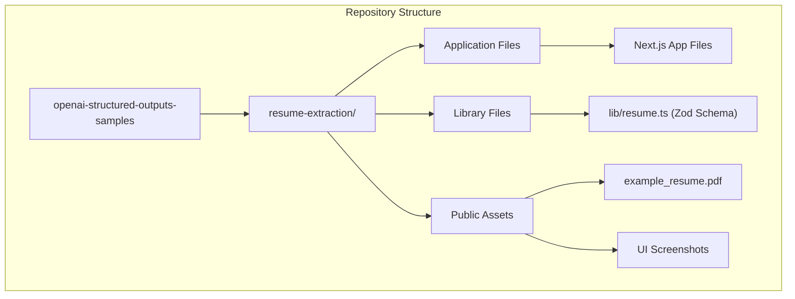
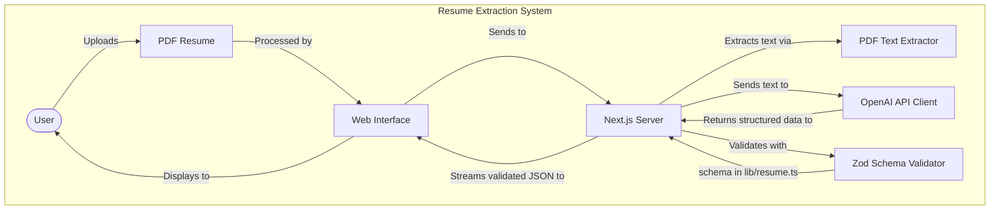
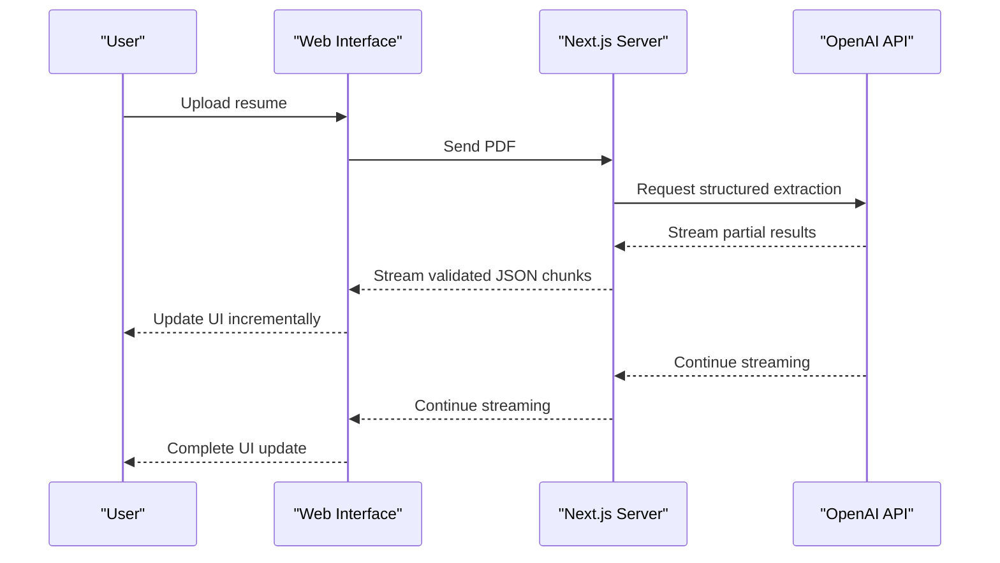
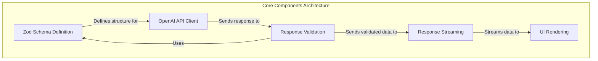

<!-- source: DeepWiki mcp.deepwiki.com · repo openai/openai-structured-outputs-samples · page 1 Overview · fetched 2026-10-26 -->

# Overview

Relevant source files

The following files were used as context for generating this wiki page:

- [resume-extraction/README.md](resume-extraction/README.md)
- [resume-extraction/package.json](resume-extraction/package.json)

This document provides an introduction to the OpenAI Structured Outputs Samples repository, which demonstrates practical implementations of OpenAI's structured outputs capabilities. The repository contains demonstrations that showcase how to create deterministic, type-safe interfaces between the OpenAI API and applications.

For detailed information about the resume extraction demo specifically, see [Resume Extraction Demo](#2).

Sources: [resume-extraction/README.md:1-7]()

## Repository Purpose

The OpenAI Structured Outputs Samples repository serves as a practical guide and reference implementation for developers looking to integrate OpenAI's structured output capabilities into their applications. The samples demonstrate how to:

1. Define structured schemas to ensure consistent AI-generated outputs
2. Stream AI responses for improved user experience
3. Validate responses against predefined schemas
4. Create type-safe interfaces between AI and application code

The primary demonstration is a resume extraction application that processes PDF resumes and extracts structured information in a consistent format.

Sources: [resume-extraction/README.md:3-7](), [resume-extraction/README.md:11-15]()

## Repository Structure

The repository is organized around individual demonstration applications, with the resume extraction demo being the primary example.

Sources: [resume-extraction/README.md:1-7]()

## Core Technologies

The repository leverages several key technologies to demonstrate structured outputs:

| Technology | Purpose | Implementation |
|------------|---------|----------------|
| OpenAI API | AI-based information extraction | Integration via OpenAI Node.js SDK |
| Zod | Schema validation and type safety | Schema definition in lib/resume.ts |
| Next.js | Full-stack web framework | Server and frontend implementation |
| PDF Processing | Extract text from PDF documents | pdf2json and pdfjs-dist libraries |
| Streaming Responses | Real-time UI updates | Server-sent events / response streaming |

Sources: [resume-extraction/package.json:11-30]()

## Resume Extraction Demo Overview

The primary demonstration in the repository is a resume extraction application that:

1. Accepts PDF resumes through file upload
2. Extracts text from the PDFs
3. Uses OpenAI's API to analyze and extract structured information
4. Validates the extracted data against a predefined schema
5. Streams the results back to the UI in real-time

Sources: [resume-extraction/README.md:3-7](), [resume-extraction/README.md:52-56]()

## Key Features

The repository, particularly the resume extraction demo, showcases several key features that demonstrate the power of structured outputs:

### 1. Reliable Parsing

The system ensures that all outputs from the OpenAI API adhere to a predefined JSON schema, making the extracted information reliable and consistent across different inputs.

### 2. Streaming Responses

Instead of waiting for the complete processing to finish, the system streams the structured outputs as they become available, providing a dynamic user experience.

### 3. Type-Safe Interfaces

By defining a schema using Zod (`lib/resume.ts`), the system creates type-safe interfaces that simplify downstream processing with predictable JSON responses.

Sources: [resume-extraction/README.md:11-15]()

## Getting Started

To explore the repository and run the demonstrations:

1. Clone the repository
2. Navigate to the desired demo directory (e.g., `resume-extraction`)
3. Install dependencies with `npm i`
4. Set up your OpenAI API key
5. Run the demo with `npm run dev`

For specific setup instructions for each demo, refer to their respective documentation:
- For the resume extraction demo, see [Installation and Setup](#2.2)

Sources: [resume-extraction/README.md:17-50]()

## Core Components

The repository demonstrates several core components that work together to enable structured outputs:

These components demonstrate a pattern that can be applied to various use cases requiring structured outputs from AI.

Sources: [resume-extraction/README.md:11-15](), [resume-extraction/package.json:11-30]()

## Technical Implementation

The technical implementation of the structured outputs approach involves:

1. **Schema Definition**: Using Zod to define the expected output structure
2. **OpenAI Integration**: Configuring the OpenAI API to generate outputs matching the schema
3. **Validation Logic**: Ensuring responses conform to the defined schema
4. **Streaming Implementation**: Processing partial responses while maintaining schema integrity
5. **UI Integration**: Displaying structured data in a user-friendly format

For a deeper technical exploration of these aspects, see [Technical Deep Dive](#3).

Sources: [resume-extraction/README.md:11-15](), [resume-extraction/package.json:11-30]()

## Conclusion

The OpenAI Structured Outputs Samples repository provides practical demonstrations of how to implement structured outputs with OpenAI's API. Through examples like the resume extraction demo, it showcases techniques for creating reliable, type-safe interfaces between AI and applications.

By leveraging schemas, validation, and streaming, developers can build robust AI-powered applications that produce consistent, structured results while providing a responsive user experience.

Sources: [resume-extraction/README.md:3-15]()

---

