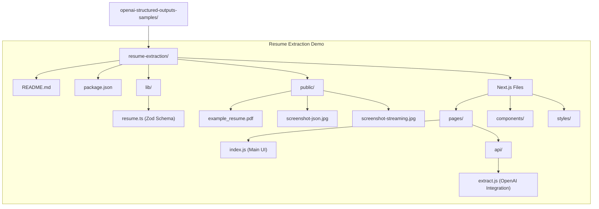
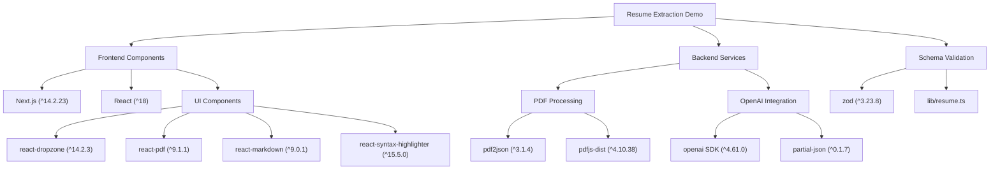
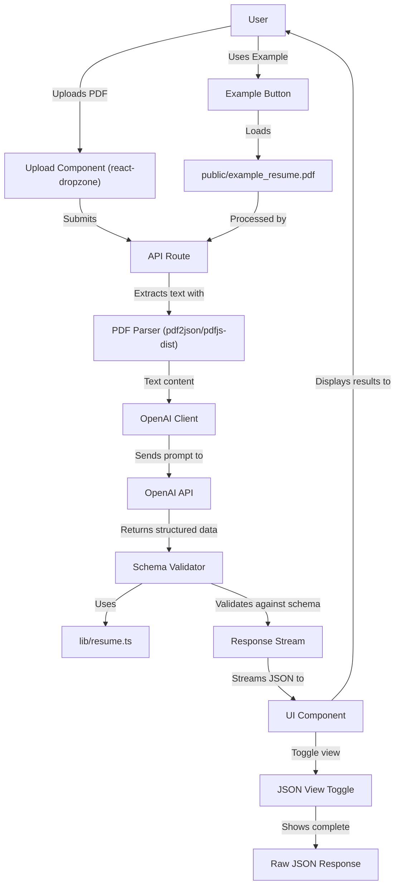

<!-- source: DeepWiki mcp.deepwiki.com · repo openai/openai-structured-outputs-samples · page 1.1 Repository Structure · fetched 2026-10-26 -->

# Repository Structure

Relevant source files

The following files were used as context for generating this wiki page:

- [resume-extraction/README.md](resume-extraction/README.md)
- [resume-extraction/package-lock.json](resume-extraction/package-lock.json)
- [resume-extraction/package.json](resume-extraction/package.json)

This document outlines the organization and file structure of the `openai-structured-outputs-samples` repository. It provides a technical overview of how the codebase is arranged, focusing on directories, key files, and their relationships. For information about the system architecture and data flow, see [Architecture](#2.1).

## Repository Organization

The repository demonstrates OpenAI's structured outputs capabilities with a primary focus on the resume extraction demo application.

Sources:
- [resume-extraction/README.md]()
- [resume-extraction/package.json]()

## Core Files and Their Functions

The repository contains several critical files that form the foundation of the resume extraction demo:

| File | Function |
|------|----------|
| `lib/resume.ts` | Contains the Zod schema that defines the structure for extracted resume data |
| `public/example_resume.pdf` | Sample resume provided for demonstration purposes |
| `public/screenshot-*.jpg` | UI screenshots used in documentation |
| `README.md` | Contains usage instructions and feature overview |
| `package.json` | Defines project dependencies and npm scripts |

The most important file is `lib/resume.ts`, which defines the schema structure that OpenAI's API output must conform to.

Sources:
- [resume-extraction/README.md]()
- [resume-extraction/package.json]()

## Technology Stack and Dependencies

The resume extraction demo is built using a modern JavaScript/TypeScript stack with specific dependencies to handle PDF processing, OpenAI API integration, and UI components.

Sources:
- [resume-extraction/package.json]()

### Key Dependencies

#### Core API and Processing Libraries

| Dependency | Version | Purpose |
|------------|---------|---------|
| `openai` | ^4.61.0 | Client library for interacting with OpenAI API |
| `pdf2json` | ^3.1.4 | Extracts text from PDF documents |
| `pdfjs-dist` | ^4.10.38 | PDF.js for PDF processing |
| `zod` | ^3.23.8 | Schema validation and type definition |
| `partial-json` | ^0.1.7 | Handles partial/streaming JSON responses |

#### Frontend Framework and Components

| Dependency | Version | Purpose |
|------------|---------|---------|
| `next` | ^14.2.23 | React framework for server-side rendering and API routes |
| `react` | ^18 | UI library |
| `react-dom` | ^18 | React DOM manipulation |
| `react-dropzone` | ^14.2.3 | File upload component for PDF files |
| `react-pdf` | ^9.1.1 | PDF rendering component |
| `tailwind-merge` | ^2.5.2 | Utility for merging Tailwind CSS classes |
| `class-variance-authority` | ^0.7.0 | Build component variant utilities |
| `lucide-react` | ^0.441.0 | Icon components library |

Sources:
- [resume-extraction/package.json]()

## Development Tools and Environment

The project uses TypeScript for type safety and includes several development tools:

| Tool | Version | Purpose |
|------|---------|---------|
| `typescript` | ^5.6.2 | Static type checking |
| `@types/node` | ^20.16.10 | TypeScript definitions for Node.js |
| `@types/react` | ^18.3.10 | TypeScript definitions for React |
| `eslint` | ^8.57.1 | Code linting |
| `tailwindcss` | ^3.4.1 | CSS framework |
| `postcss` | ^8 | CSS transformation tool |

Sources:
- [resume-extraction/package.json]()

## Application Structure and Data Flow

The resume extraction demo follows a structured data flow that connects various components:

Sources:
- [resume-extraction/README.md]()
- [resume-extraction/package.json]()

## Setup and Configuration

The resume extraction demo uses the following npm scripts defined in `package.json`:

| Script | Command | Purpose |
|--------|---------|---------|
| `dev` | `next dev` | Start development server |
| `build` | `next build` | Build for production |
| `start` | `next start` | Run production server |
| `lint` | `next lint` | Run linting |

To run the application:

1. Clone the repository
2. Navigate to the `resume-extraction` directory
3. Install dependencies with `npm i`
4. Set up an OpenAI API key in an `.env` file or as an environment variable
5. Run `npm run dev`
6. Access the application at `http://localhost:3000`

Sources:
- [resume-extraction/README.md]()
- [resume-extraction/package.json]()

## Relationship to Other Components

The repository structure enables a clear separation of concerns:

1. **Schema Definition** (`lib/resume.ts`): Defines the expected structure of the data extracted from resumes
2. **Frontend Components**: Handle user interactions and display results
3. **API Integration**: Connects to OpenAI and applies schema validation
4. **PDF Processing**: Extracts text from PDF files for processing

This organization facilitates the demonstration of OpenAI's structured outputs capability by showing how to enforce a schema on AI-generated content.

Sources:
- [resume-extraction/README.md]()
- [resume-extraction/package.json]()

---

