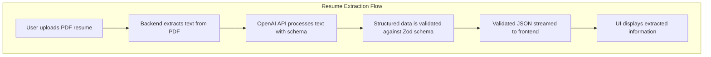
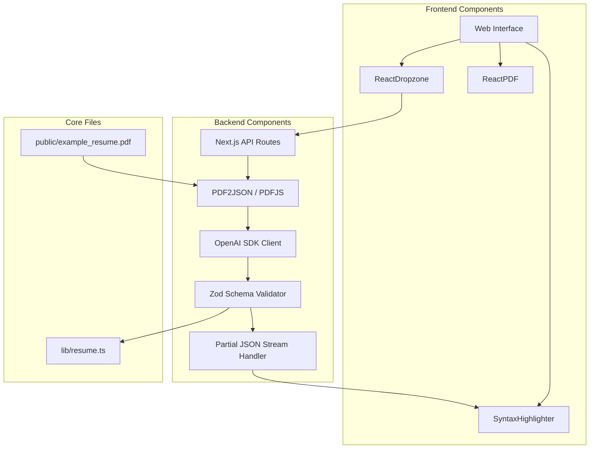
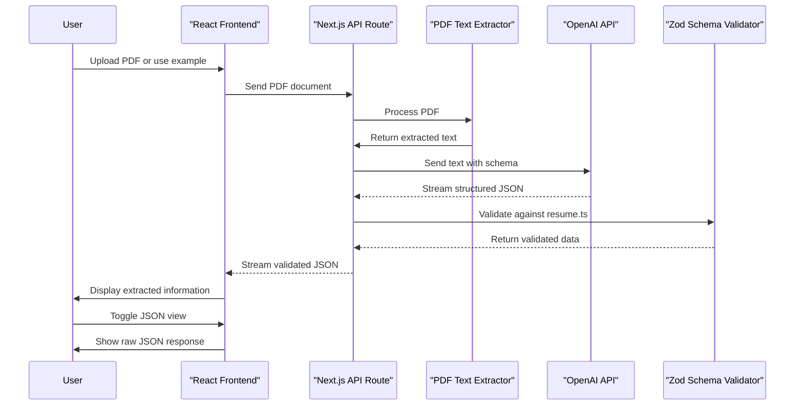

<!-- source: DeepWiki mcp.deepwiki.com · repo openai/openai-structured-outputs-samples · page 2 Resume Extraction Demo · fetched 2026-10-26 -->

# Resume Extraction Demo

Relevant source files

The following files were used as context for generating this wiki page:

- [resume-extraction/README.md](resume-extraction/README.md)
- [resume-extraction/package.json](resume-extraction/package.json)

This document provides a high-level overview of the Resume Extraction Demo application in the repository. The demo showcases how to use OpenAI's structured outputs capabilities to extract information from PDF resumes in a reliable, type-safe manner. For detailed information about the architecture, see [Architecture](#2.1), and for setup instructions, see [Installation and Setup](#2.2).

## Purpose

The Resume Extraction Demo is a web application that:
- Extracts structured information from PDF resumes using OpenAI's API
- Ensures output conforms to a predefined schema using Zod
- Streams the extracted JSON data in real-time to the UI
- Provides a simple interface for uploading resumes or using an example

It serves as a practical example of building deterministic interfaces with OpenAI's structured outputs feature, demonstrating how to create reliable parsing systems for unstructured documents.

Sources: [resume-extraction/README.md:1-7]()

## System Overview

The application allows users to upload a PDF resume or use a provided example resume. The system then processes the PDF, extracts the text content, and uses OpenAI's API to convert that unstructured text into a structured JSON format based on a predefined schema. The extracted information is streamed back to the UI as it becomes available, providing immediate feedback to the user.

Sources: [resume-extraction/README.md:3-15]()

## Key Components

The Resume Extraction Demo consists of several interconnected components:

| Component | Description | Implementation |
|-----------|-------------|----------------|
| Frontend UI | Web interface for uploading resumes and viewing results | React-based Next.js application |
| Backend Server | Processes PDFs and communicates with OpenAI API | Next.js API routes |
| PDF Processing | Extracts text from PDF documents | Uses pdf2json and pdfjs-dist libraries |
| OpenAI Integration | Sends text to API and receives structured data | Uses OpenAI Node.js SDK |
| Schema Definition | Defines the structure of extracted data | Zod schema in lib/resume.ts |
| Streaming Handler | Streams partial JSON responses to UI | Uses partial-json parser |

Sources: [resume-extraction/package.json:11-30](), [resume-extraction/README.md:11-15]()

## Code Architecture

The following diagram illustrates the code-level architecture of the Resume Extraction Demo:

Sources: [resume-extraction/package.json:11-30]()

## Data Flow

The following sequence diagram shows the detailed flow of data through the system:

Sources: [resume-extraction/README.md:52-58]()

## Key Features

### Reliable Parsing with Schema Validation

The demo uses a Zod schema defined in `lib/resume.ts` to ensure that the output from OpenAI's API conforms to a specific structure. This creates a deterministic interface that simplifies downstream processing and provides type safety.

### Streaming Responses

Instead of waiting for the entire extraction process to complete, the application streams the structured JSON data back to the UI as it becomes available, providing a more responsive user experience.

### Type-Safe Interfaces

By defining a schema that both TypeScript and the OpenAI API understand, the application ensures predictable JSON responses that are properly typed throughout the application.

### User Interface

The demo provides a clean user interface with:
- File upload functionality using React Dropzone
- Option to use an example resume
- Real-time display of extracted information
- Toggle for viewing the raw JSON response

Sources: [resume-extraction/README.md:11-15](), [resume-extraction/README.md:52-58]()

## Usage Example

The typical usage flow of the Resume Extraction Demo is:

1. User navigates to the web application (localhost:3000)
2. User either uploads a PDF resume or clicks "Use the example" button
3. The system processes the PDF and sends the text to OpenAI
4. Extracted information streams into the UI in real-time
5. User can toggle between the formatted view and raw JSON view

The application extracts key resume information such as:
- Personal details (name, contact information)
- Work experience
- Education
- Skills
- Projects

Sources: [resume-extraction/README.md:52-58]()

## Implementation Highlights

The demo showcases several important concepts for developers:

1. **Structured Output Definition**: Using Zod schemas to define the expected structure of AI-generated content
2. **Error Handling**: Validating AI outputs against the schema to ensure they match expected formats
3. **Streaming Interface**: Implementing streaming responses for better UX with large extraction tasks
4. **PDF Processing**: Extracting text content from PDF documents for AI processing
5. **Type Safety**: Maintaining type safety throughout the application using TypeScript and Zod

To modify the fields extracted by the model, developers can edit the Zod schema in the `lib/resume.ts` file.

Sources: [resume-extraction/README.md:60-60]()

## Related Resources

For more detailed information about specific aspects of the Resume Extraction Demo, please refer to:

- [Architecture](#2.1) - Detailed system architecture and component relationships
- [Installation and Setup](#2.2) - Instructions for installing and setting up the demo
- [Usage Guide](#2.3) - Comprehensive guide on using the application
- [Zod Schema Implementation](#2.4) - In-depth explanation of the schema definition
- [User Interface](#2.5) - Detailed description of the UI components

---

