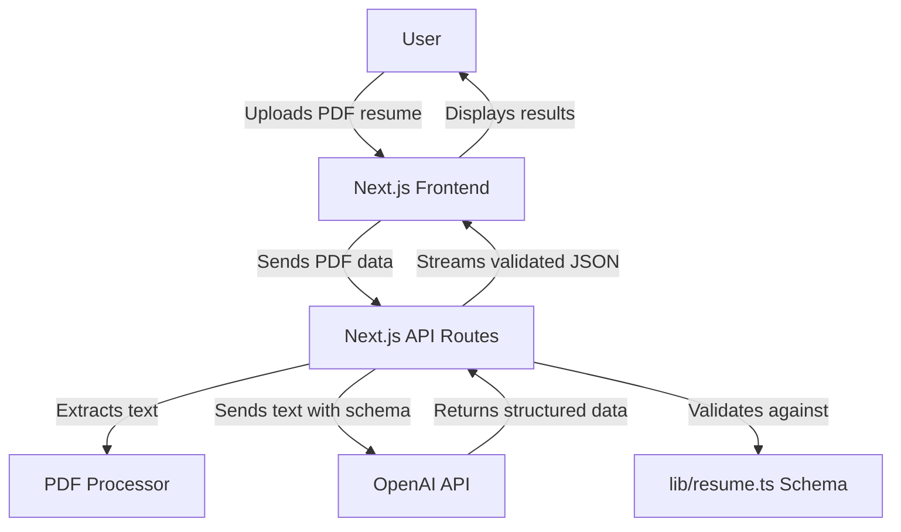
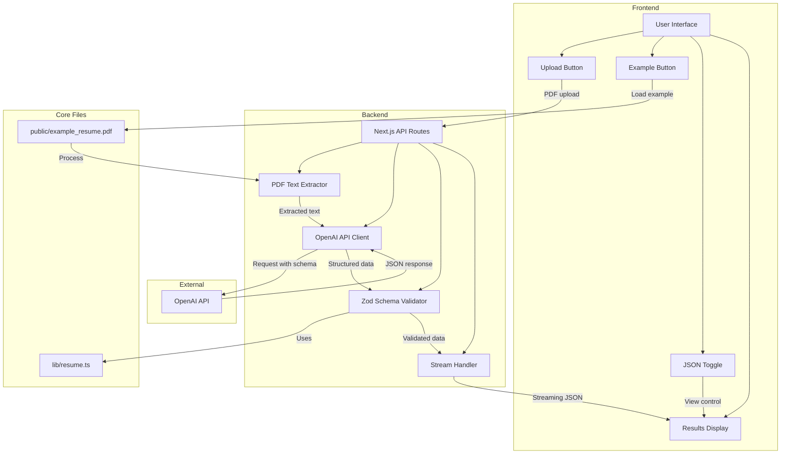
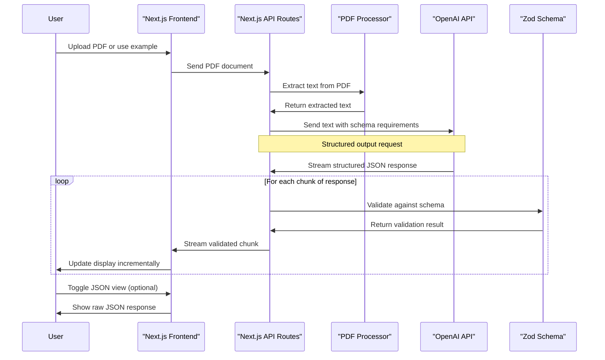
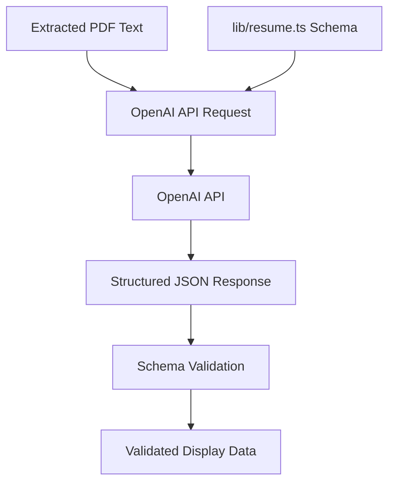
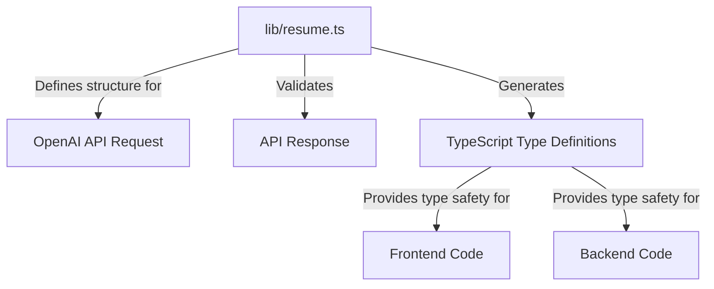

<!-- source: DeepWiki mcp.deepwiki.com · repo openai/openai-structured-outputs-samples · page 2.1 Architecture · fetched 2026-10-26 -->

# Architecture

Relevant source files

The following files were used as context for generating this wiki page:

- [resume-extraction/README.md](resume-extraction/README.md)
- [resume-extraction/package.json](resume-extraction/package.json)

This page documents the architectural design of the resume extraction demo in the OpenAI structured outputs samples repository. It covers the system components, their interactions, data flow patterns, and key technical implementation details. For installation instructions, see [Installation and Setup](#2.2), and for usage information, see [Usage Guide](#2.3).

## System Overview

The resume extraction demo is a web application that demonstrates how to use OpenAI's structured outputs capability to extract information from PDF resumes. The system follows a client-server architecture with Next.js providing both frontend and backend functionality.

Sources: [resume-extraction/README.md:3-7](), [resume-extraction/README.md:11-15]()

## Component Architecture

The resume extraction system consists of several distinct components that work together to process PDF resumes and extract structured information.

### Frontend Components

The browser-based frontend provides a simple interface for uploading PDFs and viewing the extracted data.

| Component | Purpose |
|-----------|---------|
| Upload Button | Allows users to upload a PDF resume |
| Example Button | Loads the provided example resume |
| JSON Toggle | Switches between formatted view and raw JSON view |
| Display Area | Shows the extracted information in a readable format |

Sources: [resume-extraction/README.md:53-58]()

### Backend Components

The Next.js server handles PDF processing, AI integration, and data validation.

| Component | Purpose |
|-----------|---------|
| API Routes | Handle HTTP requests and coordinate processing |
| PDF Processor | Extracts text content from PDF documents |
| OpenAI Client | Interfaces with the OpenAI API |
| Schema Validator | Ensures data conforms to the defined structure |
| Stream Handler | Manages streaming partial results to the client |

Sources: [resume-extraction/package.json:11-30]()

### Core Files

The system relies on several key files that define its structure and behavior:

| File | Purpose |
|------|---------|
| `lib/resume.ts` | Defines the Zod schema that structures OpenAI's output |
| `public/example_resume.pdf` | Provides a sample resume for demonstration |

Sources: [resume-extraction/README.md:60](), [resume-extraction/README.md:54]()

## Component Relationships

The following diagram illustrates how the different components interact within the system:

Sources: [resume-extraction/README.md:11-15](), [resume-extraction/package.json:17-20](), [resume-extraction/package.json:30]()

## Data Flow

The following sequence diagram illustrates the flow of data through the system from the initial user action to the final display of extracted information.

Sources: [resume-extraction/README.md:13-15](), [resume-extraction/README.md:53-58]()

## Technical Implementation

### PDF Processing

The system uses two libraries to handle PDF processing:

1. `pdf2json` - Provides core PDF parsing functionality
2. `pdfjs-dist` - Mozilla's PDF.js library for broader PDF support

These libraries extract the text content from PDF resumes, which is then sent to the OpenAI API for information extraction.

Sources: [resume-extraction/package.json:19-20]()

### OpenAI Integration

The application integrates with the OpenAI API using the official Node.js client library (`openai`). The key aspects of this integration are:

1. Sending the extracted PDF text to the API
2. Including the Zod schema as part of the request to enforce structure
3. Processing the streamed response from the API

Sources: [resume-extraction/package.json:17](), [resume-extraction/README.md:13]()

### Streaming Implementation

A key feature of the architecture is the streaming capability, which provides real-time updates as the model extracts information:

1. The OpenAI API streams the JSON response as it's generated
2. The backend uses `partial-json` to parse incomplete JSON fragments
3. Each valid fragment is validated against the schema
4. Validated fragments are streamed to the frontend
5. The UI updates incrementally as new information arrives

This approach provides a more responsive user experience compared to waiting for the full response.

Sources: [resume-extraction/package.json:18](), [resume-extraction/README.md:14]()

### Schema Validation

The Zod schema defined in `lib/resume.ts` serves multiple critical functions:

1. It defines the structure that OpenAI should follow when generating output
2. It validates the response to ensure it matches the expected format
3. It provides TypeScript type definitions for type safety throughout the application

The schema ensures that the extracted information is consistent and reliable, making it easier to process and display.

Sources: [resume-extraction/README.md:15](), [resume-extraction/README.md:60](), [resume-extraction/package.json:30]()

## System Boundaries and Integration Points

The architecture has several key integration points and system boundaries:

1. **User Interface ↔ API Routes**: HTTP requests transfer PDF data and receive structured results
2. **API Routes ↔ PDF Libraries**: Text extraction from PDF documents
3. **API Routes ↔ OpenAI API**: AI-powered information extraction with structured outputs
4. **API Routes ↔ Zod Schema**: Validation and type enforcement for response data

These integration points enable the seamless flow from PDF upload to structured data display, with validation and streaming enhancing the user experience.

Sources: [resume-extraction/README.md:11-15]()

---

