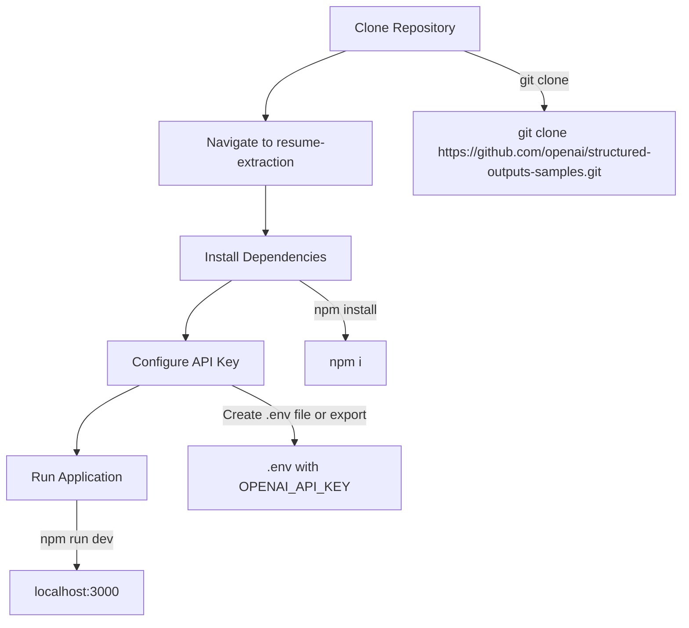
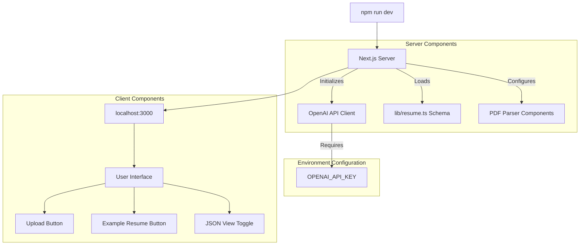
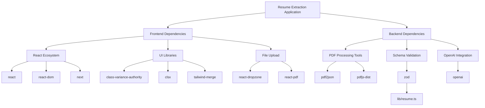

<!-- source: DeepWiki mcp.deepwiki.com · repo openai/openai-structured-outputs-samples · page 2.2 Installation and Setup · fetched 2026-10-26 -->

# Installation and Setup

<details>
<summary>Relevant source files</summary>

The following files were used as context for generating this wiki page:

- [resume-extraction/README.md](resume-extraction/README.md)
- [resume-extraction/package-lock.json](resume-extraction/package-lock.json)
- [resume-extraction/package.json](resume-extraction/package.json)

</details>


This document provides instructions for installing and setting up the Resume Extraction demo from the openai-structured-outputs-samples repository. For information about using the application once installed, see [Usage Guide](#2.3), and for details about the system architecture, see [Architecture](#2.1).

## Prerequisites

Before installing the Resume Extraction demo, ensure you have the following:

- Node.js (version 16 or higher) and npm installed
- An OpenAI API key with access to the required models
- Git for cloning the repository
- Command-line interface (terminal/command prompt)

Sources: [resume-extraction/package.json:1-43]()

## Installation Steps

### Repository Setup Flow



Sources: [resume-extraction/README.md:19-50]()

### 1. Clone the Repository

Clone the repository and navigate to the resume-extraction directory:

```bash
git clone https://github.com/openai/structured-outputs-samples.git
cd resume-extraction
```

Sources: [resume-extraction/README.md:19-24]()

### 2. Install Dependencies

Install all required dependencies using npm:

```bash
npm i
```

This command installs all dependencies specified in the package.json file:

| Category | Key Dependencies |
|----------|-------------|
| AI Integration | openai |
| PDF Processing | pdf2json, pdfjs-dist |
| Frontend Framework | react, react-dom, next |
| File Handling | react-dropzone |
| Schema Validation | zod |
| UI Components | class-variance-authority, clsx, tailwind-merge |

Sources: [resume-extraction/package.json:11-31](), [resume-extraction/README.md:25-30]()

### 3. Configure Environment

Set up your OpenAI API key using one of these methods:

1. Create a `.env` file in the `resume-extraction` folder:
   ```
   OPENAI_API_KEY=your-api-key
   ```

2. Or set the environment variable in your terminal:
   ```bash
   export OPENAI_API_KEY=your-api-key
   ```

Sources: [resume-extraction/README.md:32-42]()

## Running the Application

### Application Startup Architecture



Sources: [resume-extraction/package.json:6-9](), [resume-extraction/README.md:43-50]()

### Development Mode

Run the application in development mode with hot reloading:

```bash
npm run dev
```

This starts the Next.js development server at http://localhost:3000.

Sources: [resume-extraction/package.json:6](), [resume-extraction/README.md:43-50]()

### Production Build

For a production build:

```bash
npm run build
npm start
```

Sources: [resume-extraction/package.json:7-8]()

## Dependency Structure



Sources: [resume-extraction/package.json:11-31]()

## Troubleshooting

### Common Issues and Solutions

#### API Key Issues
- **Problem**: Application fails to connect to OpenAI API
- **Solution**: Verify your API key is correctly set in the .env file or as an environment variable
- **Check**: Ensure your API key has sufficient permissions and quota

#### Dependency Issues
- **Problem**: Missing dependencies or conflicts
- **Solution**: Try removing node_modules folder and package-lock.json, then run `npm install` again
- **Check**: Ensure you're using a Node.js version compatible with the dependencies

#### PDF Processing Issues
- **Problem**: PDF uploads not processing correctly
- **Solution**: Verify PDF processing libraries are installed properly
- **Check**: Test with the example PDF provided in the repository at `public/example_resume.pdf`

Sources: [resume-extraction/README.md:32-42](), [resume-extraction/README.md:52-58]()

## Environment Variables Reference

| Variable Name | Required | Description |
|---------------|----------|-------------|
| OPENAI_API_KEY | Yes | Your OpenAI API key for accessing the OpenAI API |

Sources: [resume-extraction/README.md:32-42]()

---

